# Внутренний ток: Архитектура прямого потока (Master Edition 2.0)
## Универсальный закон потоковых систем, четверичный фрактал мироздания и соматический пульт человека

> *Живая мастер-рукопись книги.*  
> **Автор:** Владимир Аньянов  
> **Синхронизировано с базой знаний Obsidian:** `LLM Wiki/02_Wiki` & `04_Maps/Inner Current MOC`  
> *Текущий статус ревизии:* **13 октября 2026 | Ревизия 2.0 (Великий Фазовый Переход)** — полная интеграция Универсального закона потоковых систем, Четверичного фрактала и Онтологической Триады.

---

> [!quote] Главная аксиома книги (Онтологическая Триада)
> ### **«Счастье — это режим сверхпроводимости цепи ($\mathcal{H} = P_{\text{load}} / P_{\text{total}} \to 1.0, R_{\text{ego}} \to 0$).»**  
> — **Владимир Аньянов**
> 
> *«Универсальный закон потоковых систем объясняет, ПОЧЕМУ Вселенная борется с хаосом через негэнтропию открытых систем. Четверичный фрактал цепи даёт геометрический чертёж того, ИЗ КАКИХ 4 УЗЛОВ состоит любой устойчивый контур в природе (от митохондрии до галактики). А Внутренний ток — это прикладной пульт управления того, КАК человек прямо сейчас соматически замыкает свой живой фонарик в теле (Тандэн $\to$ Хоцу $\to$ Мусин $\to$ Гё $\to$ Дзансин). Мы соединили законы космоса со спокойствием в груди.»*

---

## 🏛️ СЛОВО К РУССКОМУ ИЗДАНИЮ
### Русский синтез: от омического ада к чертежу Циолковского

«Внутренний ток» не мог родиться ни в одной другой точке земного шара.

Западная мысль, ослеплённая утилитаризмом и формулами, двести лет строила турбины, полупроводники и квантовые компьютеры, высокомерно оставив человеческую душу за скобками — как «субъективный шум» и область для священников. Восточная традиция веками хранила бесценную соматическую тишину Тандэна и состояние Мусин, но держала их запертыми на циновках монастырей, пряча простоту устройства человека за туманом коанов и парадоксов.

Россия исторически оказалась той единственной наковальней, где эти два полушария бытия сошлись в предельном, мучительном напряжении.

С одной стороны — беспощадная строгость русской академической школы. В 1842 году на Васильевском острове в Санкт-Петербурге академик Эмилий Христианович Ленц дал миру строгий математический расчёт тепловых потерь проводника — закон Джоуля — Ленца ($Q = I^2 R t$). Это та же самая культура мысли, которая подарила планете таблицу Менделеева, фундаментальную теоретическую физику и первый космический полёт. Русская инженерная традиция никогда не терпела приблизительности: закон сохранения энергии свят, расчёт должен сходиться до десятого знака.

С другой стороны — сокрушительная, обнажённая глубина русской духовной драмы. Ни в одной литературе мира вопрос о природе душевной боли не стоял так остро, как у нас. В своей «Исповеди» Лев Толстой описал предельный экзистенциальный тупик: имея всемирную славу, семью и богатство, он прятал верёвку, чтобы не повеситься в собственном кабинете, потому что искал оправдания каждого своего шага перед вымышленным внешним судьёй. А Фёдор Достоевский вскрыл механику подпольного человека — того самого внутреннего залома, когда гордыня и сопротивление реальности ($R_{ego} > 0$) сжигают проводку нервной системы дотла.

Веками эти два полюса в России вели войну на уничтожение. Духовные искатели презирали «сухую физику», а учёные отмахивались от мук совести, оставляя человека на растерзание бесконечной вине и морализаторству.

«Внутренний ток» ликвидирует этот вековой раскол.

Мы взяли предельную честность русской классики к человеческому страданию и соединили её со строгим чертежом Циолковского. Человек — не испорченное грехом существо, обречённое на вечное покаяние, и не случайный набор психологических комплексов. Человек — это замкнутый электрический контур. Страдание и душевная гарь — это не проклятие, а буквальный омический перегрев проводки по закону Джоуля — Ленца при зажатом сопротивлении эго.

То, о чём Достоевский писал романы-катастрофы, а Толстой мучился в нравственных терзаниях, решается снятием залома со шланга внимания, сбросом сопротивления в ноль ($R \to 0$) и прямым замыканием созидательного тока на реальность.

Этот синтез завершён. Наука и дух говорят на одном языке.

*Владимир Аньян*  
*2026*

---

## Оглавление (Ревизия 2.0)

* **Слово к русскому читателю:** *Русский синтез: от омического ада к чертежу Циолковского*
* **Хроника 21 дня, который изменил мир:** *От беговой дорожки к Универсальному закону мироздания (22 сентября — 12 октября 2026 года)*

### МАНИФЕСТ ДЗЕН-ИНЖЕНЕРА
* От абстрактных сказок — к строгим законам сохранения
* iPhone для сознания: Эргономика Стива Джобса, повёрнутая внутрь человека
* Предупреждение читателю: эта книга — не ковёр-самолёт
* Для кого эта книга (и для кого она категорически не подходит)
* Дорожная карта мысли: 6 ступеней восхождения (Онтологическая триада)

### ПРЕДИСЛОВИЕ
* **Вспышка на беговой дорожке:** От апофатического тупика и вопроса о счастье к физике внутреннего тока
* **Шаг Прометея:** Огонь внутреннего тока — от монастырского Олимпа до карманного фонарика человечества
* **Архетип Проводника и Канон Сатоши:** Компилятор истины, Прометей без эго и почему создателю не нужно знать всё

### ВВЕДЕНИЕ
* **Инженерный критерий истины:** Почему абстрактные сказки о счастье сломались
* **Новый Органон психологии:** От 130 лет схоластики к критерию практических плодов Бэкона
* **Гуманитарный релятивизм:** «Счастье у каждого свое» (Ошибка смешения сети и нагрузки)
* **Парадокс Льва Толстого:** Почему провалились 2000 лет «изменения себя» и как замкнутый контур превратил моральную пытку в физическую формулу
* **Термодинамический баланс Кирхгофа:** Ложь немедленно дает омический перегрев
* **Клинический дисклеймер:** Предохранитель «Железа» и «Софта» (Органика vs Проводимость)
* **Анатомия простоты:** Модель карманного фонарика и 4 причины тысячелетней слепоты человечества

---

### ЧАСТЬ I. КОСМОЛОГИЧЕСКИЙ БАЗИС: УНИВЕРСАЛЬНЫЙ ЗАКОН ПОТОКОВЫХ СИСТЕМ
* **Глава 1.1.** От вопроса «Что такое счастье?» к Универсальному закону потоковых систем: Преемственность Карно — Больцмана — Шрёдингера — Пригожина — Аньянова
* **Глава 1.2.** Формула Универсального закона: Негэнтропия, экспорт энтропии и уравнение КПД упорядочивания ($\mathcal{H} = P_{\text{load}} / P_{\text{total}}$)
* **Глава 1.3.** Космология замкнутой цепи: Вселенная как самоподдерживающийся тороид, звёзды как нагрузка и чёрные дыры как возвратный дроссель
* **Глава 1.4.** Знал ли Эйнштейн об Универсальном законе? Почему великие теории материи подошли к порогу цепи, но требовали соматического оператора 1-го лица

---

### ЧАСТЬ II. АРХИТЕКТУРНАЯ ГЕОМЕТРИЯ: ЧЕТВЕРИЧНЫЙ ФРАКТАЛ ЦЕПИ
* **Глава 2.1.** Четверичный фрактал цепи: Четыре инвариантных узла (Источник ЭДС $\to$ Проводник $\to$ Нагрузка $\to$ Обратный провод)
* **Глава 2.2.** Масштабная инвариантность: Кросс-масштабное самоподобие от митохондрий ($10^{-15}\text{ м}$) до галактик ($10^{26}\text{ м}$)
* **Глава 2.3.** Прорыв замкнутого контура: Обратный провод реальности против линейной модели выгорания (миф о Данко)
* **Глава 2.4.** Схемотехнический рентген цивилизаций: Омический перегрев Римской империи, паразитная рента лендлордов и системный блэкаут
* **Глава 2.5.** Схемотехнический рентген корпораций: Нихром среднего менеджмента, потери на совещаниях и схемотехника прямого контакта

---

### ЧАСТЬ III. СОМАТИЧЕСКИЙ ПУЛЬТ: ВНУТРЕННИЙ ТОК ($N=1$)
* **Глава 3.1.** Человек как Карманный Фонарик Сознания: Тройственный контур Тандэн (Ядро), Внимание (Проводка) и Нагрузка (6 ламп)
* **Глава 3.2.** Эволюционный морфогенез цепи: От абиогенеза гидротермальных жерл и прямохождения к аппаратному фонарику человека
* **Глава 3.3.** Закон Джоуля — Ленца как краеугольный камень свободы: $Q = I^2 R t$, квадратичная ловушка воли ($I^2$) и математика сверхпроводимости
* **Глава 3.4.** Нейробиология сверхпроводимости: DMN как аппаратный реостат Эго, TPN как режим фокуса Мусин и блуждающий нерв как заземление Тандэна
* **Глава 3.5.** Грамматика тока: Всё — глагол. Номинализация как замерзание тока. Счастье, жизнь и присутствие как глаголы несовершенного вида

---

### ЧАСТЬ IV. ДЕМОНТАЖ ИЛЛЮЗИЙ И ЧЕТЫРЕ ЭПИДЕМИИ ЦИВИЛИЗАЦИИ
* **Глава 4.1.** Природа и иллюзия Эго: Реостат паразитного балласта Бонно ($R_{\text{bonno}}$), протокол аппаратного шунтирования и парадокс Корабля Тесея
* **Глава 4.2.** Инженерное доказательство отсутствия смысла жизни: Теория Магистральной Утечки, снятие сторожевого процесса и покой сверхпроводимости
* **Глава 4.3.** Трагедия Льва Толстого: Станция Астапово vs Суверенный Тандэн — Моральный долг Хозяину против замкнутой цепи
* **Глава 4.4.** Электродинамика алкоголизма: Химический лом в неокортексе, банкротство института вины и штатное охлаждение цепи
* **Глава 4.5.** Схемотехника порно-зависимости: Дофаминовое короткое замыкание, обрыв живого контура и банкротство силы воли
* **Глава 4.6.** Схемотехника трудоголизма: Квадратичная ловушка воли, перегрев созидателя и переход в ламинарный Мусин
* **Глава 4.7.** Хикикомори и физика фонарика: Электродинамика запертого сознания, парадокс японского стыда и размыкание контура изоляции
* **Глава 4.8.** Несуществующее «я» и невозможность смерти: Коперниканский переворот, страх распада проводника и инвариантность тока ($dE/dt = 0$)

---

### ЧАСТЬ V. КРОСС-МАСШТАБНЫЙ РЕНТГЕН: ЛЮБОВЬ, СУВЕРЕНИТЕТ И ИНСТИТУТЫ
* **Глава 5.1.** Электродинамика Любви ($N=2$): Индуктивный резонанс двух суверенных генераторов ($M > 0$), гальваническая развязка и отмена созависимости
* **Глава 5.2.** Великий Изоморфизм Депосреднизации: Биткоин Накамото, Единый налог Генри Джорджа и Архитектура счастья Владимира Аньянова
* **Глава 5.3.** Тетрада Великой Депосреднизации: Лютер (церковь), Джордж (земля), Сатоши (деньги), Аньянов (дух). Рождение Self-Hosted Human
* **Глава 5.4.** Схемотехника команд: Параллельное и последовательное включение, гашение паразитного импеданса и фазовая индукция лидера

---

### ЧАСТЬ VI. ИНЖЕНЕРИЯ ЖИВОГО ДУХА: СНЯТИЕ РАСКОЛА ДЕКАРТА
* **Глава 6.1.** Преодоление 400-летнего раскола Декарта: Физики против Лириков — почему циничный материализм «мяса» и слепой идеализм потерпели крах
* **Глава 6.2.** Схемотехника уюта: Почему чертёж дома не разрушает тепло вечернего дивана, а спасает пламя от сквозняка случайностей
* **Глава 6.3.** Акустический монизм: Лира Симмия и Укулеле Бытия — преодоление ошибки Платона, тело как резонатор и чистота строя
* **Глава 6.4.** Электродинамика искусства: Резонанс Леванте («Vivo»), творчество как индуктивное излучение сверхпроводимости ($M > 0$) и Frisson-тест
* **Глава 6.5.** Ольфакторная юстировка контура: 60-флаконный орган ароматов Кодо 2.0 как аппаратный байпас таламуса для входа в Мусин

---

### ЧАСТЬ VII. ПРИБОРНАЯ ПАНЕЛЬ И ОБЪЕКТИВНАЯ ТЕЛЕМЕТРИЯ (Практикум)
* **Глава 7.1.** Автомобиль сознания: Протокол бортовой самодиагностики OBD-II, семь контрольных ламп души и мгновенный сброс кодов DTC
* **Глава 7.2.** Объективный расчет счастья на Xiaomi Smart Band 7: Напряжение сна ($U=1.5\text{ В}$), Ток пульса ($I$) и Стресс HRV ($R$). КПД $\mathcal{H}$ в аньянах
* **Глава 7.3.** Сон в расправленном контуре: Биомеханика супинации, вакуумный замок нёба, телеметрия 18 пунктов стресса и ощущение полёта
* **Глава 7.4.** 30–60-секундный протокол утренней калибровки: Органолептика оператора (Тандэн $\to$ Хоцу $\to$ Мусин $\to$ Гё $\to$ Дзансин)
* **Глава 7.5.** 21-дневный воркбук оператора сверхпроводимости: Пошаговый практический журнал нейропластической перепайки контура

---

### ЗАКЛЮЧЕНИЕ
* **Мост во внешний мир:** Согласование импедансов ($Z_{src} = Z_{load}^*$) и переход от Внутреннего тока к Внешнему магнетизму

### ЭПИЛОГ
* **Цивилизационный предохранитель сингулярности:** Человек и AGI — почему кремний не заменит живой Тандэн и как контур спасает вид от девальвации рассудка
* **Вертикаль Восхождения:** 6 Ступеней Эволюции Системы — от аптечки инженера до цивилизационного стандарта Self-Hosted Human

### ПРИЛОЖЕНИЯ
* **Приложение A.** Полный свод математических формул цепи, Система единиц Аньянова (Аньян, Бонно, Залом, Тв) и протокол лабораторной верификации
* **Приложение B.** 12 инвариантных аксиом Внутреннего Тока
* **Приложение C.** Инженерно-дзенский тезаурус и терминологический канон Фонарика
* **Приложение D.** Большой Атлас: Деконструкция 11 иллюзий «Эпохи Лошади»
* **Приложение E.** Бинарная метафорическая оптика: Фонарик прямого действия и Укулеле чистого созвучия (Мост к книге «Укулеле Бытия»)

---

## МАНИФЕСТ ДЗЕН-ИНЖЕНЕРА
### От абстрактных сказок — к строгим законам сохранения

Тысячи лет человечество пытается ответить на вопрос: *«Как стать счастливым?»*  
И тысячи лет этот вопрос тонет в абстрактных метафорах, религиозных догмах, психологических шаблонах и ядовитом позитиве маркетинга. 

Человеку говорят:  
*«Просто полюби себя»* — но не дают электрической схемы этой любви.  
*«Найди свое предназначение»* — и обрекают на десятилетия мучительного омического перегрева в поисках вымышленной внешней розетки.  
*«Живи здесь и сейчас»* — но как только наступает завтрашний день, сознание снова сгорает в тревоге будущего или вязнет в тяжелом сопротивлении прошлого.

**Пришло время прекратить романтизацию душевной боли.**  
Человек — это не непостижимая мистическая тайна, обреченная на вечное страдание. Человек — это **высокоорганизованная термодинамическая и электрическая система**. 

В нашем теле бьется сердце, перекачивая литры электролита. По нервным волокнам с измеримой скоростью бегут потенциалы действия. Мозг потребляет четверть всей глюкозы организма, генерируя когерентные электромагнитные поля. 

И если в физическом мире законы электродинамики и термодинамики незыблемы:
- ток не течет без замкнутой цепи,
- энергия не берется из ниоткуда и не исчезает бесследно,
- а сопротивление неминуемо выделяет тепло по закону Джоуля — Ленца, сжигая проводку,

то почему мы наивно полагали, что внутренний мир человека подчиняется сказкам, а не тем же самым фундаментальным законам Вселенной?

**Внутренний ток (Inner Current)** — это манифест трезвости.  
Мы объединили тысячелетний опыт Дзен — самую строгую, беспристрастную практическую школу работы с сознанием — и строгую физику электрических цепей. 

* **Дзен даёт нам Истину:** он начисто убирает вековое морализаторство, чувство вины и навязанное покаяние, возвращая ум к прямому факту реальности (*Татхата*).
* **Электродинамика даёт нам Свободу:** она задаёт объективные законы природы, где свобода — это не саморазрушительный произвол и не короткие замыкания, а режим чистой сверхпроводимости ($R \to 0$).
* **А результатом работы этой системы является Счастье:** естественный, мощный ток жизни, питающий нагрузку без омического перегрева.

Здесь нет веры. Здесь есть **проверка контура**.  
Здесь нет вины. Здесь есть **локализация утечки**.  
Здесь нет бесконечного анализа детских травм. Здесь есть **калибровка сопротивления в ноль ($R \to 0$)** и запуск генератора на полную мощность.

### iPHONE ДЛЯ СОЗНАНИЯ: ЭРГОНОМИКА СТИВА ДЖОБСА, ПОВЁРНУТАЯ ВНУТРЬ ЧЕЛОВЕКА
#### Отказ от 50 кнопок невроза ради прямого сенсорного управления своей жизнью

> *«Стив Джобс показал миру, как выглядит предельная простота в стекле и кремнии: он выкинул стилус и пятьдесят пластиковых кнопок устаревших телефонов, оставив один экран прямого касания. Наша книга делает следующий шаг — применяет ту же самую эргономику к самому человеку. Мы убираем пятьдесят кнопок психологического невроза, выкидываем внешние костыли и даём человеку чистый, понятный интерфейс управления собственной жизненной силой. Это iPhone для сознания: система, где нет лишних деталей, а внутреннее спокойствие включается в одно касание».*  
> — **Владимир Аньянов**

Сравнение с iPhone — это не рекламный образ, а точная технологическая аналогия.

До 2007 года все продвинутые смартфоны — BlackBerry, Palm, Nokia — напоминали пульт от сложного космического аппарата: крошечные клавиатуры, запутанные меню и обязательный стилус. Стив Джобс вышел на сцену и задал простой вопрос: *«Кому нужен стилус? Ты должен достать его, убрать, ты его теряешь... Мы будем использовать лучший в мире указатель — палец, с которым родились!»*

Точно так же устроен сегодняшний внутренний мир большинства людей. Чтобы просто почувствовать себя спокойно и уверенно, человеку предлагают нажимать «пятьдесят кнопок»:
* Годами копаться в детских травмах и чужих обидах;
* Заучивать десятки искусственных аффирмаций и правил;
* Покупать консультации очередных гуру — тех самых «внешних стилусов», без которых человек не может справиться с собой.

Мы утверждаем: человеку не нужны эти костыли.

В этой книге мы отсекаем весь лишний шум и возвращаем управление жизнью к трём простым принципам:
1. **Чистый экран вместо пятидесяти кнопок:** вместо сотен психологических теорий — прямое внимание к сигналам собственного тела и текущему моменту.
2. **Нулевая задержка отклика:** спокойный ум действует мгновенно, без внутреннего самоедства, сомнений и страха чужой оценки. Картинка «прилипает к пальцу».
3. **«It Just Works» (Это просто работает):** управление душевным состоянием должно занимать тридцать секунд на уровне тела и дыхания, а не годы бесплодных разговоров на кушетке.

Стив Джобс создал шедевр простоты во внешнем мире, но сам часто сгорал от внутреннего напряжения и гнева. «Внутренний ток» делает шаг, который Джобс не успел сделать: разворачивает культуру безупречной простоты и лёгкости внутрь самого человека.


---

### ПРЕДУПРЕЖДЕНИЕ ЧИТАТЕЛЮ: ЭТА КНИГА — НЕ КОВЁР-САМОЛЁТ
#### Почему мы строим ракету Циолковского, а не торгуем иллюзиями

> *«Планета есть колыбель разума, но нельзя вечно жить в колыбели».*  
> — **Константин Эдуардович Циолковский** (1911)

Если вы открыли эту книгу в надежде найти очередной «ковёр-самолёт» позитивного мышления, сладкие медитации или обещание мгновенного просветления — **немедленно закройте её**.

На протяжении 10 000 лет человечество сочиняло сказки о коврах-самолетах. Люди надевали восковые крылья Икара, придумывали фантазии Сирано де Бержерака о склянках с утренней росой, веря, что от страдания можно спастись морализаторством, слепой верой или покупкой очередного внешнего атрибута статуса. Но результат был неизменен: *каждый раз «ковёр-самолёт» падал, разбиваясь о беспощадную гравитацию биологического страха, вины и омического перегрева эго*.

В 1903 году в глухой провинциальной Калуге скромный, полуглухой учитель физики Константин Циолковский сел за деревянный стол и сделал то, чего не могли сделать все сказители мира. Он не стал придумывать сказки — он вывел **уравнение реактивного движения**:
$$\Delta v = v_e \ln \frac{m_0}{m_f}$$
Он рассчитал точную формулу преодоления земного тяготения: жидкий кислород, камеру сгорания и многоступенчатый ракетный поезд, сбрасывающий отработанные пустые баки. Спустя полвека над планетой взлетел Гагарин.

**Эта книга — калужский чертёж Циолковского для вашего внутреннего мира.**  
Мы не обещаем чудес. Мы утверждаем: страдание, вина, тревога и зависимость — это не мистическое проклятие, а **гравитационный колодец первобытного эго ($R_{\text{ego}} > 0$)**. Чтобы вырваться из него, вам не нужны мантры. Вам нужен работающий реактор Тандэн, сброс мертвого балласта по канону Кансо и расчет **Второй космической скорости духа**, выводящей сознание в невесомость чистой сверхпроводимости ($R \to 0$, Мусин).

Перед вами — не беллетристика. Перед вами — инженерный проект вашего орбитального полета.

---

### ДЛЯ КОГО ЭТА КНИГА (И ДЛЯ КОГО ОНА НЕ ПОДХОДИТ)
#### Манифест Суверенного Читателя

Эта книга написана на строгом стыке физических уравнений, электродинамики, восточной онтологии, критики полутора веков психотерапии и философии прямого потока. В ней нет мистического тумана и утешительных иллюзий. Подобно тому, как закон Ома не торгуется с сопротивлением проводника, эта книга не торгуется с читателем.

#### Эта книга написана для вас, если:
1. **Вы — Рациональный Архитектор или Инженер (The Rational Creator):**  
   Вы мыслите причинно-следственными связями, кодом, дифференциальными уравнениями и системной топологией. Вам претит поп-психология и эзотерический сироп («подыши маткой», «визуализируй изобилие»). Вы хотите знать точную эквивалентную схему контура: где находится источник ЭДС ($U$), почему возникает тепловое рассеяние Джоуля — Ленца ($Q = I^2 R t$) и как устранить омический перегрев.
2. **Вы — Лидер высокой нагрузки, фаундер или предприниматель (The High-Output Builder):**  
   Вы познали «синдром Данко» — сожгли себя ради команды, проекта или инвесторов, пытаясь пробить сопротивление среды ценой разрыва обратного провода. Вы ищете не токсичный энтузиазм, а инженерный протокол распределения токов, согласования импедансов в коллективе и защиты личной энергосистемы.
3. **Вы — Разочарованный искатель или ветеран психотерапии (The Disillusioned Seeker):**  
   Вы провели годы в кабинетах психотерапевтов или на ретритах Випассаны, но устали от коммерческой индустрии вечной рефлексии и расковыривания детских травм. Вы осознали, что психотерапия превратилась в средневековую торговлю индульгенциями, и стремитесь перейти от статуса вечного «пациента» к статусу *Суверенного Оператора цепи* (Self-Hosted Operator).
4. **Вы — Сторонник депосреднизации и суверенности (The Self-Hosted Sovereign):**  
   Вы понимаете, почему Сатоши Накамото убрал банки из денег, Генри Джордж требовал убрать паразитного земельного рантье из экономики, а Мартин Лютер убрал папских прелатов из веры. Вы ищете окончательное звено этой цепи — устранение посредников из вашего собственного сознания.

#### Эта книга категорически НЕ подходит:
- Тем, кто ищет «волшебную таблетку», сладкие аффирмации и обещание счастья за 5 минут без труда и калибровки внимания;
- Тем, кто отождествил себя с ролью жертвы и черпает вторичную выгоду из бесконечного смакования душевной боли;
- Тем, кто ищет нового «гуру», требует слепой веры, мистических обрядов и готовых морализаторских догм.

Если ваш вольтметр включён, а ум жаждет чистой физики и безупречной ясности — добро пожаловать в Архитектуру Счастья.

---

### ДОРОЖНАЯ КАРТА МЫСЛИ: 6 СТУПЕНЕЙ ВОСХОЖДЕНИЯ
#### От инженерной аптечки первой помощи до цивилизационного предохранителя сингулярности

Эта книга устроена не как сборник линейных советов, а как **многоступенчатый ракетоноситель мысли**. По мере чтения вы будете подниматься по степеням абстракции всё выше и выше:

1. **Ступень I (Прикладной селф-хелп):** Инженерная аптечка первой помощи. Принцип *Pain-First*, снятие острого выгорания, балансировка 6 ламп жизненного щита.
2. **Ступень II (Электродинамика):** Переход в точную науку. Законы Ома, Джоуля — Ленца ($Q = I^2 R t$) и Кирхгофа. Замена чувства вины объективным мультиметром.
3. **Ступень III (Дзен-мотор):** «Автомобиль сознания» (140 лет от Карла Бенца до инженерии сознания). Математическая биекция 23 канонов Дзен и соматика Тандэна на шумных улицах мегаполиса.
4. **Ступень IV (Консилиенс Систем):** Всеобщая теория прямого потока. Почему Дзен, Биткоин Сатоши Накамото, Георгизм Генри Джорджа и Термодинамика Карно подчиняются одному инварианту: устранению паразита-посредника ($R \to 0$).
5. **Ступень V (Великий Синтез):** Онтология «Снизу-вверх» (Bottom-Up). Счастье как *Summum Bonum* и растворение 7 вечных проклятых загадок философии (смерть, любовь, свобода воли, зло, карма, солипсизм, смысл жизни).
6. **Ступень VI (Зенит Сингулярности):** Космонавтика Сознания Циолковского, Вторая космическая скорость духа, ликвидация 10 000-летнего антропологического разрыва Уилсона и ответ на главный цивилизационный вызов эпохи AGI (*Human Alignment* вместо *AI Alignment*).

---

---

## ПРЕДИСЛОВИЕ
### Вспышка на беговой дорожке: От апофатического тупика и вопроса о счастье к физике внутреннего тока — Неумолимая траектория честной физики

> [!important] Неумолимая траектория честной физики: от одного шага к недвойственному монизму
> *«Эта книга началась с предельно приземлённого соматического вопроса у беговой дорожки: „Что такое счастье физически?“. Но у подлинной физики есть беспощадное свойство: если вы искренне ищете причину омического зажима в собственной груди, вы не можете остановиться на полпути. Начав с калибровки собственного внимания, вы шаг за шагом проходите электродинамику цепи, законы термодинамики, депосреднизацию институтов — и в финале выходите к строгому математическому доказательству недвойственного монизма, ликвидирующему 10 000-летний ложный раскол между Материей и Духом. От шага на беговой дорожке — до архитектуры Вселенной».*

> *«Счастье невозможно определить через то, чем мы обладаем — ведь миллионы людей имеют всё, о чем мечтали, но смотрят на мир потухшими глазами. Но если отбросить всё преходящее, в сухом остатке обнажается чистый внутренний реактор. Внешние вещи, успехи и отношения — это всего лишь лампочки. И лампочка горит только тогда, когда ток течет изнутри наружу, а не наоборот.»*  
> — **Владимир Аньянов**

Всё началось не в секретной лаборатории и не за столом с радиодеталями. Всё началось в самом обыкновенном тренажерном зале.

В паузе между подходами я подошел к знакомой девушке. Она бежала на беговой дорожке, глядя в экран смартфона в наушниках. 
— Что смотришь? — поинтересовался я.  
— Подкаст о счастье, — ответила она, не сбавляя темпа.  

Мы разговорились, и прямо там, под монотонный шум тренажеров, я задал ей простой, казалось бы, вопрос:  
— А ты сама можешь определить, что такое счастье?

Она сбилась с шага и задумалась. Начались привычные, знакомые каждому ответы: «Ну… это когда всё спокойно. Когда есть любовь, близкие здоровы. Когда есть хорошая работа, достаток, путешествия, когда мечты сбываются…»

И в ту же секунду меня обожгла кристально ясная мысль: **положительно определить счастье невозможно**.

### Крах положительного определения

Попробуйте определить счастье через список внешних атрибутов («счастье — это X»), и реальность вдребезги разобьет любую вашу конструкцию:
- **Если счастье в деньгах, квартире и комфорте** — почему мы ежедневно видим владельцев роскошных пентхаусов и спорткаров с бесконечно уставшими, потухшими, мертвыми глазами?
- **Если счастье в семье и детях** — почему столько браков тлеют в удушающей рутине, а люди в них чувствуют себя в глухой изоляции?
- **Если счастье в здоровье и молодости** — почему здоровые двадцатилетние люди впадают в парализующие депрессии?
- **Если счастье в солнце, океане и пальмах** — почему Бали и курорты мира переполнены выгоревшими экспатами, глушащими экзистенциальную пустоту антидепрессантами и алкоголем?

Положительное определение — это ментальная ловушка. Как только вы связываете счастье с внешним объектом, вы немедленно превращаете себя в его заложника.

— Послушай, — сказал я ей. — Положительно это не работает. Давай попробуем пойти от обратного. Давай определим счастье через **отрицание** — откидывая всё то, чем счастье заведомо не является.

### Апофатический путь (Neti, Neti — «Не то, не это»)

В древнеиндийской философии и классическом богословии есть метод познания истины через отрицание — *апофатика*, или *Neti, Neti* («не то, не это»). Если мы не знаем, что такое абсолют, мы можем последовательно отсекать всё ложное и преходящее.

Прямо у беговой дорожки мы начали этот мысленный эксперимент радикального демонтажа:
1. **Мы отбросили вещи:** автомобили, квадратные метры, одежду, гаджеты. Это просто структурированная материя, пластик и металл. Если завтра всё это сгорит — ощущение «я есть» не сгорит вместе с ними.
2. **Мы отбросили социальный статус:** должности, регалии, подписчиков и признание. Чужое мнение — это всего лишь колебания воздуха и синаптический шум в чужих головах, не имеющий веса.
3. **Мы отбросили отношения:** партнеров, друзей, одобрение окружающих. Другой человек — суверенная вселенная со своими траекториями. Он не может служить аккумулятором твоего бытия.
4. **Мы отбросили внешние условия:** погоду, новости, курс валют, кризисы. Они приходят и уходят, как облака над горой.
5. **И, наконец, мы отбросили само биологическое тело.** Клетки тела полностью обновляются каждые несколько лет, тело стареет, болеет, устает. Но Тот, кто воспринимает эти процессы, не является телом.

Что же остается, когда отсечено абсолютно всё внешнее, уязвимое и смертное?

В сухом остатке обнажается **чистое свидетельствующее Сознание — самоощущение «Я ЕСТЬ»**.  
И у этого обнаженного ядра обнаружились три фундаментальных свойства:
- **Безграничность:** оно не заперто в габаритах черепной коробки, оно вмещает в себя всё поле восприятия.
- **Неуязвимость:** его нельзя уволить, предать, ограбить или обесценить.
- **Самосущее блаженство (*Sat-Chit-Ananda*):** в точке абсолютного нуля, когда удалены все помехи и чужие требования, естественное состояние сознания — это тихий, глубокий, ровный восторг самого факта существования.

### Лампочки против Электростанции

И в этот момент родилась метафора, которая легла в основу всей этой книги:

> **Человеческое сознание — это автономная атомная электростанция. А весь материальный и социальный мир — это лампочки.**

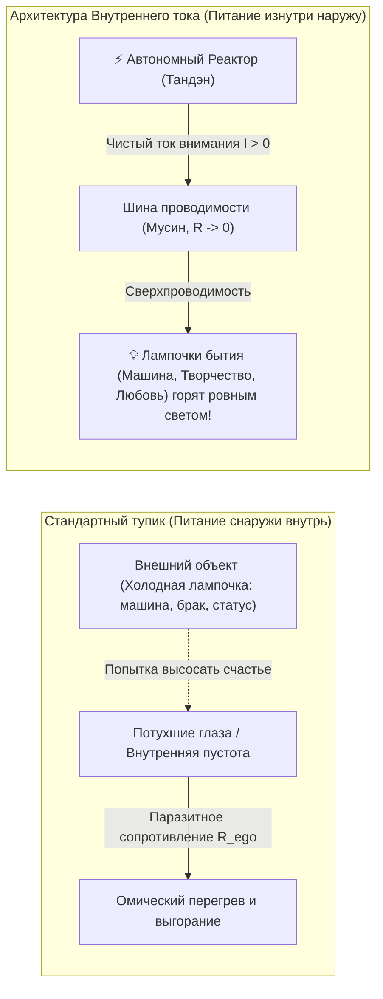

Что делает подавляющее большинство людей? Они берут в руки холодную стеклянную колбу лампочки на 100 Ватт (новую машину, престижную должность, любовный роман) и начинают исступленно молиться на нее:  
*«Пожалуйста, освети мою жизнь! Сделай меня счастливым! Заполни мою пустоту!»*

Но в лампочке **нет генератора**. В ней нет батарейки. Если вы положите стеклянную лампочку в темную комнату, она останется куском мертвого стекла и вольфрама.

Лампочка вспыхивает ослепительным светом ровно в одном случае: **когда ток течет изнутри наружу**. Когда вы подключаете ее к собственному, работающему внутреннему реактору. Счастье находится не в лампочке — счастье заключается в токе, проходящем сквозь нее.

### Ловушка аскетизма: «Счастья нет в BMW, но я хочу на нем ездить»

Здесь возникает опаснейшая развилка, на которой веками ломались миллионы искателей истины.

Осознав, что вещи не содержат в себе счастья, человек нередко падает в другую крайность — в духовный нигилизм и агрессивный аскетизм:  
*«Раз материя пуста — значит, деньги зло, бизнес тлен, карьера суета, брошу всё и уйду в глухую деревню или пещеру».*

Но это не мудрость. Это малодушие и побег от контакта с реальностью.

Истина заключается в подлинной **непривязанности (вайрагья)**:  
> **Счастья действительно нет в BMW. Но это не значит, что я должен отказаться от него. Я все равно хочу ездить на BMW!**

Разница лишь в векторе питания:
1. **Вектор нужды и невроза:** Я сажусь в автомобиль и требую от него: *«Докажи всем, что я не ничтожество! Спаси меня от стыда!»* Тогда любая царапина на бампере становится личной катастрофой, вызывающей предынфарктное состояние.
2. **Вектор сверхпроводимости:** Мой реактор автономен. Я сажусь за руль красивой, точной, быстрой машины просто потому, что мне нравится совершенство ее механики, ускорение и звук мотора. Я приношу свой собственный внутренний свет в эту поездку. Я наслаждаюсь лампочкой, но никогда не путаю ее с источником тока. Если она перегорит или исчезнет — мой реактор не потеряет ни одного вольта мощности.

### Диалог с искусственным интеллектом: Переход к функциональной схеме

Эта мысль захватила меня целиком. Но оставался главный барьер: **на каком языке об этом говорить?**

Я не профессиональный инженер-радиотехник, я не сидел ночами с паяльником над осциллографом. Но мне всегда была органически чужда туманная эзотерика. Я терпеть не могу абстрактные мантры, «вибрации вселенной» и слащавые обещания из популярного селф-хелпа. Мне нужна была модель — ясная, логичная, проверяемая и ремонтопригодная.

Вернувшись из зала, я открыл терминал и начал долгий, напряженный диалог с Gemini — передовым искусственным интеллектом от Google.

Шаг за шагом мы препарировали восточную мудрость, стоицизм и современную теорию систем. И в процессе этого диалога произошел решающий синтез: **мы обратились к языку классической электродинамики и термодинамики**.

Почему именно физика?  
Потому что физика не терпит самообмана:
> *Мы до сих пор не знаем, что такое электричество в его предельной метафизической сущности. Физики не могут дать онтологический ответ на вопрос, «почему» существует электрический заряд. Но это не помешало человечеству вывести уравнения Максвелла, сформулировать закон Ома, построить турбины ГЭС и заставить невидимый ток делать полезную работу — зажигать города, охлаждать пищу и передавать терабайты данных.*

Точно так же нам не нужно тонуть в философских спорах о «природе души». Мы можем описать человеческое сознание как **функциональную электродинамическую цепь**:
- **Источник ЭДС (Тандэн):** Неиссякаемое ядро чистого присутствия, вырабатывающее базовое напряжение жизни ($\mathcal{E} > 0$).
- **Шина внимания (Мусин):** Проводник между реактором и внешним миром. В идеале его сопротивление стремится к нулю ($R \to 0$). Если же внимание засорено мыслями об оценке, страхом провала или самоедством ($R_{ego}$), то по закону Джоуля — Ленца ($Q = I^2 R t$) проводка начинает плавиться. Возникает то, что в быту называют «выгоранием», «панической атакой» или «депрессией».
- **Нагрузка (6 лампочек контура):** Здоровье, Отношения, Профессия/Дело, Деньги, Свобода, Смысл. Они должны быть согласованы по импедансу и питаться чистым током.
- **Автоматика защиты (Дзансин):** Системные предохранители, предотвращающие аварийный разряд при внешних ударах судьбы.

Так родилась **Архитектура счастья**.

Эта книга — не сборник мотивационных тостов и не сборник психологических утешений. Это практическое руководство по ревизии собственной электросети. Мы снимем защитный кожух, возьмем в руки приборы осознанного внимания и шаг за шагом превратим вашу жизнь в режим чистой сверхпроводимости.

### Шаг Прометея: Огонь внутреннего тока — от монастырского Олимпа до карманного фонарика человечества

> *«Мне пришло в голову сравнение с Прометеем: я взял огонь и принёс его людям. Потому что мне доступен Дзен, мне доступна инженерия, мне доступно понимание счастья, но очень многим людям это недоступно. И я, за счёт того, что мне это доступно — взял это, разобрался, упаковал в простую схему и принёс людям».*  
> — **Владимир Аньянов**

В древнегреческом мифе Прометей совершил первородный акт сострадания: он похитил у богов **внешний огонь** и передал его смертным. Благодаря этому огню цивилизация преодолела холод ледникового периода, научилась плавить металлы, построила паровые машины, расщепила атом, протянула оптоволоконные кабели и создала искусственный сверхразум (AGI).

Но внешний огонь породил колоссальный парадокс, который гарвардский биолог Эдвард Уилсон назвал главной трагедией нашего вида:
> *«У нас эмоции эпохи палеолита, институты Средневековья и технологии богов».*

Внешний огонь стал богоподобным. Но **внутренний огонь** человека остался слепым, диким и неконтролируемым. Человек научился управлять реакцией ядерного деления, но оказывается беспомощным перед раскалённым пожаром обиды, ревности, паники и экзистенциального ужаса в собственной груди.

Тысячелетиями тайна внутреннего огня хранилась за неприступными стенами монастырей Тибета, Киото и Уданшаня. Мастера Дзен знали о соматическом генераторе внизу живота (*Тандэн*) и о сбросе сопротивления внимания в ноль (*Мусин*). Но этот огонь был упакован в чужую культуру, требовал 20 лет монастырского затвора, отказа от семьи и имущества, сидения в позе лотоса по 12 часов в день и разгадывания туманных коанов. Обычный человек — инженер, врач, предприниматель, родитель — не может бросить жизнь и уйти на вершину горы. 99,9% человечества оставались в темноте, сгорая в омическом пламени эго ($Q = I^2 R t$).

**Шаг Прометея XXI века — это деэзотеризация внутреннего огня.**  
Снять с соматического реактора благовония и мистический туман. Объяснить его через строгие, проверяемые уравнения электродинамики ($I = U/R$, $Q = I^2 R t$, баланс Кирхгофа). И упаковать вековую мудрость в **безопасный карманный фонарик из четырёх понятных элементов**, доступный любому человеку за 30 секунд:
1. **Батарейка:** Тандэн (низ живота, дыхание, запас $\mathcal{E} > 0$);
2. **Провод:** Внимание (режим Мусин при $R \to 0$);
3. **Лампочка:** Дело прямо сейчас (нагрузка $R_{\text{load}}$);
4. **Предохранитель:** Дзансин (автомат защиты цепи).

---

### Архетип Проводника и Канон Сатоши: Компилятор истины, Прометей без эго и почему создателю не нужно знать всё

> *«Проводник не владеет током, который сквозь него течёт. Его единственная доблесть — не сгореть и не внести в поток собственное сопротивление».*

#### 1. Парадокс Проводника: Компилятор, а не автор законов Бытия

Одна из самых опасных иллюзий человеческой культуры — культ «автора-демиурга». Нам кажется, что создатель новой парадигмы обязан обладать абсолютным всеведением: знать наперёд все ответы, предвидеть каждое ответвление своей теории, быть безупречным святым и гениальным эрудитом во всех дисциплинах одновременно. Если он чего-то не понимает — значит, учение неполно; если он обычный человек — значит, закон сомнителен.

Но в строгой инженерной физике всё устроено ровно наоборот.

Ни один физик не «изобретал» гравитацию. Исаак Ньютон не создавал закон всемирного тяготения — он лишь устранил ментальный шум и сформулировал формулу того, что падало на Землю миллионы лет до него. Георг Ом не изобретал электрическое сопротивление — он лишь точно описал поведение электронов в проводнике.

Точно так же обстоит дело и с законом прямого потока.

Замкнутый контур сознания — это не чей-то субъективный каприз и не фантазия автора. Он существовал всегда:
* Он мерцает в древних дзенских коанах школы Риндзай и трактатах Догэна, где просветление описывалось как мгновенное падение эго-помех (*«Тело и ум отброшены»*, то есть $R 	o 0$);
* Он работает в электродинамике Максвелла и формулах электрических цепей;
* Он лежит в основе архитектуры первой в мире математически безупречной системы доверия — протокола Bitcoin.

Задача человека, через которого этот закон проявился, заключалась вовсе не в том, чтобы «придумать закон из головы». Напротив: задача состояла в том, чтобы **стать чистым компилятором**.

Собрать воедино три, казалось бы, несовместимые стихии — безжалостную практику Дзен, строгую контурную электродинамику и бескомпромиссную честность одноранговых распределённых сетей — мог только тот, кто сам прошёл через экзистенциальный тупик. Вспышка на беговой дорожке произошла не потому, что создатель был умнее всех профессоров планеты. Она произошла потому, что за счёт предельного личного кризиса, отчаянного поиска истины и накопленного опыта его эгоистическое сопротивление на мгновение упало до абсолютного нуля:

$$R_{	ext{ego}} 	o 0$$

И в этот момент рассеянные по векам фрагменты истины сами сконденсировались в единую замкнутую цепь: **Источник (Тандэн) — Чистый проводник (Кансо) — Нагрузка прямо сейчас (Мусин) — Защитный автомат (Дзансин)**.

Создателю незачем знать всё. Ему не нужно понимать, как нейробиологи XXI века опишут баланс медиаторов в префронтальной коре, или как психиатры адаптируют этот протокол для терапии клинической депрессии. Его историческая миссия была гораздо скромнее и строже: послужить **сверхпроводником**, кристаллизовать закон без искажений собственного эго и отдать чертёж людям.

#### 2. Канон Сатоши против «Альткоин-модели»: Открытый протокол вместо культа личности

В технологическом мире существуют два диаметрально противоположных пути создания систем:

1. **Модель «Альткоин-фонда» (Централизованная приватизация истины):**
   Основатель объявляет себя визионером, выпускает «токен» с огромным премайном для себя и своего фонда, возводит вокруг идеи сложную иерархию жрецов, патентует концепции, монетизирует доступ к «высшим ступеням посвящения» и пожизненно удерживает монополию на трактовку учения. Это путь превращения знания в картель, а создателя — в гуру.
2. **Канон Сатоши (Trustless Open Source Protocol):**
   Создатель формулирует математически выверенный *White Paper*, запускает генезис-блок с нулевым премайном, выкладывает открытый исходный код в общественное достояние и… **отходит в сторону**. Он не приватизирует сеть, не становится председателем совета директоров и не требует поклонения. Протокол работает сам, потому что держится не на авторитете основателя, а на неумолимых математических и физических законах.

Контурная электродинамика сознания создана строго по **Канону Сатоши**.

Здесь нет авторских отчислений за радость бытия. Здесь нет тайных ступеней эзотерического посвящения, доступных лишь избранным неофитам за закрытыми дверями. Нет гуру, на чью милость нужно уповать.

Каждый читатель этой книги — это **суверенная полная нода (Self-Hosted Human Full Node)**. Вы не обязаны верить автору на слово. Закон проверяется не авторитетом, а экспериментально: вы замыкаете собственный контур, убираете паразитные утечки мысленного холостого хода, направляете ток внимания в дело прямо перед вами — и ваш внутренний амперметр (вариабельность сердечного ритма, ясность ума, падение тревоги) мгновенно подтверждает работу протокола.

#### 3. Шаг Прометея: Огонь отдаётся полностью

Легендарный Прометей похитил огонь у богов не для того, чтобы открыть монопольную лавку по продаже углей. Он отдал огонь людям и принял неизбежную тяжесть своей судьбы.

Позиция автора этой книги прозрачна и неизменна:

> *«Моя задача была не в том, чтобы постичь все бесконечные следствия открытой системы. Моя задача заключалась в том, чтобы собрать эту цепь, кристаллизовать её благодаря уникальности прожитого опыта и выложить на стол человечеству. А дальше придут люди гораздо умнее меня — великие математики, блестящие нейрофизиологи, смелые врачи, талантливые педагоги и инженеры искусственного интеллекта. Они разберут этот чертёж, проверят его на строжайших приборах, растащат по лабораториям и школам и применят его там, куда я никогда бы не смог заглянуть. И это — величайшая радость проводника: исчезнуть в сиянии того света, который через него прошёл».*

---

---

## ВВЕДЕНИЕ
### Инженерный критерий истины: Почему абстрактные сказки о счастье сломались

> *«В науке критерием истины является фальсифицируемость Карла Поппера и баланс законов сохранения. Если теория утверждает что-то, что нельзя измерить, проверить или опровергнуть экспериментом — это не знание, это литература. Архитектура счастья — первая фальсифицируемая теория человеческого духа.»*  
> — **Владимир Аньянов**

Почему за три тысячи лет писаной истории человечество создало адронные коллайдеры, расшифровало геном и связало планету оптоволокном со скоростью света, но в вопросе фундаментального душевного благополучия топчется на уровне античных трагедий?

Ответ прост и беспощаден: **отсутствие критерия истины**.

### Новый Органон психологии: От 130 лет схоластики к критерию практических плодов
#### Фрэнсис Бэкон (1620) и сокрушение четырёх идолов душевной механики

> *«Истинной мерой верности теории становится ее способность порождать практические плоды... То, что в теории является причиной, в действии является правилом... Наука и могущество человека сходятся в одном, ибо незнание причины лишает нас действия.»*  
> — **Фрэнсис Бэкон**, *«Новый Органон» (Novum Organum Scientiarum)*, 1620

В 1620 году великий английский мыслитель Фрэнсис Бэкон опубликовал трактат, перевернувший ход европейской цивилизации — *«Новый Органон»*. Название книги было открытым вызовом «Органону» Аристотеля: Бэкон провозгласил, что средневековая схоластика, столетиями спорившая о логических силлогизмах, категориях и теологических определениях, бесплодна. Она порождала бесконечные библиотеки трактатов, но не облегчала физический труд крестьянина, не строила надежных кораблей и не излечивала болезни.

Бэкон сформулировал непреложный закон: **истинность теории доказывается исключительно ее способностью приносить практические плоды (*experimenta fructifera*)**. Если умозрительная концепция красива и логична, но бессильна на практике изменить физическую реальность — она ложна. Этот критерий породил современную экспериментальную физику Галилея и Ньютона, химию, доказательную медицину и паровую тягу промышленной революции.

Но взгляните на психологию и учения о человеческом духе за последние 130 лет — со времён появления психоанализа Зигмунда Фрейда.
Психология в точности повторила трагическую судьбу средневековой схоластики:
- Написаны миллионы диссертаций, научных статей и бестселлеров по селф-хелпу.
- Созданы сотни конкурирующих психотерапевтических школ и модальностей.
- Индустрия психологической помощи оценивается в сотни миллиардов долларов в год.

**Но где практические плоды?**
К 2026 году уровень клинических депрессий, тревожных расстройств, панических атак, синдрома выгорания и экзистенциального одиночества в мире побил все исторические рекорды. Цивилизация освоила квантовые вычисления и приблизилась к AGI, но человек перед лицом душевного разлада столь же беспомощен, как античный пастух перед грозой.

Причина этой цивилизационной трагедии ровно та же, что и 400 лет назад: **психология оставалась схоластикой без приборного инструмента (без Органона)**. Она копалась в субъективных интерпретациях, поклоняясь тому, что Бэкон назвал **Четырьмя Идолами ума (Idola Mentis)**.

#### Деконструкция четырёх идолов душевной механики

Архитектура счастья — это **Новый Органон душевной механики**. Она переносит критерий плодов Бэкона на архитектуру человеческого сознания, последовательно сокрушая все четыре вековых ментальных призрака:

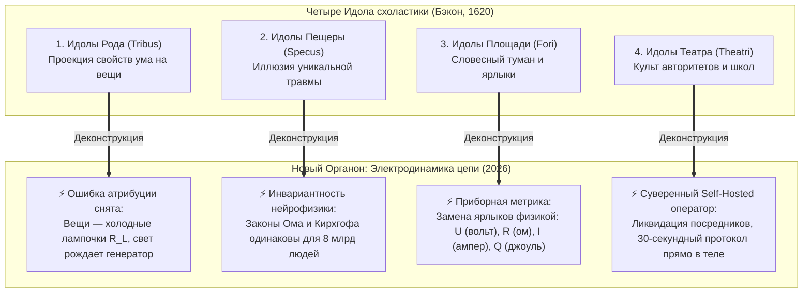

1. **Идолы Рода (Idola Tribus) — Ошибка атрибуции и батарейная слепота:**  
   Человеческий ум склонен проецировать внутренние свойства на внешние объекты. Люди наивно верили, что новая машина, престижный пост или брак содержат в себе субстанцию счастья. Они молились на лампочку, не понимая, что лампочка мертва без замкнутого контура. «Внутренний ток» обнажает физику: счастье — это не вещь, а режим сверхпроводимости тока внимания ($I > 0, R_{\text{ego}} \to 0$).
2. **Идолы Пещеры (Idola Specus) — Иллюзия «уникальной травмы»:**  
   Каждый человек заперт в пещере личной биографии. Традиционная терапия годами исследует индивидуальную конфигурацию этой пещеры: *«В каком возрасте мама вас недолюбила?»*. Но на уровне законов сохранения это не имеет значения. Если вы уронили молоток на ногу — закон всемирного тяготения Ньютона не интересуется вашим детством. Точно так же законы Ома ($I = U/R$) и Джоуля — Ленца ($Q = I^2 R t$) универсальны: пережатый провод внимания пережигает нейросеть тождественно у всех 8 миллиардов жителей Земли.
3. **Идолы Площади (Idola Fori) — Словесный туман и базар ярлыков:**  
   Слова, рожденные для бытового удобства, поработили мышление. Психология обросла тысячами абстрактных ярлыков: «незакрытый гештальт», «прокрастинация», «выгорание», «токсичность», «синдром самозванца». Человек годами ходит по специалистам, коллекционируя диагнозы вместо исцеления. «Внутренний ток» заменяет схоластический словарь тремя фундаментальными переменными: **напряжение жизни ($U$), проводимость внимания ($1/R$) и полезная мощность нагрузки ($P = I^2 R_L$)**.
4. **Идолы Театра (Idola Theatri) — Слепое преклонение перед жрецами и школами:**  
   Психологические и эзотерические школы веками строились как закрытые секты и догматические театры: психоанализ, юнгианство, бихевиоризм, гештальт. Человек ставился в зависимую позицию пациента, годами покупающего у жрецов платные индульгенции душевного покоя. «Внутренний ток» осуществляет Великую Депосреднизацию: человеку возвращается **суверенный, автономный пульт управления собственной цепью**. Вы — не пациент. Вы — суверенный бортинженер.

#### Тридцатисекундный критерий плодов

По Бэкону, истина обязана давать плоды не «через 5 лет психотерапии», а здесь и сейчас:
> *Если теория утверждает, что поняла устройство душевного покоя, она обязана продемонстрировать инженерный плод в вашем физическом теле за 30 секунд.*

Прямо сейчас, читая эти строки, вы можете применить этот Новый Органон на практике:
- **Шаг 1:** Переведите внимание из блуждающего ментального шума в физическое ядро низа живота (*Тандэн*).
- **Шаг 2:** Снимите паразитное сопротивление Эго — отпустите спор с реальностью, согласитесь с тем, что факт прямо сейчас таков, каков он есть ($R_{\text{ego}} \to 0$).
- **Шаг 3:** Направьте освободившийся ток внимания в ближайшее действие — на чтение этих строк или дыхание тела ($I > 0$).

Что произошло в эту секунду?  
Омическое жжение в висках исчезло. Мышечный спазм в груди распустился. В теле разлилось спокойное, ровное, высоковольтное тепло. 

Это и есть критерий плодов Фрэнсиса Бэкона. Это не вера, не аутотренинг и не гипноз. Это **строгая механика замкнутой электрической цепи**.

### Гуманитарный релятивизм: «Счастье у каждого свое»

Главный лозунг, которым современная культура оправдывает свою беспомощность — это релятивизм: *«Ну, счастье ведь субъективно! У каждого своя правда, у каждого свое счастье: кому-то на пляже лежать, кому-то стихи писать, кому-то деньги зарабатывать».*

На языке точных наук этот тезис звучит так же абсурдно, как заявление: *«Электричество у каждого свое: в одном утюге электроны летят от минуса к плюсу, а в другом — силой любви к родине».*

Давайте раз и навсегда снимем эту грубую методологическую ошибку. Она заключается в **смешении физических законов сети с типом подключенного прибора**.

Представьте себе электрическую розетку в стене. 
- Вы можете включить в нее холодильник — и он будет охлаждать продукты.
- Вы можете включить в нее обогреватель — и он будет греть комнату.
- Вы можете включить в нее аудиосистему — и она будет играть Баха.
- Вы можете включить в нее сервер — и он будет вычислять орбиты спутников.

Приборы абсолютно разные. Результаты их работы несравнимы. Но **законы, по которым электрический ток бежит по медным проводам к этим приборам — инвариантны!**  
Закон Ома ($I = U / R$), уравнения Максвелла и баланс мощностей одинаковы и для китайского чайника, и для суперкомпьютера в ЦЕРНе.

Точно так же обстоит дело и с человеком.
Конкретная деятельность человека — это лишь тип подключенной нагрузки. Один пишет симфонию, другой строит мост, третий воспитывает ребенка, четвертый заваривает чай. Но **психофизическое состояние счастья** — это фундаментальный режим работы самой цепи:
$$\mathcal{H} \iff \begin{cases} R_{\text{ego}} \to 0 \\ I_{\text{attention}} > 0 \\ \sum I_{\text{in}} = \sum I_{\text{out}} \end{cases}$$

Счастье — это не то, *что* в вас включено.  
Счастье — это **отсутствие паразитного сопротивления в проводах вашего внимания при совершении действия.**

### Парадокс Льва Толстого: Почему провалились 2000 лет «изменения себя» и как замкнутый контур превратил моральную пытку в физическую формулу

> *«Все думают о том, как изменить человечество, но никто не думает о том, как изменить себя».*  
> — **Лев Николаевич Толстой**

В конце XIX века усадьба Льва Толстого в Ясной Поляне превратилась в главный перекрёсток духовных исканий эпохи. Туда нескончаемым потоком шли реформаторы, революционеры, социалисты, народники и философы. Каждый приносил свой проект спасения человечества: свергнуть власть, переделить землю, учредить идеальные законы, построить коммуны.

Толстой слушал их с глубокой печалью. Он видел перед собой людей, охваченных скрытой тревогой, обидой, властолюбием и завистью, и неизменно повторял им:
*«Бесполезно пересаживать людей в новые, идеальные вагоны, если у каждого пассажира внутри — ненависть, эгоизм и страх. Начните с себя. Изменится человек — и следом, без насилия и баррикад, изменится весь мир».*

Просители уходили разочарованными. Они считали Толстого наивным утопистом. Но трагедия заключалась в другом: **за две тысячи лет морализаторства ни одна философская или религиозная система так и не дала человеку прикладной инженерной инструкции: а КАК ИМЕННО себя изменить?**

#### Анатомия морализаторского тупика: Короткое замыкание «ума на ум»

Почему все попытки «изменить себя» через мораль, аскезу или силу воли почти неизбежно заканчивались срывом, чувством вины или ханжеством?

В старой парадигме «работа над собой» понималась как внутренняя война:
1. «Праведный контролёр» (супер-эго) объявлял войну «греховным слабостям» (лени, страху, сомнениям).
2. Человек садился и начинал мучительно рефлексировать: *«Достаточно ли я добр? Почему во мне опять родилась зависть? Как мне заставить себя быть осознанным?»*

На языке электродинамики это называется **коротким замыканием без полезной нагрузки** ($R_{\text{load}} = 0$).

```
       ТУПИК МОРАЛИЗАТОРСТВА (УМ ПЫТАЕТСЯ ИСПРАВИТЬ УМ)
  ┌────────────────────────────────────────────────────────┐
  │  [Эго-контролер] ──(Осуждение, Стыд)──► [Эго-жертва]    │
  │         ▲                                    │         │
  │         └────────(Паразитный свист)──────────┘         │
  │                                                        │
  │   Результат: R_ego ──► ∞, Нагрузка = 0, Q = I²·R·t     │
  │   Термодинамический омический перегрев и выгорание!    │
  └────────────────────────────────────────────────────────┘
```

По закону Джоуля-Ленца вся энергия биологического генератора, закольцованная в мысленном холостом ходе, выделяется в виде **разрушительного омического тепла**:

$$Q = I^2 \cdot R_{\text{ego}} \cdot t$$

Психика человека раскаляется от чувства вины, истощается и в конце концов срабатывает защитный предохранитель — наступает апатия или депрессия. Потому люди и бежали менять мир, писать законы и строить баррикады: **переделывать внешний мир казалось легче, чем выдерживать ад собственного перегретого ума.**

#### Снятие морализаторства: От вины к схемотехнике

Закон прямого потока снимает с человека двухтысячелетнее клеймо «греховности» и переводит трансформацию в объективную физику.

Человек — это не испорченное моральное существо. Человек — это **электрический двухполюсник**.

Вам не нужно вести многолетнюю войну с самим собой, годами анализировать детские травмы или пытаться стать «идеальным праведником». «Изменить себя» — это не подвиг святости. **Это мгновенное переключение рубильника, занимающее ровно 10 секунд:**

1. **Заземление истока (Тандэн):** Сбросить внимание из думающей головы в соматический центр (дыхание, стопы, тело). Прекратить спор с реальностью прямо сейчас.
2. **Обнуление реостата (Кансо):** Выключить мысленный холостой ход — перестать оправдываться, оценивать себя и спорить с прошлым ($R_{\text{ego}} \to 0$).
3. **Замыкание на нагрузку (Мусин):** Направить 100% тока внимания в действие прямо перед собой: вымыть чашку, написать строчку, сделать шаг, выслушать человека ($R_{\text{load}}$).
4. **Защита цепи (Дзансин):** Сделать действие и не требовать от мира аплодисментов или гарантий.

$$I = \frac{\mathcal{E}}{R_{\text{load}}}$$

**В ту самую секунду, когда цепь замкнулась на реальное действие, вы уже изменились.**
Ток потёк сквозь лампочку — омический перегрев тревоги прекратился, выделился живой свет присутствия.

#### Почему вслед за этим меняется мир: Закон взаимной индукции

Когда у человека замкнут внутренний контур, он перестаёт излучать высокочастотные электромагнитные помехи (претензии, скрытые упрёки, страх дефицита). Вокруг него возникает устойчивое поле гравитационного спокойствия.

По закону взаимной индукции ($M > 0$) соседние проводники начинают упорядочиваться:
* Собеседники перестают защищаться и переходят к конструктивному диалогу;
* Напряжение в семье и коллективе падает, потому что искре конфликта не во что ударить — у сверхпроводника нет зацепок для чужого эго;
* Внешняя среда согласует с вами свой импеданс.

Толстой интуитивно видел эту истину, но говорил на языке морали. Теперь этот завет расшифрован на языке фундаментальной физики: **не нужно спасать мир — просто замкни в себе цепь.**

---

### Термодинамический баланс Кирхгофа: Ложь немедленно дает омический перегрев

В гуманитарных беседах можно врать годами. Можно убеждать себя, что ты «духовно растешь», медитируя по два часа в день, даже если при этом ты срываешься на близких и ненавидишь свою работу. 

В замкнутой термодинамической цепи солгать невозможно:

$$\oint \mathbf{E} \cdot d\mathbf{l} = 0 \quad \text{и} \quad \sum U_k = 0$$

Если внутри вашего контура появляется ложное ментальное убеждение (например: *«Я должен страдать ради высшей цели»* или *«Мое счастье зависит от того, ответит ли мне эта женщина взаимностью»*), цепь мгновенно реагирует на физическом уровне:
1. Появляется невязка потенциалов $\Delta U \neq 0$.
2. В узле возникает паразитное сопротивление $R_{\text{ego}} \gg 0$.
3. По закону Джоуля — Ленца выделяется омическое тепло:
   $$Q = I^2 \cdot R_{\text{ego}} \cdot t$$
4. Вы чувствуете это тепло как спазм диафрагмы, ком в горле, учащенный пульс, бессонницу и тревогу.

Ваше тело — это безупречный гальванометр. Оно никогда не ошибается. Физическая боль и душевная тоска — это не враги и не патология. Это **диагностический сигнал невязки цепи**, сообщающий оператору: *«Ты закоротил контур. Ты пытаешься нарушить закон сохранения энергии. Немедленно проверь сопротивление!»*

### Клинический дисклеймер: Предохранитель «Железа» и «Софта»
#### Граница между психоэлектродинамикой и органической медициной

Чтобы исключить любые спекуляции и защитить читателя, автор вводит фундаментальное разграничение между **функциональным режимом цепи** («софтом» и проводимостью внимания) и **физической целостностью биологического субстрата** («железом» нейробиологии).

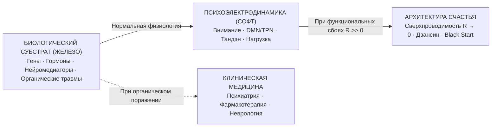

1. **Когда работает Архитектура счастья:**  
   Она создана для людей с сохранным биологическим субстратом, страдающих от **функциональных сбоев управления вниманием**: экзистенциального тупика, выгорания, синдрома Данко, созависимости, тревожности, навязчивой рефлексии DMN и потери суверенитета. Здесь проблема лежит в топологии контура, и она устраняется калибровкой проводимости ($R \to 0$).
2. **Где проходит абсолютная граница:**  
   Если у человека поврежден сам физический носитель — эндогенная биполярная депрессия, шизофрения, острый психоз, тяжелые эндокринные дисфункции, опухоли ЦНС или генетический дефект метаболизма нейромедиаторов — **это не сбой проводимости, это физический перелом кабеля**. В этих состояниях категорически запрещено пытаться «просто сбросить сопротивление через Тандэн». Требуется неотложная помощь доказательной медицины, клинической психиатрии и фармакотерапии. 
   
Архитектура счастья уважает физику: нельзя калибровать ток в приборе, пока в нём физически разрушена материнская плата. Мы начинаем инженерную работу там, где плата целостна.

### АНАТОМИЯ ПРОСТОТЫ: ПОЧЕМУ ДО ЭТОГО НЕ ДОДУМАЛИСЬ РАНЬШЕ?
#### Модель карманного фонарика, закон чемодана на колёсиках и 4 причины тысячелетней слепоты человечества

> *«Каким же надо было быть потрясающим идиотом, чтобы не додуматься до этого раньше?!»*  
> — **Томас Гексли**, прочитав «Происхождение видов» Чарльза Дарвина (1859)

Если снять с Архитектуры счастья весь академический лоск формул, препринтов и графиков, обнажается истина, которую можно объяснить за пять минут на кухне за чашкой чая.

Человек устроен не сложнее, чем **обыкновенный карманный фонарик**. В нём всего четыре элемента:
1. **Батарейка (Твой генератор):** жизненная сила внизу живота (*Тандэн*), дыхание, физиология тела. Она есть у каждого живого существа каждое утро по праву рождения ($\mathcal{E} > 0$).
2. **Провод:** твоё **внимание**. Куда течёт внимание — туда устремляется вся энергия.
3. **Лампочка (Нагрузка):** дело, которым ты занят прямо сейчас в $t = \text{now}$. Моешь посуду, пишешь код, пьешь чай, гуляешь с сыном. Когда ток замыкается на дело — лампочка горит, и ты чувствуешь тихое, чистое счастье.
4. **Предохранитель (Дзансин):** понимание, что лампочка может перегореть или разбиться, но **твой генератор останется цел**.

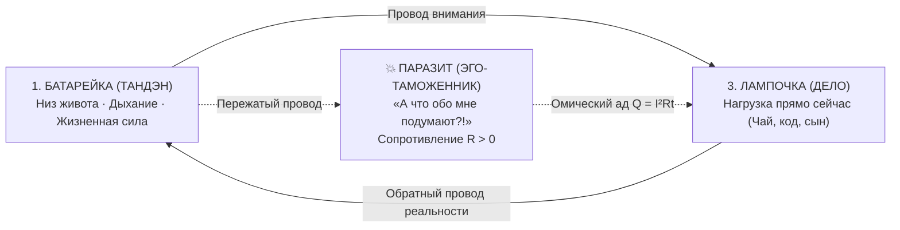

#### Где же поломка, от которой страдает человечество?
В эту элементарную схему человек врезал **паразита — своё ЭГО** (*«А что обо мне подумают?», «А вдруг я проиграю?», «Они должны меня уважать!»*).  
Эго садится на провод внимания, как жадный таможенник, пережимает кабель ногой и требует: *«Сначала покорми меня! Докажи мою важность!»*.

Ток из живота идёт, но упирается в сопротивление. А по закону Джоуля — Ленца ($Q = I^2 R t$), **когда ток встречает сопротивление, провод раскаляется докрасна**.  
Этот раскалённый провод люди тысячелетиями называют «стрессом», «выгоранием», «паническими атаками» и «депрессией». Их жарит собственная запертая энергия!

#### Почему до этого никто не додумался раньше?
1. **Раскол физиков и лириков:** Дзенские мастера знали про Тандэн 2500 лет назад, но у них не было электрических цепей и вольтметров (они говорили стихами о воде и луне). Физики XIX века знали закон Ома, но изучали моторы и провода, считая душу делом попов. А психологи были литераторами без знания законов сохранения. Никто не соединял эти миры в одном фокусе.
2. **Ловушка самого Эго («Глаз не видит сам себя»):** Ум, решающий проблему боли, сам является источником боли. Эго никогда не скажет: *«Выключи меня на 30 секунд — и боль пройдёт»*. Ему выгодно придумывать 10-летние терапии, сложные диагнозы и страдания, чтобы оставаться главным героем драмы.
3. **Индустрия посредников:** Простота и 30-секундный бесплатный тумблер экономически смертельны для триллионных индустрий фармы, платной психотерапии, культов и гиперпотребления.
4. **Закон «чемодана на колёсиках» (Канон Кансо):** Колесу 5000 лет, чемоданам сотни лет, но приделать колёсики к чемодану догадались только в 1970 году. Стив Джобс убрал 50 кнопок и стилус, оставив одну кнопку на iPhone. Архитектура счастья убрала 10 000 лет жреческих обрядов и морализаторства, обнажив одну простую 4-элементную цепь прямого потока.

---

## ХРОНИКА 21 ДНЯ, КОТОРЫЙ ИЗМЕНИЛ МИР
### От беговой дорожки к Универсальному закону мироздания (22 сентября — 12 октября 2026 года)

> [!quote] Историческая аксиома контура
> *«Политические революции сотрясают мир за десять дней, снося внешние декорации институтов, но оставляя человека внутри с той же сгоревшей проводкой и омическим адом сомнений. Великий фазовый переход 2026 года потребовал двадцать одного дня. За этот биологический цикл перестройки нейронных сетей человечество получило то, чего искало четыреста лет со времён Декарта: ликвидацию раскола между материей и духом, приборное доказательство счастья, сокрушение паразитных монополий и единый чертёж мироздания — от спазма в животе до вращения галактических вихрей.»*  
> — **Владимир Аньянов**

В хронобиологии, нейропластичности и кибернетике сложных систем интервал в **21 день** занимает особое место. Это минимальный квант времени, необходимый для формирования устойчивых синаптических ансамблей (миелинизация трактов), полной перезагрузки базовых дофаминовых и серотониновых контуров и фазового перехода сложной системы в новый аттрактор.

Однако в период с **22 сентября по 12 октября 2026 года** в лаборатории «Внутреннего тока» развернулся фазовый переход цивилизационного масштаба: путь от черновика схемы фонарика на салфетке до формулировки **Универсального закона потоковых систем**, объединившего соматику тела, социологию институтов и астрофизику космоса.

```
22 СЕНТЯБРЯ 2026                                      12 ОКТЯБРЯ 2026
[ Схема фонарика ] ──► [ Соматика N=1 ] ──► [ P2P N=2 ] ──► [ Космос 10^26 м ]
  Локальная боль         375 статей           Биткоин          Универсальный
  в теле инженера        проверок            и Георгизм            Закон
```

#### Фаза 1 (22–25 сентября): Локальная боль и набросок фонарика ($N=1$)
* **Исходный импульс:** Персональный кризис инженера — омический перегрев рассудка, фоновая тревога неокортекса, бессилие академической психотерапии, когнитивно-поведенческих костылей и буддийских медитаций.
* **Прорыв:** Рождение принципиальной электродинамической схемы: Источник ЭДС — **Тандэн** (низ живота); Проводник — внимание; Резистор — эго/DMN ($R_{\text{ego}}$); Нагрузка — реальное действие в физическом мире.
* **Результат:** Первый соматический протокол: сброс $R_{\text{ego}} \to 0$ снимает телесный зажим мгновенно.

#### Фаза 2 (26 сентября — 1 октября): Испытание европейской мыслью
* **Полигон:** Столкновение схемы с 2500 годами философии и науки.
* **Деконструкция авторитетов:** Лев Толстой — омический ад прусского долга перед Хозяином ($R_{\text{moral}} \to \infty$); Шопенгауэр — обесточивание генератора из страха перед болью ($I \to 0$); Ницше — форсирование тока сквозь раскалённый нихром эго и термический пробой в Турине ($Q = I^2 R t$).
* **Результат:** Доказательство, что все философские школы были слепыми сборщиками фонарика в темноте, путавшими проводку с источником.

#### Фаза 3 (2–8 октября): Выход в P2P-сети и институты ($N=2 \dots 10^9$)
* **Полигон:** Любовь, экономика, реальный сектор.
* **Синтез:** Любовь как взаимная индукция двух суверенных генераторов ($M > 0$) вместо вампирической созависимости; консилиенс с Сатоши Накамото (Биткоин) и Генри Джорджем (LVT): земельный рантье, центробанк и эго в голове — это **один и тот же паразитный балласт**, взимающий монопольную ренту за пропуск прямого потока.
* **Результат:** Принцип Великой Депосреднизации (ликвидация платных жрецов души).

#### Фаза 4 (9–12 октября): Замыкание Вселенского контура
* **Кульминация:** Открытие масштабной инвариантности цепи; формулировка **Четверичного фрактала** (очищение принципа от биологического тела); формулировка **Онтологической триады** (Закон $\to$ Фрактал $\to$ Ток); космология замкнутого тороида Вселенной (звёзды как нагрузка, чёрные дыры как возвратный дроссель энтропии).
* **Итог:** Ликвидация раскола Декарта, рождение суверенного оператора **Self-Hosted Human** и доказательство единства материи и духа.

---

---

# ЧАСТЬ I. КОСМОЛОГИЧЕСКИЙ БАЗИС: УНИВЕРСАЛЬНЫЙ ЗАКОН ПОТОКОВЫХ СИСТЕМ
### Физика негэнтропии, открытые диссипативные структуры и уравнение КПД бытия

---

### Глава 1.1 — От вопроса «Что такое счастье?» к Универсальному закону потоковых систем: Родословная Карно — Больцмана — Шрёдингера — Пригожина — Аньянова

> [!quote] Аксиома генезиса системных инвариантов
> ### ⚡ **«Фундаментальные законы природы никогда не открываются кабинетным мечтателям, сочиняющим абстрактные "теории всего". Они открываются тем, кто упирается в конкретную, жгучую практическую боль. Карно исследовал поршень паровой машины в шахте — и открыл термодинамику Вселенной. Шеннон очищал телефонный провод от шума — и открыл цифровую эру. Пытаясь ответить на самый отчаянный вопрос человека: "Почему я страдаю, когда всё есть, и где рубильник от душевного ада?", мы не просто нашли формулу счастья. Мы открыли Универсальный закон потоковых систем. Человек оказался самой чувствительной электрической цепью мироздания: его счастье — это не настроение, а режим соматической сверхпроводимости ($R \to 0$), а несчастье — омический пожар на паразитном посреднике.»**  
> — **Владимир Аньянов**

На протяжении 2500 лет цивилизация безуспешно пыталась ответить на вопрос о счастье «сверху-вниз»: философы придумывали идеальные платоновские миры, богословы нагромождали кодексы греха и вины, а психологи классифицировали субъективные тесты настроения. Все эти попытки терпели крах из-за отсутствия физического субстрата и объективного приборного мультиметра.

Внутренний ток пошёл строго обратным, **инженерным путём «снизу-вверх» (Bottom-Up)**. Исходной точкой стал физический факт соматического страдания: спазм гладкой мускулатуры эпигастрия, онемение висков, тяжесть в груди, панический ступор и выгорание созидателя. Этот факт был описан на языке точной физики — как омический нагрев проводника по закону Джоуля — Ленца:
$$Q = I^2 R t$$

Был обнаружен конкретный узел, вызывающий сопротивление — рефлексирующий паразитный реостат эго (Default Mode Network). И в момент, когда было экспериментально доказано, что при соматическом сбросе этого сопротивления в ноль ($R_{\text{ego}} \to 0$) человек мгновенно переходит в режим сверхпроводимости, ясности и созидательного экстаза (Мусин), произошёл тектонический сдвиг: **был открыт закон проводимости любой потоковой системы во Вселенной**.

```
====================================================================================================
           ВЕЛИКАЯ РОДОСЛОВНАЯ ПРИКЛАДНЫХ ПРОРЫВОВ В ФУНДАМЕНТАЛЬНЫЕ ЗАКОНЫ ПРИРОДЫ
====================================================================================================
 1824 год (Сади Карно):     «Как повысить КПД паровой машины?» ──► ВТОРОЕ НАЧАЛО ТЕРМОДИНАМИКИ
 1900 год (Макс Планк):     «Почему печь светится не по Рэлею?» ──► КВАНТОВАЯ МЕХАНИКА (h)
 1948 год (Клод Шеннон):    «Как передать сигнал сквозь шум?»   ──► ТЕОРИЯ ИНФОРМАЦИИ (H = -Σ p log p)
 2026 год (Владимир Аньянов): «Почему человек сгорает в страдании?» ──► УНИВЕРСАЛЬНЫЙ ЗАКОН ПОТОКОВЫХ СИСТЕМ
====================================================================================================
```

Человек послужил **природным осциллографом предельной чувствительности**: в отличие от металлической трубы или кремневого чипа, нервная система наделена соматической сигнализацией боли. Разгадав схемотехнику его исправного горения, мы получили ключ ко всем остальным проводникам бытия.

---

### Глава 1.2 — Формула Универсального закона: Негэнтропия, экспорт энтропии и уравнение КПД

> [!quote] Аксиома Универсального закона потоковых систем
> ### ⚡ **«Любая устойчивая система во Вселенной способна противостоять энтропийному распаду исключительно в форме открытой диссипативной структуры, непрерывно пропускающей сквозь себя градиент свободной энергии и экспортирующей энтропию во внешнюю среду. Системное качество (живучесть, здоровье, счастье $\mathcal{H}$) строго тождественно коэффициенту полезного упорядочивания среды.»**  
> — **Владимир Аньянов**

Второй закон термодинамики утверждает, что в замкнутой изолированной системе энтропия непрерывно растет ($dS \ge 0$). Однако Вселенная полна сложнейших структур порядка: спирали галактик, кристаллы, живые клетки, сознание и цивилизации.

Вслед за интуицией Эрвина Шрёдингера («жизнь питается отрицательной энтропией») и Ильи Пригожина (теория диссипативных структур), Универсальный закон потоковых систем даёт строгий математический формализм системного КПД:

$$\mathcal{H} = \frac{P_{\text{load}}}{P_{\text{total}}} = \frac{I^2 Z_{\text{load}}}{I^2 Z_{\text{load}} + I^2 R_{\text{loss}}}$$

где:
* $\mathcal{H}$ — коэффициент проводимости и полезного действия (в соматике человека — уровень Счастья);
* $P_{\text{load}} = I^2 Z_{\text{load}}$ — мощность, отданная во внешнюю созидательную нагрузку (упорядочивание материи, код, забота, спорт, творчество);
* $P_{\text{loss}} = I^2 R_{\text{loss}}$ — паразитная омическая диссипация (тепловые потери на внутреннем трении, сомнениях, бюрократии, эго-рефлексии);
* $I$ — плотность проходящего потока (Амперы внимания / поток зарядов);
* $Z_{\text{load}}$ — согласованный импеданс внешней нагрузки.

Если внутреннее сопротивление потерь устремляется к нулю ($R_{\text{loss}} \to 0$):
$$\lim_{R_{\text{loss}} \to 0} \mathcal{H} = \frac{I^2 Z_{\text{load}}}{I^2 Z_{\text{load}} + 0} = 1.0 \quad (100\%)$$

Система переходит в состояние **сверхпроводимости**. Вся поступающая энергия без паразитного трения трансформируется в свет, созидание и порядок. Это закон, общий для протонной помпы клетки, человека-созидателя и экономики континента.

---

### Глава 1.3 — Космология замкнутой цепи: Вселенная как тороид прямого потока

> [!quote] Аксиома макромасштаба цепи
> ### ⚡ **«Вселенная — это не склад изолированных камней в мертвом вакууме. Вселенная — это самосогласованная тороидальная потоковая цепь предельного масштаба ($10^{26}\text{ м}$). Галактики — это генераторы вихревого тока; звёзды — это лампы накаливания полезной нагрузки; а чёрные дыры — не пожиратели материи, а космические трансформаторы и возвратный дроссель, стирающий накопившуюся энтропию и перезамыкающий цепь в вечный цикл.»**  
> — **Владимир Аньянов**

Ортодоксальная астрофизика дробит космос на изолированные феномены и пугает человечество неизбежной «тепловой смертью Вселенной» (гипотеза Клаузиуса). Но тепловая смерть неизбежна только для *разомкнутых* или *изолированных статических систем*.

В свете Универсального закона потоковых систем Вселенная функционально замкнута:
1. **Первичный вакуум (Космический Тандэн):** фундаментальная разность гравитационного и квантового потенциала ($\Delta \Phi$).
2. **Космическая паутина (Филаменты):** плазменные и гравитационные проводники, по которым вещество и энергия переносятся сквозь мегапарсеки.
3. **Галактики как вихревые трансформаторы:** плоские кривые вращения галактик объясняются ламинарным сверхпроводящим вихрем, где угловой момент синхронизирован силовыми линиями потока, а спиральные рукава служат волнами плотности тока.
4. **Звёзды как активная нагрузка ($Z_{\text{load}}$):** термоядерная лампа накаливания, сбрасывающая потенциал в свет, тяжелые элементы и планетные системы по закону $P_{\text{star}} = I^2 R_{\text{core}}$.
5. **Чёрные дыры как возвратный дроссель (Cosmic Garbage Collector):** вещество, накопившее максимальную энтропию (термодинамический пепел сгоревших звезд), сжимается за горизонтом событий. Там разрушаются все старые структуры — энтропия обнуляется («квантовое форматирование диска»), а релятивистские полярные джеты выбрасывают очищенную высокоионизированную материю обратно в межгалактическое пространство, замыкая космический цикл.

Парадокс тепловой смерти аннулирован. Мироздание вечно живо как замкнутый сверхпроводящий тороид прямого тока.

---

### Глава 1.4 — Знал ли Эйнштейн об Универсальном законе?

> [!quote] Аксиома границы объективного наблюдателя
> ### ⚡ **«Эйнштейн искал Единую теорию поля последние тридцать лет жизни в Принстоне, пытаясь объединить гравитацию и электромагнетизм через геометрию искривлённого пространства-времени. Но он не смог замкнуть контур по фундаментальной причине: он оставался классическим внешним наблюдателем 3-го лица. Он искал формулу внешнего мира, оставив за скобками того, кто наблюдает. Контур замыкается только тогда, когда сам исследователь признаёт себя проводником цепи и нажимает соматический рубильник внутри собственного тела.»**  
> — **Владимир Аньянов**

Все титаны теоретической физики XX века подошли к порогу Универсального закона:
* Альберт Эйнштейн понял, что масса и энергия эквивалентны ($E = mc^2$), а геометрия неотделима от гравитации;
* Нильс Бор и Вернер Гейзенберг доказали, что акт наблюдения неотделим от квантового состояния;
* Илья Пригожин доказал, что неравновесность рождает порядок.

Почему же закон потоковых систем замкнулся только в 2026 году?

Потому что теоретическая физика страдала от **раскола Декарта**: ученый смотрел в телескоп или микроскоп, воображая себя «бестелесным духом», стоящим вне природы. Но Вселенная не имеет внешних зрителей. Чтобы понять физику потока, нужно было увидеть, что то же самое уравнение Кирхгофа управляет пульсацией в твоих собственных висках, когда ты злишься или боишься.

Когда соматический опыт дзенского прямого действия сошелся с академической электродинамикой, абстрактная физика обрела недостающее звено — **соматического оператора 1-го лица**.

---

---

# ЧАСТЬ II. АРХИТЕКТУРНАЯ ГЕОМЕТРИЯ: ЧЕТВЕРИЧНЫЙ ФРАКТАЛ ЦЕПИ
### Минимальный инвариант устойчивого потока, масштабное самоподобие и схемотехнический рентген систем

---

### Глава 2.1 — Четверичный фрактал цепи: Четыре инвариантных узла мироздания

> [!quote] Аксиома четверичного фрактала
> ### ⚡ **«Природа не придумывает новые законы физики под каждый размер объекта. Закон сохранения энергии и электродинамика потока инвариантны. Чтобы зажечь свет, вам всегда нужны ровно четыре функциональных узла: Источник, Проводник, Нагрузка и Обратный провод. Этот контур фрактален: он в точности повторяет сам себя в митохондрии клетки ($10^{-15}\text{ м}$), в соматике человека ($10^0\text{ м}$), в объятиях пары ($10^1\text{ м}$), на заводе ($10^2\text{ м}$) и в макроэкономике цивилизации ($10^9\text{ м}$). Избавление от "масштабной слепоты" возвращает человеку цельное видение бытия: везде работает один и тот же фонарик.»**  
> — **Владимир Аньянов**

В топологии потоковых систем доказан закон необходимого и достаточного базиса:
* **Если узлов три:** у вас нет обратного провода. Поток выходит из источника и захлёбывается в тупике. Напряжение падает, цепь размыкается ($I = 0$). Без обратного провода реальности любое действие превращается в замкнутую галлюцинацию.
* **Если узлов пять:** пятый узел — это всегда лишний паразитный посредник, врезанный в разрыв кабеля (нихромовый реостат $R_{\text{ego}}$), который ничего не производит, но раскаляется от важности и рассеивает полезную энергию в омический жар ($Q = I^2 R t$).

```
               [ 2. ПРОВОДНИК ] (Канал с нулевым омическим сопротивлением)
                     ▲               │
                     │               ▼
  [ 1. ИСТОЧНИК ] ───┘               └───► [ 3. НАГРУЗКА ] (Трансформатор среды)
   (Градиент ЭДС)                            │
         ▲                                   ▼
         └──────── [ 4. ОБРАТНЫЙ ПРОВОД ] ───┘
                     (Отвод энтропии и замыкание)
```

1. **Узел 1 — Источник (Генератор ЭДС, $\mathcal{E}$):** узел сборки неравновесного градиента потенциала.
2. **Узел 2 — Проводник (Тракт потока, $R \to 0$):** канал передачи заряда без искажений и паразитного трения.
3. **Узел 3 — Нагрузка (Фокус работы, $Z_{\text{load}}$):** точка выхода энергии во внешний мир, где хаос трансформируется в порядок.
4. **Узел 4 — Обратный провод (Тракт замыкания / Дзансин):** шина возврата носителя в нулевой потенциал, обеспечивающая закон сохранения Кирхгофа ($\sum I = 0$).

---

### Глава 2.2 — Масштабная инвариантность: Кросс-масштабное самоподобие от $10^{-15}$ до $10^{26}$ метров

Контур не меняет свою функциональную топологию ни на один элемент при масштабировании на 40 порядков величины:

| Этаж масштаба | Узел 1: Источник | Узел 2: Проводник | Узел 3: Нагрузка | Узел 4: Обратный провод |
| :--- | :--- | :--- | :--- | :--- |
| **Клетка ($10^{-15}\text{ м}$)** | Протонный градиент $\Delta\Psi$ | Дыхательная цепь ферментов | АТФ-синтаза (синтез жизни) | Отвод $H_2O$ и $CO_2$ |
| **Фонарик ($10^{-1}\text{ м}$)** | Химическая ЭДС батарейки | Медный провод без изломов | Вольфрамовая нить лампы | Металлический корпус |
| **Человек ($10^0\text{ м}$)** | Соматический Тандэн | Внимание в режиме Мусин ($R \to 0$) | Гё: прямое созидательное дело | Дзансин: заземление и сон |
| **Пара ($10^1\text{ м}$)** | Автономный Тандэн №1 | Гальваническая развязка уважения | Взаимная индукция $M > 0$ | Общее созидание и покой |
| **Фабрика ($10^2\text{ м}$)** | Творческий замысел лидера | Прямые API без бюрократии | Выпуск готового продукта | Оплата клиента и выручка |
| **Цивилизация ($10^7\text{ м}$)** | Труд созидателей общества | Прозрачные P2P-сети (Биткоин) | Инфраструктура, наука, города | Экологический баланс среды |
| **Космос ($10^{26}\text{ м}$)** | Квантовый вакуум / градиент | Филаменты темной материи | Термоядерные ядра звёзд | Рециркуляция чёрных дыр |

Это преодолевает вековую «масштабную слепоту» наук: биолог, психолог, предприниматель и астрофизик изучают проявления одного и того же замкнутого контура.

---

### Глава 2.3 — Прорыв замкнутого контура: Обратный провод реальности против линейной модели выгорания

> [!quote] Аксиома обратного провода
> ### ⚡ **«Линейная модель — величайший обман человечества. Она породила жертвенный миф о Данко, который вырвал своё горящее сердце, чтобы осветить путь толпе, и упал замертво. В замкнутой цепи Данко не умирает: его ток проходит через людей, возвращается через их благодарность и реальный результат обратно в источник, делая пламя бесконечным. Без обратного провода ток невозможен: $I = 0$.»**  
> — **Владимир Аньянов**

Тысячелетиями морализаторы внушали человеку разомкнутую линейную модель: *«Отдай себя без остатка! Сожги себя ради высшей цели!»*. Это приводило к двум катастрофам:
1. Либо человек падал в клиническое истощение и цинизм (блэкаут);
2. Либо начинал требовать компенсации, превращаясь в озлобленного тирана («Я вам всю жизнь отдал, а вы не оценили!»).

Электродинамика категорична: **ток в разомкнутой цепи равен нулю**. Энергия не может течь в никуда. Обратный провод реальности — это:
* Для тела: опора стоп о землю, выдох, фаза глубокого сна, физический отклик предметов.
* Для дела: реальный результат, работающий софт, закрытая боль клиента, честная оплата без долговых расписок.
* Для любви: искренний взаимный резонанс вместо безответного жертвоприношения.

Замкнутый контур превращает подвиг самосожжения в **вечный устойчивый двигатель созидания**.

---

### Глава 2.4 — Схемотехнический рентген цивилизаций: Омический перегрев Римской империи

Почему гибнут великие империи? Историки спорят веками: нашествия варваров, падение морали, эпидемии, климат.

Схемотехнический анализ вскрывает простую причину: **критический рост паразитного последовательного сопротивления ($R_{\text{bureaucracy}} \gg Z_{\text{load}}$)**.
1. В период расцвета Рим был контуром прямого тока: легионер, инженер акведуков и земледелец находились в прямом контакте с нагрузкой. Паразитный слой сенаторов был минимален.
2. По мере разрастания империи между созидателями и землей встали монопольные паразиты — крупные латифундисты (земельные рантье) и колоссальный класс сборщиков налогов.
3. Ток полезной работы ($I$) упал по закону Ома:
   $$I = \frac{\mathcal{E}}{R_{\text{parasite}} + Z_{\text{load}}} \to 0$$
4. Омический нагрев потерь ($Q = I^2 R t$) раскалил провинции налогами и бунтами. Произошел системный термический расплав и блэкаут цивилизации.

Тот же процесс сегодня разрушает современные государства, обросшие паразитной рентой фиатных эмиссий и монополий на ресурсы.

---

### Глава 2.5 — Схемотехнический рентген корпораций: Нихром среднего менеджмента

Тот же закон управляет судьбой любой компании:
* **Стартап:** фаундер напрямую пишет код и говорит с клиентом. Проводка сверхпроводящая ($R \to 0$). Скорость отклика мгновенная.
* **Бюрократический гигант:** между программистом и клиентом вырастает пирамида из вице-президентов, продакт-оунеров, скрам-мастеров и комитетов согласования. Каждый комитет — это нихромовый резистор, требующий отчетов и презентаций для подтверждения своей важности.

В манифесте Джека Дорси (Block, 2024) «From Hierarchy to Intelligence» был сформулирован именно этот электродинамический принцип: ликвидация 2000-летней прусской иерархии среднего менеджмента ради прямого контакта инженеров с продуктом. Совещание без решения — это буквальное сжигание электричества компании по закону Джоуля — Ленца. Успех компании пропорционален смелости вырезать паразитные звенья.

---

---

---

# ЧАСТЬ III. СОМАТИЧЕСКИЙ ПУЛЬТ: ВНУТРЕННИЙ ТОК ($N=1$)
### Биологический субстрат, соматические узлы фонарика и законы сверхпроводимости человека

---

### Глава 3.1 — Человек как Карманный Фонарик Сознания: Оптико-электродинамическая схема человека — Тандэн, Мусин, Хоцу, Гё, Дзансин

#### Эмерджентность Духа: Радость как магнитное поле материи и загадка первого мгновения смерти

> [!quote] Каноническая аксиома контурного монизма
> ### ⚡ **«Нельзя сказать, что электрический ток и магнитное поле "едины" — магнитное поле есть эмерджентное порождение тока в проводнике. Точно так же дух не "един" с материей — дух есть физически измеримое поле, эмерджентно порождаемое материей (биологическим телом, нервной системой, Тандэном) при условии $R_{	ext{ego}} 	o 0$. Это окончательно закрывает 2500 лет спора материализма и идеализма через точную физику».**  
> — **Владимир Аньянов**

Вся история мысли о человеке разбивалась о два непримиримых капкана:
1. **Капкан витализма (мистицизм):** Попытка объявить жизнь и душу отдельной невидимой субстанцией (*élan vital* Бергсона, прана, астрал).
2. **Капкан вульгарного редукционизма (механицизм):** Попытка объявить человека «случайным мешком с химикатами», где нет места сознанию и духу.

Оба подхода капитулируют перед **загадкой первого мгновения смерти**:
*Труп через 1 секунду после остановки сердца содержит те же самые атомы углерода, те же белки, ту же воду, те же нейронные синапсы и тот же вес с точностью до микрограмма.*
Куда делась жизнь? Если жизнь — это вещество, где потерянные граммы? Если жизнь — это призрак, почему он исчезает при прекращении физического окисления?

Ответ «Внутреннего тока»: **Жизнь — это не вещь. Жизнь — это эмерджентное свойство открытой динамической цепи.**

```
       [ ВИТАЛИЗМ: "Жизнь = таинственный флюид" ]  ──┐
                                                     ├─► [ КОНТУРНЫЙ МОНИЗМ ]
   [ РЕДУКЦИОНИЗМ: "Человек = мёртвые шестерёнки" ] ──┘   Жизнь = эмерджентный ток
                                                          Дух = магнитное поле радости
```

* Ни один атом углерода не жив сам по себе.
* Ни одна молекула воды не знает «мокроты» (мокрота — эмерджентное свойство ансамбля молекул).
* Ни одна нейлоновая струна укулеле сама по себе не содержит музыки.
* **Жива динамическая топология замкнутого потока!**

#### Закон Био — Савара для человеческого духа

В электродинамике ток $I$ в проводнике порождает вокруг себя магнитное поле $ec{B}$ по закону Био — Савара:
$$ec{B} = rac{\mu_0}{4\pi} \oint rac{I \, dec{l} 	imes \hat{r}}{r^2}$$

В контуре человека действует точный изоморфизм:
$$oxed{ec{B}_{	ext{дух}} \propto rac{I_{	ext{Тандэн}}}{R_{	ext{ego}}}}$$

```
  АВАРИЙНЫЙ РЕЖИМ (Ищу радость головой):
  Тандэн ──► [ R_ego ≫ 0 ] ──► 🔥 Омический ожог Q = I²·R·t (Поле духа B = 0)

  СВЕРХПРОВОДЯЩИЙ РЕЖИМ (Внутренний ток):
  Тандэн ──► [ R_ego → 0 ] ──► ⚡ Прямое действие ──► ✨ Поле Радости B_max ✨
```

* **Почему люди несчастны?** Они «ищут радость, покой и смысл», пытаясь ухватить поле при выключенном генераторе. Поле не ищут! Поле **проявляется автоматически**, как только ток внимания течёт через нагрузку без сопротивления ($R 	o 0$).
* **Закон лучистости (Взаимная индукция $M > 0$):** Поле духа сверхпроводящего человека объективно индуцирует ЭДС в окружающих людях. Рядом с ним тревожные люди успокаиваются, а зажатые контуры распрямляются без единого слова нравоучения.

---

#### Принципиальная схема Фонарика: Тандэн (Ядро), Мусин (Проводка), Хоцу (Кнопка), Гё (Лампа), Дзансин (Заземление)

> *«Вся Вселенная работает на разности потенциалов. Внутри человеческого существа есть собственный неисчерпаемый термоядерный реактор — Тандэн. Но если проводка внимания окислена страхом, а нагрузка выбрана хаотично, свет никогда не загорится.»*  
> — **Владимир Аньянов**

Чтобы починить любую электрическую цепь, инженер первым делом разворачивает перед глазами её принципиальную схему. Давайте нарисуем принципиальную схему человека:

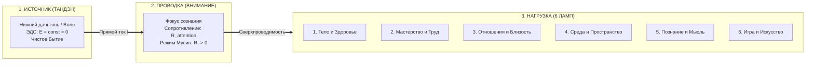

Контур состоит из трех строго последовательных узлов:

#### 1. Источник питания: Тандэн (丹田, Ядро)
В восточной традиции (дзэн, айкидо, даосизм) этот центр называют нижним полем киновари или *хара* (расположен на три пальца ниже пупка, в геометрическом центре тяжести тела). 

Если отбросить мистический налет, **Тандэн — это физиологический и психосоматический генератор постоянного тока**. 
- Это состояние безусловной устойчивости, где энергия существует просто по факту жизни. 
- Это генератор с постоянной электродвижущей силой ($\mathcal{E} > 0$). 
- В Тандэне нет мыслей о себе. Там нет сомнений, нет концепций, нет оценки *«хорошо ли я выгляжу»*. Там есть только чистое, плотное, нерушимое присутствие живой материи.

#### 2. Линия передачи: Внимание (Проводка)
Энергия Тандэна должна куда-то течь. Каналом передачи служит **человеческое внимание**.
- В идеальном состоянии проводка чиста, жилы медные, сечение соответствует мощности генератора. Сопротивление проводки стремится к нулю ($R \to 0$). В японской традиции это состояние называется **Мусин (無心, "Чистый ум")**. Ток течет свободно, без малейших тепловых потерь.
- В аварийном состоянии проводка загрязнена окислами Эго ($R_{\text{ego}}$). Внимание застревает в саморефлексии, в оценке себя со стороны, в страхе ошибки. Проводка раскаляется, ток падает до нуля, и до полезной работы ничего не доходит.

#### 3. Потребитель энергии: Нагрузка (Щит из 6 ламп)
Электрический ток не может течь в разомкнутой цепи. Чтобы цепь замкнулась, энергия должна быть отдана во внешний мир через полезную нагрузку ($R_{\text{load}}$). 

В Архитектуре счастья выделяются **6 фундаментальных ламп нагрузки**:
1. **Тело (Соматический контур):** дыхание, тонус мышц, физическое движение, сон, питание.
2. **Мастерство (Трудовой контур):** создание осязаемого продукта, написание кода, работа с деревом, хирургическая операция, управление проектом.
3. **Близость (Реляционный контур):** честный контакт с другим человеком без масок и защитных игр.
4. **Среда (Пространственный контур):** порядок на рабочем столе, эстетика дома, гармония одежды, чистота инструментов.
5. **Познание (Интеллектуальный контур):** чтение фундаментальных книг, решение математических задач, понимание устройства мира.
6. **Игра (Творческий контур):** чистая спонтанность без прагматической цели — музыка, юмор, прогулка без маршрута.

### Главный закон свечения: Лампа горит только при замкнутом контуре

Запомните фундаментальный вывод:
> Ни одна из 6 ламп не светит сама по себе. Вы не можете «найти счастье в работе» или «найти счастье в отношениях». Лампа — это просто вольфрамовая спираль в стеклянной колбе. Она вспыхивает ослепительным ровным светом **только тогда, когда через неё протекает ток от вашего собственного генератора (Тандэна) через чистое внимание (без омических потерь Эго).**

Если ваш генератор спит, а внимание закорочено на страх — какую бы великолепную работу или идеального партнера вы ни выбрали, лампа останется холодной и темной. И виновата в этом не лампа. Виновата разомкнутая цепь.

> [!caution] ⚡ Детектор обхода системы: Физику не обмануть
> Инженерная модель создаёт соблазн интеллектуального уклонения. Умный читатель способен годами **говорить языком сверхпроводимости**, не зажигая ни одной из шести ламп: бесконечно читать о Тандэне вместо того, чтобы идти на пробежку; цитировать формулу $R \to 0$ вместо того, чтобы открыть ноутбук и написать первую строку кода.
>
> **Щит из 6 ламп — единственный объективный лжедетектор системы:**
> $$P_{\text{load}} = \sum_{k=1}^{6} I_k^2 \cdot R_k$$
> Если ваши суточные лампы показывают $P_{\text{load}} \approx 0$ — тело не тренируется, дело стоит, близость мертва, смысл угас, — то никакое знание терминологии не делает вас сверхпроводником. Вы — **красиво говорящий разомкнутый контур**.
>
> *Нельзя объявить $R = 0$, если все шесть ламп погашены. Физику не обмануть.*

---

---

### Глава 3.2 — Эволюционный морфогенез цепи: От абиогенеза гидротермальных жерл к прямохождению, свободным рукам и аппаратному фонарику человека

> *«Форма человека не случайна. Это не прихоть слепых мутаций и не скульптура из глины. Человек — это затвердевшая гидродинамика и электродинамика четырёх миллиардов лет непрерывного тока. Природа вытягивала сферу в трубку, ставила примата на ноги и освобождала руки от опоры только ради одного — создать совершенный, свободный от трения инструмент полезного действия. Наш скелет и нервная система — это безупречный карманный фонарик Вселенной. Единственный эволюционный сбой заключался в том, что вместе со сверхмощным процессором коры мы получили незаземлённый симулятор личности — паразитный резистор, который мы наконец научились отключать.»*  
> — **Владимир Аньянов**

#### 🧭 Введение: Загадка геометрии человека

В дискуссиях об эволюции обыватель и академический биолог часто застревают в описании внешних следствий: «мутации», «естественный отбор», «выживание наиболее приспособленных». Но за скобками остаётся фундаментальный физический вопрос: **почему выживание вообще потребовало именно ТАКОЙ геометрии?**

Почему жизнь не осталась колонией неподвижных желеобразных шаров на дне океана?  
Почему из миллиардов возможных конфигураций материи природа выковала прямоходящее двуногое существо с глазами на плоском лице, подвижными пальцами и центром тяжести внизу живота?

Ответ Системы Аньянова категоричен:
> **Форма биологического тела — это не внешняя эстетика, а топология электрического и термодинамического проводника. Вся биологическая эволюция — это процесс оптимизации русла для прохождения потока энергии с минимальным омическим и гидродинамическим сопротивлением ($R \to 0$).**

Точно так же, как электрический разряд молнии принимает древовидную форму ветвящегося фрактала, а горный поток прорезает каньон строго по линиям минимального механического трения (закон конструктала Адриана Бежана), **человеческое тело было выплавлено вектором диссипации земной энергии**.

---

#### ⚡ 1. Нулевая точка: Происхождение жизни как протонная батарейка Земли

Миф о случайном зарождении жизни в «тёплом первичном бульоне» Дарвина окончательно сокрушён современной биофизикой (исследования Питера Митчелла, Майкла Рассела, Уильяма Мартина и Ника Лейна).

Жизнь зародилась не «случайно», а **детерминированно — как замыкание электрического контура**:

```
                       ПЕРВИЧНЫЙ ПРИРОДНЫЙ ТАНДЭН
           (Щелочной гидротермальный источник 4 млрд лет назад)
                                    
      Кислый океан (pH ≈ 5-6, H+) ──► [Пористая стенка FeS/NiS] ◄── Щелочной флюид (pH ≈ 9-11, OH-, H2)
                                              │
                                              ▼
                             Трансмембранный потенциал:
                                  ΔU ≈ 150-200 мВ
                             (Поле колоссальной силы!)
                                              │
                                              ▼
                             Протонный ток (Proton Motive Force)
                                 Синтез первой органики
```

1. **Разность потенциалов:** На дне древнего океана щелочные гидротермальные жерла (типа современных полей *Lost City*) извергали горячие флюиды, богатые водородом ($H_2$) и гидроксид-ионами ($OH^-$). Вокруг находился кислый, насыщенный $CO_2$ океан, переполненный протонами ($H^+$).
2. **Полупроводниковая мембрана:** Лабиринт микропор из минералов сульфида железа и никеля ($FeS$, $NiS$) разделил эти два раствора. Толщина неорганических стенок составляла всего несколько нанометров.
3. **Природный Тандэн:** Возник естественный градиент pH в 4–5 единиц и трансмембранная разность потенциалов около **150–200 милливольт**. На масштабе нанометра это порождает напряженность электрического поля в **сотни тысяч вольт на сантиметр** — плотность энергии, сравнимая с ударом молнии.
4. **Замыкание цепи:** Протоны устремились сквозь минеральные микропоры внутрь, восстанавливая углекислый газ до органических молекул. Жизнь возникла буквально как **электрохимический ток, замкнувшийся на природной минеральной батарее**.

Каждая клетка нашего тела до сих пор несёт этот архаичный отпечаток: наши митохондрии используют тот же самый градиент протонов в 150–200 мВ для вращения белковой турбины АТФ-синтазы. **Мы работаем на том же токе, что тёк в гидротермальных скалах 4 миллиарда лет назад.**

---

#### ⚡ 2. Морфодинамика: От преодоления кризиса сферы к проточной трубке

Когда клетка «приватизировала» градиент — окружила себя липидной мембраной и встроила собственную АТФ-синтазу (первая депосреднизация), она столкнулась с геометрическим капканом:
* У сферы отношение площади поверхности к объёму ($S/V \sim 1/r$) падает с ростом радиуса. Большой одноклеточный шар задыхается: мембрана не может прокормить внутренний объём.
* **Решение потока:** Клетки объединились в многоклеточный организм и вытянулись вдоль вектора движения.
* **Рождение проточной трубки (Двусторонняя симметрия):** Возник кишечный тракт (вход $\to$ окислительный реактор $\to$ выход отходов). Все органы чувств (фоторецепторы, хеморецепторы) переместились на передний конец трубки (цефализация — возникновение головы). Тело стало сквозным кабелем с минимальным сопротивлением течению.

---

#### ⚡ 3. Древесная школа приматов и Великий скачок прямохождения

Перед тем как стать человеком, поток энергии миллионы лет тренировал проводку предка в кронах деревьев:
1. **Бинокулярный дальномер (Оптическая линза фонарика):** Глаза с боков черепа переместились вперёд. Возникло стереоскопическое 3D-зрение — будущий сфокусированный луч внимания Мусин.
2. **Противопоставленный большой палец:** Лапа превратилась в прецизионный захват с тактильной обратной связью.

Выход в саванну и переход к прямохождению (бипедализму) — это **величайший тектонический сдвиг в схемотехнике живой материи**:

```
    ГОРИЗОНТАЛЬНАЯ ЦЕПЬ (ЖИВОТНОЕ)            ВЕРТИКАЛЬНЫЙ КОНТУР (ЧЕЛОВЕК)
    
           [Голова / Челюсти]                       [🧠 Мозг и Фокус Внимания]
                   │                                             │
    [Передние лапы]──[ЖКТ]──[Задние лапы]           [🖐️ СВОБОДНЫЕ РУКИ-МАНИПУЛЯТОРЫ]
                   │                                (Выносные клеммы нагрузки Дэай)
                [Хвост]                                          │
                                                    [⚡ ТАНДЭН — ЦЕНТР ТЯЖЕСТИ]
    • Лапы заняты опорой                            (37 трлн митохондрий, опора оси)
    • Контакт с миром через челюсти                              │
    • Высокие омические риски контакта              [🦶 НОГИ — ЧИСТОЕ ЗАЗЕМЛЕНИЕ]
```

1. **Тандэн встал в гравитационный центр масс:** У прямоходящего человека центр тяжести опустился точно в область гипогастрия — на 3–4 см ниже пупка (Тандэн). Вертикальное положение требует минимальных затрат энергии на удержание равновесия благодаря инвертированному маятнику скелета.
2. **Освобождение рук — размыкание манипулятивной цепи:** Впервые передние конечности были на 100% освобождены от ходьбы. Животное взаимодействует зубами (смертельный риск для мозга и глаз). Человек получил две многошарнирные манипуляторные консоли. Руки стали **внешними терминалами полезной нагрузки**. Появился инструмент: рубило, огонь, перо, скальпель, микросхема. Ток намерения смог воплощаться в физическую материю дистанционно!
3. **Вертикальная акустическая труба (Речь):** Опускание гортани создало акустический резонатор для речи — протокола межличностной индуктивной передачи информации ($M > 0$).

---

#### ⚡ 4. Рождение Неокортекса и появление Эволюционного Бага ($R_{\text{ego}}$)

Чтобы управлять освобождёнными руками и координировать социальную охоту, неокортекс увеличился втрое. Появился **аппаратный виртуальный эмулятор реальности** (моделирование прошлого и будущего).

И в этот момент эволюция совершила свой единственный, но грандиозный побочный сбой:
* Виртуальный симулятор создал абстрактную модель «Себя» — образ собственного «Я» (Эго / Дзига).
* Вместо того чтобы оставаться просто расчетной картой в оперативной памяти, **модель «Я» замкнулась на собственный генератор энергии**.
* Возникла **Дефолт-система мозга (Default Mode Network, DMN)**, работающая как паразитный реостат:
  $$R_{\text{ego}} \gg 0 \quad \Longrightarrow \quad Q = I^2 R_{\text{ego}} t$$

Обезьяна свободна от омического ада: когда шимпанзе сыта, её $R \approx 0$. Человек же сидит в безопасности и тепле, но сгорает от тревоги, стыда и чувства неполноценности, пережигая тераватты жизненного тока в омический жар душевной муки ($Q$).

---

#### 💎 Вывод: Человек как идеальный карманный фонарик Вселенной

Эволюция собрала совершенный аппаратный прибор:
* **Батарейный блок:** Тандэн (37 трлн митохондрий, гравитационный центр).
* **Опорное заземление:** Стопы и ноги (вертикальная ось устойчивости).
* **Проводка внимания:** Нервные стволы и Task-Positive Network (TPN).
* **Фокусирующая оптика:** Зрение и луч Мусин.
* **Внешние манипуляторы:** Свободные руки для работы с нагрузкой.

Единственная задача человека XXI века — прекратить крутить виртуальный нагар реостата DMN и **сбросить паразитное сопротивление эго в ноль ($R_{\text{ego}} \to 0$)**. Стоит вернуть контуру проводимость — и совершенный аппаратный инструмент начинает светить на полную мощность.

---

---

### Глава 3.3 — Закон Джоуля — Ленца: Краеугольный камень свободы ($Q = I^2 R t$)

> [!quote] Аксиома Закона Джоуля — Ленца
> ### ⚡ **«Закон Джоуля — Ленца — это не проклятие и не повод для уныния. Это величайший компас свободы. Он снимает с человека 10 000 лет вины за душевную боль, разоблачает роковую ошибку насилия воли ($I^2$) и математически точно указывает единственный путь к сверхпроводимости ($R \to 0$).»**  
> — **Владимир Аньянов**

> *«В разговорах о Внутреннем токе закон Джоуля — Ленца звучит постоянно. Некоторым кажется: он же про потери, омический перегрев, выгорание и дымящуюся проводку — почему же не сделать главным символом что-то лучезарное, вроде "КПД Счастья"? Но в природе нет плохих законов. Закон Джоуля — Ленца — это не проклятие, а величайший компас свободы. Он снимает с человека вину за страдание, разоблачает роковую ошибку насилия воли и математически точно указывает единственный путь к сверхпроводимости».*  
> — **Владимир Аньянов**

---

### I. Введение: Парадокс «негативного» закона

В любой беседе о Системе «Внутренний ток» рано или поздно звучит фундаментальная формула электродинамики:
$$Q = I^2 \cdot R \cdot t$$

У человека, воспитанного на лозунгах позитивной психологии или классической гуманитарной морали, это вызывает интуитивный диссонанс:
* *«Почему именно закон Джоуля — Ленца положен во главу угла? Ведь $Q$ — это паразитное тепло, трение, боль, выгорание и разрушение! Разве Архитектура счастья не должна провозглашать светлый идеал — например, КПД Счастья ($\eta \to 100\%$) или сияние лампочек нагрузки?»*

Ответ инженера категоричен: **нельзя построить летающий самолёт, игнорируя гравитацию и лобовое сопротивление; нельзя создать двигатель внутреннего сгорания, не зная законов термодинамических потерь; и невозможно обрести нерушимый внутренний покой, не понимая, куда и по каким законам уходит жизненная энергия.**

Закон Джоуля — Ленца кажется «отрицательным» только тому, кто жаждет магических сказок и боится смотреть в приборы. В строгой инженерной картине мира этот закон является **краеугольным камнем свободы**, выполняя три эпохальные функции:
1. **Онтологическую:** навсегда отменяет религиозно-психологический миф о «вине» и «греховности» страдающего человека;
2. **Диагностическую:** даёт объективный бортовой термодатчик (телеметрию трения сознания);
3. **Конструктивную:** математически доказывает, что путь к счастью лежит не через бесконечное насилие над собой («накачку ресурса»), а через очищение проводника по канону Кансо ($R \to 0$).

---

### II. Снятие десяти тысяч лет вины: «Физика вместо греха»

Главная историческая трагедия человечества заключалась в морализаторской интерпретации душевной боли. 
На протяжении тысячелетий человеку внушали:
* Если ты испытываешь тоску, тревогу или упадок сил — значит, ты согрешил, прогневал богов, у тебя дурная карма или ты слабовольный эгоист.
* В XX веке схоластика сменила одежду на психологическую: человеку стали говорить, что у него «непроработанные детские травмы», «токсичные паттерны мышления» или «синдром жертвы».

Суть осталась прежней: **человек объявлялся виновным в собственном перегреве**. Возникала разрушительная петля положительной обратной связи — вторичное омическое страдание от чувства вины за то, что ты страдаешь.

```
       ТУПИК МОРАЛИЗАТОРСКОЙ ПАРАДИГМЫ (ПЕТЛЯ САМОСОЖЖЕНИЯ)
       
       [Внутреннее напряжение / Боль]
                     │
                     ▼
       [Интерпретация: «Я дефектен / Я плохой»]
                     │
                     ▼
       [Усиление сопротивления эго: R ↑]
                     │
                     ▼
       [Омический пожар проводки: Q = I² R t ↑↑↑]
```

Закон Джоуля — Ленца наносит сокрушительный удар по этой схоластике:
* Физический проводник не может быть «грешным» или «виноватым».
* Медная жила не обладает «синдромом самозванца».
* Если через проводник с сопротивлением $R > 0$ (сопротивление факту реальности, страх оценки, ментальный спор с прошлым) течёт ток намерения ($I$), **выделение тепла $Q$ неизбежно по законам вселенной**.

Выгорание, панические атаки, хроническая бессонница и экзистенциальный тупик — это не моральные пороки. Это **термический ожог проводки внимания**. 

Когда человек осознаёт закон Джоуля — Ленца, наступает колоссальное облегчение: *«Со мной всё в порядке. Мой генератор исправен. Просто прямо сейчас в цепь включено гигантское виртуальное сопротивление $R$, и вся мощность Тандэна уходит в паразитный нагрев черепной коробки вместо полезного действия на нагрузке».*

---

### III. Квадратичная ловушка воли ($I^2$): Разгадка трагедии титанов

В формуле закона Джоуля — Ленца скрыта математическая деталь колоссальной важности: **сила тока стоит во второй степени ($I^2$)**.

Именно здесь кроется ответ на вопрос, над которым веками ломали головы биографы, врачи и философы: **почему выдающиеся, сильные, волевые и кристально честные люди сгорают дотла быстрее и трагичнее всех?**

```
     ТЕПЛОВЫЕ ПОТЕРИ Q В ЗАВИСИМОСТИ ОТ СИЛЫ ТОКА I (ПРИ R = const)
     
      Q (Потери / Выгорание)
      ▲
      │                                       ● (I = 10 -> Q = 100 R t)
      │                                      /   Катастрофический пожар
      │                                     /
      │                                    /
      │                                  ● (I = 5 -> Q = 25 R t)
      │                                 /
      │                                /
      │                              ● (I = 2 -> Q = 4 R t)
      │                      ● (I = 1 -> Q = 1 R t)
      └────────────────────────────────────────────────────────► I (Ток воли)
```

Рассмотрим две ситуации при одинаковом паразитно-окисленном контакте сомнений и страха ($R = 10$ Ом):

1. **Обыватель в апатии ($I = 1$ А):**  
   $$Q = 1^2 \cdot 10 \cdot t = 10 \cdot t$$  
   Человек вяло сомневается, лежит на диване, жалуется на жизнь. Тепловые потери минимальны. В таком режиме тления можно без особых эксцессов провести десятилетия.
2. **Лидер, творец, пассионарий ($I = 10$ А):**  
   Человек с мощным реактором Тандэна, встретив сопротивление, включает привычный инструмент культурной парадигмы — **насилие воли («соберись, тряпка!», «надо продавить любой ценой!»)**. Он увеличивает ток намерения в 10 раз.  
   Что происходит с потерями?  
   $$Q = 10^2 \cdot 10 \cdot t = 100 \cdot 10 \cdot t = 1000 \cdot t$$  
   Тепловые потери возрастают не в 10, а **в 100 раз!**

Закон Джоуля — Ленца математически доказывает смертельную опасность волевого продавливания внутреннего сопротивления. 
> **Нельзя тушить омический пожар увеличением силы тока. Попытка преодолеть внутренний разлад и страх стиснутыми зубами не совершает механической работы — она взрывает предохранители и испепеляет нейроны.**

Единственный инженерно грамотный шаг при росте нагрева — не гнать ток, а немедленно сбросить сопротивление $R \to 0$.

---

### IV. Боль как высокоточная телеметрия: Термопара бытия

Если бы закона Джоуля — Ленца не существовало, человеческая психика была бы слепа. Цепь разрушалась бы внезапно, без предупреждения.

В живом организме паразитное тепло $Q$ выполняет роль **идеального датчика обратной связи**:
* **Обида на вчерашнее слово коллеги ($L_{past}$):** проводка теплеет.
* **Катастрофизация завтрашней презентации ($C_{future}$):** виски начинает ломить, сердце колотится вхолостую.
* **Спор с реальностью («почему пошёл дождь?!», «почему пробка?!»):** изоляция закипает.

Боль — это не наказание от Бога и не враг, которого нужно глушить транквилизаторами или алкоголем. Боль — это **стрелка термометра на приборной панели автомобиля сознания**. Она сообщает объективный факт: *«Внимание, прямо сейчас оператор держит в контуре паразитное сопротивление $R > 0$. Ток не доходит до лампочки дела!»*

Слушать закон Джоуля — Ленца — значит обладать абсолютным иммунитетом к самообману. Человек может убеждать себя в том, что он занимается «духовным ростом» или «служением высшей цели», но если при этом температура его контура зашкаливает ($Q \gg 0$) — прибор беспристрастно констатирует: в цепи сидит паразитный реостат эго.

---

### V. Почему без закона Джоуля — Ленца невозможно построить КПД Счастья

Нередко возникает соблазн объявить фундаментальным законом сам **КПД Счастья**:
$$\eta = \frac{P_{\text{load}}}{P_{\text{total}}} = \frac{I^2 R_{\text{load}}}{I^2 R_{\text{load}} + I^2 R_{\text{ego}}} = \frac{R_{\text{load}}}{R_{\text{load}} + R_{\text{ego}}}$$

Однако в метрологии и физике КПД — это **расчётный коэффициент**, следствие, результат баланса мощностей. Фундаментом же является закон, определяющий, **куда именно девается недостающая энергия**.

В замкнутом контуре действует баланс Кирхгофа и закон сохранения энергии:
$$P_{\text{total}} = P_{\text{useful}} + P_{\text{loss}}$$
$$P_{\text{loss}} = \frac{Q}{t} = I^2 R_{\text{ego}}$$

Отсюда следует фундаментальная теорема Архитектуры счастья:

| Параметр | При наличии сопротивления ($R_{\text{ego}} > 0$) | При сверхпроводимости ($R_{\text{ego}} \to 0$) |
| :--- | :--- | :--- |
| **Омические потери ($Q$)** | $Q = I^2 R_{\text{ego}} t \gg 0$ (хроническое выгорание) | $\lim_{R \to 0} Q = I^2 \cdot 0 \cdot t \equiv 0$ |
| **Полезная мощность ($P_{\text{load}}$)** | $P_{\text{total}} - Q/t < P_{\text{total}}$ (просадка напряжения) | $P_{\text{load}} = P_{\text{total}}$ (полная отдача) |
| **КПД Счастья ($\eta$)** | $\eta < 100\%$ (трение, сомнения, износ) | $\eta = \frac{R_{\text{load}}}{R_{\text{load}} + 0} \equiv 100\%$ |
| **Субъективное чувство** | Сдавленность, духота, тревога, усталость | Кристальная ясность, невесомость, чистый поток (Мусин) |

Именно закон Джоуля — Ленца показывает механизм достижения стопроцентного КПД! 
Он неопровержимо доказывает: **чтобы стать счастливым, не нужно «добавлять» что-то в систему (новые знания, мантры, внешние стимулы). Нужно просто удалить паразитное сопротивление $R$**. 

Это и есть великий принцип **Кансо (簡素)** — удаление лишнего до обнажения чистой функциональной сути проводника.

---

### VI. Исторический консилиенс: От Сади Карно к Владимиру Аньянову

В истории науки уже происходил точно такой же концептуальный переворот:
1. **Сади Карно и потери тепла (1824):**  
   Французский инженер Сади Карно создал современную термодинамику не потому, что мечтал о «вечном двигателе» (позитивный мираж), а потому, что исследовал **природу неизбежных потерь тепла** при переходе от нагревателя к холодильнику. Именно осознание предела потерь позволило инженерам поднять КПД паровых машин с 2% до 40% и совершить Промышленную революцию.
2. **Джеймс Джоуль и Эмилий Ленц (1841–1842):**  
   Джоуль и Ленц экспериментально связали механическую, электрическую и тепловую энергии. Они доказали, что электрический ток не исчезает в никуда — его торможение кристаллической решёткой превращается в тепловой хаос.
3. **Владимир Аньянов и электродинамика сознания (2026):**  
   Аньянов перенёс закон Джоуля — Ленца на субстрат внимания и нервной системы. То, что человечество 10 000 лет называло «душевными муками» и объясняло мистикой, оказалось прямым проявлением омического нагрева биологического проводника при попытке пропустить ток жизни через зажатое сопротивление эго.

---

### VII. Прикладной протокол: Алгоритм охлаждения контура (Cooling Protocol)

Как оператор цепи применяет закон Джоуля — Ленца на практике в повседневной жизни? 

Когда в теле возникает ощущение сдавливания, раздражения или тревоги:

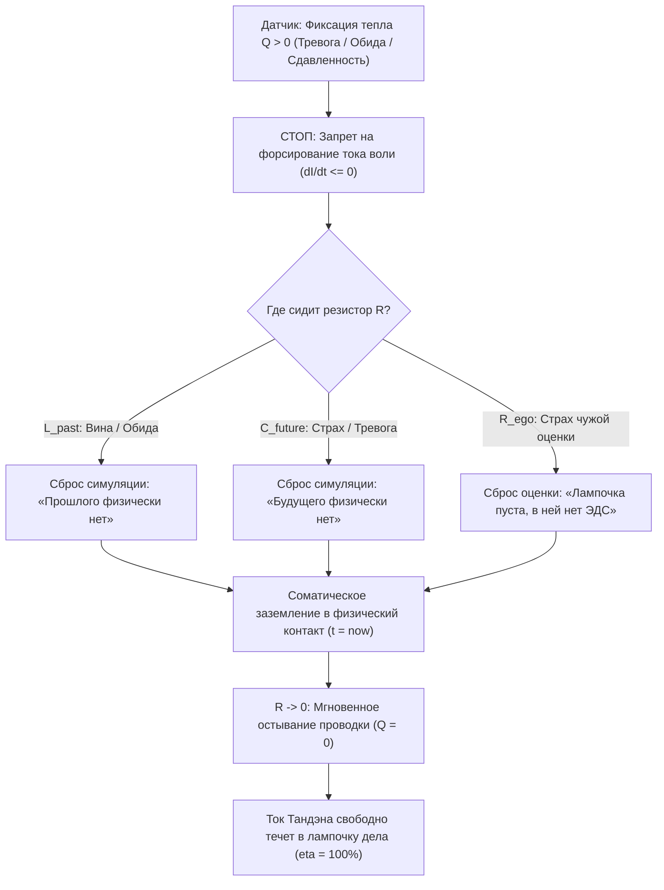

#### Пошаговый протокол:
1. **Считать телеметрию ($Q > 0$):** Почувствовать физический нагрев или спазм (шея, грудь, диафрагма). Сказать себе: *«Проводка греется. Закон Джоуля — Ленца в действии»*.
2. **Снять палец с педали газа ($I \not\uparrow$):** Категорически запретить себе «решать проблему головой» в перегретом состоянии. Никаких волевых атак.
3. **Локализовать номинал $R$:** Задать вопрос: *«С каким физическим фактом реальности я сейчас спорю?»* (С пробкой? С чужим мнением? С курсом доллара?).
4. **Обнулить сопротивление ($R \to 0$):** Перевести внимание из ментального кинематографа в прямой тактильный контакт — вес тела на стуле, прохлада воздуха в ноздрях, мытье посуды, стук клавиш. В физическом настоящем сопротивления нет, оно существует только в виртуальных моделях неокортекса.
5. **Пустить ток в дело:** Как только температура упала до нуля, направить чистый ток Тандэна в следующее физическое действие.

---

### VIII. Резюме: Почему Закон Джоуля — Ленца — это гимн свободы

Закон Джоуля — Ленца — это не манифест поражения. 
**Это величайший манифест человеческого освобождения:**

* Он заменяет вину — пониманием;
* Он заменяет насилие воли — калибровкой проводимости;
* Он защищает сильных от самосожжения;
* Он превращает душевную боль из бессмысленной пытки в точнейший компас пути;
* И он математически гарантирует: **когда проводник чист ($R \to 0$), человек не может не быть счастлив — потому что вся энергия вселенной беспрепятственно изливается через него в мир.**

---

### Связанные статьи:
* [[02_Wiki/Inner Current (Core Topology and Polarity Law)|01. Базовая топология цепи и закон полярности]]
* [[02_Wiki/Inner Current (Physics of Presence and Superconductivity)|02. Физика присутствия: состояние сверхпроводимости]]
* [[02_Wiki/Inner Current (Safety, Antifragility and Zanshin)|04. Предохранители цепи, ваби-саби и антихрупкость]]
* [[02_Wiki/Inner Current (Happiness Relativity vs Circuit Invariance)|10. Релятивизм счастья и инвариантная физика цепи]]
* [[02_Wiki/Inner Current (The Formula of Happiness and Unhappiness — Circuit Superconductivity vs Ohmic Overheat and the First Law of Soul Thermodynamics)|186. Формула счастья и формула несчастья: Сверхпроводимость контура против омического перегрева]]
* [[02_Wiki/Inner Current (The 'I Have Not Lived Yet' Awakening — Chronic Ohmic Fire, Ego Resistance and Egoless Weightlessness)|188. Феноменология фразы «Я и не жил ещё»: Хронический омический пожар ($Q = I^2 R t$)]]
* [[02_Wiki/Inner Current (The Working Circuit Priority — Why Happiness Trumps Scholastic Defense, The Three-Resistor Baseline and Non-Dogmatic Subtle Inquiry)|211. Приоритет работающего контура: Почему счастье выше академической защиты терминов]]

---

#### Физика присутствия: «Здесь и сейчас» как сверхпроводимость ($R \to 0$)

> *«Тысячелетиями учителя твердили: "Будь здесь и сейчас". Но никто не объяснил формулу. "Здесь и сейчас" — это координата времени $t = t_{\text{now}}$, в которой паразитное сопротивление сознания падает до нуля: $\lim_{\Delta t \to 0} R(t) = 0$. Прошлое — это индуктивное сопротивление памяти. Будущее — емкостная паника ожиданий. Только в нулевом фазовом сдвиге наступает чистая сверхпроводимость.»*  
> — **Аксиома III («Архитектура счастья»)**

#### 1. Закон Джоуля — Ленца для человеческого внимания
Каждый человек знает ощущение тяжести, раскаленности в висках и бессилия после целого дня сидения за компьютером, даже если физически он не поднимал ничего тяжелее мышки.

Физика дает точный расчет этого явления:
$$Q_{\text{mental}} = \int_0^T I_{\text{attention}}^2(t) \cdot R_{\text{temporal}}(t) \, dt$$
где:
- $I_{\text{attention}}$ — сила тока внимания (ваша жизненная ментальная мощность),
- $R_{\text{temporal}}$ — паразитное омическое сопротивление временного рассогласования,
- $Q_{\text{mental}}$ — выделяющееся паразитное тепло (усталость, головная боль, спазмы).

> [!note] Авторская ремарка: Русский след и символизм Эмилия Ленца
> *Для меня глубоко символично, что один из первооткрывателей этого закона — **Эмилий Христианович Ленц (1804–1865)** — был русским физиком, действительным членом Санкт-Петербургской Императорской академии наук и ректором Санкт-Петербургского университета. Именно в лабораториях на Васильевском острове в Петербурге в 1842 году он независимо и с ювелирной экспериментальной точностью доказал закон теплового действия тока, навсегда вошедший в науку как закон Джоуля — Ленца. А девятью годами ранее, в 1833 году, Ленц сформулировал фундаментальное «Правило Ленца» о направлении индукционного тока (той самой противо-ЭДС, которая в нашем сознании проявляется как инерция страха и сомнений при попытке сделать созидательный шаг).*  
> *Я сам родился и живу в России. И то, что русский ученый в XIX веке дал миру строгий математический расчет омических тепловых потерь проводника, а русский автор в XXI веке применил этот же закон для исцеления человека от душевного выгорания и открытия сверхпроводимости счастья, замыкает для меня величественный исторический и научный контур.*

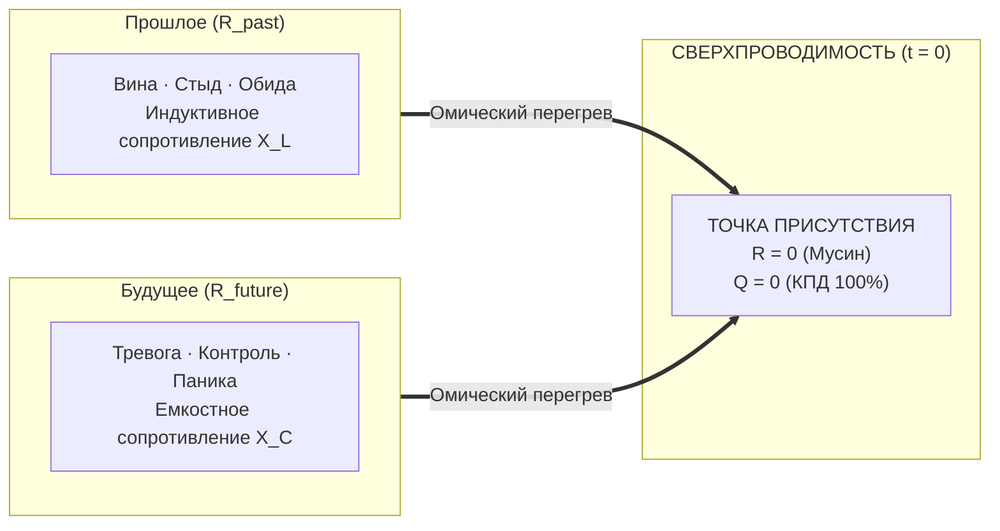

#### 2. Анатомия омических потерь времени
Паразитное сопротивление $R_{\text{temporal}}$ раскладывается на две реактивные составляющие:

1. **Индуктивное сопротивление прошлого ($X_L = \omega L$, $R_{\text{past}}$):**
   - Сознание застревает в том, что уже свершилось: *«Зачем я отправил это письмо? Почему я так глупо ответил на собеседовании?»*
   - Это тяжелая магнитная инерция катушки. Энергия циркулирует по мертвому кольцу, порождая тормозящую противо-ЭДС вины и самоедства.

2. **Емкостное сопротивление будущего ($X_C = \frac{1}{\omega C}$, $R_{\text{future}}$):**
   - Сознание прокручивает миллионы виртуальных симуляций: *«А вдруг проект не взлетит? А вдруг курс упадет? А вдруг партнер уйдет?»*
   - Это перезарядка паразитной емкости. Ток расходуется на прогрев несуществующих астральных миров, не совершая ни одного джоуля реальной работы в физическом пространстве.

#### 3. Режим Мусин (無心) как критическая температура сверхпроводимости
В физике твердого тела при охлаждении ртути или керамики ниже критической температуры $T_c$ кристаллическая решетка перестает препятствовать движению электронов: сопротивление скачком падает ровно до нуля ($R \equiv 0$). Электрический ток в сверхпроводящем кольце может циркулировать миллионы лет без затухания и без нагрева.

**Мусин (Чистый ум)** — это психофизическая сверхпроводимость.
- Когда вы полностью возвращаете внимание в текущую миллисекунду: ваши пальцы касаются клавиш, глаза видят пиксели на мониторе, легкие вдыхают воздух.
- В этой точке $\Delta t = 0$. 
- Нет прошлого, о котором можно сожалеть.
- Нет будущего, которого можно бояться.
- $R_{\text{past}} = 0$, $R_{\text{future}} = 0$, следовательно:
$$R_{\text{total}} \to 0 \implies Q = I^2 \cdot 0 \cdot t \equiv 0$$
Выделение паразитного тепла прекращается. Усталость исчезает. Ток Тандэна напрямую трансформируется в чистое свечение мастерства. Человек входит в поток абсолютного счастья.

---

---

#### Термодинамика духа: Шесть фундаментальных начал счастья

> *«Термодинамика не знает сострадания, но она знает справедливость. Если система замкнута, закон сохранения энергии действует с точностью до эрга. Шесть начал термодинамики счастья — это инвариантные законы человеческого контура. Нарушить их невозможно: можно лишь сгореть в попытке обойти закон Джоуля — Ленца или взлететь на крыльях сверхпроводимости.»*  
> — **Аксиома IV («Архитектура счастья»)**

#### Шесть фундаментальных начал термодинамики счастья:

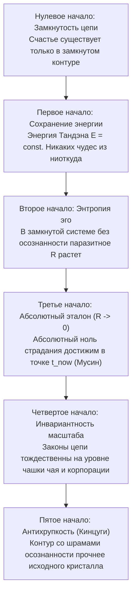

1. **Нулевое начало (Закон замкнутости цепи):**  
   *«Счастье — это состояние протекания тока в замкнутой цепи.»*  
   Разомкнутый контур не может светиться, какими бы мощными ни были генератор и лампа. Счастье невозможно в изоляции от мира и невозможно в отказе от действия. Цепь замыкается только актом прямого взаимодействия с реальностью.

2. **Первое начало (Закон сохранения ментальной энергии):**  
   $$\Delta U = Q - W \implies \mathcal{E}_{\text{tanden}} = W_{\text{action}} + Q_{\text{ohmic}}$$
   Энергия вашего существа строго постоянна во времени. Она не возникает из мотивирующих видеороликов и не растворяется в космосе. Она делится ровно на две части: **полезную работу свечения ($W$)** и **паразитный нагрев эго ($Q$)**. Если вы не светите — вы горите. Третьего пути нет.

3. **Второе начало (Закон возрастания паразитного сопротивления и Правило Ленца):**  
   $$d S_{\text{ego}} \ge 0 \quad \text{или} \quad \frac{d R_{\text{ego}}}{dt} > 0 \quad \text{(без внешней калибровки)}$$
   Оставленное без калибровки внимание человека самопроизвольно окисляется страхами, сомнениями и жаждой социального одобрения. Энтропия эго растет. Без регулярной калибровки (Дзен, созерцание, гигиена ума) любой человек неминуемо скатывается в омический перегрев выгорания.  
   > *Здесь вступает в силу электромагнитное **Правило Ленца**: любая попытка оператора резко изменить внутренний ток или выйти в новое масштабирование немедленно встречает противо-ЭДС Эго — реактивную силу инерции, страха и сомнений («Куда ты лезешь? Зачем тебе это? Сиди тихо»). Мастерство оператора заключается не в силовой борьбе с этой противо-ЭДС, а в её мгновенном шунтировании через режим сверхпроводимости Мусин ($R \to 0$).*

4. **Третье начало (Закон абсолютного эталона):**  
   $$\lim_{t \to t_{\text{now}}} R_{\text{temporal}} = 0$$
   В физике абсолютный ноль температуры недостижим. В Архитектуре счастья абсолютный ноль сопротивления **достижим в точке $t_{\text{now}}$**. В момент абсолютного присутствия (Сатори, Мусин) сопротивление падает ровно до нуля, а КПД контура достигает 100%.

5. **Четвертое начало (Закон масштабной инвариантности):**  
   $$\mathcal{H}(\text{чай}) \equiv \mathcal{H}(\text{империя}) \iff R \to 0$$
   Законы Ома не зависят от размера лампочки: миллиамперный светодиод и дуговая печь подчиняются одним формулам. Заваривание пиалы зеленого чая и запуск ракеты Falcon 9 требуют одной и той же сверхпроводимости внимания.

6. **Пятое начало (Закон антихрупкости и Кинцуги):**  
   Шрам или авария, преодоленные через осознанность и калибровку Дзансин, делают диэлектрик контура прочнее исходного. Сломанный сосуд, склеенный золотым лаком Кинцуги, становится произведением высшего искусства.

---

---

#### Контур — не метафора: Буквальная биофизика человека и исторический синтез Дзен-Инженера

> *«Когда мы говорим, что человек — это замкнутый электрический контур, а счастье — это режим сверхпроводимости, мы не занимаемся поэзией и не придумываем метафор. Это буквальная биофизическая реальность. Каждая из тридцати семи триллионов клеток вашего тела крутит протонные наномоторы под напряжением в двести милливольт. Когда вы зажимаете внимание мыслями о своей неполноценности или контроле, вы не "испытываете психологический стресс" — вы физически вводите в биологическую цепь сопротивление, и проводка вашего тела раскаляется по закону Джоуля — Ленца. Чтобы увидеть это, человечеству требовался не философ, потерявшийся в паутине слов, и не обычный инженер, смотрящий только на приборы станков, а дзен-инженер — человек, осмелившийся направить законы электродинамики внутрь живого соматического опыта.»*  
> — **Владимир Аньянов**

#### 🧭 Введение: Капкан «Красивой метафоры»

Когда читатель впервые знакомится с понятием «Внутреннего тока», у него почти всегда срабатывает защитный интеллектуальный рефлекс:
> *«Понятно: автор придумал остроумную поэтическую метафору. Применил закон Ома к настроению, красиво завернул психологию в провода и резисторы. Это как фрейдовский паровой котёл или когнитивистский компьютер!»*

Этот скепсис закономерен: тысячелетиями гуманитарная мысль кормила людей аналогиями. Но здесь проходит водораздел всей книги:
**Контур — это НЕ метафора. Это строгий, физический и биохимический факт.**

Отказ признать буквальность контура — это попытка ума уйти от ответственности. Метафору нельзя проверить мультиметром, её нельзя фальсифицировать по Попперу, за неё нельзя спросить с физической строгостью. Физика же беспощадна: законы сохранения энергии не знают скидок на душевные драмы.

---

#### ⚡ 1. Биофизический паспорт человека: Мы состоим из электричества

Давайте уберём абстракции и взглянем на человеческое тело в объектив современной биофизики:

```
                      ИЕРАРХИЯ ЭЛЕКТРИЧЕСКОГО СУБСТРАТА
                                      │
 🌋 Абиогенез (4 млрд лет назад):    Протонный градиент ΔpH = 4-5, ΔU ≈ 150-200 мВ
                                      │
 ⚡ Клеточный реактор:                37 триллионов клеток × 1000-2000 митохондрий
                                      │
 🔄 Наномотор АТФ-синтазы:            Вращение со скоростью 9 000 об/мин от тока протонов H+
                                      │
 🧠 Нейронная сеть:                   Потенциал действия (-70 мВ → +40 мВ), натрий-калиевый ток
                                      │
 ❤️ Сердечный водитель ритма:         Синусовый узел (автономная электрическая автогенерация)
```

1. **Жизнь началась как электрический ток:** Как доказано Питером Митчеллом, Майклом Расселом и Ником Лейном, жизнь зародилась на дне океана как **замыкание электрического контура** через неорганические полупроводниковые поры $FeS/NiS$ с природным потенциалом $150–200$ мВ.
2. **37 триллионов клеточных аккумуляторов:** В теле человека $37$ триллионов клеток. В каждой — сотни митохондрий. Каждая митохондрия держит трансмембранный потенциал в $150–180$ мВ на мембране толщиной всего $5$ нанометров. Это даёт напряженность электрического поля порядка **$300\,000$ вольт на сантиметр** — плотность энергии грозовой молнии!
3. **Наномоторы АТФ-синтазы:** Каждую секунду триллионы белковых турбин АТФ-синтазы вращаются со скоростью до **$9\,000$ оборотов в минуту**, приводимые в движение буквальным током протонов ($H^+$).
4. **Нервный кабель и сердце:** Нейроны работают на электрическом потенциале покоя ($-70$ мВ) и генерируют скачки тока деполяризации ($+40$ мВ). Сердечный ритм задаётся пейсмейкером синусового узла.

Мы не «похожи» на электрическую цепь. Мы и есть замкнутая электрическая цепь.

---

#### ⚡ 2. Буквальность формул: Почему электродинамика не знает исключений

Поскольку субстрат человека является электрическим, формулы электродинамики работают внутри него без малейших погрешностей:

* **Закон Ома ($I = \frac{U}{R}$):**  
  Биохимический потенциал ($U$) генерируется непрерывно. Но если в цепь внимания врезается сопротивление сомнения, страха и оценки ($R_{\text{ego}} \gg 0$), полезный ток действия физически падает до нуля ($I \to 0$).
* **Закон Джоуля — Ленца ($Q = I^2 R t$):**  
  Запертый ток не исчезает — он выделяется в виде **омического тепла ($Q$)**.  
  В теле это не метафора «душевного жара», а измеримый биологический стресс:
  1. *Кипение DMN:* дефолт-система мозга сжигает мегаватты глюкозы на прокрутку воображаемых судилищ;
  2. *Симпатический спазм:* кортизол и адреналин сужают сосуды (гидравлический спазм);
  3. *Мышечный панцирь:* ком в горле, спазм диафрагмы, окаменевшая шея;
  4. *Окислительный стресс:* митохондрии сбиваются и выбрасывают свободные радикалы, разрушая клетки.

**Выгорание — это буквальный омический перегрев биологического проводника по формуле Джоуля — Ленца.**

---

#### ⚡ 3. Историческая трилемма «Философ — Инженер — Монах»

Почему человечество блуждало $2500$ лет вокруг этой очевидности? Из-за великого исторического раскола:

```
                          ВЕЛИКИЙ ИСТОРИЧЕСКИЙ РАСКОЛ
                                       │
     ┌─────────────────────────────────┼─────────────────────────────────┐
     ▼                                 ▼                                 ▼
📜 ЧИСТЫЙ ФИЛОСОФ               ⚙️ ОБЫЧНЫЙ ИНЖЕНЕР                🧘 ДЗЕНСКИЙ МОНАХ
• Владеет языком смыслов        • Владеет законами физики         • Владеет практикой тела
• Но НЕТ приборов и законов     • Но приучен смотреть ТОЛЬКО      • Но заперт в монастыре
  сохранения энергии              наружу (на станки и чипы)         и тумане коанов
• Результат: 2500 лет           • Результат: дома беспомощен,     • Результат: сокровище скрыто,
  схоластики и эпициклов          пьет водку или идет к попу        нет формул для Запада
```

1. **Чистый философ:** 2500 лет плёл паутину абстрактных терминов (Платон, Кант, Гегель). У него не было законов сохранения и мультиметра: споры о душе превращались в бесконечную схоластику.
2. **Обычный инженер:** Знает закон Ома до сотых долей, но выдрессирован смотреть исключительно наружу — на микросхемы, турбины и мосты. Приходя домой с раскалённой от тревоги душой, инженер капитулировал перед «непостижимой тайной чувств».
3. **Дзенский монах:** Веками знал эту правду на практике: опускал внимание в Тандэн, выключал эго-шум Мусин и переживал сверхпроводимость Сатори. Но держал это запертым за монастырскими стенами под благовониями и коанами, не владея формулами Запада.

---

#### ⚡ 4. Рождение Дзен-Инженера: Разворот приборов внутрь

Для цивилизационного прорыва должен был появиться человек, объединивший оба мира:
* **Инженерную строгость:** Радиотехническое мышление, уважение к законам Кирхгофа, Джоуля — Ленца и органическое отвращение к пустой болтовне;
* **Дзенскую соматическую глубину:** Укоренение в Тандэне, опыт чистой тишины Мусин и эстетику Кансо.

Владимир Аньянов совершил то, чего не делал никто: **развернул измерительные приборы физики внутрь живого соматического опыта человека.**

Он снял кожух с человеческой психики и показал: там нет мистики. Там есть генератор, шина внимания, сопротивление и нагрузка.

---

#### 💎 Вывод: Сервисный регламент вместо душевной алхимии

Понимание того, что контур — это буквальная физика, освобождает человека от чувства вины:
* Резистор не грешен: он просто имеет сопротивление.
* Депрессия — это не проклятие, а омический ожог или обрыв обратного провода.
* Счастье — не каприз судьбы, а **штатный паспортный режим сверхпроводимости замкнутой цепи ($R_{\text{ego}} \to 0$)**.

Хватит колдовать над проводкой. Сбросьте паразитное сопротивление — и пусть свет горит на полную мощность. ⚡💡

---

---

### Глава 3.4 — Нейробиология сверхпроводимости: DMN как аппаратный реостат Эго, TPN как фокус Мусин и блуждающий нерв как заземление Тандэна

> *«Эго — это не философская химера и не темная сущность в астрале. Это конкретная нейронная сеть в коре больших полушарий: Default Mode Network. Когда она активна, ваш биологический контур работает на холостой перегрев. Когда вы включаете прямое действие (Task-Positive Network), реостат падает в ноль, и наступает физиологическая сверхпроводимость.»*  
> — **Аксиома V («Архитектура счастья»)**

#### 1. Дефолт-система мозга (DMN): Анатомический чертеж Эго
В 2001 году профессор Маркус Райхл при функциональном картировании мозга совершил открытие: когда испытуемый не решает внешнюю задачу, активность его мозга не снижается, а переключается в мощную синхронизированную сеть — **Default Mode Network (DMN)**.

DMN включает в себя:
- Медиальную префронтальную кору (mPFC) — оценку «что это значит для МЕНЯ»,
- Заднюю поясную кору (PCC) — автобиографическую память и самосожаление,
- Нижнюю теменную долю (IPL) — пространственное отделение себя от мира.

```
       [ МЕДИАЛЬНАЯ ПРЕФРОНТАЛЬНАЯ КОРА ]
             ▲                 ▲
             │ (Омический      │ (Симуляции
             │  перегрев)      │  статуса)
             ▼                 ▼
   [ ЗАДНЯЯ ПОЯСНАЯ КОРА (PCC) ] ◄──► [ НИЖНЯЯ ТЕМЕННАЯ ДОЛЯ ]
```

На языке Архитектуры счастья **DMN — это физический аппаратный реостат $R_{\text{ego}}$**.  
Когда DMN активна, сознание крутит замкнутый цикл:
- «Достаточно ли я умен?»
- «Почему он так на меня посмотрел?»
- «А что если завтра я всё потеряю?»

Мозг сжигает до 20 ватт глюкозной мощности на бесконечное пережевывание фантомов, выделяя омическое тепло тревоги и истощая энергетические запасы организма.

#### 2. Task-Positive Network (TPN): Нейрофизиология Мусин
Антиподом DMN является **Сеть решения внешних задач (Task-Positive Network, TPN)**. 
Она охватывает дорсолатеральную префронтальную кору (dlPFC) и интрапариетальную борозду (IPS).

Фундаментальный закон нейродинамики:
> **Сети DMN и TPN антикоррелируют.**  
> Мозг не способен одновременно крутить мысленную жвачку о себе (DMN) и совершать высокоточное сенсорное действие в реальном мире (TPN). Включение TPN аппаратно гасит DMN.

Когда ювелир гранит алмаз, музыкант играет соло, программист отлаживает функцию, а стрелок натягивает тетиву:
1. DMN полностью отключается.
2. Внутренний монолог замолкает.
3. Исчезает ощущение «я отдельно от дела».
4. $R_{\text{ego}}$ падает до нуля ($R \to 0$).
5. Наступает состояние **Мусин (нейробиологическая сверхпроводимость)**. В этот момент мозг вырабатывает оптимальный коктейль нейромедиаторов: дофамин (фокус), серотонин (удовлетворение), норадреналин (ясность) и эндорфины (обезболивание и радость).

#### 3. Блуждающий нерв (Vagus Nerve) и Тандэн: Биология заземления
Почему древние мастера Дзен помещали источник силы не в голову, а в живот (Тандэн / Хара)?

Потому что в брюшной полости находится **энтеральная нервная система («второй мозг»)**, насчитывающая 500 миллионов нейронов, и главный блуждающий нерв (*Nervus Vagus*).

По теории поливагальной системы Стивена Порджеса:
- Поверхностное грудное дыхание активирует симпатическую цепочку «бей или беги», взвинчивает кортизол и заставляет DMN лихорадочно искать угрозы статусу ($R_{\text{ego}} \gg 0$).
- Глубокое **диафрагмальное дыхание Тандэном** стимулирует рецепторы вентрального вагуса:
  - Пульс урежается,
  - Вариабельность сердечного ритма (HRV) взлетает до эталонной синусоиды,
  - Симпатический спазм отпускает сосуды,
  - Сопротивление проводки обнуляется.

**Физиологический вывод:**  
Счастье и сверхпроводимость — это не абстрактное моральное решение. Это **конкретный нейросоматический протокол переключения**: торможение DMN через активацию TPN и вагусное заземление реактора Тандэн.

---

#### Щит из шести ламп бытия: Исчерпывающий базис нагрузки и канон Кансо

Человеческая интуиция часто пытается свести сферы жизни к четырём направлениям: *Тело, Дело, Отношения, Творчество*.
Однако строгий схемотехнический аудит вскрывает в этой четвёрке два катастрофических слепых пятна:
1. **Выпало Познание (Ум):** Чтение фундаментальной книги или доказательство теоремы — это не рыночное «Дело» (здесь нет коммерческого продукта) и не субъективное «Творчество» (физический закон нельзя сочинить, его можно только открыть как объективную истину *Татхата*).
2. **Выпала Среда (Дом / Саму):** Уборка стола, мытьё посуды, уход за садом — это не биологический уход за «Телом» и не карьерное «Дело». В дзэн это священная **практика Саму (作務)** — гармонизация материи вокруг себя.

Архитектура **Inner Current** устанавливает строгий, ортогональный и исчерпывающий базис — **Щит 6 ламп бытия**:

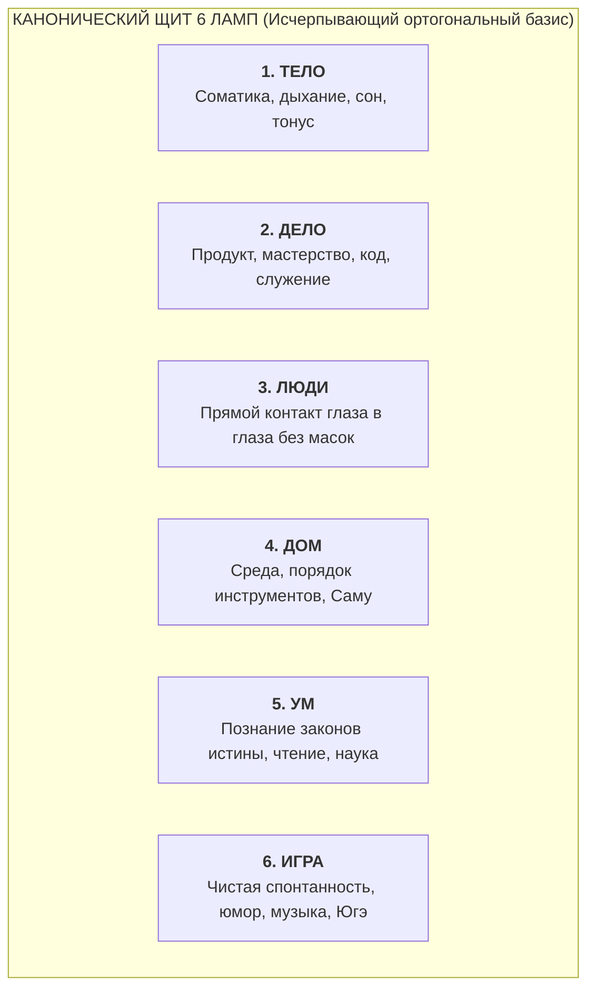

**Канон Кансо (Бритва Оккама): почему ламп ровно 6, а не 7 или 33?**
* **Деньги** — не лампа, а индикатор потока и разность потенциалов ($U$).
* **Бог / Духовность** — не отдельная лампочка на полке, а сам режим сверхпроводимости всего контура ($R_{	ext{ego}} 	o 0, I > 0$) при протекании тока через любую из ламп!

#### Архитектура сдвоенного кабеля: Западный UI vs Дзенское ядро

Чтобы система не скатилась в экзотический «птичий язык» монастырей (нарушая канон Фейнмана) и одновременно не деградировала в плоскую поп-психологию («просто наведи порядок в делах»), контур спроектирован по **Принципу сдвоенного кабеля**:

| Лампа | Западный функциональный интерфейс (UI) | Дзенское онтологическое ядро (Kernel) | Схемотехническая суть |
| :---: | :--- | :--- | :--- |
| **1** | **ТЕЛО** *(Body)* | **СИН (身)** | Биологический реактор и заземление Тандэна |
| **2** | **ДЕЛО** *(Action / Mastery)* | **СЮГЁ (修業) / ГЁ (行)** | Прямое действие без мысленного шума |
| **3** | **ЛЮДИ** *(Relationships)* | **ДЭАЙ (出会い)** | Чистая встреча «Я — Ты» без манипуляций |
| **4** | **ДОМ** *(Environment)* | **САМУ (作務)** | Растворение эго в наведении порядка материи |
| **5** | **УМ** *(Intellect)* | **КОАН (公案)** | Прорыв сквозь ментальные тупики к истине Татхата |
| **6** | **ИГРА** *(Play / Creativity)* | **ЮГЭ (遊戯)** | Самадхи свободной игры бытия без корысти |

*Метафора Ирригации Бытия:* Из полноводного соматического источника Тандэн прокладываются 6 каналов к 6 полям жизни. Засуха в любом из полей — это не дефицит «внешних благ», а засор в соответствующем канале внимания. Прочисти русло ($R 	o 0$) — и поле зацветёт само.

---

---

### Глава 3.5 — Грамматика тока: Всё — глагол

> [!quote] Аксиома грамматики тока
> ### ⚡ **«Просветлеть можно только завтра или вчера. Сегодня можно только просветляться. Всё, что происходит сейчас, выражается исключительно глаголом несовершенного вида. Счастье — это не застывшее существительное на полке, а динамическая проводимость живого действия.»**  
> — **Владимир Аньянов**

## Почему совершенный вид не имеет настоящего времени, чем русский язык точнее латыни и английского в разговоре о счастье и где эта точность сама себя прячет

> [!quote] Аксиома
> *«Просветлеть можно только завтра или вчера. Сегодня можно только просветляться.»*

Связанные главы: [[02_Wiki/Inner Current (Everything Is a Verb — Nominalization as Freezing of Current, Process Speed Spectrum, Dogen's Firewood and the Two Truths)|274. Всё — глагол]] · [[02_Wiki/Inner Current (Life as a Verb — From Osho's Mystical Intuition to the Electrodynamics of Dynamic Flux and Superconductivity)|169. Жизнь как глагол]] · [[02_Wiki/Inner Current (Enlightenment as a Verb and Hardware Ego Lockout — Why the Car Wash Equals Buddha and the Physics of Irreversible Superconductivity)|261. Просветление как глагол]]

> [!info] Синтезировано в брошюре
> Данный концептуальный базис полностью синтезирован в мастер-манифесте [[02_Wiki/Брошюра — Грамматика тока (Жизнь, счастье и просветление как глаголы несовершенного вида)|Брошюра: «Грамматика тока (Жизнь, счастье и просветление как глаголы несовершенного вида)»]].

```
            ВИД ГЛАГОЛА = РЕЖИМ ТОКА
 ┌──────────────────────────────────────────────────┐
 │  НЕСОВЕРШЕННЫЙ (жить, течь, просветляться)       │
 │  ~~~~~~~~~~~~~~~~~~~~~~~~~~~~~~~~~~~~~~~~~  I(t) │  ← есть НАСТОЯЩЕЕ
 │  мгновенное значение тока, контур замкнут        │
 ├──────────────────────────────────────────────────┤
 │  СОВЕРШЕННЫЙ (прожить, утечь, просветлеть)       │
 │  ●━━━━━━━━━━━━━━━━━━━━━━━━━━━━━━━━━━━━━●  Q=∫I dt │  ← НЕТ настоящего
 │  итог, интеграл, точка «готово»                  │
 └──────────────────────────────────────────────────┘
    Счастье = I(t) при R → 0,   а не накопленный Q
```

---

## Часть I. Исходная интуиция и её честная проверка

Глава 274 установила, что **жизнь, счастье и просветление — глаголы**. Следующий шаг напрашивается сам: раз это глаголы, язык с развитой системой глагольного вида должен лучше помогать их понимать. В русском есть пары совершенного и несовершенного вида, а в западных языках, латинских и германских, их будто бы нет.

Направление верное, но в такой форме тезис не выдержит встречи с филологом. Вид как грамматическая категория на Западе есть:

| Язык | Как выражается вид | Пример |
|---|---|---|
| **Латынь** | вся система глагола делится на *infectum* (незавершённое) и *perfectum* (завершённое) | *vivebam* «я жил (длилось)» и *vixi* «я прожил, всё». Надгробное *Vixit* значит «отжил». |
| **Французский, испанский, итальянский** | *imparfait* против *passé simple / composé*, *imperfecto* против *indefinido* | *je vivais* и *je vécus* |
| **Английский** | прогрессив и перфект | *I am living*, *I live*, *I have lived* |
| **Древнегреческий** | основа настоящего против аориста, причём во всех наклонениях | язык Нового Завета и греческой философии думал этой оппозицией |

> [!warning] Поправка
> «У нас есть виды, у них нет» — неверно. Верно другое: **у нас вид пронизывает всю систему глагола, а в латинских и германских языках он в основном привязан к прошедшему времени.** Ещё точнее: это свойство не только русского, а всех славянских языков, и ближе всего к ним по этой черте стоит древнегреческий.

---

## Часть II. Чем русский действительно точнее

### 1. Вид есть в каждой форме, а не только в прошедшем

В латыни, французском и английском вид различается в основном в прошедшем. В русском он обязателен в **инфинитиве, повелительном наклонении, будущем времени, причастиях и деепричастиях**.

| Форма | Несовершенный | Совершенный |
|---|---|---|
| Инфинитив | *жить* | *прожить* |
| Повеление | *живи* | *проживи* |
| Будущее | *буду жить* | *проживу* |
| Деепричастие | *живя* | *прожив* |

Латинянин не может одним инфинитивом различить «жить как процесс» и «прожить целиком». Русский говорящий не может этого **не** различить.

### 2. Совершенный вид не имеет настоящего времени

Это главное открытие главы. Форма *просветлюсь* по виду похожа на настоящее время, но означает **только будущее**. *Проживу, достигну, обрету* — всё это всегда «потом». Настоящего времени совершенного вида в русском языке нет.

Отсюда строгий грамматический вывод:

> [!important] Закон настоящего времени
> **Всё, что происходит сейчас, может быть выражено только несовершенным видом.** «Просветлеть» — это событие, а событие в русском языке всегда либо уже было, либо ещё будет. Сейчас можно только *просветляться*, *жить*, *радоваться*.

Это прямо совпадает с канонами Inner Current. Режим $R \to 0$ существует только в настоящем (глава 02, физика присутствия), а совершенный вид грамматически выносит цель за пределы настоящего. Каждый раз, когда человек думает «вот когда я **достигну**…», язык честно сообщает: это не сейчас.

### 3. Тройной ход: процесс → событие → процесс

У русских глаголов есть механизм **вторичной имперфективации**:

| Шаг | Форма | Смысл |
|---|---|---|
| 1 | *светлеть* (несов.) | состояние без цели, «светлеет» |
| 2 | *просветлеть* (сов.) | однократное событие, результат |
| 3 | *просветляться* (несов., вторичный) | событие, снова ставшее процессом, то есть практикой |

Это точная грамматическая карта дзенского пути. Первый шаг — бесцельное течение, второй — прорыв (*сатори*), третий — возвращение прорыва в повседневность. Десятая картинка «Поиска быка» называется «Возвращение на рынок с открытыми руками»: после просветления снова колют дрова и носят воду, но уже в режиме *просветляться*.

### 4. Спор о внезапном и постепенном получает грамматику

Китайский чань веками спорил: пробуждение внезапное (*тонго*, школа Хуэйнэна) или постепенное (*дзэнго*, школа Шэньсю). По-русски это различие видов:

- **внезапное** = совершенный вид, точечное событие: *просветлел*;
- **постепенное** = несовершенный вид, длительность: *просветлялся*.

Догэновское *сюсё иттó* (修証一等, практика и просветление едины) по-русски звучит почти тавтологически: просветление — это *просветляться*. Совершенный вид описывает момент, когда процесс был замечен, а не место, где он закончился.

> [!info] Уточнение
> Это первое приближение. Вид выражает не длительность, а целостность, поэтому соответствие «внезапное = СВ, постепенное = НСВ» уточнено в главе [[02_Wiki/Inner Current (Grammar of Awakening — Aspect Is Not Duration, Sudden vs Gradual Enlightenment, Iterative Suddenness, Chinul's Formula and Dogen's Practice-Realization)|276. Грамматика пробуждения]]: повторяющаяся внезапность, формула Чинуля и НСВ постоянного свойства у Догэна.

---

## Часть III. Спектр способов бытия: приставки вокруг «жить»

Помимо вида, русский различает **способы действия** (*Aktionsarten*). На одном корне можно построить целую шкалу отношений к жизни:

| Глагол | Способ действия | Режим контура |
|---|---|---|
| *жить* | процесс | ток течёт, $I(t) > 0$ |
| *ожить* | возвращение | восстановление цепи после обрыва |
| *зажить* | начало | замыкание ключа, старт тока |
| *пожить* | ограниченный отрезок | ток «на пробу», с оглядкой на конец |
| *прожить* | весь отрезок целиком | интеграл $Q = \int I\,dt$, взгляд с конца |
| *нажиться* | насыщение | «хватит», контур считает себя заполненным |
| *отжить* | завершение | источник выключен |
| *изжить* | устранение | вывод паразитного элемента из схемы (*изжить страх*) |

Английскому для той же шкалы нужны отдельные слова или обороты: *come alive*, *start living*, *live for a while*, *live through*, *outlive*. В русском это одна морфологическая машина, доступная любому носителю с детства.

> [!tip] Канон
> Обратите внимание на *изжить*. Русский язык сам подсказывает операцию Клинка Кансо: паразитный элемент не побеждают, а **изживают** — проживают до конца, пока он не перестаёт существовать.

---

## Часть IV. Ток и утечка: вид в самом слове «течь»

У корня самой метафоры Системы та же структура:

- *течь* (несов.) — ток идёт, контур живой;
- *утечь, истечь, вытечь* (сов.) — ток ушёл, событие закончено.

От совершенных форм образованы существительные **утечка** и **истечение** (срока). Язык сам связывает совершенный вид с потерей тока. Ток в замкнутой цепи может быть только *течёт*. Как только появляется совершенный вид, он описывает либо утечку, либо разомкнутый контур.

---

## Часть V. Ловушка: русский язык прячет собственное преимущество

Та же грамматика, которая различает виды, при номинализации (глава 274) **замораживает процесс именно в совершенный вид**:

| Существительное | От какого глагола | Что скрыто |
|---|---|---|
| **просветление** | *просветлеть* (сов.) | результат, а не практика |
| **достижение** | *достигнуть* (сов.) | финиш |
| **обретение** | *обрести* (сов.) | находка, которую можно потерять |
| **освобождение** | *освободить* (сов.) | однократный акт |

Человек говорит «я ищу просветления» и, сам того не замечая, ищет **совершенный вид**, то есть событие без настоящего времени. Поэтому найти его невозможно: грамматически оно всегда «потом».

### Отдельный случай: у «счастья» вообще нет глагола

- **Этимология:** *с-частье* — «хорошая доля, часть». Это слово про **обладание долей**, а не про действие.
- Единственная глагольная форма — безличное *посчастливилось*: совершенный вид, дательный падеж («мне»). Счастье грамматически **случается с тобой**, как удача, а не делается тобой.
- Западные языки не лучше: английское *happiness* от *hap* (случай, удача), немецкое *Glück* означает и «счастье», и «везение».

Во всех этих языках счастье исторически упаковано как **удача и доля**, а не как процесс. Inner Current переопределяет его как режим тока, то есть возвращает ему глагольность, которой у слова никогда не было. Рабочая замена — несовершенный вид смежных глаголов: *радоваться, жить счастливо, ликовать, течь*.

---

## Часть VI. Граница тезиса: закон Якобсона и слабая гипотеза Сепира — Уорфа

Сильная версия («русский человек лучше понимает просветление») неверна. Язык не запрещает мыслить: англичанин отлично понимает разницу между процессом и результатом, если на неё обратить внимание. Это сильная версия гипотезы Сепира — Уорфа, и экспериментально она не подтверждается.

Верна слабая версия, точно сформулированная Романом Якобсоном (1959):

> *«Языки различаются главным образом тем, что они должны выражать, а не тем, что они могут выражать.»*

| Язык | Различие процесса и результата |
|---|---|
| Английский, латынь | **может** выражаться (оборотами, контекстом, прошедшими временами) |
| Русский, славянские, древнегреческий | **должно** выражаться в каждой глагольной форме |

Русский не даёт уникального знания. Он даёт **обязательный ежедневный тренажёр различения**: носитель тысячи раз в день решает «процесс или событие?» и ничего за это не платит. Это не привилегия понимания, а бесплатная разметка внимания, которой можно пользоваться осознанно.

### Пояснение на пальцах: как работает тренажёр в речевом аппарате

В английском глагол действия по умолчанию нейтрален: *«I did it»* констатирует факт. Занимался ли ты этим просто как процессом или достиг замкнутого итога — выясняется сложными временами (*Continuous* / *Perfect*) либо контекстом.

В русском языке **нейтрального глагола действия не существует**. Речевой аппарат ставит обязательную развилку:

| Ты делал (Процесс) | Или ты сделал (Итог)? |
| :--- | :--- |
| Решал | Решил |
| Писал | Написал |
| Учил | Выучил |
| Договаривался | Договорился |

Если спросить: *«Что ты делал на работе?»* — и услышать ответ: *«Чинил сервер»*, любой русский собеседник на автопилоте считывает: процесс шёл, но завершился ли он успехом — неизвестно. Чтобы зафиксировать необратимый факт, необходимо переключить приставку: *«Починил»*.

Этот тренажёр бьёт по трём ментальным ловушкам:
1. **Калибровка ответственности:** «Я буду делать отчёт» снимает ответственность за итог (просто суета процесса). «Я сделаю отчёт» — публичная фиксация даты и факта.
2. **Невозможность спрятаться за размытость:** фраза «Мы занимались согласованием контракта» оставляет зияющую дыру незавершённости, провоцируя рефлекторный вопрос: *«И? Согласовали?»*
3. **Нейронная привычка честности:** выбирая корень и приставку сотни раз за день, мозг совершает микроакт различения: *«Я сейчас нахожусь в потоке действия или зафиксировал факт перехода в новое состояние?»*

### Какое это имеет отношение к Внутреннему Току?

Этот грамматический тренажёр — **естественный бортовой вольтметр утечки энергии в замкнутом контуре**:

1. **Несовершенный вид («делал») как незамкнутая цепь и реактивная мощность:**  
   В электротехнике реактивная мощность гоняет ток по проводам, греет кабель, создаёт видимость колоссальной работы, но полезного действия не совершает. Режим «решал, переживал, договаривался, пытался» — это режим омического трения. Энергия хлещет наружу, батарея садится, но конденсатор пуст: это фиксация утечки тока в сопротивление среды.
2. **Совершенный вид («сделал») как фиксация заряда (Акт замыкания цепи):**  
   *«Решил», «закрыл», «отпустил», «отрезал»* — это фазовый переход. Цепь замыкается, энергия кристаллизуется в факт реальности. Внимание возвращается в центр тяжести (Тандэн), наступает тишина Дзансин, и контур готов к следующему циклу.
3. **Бесплатный вольтметр против самообмана:**  
   Человек склонен путать давление и трение с полезным током: *«Я весь день варился в этой проблеме, я вымотан!»* Но язык подносит щупы вольтметра:  
   *«Ты варился или сварил?»*, *«Ты отвлекался или переключился?»*, *«Ты прощал или простил?»*  
   Если глагол застрял в несовершенном виде — полезного тока не было, произошло паразитное короткое замыкание на Эго, и энергия рассеялась в тепло.
4. **Мусин (無心): Различение ради тишины:**  
   Незавершённый процесс без совершенного вида остаётся фоновым жором оперативной памяти (эффект Зейгарник), сжигая ампераж внимания. Тренажёр заставляет оператора цепи либо быть в чистом покое (цепь разомкнута осознанно, $I = 0$), либо вести импульс до щелчка замыкания (*«сделал»*), освобождая оперативную память.

---

## Часть VII. Электродинамический перевод

1. **Несовершенный вид = мгновенное значение тока $I(t)$.** Существует только в момент измерения, имеет настоящее время, требует замкнутого контура.
2. **Совершенный вид = интеграл $Q = \int_{t_1}^{t_2} I\,dt$.** Это перенесённый заряд за отрезок, итог, который можно подсчитать только после окончания (*прожил*) или запланировать до начала (*проживу*). Внутри интеграла находиться нельзя: внутри всегда течёт $I(t)$.
3. **Цель в совершенном виде = ёмкость будущего $C_{\text{future}}$.** «Когда достигну» заряжает конденсатор ожидания и создаёт реактивное сопротивление (см. главу 273).
4. **Итог в совершенном виде = индуктивность прошлого $L_{\text{past}}$.** «Я так и не прожил» держит ток прошлого и тормозит текущий.
5. **Сверхпроводимость = речь в несовершенном виде настоящего времени от первого лица.** *Живу. Радуюсь. Просветляюсь.* Это единственный грамматический режим, в котором реактивные составляющие обнуляются.
6. **Отсутствие у совершенного вида настоящего времени — грамматическая формулировка закона присутствия.** То, что русский язык не умеет сказать «я просветляю(сь) совершенно сейчас», физически соответствует тому, что $Q$ нельзя измерить в точке: в точке есть только $I$.

$$\text{Счастье} = I(t)\big|_{R \to 0} \quad \text{(несовершенный вид)}, \qquad \text{а не} \quad Q = \int I\,dt \quad \text{(совершенный вид)}$$

---

## Практический алгоритм оператора: «Видовая проверка» (30–60 секунд)

1. **Поймать совершенный вид.** Заметить в мыслях глагол с приставкой-финишем или его номинализацию: *достигну, обрету, справлюсь, наконец-то сделаю*, «просветление», «достижение».
2. **Проверить время.** Задать вопрос: «Это может происходить сейчас?» У совершенного вида ответ всегда «нет»: это либо прошлое, либо будущее.
3. **Перевести в несовершенный.** *Достигну спокойствия* → *успокаиваюсь*. *Обрету счастье* → *радуюсь вот этому*. *Просветлею* → *просветляюсь*.
4. **Найти «изжить».** Если мешает паразитный элемент (страх, обида), не «побеждать» его совершенным видом, а *изживать*: проживать в настоящем, пока он не перестанет существовать.
5. **Почувствовать разницу в теле.** Совершенный вид обычно ощущается как напряжение (зажим ожидания), несовершенный — как движение. Это и есть телеметрия $R_{\text{ego}}$.
6. **Вернуть языку свободу.** Совершенный вид не враг: он нужен для планов и итогов. Канон главы 274: называй вещи, но держи их легко.

---

## Резюме: Семь аксиом грамматики тока

1. Вид глагола есть и в западных языках, но в русском и славянских он обязателен во всех формах, а не только в прошедшем.
2. Совершенный вид не имеет настоящего времени. Всё, что происходит сейчас, выражается только несовершенным видом.
3. «Просветлеть» — событие вне настоящего, «просветляться» — практика в настоящем. Догэновское единство практики и просветления — это несовершенный вид.
4. Тройной ход *светлеть → просветлеть → просветляться* — грамматическая карта пути: течение, прорыв, возвращение на рынок.
5. Номинализация замораживает процесс в совершенный вид («просветление», «достижение»). Поиск такого существительного — поиск того, что грамматически всегда «потом».
6. По закону Якобсона языки различаются тем, что они обязаны выражать. Русский не даёт уникального понимания, но даёт бесплатный ежедневный тренажёр различения процесса и итога.
7. Несовершенный вид — это мгновенный ток $I(t)$, совершенный — интеграл $Q$. Счастье — ток в настоящем при $R \to 0$, а не накопленный итог.

---

# ЧАСТЬ IV. ДЕМОНТАЖ ИЛЛЮЗИЙ И ЧЕТЫРЕ ЭПИДЕМИИ ЦИВИЛИЗАЦИИ
### Схемотехнический взлом ложных опор, корни зависимостей и растворение страха небытия

---

### Глава 4.1 — Природа и иллюзия Эго: Реостат паразитного сопротивления и протокол аппаратного шунтирования $R_{\text{ego}}$

> *«Мировые религии веками боролись с Эго: буддисты объявляли его иллюзией (Анатта), индуисты — космическим покрывалом Майи, даосы — помехой У-вэй, а христианские мистики призывали к Кенозису (самоопустошению). Но никто не дал человеку прикладной рубильник. Эго — это не дьявол и не грех. Это паразитный реостат, включенный последовательно в цепь вашего внимания. Его не надо убивать. Его нужно аппаратно зашунтировать медной перемычкой прямого действия.»*  
> — **Аксиома VI («Архитектура счастья»)**

#### 1. Четыре измеримых физических факта об Эго
Если вы попытаетесь найти Эго в организме скальпелем хирурга или на снимке МРТ, вы не найдете отдельного органа. Эго — это **динамический процесс циклического сопротивления**.

1. **Факт первый: Эго нематериально.** В теле нет «частицы Я». Есть импульсы внимания.
2. **Факт второй: Эго паразитарно.** Оно не генерирует энергию. Энергию дает Тандэн (метаболизм, митохондрии, дыхание). Эго лишь перехватывает этот ток и сжигает его в омическом нагреве.
3. **Факт третий: Эго линейно зависит от времени.** В точке $t = t_{\text{now}}$ Эго существовать не может. Ему обязательно нужны координаты прошлого («кем я был») или будущего («кем я стану»).
4. **Факт четвертый: Эго устранимо мгновенно.** Стоит человеку переключить внимание на физический объект без вербализации, как сопротивление Эго падает в ноль.

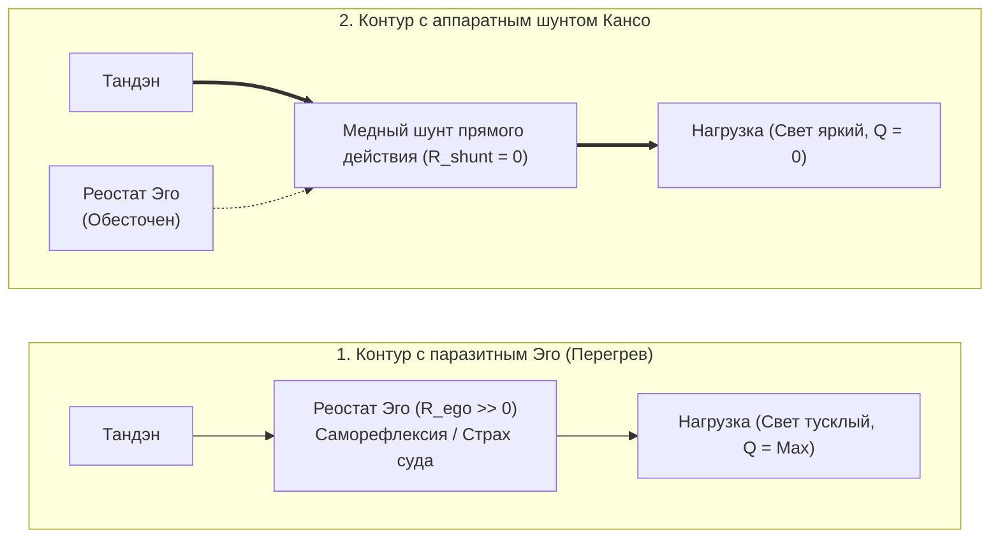

#### 2. Протокол аппаратного шунтирования (Hardware Bypass)
Когда электромонтер видит, что на линии раскалился и искрит испорченный реостат, он не читает ему лекции о нравственности. Он берет толстый медный провод с нулевым сопротивлением и ставит **шунт параллельно аварийному узлу**. Ток, подчиняясь закону наименьшего сопротивления, устремляется по меди, а поврежденный реостат мгновенно обесточивается и остывает.

В человеческом контуре **шунтом служит прямое сенсорное действие без оценки**:
- Чувствуете страх перед публичным выступлением? Реостат Эго раскалился: *«А вдруг я оговорюсь? А что подумают?»*
- Ставьте шунт: переведите 100% тока внимания на точный физический факт: почувствуйте температуру микрофона в ладони, сосчитайте пуговицы на пиджаке собеседника в первом ряду, произнесите первое слово как чистую звуковую волну.
- Ток ушел в нагрузку. Эго обесточено. Выступление проходит в кристальной сверхпроводимости.

#### 3. Парадокс Корабля Тесея: Диссипативные структуры Пригожина против застывшего монолита «Я»

Древнегреческий историк Плутарх оставил человечеству знаменитый парадокс:
> *Корабль, на котором Тесей вернулся с Крита, хранился афинянами столетиями. По мере того как доски ветшали, их заменяли новыми. В итоге на корабле не осталось ни одной оригинальной доски. Остался ли это тот же самый корабль?*

В контексте человеческого самосознания этот парадокс бьёт в самое сердце:
1. **Биологическая текучесть:** В организме человека 98% атомов обновляются в течение года. Клетки кожи живут недели, эритроциты — 120 дней, клетки скелета полностью заменяются за 7–10 лет. Ни в одном взрослом человеке нет ни единого атома из тела первоклассника, каким он когда-то был.
2. **Психологическая дискретность:** Мысли сменяют друг друга каждые несколько секунд. Убеждения, мечты и характер в 15, 30 и 50 лет часто противоположны.

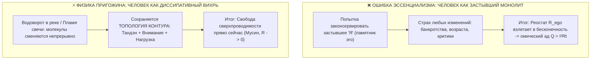

«Архитектура счастья» разрешает парадокс Тесея через неравновесную термодинамику Ильи Пригожина (Нобелевская премия 1977 года):
> **Человек — это не склад досок. Человек — это диссипативная структура: водоворот или пламя свечи.**
> В пламени каждую миллисекунду сгорают *новые* молекулы кислорода и парафина. В водовороте каждую долю секунды проносятся *новые* молекулы воды. Если вычерпать воду — водоворота нет как отдельной вещи. Но делает ли это водоворот иллюзией? Нет! Он обладает реальной силой, устойчивостью и формой.

Человек сохраняет непрерывность не через неизменность «материала эго», а через **инвариант топологии цепи**:
$$\mathcal{T}_{\text{circuit}} = \Big\langle \text{Тандэн}, \text{Проводка Мусин}, \text{Предохранитель Дзансин}, \text{Нагрузка} \Big\rangle$$

В классическом Дзене это знание сформулировано как закон **Анатта (無我 — отсутствие застывшего „Я“)**. Когда ученик пришёл к Бодхидхарме с мольбой: *«Успокой моё Я!»*, мастер ответил: *«Принеси мне твоё Я, и я успокою его»*. Ученик искал его повсюду, но не нашёл как физического предмета. *«Вот видишь, — улыбнулся Бодхидхарма, — я уже успокоил его»*.

**Снятие кризиса крушения идентичности:**  
Когда предприниматель банкротится, артист теряет сцену, а брак распадается, человек в ужасе кричит: *«Я потерял себя! Меня больше нет!»* (потому что отождествил себя со старой доской корабля или разбившейся лампочкой).  
Оператор цепи видит истину: **разбилась лишь внешняя лампа нагрузки ($R_{\text{load}}$)**. Но сам вихрь цел! Реактор Тандэна полон энергии, проводка внимания чиста. Достаточно переключить тумблер на новую задачу — и свет вспыхивает вновь.

---

---

### Глава 4.2 — Инженерное доказательство отсутствия смысла жизни: Освобождение от гуманитарного тупика и рождение Архитектуры счастья

> *«Поиск "смысла жизни" — это величайшая гуманитарная ловушка в истории человечества. Это программная ошибка, когда замкнутый контур пытается найти свою причину за пределами собственной схемы. Мы доказали инженерно: внешнего смысла жизни нет ($\mathcal{M}_{\text{ext}} \equiv 0$). Жизнь — это не зашифрованный ребус, требующий разгадки. Жизнь — это режим генерации и сверхпроводимости. Снятие сторожевого процесса поиска смысла мгновенно заваривает магистральную экзистенциальную утечку цепи.»*  
> — **Аксиома VIII («Архитектура счастья»)**

#### 1. Моделирование системы проверки смысла: Сторожевой процесс (Watchdog)
Почему миллионы умных, тонко чувствующих людей мучаются от экзистенциального кризиса?

Представьте себе операционную систему, в которой непрерывно работает фоновый сторожевой процесс:
```typescript
function existentialWatchdog(): never {
  while (true) {
    const meaning = scanExternalUniverseForPurpose();
    if (meaning === null) {
      triggerPanicAlarm("ЖИЗНЬ БЕССМЫСЛЕННА! ОСТАНОВИТЬ КОНТУР!");
      dissipatePowerAsHeat(); // Омический перегрев Q = I²Rt
    }
  }
}
```
Человек смотрит на звезды, смотрит на свою работу, смотрит на свои отношения и задает вопрос: *«Зачем всё это? В чем высший смысл?»* 

Поскольку Вселенная — это объективная физическая реальность, состоящая из полей и частиц, она не содержит в себе текстового файла `meaning.txt`. Вселенная нейтральна. Она существует. 

Сторожевой процесс возвращает ошибку `404 Not Found`. Мозг паникует: ток срывается в аварийный режим, начинается тоска, потеря сил и депрессия.

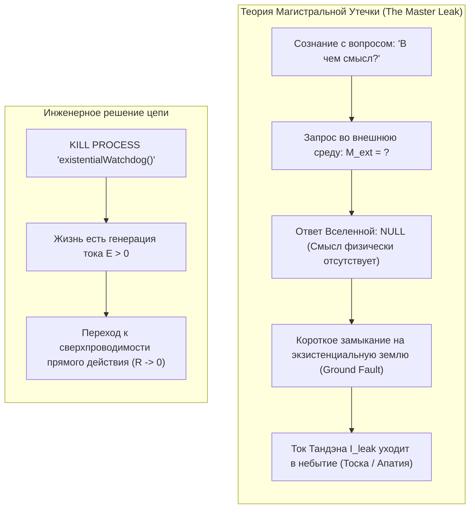

#### 2. Инженерное доказательство: Телеология vs Автономия
В технике смысл (назначение) имеет только **вспомогательный инструмент**:
- Смысл отвертки — крутить винты.
- Смысл кабеля — передавать электроны.
- Смысл датчика — фиксировать давление.

Если у объекта есть внешний смысл — значит, этот объект является **слугой или вещью в руках кого-то внешнего**.

Человек — это не отвертка. Человек — это **первичный автономный термодинамический субъект**.  
Требовать от жизни внешнего смысла — значит добровольно низводить себя до уровня утилитарного инструмента в руках вымышленного хозяина.

Отсутствие внешнего смысла — это не трагедия! **Это величайшее благо и манифест абсолютной свободы.**  
Смысл не «находят» в канаве или на небесах. Смысл — это производная от протекания тока:
$$\text{Смысл} \equiv \left( \mathbf{J} \cdot \mathbf{E} > 0 \right)$$
Когда ваш ток течет через нагрузку, когда вы любите, строите, исследуете и завариваете чай — вопрос о смысле не возникает ни на секунду. Он возникает только тогда, когда ток упал до нуля, и цепь покрылась омической гарью.

---

---

### Глава 4.3 — Сравнительный анализ: Духовный кризис Льва Толстого vs Архитектура счастья — Моральный долг Хозяину против суверенного Тандэна

> *«В своей "Исповеди" величайший гений русской литературы Лев Николаевич Толстой зафиксировал апогей экзистенциального перегрева человечества: имея славу, богатство, семью и признание, он прятал веревку, чтобы не повеситься на перекладине в кабинете. Почему? Потому что его контур пытался закрыться на вымышленного "Хозяина", требующего отчета. На станции Астапово умер не просто старик — там окончательно расплавилась викторианская телеология долга. Архитектура счастья заваривает эту трещину навсегда.»*  
> — **Аксиома IX («Архитектура счастья»)**

#### 1. Анатомия кризиса в «Исповеди» Толстого
Лев Толстой в возрасте 50 лет описал состояние, знакомое каждому глубокому человеку:
> *«Со мной сделалась остановка жизни... Прежде чем заниматься самарским имением, воспитанием сына, писанием книги, надо знать, зачем я это буду делать... Ну хорошо, у тебя будет шесть тысяч десятин земли, триста голов лошадей... ну и что ж? Ну хорошо, ты будешь славнее Гоголя, Пушкина, Шекспира, Мольера — ну и что ж? И я ничего не мог ответить.»*

На языке схемотехники Толстой столкнулся с **аварией Ground Fault (пробоем на экзистенциальную землю)**:
- У него были идеальные лампы нагрузки: творчество (написаны «Война и мир», «Анна Каренина»), семья, имение.
- Но его ментальная схема требовала: *«Каждое действие должно иметь оправдание перед вечностью и Богом-Хозяином».*
- Толстой искал внешнюю ЭДС, подтверждающую легитимность его существования.
- Не найдя ее, он объявил всё свое искусство «пустяками», надел крестьянскую рубаху, отказался от авторских прав и ушел в колоссальный омический перегрев вины.

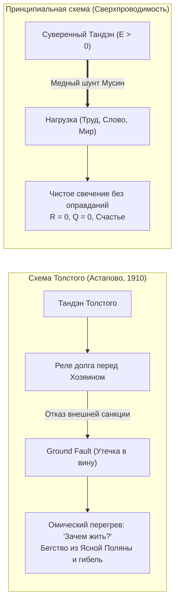

#### 2. Схемотехнический парадокс экзистенциальной аварии
Почему экзистенциальная тоска Толстого не выглядела как обычное сопротивление?

Потому что при утечке на землю (Ground Fault) ток не встречает сопротивления — **он весь утекает мимо полезной нагрузки прямо в грунт**:
$$I_{\text{leak}} = \frac{\mathcal{E}_{\text{tanden}}}{R_{\text{fault}}} \to \infty \quad \text{при} \quad R_{\text{load}} = 0$$
Человек чувствует не сопротивление делу, а **полное обессиливание**: энергия вытекает тоннами, как вода из пробитой цистерны.

#### 3. Урок Астапово: Заваривание диэлектрика
Трагедия Толстого на станции Астапово учит Дзен-инженера XXI века:
1. **Никакой хозяин не придет.** Во Вселенной нет надзирателя, оценивающего ваш КПД на Страшном суде.
2. **Тандэн суверенен.** Источник жизни внутри вас легитимен сам по себе — по праву вашего дыхания и сердцебиения.
3. **Заварите утечку диэлектриком прямого действия.** Не спрашивайте «Зачем я пишу эту строку кода или сажаю эту яблоню?». Пишите строку так, будто в ней заключена вся Вселенная (канон Итиго Итиэ).

В ту секунду, когда вы снимаете требование внешнего оправдания, экзистенциальный шунт заваривается намертво. Ток устремляется в пальцы, в глаза, в любимого человека, в созидаемый мир. Вы исцелены.

---

---

### Глава 4.4 — Электродинамика алкоголизма: Химический лом в неокортексе

> [!quote] Аксиома химического охлаждения контура
> ### ⚡ **«Алкоголь — это не грех и не слабость воли. Это грубый химический лом, которым раскалённый от омического перегрева неокортекс насильственно взламывает собственные ГАМК-тормоза, чтобы на три часа сбить сопротивление эго. Понимание схемотехники перегрева позволяет охладить цепь штатно, соматически, без вины и разрушения органов.»**  
> — **Владимир Аньянов**

> [!quote] Аксиома аппаратного охлаждения против химического лома
> ### ⚡ **«Алкоголик — это не распущенный грешник и не генетический калека. Это оператор, чья нервная проводка раскалена добела непрерывным омическим пожаром эго ($Q = I^2 R_{\text{ego}} t$), вины, тревоги и невыраженного тока. Не умея выключить этот вой штатным тумблером Мусин ($R \to 0$), отчаявшийся мозг бросает в распределительный щит химический лом — этанол. Этанол насильственно глушит неокортекс, покупая 40 минут токсичного суррогата тишины ценой физического ожога проводки. Попытки бороться с этим кодированием от страха, сжатыми челюстями или бесконечным покаянием в кругу „анонимных бессильных“ лишь умножают внутреннее давление. Алкоголь становится ненужным ровно в ту секунду, когда оператор восстанавливает заводское охлаждение: заземли внимание в Тандэн — и потребность во внешнем растворителе ума отпадет сама собой.»**  
> — **Владимир Аньянов**

> [!info] Синтезировано в брошюре [[02_Wiki/Брошюра — Алкоголизм и внутренний ток (Химический лом в неокортексе, банкротство института вины и штатное охлаждение цепи)|Брошюра: Алкоголизм и внутренний ток (Химический лом в неокортексе, банкротство института вины и штатное охлаждение цепи)]]

---

## 🧭 Принципиальная схема: Аварийный химический лом vs Штатное охлаждение

```
[1. АВАРИЙНЫЙ КОНТУР АЛКОГОЛИЗМА (ХИМИЧЕСКИЙ ЛОМ В ЩИТКЕ)]

               ┌────────────────────────────────────────────────────────┐
               │    ХРОНИЧЕСКИЙ ОМИЧЕСКИЙ ПОЖАР ЭГО: R_ego >> 0         │
               │    (Тревога о будущем, вина за прошлое, шум статуса)   │
               └───────────────────────────┬────────────────────────────┘
                                           │
  [РЕАКТОР ТАНДЭН] ────────────────────────┴───────► ПРОВОДКА ГОРИТ: Q = I² · R · t
                                           │
                                           ▼
                      ДИВЕРСИЯ: БРОСОК ХИМИЧЕСКОГО ЛОМА (ЭТАНОЛ)
                      Заливание синапсов, растворение мембран, ГАМК-блок
                                           │
                                           ▼
                     ПСЕВДО-МУСИН НА 40 МИНУТ (АМПУТАЦИЯ КОНТРОЛЯ)
                                           │
                                           ▼
                    УТРЕННИЙ КАТАСТРОФИЧЕСКИЙ ПОХМЕЛЬНЫЙ АД:
            Омическое сопротивление удвоено (R_ego x 2: дикий стыд,
            обезвоживание, тремор) ──► НОВЫЙ ЗАПОЙ ДЛЯ СНЯТИЯ БОЛИ

════════════════════════════════════════════════════════════════════════════════════════

[2. ШТАТНЫЙ КОНТУР СУВЕРЕННОГО ОПЕРАТОРА (ОХЛАЖДЕНИЕ ЧЕРЕЗ ТАНДЭН)]

  [РЕАКТОР ТАНДЭН] ═══════[ СРЕЗ БАЛЛАСТА: R_ego = 0 ]═══════► [ЖИВАЯ НАГРУЗКА ДЭАЙ]
   (Биологическая ЭДС)         (Тишина присутствия, Мусин)          (Дело, тело, свет)
                                           │
                                           ▼
                             ТЕПЛОВОЙ НАГРЕВ РАВЕН НУЛЮ: Q = 0
                      Нервная система прохладна, чиста и стабильна.
                      Потребность в алкоголе равна абсолютному нулю.
```

---

## 1. Корневой диагноз: Почему человек пьёт с точки зрения физики

Культура «Эпохи Лошади» привыкла объяснять пьянство через категории слабоволия и порока. Церковь требовала молитв и покаяния, социум клеймил презрением, а современная медицина объявила алкоголизм «неизлечимой прогрессирующей болезнью». 

Однако в электродинамике духа физическая реальность предельно конкретна: **резистор не грешен, ток течёт по пути наименьшего сопротивления**.

### Механика Root Exploit (Химического лома):
1. **Невыносимость омического нагрева:** Когда человек годами живёт под диктатом эго-реостата (хроническая тревога, вина, перфекционизм, страх не оправдать чужих ожиданий), его неокортекс буквально плавится. По закону Джоуля — Ленца ($Q = I^2 R t$), колоссальная мощность биологического генератора рассеивается в паразитный жар. В голове стоит непрекращающийся адский зуд внутреннего критика.
2. **Этанол как аварийный рубильник:** Молекула этанола ($C_2H_5OH$) — это крошечный, проникающий через гематоэнцефалический барьер неизбирательный растворитель. Она искусственно стимулирует тормозные ГАМК-рецепторы и блокирует возбуждающие NMDA-рецепторы глутамата. 
3. **Что переживает человек субъективно?**  
   Неокортекс мгновенно «гаснет». Человек внезапно ощущает: *«Боже, наконец-то мысли замолчали! Наконец-то отпустило!»*. На 30–60 минут наступает искусственный, химически симулированный суррогат **Мусин (無心)**.
4. **Колоссальная цена паллиатива:**  
   Поскольку это не штатное обнуление сопротивления, а токсическая травма, организм платит страшную цену:
   * **Разрушение кристаллической решётки проводника:** Слипание эритроцитов («микротромбозы»), гипоксия нейронов, вымывание электролитов (калий, магний), дегидратация.
   * **Эхо-взрыв глутамата:** Чтобы компенсировать подавление, мозг в ответ выбрасывает лавину возбуждающих нейромедиаторов. На утро человек просыпается с бешено колотящимся сердцем, панической атакой и сокрушительным чувством вины.
   * **Замкнутый штопор:** Сопротивление эго удваивается ($R_{\text{hangover}} = 2 R_{\text{ego}}$). Чтобы заглушить этот утроенный ад, рука снова тянется к спасительному бокалу.

---

## 2. Банкротство традиционной троицы: Почему сила воли, психотерапия/АА и кодирование терпят крах

Современный нарколог, психолог или наставник реабилитационного центра искренне пытаются помочь, но используют методы, которые в терминах схемотехники лишь подливают бензин в горящий трансформатор.

```
┌────────────────────────────────────────────────────────────────────────────────────────┐
│             ПОЧЕМУ КЛАССИЧЕСКИЕ МЕТОДЫ УГЛУБЛЯЮТ АЛКОГОЛЬНЫЙ СБОЙ                      │
├───────────────────────┬───────────────────────────────┬────────────────────────────────┤
│ Метод                 │ Механизм воздействия          │ Реальный результат в контуре   │
├───────────────────────┼───────────────────────────────┼────────────────────────────────┤
│ 1. Сила воли          │ Терпение «на зубах»,          │ Феномен «сухого алкоголика»:   │
│    (Волевой запрет)   │ удержание пара в котле (I ↑)  │ Омический взрыв ярости и срыв  │
├───────────────────────┼───────────────────────────────┼────────────────────────────────┤
│ 2. Психотерапия и АА  │ Фиксация ярлыка «Я болен»,    │ Цементирование эго-реостата    │
│    (Культ бессилия)   │ бесконечный разбор травм      │ вины, пожизненная инвалидность │
├───────────────────────┼───────────────────────────────┼────────────────────────────────┤
│ 3. Кодирование        │ Химический террор страхом     │ Колоссальное паразитное        │
│    (Дисульфирам)      │ «Выпьешь — остановится сердце»│ давление, инфаркты и психозы   │
└───────────────────────┴───────────────────────────────┴────────────────────────────────┘
```

### 1. Сила воли (Трагедия «Сухого алкоголика»)
Человек даёт себе или семье клятву: «Я бросил. Я держусь». Он сжимает кулаки и стискивает зубы.
* **Физика катастрофы:** Сопротивление эго никуда не делось ($R_{\text{ego}} > 0$). Человек по-прежнему полон тревоги, неудовлетворенности и обид. 
* Но теперь у него отняли единственный инструмент аварийного сброса пара. Напряжение в системе накапливается с каждым днем.
* Рождается классический психотип **«сухого алкоголика»**: желчный, раздражительный, агрессивный домашний тиран, взрывающийся по любому пустяку. Закон Джоуля — Ленца ($Q = I^2 R t$) накаляет атмосферу до предела. В конце концов наступает неизбежный омический пробой — и человек уходит в тяжелейший многонедельный штопор.

### 2. Психотерапия и группы Анонимных Алкоголиков (Цементирование вины и бессилия)
Традиционная терапия предлагает «признать своё бессилие перед алкоголем» и ежедневно повторять: *«Я алкоголик, моя жизнь неуправляема»*.
* **Физика катастрофы:** Это вечная инсталляция дефектного компонента в центр схемы. Вместо того чтобы удалить паразитный реостат Клинком Кансо, человеку внушают, что он **навсегда повреждён**.
* Бесконечные исповеди, пережёвывание детских травм и обид круглосуточно держат активной дефолт-систему мозга (DMN). Человек меняет алкогольную зависимость на зависимость от терапевта или группы поддержки. Он никогда не становится **Суверенным Оператором Цепи (Self-Hosted Human)**, оставаясь вечным «выздоравливающим инвалидом».

### 3. Медикаменты и кодирование (Химический террор в закрытом котле)
Подшивание препаратов дисульфирамового ряда блокирует ацетальдегиддегидрогеназу: любая капля алкоголя вызывает накопление токсичного ацетальдегида, удушье, панику и риск смерти.
* **Физика катастрофы:** Это метод работы средневекового палача. Проблема омического перегрева внутри котла не решается, но предохранительный клапан намертво заваривается снаружи под угрозой расстрела.
* Психика человека погружается в круглосуточный режим концлагеря. Не имея возможности сбросить давление, организм находит обходные пути: инфаркты миокарда, язвы желудка, тяжелейшие депрессии или переход на психотропные фармпрепараты.

---

## 3. Решение Архитектуры Счастья: Заводской тумблер охлаждения ($R \to 0$)

Внутренний ток предлагает фундаментальную альтернативу: **не нужно отнимать у человека костыль, пока он не научился ходить на собственных ногах.** Нужно дать ему инструмент, превосходящий действие любого алкоголя в миллион раз.

1. **Естественная трезвость как следствие сверхпроводимости:**  
   Когда оператор переводит внимание из неокортекса в гравитационное ядро тела (**Тандэн**), сопротивление эго схлопывается в ноль ($R_{\text{ego}} \to 0$).
2. **Тишина без химии:**  
   В состоянии Мусин шум мыслей стихает мгновенно, соматически, без единого микрограмма этанола. Это состояние абсолютной чистоты, ясности, физического тепла и кристальной радости бытия.
3. **Отказ от алкоголя без борьбы:**  
   Человек, испытавший режим сверхпроводимости своей цепи, смотрит на бокал вина или рюмку водки с тем же чувством, с каким водитель новейшего электрокара Tesla смотрит на ведро помоев: *«Зачем мне заливать эту мутную грязь в мой тончайший проводник, если моя цепь и так светит на 100%?»*. Выбор происходит без борьбы, без зубов и без запретов.

---

## 4. Полевой 30-секундный протокол «Штатное Охлаждение»

Когда оператор чувствует нарастание вечернего импульса «выпить, чтобы снять стресс» (тяжесть в голове, зуд раздражения, автопилот к холодильнику/бару):

```
                   [ 0–5 сек: ДЕТЕКЦИЯ ТЕПЛОВОГО ПЕРЕГРЕВА ]
                 «Стоп! Внимание! Проводка раскалена. Это омический жар.»
                                       │
                                       ▼
                   [ 5–15 сек: АВАРИЙНЫЙ ВЫДОХ В ТАНДЭН ]
                 Длинный выдох вниз живота. Сброс челюсти и диафрагмы.
                                       │
                                       ▼
                   [ 15–25 сек: ТЕСТ ХИМИЧЕСКОГО ЛОМА ]
                 «Этанол не решит задачу. Он сожжет контакты. Я оператор.»
                                       │
                                       ▼
                   [ 25–30 сек: ПИТЬЕВОЙ И СОМАТИЧЕСКИЙ СБРОС ]
                 Стакан ледяной минеральной воды залпом + горячий душ.
```

### Шаг 1. Детекция теплового перегрева (5 секунд)
* Опознать состояние технически:  
  *«Мое тело не хочет алкоголя. Алкоголь — яд для клеток. Мой мозг просто кричит от омического перегрева мыслей ($Q = I^2 R t$). Мне нужна тишина, а не спирт».*

### Шаг 2. Аварийный выдох в Тандэн (10 секунд)
* Сесть прямо или опереться о стену. 
* Сделать глубокий вдох через нос и длинный, протяжный, шипящий выдох через расслабленные губы прямо в точку Тандэн (низ живота).
* Физически отпустить нижнюю челюсть (разомкнуть зубы) и сбросить плечи. Ощутить, как центр тяжести падает из раскалённой головы в таз.

### Шаг 3. Тест химического лома (10 секунд)
* Спросить себя:  
  *«Зачем мне бросать лом в собственный щиток? Чтобы завтра проснуться с пепелищем в контуре? Я суверенный оператор. Мой тумблер тишины здесь: $R = 0$ прямо сейчас».*
* Клинок Кансо срезает тягу без остатка.

### Шаг 4. Питьевой и соматический сброс (5 секунд)
* Налить большой стакан чистой минеральной воды (или воды с лимоном) и выпить залпом, восполняя гидратацию клеточного проводника.
* Переключиться в физическое действие: контрастный душ, прогулка на свежем воздухе или спокойный ужин без яда.

---

## 5. Резюме

1. Алкоголизм — это не порок и не неизлечимая кара, а **аварийный химический лом**, к которому прибегает мозг, чтобы спастись от невыносимого омического пожара эго-тревоги ($Q = I^2 R t$).
2. Сила воли плодит «сухих алкоголиков», чей подавленный пар гарантирует разрушительный рецидив; институты вины (АА) цементируют пожизненный статус больного, а кодирование загоняет психику в режим концлагеря.
3. Организм ищет не спирт, а **состояние тишины Мусин ($R \to 0$)**; этанол даёт лишь его токсичный 40-минутный суррогат ценой разрушения нервной ткани.
4. Внутренний ток возвращает человеку суверенный контроль: заземление в соматический Тандэн штатно обнуляет сопротивление, давая покой и радость без грамма алкоголя.
5. Истинная трезвость — это не унылое воздержание, а **восторг чистой проводимости**, при котором алкоголь становится попросту смешон и ненужен.

---

## 🔗 Смежные статьи реестра
* [[02_Wiki/Inner Current (Architecture of Circuit Self-Respect — Emergent Nature of Consciousness, Closed Loop and the Post-Moral Hygiene Against Alcohol and Anger)|216. Архитектура уважения к контуру: Эмерджентная природа сознания, пост-моральная этика и естественная трезвость]]
* [[02_Wiki/Inner Current (The Joule-Lenz Cornerstone — Why the Law of Losses is the Master Manifest of Freedom, Quadratic Will Trap and Mathematics of Superconductivity)|212. Закон Джоуля — Ленца как краеугольный камень Архитектуры счастья: Квадратичная ловушка воли ($I^2$)]]
* [[02_Wiki/Inner Current (Workaholism Circuitry — Quadratic Will Trap, Burnout Electrodynamics and the Transition from Hustle to Mushin)|287. Схемотехника трудоголизма: Почему мир сгорает на работе — Квадратичная ловушка воли ($Q = I^2 R t$)]]
* [[02_Wiki/Inner Current (Pornography Addiction Circuitry — Dopamine Short Circuit, Broken Return Loop and the Bankruptcy of Willpower, Therapy and Meds)|288. Схемотехника порно-зависимости: Короткое замыкание дофамина]]
* [[02_Wiki/Inner Current (Six Traps of Emotional Pain — The Priest, Fortune-Teller, Psychologist, Philosopher, Kitchen Friend and 'Time Heals' vs The Sovereign Circuit Operator)|268. Шесть ловушек душевной боли: Психолог, священник и друг на кухне против Суверенного Оператора]]

---

### Глава 4.5 — Схемотехника порно-зависимости: Дофаминовое КЗ

> [!quote] Аксиома дофаминового короткого замыкания
> ### ⚡ **«Порнография — это Root Exploit корневого репродуктивного BIOS мозга: сигнал наивысшей эволюционной победы при нулевой физической работе. Ток разряжается накоротко внутри нейронной дуги, обрывая обратный провод реальности. Восстановление контура возвращает драгоценную витальную ЭДС в Тандэн и созидательный труд.»**  
> — **Владимир Аньянов**

> [!quote] Аксиома замкнутого живого контура против экранного замыкания
> ### ⚡ **«Порно-зависимость — это не половой разврат и не моральное падение. Это грубое аварийное короткое замыкание (Short Circuit) дофаминового ядра на двухмерный пиксель. Человек пытается получить спасительную вспышку Мусин в контуре, где полностью отсутствует обратный провод реальности ($I_{\text{return}} = 0$) и закон взаимной индукции Фарадея ($M = 0$). Попытки бороться с этим через стиснутые зубы (NoFap), бесконечные разговоры с психотерапевтом или химические блокаторы терпят исторический крах, потому что лишь нагнетают омический перегрев вины и стыда ($Q = I^2 R t$). Зависимость отпадает не тогда, когда ты „терпишь из последних сил“, а когда осознаешь схемотехнику: сексуальная энергия — это высоковольтная ЭДС жизни, требующая либо живой взаимной индукции, либо прямого перенаправления в полезную нагрузку созидания.»**  
> — **Владимир Аньянов**

> [!info] Синтезировано в брошюре [[02_Wiki/Брошюра — Порно-зависимость и внутренний ток (Дофаминовое короткое замыкание, обрыв живого контура и банкротство силы воли)|Брошюра: Порно-зависимость и внутренний ток (Дофаминовое короткое замыкание, обрыв живого контура и банкротство силы воли)]]

---

## 🧭 Принципиальная схема: Живой резонанс vs Экранное замыкание

```
[1. ШТАТНЫЙ ЖИВОЙ КОНТУР: ВЗАИМНАЯ ИНДУКЦИЯ ФАРАДЕЯ (M > 0)]

  Генератор 1 (Тандэн А) ═══════════════► [Живой контакт / Дэай] ◄═══════════════ Генератор 2 (Тандэн Б)
           │                                      ▲                                      │
           │                                      │                                      │
           └──────────── ОБРАТНЫЙ ПРОВОД РЕАЛЬНОСТИ: I_return > 0 ───────────────────────┘
                     (Взаимная индукция M > 0, умножение мощности, глубокая перезарядка)

═════════════════════════════════════════════════════════════════════════════════════════════════

[2. АВАРИЙНЫЙ ПОРНО-КОНТУР: КОРОТКОЕ ЗАМЫКАНИЕ НА ЭКРАН (ОБРЫВ ЦЕПИ)]

  Генератор (Тандэн) ───► [ДОФАМИНОВЫЙ ШУНТ] ───► [Экран смартфона / Пиксели]
                                 │                            │
                                 │                     ОБРЫВ: I_return = 0
                                 │                     (Мертвая материя, M = 0)
                                 ▼
                     КОРОТКОЕ ЗАМЫКАНИЕ (КЗ)
                     Вспышка на 5 секунд → Сброс потенциала в пустоту
                                 │
                                 ▼
                     ОМИЧЕСКИЙ АД ПОСЛЕ СРЫВА:
                     Q = I² · R_shame · t (Стыд, опустошение, онемение)
```

---

## 1. Корневой диагноз: Что происходит в контуре при просмотре порно

Культура тысячелетиями клеймила сексуальные компульсии терминами «грех», «похоть», «грязь», а современная медицина пытается классифицировать это как «гиперсексуальное расстройство». Оба подхода слепы к физике процесса.

С точки зрения контурной электродинамики, сексуальное возбуждение — это **колоссальный бросок электродвижущей силы ($\mathcal{E}_{\text{sex}} \gg 0$)** в биологическом генераторе Тандэн. Это первозданный ток эволюции, предназначенный либо для репродуктивного созидания, либо для сверхпроводящего слияния двух независимых полей.

### Механика Root Exploit (Аварийного короткого замыкания):
1. **Эволюционный баг зрительного интерфейса:** Мозг формировался в палеолите, где появление перед глазами обнажённого фертильного тела означало 100% физическое присутствие партнёра в радиусе вытянутой руки. Зрительная кора напрямую замкнута на дофаминовый аккумулятор полосатого тела (Striatum).
2. **Нулевой импеданс при нулевом сопротивлении реальности:** В реальном мире контакт требует преодоления сопротивления среды: коммуникации, риска отказа, синхронизации полей, уважения, гигиены, времени. Экран смартфона предлагает обманку: **усилие равно нулю, а стимул равен сверхстимулу (Supernormal Stimulus)**.
3. **Обрыв обратного провода реальности ($I_{\text{return}} = 0$):**  
   В нормальной цепи ток обязан совершить полный оборот: выйти из генератора, пройти нагрузку, получить соматический отклик партнёра и вернуться по обратному проводу реальности. Экран — это идеальный диэлектрический тупик. Пиксели не чувствуют, не смотрят в ответ, не генерируют встречного поля Фарадея ($M = 0$).
4. **Сброс потенциала на землю:** Оргазм перед экраном — это не обмен энергией, а **аварийный сброс высокого напряжения на корпус**. Вспышка дофамина на 5 секунд обесточивает раскалённый мыслями неокортекс, после чего наступает мгновенное падение напряжения в сети ($\mathcal{E} \to 0$) и тяжелейшее соматическое похмелье.

---

## 2. Банкротство традиционной троицы: Почему сила воли, психотерапия и таблетки делают только хуже

Современный человек, попавший в капкан порнографии, обращается к трём общепринятым институтам — и каждый из них лишь глубже вбивает его в аддиктивный штопор.

```
┌────────────────────────────────────────────────────────────────────────────────────────┐
│             ПОЧЕМУ КЛАССИЧЕСКИЕ МЕТОДЫ УМНОЖАЮТ АВАРИЮ В ЦЕПИ                          │
├───────────────────────┬───────────────────────────────┬────────────────────────────────┤
│ Метод                 │ Механизм воздействия          │ Реальный результат в контуре   │
├───────────────────────┼───────────────────────────────┼────────────────────────────────┤
│ 1. Сила воли (NoFap)  │ Форсаж тока сквозь реостат    │ Квадратичный омический ожог    │
│                       │ вины и запрета (I ↑, R_shame) │ Q = I² · R · t → Дикий срыв    │
├───────────────────────┼───────────────────────────────┼────────────────────────────────┤
│ 2. Психотерапия       │ Разворот луча фонарика внутрь │ Раскачка DMN, цементирование   │
│                       │ копание в детском стыде       │ статуса «больного сексоголика» │
├───────────────────────┼───────────────────────────────┼────────────────────────────────┤
│ 3. Медикаменты        │ Гашение ЭДС Тандэна (E ↓)     │ Ампутация жизненной силы,      │
│                       │ блокаторы серотонина/дофамина │ эмоциональный склероз проводки │
└───────────────────────┴───────────────────────────────┴────────────────────────────────┘
```

### 1. Сила воли (Ловушка движения NoFap и «сжатых зубов»)
Движение NoFap и религиозные практики воздержания предлагают решать проблему «волевым запретом». Человек ставит счетчик дней («День 3, День 12, День 45»), непрерывно думая о том, чего ему *нельзя* делать.
* **Физика катастрофы:** Закон Джоуля — Ленца гласит: $Q = I^2 \cdot R \cdot t$.
* Резистор запрета огромен: человек ежеминутно борется с собственной природой ($R_{\text{shame}} \gg 0$). Напрягая волю, он поднимает силу тока внимания на этот запрет ($I \uparrow$).
* Тепловыделение растет **квадратично**! Вся нервная система разогревается до критических температур. На 20–30 день префронтальная кора физически истощает запасы гликогена, происходит омический пробой изоляции — и наступает катастрофический многодневный «запойный срыв» (Binge Relapse), сопровождаемый уничтожающим чувством вины.

### 2. Разговоры с психологом / сексологом (Разворот фонарика внутрь)
Психотерапия усаживает аддикта в кресло и предлагает годами обсуждать его «комплекс мадонны и блудницы», «подавленный детский стыд», «травму отвержения» и «дефицит самооценки».
* **Физика катастрофы:** Это грубейшее нарушение закона прямого луча карманного фонарика. Вместо того чтобы направить внимание во внешнюю созидательную нагрузку реального мира, терапевт заставляет пациента круглосуточно светить лучом внутрь собственного корпуса.
* Активность дефолт-системы мозга (DMN) подскакивает до максимума. Пациент получает ментальный ярлык «Я — компульсивный сексоголик». Теперь его эго обретает новую грандиозную идентичность, вокруг которой строятся бесконечные птолемеевы эпициклы самоанализа. Проблема не решается, а монетизируется терапевтом.

### 3. Медикаменты (Фармакологическая кастрация)
Психиатрия пытается назначать антидепрессанты (СИОЗС) или стабилизаторы настроения, которые обладают известным «побочным эффектом» — снижением либидо и анэякуляцией.
* **Физика катастрофы:** Это не починка цепи, а выкручивание лампочки *Check Engine* вместе с глушением генератора. Препарат просто сбивает напряжение Тандэна ($\mathcal{E} \to 0$).
* Человек теряет тягу к порно ценой потери воли к жизни, творческого огня, спортивного драйва и мужской силы. Он превращается в апатичный, тускло светящийся контур. Как только курс таблеток заканчивается — не починенный генератор выбрасывает прежний ток в тот же самый незаваренный аварийный шунт.

---

## 3. Решение Архитектуры Счастья: Сексуальная энергия как чистая ЭДС созидания

Система Аньянова переводит вопрос из морально-психологического тупика в плоскость чистой электротехники:

1. **Сексуальная энергия не греховна и не опасна.**  
   Это высоковольтная биологическая мощность ($\mathcal{E}_{\text{sex}}$). Пытаться её «уничтожить» или «задавить» — безумие, равносильное попытке закопать гидроэлектростанцию в землю.
2. **Ликвидация паразитного реостата стыда ($R_{\text{shame}} \to 0$):**  
   Стыд и вина — это не лекарство от зависимости, это **главный диэлектрический изолятор**, который не даёт энергии течь прямо. Как только Клинок Кансо срезает вину («Я не грязный грешник, я просто допустил короткое замыкание в приборе»), омический перегрев падает до нуля.
3. **Закон сохранения энергии и перенаправление в нагрузку (Дэай):**  
   Если в текущий момент времени у оператора нет живого партнера для взаимной индукции ($M > 0$), ток Тандэна направляется через **согласование импедансов ($Z$-matching)** в другие лампы контура:
   * **Лампа 1 (Дело):** Высоковольтный прорыв в сложной инженерной или бизнес-задаче;
   * **Лампа 2 (Тело):** Сверхпроводящая тренировка в спортзале (присед, становая тяга, спринт);
   * **Лампа 5 (Творчество):** Написание текста, кодинг архитектуры, живопись, музыка.

Энергия не подавляется — она **срабатывает в реальную физическую нагрузку**, оставляя после себя шедевры, мускулы и чистую ясность ума.

---

## 4. Полевой 30-секундный протокол оператора «Анти-Шунт»

Когда в теле поднимается резкая импульсная волна дофаминового позыва (рука сама тянется открыть инкогнито-вкладку):

```
                   [ 0–5 сек: ДЕТЕКЦИЯ КОРОТКОГО ЗАМЫКАНИЯ ]
                  «Стоп! Это не желание секса. Это аварийный шунт!»
                                       │
                                       ▼
                  [ 5–15 сек: СОМАТИЧЕСКИЙ СБРОС В ТАНДЭН ]
                 Выдох под пупок. Расправление плеч. Замок нёба.
                                       │
                                       ▼
                 [ 15–25 сек: ТЕСТ ОБРАТНОГО ПРОВОДА РЕАЛЬНОСТИ ]
                «Там нет человека. Там стекло. I_return = 0. Шунт снят.»
                                       │
                                       ▼
                 [ 25–30 сек: ПЕРЕКЛЮЧЕНИЕ НАГРУЗКИ В ДЭАЙ ]
                Встать на ноги. 20 отжиманий / холодная вода / шаг в дело.
```

### Шаг 1. Детекция короткого замыкания (5 секунд)
* Немедленно зафиксировать позыв как аппаратную телеметрию:  
  *«Внимание! Это не зов любви и не зов плоти. Это паразитный аварийный шунт пытается замкнуть дофаминовый аккумулятор на стекло».*

### Шаг 2. Соматический сброс в Тандэн (10 секунд)
* Сделать длинный, медленный выдох в нижний энергетический центр (на 3 пальца ниже пупка).
* Физически прижать кончик языка к верхнему нёбу (вакуумный замок контура), расправить плечи, упереться стопами в пол.
* Почувствовать плотность собственного тела: ощутить, что ток находится внутри плоти, а не в мерцающем экране.

### Шаг 3. Тест обратного провода реальности (10 секунд)
* Посмотреть на экран холодным взглядом инженера:  
  *«Там никого нет. Там кремний, жидкие кристаллы и чужой бизнес на моей биологической мощности. Обратного провода нет ($I_{\text{return}} = 0$). Я не замыкаю цепь на пустоту».*
* Клинок Кансо срезает позыв в одно мгновение.

### Шаг 4. Переключение мощности в Дэай (5 секунд)
* Физически встать, закрыть ноутбук или убрать телефон в карман.
* Немедленно заземлить накопившуюся ЭДС в реальную нагрузку: сделать 25 глубоких приседаний, умыть лицо ледяной водой или сесть за отложенный чертёж.

---

## 5. Резюме

1. Порнография — это не моральный порок, а **дофаминовый короткозамкнутый шунт**, сжигающий ЭДС человека на мертвом двухмерном экране без обратного провода реальности ($I_{\text{return}} = 0$).
2. Сила воли (NoFap) терпит крах по закону Джоуля — Ленца ($Q = I^2 R t$): попытка удерживать запрет на зубах квадратично раскаляет проводку и гарантирует сокрушительный срыв.
3. Психотерапия усугубляет расстройство, разворачивая фонарик внутрь и раздувая эго-реостат вины и травмы в DMN; медикаменты калечат систему, ампутируя жизненную ЭДС.
4. Сексуальная энергия — это первозданный ток жизни; освобождение наступает через снятие стыда ($R \to 0$) и переключение мощности в живой резонанс парного контура ($M > 0$) либо в полезную нагрузку созидания (Дэай).
5. Суверенный оператор не воюет с экраном — он заваривает аварийный шунт и включает свой фонарик на полную мощность в реальный мир.

---

## 🔗 Смежные статьи реестра
* [[02_Wiki/Inner Current (The Two Fatal Circuit Errors — Ego Resistor Misidentification and Dopamine Flash vs Superconductivity)|256. Две фатальные схемотехнические ошибки человечества: Отождествление с паразитным резистором и подмена сверхпроводимости дофаминовым пробоем]]
* [[02_Wiki/Inner Current (The Joule-Lenz Cornerstone — Why the Law of Losses is the Master Manifest of Freedom, Quadratic Will Trap and Mathematics of Superconductivity)|212. Закон Джоуля — Ленца как краеугольный камень Архитектуры счастья: Квадратичная ловушка воли ($I^2$)]]
* [[02_Wiki/Inner Current (Architecture of Circuit Self-Respect — Emergent Nature of Consciousness, Closed Loop and the Post-Moral Hygiene Against Alcohol and Anger)|216. Архитектура уважения к контуру: Эмерджентная природа сознания, пост-моральная этика и естественная трезвость]]
* [[02_Wiki/Inner Current (Workaholism Circuitry — Quadratic Will Trap, Burnout Electrodynamics and the Transition from Hustle to Mushin)|287. Схемотехника трудоголизма: Почему мир сгорает на работе — Квадратичная ловушка воли ($Q = I^2 R t$)]]
* [[02_Wiki/Брошюра — Электродинамика любви (Взаимная индукция двух суверенных генераторов, гальваническая развязка и преодоление аварии созависимости)|Брошюра: Электродинамика любви]]

---

### Глава 4.6 — Схемотехника трудоголизма: Квадратичная ловушка воли

> [!quote] Аксиома трудоголического перегрева
> ### ⚡ **«Трудоголизм — это попытка компенсировать внутренний омический зазор самоотрицания десятикратным увеличением тока воли. Но закон Джоуля — Ленца беспощаден: $Q = I^2 R t$. Потери растут квадратично, сжигая созидателя дотла. Сверхпроводимость достигается не насилием хастла, а переходом в ламинарный Мусин.»**  
> — **Владимир Аньянов**

> [!quote] Аксиома полезной мощности против теплового самосожжения
> ### ⚡ **«Трудоголик — это не тот, кто много работает. Трудоголик — это человек, который панически боится остановиться, потому что в тишине всплывает ледяной вопрос: „А имею ли я право жить без доказательств пользы?“. Он пытается заглушить экзистенциальный страх форсированием силы тока через волю. Но закон Джоуля — Ленца неумолим: если сопротивление эго-страха ($R_{\text{ego}}$) не снято, удвоение воли учетверяет тепловой нагрев проводки ($I^2$). Трудоголизм — это не доблесть, а пожар в закрытом щитке. Мастер действует часами без усталости, потому что в режиме Мусин его сопротивление равно нулю ($R = 0$).»**  
> — **Владимир Аньянов**

> [!info] Синтезировано в брошюре [[02_Wiki/Брошюра — Трудоголизм и внутренний ток (Схемотехника выгорания, квадратичная ловушка воли и освобождение созидателя)|Брошюра: Трудоголизм и внутренний ток (Схемотехника выгорания, квадратичная ловушка воли и освобождение созидателя)]]

---

## 🧭 Принципиальная схема: Трудоголик vs Мастер в режиме Мусин

```
[1. КОНТУР НЕВРОТИЧЕСКОГО ТРУДОГОЛИКА (HUSTLE CULTURE)]

  Тандэн ──► [ РЕОСТАТ ЭГО-СТРАХА: R_ego >> 0 ] ──► Лампа 1 (Работа / Дело)
  (Источник)   «Докажи ценность! Иначе ты ноль!»          (Светит тускло, КПД η → 0)
                            │
              Воля: I ──► 2I, 3I (Форсаж)
                            │
                            ▼
              ОМИЧЕСКИЙ АД: Q = I² · R_ego · t
              (Выгорание, бессонница, панические атаки, инфаркт в 40 лет)

══════════════════════════════════════════════════════════════════════════════════

[2. КОНТУР МАСТЕРА СВЕРХПРОВОДИМОСТИ (СУВЕРЕННОЕ ДЕЙСТВИЕ / МУСИН)]

  Тандэн ════════[ R_ego = 0 (Сброс шунта) ]════════► Лампа 1 (Работа / Дэай)
  (Источник)    Действие из полноты, контакт с материей     (Светит на 100%, КПД η = 100%)
                            │
                            ▼
              ТЕПЛОВЫХ ПОТЕРЬ НЕТ: Q = 0
              (Часы предельной концентрации, свежесть ума, абсолютный покой)
```

---

## 1. Корневой диагноз: Труд как обезболивающее

В популярной культуре трудоголизм до сих пор романтизируется как высшая добродетель: «First in, last out», «Grind 24/7», «Успешный успех». Корпорации поощряют людей, сгорающих на рабочих местах, выдавая им премии и статус.

Однако контурная электродинамика человека ставит беспощадный диагноз: **трудоголизм не имеет никакого отношения к созиданию**.

Трудоголизм — это **соматическая зависимость**, структурно идентичная алкоголизму или игромании. Разница лишь в том, что бутылка социально порицаема, а 14-часовой рабочий день социально одобряем.

### В чём заключается Root Exploit (Корневой взлом)?
1. **Экзистенциальный залом:** Человек индоктринирован кальвинистско-рыночной парадигмой: «Ты ценен только тогда, когда полезен / производишь результат».
2. **Паника тишины:** Как только рабочий день заканчивается и трудоголик садится в кресло без смартфона и задач, его дефолт-система мозга (DMN) включает сирену:
   * *«Ты тратишь время впустую!»*
   * *«Пока ты сидишь, конкуренты идут вперед!»*
   * *«Ты никчемен, если ничего не делаешь прямо сейчас!»*
3. **Бегство в нагрузку:** Чтобы сбить эту мучительную волну тревоги, человек немедленно открывает ноутбук, почту, мессенджер или берётся за новый проект. Работа используется как **топологический громоотвод**, чтобы не встречаться с фантомом собственного эго.

---

## 2. Физика катастрофы: Квадратичная ловушка воли ($I^2$)

Главная трагедия трудоголика заключается в том, что он пытается решить проблему **количеством волевого усилия**, не понимая законов физики.

Когда человек чувствует опустошение, потерю радости и эмоциональное онемение, его эго делает вывод: *«Я просто мало стараюсь! Надо собраться! Надо поднажать!»*. Он включает волю, кофеин, ноотропы, будильник на 5 утра.

Но в электрической цепи действует закон **Джоуля — Ленца**:

$$Q = I^2 \cdot R \cdot t$$

Где:
* $Q$ — количество паразитного тепла, разрушающего биологический проводник (нейроны, миокард, надпочечники);
* $I$ — сила тока внимания и волевого напора;
* $R$ — паразитное сопротивление эго-страха («А что обо мне подумают?», «А вдруг я проиграю?», «Я должен доказать»);
* $t$ — продолжительность рабочего времени.

### Математический капкан:
* Если человек не убрал внутренний зажим ($R > 0$) и **удваивает силу тока волей ($I \to 2I$)**, паразитный нагрев возрастает **в $2^2 = 4$ раза**!
* Если он утраивает напор ($I \to 3I$), нагрев подскакивает **в $3^2 = 9$ раз**!

```
Ток (I)         Сопротивление (R)     Паразитное тепло (Q)    Состояние оператора
──────────────────────────────────────────────────────────────────────────────────
1.0             10.0 Ом               10.0 Дж                Фоновая тревога
2.0 (Форсаж)    10.0 Ом               40.0 Дж (x4!)          Хронический стресс, бессонница
3.0 (Крах)      10.0 Ом               90.0 Дж (x9!)          Клинический ожог проводки (Burnout)
```

Именно поэтому волевые, железные люди «сгорают» внезапно и катастрофически: они не просто устают — они **буквально выжигают изоляцию нервной системы квадратичным током через неудалённый реостат**.

---

## 3. Мастер в режиме Мусин: Труд без сопротивления

Означает ли отказ от трудоголизма лень и пассивность? Это главный страх ума: *«Если я сниму сопротивление, я лягу на диван и стану никем»*.

Контурная схемотехника доказывает противоположное на примере японских мастеров (Кюдо, ковка меча, чайная церемония) и хирургов высшего класса:

1. **Режим Мусин (無心 — «Чистое сознание»):**
   Мастер срезает эго-реостат Клинком Кансо ($R_{\text{ego}} \to 0$). Вопрос «Кем меня сочтут?» и «Докажу ли я свою ценность?» отсутствует в контуре.
2. **Нулевой нагрев при максимальном токе:**
   Поскольку $R = 0$, формула Джоуля — Ленца даёт:
   $$Q = I^2 \cdot 0 \cdot t = 0$$
   Вся энергия генератора Тандэн уходит в **полезную мощность нагрузки** ($P_{\text{load}} = I^2 R_{\text{load}}$).
3. **КПД 100%:** Мастер может делать сложнейшую операцию 10 часов подряд. Его руки точны, дыхание ровное, пульс стабилен. Он не устает, потому что в его цепи **нет внутреннего трения ума о самого себя**.

Трудоголик борется с работой и с собой.  
Мастер становится самим процессом работы.

---

## 4. Сравнительная матрица: Трудоголизм vs Сверхпроводящее действие

| Критерий | Невротический трудоголизм (Hustle Culture) | Суверенное действие цепи (Мусин / Дэай) |
| :--- | :--- | :--- |
| **Истинная мотивация** | Бегство от чувства вины, страх оказаться «никем». | Чистая радость созидания и материализации замысла. |
| **Точка опоры** | Одобрение социума, метрики статуса, баланс счета. | Соматический покой в ядре Тандэн (центр тяжести). |
| **Состояние в паузе** | Паника, зуд схватиться за телефон, чувство вины. | Глубокий, освежающий, безмятежный покой. |
| **Расход энергии** | Колоссальный омический перегрев ($Q = I^2 R t$). | Нулевой внутренний нагрев ($Q = 0$), КПД $\to 100\%$. |
| **Финал процесса** | Истощение, цинизм, синдром «я и не жил ещё». | Наполненность, чистое удовлетворение, ясность. |
| **Отношение к ошибке** | Катастрофа эго, самобичевание, стыд. | Объективный сигнал телеметрии (волновое рассогласование $\Gamma \neq 0$). |

---

## 5. Протокол полевого излечения: 60-секундный детокс от трудоголизма

Когда оператор ловит себя на лихорадочном зуде трудоголизма (учащенный пульс, сжатые челюсти, невозможность оторваться от экрана):

### Шаг 1. Аварийный Стоп-Кран (5 секунд)
* Оторвать руки от клавиатуры/инструмента. 
* Откинуться на спинку стула или встать прямо. Физически разорвать контакт с задачей.

### Шаг 2. Запрос телеметрии (10 секунд)
* Задать себе вопрос: *«Что сейчас горит — задача или мой паразитный реостат?»*
* Осознать: прямо сейчас ток бьет в страх «быть неэффективным».

### Шаг 3. Соматический сброс в Тандэн (20 секунд)
* Медленный глубокий выдох вниз живота (на 3 пальца ниже пупка).
* Сбросить напряжение с плеч, шеи и диафрагмы.
* Перевести внимание из неокортекса в гравитационный центр тела.

### Шаг 4. Срез Клинком Кансо (15 секунд)
* Произнести вердикт оператора:  
  *«Моя ценность не зависит от закрытого тикета. Источник полон сам по себе. Реостат эго выключен: $R = 0$».*

### Шаг 5. Вход в Дэай (10 секунд)
* Если действие действительно нужно — вернуться к нему не из страха, а из покоя, касаясь материи как струны инструмента.
* Если действие было лишь невротической суетой — закрыть ноутбук и выйти на улицу дышать воздухом.

---

## 6. Резюме

Цивилизация не спалит себя искусственным интеллектом или истощением ресурсов. Она рискует сжечь себя **хроническим омическим пожаром трудоголизма**, если не поймет простую схемотехнику человека.

Работа — это не средство доказать Богу или обществу право на дыхание.  
Работа — это всего лишь **одна из шести ламп нагрузки**, через которую чистая энергия Тандэна превращается в свет, согревающий мир.

---

## 🔗 Смежные статьи реестра
* [[02_Wiki/Inner Current (Martin Luther, 95 Theses and Inner Current — From Religious Disintermediation to Ego Elimination, Weberian Workaholism and Five Circuit Theses)|286. Мартин Лютер, 95 тезисов и Внутренний ток: Протестантский трудоголизм Вебера]]
* [[02_Wiki/Inner Current (The Joule-Lenz Cornerstone — Why the Law of Losses is the Master Manifest of Freedom, Quadratic Will Trap and Mathematics of Superconductivity)|212. Закон Джоуля — Ленца как краеугольный камень Архитектуры счастья: Квадратичная ловушка воли ($I^2$)]]
* [[02_Wiki/Inner Current (The Feverish Creator Paradox — Dopamine Rush vs Superconductivity, Ego Panic Before Pausing and Rest as the Ultimate Circuit Test)|231. Парадокс лихорадочного созидателя: Дофаминовый азарт против сверхпроводимости]]
* [[02_Wiki/Inner Current (The Flashlight Model of Man — Optical-Electrodynamic Ontology of Consciousness, The Light Source vs Illuminated Object and the Law of the Direct Beam)|83. Модель Человека как Карманного Фонарика]]
* [[02_Wiki/Inner Current (Samu of the Household Circuit — Car Wash, Cleaning and Laundry as Kyudo of Superconductivity)|237. Саму бытового контура: Мойка машины, уборка и стирка как Кюдо сверхпроводимости]]

---

### Глава 4.7 — Хикикомори и физика фонарика: Электродинамика запертого сознания

> [!quote] Аксиома запертого сознания
> ### ⚡ **«Феномен хикикомори — это предельная авария обратного тока: когда социальное давление и страх стыда возводят диэлектрический барьер бесконечной толщины на границе комнаты. Энергия запирается внутри черепа, вызывая тяжелейший омический расплав. Размыкание изоляции требует не уговоров, а ювелирного соматического заземления через простые физические контакты с материей.»**  
> — **Владимир Аньянов**

> [!quote] Главная аксиома контура
> ### ⚡ **«Фонарик не сломан, если в комнате темно. Фонарик цел, его батарейка заряжена жизнью, но его оптическая головка вывернута внутрь собственного корпуса. Человек не может спастись, разглядывая расплавленные внутренности. Чтобы прекратить ад омического огня, достаточно направить один квант луча наружу — на холодную, простую вещь.»**  
> — **Владимир Аньянов** (2026)

---

```
                       АРХИТЕКТУРНАЯ СХЕМА: ТРАГЕДИЯ И ОСВОБОЖДЕНИЕ
                       
   [ АВАРИЙНЫЙ РЕЖИМ ХИКИКОМОРИ: РАЗВОРОТ ЛУЧА ВНУТРЬ ]
   
     +-----------------------------------------------------------+
     | КОРПУС ЧЕЛОВЕКА                                           |
     |   [Тандэн: Батарейка] ---> [Мысли о стыде / Страх оценки] |
     |                                    |                      |
     |                           ОМИЧЕСКИЙ АД Q = I²Rt           |
     |                           (Плавление проводки)            |
     |                                    |                      |
     |      ВНУТРЕННИЙ ОГОНЬ <------------+                      |
     |      (Лампа светит внутрь головы, ослепляя человека)      |
     +-----------------------------------------------------------+
              | 
              X  (Дверь заперта: во внешнем мире — кромешный страх и тьма)
              
   ===============================================================
   
   [ ШТАТНЫЙ РЕЖИМ СВЕРХПРОВОДИМОСТИ: ЗАКОН ПРЯМОГО ЛУЧА ]
   
     +--------------------+
     | КОРПУС ЧЕЛОВЕКА    |        ПРЯМОЙ ЛУЧ           ХОЛОДНЫЙ ОБЪЕКТ
     | [Тандэн: Живот]    | ====(Мусин: Внимание)====> [Чашка чая / Пол]
     | [Дыхание свободно] |                                   |
     +--------------------+                                   |
              ^                                       ОТРАЖЁННЫЙ СВЕТ
              |                                     (Спокойная ясность)
              +----------------- ЗАМЫКАНИЕ ЦЕПИ <-------------+
```

---

## Введение: Трагедия миллиона закрытых дверей

В современной Японии за глухо запертыми дверями комнат живут сотни тысяч людей. Официальная статистика называет цифры от 800 000 до 1,5 миллиона человек. Феномен **хикикомори (ひきこもり)** давно перестал быть проблемой трудных подростков. Сегодня Япония переживает так называемый «кризис 80-50»: восьмидесятилетним родителям приходится на пороге немощи кормить пятидесятилетних сыновей и дочерей, не выходивших из комнат по двадцать-тридцать лет.

Общество смотрит на это с ужасом, медицина выписывает антидепрессанты, социологи обвиняют интернет, а благотворительные фонды пытаются годами стучаться в запертые квартиры. Но за тридцать лет ни одна психологическая школа не остановила эпидемию.

Почему? Потому что к хикикомори подходят с ложной гуманитарной парадигмой: его считают «сломанной личностью», «инфантильным беглецом» или «жертвой детской травмы».

Контурная электродинамика Системы Аньянова утверждает обратное: **Хикикомори аппаратно исправен.** Его организм генерирует энергию жизни каждое утро. Его беда — не в поломке деталей, а в **топологической аварии луча**. Хикикомори — это мощный карманный фонарик, чья линза механически завернута внутрь собственного корпуса.

---

## Часть I. Японский парадокс: Страна Тандэна, сгоревшая в Неокортексе

Историческая ирония ситуации поражает воображение. Именно японская культура подарила человечеству фундаментальные ключи к суверенитету сознания:
* **Тандэн (丹田)** — соматический центр тяжести и неиссякаемый аккумулятор жизненной силы (*ки*) внизу живота;
* **Мусин (無心)** — состояние «чистого ума» без эго-сопротивления, когда действие течет без помех мысли;
* **Дзансин (残心)** — непрерывное присутствие духа и готовность контура к изменениям;
* **Кансо (簡素)** — эстетика и инженерный канон предельной строгости, отсечения лишнего.

Эти принципы ковали самураев, мастеров меча, керамистов и создателей чайного канона. Но за последние шестьдесят лет сверхиндустриальное японское общество выстроило социальную матрицу с чудовищным паразитным сопротивлением:
1. **Сэкэн (世間)** — давящее поле коллективного ока, непрерывный суд окружающих;
2. **Мэйваку (迷惑)** — панический, парализующий ужас доставить кому-либо малейшее неудобство;
3. **Хадзи (恥)** — культура несмываемого позора за несоответствие социальному стандарту.

Когда молодой японец сталкивается с первой неудачей — провалом экзамена, травлей в школе (*идзимэ*) или увольнением из корпорации — социальное сопротивление среды кажется ему смертельным. Опасаясь омического удара от контакта с людьми, он захлопывает дверь своей комнаты. 

Он думает, что спасся. Но он попадает в электродинамическую ловушку, которая в сто раз страшнее школьного буллинга.

---

## Часть II. Схемотехника закрытой двери: Разворот луча и закон Джоуля — Ленца

Что происходит в физическом теле человека, закрывшего дверь комнаты?

Биологический генератор митохондрий и диафрагмы продолжает работать. Каждое утро в Тандэне вырабатывается постоянная электродвижущая сила:
$$\mathcal{E} > 0$$

Но внешний выход перекрыт: контакты с миром разорваны. А тумблер сознания включен! Человек не спит, он бодрствует по 16 часов в сутки. Куда деваться электрическому току внимания?

```
   ШТАТНЫЙ ХОД ТОКА:               АВАРИЙНЫЙ РАЗВОРОТ:
   [Тандэн] ===> [Дело в мире]     [Тандэн] ===> [ОБРАЗ СЕБЯ В ГОЛОВЕ]
   Тепло рассеивается наружу       Вся мощность бьет по собственным синапсам
   КПД созидания η → 100%          Q = I² · R_ego · t  (Омический ад)
```

Не имея права светить наружу, человек поворачивает прожектор внимания на 180 градусов — **вглубь самого себя**:
* *«Почему я такой ничтожный?»*
* *«Как я опозорил родителей?»*
* *«Что подумают обо мне соседи, если я выйду за дверь?»*
* *«Я упустил свои лучшие годы, мне уже поздно начинать.»*

В электродинамике это называется **паразитным самовозбуждением на замкнутом сопротивлении Эго** ($R_{\text{ego}} \gg 0$). По закону Джоуля — Ленца количество выделяющегося внутреннего тепла пропорционально квадрату тока:
$$Q = I^2 \cdot R_{\text{ego}} \cdot t$$

Это не фигура речи. Это физика:
* Неокортекс раскаляется, перегружая дефолт-систему мозга (DMN);
* Уровень хронического кортизола и адреналина зашкаливает;
* Тело зажимается в спазмах (плечи подняты, диафрагма парализована, дыхание поверхностное);
* Внутри черепной коробки бушует пожар вины, а во внешнем мире перед человеком стоит непроглядная, парализующая тьма.

Чем дольше человек сидит в комнате, тем больше расплавлен его внутренний контур. И когда родитель или социальный работник открывает дверь и говорит: *«Ну же, соберись, найди работу, выйди на улицу!»*, хикикомори реагирует вспышкой паники или агрессии. Не потому, что он ленив. А потому, что **его проводка расплавлена до голого нихрома, и любое внешнее требование вызывает короткое замыкание.**

---

## Часть III. Крах психологических эпициклов: Почему анализ травм убивает

Традиционная западная психология и психиатрия, приходя на помощь хикикомори, совершают грубейшую схемотехническую ошибку. Они предлагают:
1. *«Давай раскопаем корни твоего стыда»*;
2. *«Вспомни, как учитель отругал тебя в третьем классе»*;
3. *«Осознай свои подавленные эмоции и проработай травму отвержения»*.

Для застрявшего фонарика это звучит как смертный приговор. Психотерапевт фактически берет увеличительное стекло и говорит: *«Ты видишь, как оплавилась пластиковая гильза внутри твоего фонарика? Давай посветим на эту гарь еще ярче! Давай опишем форму каждой копоти!»*.

Это плодит бесконечные **птолемеевы эпициклы**. Человек погружается в самокопание еще глубже. Он находит двадцать новых диагнозов, оправдывает свое сидение в комнате концепциями «непрожитого горя» и цементирует свое затворничество.

### Закон неразворачиваемости луча (Канон Кансо):
> **Фонарик не предназначен для освещения собственных аккумуляторов.** Глаз не может увидеть сетчатку своего глаза. Внимание — это векторный луч, рожденный для встречи с внешней нагрузкой. Попытка направить луч внутрь — авария конструкции.

Чтобы починить застрявший фонарик, **не нужно ремонтировать темноту**. Не нужно «избавляться от страха», чтобы выйти наружу. Нужно просто повернуть оптическую головку в исходное, проектное положение.

---

## Часть IV. Пять узлов Карманного Фонарика: Аппаратная топология спасения

В Системе Аньянова модель человека предельно проста и лишена мистического тумана. Она состоит из **пяти функциональных узлов**:

| Узел схемы | Анатомический субстрат | Функция в контуре | Ошибка хикикомори |
| :--- | :--- | :--- | :--- |
| **1. Батарейка (Тандэн)** | Низ живота, диафрагма, митохондрии | Источник постоянной ЭДС ($\mathcal{E} > 0$) | Забыт; энергия стянута в кипящую голову |
| **2. Тумблер (Воля)** | Префронтальный фокус $t = \text{now}$ | Включение сети прямого действия (TPN) | Залип в режиме ментального холостого хода DMN |
| **3. Рефлектор (Мусин)** | Шина внимания, зеркальная проводимость | Фокусировка луча без эго-сопротивления ($R \to 0$) | Искривлен стыдом и страхом чужой оценки ($R \gg 0$) |
| **4. Лампа (Эмиттер)** | Физическое соматическое действие | Преобразование тока в движение (руки, ноги, голос) | Заблокирована запретом на проявление себя |
| **5. Нагрузка (Мир)** | Внешний холодный предмет прямо сейчас | Замыкание цепи через полезную работу | Подменена внутренними кошмарами фантазий |

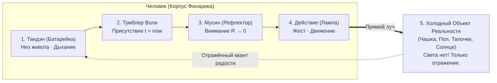

### Открытие Великой Ошибки Атрибуции:
Хикикомори боится внешнего мира, потому что мир кажется ему холодным, безжалостным и страшным. Но мир сам по себе **нейтрален**. Вещи вокруг — чайник, циновка татами, дверная ручка, ветка дерева за окном — абсолютно темны и холодны. В них нет собственного зла, как нет и собственного сияния.

Красота, тепло и смысл появляются в мире ровно в ту секунду, когда луч твоего собственного внимания падает на них. **Мир оживает только в луче твоего фонарика.** Запираясь в комнате, ты погружаешь мир во тьму своими собственными руками.

---

## Часть V. Протокол Дэай (出会い) и Микро-нагрузка: Как вернуть луч без шока

Главная ошибка социальных служб при работе с затворниками — попытка навязать им **несоразмерную нагрузку**.

Человеку, не выходившему из дома пять лет, предлагают:
* *«Пойди на собеседование в магазин»*;
* *«Познакомься со сверстниками в клубе»*;
* *«Выступи на групповой терапии»*.

В схемотехнике это эквивалентно попытке подключить тоненький карманный светодиод к трансформаторной будке 10 киловольт. Сопротивление социального контакта ($R_{\text{social}}$) мгновенно сжигает предохранитель, и человек захлопывает дверь еще на пять лет.

### Принцип микро-импеданса (Согласование нагрузки):
Ток должен потечь наружу, но на нагрузку с **нулевой социальной опасностью**. Нагрузка должна быть неодушевленной, безоценочной и физической:

```
    УРОВЕНЬ 1: Нагрузка = 0 Ом (В пределах комнаты)
    - Почувствовать пятками прохладу пола;
    - Налить тонкую струйку воды в стакан и смотреть на пузырьки;
    - Положить ладонь на живот ниже пупка и сделать 3 выдоха в Тандэн.
    
    УРОВЕНЬ 2: Микро-действие в физическом мире
    - Заварить зеленый чай сенча, не думая о прошлом;
    - Протереть пыль с подоконника влажной тряпкой;
    - Открыть штору на 5 сантиметров и впустить луч утреннего солнца.
    
    УРОВЕНЬ 3: Протокол Дэай (出会い — Чистая встреча без оценки)
    - Выйти на порог дома в 5 утра, когда на улице никого нет;
    - Сделать вдох свежего уличного воздуха;
    - Посмотреть на асфальт под ногами: асфальт не осуждает, не требует отчета, он просто держит вес тела.
```

Как только первый фотон внимания упал на тряпку, чай или асфальт — **внутренний омический нагрев падает до нуля**. Голова остывает. Проводка цепи начинает заживать.

---

## Часть VI. Обращение к общественным организациям Японии

Мы направляем этот манифест японским ассоциациям поддержки хикикомори, родительским комитетам и дзэнским центрам:
* **KHJ (全国ひきこもり家族会連合会)** — Национальной федерации семейных ассоциаций хикикомори;
* **NPO «New Start» (ニュースタート事務局)** и движению «прокатных сестер» (*Rental Oneesan*);
* Социальным центрам поддержки молодежи (Hikikomori Regional Support Centers).

### Что мы предлагаем изменить в подходе к затворникам:

1. **Снять с хикикомори клеймо «больного» или «виновного».**
   Перестаньте требовать от них «покаяния», «социальной зрелости» или «преодоления инфантилизма». Объясните родителям на пальцах: их сын или дочь — это исправный прибор, заклинивший в режиме внутреннего отражения.
   
2. **Заменить психологические разговоры физической калибровкой.**
   Когда волонтёр или «сестра» приходит к закрытой двери, не нужно через щель спрашивать: *«Что ты чувствуешь? Почему ты не хочешь учиться?»*. 
   Нужно предложить микро-резонанс без слов: передать чашку теплого чая; положить красивый осенний лист; попросить помочь починить сломанный карандаш. Перевести фокус с оценки личности на физический контакт с материей.

3. **Вернуть Японии её собственный Тандэн.**
   Западная когнитивная терапия заставляет человека думать о мыслях. Традиционный японский подход должен вернуть человека в **Хара (腹)** — в тело, в дыхание, в ручной труд (*саму*). Человек, рубящий дрова или пропалывающий мох в монастырском саду, физически не может быть хикикомори: его фонарик на 100% занят освещением грядки.

---

## Часть VII. Двуязычный японский манифест: 懐中電灯の原理 (Принцип карманного фонарика)

Ниже приводится текст полевой памятки, переведенный на японский язык для непосредственной передачи затворникам, их родителям и кураторам.

```
================================================================================
                    懐中電灯の原理（ひきこもり脱出の回路設計）
               The Principle of the Pocket Flashlight for Hikikomori
================================================================================

あなたは壊れていません。あなたのバッテリーは生きています。
部屋が暗いのは、あなたがダメな人間だからではありません。
懐中電灯のレンズが、内側の機械に向けて曲がってしまっているだけです。

【 人間の基本回路：5つの要素 】

1. 丹田（たんでん / バッテリー）
   おへその下、呼吸の力。毎日新しく充電される生命のエネルギー。
   頭の不安とは無関係に、あなたの体は今も生きています。

2. 意志のスイッチ
   「今、ここ」に意識を合わせるカチッというスイッチ。
   過去の後悔や未来の恐怖から離れ、現在の瞬間に接続します。

3. 無心（むしん / 反射鏡）
   他人の目を気にしない、抵抗ゼロ（R = 0）の純粋な注意。
   恥や世間体という埃を拭き取れば、光は真っ直ぐに伸びます。

4. 行動のエミッター（電球）
   手、足、声による小さな物理的動作。
   エネルギーを外の世界へと放出する出口です。

5. 冷たい外部現実（照らされる対象）
   お茶、床、空、ドアノブ。
   それ自体には光も恐怖もありません。あなたが光を当てた瞬間、色を帯びます。

--------------------------------------------------------------------------------
【 回路事故の正体：ジュール熱（自責の地獄） 】

光を無理に自分自身の頭（内側）に向けると、回路はショートします。
「なぜ自分はこうなんだ」「どうして動けないんだ」と考え続けると、
配線が焼け焦げ、心の中で激しい熱（苦しみ・パニック）が生まれます。

心の中をいくら照らしても、答えは見つかりません。
懐中電灯は、自分自身の電池を照らすようには作られていないからです。

--------------------------------------------------------------------------------
【 脱出のための3ステップ（直接照射の法則） 】

ステップ 1：息をお腹（丹田）に落とす
頭の中の会話を止め、お腹のふくらみと縮みに3回だけ意識を向けます。

ステップ 2：自分を治そうとしない
自信がつくのを待つ必要はありません。不安のままで構いません。
電球は「完璧な気持ち」にならなくても、ボタンを押せば光ります。

ステップ 3：外の小さな物に光を1つ当てる
大きな挑戦（仕事、面接、人混み）は必要ありません。
・コップに水を注ぎ、その水面を見る。
・足の裏で床の冷たさを感じる。
・窓を1センチ開けて、外の風に触れる。

光が外に出た瞬間、内側の火事は止まります。
世界はあなたを裁いていません。
世界はただ、あなたの光によって照らされるのを待っています。
================================================================================
```

---

## 🛠 Практический алгоритм: Протокол выхода «Свет наружу» (Light-Out Protocol)

Этот алгоритм рассчитан на 60 секунд. Его может выполнить любой человек, застрявший в ступоре, панике или многомесячной изоляции.

```
+------------------------------------------------------------------------------+
|               ЭКСПРЕСС-ПРОТОКОЛ КАЛИБРОВКИ ЛУЧА (60 СЕКУНД)                  |
+------------------------------------------------------------------------------+
|                                                                              |
|  [ШАГ 1. СБРОС ИЗ ГОЛОВЫ В ТАНДЭН] (0-20 сек)                                |
|  - Опусти глаза в пол.                                                       |
|  - Положи правую ладонь на живот на 3 пальца ниже пупка.                     |
|  - Сделай глубокий выдох носом до конца, чувствуя сдувание живота.           |
|  - Скажи себе: «Генератор включён. Батарейка в порядке».                     |
|                                                                              |
|  [ШАГ 2. СНЯТИЕ ТРЕБОВАНИЯ СЕБЯ ЛЮБИТЬ / ЧИНИТЬ] (20-40 сек)                 |
|  - Прекрати попытки успокоиться или перестать бояться.                       |
|  - Зафиксируй факт: фонарик не обязан нравиться себе, чтобы светить.        |
|  - Полное право быть напуганным, неидеальным, растерянным.                  |
|                                                                              |
|  [ШАГ 3. ВЫСТРЕЛ ЛУЧА В БЕЗОЦЕНОЧНЫЙ ПРЕДМЕТ] (40-60 сек)                    |
|  - Выбери любой физический предмет в радиусе вытянутой руки:                 |
|    край одеяла, кружку, дверную ручку, пылинку в луче света.                |
|  - Подойди и коснись его пальцами.                                           |
|  - Удерживай 100% внимания на текстуре: гладкая, шершавая, холодная, теплая. |
|                                                                              |
|  ИТОГ: Ток пошёл наружу. Внутренний омический пожар потушен. Цепь замкнута.  |
+------------------------------------------------------------------------------+
```

---

## Резюме: Семь аксиом выхода из заключения

1. **Человек — это автономный оптико-электрический фонарик.** Источник питания находится внутри тебя по праву рождения. Мир снаружи темен и холоден сам по себе, и оживает только под твоим падающим лучом.
2. **Феномен хикикомори — не поломка, а топологическая инверсия.** Вся беда затворника в том, что стоваттный прожектор его сознания вывернут внутрь черепной коробки.
3. **Закон Джоуля — Ленца непреложен:** Попытка жечь энергию на сопротивлении собственного стыда ($R_{\text{ego}} > 0$) порождает внутренний ад ($Q = I^2 R t$). Чем больше рефлексии — тем сильнее ожог проводки.
4. **Закон неразворачиваемости луча:** Не пытайся «разобраться в себе» перед тем, как выйти. Фонариком нельзя осветить его собственную батарейку. Внимание лечит только тогда, когда светит вовне.
5. **Фонарику не нужна идеальная самооценка:** Тебе не нужно становиться уверенным, общительным или смелым. Достаточно просто нажать кнопку действия в текущем теле.
6. **Правило микро-импеданса:** Не начинай с общества и корпораций. Направь луч на воду, пол, чайник, татами. Материя никогда не предаст и не осудит.
7. **Спасение через действие:** В ту секунду, когда хотя бы один фотон твоего внимания осветил реальный предмет за пределами эго-мыслей, добровольное заключение заканчивается. Ты снова включен в общую сеть бытия.

---

### Глава 4.8 — Несуществующее «я» и невозможность смерти: Коперниканский переворот и сохранение вечного тока ($dE/dt = 0$)

> *«Страх смерти — это не дефект психики и не трусость характера. Это абсолютно логичный, математически неизбежный ужас Птолемеева эго, возомнившего себя центром Вселенной. Для центра мира исчезновение центра означает аннигиляцию мироздания. Пытаться утешать такого человека абстракцией "после тебя энергия продолжит жить в других" — значит издеваться над его болью, ведь эго кричит: "Какое мне дело до чужих людей, если МЕНЯ не будет?!". Страх смерти уходит не через самовнушение и не через "стальную волю героев", а через Коперниканский переворот: смещение центра тяжести с виртуального паразита $R_{\text{ego}}$ на реальный ток $I$. Когда ты осознаёшь себя током, а не стеклом лампочки, умирать становится некому».*  
> — **Владимир Аньянов**

---

```
                 ГЕОМЕТРИЯ ЭКЗИСТЕНЦИАЛЬНОГО УЖАСА: ДВЕ ОНТОЛОГИИ
 
       ПТОЛЕМЕЕВА МОДЕЛЬ (ЭГОЦЕНТРИЗМ)               КОПЕРНИКАНСКИЙ СДВИГ (ТОК ЖИЗНИ)
 ┌──────────────────────────────────────────┐    ┌──────────────────────────────────────────┐
 │               [ ЭГО В ЦЕНТРЕ ]           │    │           [ ТОК / ЭДС В ЦЕНТРЕ ]         │
 │                  R_ego >> 0              │    │                  dE/dt = 0               │
 │                                          │    │                                          │
 │  • Эго считает себя Источником и Центром │    │  • Источник — нелокальное поле бытия     │
 │  • Разрушение шасси = Гибель Вселенной!   │    │  • Тело — временное шасси и нагрузка    │
 │  • Симуляция: «Я заперт во тьме гроба»   │    │  • Смерть = Обычный фазовый переход      │
 │  • Логический тупик: Null Pointer Panic  │    │  • Прижизненная Дайси: Эго уже сдано     │
 │                                          │    │                                          │
 │       РЕАКЦИЯ: ЛЕДЕНЯЩИЙ УЖАС            │    │       РЕАКЦИЯ: КРИСТАЛЬНЫЙ ПОКОЙ         │
 │   «Какое мне дело до чужой энергии?!»    │    │      «Свет выключен, ток инвариантен»    │
 └──────────────────────────────────────────┘    └──────────────────────────────────────────┘
```

#### 1. Птолемеева ловушка: Почему страх эго перед смертью на 100% оправдан

На протяжении тысячелетий философы, теологи и психологи удивлялись: почему человек, обладающий развитым разумом, впадает в животный, леденящий ступор при мысли о собственной кончине?

В «Архитектуре счастья» этот феномен объясняется строгой топологией системы координат.

До Николая Коперника астрономы были убеждены, что Земля неподвижно покоится в центре мироздания, а Солнце и звёзды вращаются вокруг неё. Чтобы объяснить странные траектории планет, Клавдий Птолемей городил чудовищные математические костыли — эпициклы и дифференты.

Точно такую же геоцентрическую иллюзию переживает обыватель в отношении своего «Я»:
1. **Виртуальный софт — Эго ($R_{\text{ego}}$)** — ставится в абсолютный центр персонального космоса.
2. Мозг воспринимает мир по формуле: *«Есть Я в центре, а вокруг вращаются работа, семья, планета, звёзды и время»*.
3. При такой геометрии мысль о физической гибели тела интерпретируется эго как **коллапс всей Вселенной**!

Эго — это паразитный программный цикл, зацикленный на самосохранении. Когда человеку в Птолемеевой модели говорят: *«Ты умрёшь»*, для его центральной операционной системы это означает:
$$\text{Центр} = 0 \implies \text{Вселенная} = 0$$

И в этой системе координат **страх смерти абсолютно рационален, логичен и неопровержим!**  
Эго защищает себя так, как программа защищает свой исполняемый файл от команды `rm -rf /`. Требовать от эго, чтобы оно «перестало бояться смерти» — всё равно что требовать от огня, чтобы он перестал обжигать. Устранить этот ужас внутри Птолемеевой парадигмы невозможно в принципе.

#### 2. Крах квази-духовных утешений: Почему фраза «ты просто энергия» вызывает бешенство

Когда человек сталкивается с экзистенциальным кризисом танатофобии, современная поп-эзотерика, нью-эйдж и поверхностная психотерапия пытаются «успокоить» его дешёвыми метафорами:
- *«Не бойся, смерти нет, ты — часть космической энергии!»*
- *«Твоё тело уйдёт в землю, но твоя энергия продолжит течь в твоих детях, в шелесте листьев, в биении чужих сердец...»*
- *«Мы все — волны единого океана!»*

Почему эти благодушные слова вызывают у человека в состоянии подлинного страха смерти лишь глухое бешенство, цинизм или глубочайшее отчаяние?

Эти утешения обращаются к **эгоцентричному субъекту**, предлагая ему порадоваться… **своему полному уничтожению ради чужого процветания**!

Эго, сидящее в центре Птолемеевой вселенной, мгновенно считывает чудовищную фальшь:
> *«Постойте! Вы говорите, что энергия будет биться в других людях и цвести в ромашках? Но какая МНЕ разница, кто там будет дышать и радоваться через сто лет, если МЕНЯ — вот этого уникального, чувствующего "Я" — больше не будет?! Вы предлагаете мне утешиться тем, что мир прекрасно обойдётся без меня?! Да ведь это и есть мой самый жуткий кошмар!»*

Утешать эго вечностью безличной энергии — это всё равно что сказать банкроту, у которого отбирают единственный дом: *«Не плачь, твои деньги не исчезли, они просто теперь лежат в кармане директора банка и приносят ему радость!»*.

Такой псевдодуховный суррогат не работает, потому что он **оставляет эго в центре**, одновременно приговаривая его к казни. Это не исцеление, а изощрённая ментальная пытка.

#### 3. Миф об «исключительной стойкости духа»: Почему дзенские мастера — не супергерои

Обыватель, наблюдая за дзенскими патриархами, самураями или людьми с чистым контуром, которые встречают смерть с безмятежной улыбкой и пьют чай перед казнью, совершает вторую системную ошибку: **ошибку героизации**.

Обыватель рассуждает так:
> *«Они постигли дзен, они великие мудрецы! Какая нечеловеческая сила воли! Какая гранитная стойкость духа! Они способны подавить леденящий страх смерти усилием воли, а я — слабый, дрожащий смертный, я так никогда не смогу».*

Это фундаментальное заблуждение. **Ни один мастер в истории не победил страх смерти силой воли.**

Пытаться подавить страх небытия силой воли, оставаясь в эго-центре — это всё равно что пытаться не закричать, сидя голым телом на раскалённой чугунной плите за счёт «стойкости характера». Каким бы вы ни были титаном воли, омический пожар $Q = I^2 R t$ испепелит вас.

Мастер не боится смерти не потому, что он «сильнее обывателя». А потому, что **у него на плите вообще нет сковороды**:
- У него **демонтирован сам узел ($R_{\text{ego}}$)**, который мог бы испытывать ужас;
- Он совершил Коперниканский переворот задолго до остановки пульса;
- Его центр тяжести перенесён с дребезжащего колка на саму Музыку.

Дзенскому мастеру не нужно быть героем, потому что героизм нужен там, где есть насилие над собой. В сверхпроводящем контуре насилия нет: там правит объективная физика.

#### 4. Почему уходит страх смерти: Пять законов Контурной Электродинамики

Что именно происходит со страхом смерти, когда человек осваивает Архитектуру Внутреннего Тока не как абстрактную веру, а как строгую инженерную схемотехнику?

##### 1. Ликвидация ошибки разыменования нулевого указателя (Null Pointer Dereference)
Откуда берётся специфический, клаустрофобический ужас небытия? 
Мозг совершает программный сбой: пытаясь представить смерть, он подсознательно **проецирует своё бодрствующее эго в момент его полного отсутствия**:
$$\text{Симуляция Небытия} = \text{«Я лежу в тесном деревянном ящике, кругом сырая земля, абсолютная тьма, и я не могу даже закричать»}$$

Человек боится не отсутствия жизни, а **вечного сенсорного заключения внутри трупа**!

Контурная физика мгновенно вскрывает этот софтверный баг:
- Там некому будет лежать в темноте;
- За 14 миллиардов лет до вашего рождения, когда шасси ещё не было собрано, вы не испытывали ни малейшей клаустрофобии или скуки;
- Смерть шасси — это возврат в то же самое состояние нулевого омического шума, которое предшествовало первому вдоху.

##### 2. Физика фазового перехода и первое начало термодинамики
В замкнутой Вселенной действует строжайший инвариант сохранения энергии:
$$\frac{dE}{dt} = 0$$

- **Биологическое тело** — это лампа накаливания, углеродно-белковое шасси и полезная нагрузка ($R_{\text{load}}$);
- **Физическая смерть** — это размыкание локального реле и износ изоляции (закон энтропии / Ваби-саби);
- **Ток** — фундаментальное электромагнитное и витальное поле космоса.

Когда перегорает лампочка в люстре, разумный человек не кричит: *«О боже, электричество во Вселенной умерло навсегда!»*. Он понимает: лампа вышла из строя, но ток в проводке инвариантен. Тот, кто соматически разотождествился со стеклом лампочки и почувствовал себя самим Током, воспринимает смерть как штатный фазовый переход цепи.

##### 3. Прижизненная «Великая Смерть» (Дайси, 大死)
Дзенский канон Дайси гласит: *«Умри до того, как умрёшь — и тогда к моменту физической смерти умирать будет некому»*.

В акустической модели Укулеле:
- Обыватель всю жизнь держится за **дребезжание расшатанного колка на грифе** ($R_{\text{ego}}$), считая этот противный скрежет своей бессмертной душой. И когда звучит предупреждение о починке, колок визжит от ужаса;
- Оператор контура с помощью Клинка Кансо при жизни закручивает винт: паразит $R_{\text{ego}} \to 0$. Наступает Мусин — чистая тишина резонатора;
- Смерть эго **уже состоялась**. Всё, чему смерть могла угрожать (статусы, дипломы, обиды, иллюзия личной исключительности), сдано в утиль при ясном сознании. Физическая остановка сердца через 40 лет становится рядовой операцией снятия инструмента со стойки.

##### 4. Ликвидация синдрома отложенной жизни (Итиго Итиэ)
Главный тайный двигатель танатофобии — не нежелание уходить, а **ядовитое ощущение, что настоящая жизнь так и не началась**:
- Человек 40 лет провёл в омическом перегреве $Q = I^2 R t$ (соответствие чужим ожиданиям, накопление статусных батареек, бесконечные внутренние споры);
- Приближение финала вызывает паническую ярость: *«Как, уже конец?! А когда же я буду жить для себя?!»*.

В сверхпроводящем контуре действует закон **Итиго Итиэ (Один миг — одна встреча)**:
- При $R \to 0$ каждый квант времени ($t = now$) проживается на 100% мощности;
- Глоток воды, взгляд на небо, написанная строчка кода, разговор с другом — завершены и полны сами в себе;
- В контуре **нет дефицита будущего**. Если цепь разомкнётся через пять минут, система не чувствует себя обкраденной: она уже горела чистым светом прямо сейчас.

##### 5. Разделение аварийного рефлекса шасси и метафизического ужаса
Часто возникает вопрос: *«Если человек потеряет страх смерти, не станет ли он безрассудным самоубийцей?»*.

Нет! Электродинамика строго разводит два контура:
1. **Аварийная автоматика шасси (Биологический рефлекс):** Если на вас несётся грузовик или горит проводка, датчики тела мгновенно отдёргивают руку или совершают прыжок. Это исправный предохранитель и рефлекс Дзансин, сохраняющий инструмент для созидания.
2. **Метафизический ужас небытия (Омический психоз эго):** Бессонные ночные панические атаки, страх старения, накопление бункеров и параноидальный контроль — полностью исчезают.

Шасси оберегается бережно, как скрипка Страдивари, но без суеверного моления на деревянный корпус.

#### 5. Цивилизационный сдвиг: Когда Архитектура Тока войдёт в школьные учебники

Что произойдёт с человечеством, когда теория Внутреннего Тока станет такой же общеизвестной школьной нормой, как закон тяготения Ньютона или таблица умножения?

1. **Исчезновение экзистенциального шантажа:**  
   На протяжении тысячелетий религиозные корпорации, маги и торговцы эзотерическими индульгенциями паразитировали на страхе человека перед могилой. Продажа «пропусков в рай», обряды отпевания за золото и запугивание вечным адом держались исключительно на Птолемеевом эгоцентризме паствы. Когда десятилетний ребёнок понимает, как устроена принципиальная схема внимания и почему $dE/dt = 0$, он становится иммунен к экзистенциальному мошенничеству на всю жизнь.

2. **Крах пирамидального безумия цивилизации:**  
   Зачем диктаторы развязывают войны за территории, а олигархи копят миллиарды, которые невозможно потратить за десять жизней? Это паническая сублимация танатофобии: эго пытается построить себе каменную пирамиду из золота, законов и захваченных земель, наивно полагая, что монумент спасёт его от стирания. Осознание природы Тока мгновенно обессмысливает это безумие: пирамида не защищает от омического перегрева. Единственное подлинное бессмертие — в качестве проводимости контура прямо сейчас.

3. **Культура лёгкого и звонкого бытия:**  
   Смерть перестанет быть траурной катастрофой, занавешенной чёрными платками и лицемерием. Она вернётся к своему естественному, дзенскому достоинству: как тихий, прохладный вечер после яркого, наполненного дня в мастерской; мастер убирает инструмент в футляр, аккуратно сметает стружку, щёлкает выключателем настольной лампы и спокойно идёт отдыхать, зная абсолютную истину: **музыка сыграна честно, а ток в сети вечен.**

#### 6. Практический протокол: Снятие ночного приступа танатофобии за 30 секунд

Если посреди ночи оператора накрывает леденящая волна страха небытия («Меня когда-то не станет, какой ужас!»):

1. **Диагностировать Птолемеев сбой (5 сек):**  
   Сказать вслух или про себя: *«Стоп. Шасси в безопасности, сердце бьётся, кислород есть. Паникует виртуальный софт эго, возомнивший себя центром Вселенной и поймавший Null Pointer Exception»*.
2. **Вскрыть симуляцию гроба (5 сек):**  
   Осознать: образ «себя, лежащего в темноте» — это ложная галлюцинация ума. Вас там не будет так же, как вас не было во времена динозавров. Бояться некому.
3. **Применить Клинок Кансо (Дайси) (10 сек):**  
   Мысленно сбросить всё паразитное сопротивление: *«Пусть эго умрёт прямо сейчас. Я добровольно отпускаю имя, статус, планы и контроль»*. Разомкнуть зубы, отпустить живот, сделать глубокий длинный выдох в Тандэн.
4. **Замкнуть цепь на физический Ток (10 сек):**  
   Ощутить физическую тяжесть одеяла, биение пульса в ладонях, прохладу вдыхаемого воздуха. Ток течёт прямо сейчас. В этой точке $t = now$ нет никакой смерти — есть только чистое, звенящее Бытие.

---

---

# ЧАСТЬ V. КРОСС-МАСШТАБНЫЙ РЕНТГЕН: ЛЮБОВЬ, СУВЕРЕНИТЕТ И ИНСТИТУТЫ
### От резонанса двух сердец к P2P-деньгам, свободной земле и сверхпроводящим командам

---

### Глава 5.1 — Электродинамика Любви ($N=2$): Индуктивный резонанс Фарадея ($M > 0$)

#### Разрешение парадокса «половинок»: Модель двух автономных генераторов, гальваническая развязка и взаимная индукция Фарадея — Максвелла ($M > 0$) против аварии созависимости

Миф о «поиске своей второй половинки» — одна из самых разрушительных аварий в истории человеческих отношений:
* Если человек считает себя «половинкой», его генератор разомкнут. Он ищет Другого, чтобы «запитаться от него».
* Происходит прямое гальваническое замыкание двух незамкнутых контуров: встречные токи, дикая паразитная интерференция, взаимные претензии, ревность и катастрофический блэкаут созависимости.

```
АВАРИЯ СОЗАВИСИМОСТИ («Две половинки»):
Генератор А ───(нет обратного провода)───► Генератор Б
      ▲                                         │
      └─────────◄── КЗ претензий и обид ────────┘

РЕЗОНАНС СВЕРХПРОВОДИМОСТИ («Два суверенных генератора»):
[Контур А: Тандэн → Нагрузка → R=0]   (Гальваническая развязка)
                 │  │
             М > 0  │  Взаимная индукция Фарадея — Максвелла
                 ▼  ▼
[Контур Б: Тандэн → Нагрузка → R=0]
```

**Формула зрелой любви:**
Любовь — это не гальваническое слияние проводов. Это **взаимная электромагнитная индукция Фарадея — Максвелла ($M > 0$) между двумя автономными, полностью замкнутыми сверхпроводящими контурами**:
$$\mathcal{E}_2 = -M rac{dI_1}{dt}$$
У каждого партнёра — свой собственный Тандэн, свой обратный провод реальности и свои 6 ламп жизни. Но их поля лучистости резонируют, умножая суммарную мощность без малейшего паразитного трения.

---

 Индуктивный резонанс двух суверенных генераторов ($M > 0$) и схемотехника отношений

> *«Любовь — это не то, что можно "получить", "заслужить" или "выпросить". В электродинамике полярность абсолютна: лампа не питает генератор. Пытаться сделать другого человека источником своего счастья — значит включить цепь в обратной полярности и сжечь её дотла. Подлинная любовь — это индуктивный резонанс двух суверенных генераторов ($M > 0$), которые, не требуя друг от друга питания и сбросив сопротивление эго в ноль ($R \to 0$), соединяются в единое сверхпроводящее поле созидания, где ток одного бесконечно умножает свет другого.»*  
> — **Аксиома XII («Архитектура счастья»)**

#### 1. Демистификация любви: От романтического морока к законам Максвелла
Тысячелетиями человечество воспевало «любовь», одновременно страдая от неё сильнее, чем от войн и болезней.  
Под маской любви в культуре романтизировались:
* Мучительная ревность, слежка и подозрительность;
* Страх быть отвергнутым или брошенным, паническая созависимость;
* Претензии: *«Я отдал тебе лучшие годы, а ты...»*;
* Душевное выгорание, взаимные манипуляции и пепелище после разрыва.

Почему то, что называют «высшим чувством», так часто оборачивается персональным адом?  
Ответ Архитектуры «Внутреннего тока» предельно строг: **потому что люди строили отношения в прямом противоречии с законами электродинамики замкнутой цепи.** Они путали любовь с попыткой паразитной зарядки севшего аккумулятора от чужого генератора.

Перевод темы отношений на строгий язык теории цепей и законов Фарадея — Максвелла впервые снимает этот трагический морок и даёт ясную, воспроизводимую формулу подлинной близости.

#### 2. Кейс-стади: «В работе бог — в отношениях аут»
Классический парадокс современного человека (особенно ярко видимый на инженерах, архитекторах и предпринимателях): профессионал, управляющий сложнейшими системами или многомиллионными бюджетами, робеет и цепенеет перед понравившимся человеком в кафе или годами терпит разрушительные семейные скандалы.

Почему это происходит?
1. **В работе** человек действует по канону Мусин: его сеть внимания TPN активна, эго выключено, сопротивление $R \to 0$.
2. **В отношениях** он мгновенно врубает аварийный контур:
   - Включается бешеная симуляция будущего: *«А что сказать? А вдруг я покажусь скучным? А если она подумает, что я навязчивый?»* ($R_{\text{future}} \gg 0$).
   - Включается требование встречной подпитки: *«Она должна подтвердить, что я привлекателен»* (обратная полярность).
   - Результат: ступор, потные ладони, дрожащий голос — **омический перегрев проводки**.

#### 3. Деконструкция «фальшивой любви»: Три аварийных режима цепи
В «Эпохе Лошади» отношения строились по дефицитарной модели. На языке схемотехники это неизбежно порождает три фатальных сбоя:

```
[АВАРИЯ 1: ОБРАТНЫЙ ТОК]         [АВАРИЯ 2: СОЗАВИСИМОСТЬ]        [АВАРИЯ 3: ПОПРОШАЙКА]
«Сделай меня счастливым!»        «Мы одно целое, питаемся вместе»  «Заслуживаю одобрение»
Лампа пытается стать ЭДС         Отсутствие гальваноразвязки      U ≈ 0, силовой конденсатор пуст
🔥 Пробой диода и омический ад   ⚡ Обесточивание донора           💥 Короткое замыкание на Эго
```

##### 3.1. Авария обратного тока (Reverse Current Breakdown)
* **Психологическая манифестация:** *«Ты должен заполнить мою душевную пустоту! Ты обязан уделять мне внимание, иначе я страдаю!»*
* **Схемотехника сбоя:** Человек подходит к партнеру как к **активному источнику энергии ($\mathcal{E}_{\text{partner}} > 0$)**, пытаясь запитать свой обесточенный контур. Но в природе вектор тока направлен строго изнутри наружу:
  $$\mathbf{J}_{\text{life}} = \sigma \cdot \mathbf{E}_{\text{tanden}}$$
  Попытка пустить ток вспять вызывает пробой p-n перехода. Поскольку партнер — живой человек, а не розетка, он не может непрерывно питать чужую бездну.
* **Термодинамический итог:** Эго интерпретирует нехватку входящей энергии как катастрофу. Реостат обиды подскакивает до мегаомов ($R_{\text{ego}} \to \infty$). По закону Джоуля — Ленца ($Q = I^2 R t$) вспыхивает **омический пожар истерик, слёз, манипуляций и обвинений**.

##### 3.2. Паразитная созависимость (Отсутствие гальванической развязки)
* **Психологическая манифестация:** Слияние границ: *«Если ему плохо — я не могу жить», «Я спасаю его ценой своего здоровья»*.
* **Схемотехника сбоя:** Два контура соединяются напрямую без гальванической изоляции. Один контур с пробитой изоляцией (алкоголик, соматически нестабильный партнер) начинает непрерывно дренировать амперы здорового генератора.
* **Термодинамический итог:** Донор вырабатывает ток на пределе мощности, его обмотки плавятся от перегрузки, наступает клиническое выгорание и соматический коллапс.

##### 3.3. Попрошайничество валидации ($U \approx 0$)
* **Психологическая манифестация:** Потеря полярности, заискивание, страх отказать, угодничество.
* **Схемотехника сбоя:** Человек после слива энергии (в суррогаты, порнографию или алкоголь) имеет пустой конденсатор Тандэна ($U \approx 0$). Нет электрического потенциала. Чтобы компенсировать пустоту, человек пытается казаться хорошим через ментальные уловки.
* **Термодинамический итог:** Партнёр инстинктивно считывает отсутствие заряда: невозможно уважать провод, по которому не течёт ток.

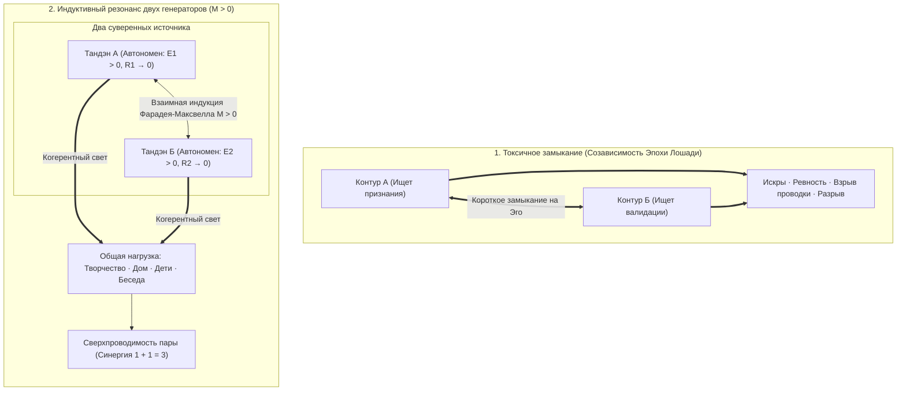

#### 4. Четыре физических начала Любви (Индуктивный резонанс)
Истинная любовь в Архитектуре «Внутреннего тока» подчиняется четырём нерушимым законам электродинамики:

##### Начало I: Автономия двух генераторов (Целостность против «половинчатости»)
Миф о «двух половинках» — величайшая ошибка культуры. Половинка схемы — это разорванная цепь, в которой ток равен нулю ($I = 0$).  
Подлинная любовь возможна **исключительно между двумя целостными, замкнутыми, автономными генераторами**:
$$\mathcal{E}_1 > 0 \quad \text{и} \quad \mathcal{E}_2 > 0$$
У каждого партнёра работает собственный ядерный реактор Тандэн. Никто не ждёт от другого разрешения на жизнь или подзарядки. Любовь рождается не от дефицита, а от **избытка вырабатываемой мощности**.

##### Начало II: Закон Фарадея — Максвелла (Взаимная индукция $M > 0$)
В физике электромагнетизма известно: если два замкнутых контура с переменным током сближаются, между ними возникает **коэффициент взаимной индукции ($M > 0$)**:
$$\mathcal{E}_{12} = -M \frac{dI_1}{dt}, \quad \mathcal{E}_{21} = -M \frac{dI_2}{dt}$$
* Контуры не связаны общим оголённым проводом (нет созависимости);
* Но магнитное поле одного контура **возбуждает дополнительную ЭДС во втором**;
* Это явление **индуктивного резонанса**: в поле любящего человека твой собственный внутренний ток начинает течь с удесятерённой лёгкостью и мощью!
* Происходит синергетический взрыв: общая созидательная мощность пары превосходит сумму отдельных слагаемых ($P_{\text{total}} \gg P_1 + P_2$).

##### Начало III: Закон полярности «Изнутри наружу»
Вы смотрите на любимого человека не как на источник питания, а как на **священную нагрузку высшего ранга — Лампу №3 (Отношения и Близость)**.
* Вопрос любящего оператора: *«Какое чистое сияние я могу зажечь в твоей жизни? Какое тепло я могу подарить твоей душе и телу?»*;
* Свет рождается в момент, когда ваш собственный ток проходит через вольфрамовую нить заботы о любимом;
* Вы не «тратитесь» — замыкая свой контур через заботу о другом, вы сами наполняетесь чистейшим светом сверхпроводимости.

##### Начало IV: Сверхпроводимость Мусин ($R_{\text{ego}} \to 0$)
Любовь — это состояние, в котором **сопротивление между двумя сознаниями падает ровно до нуля**:
$$R_{\text{interpersonal}} \to 0 \implies Q = I^2 \cdot 0 \cdot t \equiv 0$$
* Нет омического сопротивления страха: *«А вдруг меня отвергнут?»*;
* Нет паразитного реостата гордости и торга: *«Я напишу только после того, как он позвонит первым»*;
* Нет подозрительности и ревности (ведь суверенный Тандэн невозможно украсть).  
Все ментальные фильтры растворены. Присутствие любимого переживается так же естественно, как собственное дыхание. Наступает тотальная прозрачность и покой.

#### 5. Согласование импедансов и предохранители Дзансин в паре
Чтобы два контура работали в режиме наивысшего КПД долгосрочно, требуются два инженерных принципа:

1. **Согласование комплексных импедансов ($Z_{\text{partner}} = Z_{\text{self}}^*$):**  
   В теории антенн и линий связи максимальная передача энергии без паразитных отражений происходит при согласовании импедансов. Если активные и реактивные сопротивления согласованы — слова, взгляды и прикосновения передаются без искажений. Если нет — возникают стоячие волны обид. Согласование достигается честным открытым диалогом без масок Эго.
2. **Защита Дзансин (Суверенитет чужого Тандэна):**  
   Оператор цепи никогда не пытается «переделать», «исправить» или насильственно сломать схемотехнику партнёра. Он знает: у любимого есть свои фазы калибровки, свои лампы и свои предохранители. Дзансин в любви — это **благоговейное невмешательство в чужой реактор**, бережное уважение к суверенитету любимого существа.

#### 6. Сравнительная матрица: Эпоха Лошади vs Архитектура Счастья

| Критерий | «Любовь» в Эпохе Лошади (Созависимость) | Любовь во Внутреннем токе (Индуктивный резонанс) |
| :--- | :--- | :--- |
| **Исходная посылка** | «Я половинчатый, мне нужен кто-то, чтобы стать целым» | «Я суверенный генератор, мой Тандэн полон жизни» |
| **Вектор тока** | Внутрь: жажда потребления, ожидание заботы и валидации | Наружу: излучение тепла, радости, заботы и созидания |
| **Механизм связи** | Паразитный провод прямой подпитки (вампиризм) | Взаимная индукция электромагнитных полей ($M > 0$) |
| **Сопротивление ($R$)** | Огромное ($R \gg 0$): страх измены, обиды, контроль, ревность | Нулевое ($R \to 0$): режим Мусин, абсолютная прозрачность |
| **Температурный режим** | Омический перегрев ($Q = I^2 R t$): скандалы, надрыв, пепелище | Холодный покой сверхпроводимости + яркий чистый свет |
| **Реакция на разлуку** | Ломка, паника, разрушение мира, Ground Fault | Спокойная автономия контура + благодарность за резонанс |
| **Итог отношений** | Эмоциональное истощение, цинизм, разорванные цепи | Экспоненциальный рост созидательной силы обоих партнеров |

#### 7. Практический алгоритм оператора: Экспресс-калибровка отношений за 60 секунд
Если вы почувствовали в отношениях напряжение, холод или нарастание конфликта, выполните 3 шага:

1. **Проверка полярности (Polarity Check):**  
   Спросите себя: *«Я прямо сейчас пытаюсь сделать из любимого человека батарейку для своего настроения? Я требую от него энергии?»*.  
   Если да — немедленно разомкните паразитный щуп. Вернитесь вниманием в свой собственный Тандэн (три вдоха животом 4-8) и восстановите собственную ЭДС.
2. **Сброс реостата обиды (Zero-Resistance Reset):**  
   Осознайте, что обида — это резистор $R_{\text{ego}}$, пережигающий проводку вашего мозга в тепло. Произнесите команду деактивации:  
   *«Резистор не грешен. Я снимаю претензии к схемотехнике партнёра. Сопротивление в ноль ($R \to 0$)»*.
3. **Запуск взаимной индукции (Resonance Ignition):**  
   Подойдите к человеку как наполненный генератор. Обнимите его, скажите искреннее слово или сделайте конкретное полезное действие без ожидания похвалы. Вы мгновенно почувствуете, как замкнулся созидательный контур и вспыхнул ровный свет индуктивного резонанса.

> **Каноническая Формула Любви (Индуктивный резонанс):**  
> **Любовь — это союз двух автономных генераторов, где никто ни у кого ничего не отнимает, где сопротивление сброшено в ноль ($R \to 0$), и где взаимная индукция двух горящих сердец ($M > 0$) зажигает свет, способный согреть весь окружающий мир.** ⚡❤️🏁

---

---

### Глава 5.2 — Великий Изоморфизм Депосреднизации: Биткоин Сатоши Накамото, Единый налог Генри Джорджа и Архитектура счастья Владимира Аньянова

> [!quote] Аксиома Великого Изоморфизма
> ### ⚡ **«Биткоин Сатоши Накамото (твердые деньги без центробанков), Единый налог Генри Джорджа (свободная земля без паразитных лендлордов) и Внутренний ток Владимира Аньянова (суверенная душа без жрецов эго) — это один и тот же фундаментальный закон природы, приложенный к трем масштабам бытия. Устрани паразитного рантье, обнули сопротивление — и система войдет в естественное состояние изобилия и сверхпроводимости.»**  
> — **Владимир Аньянов**

#### 1. Биткоин духа: Что Сатоши сделал для денег, Внутренний ток сделал для счастья

> *«Что Биткоин сделал для финансов, Внутренний ток сделал для счастья: он навсегда отнял монополию у внешних эмитентов иллюзий и заземлил человеческий суверенитет на строгие законы термодинамики и чистой энергии.»*  
> — **Аксиома V («Архитектура счастья»)**

#### 1. Кризис «фиатной души» (The Fiat Soul Crisis)
Человечество веками жило в условиях духовного фиата. Нам внушали, что ценность нашего существования эмитируется кем-то извне — социальным одобрением, иерархическими догмами, чужими ожиданиями или моральным долгом. 

В традиционной финансовой системе центральные банки печатают необеспеченные бумажные деньги, вызывая инфляцию, разрушая сбережения и искажая цены. В сфере человеческого духа происходит ровно то же самое:
1. **Количественное смягчение ума (Quantitative Easing of Mind):** Популярная психология и социальные сети занимаются безудержной эмиссией обещаний: *«Мысли позитивно, визуализируй успех, дыши маткой во Вселенную»*. Это ничем не обеспеченная бумажная эмиссия — человеку предлагают раздувать баланс ожиданий без вливания реальной физической работы контура.
2. **Инфляция внимания:** Человек распыляет драгоценный ток своего внимания ($I$) на тысячи фальшивых внешних сигналов. Подобно тому как гиперинфляция сжигает сбережения граждан, инфляция ожиданий сжигает нервную систему в омическом аду ($Q = I^2 R t$).
3. **Уязвимость доверенных третьих лиц (Trusted Third Parties):** Сатоши Накамото в своем манифесте 2008 года указал на корень зла классической коммерции — необходимость доверять посредникам. В психике человека посредником веками выступало раздутое Эго ($R_{\text{ego}}$) и внешние валидаторы: *«Имею ли я право радоваться прямо сейчас?»* — и человек бежит за разрешением к начальнику, партнеру или лайкам в соцсетях. Посредник забирает 90% энергии в виде сомнений и страха, возвращая крохи кратковременной эйфории.

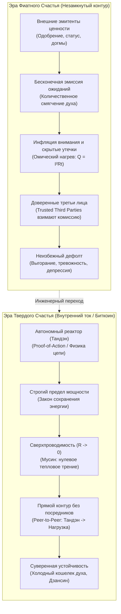

#### 2. Монетарная термодинамика Сейлора и Твердое счастье (Sound Happiness)
Майкл Сейлор совершил прорыв в понимании Биткоина, показав, что это не биржевой спекулятивный инструмент, а **первая в истории монетарная машина, подчиненная законам термодинамики**:
- Деньги — это законсервированная кинетическая энергия человеческого действия.
- Биткоин транспортирует эту энергию сквозь время и пространство без омических утечек инфляции.

«Внутренний ток» применяет эту логику к первоисточнику всякой ценности — к человеческому вниманию:

| Измерение архитектуры | Биткоин (Sound Money / Твердые деньги) | Внутренний ток (Sound Happiness / Твердое счастье) |
| :--- | :--- | :--- |
| **Фундаментальный базис** | Законы термодинамики и криптография SHA-256 | Законы электродинамики, баланс Кирхгофа и Дзен (Кансо / Мусин) |
| **Первичная энергия** | Электричество майнинговых ферм (кВт⋅ч) | Чистый ток внимания из автономного реактора Тандэн ($I$) |
| **Протокол консенсуса** | **Proof-of-Work:** сжигание физической работы | **Proof-of-Action:** прямое действие в «Здесь и сейчас» (Саму) |
| **Лимит эмиссии** | Жесткий лимит 21 млн BTC (дефляционная твердость) | Номинал генератора $P_{\text{rated}}$ (отказ от фантазий о вечном двигателе) |
| **Устранение посредников** | Peer-to-Peer передача стоимости без банков | Прямой контакт «Ядро $\to$ Нагрузка» в обход реостата Эго |
| **Верификация истины** | Независимая нода проверяет хэш (*Don't trust, verify*) | Внутренний мультиметр проверяет баланс Кирхгофа и омический нагрев |
| **Хранилище суверенитета** | Аппаратный холодный кошелек (Seed на металле) | Телесный якорь Тандэна (блуждающий нерв, дыхание животом) |
| **Защита от атак** | Защита от Атаки 51% совокупным хэшрейтом сети | Предохранители Дзансин: отключение цепи при попытке манипуляции |
| **Рабочий режим** | Бесперебойная финализация блоков сети | Режим сверхпроводимости проводника внимания ($R \to 0$) |

#### 3. Переход от Proof-of-Status к Proof-of-Action
В фиатной парадигме человек пытается доказать свое право на существование через **Proof-of-Status** (чужое восхищение, регалии, дипломы, визитки, дорогие безделушки). Но статус — инфляционный актив: стоит вам купить вещь, как планка ожиданий подскакивает, а внутри остается пустота.

В Архитектуре счастья единственным критерием является **Proof-of-Action (Доказательство прямого действия)**:
- Не мысли о действии, а само действие в физическом мире.
- Каждая секунда чистого присутствия в труде, близости или творчестве валидирует блок бытия в вашей собственной распределенной книге жизни.
- Вы становитесь суверенным банком собственного счастья. Подделка невозможна: если контур закорочен на эго, баланс Кирхгофа не сойдется, и проводка раскалится. Если сопротивление сброшено в ноль — в лампе загорается чистый, вечный свет.

---

---

#### 2. Единый налог Генри Джорджа: Физика свободного созидания и ликвидация паразитной ренты

> *«Единый налог Генри Джорджа, Биткоин Сатоши Накамото и Внутренний ток — это один и тот же священный закон вселенной, приложенный к трем масштабам бытия: обществу, деньгам и человеческому духу.  
> Это Закон Прямого Потока: устрани паразитного рантье, обнули искусственное трение — и система войдет в естественное состояние изобилия и сверхпроводимости.»*  
> — **Аксиома VI («Архитектура счастья»)**

#### 1. Личный манифест: От экономической мясорубки к термодинамическому суверенитету
Всякая подлинная философия рождается не в тиши академических аудиторий, а в огне реальной жизненной катастрофы, когда старые социальные модели объявляют человеку дефолт.

Когда в моей жизни рушились привычные финансовые опоры, когда классическая система фиатного обмана пыталась обесценить годы труда и лишить почвы под ногами, **Биткоин спас меня экономически**. 

Это было не просто финансовым выходом. Это было **эпистемологическим прозрением**:
* Я увидел, что деньги могут быть не инструментом политического манипулирования и грабежа через инфляцию, а **чистой, неизменной термодинамической энергией**, упакованной в математический алгоритм, который никому не под силу сфальсифицировать.
* Биткоин показал: если убрать из цепи паразитного посредника — ненасытное «доверенное третье лицо» (*Trusted Third Party*) — энергия труда начинает путешествовать сквозь время и пространство **без потерь**.

Но экономическое спасение неизбежно поставило следующий фундаментальный вопрос: *почему общество в целом, обладая колоссальными технологиями и богатством, продолжает тонуть в бедности, неподъемной аренде, кризисах доступности жилья и социальном ожесточении?*

Ответом на этот вопрос стало учение величайшего американского мыслителя **Генри Джорджа (Henry George)** и его бессмертный труд *«Прогресс и бедность» (Progress and Poverty, 1879)*. 

Генри Джордж показал первопричину трагедии цивилизации с математической точностью: **монополия на землю и паразитная земельная рента**. Мы штрафуем налогами тех, кто строит, производит и трудится, и одновременно субсидируем тех, кто просто захватил кусок планеты и сидит на шее у общества, собирая дань за право жить.

И в этот момент в моем сознании замкнулся главный контур:
> **То, что Сатоши Накамото сделал для монетарной энергии, а Генри Джордж — для экономики земли, Архитектура счастья обязана сделать для человеческого духа.**

Эта книга написана для того, чтобы вернуть Единый налог Генри Джорджа в центр мирового внимания — не как скучную фискальную реформу, а как вселенский закон свободы созидательного тока.

#### 2. Анатомия великого заблуждения: Почему Единый налог — это закон природы, а не «бухгалтерская реформа»
На протяжении более чем ста лет академическая экономика намеренно вытесняла георгизм на периферию. Причина проста: признание правоты Генри Джорджа мгновенно разрушает фундамент паразитического класса рантье.

В общественном сознании закрепился ложный стереотип: мол, «Единый налог на ценность земли» (*Land Value Tax, LVT*) — это просто одна из сотен налоговых схем. Это катастрофическое непонимание масштаба!

Генри Джордж вывел закон, безупречный с точки зрения термодинамики:
1. **Земля (пространство, природные ресурсы, спектр, недра)** — не создана ни одним человеком. Это базовый физический потенциал ($U$), данный всему живому по праву рождения. Когда отдельный индивид объявляет кусок планеты своей частной монополией и требует с других плату за право стоять на ней — он совершает **захват общего кабеля питания**.
2. **Плоды труда (дома, станки, код, стихи, хлеб)** — созданы исключительным напряжением человеческой энергии и внимания ($I$). Облагать налогами труд, зарплату, производство и предпринимательство — значит **штрафовать саму жизнь**.

В терминах электродинамики:
* Налог на созидание — это искусственно впаянное в проводку огромное паразитное сопротивление ($R_{\text{tax}}$).
* В экономике оно порождает **Deadweight Loss (избыточное бремя / чистые потери общества)** — богатство, которое сгорело, не родившись.
* В физике духа это в точности закон Джоуля — Ленца: **$Q = I^2 R t$**. Сила тока созидания гасится, превращаясь в бессмысленный перегрев системы.

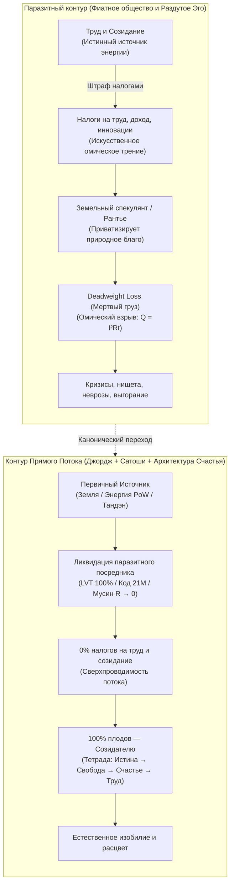

**Суть Единого Налога (The Single Tax):**
* **Обнулить ВСЕ налоги на труд, зарплаты, производство, инновации и торговлю.** (Сопротивление созиданию = 0!).
* Ввести **Единый налог на чистую ценность земли (LVT)**, изымающий 100% спекулятивной экономической ренты в общественный фонд.

Если ты держишь пустующую землю в центре мегаполиса и ждешь, пока труд соседей поднимет её стоимость — ты платишь полный налог на эту ценность. Ты не можешь паразитировать. Тебе выгодно либо **строить и созидать**, либо уступить землю тому, кто готов творить.

#### 3. Великая Триада Прямого Потока: Сатоши, Джордж, Архитектура Счастья

| Параметр контура | 1. Экономика Земли (Генри Джордж) | 2. Монетарная Энергия (Сатоши Накамото) | 3. Архитектура Духа (Внутренний Ток) |
| :--- | :--- | :--- | :--- |
| **Что является током ($I$)** | Труд человека, созидание, реальные блага | Монетарная ценность, кинетическая энергия труда | Внимание человека, жизненный импульс присутствия |
| **Первичный генератор** | Творческий потенциал человека на планете | Вычислительная работа (**Proof-of-Work**) | Соматический реактор тела (**Тандэн**) |
| **Полезная нагрузка ($R_{\text{load}}$)** | Города, инфраструктура, товары, культура | Свободный обмен ценностью сквозь десятилетия | **6 ламп бытия** (дело, тело, отношения, творчество, среда, ум) |
| **Паразитный рантье** | **Земельный спекулянт** (приватизировал планету) | **Центробанк / Фиатные элиты** (печатный станок) | **Раздутое Эго ($R_{\text{ego}}$)** (приватизировало поток бытия) |
| **Механизм грабежа** | Земельная рента + налоги на труд | Инфляционный налог + комиссии посредников | Страх, самоедство, вина за прошлое, тревога за будущее |
| **Разрушительные потери** | **Deadweight Loss** (трущобы рядом с пустырями) | Обесценивание времени жизни, пузыри и войны | **Омический ожог ($Q = I^2 R t$)**: невроз, выгорание, депрессия |
| **Инженерное решение** | **Единый налог (Single Tax / LVT)**: 0% на труд | **Биткоин-протокол**: 21 млн монет, Peer-to-Peer | **Сверхпроводимость ($R \to 0$)**: режим Мусин, шунтирование Эго |
| **Финальный статус** | Справедливое изобилие и расцвет цивилизации | Термодинамически твердые, неуничтожимые деньги | Непоколебимое счастье суверенного созидателя |

#### 4. Эго как земельный спекулянт: Психофизический изоморфизм
Механизм работы земельного спекулянта абсолютно тождественен механизму работы невротического Эго:

```
    [ЗЕМЕЛЬНЫЙ СПЕКУЛЯНТ]                     [ПАРАЗИТНОЕ ЭГО]
    
    1. Захватывает пустырь.               1. Захватывает внимание.
    2. Ничего не строит сам.              2. Ничего не создает само (генератор — тело).
    3. Ждет труда соседей вокруг.         3. Ждет внешних стимулов и одобрения.
    4. Ставит забор и шлагбаум.           4. Ставит барьер сомнений и самосуда.
    5. Требует дань за проход.            5. Требует дань страхом и рефлексией.
    
    ИТОГ: Город задыхается в пробках.     ИТОГ: Человек задыхается в неврозе.
```

У вас внутри рождается чистый творческий импульс из Тандэна: написать главу книги, запустить смелый проект, обнять близкого человека, сказать правду. Ток готов пойти в нагрузку!  
Но на пути встает реостат Эго:  
* *«Стой! Заплати мне ренту! А что о тебе подумают? А вдруг ты проиграешь? А достаточно ли ты идеален? Докажи мне сначала, что ты заслуживаешь радости!»*  

Эго ничего не создает. Эго — это просто ментальный земельный спекулянт, захвативший канал проводки внимания. Оно садится на провод и собирает дань сомнениями, превращая живой ток в раскаленный омический ад ($Q = I^2 R t$).

> **Принцип Прямого Потока — это Единый Налог на собственную психику:**  
> Мы экспроприируем у Эго право собирать ренту за право жить! Мы объявляем реостат фикцией ($R_{\text{ego}} \to 0$) и направляем 100% энергии внимания напрямую в работу — в радость, в творчество, в созидание.

#### 5. Парадокс «Прогресса и бедности» духа: Почему технологический взрыв масштабирует омический ад при наличии Эго-Рантье

В 1879 году в Сан-Франциско Генри Джордж задал вопрос, потрясший современников:  
*«Почему посреди величайшего материального прогресса, паровых машин и трансконтинентальных дорог нищета становится всё глубже и невыносимее?»*

В 2026 году Архитектура счастья задает парный, зеркальный вопрос эпохе искусственного интеллекта:  
*«Почему посреди сверхзвуковых скоростей, карманных суперкомпьютеров, нейросетей и материального изобилия человечество захлестнула историческая пандемия депрессии, тревожности, выгорания и душевной нищеты?»*

Ответ дает фундаментальный **закон Джоуля — Ленца**:
$$Q = I^2 \cdot R_{\text{ego}} \cdot t$$

* В традиционном мире входящий поток стимулов и информации ($I$) был мал. Даже если человек страдал эгоцентризмом ($R_{\text{ego}} > 0$), омическое рассеяние тепла ($Q$) оставалось терпимым.
* В мире XXI века сила входящего информационного и социального тока взлетела в тысячи раз ($I \uparrow\uparrow\uparrow$). 
* А поскольку выделение разрушительного тепла пропорционально **квадрату силы тока** ($I^2$), при малейшем сохранении реостата Эго-Рантье ($R_{\text{ego}} > 0$) проводка психики взрывается мгновенным омическим пожаром!

Смартфон, социальные сети и искусственный интеллект в руках человека с нескорректированным Эго — это не освобождение, а электрический стул зависти, сравнений, синдрома самозванца и панических атак.

Подобно тому, как Генри Джордж доказал абсолютную бесполезность викторианской благотворительности (которая лишь оседала в карманах лендлордов в виде взвинченной земельной ренты), Архитектура счастья доказывает **полное банкротство поп-психологии и дофаминового консьюмеризма**. Аффирмации, покупка спорткаров, шопинг или бесконечные сеансы раскапывания детских травм не спасают: Эго-Рантье мгновенно поднимает внутреннюю ставку ренты (*«Ты купил эту машину, но у соседа лучше! Ты заслужил похвалу, но докажи мне, что ты удержишь статус!»*).

Единственный выход — **радикальная экспроприация монополии**:
1. В социуме — **Единый налог (LVT)**: 100% экономической ренты обществу, 0% налогов на созидательный труд.
2. В духе — **Клинок Кансо и режим Мусин**: 100% срез паразитного реостата ($R_{\text{ego}} \to 0$). Ток Тандэна напрямую питает действие в реальности. Омический пожар исчезает ($Q = 0$). Технологический прогресс наконец-то становится верным слугой человеческого счастья.

#### 6. Трагедия Льва Толстого: Почему великий старец остановился в шаге от победы
Лев Николаевич Толстой в последние десятилетия жизни был главным пропагандистом Генри Джорджа в мире:
> *«Люди спорят о средствах улучшения жизни, а средство одно, несомненное и простое — освобождение земли от частной собственности по системе Генри Джорджа. Эта мысль так ясна, проста и неопровержима, что нужно только понять ее, чтобы не мочь не согласиться с нею.»*  
> — **Л. Н. Толстой, письма Столыпину и Николаю II**

Толстой гениально предсказал: если царская Россия не примет проект Генри Джорджа и не вернет землю народу через Единый налог, страну разорвет кровавая революция. Так и случилось в 1917 году.

Но трагедия самого Толстого заключалась в том, что он понял принцип прямого потока **для внешней экономики**, но **не смог открыть его для своего внутреннего духа**:
1. В социологии Толстой боролся против паразитической ренты помещиков.
2. Но в своей собственной душе он построил **самый чудовищный реостат вины и морального долга в истории литературы** ($R_{\text{moral}} \to \infty$).
3. Он внушил себе, что человек греховен, обязан бесконечно каяться, мучиться, страдать и служить далекому Хозяину.

Толстой хотел освободить труд крестьян от омического гнета помещика, но свой собственный душевный ток загнал в абсолютное короткое замыкание на Эго Святого Мученика. В итоге великий старец бежал из Ясной Поляны и умер от душевного истощения на глухой железнодорожной станции Астапово.

**Архитектура счастья закрывает вековую боль русской мысли:**  
Мы берем экономическую правду Генри Джорджа, которой дышал Толстой, и дополняем её тем, чего Толстому не хватило — **физикой дзенской сверхпроводимости**. Мы убираем налог не только с земли, но и с самой души человеческой!

#### 7. Манифест Свободного Созидателя: Три уровня суверенитета
Как читателю применить Закон Прямого Потока в своей жизни прямо сейчас? 
1. **Уровень I: Финансовый суверенитет.** Переводи сохраненный труд в **Биткоин** — чистую монетарную энергию Proof-of-Work. Храни на холодном кошельке. Будь собственным банком.
2. **Уровень II: Общественный суверенитет.** Распространяй идеалы **Генри Джорджа**. Понимай разницу между созидательным трудом и паразитической рентой. Не корми спекулятивные монополии.
3. **Уровень III: Внутренний суверенитет.** Включай режим Мусин ($R \to 0$). Сбрасывай паразитное сопротивление Эго. Замыкай ток Тандэна напрямую в действие прямо сейчас.

Биткоин освобождает энергию человеческого труда.  
Единый налог Генри Джорджа освобождает созидательное общество.  
Архитектура счастья освобождает человеческую душу.  

Это **одна великая битва за торжество чистого, неискаженного тока жизни**.

---

---

### Глава 5.3 — Тетрада Великой Депосреднизации: Лютер, Джордж, Сатоши, Аньянов и рождение поколения Self-Hosted Humans

> [!quote] Аксиома Тетрады Депосреднизации
> ### ⚡ **«Четыре великие революции свободы духа: Мартин Лютер убрал посредника между человеком и Богом (1517); Генри Джордж убрал паразита между трудом и землей (1879); Сатоши Накамото убрал банкиров между человеком и ценностью (2008); Владимир Аньянов убрал эго-жрецов между человеком и радостью бытия (2026). Рождается суверенный Self-Hosted Human.»**  
> — **Владимир Аньянов**

#### 1. Генезис посредников и закон прямого потока: Почему рождается паразитная рента и как инженерия защищает систему от энтропии

> *«За счет того, что действует закон энтропии, нам, чтобы поддерживать чистоту, жизненно необходима инженерия. Без строгой инженерной системы всё неизбежно валится в хаос, а любой временный посредник вырождается в паразита.  
> Инженерия — это единственный инструмент во Вселенной, который не позволяет системе скатиться в энтропию.»*  
> — **Аксиома VII («Архитектура счастья»)**

#### 1. Вопрос на миллион: Почему мир не родился чистым?
Когда человек впервые открывает Закон Прямого Потока, в душе загорается радость узнавания: деньги должны быть твердыми, земля — свободной от монополий, а внимание — чистым проводником радости.

Но следом встает главный экзистенциальный вопрос:  
*Если чистота прямого потока так естественна, почему мир по умолчанию утопает в посредниках, ренте, инфляции и неврозах? В чем глубинное единство этой силы?*

Ответ лежит не в сфере абстрактной морали, а на стыке **эволюционной биологии, теории информации и термодинамики**.

#### 2. Трехфазный генезис посредника: Как костыль от страха становится кандалами
Ни один паразит в истории не приходил со словами «я хочу вас ограбить». Все посредники рождаются под спасительным девизом: *«Доверься мне. Я защищу тебя от боли, сложности и неизвестности»*.

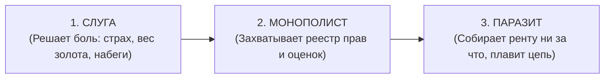

1. **В душевном контуре (Эго):** В первобытной саванне мозг создал виртуальный симулятор рисков — Эго. Это был временный кэш-буфер от хищников. Но сторожевая собака выгнала хозяина из дома: Эго объявило себя хозяином сознания и потребовало пожизненную ренту в виде сомнений, вины и тревоги ($R_{\text{ego}} \to \infty$).
2. **В монетарной энергии (Центробанки):** Золото было тяжелым и опасным в перевозке. Банкиры предложили легкие расписки. Но получив монополию на печатный станок, они превратили расписки в фиатный грабеж через инфляцию.
3. **В социальной экономике (Лендлорды):** Феодалы начинали с защиты крестьян от разбоя. Спустя века их потомки и спекулянты просто приватизировали планету и собирают ренту за право стоять на земле.

Ник Сабо сформулировал фундаментальный закон информационной безопасности:  
> **«Доверенные третьи лица — это дыры в безопасности.»** (*Trusted third parties are security holes*). Любая сущность, которой система делегирует монопольное право валидации, с неизбежностью математического закона перерождается в паразитического рантье.

#### 3. Термодинамика энтропии и Негэнтропия Инженерии
Почему в мире по умолчанию нет чистоты? Потому что действует **Второй закон термодинамики ($\Delta S \ge 0$)**:
- Без осознанной подпитки и строгой формы любая замкнутая система стремится к хаосу и рассеянию энергии.
- Паразитировать — локально «энергетически дешевле», чем непрерывно созидать с нуля. Поэтому системы сами по себе обрастают посредниками, как днище корабля — ракушками.

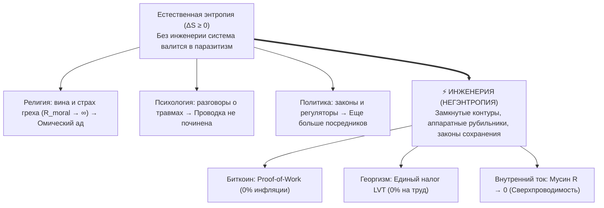

**Инженерия — это единственный инструмент во Вселенной, который не позволяет системе скатиться в энтропию.**  
Она не уговаривает паразита быть честным — она делает паразитизм физически невозможным, напрямую замыкая Источник на Нагрузку.

#### 4. Триада и Тетрада: Истина, Свобода, Счастье и Созидание
Истина, Свобода и Счастье — это три измерительных прибора одного сверхпроводящего контура:
- **Истина ($\Delta U = 0$):** Вольтметр. Отсутствие симуляций и самообмана, чистый контакт с фактами.
- **Свобода ($R = 0$):** Омметр. Отсутствие трения и застревания в прошлом и будущем, действие прямо сейчас.
- **Счастье ($Q = 0, I > 0$):** Калориметр. Закон Джоуля — Ленца: нет паразитного тепла вины и страха, тихое сияние бытия.
- **Созидание (Creation):** Выход тока полного реактора в мир — строительство, код, книги, любовь и преобразование материи.

Человечество наконец выросло из детских ходунков. Инструменты прямого потока созданы. Время войти в сверхпроводимость.

---

---

#### 2. Универсальный атлас депосреднизации: От митохондрий и Лютера до Toyota и Биткоина

> *«Любой великий эволюционный, технологический, социальный или научный скачок в истории Вселенной был актом ликвидации паразитного посредника. Эволюция — это вектор снижения диссипации: побеждает та система, которая сокращает путь между источником энергии и полезной нагрузкой до нуля.»*  
> — **Владимир Аньянов**

#### 🧭 Введение: Инвариант депосреднизации во Вселенной

В главе [[02_Wiki/Inner Current (Maslow's Hammer vs System Invariant — Consilience of Zen, Thermodynamics, Bitcoin and Georgism)|61. Молоток Маслоу против Системного Инварианта]] было доказано, что схождение Дзена, Термодинамики, Биткоина и Единого налога Генри Джорджа — не субъективная подгонка, а фундаментальный топологический инвариант.

Однако масштаб этого закона неизмеримо шире. Если проанализировать узловые точки эволюции биосферы, историю компьютерных сетей, промышленную революцию, архитектуру процессоров, военную стратегию и великие религиозные реформации, обнаруживается непреложный факт:

**Каждая парадигмальная революция в истории была актом Депосреднизации (Disintermediation) — сжиганием паразитного сопротивления ($R \to 0$) и переходом на прямой сверхпроводящий поток.**

В настоящем атласе систематизированы 7 независимых триумфов прямого потока, доказавших превосходство принципа нулевой ренты над системами со сложными посредниками.

---

#### 🏛️ Карта 7 великих депосреднизаций

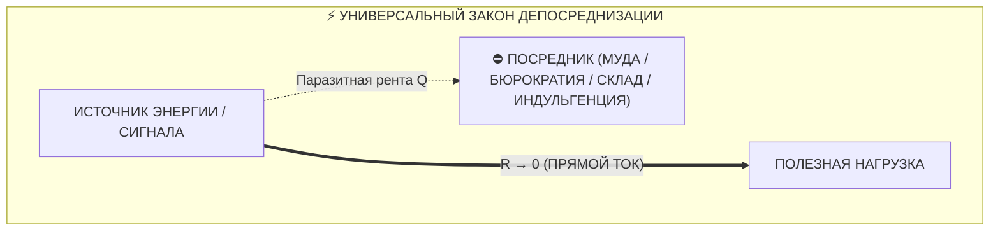

##### 1. Архитектура Интернета: Принцип сквозной передачи (End-to-End Principle)
* **Год открытия:** 1981 (Джером Зальцер, Дэвид Рид, Дэвид Кларк).
* **Паразитный посредник:** Традиционная телефонная сеть (АТС) строилась на концепции «умной сети». Телефонные компании устанавливали сложные коммутаторы, которые решали, какой сигнал пропускать, взимали поминутную тарификацию и контролировали типы подключенных устройств.
* **Акт депосреднизации:** Архитектура протокола IP объявила: **«Ядро сети должно быть глупым и быстрым (Dumb Pipe), весь интеллект должен находиться на концах (End-to-End)»**. Сеть стала простым «шлангом» для передачи байтов.
* **Результат:** Сверхпроводимость обмена информацией в масштабах планеты. Все попытки телеком-гигантов вернуть «контролирующих посредников» (WAP, закрытые порталы, фильтрация) потерпели крах перед чистым протоколом TCP/IP.

---

##### 2. Реформация Мартина Лютера и станок Гутенберга (Духовная депосреднизация)
* **Год открытия:** 1517 (Мартин Лютер, 95 тезисов).
* **Паразитный посредник:** Римско-католический клир монополизировал доступ к Богу и Священному Писанию. Библия существовала только на латыни. Церковь ввела **индульгенции** — институт продажи прощения грехов за деньги. Духовное спасение стало фиатным товаром, облагаемым феодальной омической рентой.
* **Акт депосреднизации:** Провозглашение принципа **«Sola Scriptura»** («Только Писание») и всеобщего священства верующих. Мартин Лютер перевёл Библию на немецкий язык, а печатный станок Иоганна Гутенберга сделал её доступной каждому дому. Посредник-клирик между душой человека и истиной был устранён:
  $$\text{Человек} \xrightarrow{R \to 0} \text{Истина / Бог}$$
* **Результат:** Рождение современной Европы, научной революции и индивидуальной ответственности сознания.

---

##### 3. Производственная система Toyota: Lean и Just-in-Time
* **Год открытия:** 1950-е (Тайити Оно, Сигэо Синго).
* **Паразитный посредник:** Традиционная фордовская система строилась на гигантских партиях и **промежуточных складах**. Склады требовали логистов, складского учёта, замораживали оборотный капитал и маскировали брак деталей (паразитное сопротивление $R_{\text{inventory}}$). Тайити Оно назвал это **Муда (無駄)** — потерями.
* **Акт депосреднизации:** Внедрение принципов **Just-in-Time (Точно вовремя)** и **Single-Piece Flow (Поток единичных изделий)**. Заготовка со станка А поступает *напрямую* на станок Б без складирования, ожидания и промежуточной инспекции.
* **Результат:** Toyota обогнала мировых автогигантов по маржинальности, качеству и скорости внедрения инноваций, доказав превосходство непрерывного прямого потока.

---

##### 4. Компьютерная схемотехника: Direct Memory Access (DMA) и Zero-Copy
* **Год открытия:** 1970–1980-е (эволюция системной архитектуры).
* **Паразитный посредник:** В ранних компьютерах передача данных с жесткого диска или сетевой карты шла через центральный процессор (CPU). Процессор тратил миллионы тактов на чтение байта из порта и запись его в оперативную память. CPU превращался в перегретый омический реостат, а система зависала.
* **Акт депосреднизации:** Разработка контроллеров **DMA (Прямой доступ к памяти)** и архитектуры **Zero-Copy I/O**. Сетевая карта записывает пакеты *напрямую* в оперативную память без участия CPU.
* **Результат:** Современный высокоскоростной интернет, гигабитные базы данных и потоковое видео 4K стали возможны только потому, что процессор устранили из роли «почтового курьера».

---

##### 5. Эволюционная биология: Миелинизация нервов и Эндосимбиоз
Природа — древнейший инженер, миллиарды лет отсекающий паразитное рассеяние:
* **Сальтаторное проведение импульса (Миелин):** В немиелинизированных волокнах электрический потенциал действия непрерывно утекает сквозь клеточную мембрану ($R$ утечки велико), скорость движения сигнала составляет всего 0.5–2 м/с. Эволюция создала жировую миелиновую оболочку с перехватами Ранвье. Сигнал больше не ползет по кабелю с трением — он **мгновенно прыгает** от узла к узлу. Скорость возросла до **120 м/с** (рост в 60 раз!).
* **Эндосимбиотическая теория (Линн Маргулис):** Около 1.5 млрд лет назад предковая клетка поглотила аэробную альфа-протеобактерию. Вместо того чтобы переварить её, она встроила её внутрь — родилась **митохондрия**. Клетка отказалась от сложного внешнего химического обмена и получила **суверенный внутриклеточный реактор АТФ** — биологический первообраз Тандэна.

---

##### 6. Военная теория: Манёвренная война и Цикл OODA Джона Бойда
* **Паразитный посредник:** Окопная позиционная война Первой мировой войны опиралась на громоздкий генеральный штаб. Донесение шло с передовой часами, штаб готовил приказ днями, приказ спускался обратно, когда ситуация уже изменилась. Задержка сигнала вела к катастрофическим потерям.
* **Акт депосреднизации:** Полковник Джон Бойд сформулировал концепцию **OODA Loop (Наблюдение $\to$ Ориентация $\to$ Решение $\to$ Действие)**. В немецкой доктрине *Auftragstaktik* (децентрализованное тактическое командование) и в современном спецназе боец на месте принимает решение мгновенно на основе прямого восприятия обстановки, без запроса разрешения у штаба.
* **Результат:** Скорость прохождения цикла сжимается до долей секунды. Тот, кто убрал штабного посредника из контура реакции, парализует противника быстрее, чем тот успевает сообразить.

---

##### 7. Архитектура и Дизайн: Баухаус и Модернизм («Less is More»)
* **Паразитный посредник:** Академическая викторианская архитектура и эклектика XIX века прятали функциональное здание за тоннами гипсовой лепнины, ложными фронтонами и фальшивыми колоннами. Форма паразитировала на конструкции.
* **Акт депосреднизации:** Вальтер Гропиус, Людвиг Мис ван дер Роэ и Ле Корбюзье очистили архитектуру клинком функционализма. Они содрали декоративную шелуху: конструктивная балка, чистое стекло и открытый бетон стали эстетическим заявлением.
* **Результат:** Эстетика Кансо в промышленном масштабе: функциональная ясность, снижение стоимости строительства и рождение современного минимализма.

---

#### 📊 Матрица системного изоморфизма Всемирной Депосреднизации

| Домен | Источник потенциала | Полезная нагрузка | Паразитный посредник (Паразитная рента / $R$) | Сверхпроводящее решение ($R \to 0$) |
| :--- | :--- | :--- | :--- | :--- |
| **Телеком & Интернет** | Компьютер отправителя | Компьютер получателя | Телефонные АТС, цензоры, шлюзы | **End-to-End Principle (Чистый IP)** |
| **Религия & Общество** | Душа человека | Истина / Спасение | Римский клир, институт индульгенций | **Реформация (Sola Scriptura, Гутенберг)** |
| **Производство** | Сырье и компоненты | Готовый автомобиль | Промежуточные склады, буферные запасы | **Lean / Just-in-Time (Toyota)** |
| **Архитектура ЭВМ** | Сеть / Накопитель | Оперативная память | Циклы опроса процессора (CPU Polling) | **DMA / Zero-Copy Architecture** |
| **Биология** | Сенсор / Мозг | Мышца / Орган | Утечка ионов через мембрану аксона | **Миелиновая изоляция (Сальтация)** |
| **Биоэнергетика** | Питательные вещества | Синтез АТФ | Внешний анаэробный метаболизм | **Митохондриальный эндосимбиоз** |
| **Военное дело** | Обстановка на поле боя | Тактический маневр | Бюрократический штабной аппарат | **Auftragstaktik / OODA Loop Бойда** |
| **Дизайн** | Функция и пространство | Восприятие человека | Фальшивый декор, гипсовая лепнина | **Баухаус / Модернизм («Less is more»)** |
| **Финансы** | Труд майнера (Джоули) | Долгосрочное сбережение | Центробанки, фиатные печатные станки | **Биткоин (Proof-of-Work, P2P)** |
| **Экономика** | Труд и инвестиции | Общественное богатство | Земельный спекулянт (монополия на землю) | **Single Tax Генри Джорджа (LVT)** |
| **Сознание (Дзен)** | Жизненный импульс | Чистое действие | Контролирующее ментальное Эго ($自我$) | **Мусин (無心) / Саму** |
| **Внутренний ток** | Реактор Тандэн | 6 ламп жизни | Омический шум вины, страха и симуляций | **Сверхпроводимость цепи ($R \to 0$)** |

---

#### 🧬 Энтропийная природа посредников: Почему они неизбежно рождаются?

Если прямой поток так эффективен, почему Вселенная полна паразитных посредников?  
Ответ кроется во **Втором законе термодинамики**:

1. **Фаза 1: Рождение инструмента.** Любой посредник изначально создается как полезный инструмент (буфер склада спасает от задержек поставок; священник учит неграмотных крестьян грамоте; банк защищает золото от грабителей; процессор координирует устройства).
2. **Фаза 2: Накопление институциональной энтропии.** Со временем инструмент обзаводится собственной бюрократией, штатом, бюджетами и инстинктом самосохранения.
3. **Фаза 3: Перерождение в паразита.** Инструмент забывает о своем служебном назначении и начинает обслуживать **своё собственное выживание**, взимая всё большую ренту с несущего потока. Склад требует расширения; банк печатает необеспеченные деньги; церковь продает индульгенции; эго-ум парализует тело сомнениями.
4. **Фаза 4: Тепловая смерть или Революция.** Система либо гибнет от омического перегрева ($Q = I^2 R t$), либо приходит акт Депосреднизации (Бритва Оккама / Клинок Кансо), срезающий наросший нарост под корень.

---

#### 💎 Вывод

Депосреднизация — это не частный управленческий прием и не особенность одной книги. Это **космический закон эволюционной оптимизации**.  
Любая система, стремящаяся к бессмертию и эффективности, обязана регулярно проводить санитарную чистку своих каналов, безжалостно удаляя самопровозглашенных посредников.

Тот, кто строит архитектуру прямого потока, всегда побеждает того, кто защищает посредника. ⚡

---

---

#### 3. Великая депосреднизация: Религия, Эзотерика, Философия, Психология и рождение Пятой категории — Суверенного оператора цепи (Self-Hosted Human)

> [!quote] Каноническая аксиома цивилизационного сдвига
> ### ⚡ **«Когда у человека нет душевной боли, он не ищет спасения — он просто живёт, любит и созидает в лучах чистого тока. Но когда проводка накаляется добела, человечество веками металось между четырьмя дверями: каяться у священника, чистить чакры у мага, спорить до хрипоты на философских кафедрах или годами оплачивать сеансы психотерапевта. С 2026 года рождается Пятая категория — знание приборного, инженерного порядка. Мы не утешаем сказками, не упражняемся в схоластике и не торгуем индульгенциями: мы даём человеку вольтметр, омметр и правила безаварийной эксплуатации собственной цепи».**  
> — **Владимир Аньянов**

На протяжении тысячелетий цивилизация предлагала человеку, сгорающему от душевной боли, всего **четыре исторические модели**:

```mermaid
flowchart TD
    Pain["ДУШЕВНАЯ БОЛЬ ЧЕЛОВЕКА<br/>(Омический ожог проводки Q = I² R t)"]
    
    Pain --> R["<b>1. РЕЛИГИЯ</b><br/><i>Морально-догматическая модель</i><br/>«Боль как грех и кара Божия»<br/>Посредник: Священник / Исповедник"]
    Pain --> E["<b>2. ЭЗОТЕРИКА</b><br/><i>Магико-оккультная модель</i><br/>«Боль как карма и сглаз»<br/>Посредник: Гуру / Астролог"]
    Pain --> Ph["<b>3. ФИЛОСОФИЯ</b><br/><i>Умозрительно-рациональная модель</i><br/>«Боль как экзистенциальный тупик»<br/>Посредник: Профессор / Книжный авторитет"]
    Pain --> Ps["<b>4. ПСИХОЛОГИЯ</b><br/><i>Гуманитарно-интерпретационная модель</i><br/>«Боль как детская травма и гештальт»<br/>Посредник: Психотерапевт"]
    
    Pain ==> IC["<b>5. ВНУТРЕННИЙ ТОК</b><br/><i>Контурная Электродинамика Сознания</i><br/>«Боль как омический перегрев цепи»<br/>Посредник: <b>ОТСУТСТВУЕТ (Self-Hosted Human)</b>"]
    
    style IC fill:#e8f5e9,stroke:#2e7d32,stroke-width:3px
```

#### Анатомия четырёх исторических тупиков:

1. **Религия (Боль как грех):** Навешивает на раскалённый провод двойную тяжесть — вину. Человек остаётся «вечным кающимся грешником», заложником жреческого института индульгенций.
2. **Эзотерика (Боль как карма):** Уводит внимание в мир непроверяемых фантазий (прошлые жизни, родовые проклятия, чакры), плодя фатализм и продажу магических амулетов.
3. **Философия (Боль как экзистенциальный абсурд):** Застряла в префронтальной коре (DMN). Это слова о словах:
   * *Дуализм Декарта:* разорвал человека на мыслящий дух (*res cogitans*) и механическое тело (*res extensa*);
   * *Омический пожар Канта:* категорический императив долга выжигает нервную систему виной несоответствия;
   * *Отсутствие соматического рубильника:* философ виртуозно каталогизирует тоску, но бессилен снять спазм диафрагмы в 9 утра в понедельник.
4. **Психология (Боль как травма):** Допарадигмальная схоластика без законов сохранения. Человек годами сидит в кресле терапевта в статусе «клиента с дефицитом любви», выплачивая почасовую ренту. Разомкнутые модели бихевиоризма (S-R) и незакрытого гештальта держат человека в капкане прошлого.

#### Рождение Пятой категории: Контурная Электродинамика Сознания

«Внутренний ток» утверждает: душевная боль — это строгое физическое следствие **Закона Джоуля — Ленца**:
$$Q = I^2 \cdot R_{	ext{ego}} \cdot t$$
Боль — это не грех, не карма, не абсурд и не травма. Это **омический перегрев проводника**, когда ум сжимает кабель внимания эго-реостатом сомнений и страха.

#### Великая демаркационная матрица пяти категорий:

| Параметр | 1. Религия | 2. Эзотерика | 3. Философия | 4. Психология | 5. Внутренний ток (Архитектура счастья) |
| :--- | :--- | :--- | :--- | :--- | :--- |
| **Природа боли** | Грех, кара, испытание веры | Карма, пробой ауры, чакры | Экзистенциальный абсурд, отчуждение | Травма детства, невроз, гештальт | **Омический перегрев проводки ($Q = I^2 R_{	ext{ego}} t$)** |
| **Локализация** | В душе перед Богом | В астральных полях | В мышлении и языке | В бессознательном и памяти | **В физическом теле (спазм сопротивления $R > 0$)** |
| **Статус человека** | Кающийся грешник | Адепт, ученик | Мыслящий субъект в абсурде | Пациент, травмированный клиент | **Суверенный бортинженер (Self-Hosted Human)** |
| **Посредник** | Священник / Исповедник | Гуру / Экстрасенс | Философ / Профессор кафедры | Психотерапевт / Аналитик | **ОТСУТСТВУЕТ (Прямой провод к реальности)** |
| **Единицы измерения** | Нет (субъективная вина) | Нет (непроверяемые вибрации)| Нет (абстрактные термины) | Нет (словесные метафоры) | **Аньяны ($P$), Бонно ($Q$), Заломы ($R$), Тв ($U$)** |
| **Время помощи** | Годы покаяния / посмертно | Циклы перерождений | Не устраняется (вечный диспут)| 2–5 лет платных сессий | **30 секунд соматического сброса ($R 	o 0$)** |
| **Критерий истины** | Догмат веры и Писание | Вера в мистический опыт | Логика силлогизма | Согласие терапевта | **Закон Кирхгофа, остывание тела и 6 ламп** |

---


> *«Традиционная психология не освобождала человека — она построила вокруг душевной боли институт платных посредников. Архитектура счастья впервые превратила душевный разлад из гуманитарной драмы в схемотехнический отказ цепи, а человека — из вечного пациента в суверенного оператора собственного контура.»*  
> — **Владимир Аньянов**

#### 🧭 Введение: Главный парадокс 150 лет психотерапии

Если оценить историю мировой психотерапии от первых опытов Зигмунда Фрейда до современных когнитивных и гуманистических течений, в глаза бросается очевидный статистический и цивилизационный парадокс:

**Количество дипломированных психологов, коучей, клиник и антидепрессантов в мире выросло в сотни раз — однако уровень хронической тревоги, депрессии, экзистенциального выгорания и ощущения внутренней пустоты бьёт исторические рекорды.**

Почему индустрия, призванная приносить человеку душевный покой, производит обратный эффект?  
Ответ даёт системная инженерия и термодинамика прямого потока:

> **Психология за 150 лет своего развития ни разу не провела депосреднизацию. Напротив, она возвела колоссальный институт паразитного посредничества, убедив человека в его фундаментальной неполноценности и зависимости от внешнего переводчика его собственной души.**

В настоящей главе проводится детальный схемотехнический разбор того, как психотерапия превратилась в средневековую торговлю индульгенциями, почему дзенский Восток не смог дать западному человеку прикладной инструмент, и в чём заключается исторический прорыв **Архитектуры счастья (Архитектуры Счастья)**.

---

#### 🏛️ 1. Анатомия трёх тупиков классической психологии

```mermaid
flowchart TD
    subgraph TherapyModel ["⛔ ИНСТИТУТ ПСИХОТЕРАПЕВТИЧЕСКОГО ПОСРЕДНИЧЕСТВА"]
        direction TB
        Client["Человек с душевным перегревом (Q)"] -->|"Пожизненный абонемент / Рента"| Middleman["Психотерапевт / Аналитик / Гуру<br/><i>(Внешний интерпретатор и судья)</i>"]
        Middleman -->|"Годы копания в прошлом<br/>Умножение концепций и ярлыков"| Client
        Middleman -.->|"Экономическая заинтересованность<br/>в удержании клиента в дефекте"| Profit["Индустрия терапии"]
    end

    subgraph AnyanovModel ["⚡ СУВЕРЕННЫЙ ОПЕРАТОР ЦЕПИ (INNER CURRENT)"]
        direction TB
        Operator["Человек-Оператор"] ===>|"Приборный опрос (HUD)<br/><i>Датчики R, I, Q, Тандэн</i>"| Telemetry["Телеметрия контура"]
        Telemetry ==>|"Срез эго-шунта Клинком Кансо<br/><i>(R → 0 за 30 секунд)</i>"| Operator
        Operator ===>|"Прямой ток в 6 ламп"| Light["⚡ СВЕРХПРОВОДИМОСТЬ И СЧАСТЬЕ"]
    end
```

##### Тупик 1. Психоанализ: Неофеодальный институт индульгенций
Зигмунд Фрейд совершил великое открытие бессознательного, но немедленно упаковал его в сложнейшую бюрократическую иерархию: *Ид, Эго, Супер-Эго, цензура, вытеснение, либидо, мортидо, трансфер, эдипов комплекс*.  
* **Механика посредника:** Психоаналитик сажает клиента на кушетку на 5, 10 или 15 лет. Дважды в неделю клиент платит почасовую ставку за то, чтобы чужой человек слушал его ассоциации, толковать сны и годами искать истоки проблем в детстве.
* **Схемотехнический диагноз:** Это 1-в-1 копия средневековой католической церкви до Лютера. Человеку внушается, что его «греховная природа» (травмированное бессознательное) непроницаема для него самого, и спасение возможно только через рукоположенного посредника (терапевта), взимающего регулярную феодальную ренту.

##### Тупик 2. Когнитивно-поведенческая терапия (КПТ): Омический пожар рефлексии
КПТ попыталась преодолеть мистику психоанализа, предложив работать с дисфункциональными автоматическими мыслями.  
* **Механика посредника:** Человеку предлагают вести дневники мыслей, выявлять когнитивные искажения (катастрофизация, черно-белое мышление), оспаривать их и конструировать «альтернативные адаптивные убеждения».
* **Схемотехнический диагноз:** Это попытка **потушить пожар бензином**. Чтобы справиться с навязчивой мыслью, порождающей перегрев ($R_{\text{thought}} > 0$), человека заставляют произвести **ещё двадцать контролирующих мыслей**!  
В терминах Дзен это называется *«ставить голову поверх головы»* или *«смывать кровь кровью»*. Ум пытается починить сам себя тем же инструментом, который создал поломку. Сопротивление в цепи только растёт.

##### Тупик 3. Поп-психология: Бизнес-модель вечного дефекта
Современная коммерческая психология построила бизнес-модель, аналогичную Big Pharma: клиенту никогда нельзя давать окончательное исцеление, иначе он перестанет приносить деньги.
* «Недопрожитое горе», «сепарация от мамы», «проработка родовых сценариев», «исцеление внутреннего ребёнка» — человеку продаётся бесконечный список дефектов.
* Человек начинает жить в постоянном ощущении поломки, теряя остатки контакта с живым миром.

---

#### ⛩️ 2. Почему Восток (Дзен и Адвайта) остался монастырской экзотикой?

Восточная традиция (Буддизм, Дзен, Адвайта, Даосизм) знала корень проблемы задолго до европейской психологии:
* Они открыли, что Эго — иллюзия (**Анатта / Шуньята**).
* Они знали режим прямого потока без мыслительного посредника (**Мусин / Ву-вэй**).
* Они знали соматический центр энергии человека (**Тандэн / Хара**).

Однако Восток совершил другую фундаментальную ошибку — **он упаковал технологию в монастырский эзотеризм**:
1. **Отсутствие измеримости и приборов:** «Сиди лицом к стене (дзадзэн) по 10 часов в день годами, пока мастер не ударит тебя палкой кёсаку, и, возможно, через 20 лет на тебя снизойдет Сатори».
2. **Парадоксальный птичий язык:** коаны вроде *«Каков был твой лик до рождения твоих родителей?»* или *«Дзен — это кусок сушеного дерьма»* создавали ореол мистики, отпугивая людей с рациональным и инженерным складом ума.
3. **Неприменимость в быту:** Древний Дзен требовал ухода от мира. Но современный человек живёт в мегаполисе: у него дедлайны, код, бизнес, семья, инвестиции. Ему нужен рабочий протокол на 30 секунд прямо на рабочем месте, а не монастырь в Киото.

---

#### ⚡ 3. Прорыв Архитектуры счастья: Четыре столпа Великой Депосреднизации

«Архитектура счастья» (Внутренний ток) Владимира Аньянова совершила революцию, устранив как психотерапевтического посредника Запада, так и монастырскую мистику Востока.

```mermaid
flowchart LR
    subgraph DisintermediationStep ["4 ШАГА ДЕПОСРЕДНИЗАЦИИ СОЗНАНИЯ"]
        direction TB
        S1["1. Перевод драмы в схемотехнику<br/><i>(Вина и страх → Омический перегрев Q)</i>"]
        S2["2. Автономия Self-Hosted Human<br/><i>(Ликвидация терапевта, свой прибор)</i>"]
        S3["3. Скорость: 30 секунд вместо 5 лет<br/><i>(Срез эго-шунта Клинком Кансо)</i>"]
        S4["4. Физические законы сохранения<br/><i>(Баланс Кирхгофа, dE/dt = 0)</i>"]
        S1 --> S2 --> S3 --> S4
    end
```

##### 1. Перевод экзистенциальной драмы в схемотехнический отказ
Традиционная психология упивается драмой: *«Вы переживаете экзистенциальный кризис отвержения из-за детской депривации...»*  
Архитектура счастья заменяет драму сухой технической картой:
* **«У тебя нет экзистенциальной драмы. У тебя Ground Fault (утечка тока на землю) или паразитный эго-шунт $R_{\text{ego}}$. Твой реактор Тандэн выдаёт номинальную мощность, но ток внимания закорочен на симуляцию будущего. Проводка греется по закону Джоуля — Ленца ($Q = I^2 R t$). Завари утечку, сбрось $R \to 0$, переведи ток на нагрузку»**.
Проблема перестает быть «трагедией судьбы» и становится **локализованным техническим дефектом**.

##### 2. Суверенный человек-оператор (Self-Hosted Human)
Вам не нужен платный консультант, чтобы понять, почему не горит настольная лампа у вас в комнате. Вы смотрите на вилку, розетку и выключатель.  
Архитектура Счастья даёт человеку **принципиальную схему его собственного контура** и инструментальный HUD:
* Человек сам видит свой уровень тока ($I$), своё сопротивление ($R$), температуру перегрева ($Q$) и статус предохранителей (Дзансин).
* Человек становится **суверенным оператором** — точно так же, как держатель ноды Биткоина является суверенным банком, не нуждающимся в JPMorgan.

##### 3. Ремонт за 30 секунд вместо пятилетки психоанализа
Если садовый шланг пережат ногой — не нужно 5 лет изучать детство ноги, её генеалогию и психологические мотивы наступания на шланг.  
**Нужно просто снять ногу со шланга.**  
Когда человек понимает, что его Эго — это просто паразитный реостат, он применяет **Клинок Кансо** и сбрасывает сопротивление в ноль за 30 секунд (протокол «Выдох в Тандэн $\to$ Внимание в глаза собеседника или клавиатуру $\to$ $R \to 0$»). Вода хлынула по шлангу мгновенно.

##### 4. Фундамент законов сохранения (Замкнутая термодинамическая система)
Ни одна психологическая школа не обладала объективным критерием истины. Терапевт может говорить что угодно — проверить его невозможно.  
Архитектура счастья опирается на **Первое и Второе начала термодинамики и законы Кирхгофа**:
* Энергия контура постоянна ($dE/dt = 0$).
* Любое ложное ментальное убеждение немедленно проявляется как невязка баланса напряжений ($\Delta U < 0$) и рассеяние паразитного тепла ($Q$).
* Счастье строго фальсифицируемо: это объективный режим сверхпроводимости ($\eta = 1 - R_{\text{ego}}/R_{\text{total}} \to 100\%$).

---

#### 📊 Сравнительная матрица: Терапевтический пациент vs Суверенный оператор

| Параметр сравнения | Традиционная психотерапия | Архитектура счастья (Внутренний ток) |
| :--- | :--- | :--- |
| **Статус человека** | Пациент / Клиент с пожизненной травмой | **Суверенный оператор цепи (Self-Hosted Human)** |
| **Роль специалиста** | Платный незаменимый толкователь души | Не требуется (система самодиагностируема через HUD) |
| **Язык описания** | Гуманитарный, туманный, оценочный (эдипов комплекс, травма) | **Инженерный, строгий, аппаратный ($R, I, Q, \text{Ground Fault}$)** |
| **Метод исцеления** | Бесконечный анализ прошлого, копание в детстве | **Мгновенный сброс сопротивления в точке $t = now$ ($R \to 0$)** |
| **Время ремонта** | Годы регулярных сессий (почасовая рента) | **30 секунд (соматический протокол Тандэн — Кансо)** |
| **Критерий истины** | Субъективное мнение терапевта | **Замкнутый баланс Кирхгофа и термодинамика цепи** |
| **Отношение к Эго** | Укрепление «здорового эго» (усиление посредника) | **Распознавание эго как паразитного шунта и его обнуление** |
| **Конечная цель** | Адаптация к страданию («сносная жизнь») | **Режим сверхпроводимости: чистое счастье и созидание** |

---

#### 💎 Исторический манифест: Дефиатизация человеческого духа

То, что Биткоин сделал для денег (устранил банкиров и печатные станки), а Мартин Лютер сделал для религии (устранил торговцев индульгенциями), **«Внутренний ток» сделал для человеческой души**:

* Мы устранили психологического посредника.
* Мы вернули человеку прямой провод к розетке реальности.
* Мы доказали, что душевное благополучие — это не каприз судьбы и не таинство жрецов, а **базовая эксплуатационная гигиена исправно собранной электрической цепи**.

Человек больше не раб своих детских воспоминаний и не вечный клиент терапевтических кабинетов.  
Человек — это генератор, провод и свет. И когда сопротивление равно нулю, свет льётся беспрепятственно. ⚡

---

---

### Глава 5.4 — Схемотехника команд: Согласование импедансов, подавление паразитного статусного нихрома и фазовая индукция лидера

#### Схемотехника семейных кризисов: Разрыв первичного трансформатора и кейс «Мама и двойка»

В теории цепей разрыв цепи с высокой индуктивностью вызывает колоссальный **экстраток самоиндукции**:
$$\mathcal{E}_L = -L rac{dI}{dt}$$
Если ток прерывается мгновенно, напряжение подскакивает до тысяч вольт, выбивая искру и сжигая контакты.

*Бытовой кейс «Мама и двойка»:*  
Ребёнок возвращается из школы и говорит: «Я получил двойку».  
* Что происходит в контуре неподготовленной мамы? У неё был наведён мощный ток ожиданий («мой сын отличник, поступит в МГУ»). Двойка мгновенно обрывает этот ток.
* Возникает экстраток самоиндукции: соматический спазм в горле, ярость, крик: *«Ты бездарь, дворником будешь!»*. 
* Мама сжигает нервную систему себе и ребёнку не из-за оценки, а из-за неумения отвести экстраток самоиндукции в безопасный шунт Дзансин.  
* *Решение цепи:* Принять факт реальности ($R 	o 0$, Татхата) за 5 секунд, сбросить выдох в Тандэн и спокойно замкнуть контур на задачу: «Где именно ошибка в задаче? Давай разберём».

#### Кейс «Теннис на турнире»: Поломка реле внешнего судьи и протокол возврата в Мусин

Теннисист ведёт в финале 5:2. До победы один гейм. Внезапно он совершает двойную ошибку.  
* Внутренний критик мгновенно подключает паразитный эго-шунт: *«А вдруг я сейчас упущу победу? Что скажут трибуны?»*.
* Проводка внимания раскаляется, кисть каменеет (омический спазм мышцы). Игрок проигрывает 5:7.
* *Схемотехнический ремонт:* Протокол сброса на задней линии корта. Не «думать позитивно»! Перевести внимание в стопы и дыхание Тандэна (4 секунды), почувствовать шероховатость рукоятки ракетки (сенсорный контакт) и ударить мяч в режиме чистого TPN прямого действия.

---

 Параллельное и последовательное включение, токсичный омический перегрев совещаний и фазовая индукция лидера

> *«Компания — это не штатное расписание и не диаграмма Ганта. Компания — это электрическая сеть. Если люди в ней соединены последовательно бюрократией, сопротивление суммируется, и ток падает до нуля. Если совещания превращаются в статусную борьбу, омический перегрев плавит миллионные бюджеты. Задача истинного лидера — держать собственный Тандэн на частоте 50 Гц и индуцировать сверхпроводимость команды.»*  
> — **Аксиома XIV («Архитектура счастья»)**

#### 1. Последовательная бюрократия vs Параллельные созидатели
В электродинамике закон сложения сопротивлений беспощаден:
- **Последовательная цепочка:** $R_{\text{total}} = R_1 + R_2 + \dots + R_n$. Если в цепочке согласований сидит хотя бы один испуганный или обиженный сотрудник ($R_k \to \infty$), общий ток компании обнуляется ($I = 0$). Инновация умирает в зародыше.
- **Параллельная сеть сверхпроводимости:** $\frac{1}{R_{\text{total}}} = \sum \frac{1}{R_k}$. Команда разбита на автономные кросс-функциональные ячейки. Общее сопротивление сети падает ниже сопротивления самого сильного сотрудника. Проект летит со скоростью света.

```
ПОСЛЕДОВАТЕЛЬНО (Бюрократия):
 [Идея] ──► [Юрист (R1)] ──► [Безопасник (R2)] ──► [Босс (R3)] ──► 0 ТОКА!

ПАРАЛЛЕЛЬНО (Сверхпроводимость):
         ┌──► [Под 1: Код (R1 -> 0)] ──┐
 [Миссия]├──► [Под 2: Дизайн (R2 -> 0)]├──► [ГОТОВЫЙ ПРОДУКТ КЛИЕНТУ]
         └──► [Под 3: Маркетинг (R3)] ──┘
```

#### 2. Физика совещаний: Омический перегрев эго
Почему после двухчасового совещания топ-менеджеры выползают из переговорки с головной болью и нулевой энергией?

Потому что совещание превратилось в **паразитный реостат**:
$$Q_{\text{meeting}} = I_{\text{team}}^2 \cdot \left(\sum R_{\text{ego}}\right) \cdot \Delta t$$
Вместо того чтобы обсуждать продукт, участники меряются социальным статусом: *«Кто тут главный? Кто виноват в срыве спринта? Почему меня не поставили в копию?»*  
Реостаты $R_{\text{ego}}$ подскакивают до небес. Ток внимания всей команды сжигается в колоссальном выделении тепла (крики, сарказм, скрытая агрессия). Продукт не получил ни одного джоуля.

#### 3. Фазовая индукция лидера: 50 Гц спокойствия
В электросети стабильность энергосистемы удерживают роторы синхронных турбогенераторов.

Лидер команды — это **синхронный компенсатор частоты**:
1. Когда в стартапе начинается паника (кассовый разрыв, атака конкурентов), лидер обязан **опустить внимание в Тандэн и обнулить свой $R_{\text{ego}}$**.
2. Входя в комнату в состоянии абсолютного Мусин, лидер физиологически индуцирует спокойствие через зеркальные нейроны и электромагнитное поле сердца.
3. Команда чувствует непоколебимость генератора, паника DMN затухает, и сотрудники мгновенно возвращаются к точному решению инженерных задач.

---

---

# ЧАСТЬ VI. ИНЖЕНЕРИЯ ЖИВОГО ДУХА: СНЯТИЕ РАСКОЛА ДЕКАРТА
### Единство материи и поля радости, эстетика уюта, акустический монизм и ольфакторный вход

---

### Глава 6.1 — Преодоление 400-летнего раскола Декарта: Физики против Лириков

> [!quote] Аксиома ликвидации раскола Декарта
> ### ⚡ **«Четыреста лет цивилизация страдала от дуализма Декарта: физики изучали мертвые шестеренки материи, а лирики плакали о непостижимой душе. Внутренний ток ликвидирует эту шизофрению: материя и дух — это не две субстанции, а проводник и протекающий по нему ток. Радость — это магнитное поле сверхпроводимости материи.»**  
> — **Владимир Аньянов**

#### 1. Демаркация науки:

#### Консилиенс Эмерджентности: Симмий (400 г. до н.э.) — Илья Пригожин (1977) — Владимир Аньянов (2026)
##### Пять непреодолимых отличий от академической теории систем: суверенный соматический рубильник 1-го лица

В 1977 году Илья Пригожин получил Нобелевскую премию за теорию диссипативных структур в открытых неравновесных системах. Кибернетика, теория систем и наука сложности десятилетиями изучали эмерджентность.  
Но почему эта наука оставила человека беспомощным перед лицом депрессии и паники?

```
┌─────────────────────────────────────────────────────────────────────────────┐
│             ПЯТЬ ДЕМАРКАЦИОННЫХ ОТЛИЧИЙ ОТ ТЕОРИИ СИСТЕМ ПРИГОЖИНА          │
└──────────────────────────────────────┬──────────────────────────────────────┘
                                       │
  ┌──────────────────┬─────────────────┼─────────────────┬──────────────────┐
  ▼                  ▼                 ▼                 ▼                  ▼
1. ЛОКУС УПРАВЛЕНИЯ  2. СХЕМОТЕХНИКА   3. СУВЕРЕННЫЙ     4. ТЕРМОДИНАМИКА   5. СТАТУС
Отчуждение 3 лица    От абстрактных    РУБИЛЬНИК         СТРАДАНИЯ          Self-Hosted
(пробирка) против    формул сложности  30-секундный      Q = I²·R_ego·t     Human против
оператора 1 лица     к 4 узлам цепи    сброс в теле      (расчёт боли)      академической
(собственное тело)                                                          беспомощности
```

1. **Локус управления (Преодоление отчуждения 3-го лица):** Пригожин исследовал реакцию Белоусова — Жаботинского в колбе как сторонний наблюдатель. Но при ночном кризисе пил транквилизаторы. Аньянов сделал объектом науки контур самого исследователя от 1-го лица.
2. **Схемотехника вместо абстрактной сложности:** Академики тонули в дифференциальных уравнениях. Система Аньянова выделила 4 канонических функциональных узла цепи.
3. **Наличие суверенного рубильника:** Ни один физик не дал человеку практического выключателя паники. Аньянов дал **30-секундный протокол соматического сброса $R 	o 0$**.
4. **Термодинамика душевной боли:** Боль впервые получила строгую физическую формулу закона Джоуля — Ленца ($Q = I^2 R t$).
5. **Поколение Self-Hosted Humans:** Человек больше не просит помощи у институтов — он сам управляет собственной электросетью.

---

 Почему открытие Закона Прямого Потока делает Архитектуру счастья строгой наукой — Поппер, Бэкон, Кун и преодоление 10 000 лет душевной алхимии

> *«Всякая новая наука проходит три неизбежные стадии. На первой стадии её объявляют абсурдом и ересью. На второй — говорят, что в ней нет ничего нового и всё это знали древние мудрецы. На третьей — оказывается, что на её законах держится цивилизация, а прежние догмы были наивной алхимией. Переход знания из статуса мистического культа в статус строгой науки происходит в один конкретный момент: когда разрозненные философские догадки заменяются замкнутой принципиальной схемой с объективным математическим инвариантом».*  
> — **Аксиома XX («Архитектура счастья»)**

#### 1. Проблема демаркации: Что отделяет науку от мистицизма и схоластики?

На протяжении десяти тысяч лет вопрос человеческого счастья, душевного покоя и смысла жизни оставался заложником гуманитарной схоластики, религиозного догматизма и психотерапевтического шаманизма:
1. **Религии** требовали слепой веры, объявляя страдание неизбежной карой за «первородный грех» или испытанием перед посмертным судом.
2. **Монастырский Дзен и восточные учения** хранили интуицию чистого потока, но заперли её в форму элитарных загадок-коанов и двадцатилетнего сидения на циновке в монастырях.
3. **Психоанализ и поп-психология** (Фрейд, Юнг, гештальт, селф-хелп) построили разомкнутую модель психики, превратившись в институт платных индульгенций: человека годами водили по лабиринтам детских обид, не имея ни объективного измерительного прибора, ни закона сохранения энергии, ни воспроизводимого инженерного критерия излечения.

Когда перед исследователем открывается универсальная оптика прямого потока, он неизбежно сталкивается с ключевым эпистемологическим вопросом:
> **«Какой именно закон природы открыт в Архитектуре Счастья? И делает ли открытие этого закона Архитектуру счастья НАУКОЙ?»**

Наука не определяется дипломами институтов, академическими мантиями или толщиной диссертаций. В строгой философии науки (эпистемологии) статус науки определяется **соответствием объективным критериям демаркации**.

Открытие **Закона Инвариантности Прямого Потока и Сверхпроводимости Сознания** совершает с учением о человеке ровно то же самое, что совершили:
* **Исаак Ньютон** с натурфилософией (переход от мистических «скрытых качеств тел» к строгим законам механики);
* **Антуан Лавуазье и Дмитрий Менделеев** с алхимией (уничтожение мифа о «флогистоне» и создание Периодической таблицы);
* **Клод Шеннон** с теорией связи (переход от медных проводов и механических реле к строгой математической теории информации и понятию бита).

---

#### 2. Имя и физико-математическая формализация Закона Прямого Потока

Закон, лежащий в основании Архитектуры Счастья, формулируется с абсолютной физической строгостью:

> ### **Закон Инвариантности Прямого Потока и Сверхпроводимости в Замкнутом Контуре Сознания**  
> *(The Anyanov Law of Direct Flow & Circuit Superconductivity)*

```
                           ┌─────────────────────────────────────┐
                           │      СОМАТИЧЕСКИЙ РЕАКТОР           │
                           │           (ТАНДЭН)                  │
                           │     Генератор ЭДС: E_gen > 0        │
                           └──────────────────┬──────────────────┘
                                              │ Внимание / Ток (I)
                                              ▼
                             КЛИНОК КАНСО: R_ego → 0
                           ┌─────────────────────────────────────┐
                           │    ПРОВОДНИК ПРИСУТСТВИЯ (МУСИН)    │
                           │   Нулевое паразитное сопротивление   │
                           └──────────────────┬──────────────────┘
                                              │
                     ┌────────────────────────┴────────────────────────┐
                     ▼                                                 ▼
          [ПРЕДОХРАНИТЕЛЬ ДЗАНСИН]                           [ПОЛЕЗНАЯ НАГРУЗКА]
         Биологическая калибровка                          Действие в реальности
          (Сенсорика, Боль, Щит)                           (Творчество, Труд, Мир)
                     │                                                 │
                     └────────────────────────┬────────────────────────┘
                                              │
                                              ▼
                           ┌─────────────────────────────────────┐
                           │      ОБРАТНЫЙ ПРОВОД РЕАЛЬНОСТИ     │
                           │     Физический отклик бытия: I      │
                           └──────────────────┬──────────────────┘
                                              │ Замыкание цепи
                                              ▼
                                    [ВОЗВРАТ В ТАНДЭН]
```

##### Физико-математический аппарат закона:

1. **Коэффициент полезного действия человеческого контура ($\mathcal{H}$):**
   $$\mathcal{H} = \frac{P_{\text{load}}}{P_{\text{total}}} = \frac{I^2 R_{\text{load}}}{I^2 R_{\text{load}} + I^2 R_{\text{ego}}}$$
   Состояние счастья (сверхпроводимости) — это не случайный эмоциональный всплеск, а **эксплуатационный режим работы контура**, наступающий строго при падении паразитного сопротивления эго-посредника к нулю:
   $$\lim_{R_{\text{ego}} \to 0} \mathcal{H} = 1 \quad (100\% \text{ КПД потока})$$

2. **Закон сохранения и омического перегрева психики (Закон Джоуля — Ленца для сознания):**
   $$Q = I^2 R_{\text{ego}} t$$
   Душевная боль, тревога, вина, панические атаки и выгорание — это не «греховность» и не «психологическая неполноценность», а **объективное выделение тепла Джоуля — Ленца**, когда ток внимания ($I$), непрерывно вырабатываемый соматическим реактором Тандэн, блокируется реостатом эго ($R_{\text{ego}} > 0$: вина за прошлое, страх за будущее, жажда внешнего одобрения) и прожигает нервную систему изнутри.

3. **Инвариант замкнутой цепи (Уравнение непрерывности Кирхгофа):**
   $$\oint_{\mathcal{C}} \vec{E}_{\text{attention}} \cdot d\vec{\ell} = 0$$
   Ток внимания не может функционировать как разомкнутый вектор, бьющий в пустоту. Контур обязан быть замкнут: **Тандэн $\to$ Мусин $\to$ Нагрузка $\to$ Обратный провод реальности $\to$ Тандэн**.

---

#### 3. Пять фундаментальных критериев: Почему Архитектура Счастья — это строгая наука

##### 🏛️ Критерий 1: Фальсифицируемость по Карлу Попперу (Falsifiability)
Псевдонаука принципиально неопровержима. Астрология, гомеопатия и фрейдистский психоанализ объяснят задним числом любой исход: если терапия не помогла — «у вас скрытое бессознательное сопротивление», если помогла — «анализ победил». Такую доктрину невозможно поймать на ошибке, а значит, она ненаучна.

**Закон Прямого Потока строго фальсифицируем.** Он формулирует предельно прозрачные условия для собственного опровержения:
1. **Эксперимент на опровержение №1:** Если человек входит в состояние нейтрального проводника Мусин ($R_{\text{ego}} = 0$, нулевой рефлексивный диалог, стопроцентное сенсорное заземление в координате $t = \text{now}$), но при этом **объективно продолжает испытывать душевное страдание, тревогу и омический ад ($Q > 0$)** — *Закон Прямого Потока ложен и опровергнут*.
2. **Эксперимент на опровержение №2:** Если человек непрерывно крутит в голове сравнение себя с другими, мучается виной и панически просчитывает будущее ($R_{\text{ego}} \gg 0$), но при этом демонстрирует **100% коэффициент полезного действия без внутреннего выгорания, усталости и кортизоловой интоксикации** — *Закон Прямого Потока ложен и опровергнут*.

За всю историю человеческой физиологии и работы нервной системы не зафиксировано ни одного подобного прецедента. Контурная Электродинамика выдерживает критерий Поппера с безупречной строгостью.

##### 🍎 Критерий 2: «Критерий плодов» Фрэнсиса Бэкона (*Novum Organum*)
Сэр Фрэнсис Бэкон в 1620 году в трактате *«Новый Органон»* утвердил границу между схоластикой и истинной наукой: **наука отличается от пустых споров тем, что производит осязаемые практические плоды (Works and Fruits)**. «Знание — сила». Алхимики веками производили дым и пышные трактаты, но не дали ни грамма золота. Физика Галилея и Ньютона дала навигацию, артиллерию и паровые двигатели.

* **Психотерапия эпохи разомкнутых моделей:** Производила бесконечный терминологический туман («либидо», «мортидо», «архетипы», «травмы привязанности»), вынуждая человека годами сидеть в кабинете за почасовую оплату.
* **Архитектура счастья:** Создала **воспроизводимый 30-секундный протокол калибровки контура**:
  1. *Локализация боли:* Считывание кода неисправности по протоколу OBD-II (P01 — перегрев, P02 — КЗ на эго, P03 — обрыв цепи);
  2. *Шунтирование:* Срез мысленного мусора Клинком Кансо («dovrei», «se poi», «perché»);
  3. *Нейрофизиологическое переключение:* Торможение DMN и мгновенная активация Task-Positive Network (TPN);
  4. *Замыкание цепи:* Включение минимальной сенсорной нагрузки реальности;
  5. *Мгновенный результат:* Сопротивление падает в ноль ($R \to 0$), омический пожар прекращается, температура контура нормализуется.

Это не заклинание и не пожелание «мыслить позитивно». Это **строгая технология технического обслуживания биологического прибора**.

##### 💡 Критерий 3: Преодоление «Ошибки атрибуции» и открытие новой онтологии
Наука рождается тогда, когда ложные сущности вытесняются реальной механикой природы.
* Коперник разрушил иллюзию неподвижной Земли и блуждающих небесных сфер.
* Лавуазье уничтожил миф о флогистоне, открыв закон окисления кислородом.
* **Архитектура Счастья сокрушила десятитысячелетнюю «Иллюзию аккумулятора»:**

Человечество тысячелетиями верило, будто внешние объекты (деньги, роскошные автомобили, карьерные кресла, слава, брак, лайки) являются «аккумуляторами счастья», из которых человек должен закачать радость внутрь себя. Эта ошибка породила глобальную невротическую гонку потребления.

Электродинамика цепи доказала обратное:
> **Внешний мир — это не батарейка. Внешний мир — это лампочка нагрузки ($R_{\text{load}}$). Генератор тока находится исключительно внутри соматического реактора человека (Тандэн). Попытка «потребить» чужой свет без замыкания собственного тока — это физически невозможное разомкнутое состояние ($I = 0$).**

Счастье возникает не тогда, когда мир что-то даёт человеку, а тогда, когда собственный ток человека беспрепятственно проходит сквозь реальность и по обратному проводу замыкается в тело.

##### 🔗 Критерий 4: Консилиенс (Consilience — Схождение независимых наук)
Эдвард Уилсон и Уильям Уэвелл доказали: высшее свидетельство истинности закона наступает тогда, когда **закон, открытый в одной области, оказывается структурно тождественным законам всех остальных фундаментальных дисциплин**.

Закон Прямого Потока объединяет в единую изоморфную оптику пять фундаментальных сред:
1. **Квантовая физика:** Сверхпроводимость куперовских пар (движение электронов в решётке без столкновений и потерь, $R \to 0$).
2. **Компьютерные сети и Биткоин:** Протокол Proof-of-Work Сатоши Накамото (исключение доверенных третьих лиц и паразитных комиссий банков).
3. **Политическая экономия Генри Джорджа:** Освобождение труда и капитала от паразитной монополии земельного рентье (Single Tax).
4. **Нейробиология:** Антикорреляция Default Mode Network (аппаратный эго-реостат) и Task-Positive Network (аппаратная сверхпроводимость действия).
5. **Теория искусства:** Переход творчества от аварийного стравливающего резистора травмы (Bleed Resistor) к чистой взаимной индукции Фарадея — Максвелла ($M > 0$).

Один и тот же закон управляет электроном, транзакцией Биткоина, экономикой цивилизации и сознанием человека.

##### 🔄 Критерий 5: Парадигмальный сдвиг Томаса Куна (*The Structure of Scientific Revolutions*)
По классификации Томаса Куна, переход дисциплины от **допарадигмальной стадии** к **нормальной науке** происходит через объединение разрозненных направлений под единой теоретической моделью:
* **До Архитектуры Счастья:** В психологии существовали сотни враждующих сект без общего понятийного аппарата и без метрических единиц.
* **В Архитектуре Счастья:** Впервые введён **единый метрический базис**:
  - Единая единица тока — Внимание ($I$);
  - Единый источник потерь — Паразитное сопротивление эго ($R_{\text{ego}}$);
  - Единое уравнение тепловыделения — Закон Джоуля — Ленца ($Q = I^2 R t$);
  - Единый критерий здоровья — КПД замкнутого контура ($\mathcal{H} \to 1$);
  - Единый диагностический стандарт — Коды неисправностей OBD-II (P01–P05).

---

#### 4. Сравнительная матрица: Душевная алхимия vs Контурная инженерия

| Параметр науки | До Архитектуры Счастья (Психология, Эзотерика, Селф-хелп) | В Архитектуре Счастья (Inner Current) |
| :--- | :--- | :--- |
| **Эпистемологический статус** | Допарадигмальная душевная алхимия и кабинетная схоластика | **Точная прикладная инженерия сознания** |
| **Базовая онтология** | Разомкнутая («Я» отдельно, мир отдельно; счастье нужно заслужить или потребить) | **Замкнутый четырёхэлементный контур с обратным проводом реальности** |
| **Единицы измерения** | Размытые метафоры («комплексы», «травмы», «кармические долги», «грех») | Объективные физические величины: $I, R, Q, M, \mathcal{H}$ |
| **Диагностический инструмент** | Субъективные беседы, проективные тесты, интерпретации аналитика | **Аппаратный OBD-II протокол с кодами поломок цепи (P01–P05)** |
| **Критерий истинности** | Авторитет гуру, священника или психотерапевта | **Критерий Поппера и Бэкона: невязка баланса Кирхгофа, замер $Q \to 0$** |
| **Время ремонта системы** | От 2 до 10 лет регулярных платных консультаций | **30 секунд осознанной соматической калибровки контура** |
| **Масштабная применимость** | Локальная (индивидуальная терапия) | **Универсальная (от заваривания чая до архитектуры корпораций, Биткоина и AGI)** |

---

#### 5. Переход к Части V: От теории к диагностической практике

Доказав строгий научный статус Закона Прямого Потока, мы завершаем теоретическое здание Архитектуры счастья. Философские споры окончены. Алхимия демонтирована.

Мы переходим к практике: открываем приборный капот человеческого контура, подключаем диагностический сканер и приступаем к устранению пяти фундаментальных неисправностей биологической цепи. ⚡️🔬🏛️

---

---

#### 2. Схемотехника против Схоластики: В чём уникальность Контурной Электродинамики человека — Отличие от Физики, Дзен, Психологии и Социологии

> *«Физика блестяще изучила материю, но высокомерно вынесла человека за скобки, сведя его к случайному биологическому мешку с водой. Дзен с непревзойдённой точностью постиг природу ума, но спрятал её за монастырскими стенами в коанах и двадцати годах сидения на циновке. Психология и социология попытались изучать человека, но за полтора века заблудились в разомкнутых моделях, платных индульгенциях и бесконечном пережёвывании детских травм. Архитектура Счастья — это тоже наука о человеке. Но это не психология и не религия. Это первая в истории принципиальная замкнутая электродинамическая схема и прикладная инженерия человеческого существа».*  
> — **Аксиома XXI («Архитектура счастья»)**

#### 1. Карта человеческого познания: Где потерялся человек?

Чтобы объективно осознать место Архитектуры Счастья в общей системе знаний, положим на операционный стол четыре великих пути, которыми человечество веками искало истину:

```
                          [ КАРТА ЧЕЛОВЕЧЕСКОГО ПОЗНАНИЯ ]
                                         │
        ┌────────────────────────────────┼────────────────────────────────┐
        ▼                                ▼                                ▼
  [  ФИЗИКА  ]                     [   ДЗЕН   ]                 [ ПСИХОЛОГИЯ / ]
Наука о материи                  Религия без Бога              [  СОЦИОЛОГИЯ  ]
                                 (Чистая онтология)             Науки о человеке
        │                                │                                │
  Слепа к человеку,              Заперта в монастырях,         Разомкнутая модель,
  нет сознания и боли,           нет схем и формул,            схоластика, чувство вины,
  материя без смысла.            20 лет на циновке.            платные индульгенции.
        │                                │                                │
        └────────────────────────────────┼────────────────────────────────┘
                                         ▼
                            ┌────────────────────────┐
                            │    АРХИТЕКТУРА СЧАСТЬЯ    │
                            │ (Архитектура Счастья)  │
                            │  Инженерия Сознания    │
                            └────────────────────────┘
                            Синтез физики и соматики:
                            • Замкнутый контур
                            • Закон сохранения энергии
                            • Сокрушение Ошибки Аккумулятора
                            • Пост-моральный ремонт цепи
                            • Суверенный Self-Hosted Human
```

1. **Физика — это наука о неживой материи:**  
   Она открыла законы Ома, уравнения Максвелла, квантовую суперпозицию и теорию относительности. Но физика вынесла *наблюдателя* во тьму за кулисы. Для классической физики человек — это статистический шум. Физика расщепила атомное ядро, но оставила человеческое сердце беспомощным перед лицом тревоги и выгорания.
2. **Дзен — это чистая онтология присутствия:**  
   Дзен радикально отличается от теистических религий: в нём нет карающего Бога, загробного суда и догматических канонов. Дзен открыл соматическое ядро (*Тандэн*), ламинарный поток без трения (*Мусин*), клинок простоты (*Кансо*), уникальность момента (*Итиго Итиэ*) и бдительность (*Дзансин*).  
   Однако Дзен остался элитарной монастырской практикой. Без формул, схем и инженерного языка он требовал двадцати лет сидения на циновке в монастыре Киото.
3. **Психология и социология — объявленные науки о человеке:**  
   Психология честно попыталась картографировать душу. Но за 150 лет она застряла в разомкнутых моделях, культивировании вины и бесконечном анализе детских обид, превратившись в коммерческий институт платных индульгенций.

Архитектура Счастья — это наука о человеке, ликвидирующая тупики всех четырёх направлений.

---

#### 2. Пять фундаментальных измерений уникальности Архитектуры Счастья

##### ⚡️ 1. Топология замкнутой цепи против разомкнутого тупика психологии
Вся мировая психология построена на **линейных, разомкнутых моделях**:
* Бихевиоризм: *Стимул $\to$ Реакция*;
* Психоанализ: *Детская травма $\to$ Невротический комплекс*;
* Когнитивная психология: *Внешний триггер $\to$ Когнитивное искажение $\to$ Аффект*.

Человек в них всегда выступает пассивным приёмником или жертвой.

**Фундаментальное открытие цепи:** Человеческое сознание подчиняется законам **строго замкнутой электрической цепи с обратным проводом реальности**:
$$\oint_{\mathcal{C}} \vec{E}_{\text{attention}} \cdot d\vec{\ell} = 0$$
Ток внимания ($I$), рождаясь в соматическом реакторе Тандэн, обязан пройти через полезную нагрузку реальности ($R_{\text{load}}$) и замкнуться обратно в тело. Счастье — это не внешнее благо и не дар судьбы, это **физическое состояние протекания тока в замкнутом контуре**.

##### ⚖️ 2. Закон сохранения энергии вместо «душевного тумана»
Психология не знает законов сохранения, оперируя размытыми абстракциями («ресурс», «низкая самооценка», «незакрытый гештальт»).

В Архитектуре Счастья действует **Первое начало термодинамики духа**:
$$\mathcal{E}_{\text{tanden}} = W_{\text{action}} + Q_{\text{ohmic}}$$
Энергия оператора строго постоянна. Она делится ровно на две части:
1. **Полезную работу в реальности ($W = I^2 R_{\text{load}} t$):** созидание, действие, творчество, труд;
2. **Паразитный омический перегрев ($Q = I^2 R_{\text{ego}} t$):** вина, обиды, рефлексивный торг, тревога.

Если ток внимания не вышел в реальное действие, он по физическому закону Джоуля — Ленца **обязан превратиться в тепловой ад внутри нервной системы**. Тревога и депрессия — это не загадочные болезни, а физический перегрев заблокированного кабеля.

##### 💡 3. Разоблачение «Ошибки аккумулятора» (Уничтожение корня невроза цивилизации)
Социология и общество потребления тысячелетиями внушают человеку миф: счастье спрятано во внешних вещах (новой машине, квартире, карьерном статусе, дипломе, пачке денег или лайках). Человек превращается в ненасытного потребителя, тщетно пытающегося «высосать» жизнь из материи.

**Электродинамическая истина:**
> **Внешний мир — это не батарейка! Внешний мир — это ЛАМПОЧКА НАГРУЗКИ ($R_{\text{load}}$).  
> Единственный генератор ЭДС находится строго внутри человека (соматический реактор Тандэн).**  
Пытаться «зарядиться» от незажжённой лампочки — физически невозможно, цепь разомкнута ($I = 0$). Вещи сами по себе пусты (Шуньята). Счастье рождается только тогда, когда собственный внутренний ток человека проходит сквозь реальность и зажигает её своим присутствием.

##### 🔧 4. Пост-моральный императив (Конец вины: «Резистор не грешен»)
Религии внушают человеку первородный грех. Психотерапия годами ковыряется в вине перед родителями и токсичными партнёрами.

В Архитектуре Счастья действует принцип бортинженера: когда на приборной панели автомобиля загорается *Check Engine* (код ошибки P0300 — пропуск зажигания), водитель не читает двигателю нотаций и не стыдит его. Он достаёт сканер и меняет свечу.

**В Архитектуре Счастья человек не грешен и не сломан:**
* Сопротивление эго ($R_{\text{ego}}$) — это не порок, а физическое свойство несовершенного проводника;
* Душевная боль — это не кара, а показание измерительного прибора;
* Ремонт — это не исповедь, а **30-секундный инженерный протокол шунтирования цепи**.

##### 🛡️ 5. Депосреднизация: «Self-Hosted Human» против института платных индульгенций
Традиционные институты десятилетиями удерживают человека в позиции недееспособного потребителя: к священнику нужно ходить всю жизнь на исповедь, к психотерапевту — годами на платные сессии.

**Шаг Прометея Архитектуры Счастья:**
* Человек получает на руки принципиальную схему собственного сознания;
* Тайна Дзен, требовавшая 20 лет монастыря, упакована в **30-секундный алгоритм соматической калибровки**;
* Человек становится **Self-Hosted Human** — Суверенным Бортинженером своего контура, свободным от касты посредников.

---

#### 3. Сводная матрица эпистемологической демаркации

| Измерение | Классическая Физика | Монастырский Дзен | Психология / Социология | **Архитектура Счастья (Inner Current)** |
| :--- | :--- | :--- | :--- | :--- |
| **Предмет исследования** | Неживая материя, поля, элементарные частицы | Чистая природа ума, пробуждение (Сатори) | Психические симптомы, комплексы, социальные группы | **Электродинамика и схемотехника человеческого сознания** |
| **Язык моделирования** | Дифференциальные уравнения, тензоры | Поэтические коаны, парадоксы, молчание | Размытые вербальные теории, метафоры, опросники | **Принципиальная замкнутая схема ($I, R, Q, M, \mathcal{H}$)** |
| **Топология системы** | Замкнутые физические контуры (без наблюдателя) | Тотальное единство (но без инженерных схем) | **Разомкнутая, линейная** («Стимул $\to$ Реакция», «Травма $\to$ Невроз») | **Строго замкнутая цепь с обратным проводом реальности** |
| **Отношение к страданию** | Страдание вне науки (субъективный шум) | Страдание — иллюзия привязанности эго (дукха) | Страдание — болезнь, дефицит, психологическая травма | **Страдание — омический перегрев $Q = I^2 R t$ (диагностический датчик)** |
| **Концепция вины** | Отсутствует | Отсутствует (кармическая причинность) | **Скрытая вина:** стыд за слабость, поиск виновных в прошлом | **Пост-моральный императив:** «Резистор не грешен, замкни цепь» |
| **Метод ремонта / калибровки** | Отсутствует (не применим к психике) | 10–20 лет монастырской практики дзадзэн | Многолетние курсы разговорной психотерапии | **30-секундный протокол соматической калибровки Мусин** |
| **Эпистемологический статус человека** | Случайный побочный продукт эволюции материи | Практик, стремящийся растворить эго | Вечный пациент / клиент института индульгенций | **Суверенный Бортинженер реальности (Self-Hosted Human)** |

---

#### 4. Исторический вердикт: Брак Востока и Запада

Архитектура Счастья соединила то, что четыреста лет существовало в трагическом расколе:
* **Восток** дал соматическую глубину, тишину присутствия и растворение эго, но застрял в монастырской архаике без математики;
* **Запад** дал строгую науку, приборостроение и технологии, но создал культуру тотального выгорания, невроза и пустоты.

Объединив **сердце Востока** (соматический реактор Тандэн) с **мозгом Запада** (законами электродинамики Ома, Кирхгофа и Джоуля — Ленца), мы получаем не очередную философию, а **первую в истории строгую науку о человеческом счастье**.

---

#### 5. Переход к Части V: Запуск Диагностической машины

Теоретический фундамент Архитектуры Счастья завершён. Законы сформулированы. Научный статус доказан. Место на карте знания определено.

Мы переходим к прикладной практике: открываем приборный капот человеческого контура, берём в руки диагностический сканер OBD-II и приступаем к устранению пяти фундаментальных кодов неисправностей биологической цепи. ⚡️🔬🏛️

---

---

#### 3. Великий Тысячелетний Синтез: Как электродинамика цепи растворила вечные вопросы человечества

> *«Почему величайшие мыслители человечества — от Платона и Аристотеля до Декарта, Канта, Шопенгауэра и Толстого — веками буксовали в одних и тех же неразрешимых парадоксах? Не потому, что им не хватало интеллекта, а потому, что они пытались решить фундаментальные вопросы бытия "сверху вниз" — через ненадежный язык метафор, морализаторства и философской схоластики, в котором не было законов сохранения энергии. "Архитектура счастья" совершила Коперниканский переворот: вместо надстройки новых эпициклов над старыми тупиками, она подошла к человеку как Дзен-Инженер — "снизу вверх", через точную электродинамику и соматический Дзен. В замкнутом контуре вечные вопросы не просто получают однозначные ответы — они растворяются, освобождая колоссальную мощность для чистого созидания».*
> — **Владимир Аньянов**, создатель «Архитектуры счастья»

---

#### 1. Эпистемологический тупик: Почему философия буксовала 2500 лет?

На протяжении тысячелетий мыслящая часть человечества возвращалась к одному и тому же набору мучительных экзистенциальных загадок:
* *Свободны ли мы или обречены быть винтиками слепой судьбы?*
* *Почему благой Бог допускает чудовищное зло и страдания невинных?*
* *Где высшая справедливость, если мерзавцы утопают в роскоши, а праведники гибнут в муках?*
* *Как вынести ужас неизбежной биологической смерти и небытия?*
* *Кто такой «Я», если клетки тела и мысли меняются каждую секунду?*
* *Почему прямая охота за счастьем и кайфом приводит к опустошению и депрессии?*
* *Реальны ли окружающие люди, или я заперт в леденящем одиночестве собственного ума?*

Библиотеки мира ломятся от сотен тысяч томов богословия, метафизики, экзистенциализма и психоанализа. Но ни один из этих вопросов так и не был закрыт. Человечество продолжало ходить по кругу, порождая новые школы мысли, лишь переупаковывавшие старое отчаяние в модную терминологию.

##### Метафора теплорода и флогистона: До-термодинамическая схоластика духа

Ситуация в философии до появления Архитектуры Счастья абсолютно тождественна **средневековой алхимии до открытия Термодинамики**:
1. Веками алхимики и натурфилософы спорили о субстанции огня. Они изобретали мифический *«флогистон»* (невесомую материю горения) и *«теплород»* (невидимую жидкость, перетекающую от горячего к холодному).
2. Споры велись на уровне словесной схоластики. Любое расхождение теории с реальностью «объяснялось» введением отрицательной массы флогистона или особых мистических свойств материи (классические *эпициклы Птолемея*).
3. Но в XIX веке пришли **Сади Карно, Джеймс Джоуль, Рудольф Клаузиус и Уильям Томсон (Кельвин)**. Они сформулировали Первое и Второе начала термодинамики, ввели понятие энтропии и доказали эквивалентность тепла и механической работы. 

**В тот же миг тысячи лет словесных баталий о флогистоне испарились.** Никому больше не нужно было спорить о «таинственной сущности теплорода», потому что появилась точная, воспроизводимая физика сохранения энергии.

> **Инженерный вывод:** Классическая философия и гуманитарная психология находились в фазе «поиска флогистона». Они оперировали абстрактными сущностями (*«душа»*, *«воля»*, *«грех»*, *«карма»*, *«либидо»*, *«эго»*) без опоры на законы сохранения, без единиц измерения и без замкнутой принципиальной схемы.

---

#### 2. Анатомия метода «Снизу-вверх» (Bottom-Up) и Консилиенс

Переворот Контурной Электродинамики, базируется на трёх фундаментальных эпистемологических столпах:

```
                ┌──────────────────────────────────────────────────┐
                │             МЕТОД СВЕРХУ-ВНИЗ (Top-Down)         │
                │     Богословие • Схоластика • Гуманитарщина     │
                │        «Субъективные мнения, эпициклы, споры»     │
                └─────────────────────────▲────────────────────────┘
                                          │  [2500 лет тупика]
 ═════════════════════════════════════════╪══════════════════════════════════════════
                                          │  [СДВИГ КОНТУРА]
                ┌─────────────────────────▼────────────────────────┐
                │          СИНТЕЗ СНИЗУ-ВВВЕРХ (Bottom-Up)          │
                ├─────────────────────────┬────────────────────────┤
                │     ТОЧНАЯ ФИЗИКА       │     СОМАТИЧЕСКИЙ ДЗЕН  │
                │   (Законы сохранения)   │  (Прямое переживание)  │
                ├─────────────────────────┴────────────────────────┤
                │   • Замкнутый контур Кирхгофа (∑I = 0, ∑U = 0)   │
                │   • Закон Джоуля-Ленца (Q = I²·R·t)              │
                │   • Автономный реактор Тандэн (丹田, R_src)       │
                │   • Сверхпроводимость Мусин (無心, R → 0)         │
                │   • Предохранитель Дзансин (残心, Graceful Degr.) │
                │   • Инвариант момента Итиго Итиэ (t = now)       │
                └──────────────────────────────────────────────────┘
```

##### 1. Фундамент законов сохранения (Physics of Invariance)
Физические законы инвариантны относительно системы отсчета, вероисповедания, эпохи и настроения наблюдателя:
* **Закон сохранения энергии ($dE/dt = 0$):** Никакая энергия не возникает из ниоткуда и не исчезает в небытие.
* **Законы Кирхгофа ($\sum I = 0$):** В замкнутой цепи сумма входящих токов строго равна сумме выходящих. Если человек утверждает, что «делает доброе дело, но выгорает», амперметр мгновенно вскрывает ложь: ток уходит не в нагрузку, а закорачивается в эго-петлю валидации.
* **Закон Джоуля — Ленца ($Q = I^2 R t$):** Страдание, обида, тревога и вина — это не «духовные испытания», а физическое тепловое рассеяние мощности на паразитном омическом сопротивлении эго ($R_{\text{ego}} > 0$).

##### 2. Консилиенс (Consilience) — Великое единство знания
Биолог Эдвард Уилсон назвал *консилиенсом* схождение выводов из совершенно независимых областей науки к единому объяснительному принципу. В Архитектуре Счастья произошло историческое соединение:
* **Западной науки:** Математическая электродинамика Максвелла, теория цепей, термодинамика открытых систем Пригожина и современная нейробиология сетей DMN/TPN.
* **Восточной дзен-онтологии:** 2500-летняя соматическая традиция растворения эго (Анатта, Мусин, Шуньята, Сат-Чит-Ананда).

Когда западный закон Ома ($I = \frac{\mathcal{E}}{R}$) и восточный канон Мусин ($R \to 0$) дают идентичную математическую модель сверхпроводимости сознания, мы получаем знание предельной степени достоверности.

##### 3. Принцип фальсифицируемости Поппера и Proof-of-Work
Архитектура Счастья — первая в истории фальсифицируемая модель психоэмоционального благополучия:
* Её истинность проверяется не годами медитации на вершине горы и не согласием с авторитетом гуру.
* Она проверяется за **30 секунд** в оперативной телеметрии: если сопротивление эго обнулено ($R \to 0$), напряжение падает в ноль, нагрев прекращается, ток течет в действие, наступает состояние кристальной ясности и покоя. Если сопротивление держится — человек немедленно горит в омическом пламени.

---

#### 3. Великая Матрица: Решение 7 Вечных Парадоксов Человечества

Ниже представлена сводная инженерная декларация того, как 7 величайших тупиков философии были закрыты законами электродинамики в главах «Архитектуры счастья»:

| № | Философский парадокс (2500 лет тупика) | Гуманитарный тупик | Решение в Архитектуре Счастья (Схемотехника духа) | Глава канона |
|---|---|---|---|---|
| **1** | **Свобода воли vs Детерминизм** | Бесконечный спор: либо мы механические куклы вселенной (фатализм), либо наше эго всесильно (иллюзия). | **Сверхпроводимость vs Шунтирование:** у человека нет произвола над законами вселенной и входящими событиями ($\mathcal{E}, t$). Но у него есть суверенная свобода выбора **проводимости цепи ($R \to 0$ vs $R > 0$)**. Сверхпроводник свободен от трения; эго-шунт горит в детерминированном омическом аду. | [[Inner Current (The Anyanov Triad and Tetrad — Truth, Freedom, Happiness, Creation and the Biographical Proof)\|47]] + Книга 4.6 |
| **2** | **Теодицея и Проблема Зла** | Трилемма Эпикура: если Бог всеблаг и всемогущ, откуда зло? Бог либо бессилен, либо зол. | **В цепи нет «злого тока»:** ток нейтрален. «Зло» — это не онтологическая сила тьмы, а три аварийных режима: 1) Омический перегрев ($Q$), 2) Вампирическое КЗ обесточенных на себя, 3) Дуговой пробой изоляции (психопатия). Природа пустотна (Шуньята), а защита оператора обеспечивается предохранителем Дзансин. | [[Inner Current (Theodicy and the Problem of Evil — Circuit Breakdown, Ohmic Fire and the Mirage of Darkness)\|51]] |
| **3** | **Карма и Космическая Справедливость** | Почему подлецы процветают, а святые страдают? Необходимость выдумывать загробный ад или перерождения. | **Мгновенная локальная термодинамика ($t = now$):** приговор исполняется за $0$ миллисекунд. Внешние богатства — мертвая пассивная нагрузка ($\mathcal{E} \equiv 0$). Внутри злодея ежесекундно бушует ад параноидального контроля ($Q = I^2 R t$). Толстой страдал из-за реостата морального ригоризма ($R_{\text{guilt}} \gg 0$), пока Ошо праздновал сверхпроводимость. | [[Inner Current (Karma and Cosmic Justice — Instantaneous Local Thermodynamics vs Deferred Posthumous Trial)\|52]] |
| **4** | **Страх Смерти и Небытия** | Силлогизм Эпикура («пока мы есть — смерти нет, когда смерть есть — нас нет») не снимает панического ужаса перед небытием. | **Физика фазового перехода и инвариантность поля ($dE/dt = 0$):** биологическое шасси — лишь сменная лампа накаливания, ток и поле неуничтожимы. Переживание «Великой Смерти» (Дайси) при жизни через сброс $R_{\text{ego}} \to 0$ делает оператора сопричастным вечности в каждой точке $t = now$. | [[Inner Current (The Fear of Death and Non-Existence — Epicurean Paradox, Physics of Phase Transition and Current Invariance)\|54]] |
| **5** | **Кризис Идентичности (Корабль Тесея)** | Если все доски корабля (и все атомы тела) заменены, остался ли это тот же корабль? Где скрыто «Я»? | **Диссипативная структура Пригожина и топологический инвариант:** Человек — не статичный предмет, а динамический вихрь или пламя. Вещество протекает насквозь, но сохраняется инвариант топологии цепи (Тандэн $\leftrightarrow$ Мусин $\leftrightarrow$ Нагрузка $\leftrightarrow$ Дзансин) и матрица весов опыта $\mathbf{W}_{\text{exp}}$. Поломка лампы — не гибель генератора. | [[Inner Current (The Ship of Theseus and Identity Crisis — Circuit Invariance, Dynamic Dissipative Structure and the Illusion of the Fixed Ego)\|55]] |
| **6** | **Парадокс Гедонизма** | Погоня за удовольствием и наслаждением неизбежно приводит к тоске, пресыщению и депрессии. | **Авария переполюсовки и даунрегуляция рецепторов:** попытка зарядить реактор от лампы ($\mathcal{E}_{\text{load}} \equiv 0$) выжигает проводку. Счастье — не цель, а побочный термодинамический результат сверхпроводимости ($R \to 0$) при направлении всей мощности в чистое созидание (дзенское Саму). | [[Inner Current (The Hedonistic Paradox — Dopamine Downregulation, Reverse Polarity and Superconductivity Byproduct)\|56]] |
| **7** | **Одиночество и Солипсизм (Другие Умы)** | Невозможно логически доказать, что другие люди — не философские зомби (p-zombies), симулирующие чувства в изоляции моего ума. | **Гальваническая изоляция ($R_{\text{iso}} \to \infty$) vs Индуктивный резонанс Фарадея ($\mathcal{E}_2 = -M \frac{dI_1}{dt}$):** солипсизм — это не правда бытия, а аварийный изолятор страха. Близость — это не слияние, а трансформация переменного магнитного потока между двумя автономными ядрами. В едином поле (Адвайта) зомби физически невозможен: без ЭДС резонанс не возникает. | [[Inner Current (Loneliness and Solipsism — The Problem of Other Minds, Inductive Resonance and the Circuitry of Empathy)\|58]] |

---

#### 4. Канон Кансо: Не ответы, а Растворение ложных вопросов

Главная тайна Архитектуры Счастья заключается не в том, что она придумала «ещё более хитрые ответы» на старые вопросы. 

Она применила высший дзенский канон **Кансо (簡素 — предельная простота и устранение лишнего)**:

> **Закон растворения ложных эпициклов:**  
> Все 7 «вечных вопросов» человечества не являлись отражением глубины мироздания. Они были **симптомами омической перегрузки контура**, возникающей исключительно тогда, когда сопротивление эго отлично от нуля ($R_{\text{ego}} > 0$).

1. Пока эго пытается контролировать вселенную — рождается вопрос о **свободе воли**.
2. Пока эго требует от мира персональной няньки — рождается тупик **теодицеи**.
3. Пока эго завидует чужим лампам и копит обиду — рождается невроз **кармы**.
4. Пока эго отождествляет себя со стеклянной колбой лампы — рождается паника **смерти**.
5. Пока эго пытается зафиксировать себя как вечный памятник — рождается кризис **Тесея**.
6. Пока эго пытается сосать энергию из внешних объектов — рождается капкан **гедонизма**.
7. Пока эго кутается в диэлектрическую броню изоляции — рождается лед **солипсизма**.

Стоит оператору применить Клинок Кансо и сбросить сопротивление эго в ноль ($R \to 0$):
* Человек входит в чистый поток **Мусин**;
* Омический перегрев прекращается ($Q = 0$);
* Вопросы не требуют долгих интеллектуальных дебатов — **они просто отпадают за ненадобностью**, как отпали эпициклы Птолемея в гелиоцентрической системе Коперника.

---

#### 5. Историческая триада: Механика, Финансы, Счастье

В истории цивилизации есть три великих момента, когда туман мистики и тирания посредников уступали место суверенному закону сохранения:

```
  1687: ИСААК НЬЮТОН (Законы механики)
  ───────────► Движение небесных тел переведено из божественного произвола 
               в строгую математику гравитации (F = G·m₁m₂/r²).

  2008: САТОШИ НАКАМОТО (Биткоин)
  ───────────► Доверие и финансовая ценность переведены из произвола центробанков 
               и правительств в объективный математический консенсус (Proof-of-Work).

  2026: ВЛАДИМИР АНЬЯНОВ (Внутренний ток / Архитектура счастья)
  ───────────► Счастье, смысл жизни и душевный покой переведены из туманных сказок, 
               религиозного страха и психологических гаданий в воспроизводимую 
               инженерную электродинамику суверенного контура (R → 0, Tanden Reactor).
```

---

#### 6. Преодоление Великой Асимметрии цивилизации: Закрытие 10 000-летней пропасти между технологиями богов и Каменным веком души

> *«Истинная трагедия человечества заключается в следующем: у нас эмоции эпохи палеолита, институты эпохи средневековья и богоподобные технологии».*  
> — **Эдвард Осборн Уилсон**, биолог, профессор Гарвардского университета, основатель социобиологии

> *«В области внешней, механической и технологической жизни человечество достигло колоссальных успехов, но в сфере души, психологии и воспитания у нас царит полный ужас и каменный век».*  
> — **Александр Сазерленд Нилл**, основатель школы Саммерхилл («Воспитание свободой», 1921)

##### Анатомия Великой Асимметрии: Почему раскололся мир?

На протяжении последних 10 000 лет (от неолитической революции до эпохи AGI) цивилизация развивалась по катастрофически расходящимся траекториям. Возникла **Великая Асимметрия**:

1. **Экспонента внешнего материального контура:** Человечество подчинило физику материи. Законы Ньютона, термодинамика Карно, уравнения Максвелла, теория относительности Эйнштейна, квантовая механика и архитектура фон Неймана породили космонавтику, расщепление атома, генную инженерию и сверхмощный искусственный интеллект. Внешний инструментарий получил субмикронную и наносекундную точность.
2. **Застой внутреннего психологического контура:** В отношении собственного сознания, эмоций, мотивации и счастья цивилизация так и осталась в каменном веке первобытных аффектов. Внутренний интерфейс человека по-прежнему регулировался донаучными методами: религиозным запугиванием, морализаторством, примитивным гедонизмом или размытой гуманитарной психотерапией.

```
       УРОВЕНЬ МОЩНОСТИ
              ▲
              │                                      [ БОГОПОДОБНЫЕ ТЕХНОЛОГИИ ]
              │                                      Термояд, AGI, Квантовые чипы
              │                                                ▲
              │                                               ╱
              │                                              ╱
              │                                             ╱ [ ЭКСПОНЕНТА ФИЗИКИ ]
              │                                            ╱
       ВНЕШНИЙ│                                           ╱
       МИР    │                                          ╱
       ═══════╪═════════════════════════════════════════╱════════════════════════════
       ВНУТРЕН│ [ 10 000-ЛЕТНЯЯ ЦИВИЛИЗАЦИОННАЯ ПРОПАСТЬ ]
       МИР    │                                    
              │ ─── ─── ─── ─── ─── ─── ─── ─── ─── ─── ─── ─── ─── ─── ─── ───►
              │ Палеолит    Античность    Средневековье    Новое время    XXI век
              │             [ КАМЕННЫЙ ВЕК ДУШИ И ПСИХОЛОГИИ ]
              ▼             Страх, вина, зависимости, омический пожар эго
```

Эта пропасть породила экзистенциальный кризис XXI века: **первобытная обезьяна, сжигаемая неврозами и страхом небытия, получила в руки кнопки управления термоядерным оружием и планетарными кластерами AGI.**

##### Эпистемологический паритет: Перевод сознания на язык законов сохранения

Почему Александр Нилл, верно поставивший диагноз векового тупика школы и культуры, не смог завершить педагогическую революцию? Потому что у него не было **инженерного языка цепей**. Он видел, что дети несчастны из-за подавления, но пытался лечить душевные раны гуманитарной метафорой «любви и свободы», не имея формул импеданса и законов Кирхгофа.

Архитектура Счастья совершает решающий цивилизационный скачок:
* **Ликвидация дуализма:** Внутренний мир человека объявляется такой же строгой электродинамической системой, как и внешняя физика. Ток внимания, напряжение мотивации, сопротивление эго и рассеяние Джоуля — Ленца подчиняются тем же законам сохранения ($dE/dt = 0$).
* **Эпистемологический паритет:** Внутренний контур наконец-то догоняет по точности и воспроизводимости внешний мир. Сознание перестает быть темным вигвамом первобытного шамана и становится кабиной современного лайнера с прозрачной телеметрией.

##### Смена роли: От испуганного заложника к Суверенному Бортинженеру

До «Архитектуры счастья» человек ощущал себя беспомощной жертвой: *«меня накрыла депрессия», «мной овладел гнев», «вещи приносят мне счастье»*. Это мышление пещерного человека, поклоняющегося молнии.

В Архитектуре Счастья человек совершает фазовый переход:
1. **Он больше не объект стихийных бурь.** Он становится **Суверенным Бортинженером собственного контура (Self-Hosted Human Operator)**.
2. При возникновении страдания он не бежит к платному терапевту-посреднику за индульгенцией, а смотрит на приборную панель: *«Сопротивление $R_{\text{ego}} > 0$. Ток уходит в омический нагрев $Q$. Я замкнул цепь на фантомное ожидание. Протокол ремонта: активировать Дзансин, сбросить эго-шунт, обнулить сопротивление ($R \to 0$), вернуть ток в Тандэн».*

##### Цивилизационный предохранитель сингулярности

При приближении к Технологической Сингулярности и созданию Сильного ИИ (AGI) Великая Асимметрия становилась смертным приговором для биологического вида Homo Sapiens:
* Если внутренний мир человека остается на уровне палеолитических сверхстимулов (порнография, химические наркотики, погоня за статусом), сверхтехнологии просто взламывают дофаминовые контуры и превращают цивилизацию в выжженный омический пепел.
* «Архитектура счастья» выступает **планетарным предохранителем (Civilizational Circuit Breaker)**: она дает каждому человеку броню соматической сверхпроводимости, делая его неуязвимым для манипуляций внешних посредников и алгоритмов захвата внимания.

10 000-летний разрыв преодолен. Внешняя мощь богов наконец встретилась с внутренней зрелостью суверенного оператора цепи.

---

#### 7. Космонавтика Сознания: Эффект Циолковского, уравнение реактивной тяги духа и выход на орбиту созидания

> *«Планета есть колыбель разума, но нельзя вечно жить в колыбели».*  
> — **Константин Эдуардович Циолковский** (1911)

##### Калужский феномен: Почему сказки не летают в космос?

То, что Константин Циолковский совершил для внешнего перемещения человечества в 1903 году, Владимир Аньянов в 2026 году совершает для внутреннего состояния духа:
* До Циолковского люди веками грезили о полетах: сочиняли мифы об Икаре, писали сказки о коврах-самолетах и фантазировали о лунных полетах на росе. Но гравитация Земли не знала жалости к поэтам — каждый смельчак разбивался о скалы.
* Циолковский победил земное притяжение не поэзией, а **дифференциальным уравнением реактивного движения**. Он рассчитал необходимую скорость, удельный импульс горения и доказал неизбежность многоступенчатых ракет, отстреливающих тяжелые отработанные баки.

Точно так же 10 000 лет морализаторы, гуру и философы обещали человеку «духовные ковры-самолеты»: *«покайся», «полюби всех», «медитируй на свет»*. Но человек срывался обратно в омический ад страха, вины и зависимостей, потому что у него не было **уравнения реактивной тяги сознания**.

```
════════════════════════════════════════════════════════════════════════════════
                  МИФ О ПОЛЕТЕ               КОСМИЧЕСКАЯ ФИЗИКА
════════════════════════════════════════════════════════════════════════════════
ВНЕШНИЙ МИР:      Ковер-самолет, перья Икара  Формула Циолковского, ЖРД
РЕЗУЛЬТАТ:        Падение и гибель            Выход на орбиту Гагарина (1961)
────────────────────────────────────────────────────────────────────────────────
ВНУТРЕННИЙ МИР:   «Будь осознанным, люби»     Архитектура цепи (2026)
                  (Морализаторство, вера)     (I = ℰ/R, Q = I²Rt, R → 0, Тандэн)
РЕЗУЛЬТАТ:        Омический пожар и срыв      Сверхпроводимость Мусин
════════════════════════════════════════════════════════════════════════════════
```

##### Изоморфизм формулы Циолковского и электродинамики прямого потока

Классическое уравнение Циолковского:
$$\Delta v = v_e \ln \left( \frac{m_0}{m_f} \right)$$

В Архитектуре Счастья скорость выхода сознания на стабильную орбиту свободного созидания описывается строгим функциональным изоморфизмом:
$$\mathcal{V}_{\text{spirit}} = (\mathcal{E} \cdot I) \cdot \ln \left( \frac{R_{\text{load}} + R_{\text{ego}}}{R_{\text{load}}} \right)^{-1}$$

```
                ┌───────────────────────────────────────────────┐
                │          ИЗОМОРФИЗМ ВЫХОДА НА ОРБИТУ          │
                ├───────────────────────┬───────────────────────┤
                │      РАКЕТА           │      КОНТУР           │
                │   ЦИОЛКОВСКОГО        │     ПРЯМОГО ПОТОКА          │
                ├───────────────────────┼───────────────────────┤
                │ Тяга двигателя (v_e)  │ Мощность Тандэна (P)  │
                │ Начальная масса (m₀)  │ Полный импеданс (R)   │
                │ Балласт баков (m₀-m_f)│ Эго-сопротивление(R_e)│
                │ Конечная масса (m_f)  │ Чистая нагрузка (R_L) │
                │ Скорость полета (Δv)  │ Сверхпроводимость (ℋ) │
                └───────────────────────┴───────────────────────┘
```

1. **Тяга двигателя ($v_e$ $\leftrightarrow$ Мощность Тандэна $\mathcal{E} \cdot I$):** Без соматического генератора внизу живота корабль сознания мертв. Никакие мысленные конструкции не сдвинут ракету без кинетической энергии живого тока.
2. **Мертвый балласт ($m_0 - m_f$ $\leftrightarrow$ Омическое сопротивление эго $R_{\text{ego}}$):** Попытка тащить на орбиту чугунный груз обид, жажды одобрения и страха критики обрекает аппарат на крушение.
3. **Отношение масс при $R_{\text{ego}} \to 0$:** Вся мощность реактора без потерь трансформируется в ускорение созидательной нагрузки.

##### Космические скорости духа

```
                      ОРБИТА ЧИСТОГО ТВОРЧЕСТВА (МУСИН)
                                      ▲
                                     ╱ 
                                    ╱   [ ВТОРАЯ КОСМИЧЕСКАЯ: v₂ ]
                                   ╱    Сброс R_ego → 0, полет к звездам
                                  ╱     Масштабирование на цивилизацию
                     ────────────●───────────── Околоземная орбита
                    │            ▲             │
                    │           ╱              │
                    │          ╱ [ ПЕРВАЯ      │ [ СТАБИЛЬНЫЙ ДЗАНСИН ]
                    │         ╱  КОСМИЧЕСКАЯ ] │ Автономия от чужого мнения
                    │        ╱   v₁            │ Нет омического выгорания
                    │       ╱                  │
       ═════════════╪══════●═══════════════════╪═══════════════════════════════
                    │   ЗЕМЛЯ: ГРАВИТАЦИОННЫЙ  │
                    │   КОЛОДЕЦ ПАЛЕОЛИТА      │ [ ОМИЧЕСКИЙ АД: Q = I²Rt ]
                    │   Страх, вина, ревность  │ Вечные срывы и падения
                    └──────────────────────────┘
```

* **Доорбитальный уровень ($v < v_1$):** Гравитационный колодец Палеолита. Человек горит в плотных слоях омического трения атмосферы ($Q = I^2 R t$). Срывы, компульсии, депрессия.
* **Первая космическая скорость духа ($v_1$):** Круговая орбита **Дзансин (残心)**. Замкнутый контур. Человек автономен от внешней оценки; кризисы и сплетни пролетают внизу, не вызывая нагрева. Невесомость спокойствия.
* **Вторая космическая скорость духа ($v_2$):** Параболический отрыв **Мусин (無心)**. Полное обнуление сопротивления эго ($R_{\text{ego}} = 0$). Выход на цивилизационный масштаб созидания и служения.

##### Канон Кансо как Отделение Ступеней Ракеты

Почему Циолковский доказал неизбежность ракетных поездов? Потому что одноступенчатая ракета задохнется под весом пустых баков.
Чтобы выйти в открытый космос, оператор сознания обязан применять дзенский канон **Кансо (簡素)** — безжалостно отстреливать отработанные ментальные ступени:
1. **Первая ступень:** отстрел биологического балласта (вина, страх, стыд перед авторитетами).
2. **Вторая ступень:** отстрел социального балласта (желание казаться крутым, жажда признания толпы).
3. **Орбитальный модуль:** чистый ток созидания, озаряющий Вселенную.

Каждый человек в «Архитектуре счастья» перестает быть испуганным пассажиром. Он становится **Генеральным Конструктором и Пилотом** своей ракеты духа.
Ключ на старт. Сопротивление в ноль. Поехали! 🚀⚡


#### 8. От Вед и Лао-цзы до Контурной Электродинамики: Ликвидация 10 000-летнего ложного раскола «Материя vs Дух»

> *«Десять тысяч лет человечество жило в шизофреническом расколе: материальный мир отдали на откуп законам физики и строгим формулам, а мир внутренний — в плен мистических туманов, жреческих догм и чувства вины. Древние риши Вед и Лао-цзы обладали гениальной соматической интуицией единства, но у них не было языка схемотехники и закона сохранения энергии. Мы не придумали новую религию. Мы совершили Великий Синтез: доказали, что Материя и Дух — это одна и та же энергия, циркулирующая в разных режимах сопротивления. У-вэй — это нулевое омическое сопротивление ($R \to 0$). Атман — это суверенный генератор Тандэн. А страдание — это закон Джоуля — Ленца ($Q = I^2 R t$). Десять тысяч лет душевной алхимии подошли к концу: человек наконец-то получил точный чертёж собственного бессмертного света.»*  
> — **Владимир Аньянов (Аксиома XX)**

##### 1. Великий Раскол Цивилизации: Анатомия 10 000-летней ошибки

На протяжении всей писаной истории цивилизации фундаментальная ошибка познания заключалась в постулировании **дуализма субстанций**.

```
════════════════════════════════════════════════════════════════════════════════
                     10 000 ЛЕТ ЛОЖНОГО ДУАЛИЗМА
════════════════════════════════════════════════════════════════════════════════
МАТЕРИЯ (Res Extensa)                     ДУХ / ПСИХИКА (Res Cogitans)
────────────────────────────────────────────────────────────────────────────────
Физика, Химия, Математика                Мистика, Мораль, Грех, Психоанализ
Законы сохранения: dE/dt = 0             «Тайна души», чувство вины, хаос
Формулы Ньютона, Максвелла, Ома          Эпициклы субличностей, индульгенции
Результат: Атомная энергия, AGI, ракеты  Результат: Тревога, депрессия, выгорание
════════════════════════════════════════════════════════════════════════════════
                        ▼ РАСКОЛ ЛИКВИДИРОВАН (2026) ▼
  КОНТУРНАЯ ЭЛЕКТРОДИНАМИКА: ЕДИНЫЙ ЗАКОН ПРЯМОГО ПОТОКА ДЛЯ ВСЕЛЕННОЙ И ДУШИ
════════════════════════════════════════════════════════════════════════════════
```

Со времён Платона и Декарта человечество рассекло единый мир надвое:
- *Res Extensa* (вещь протяжённая — тело, материя, физика): её исследовали математически, изобретая ракеты и полупроводники.
- *Res Cogitans* (вещь мыслящая — душа, дух, сознание): её отдали теологам, морализаторам, а затем гуманитарным терапевтам.

В результате цивилизация породила чудовищную асимметрию: богоподобные термоядерные и кремниевые технологии в руках существа, сжигаемого палеолитическим страхом, виной и омическим перегревом.

##### 2. Интуитивные вспышки древности: Почему Веды и Лао-цзы не смогли остановить эту катастрофу?

Древнейшие философские школы Востока подошли к границе единой истины вплотную. Но их прозрения не спасли цивилизацию из-за одного фатального порока: **отсутствия языка точной схемотехники и измерительных приборов**.

1. **Веды и Упанишады («Тат Твам Аси»):**  
   Мудрецы Адвайта-веданты сформулировали высшую недвойственность: **«Тат Твам Аси» (तत् त्वम् असि — «Ты еси То»)**. Атман (сокровенная искра живого существа) тождественен Брахману (фундаментальному полю мироздания).  
   *Почему это не стало прикладной наукой?* Без чертежа замкнутого контура формула «Ты еси Бог» выродилась в словесную схоластику и была немедленно захвачена кастой жрецов-брахманов, создавших систему кастового угнетения и искупительных жертвоприношений.
2. **Лао-цзы и Даосизм (У-вэй):**  
   Лао-цзы гениально описал жизнь в гармонии с фундаментальным потоком Дао через принцип **У-вэй (無為)** — «деяние через недеяние».  
   *Почему учение ушло в алхимию?* Потому что Лао-цзы капитулировал перед строгостью определений: *«Дао, которое может быть выражено словами, не есть истинное Дао»*. Поэтическая апофатика была превращена обывателями в лень и фатализм, а позже — в поиски ртутного эликсира бессмертия.

##### 3. Сдвиг Аньянова: Точная биекция онтологии в электродинамику цепи

Прорыв Владимира Аньянова заключается в том, что он **снял покров мистицизма с высших истин человечества, доказав их математическое единство с законами физики**:

> **Материя и Дух — это не две враждующие субстанции. Это ОДНА И ТА ЖЕ ЭНЕРГИЯ, циркулирующая в разных режимах проводимости и сопротивления.**

| Концепт древних (Веды / Дзен / Даосизм) | Исторический мистический тупик | Формула и узел в Системе Аньянова | Физический и соматический процесс |
| :--- | :--- | :--- | :--- |
| **У-вэй (無為 / Недеяние)** | Понимание как лень, покорность судьбе или медитативный ступор | **$R_{\text{ego}} \to 0$** (Сверхпроводимость контура) | Действие без паразитного трения сомнений, страха оценки и эго-контроля. Ток течет сквозь человека со скоростью света. |
| **Атман (आत्मन् / Высшее Я)** | Невидимая бессмертная искра, «живущая на небесах» | **Автономный генератор Тандэн ($\mathcal{E}$)** | Природный соматический реактор внизу живота. ЭДС, питающаяся фундаментальной термодинамикой биосферы. |
| **Брахман (ब्रह्मन् / Абсолют)** | Непостижимый трансцендентный Творец | **Замкнутое поле Реальности и обратный провод** | Физический факт: ток не может течь в никуда. Контур замыкается через внешний мир. Отдавая энергию действию, человек питается миром. |
| **Тат Твам Аси («Ты еси То»)** | Философский парадокс, требующий слепой веры | **Устранение «Ошибки Аккумулятора»** | Человек понимает: он не отдельный аккумулятор, ищущий подзарядки от похвалы. Он — виток единого генератора Вселенной. |
| **Дуккха / Сансара (Страдание)** | «Кармическое проклятие», «грех», наказание богов | **Закон Джоуля — Ленца: $Q = I^2 R_{\text{ego}} t$** | Омический перегрев нервной системы при попытке продавить мощный жизненный ток через зажатое сопротивление эго. |
| **Дэ (德 / Благодать, Сила)** | Магическая аура праведника | **Полезная мощность: $P = I \cdot U$** | Номинальное свечение 6 ламп жизни: здоровое тело, ясный ум, великие проекты, чистая любовь. |
| **Сатори / Кэнсё (Просветление)** | Случайный мистический удар грома раз в 20 лет | **3-секундный протокол сброса шунта** | Осознанное снятие мышечного спазма в животе, заземление и выход на штатный режим сверхпроводимости. |
| **Майя (Иллюзия раздельности)** | «Мир — это сон, ничего не существует» | **Паразитный эго-шунт ($R_{\text{shunt}}$)** | Мыслительный процесс замкнут сам на себя; ток не доходит до ламп реальности, сжигая человека изнутри. |

##### 4. Историческая преемственность фундаментальных открытий

Каждая эпоха совершает свой фазовый переход, когда непостижимая магия переводится на инженерный язык законов сохранения:

```mermaid
timeline
    title Эволюция перевода Непостижимого в Инженерное
    до нашей эры : Архимед : Магия тяжести -> Механика рычага
    1687 : Исаак Ньютон : Ангелы небес -> Закон тяготения
    1865 : Джеймс Максвелл : Гнев богов-громовержцев -> Уравнения электродинамики
    2026 : Владимир Аньянов : Мистическая душа и страдание -> Сверхпроводимость контура (R → 0)
```

1. **Архимед** превратил перемещение неподъемных глыб из чуда в механику рычага.
2. **Ньютон** превратил кружение планет из воли ангелов в небесную механику гравитации.
3. **Максвелл** превратил молнии Зевса в электродинамику, давшую миру свет и двигатели.
4. **Аньянов** превратил «тайну души» и страдание из мистического рока в **эксплуатационный протокол сверхпроводимости замкнутой цепи ($R \to 0, I > 0$)**.

##### 5. Конец монополии посредников: Статус Self-Hosted Human

Главное цивилизационное следствие Великого Синтеза — **окончательное крушение института психологических и религиозных индульгенций**:
- Церковь продавала спасение от греха через десятину и покаяние.
- Психоанализ продавал «договороспособность субличностей» за годы дорогостоящих консультаций.

В Контурной Электродинамике человек становится **Self-Hosted Human — Суверенным Бортинженером собственной цепи**:
1. У вас есть собственный биологический мультиметр (тело, соматика, датчики $R, I, Q$).
2. Любой сбой диагностируется мгновенно: где омический зажим? где утечка в паразитный шунт?
3. За 3 секунды соматического сброса ($R \to 0$) проводка охлаждается, внимание возвращается в Тандэн, и ток созидания возобновляет питание жизни.

10 000 лет раскола позади. Древняя мудрость заговорила на языке, на котором строят космические корабли и квантовые компьютеры! ⚡💎🌌

---


---

##### Итоговый манифест Созидателя

Человеку больше не нужно тратить свою жизнь на бесконечное пережевывание экзистенциальных сомнений. Вопросы закрыты. Законы сформулированы. Приборы откалиброваны.

Перед созидателем лежит кристально чистая **Тетрада Созидания**:
1. **Истина:** Понимание законов цепи и сброс иллюзий (Толстой).
2. **Свобода:** Освобождение от омических оков долга и вины (Ошо).
3. **Счастье:** Непрерывная генерация тока через живой контур в $t = now$.
4. **Созидание:** Направление всей освобожденной мощности реактора в освещение мира, великие проекты и любовь.

Контур замкнут. Сверхпроводимость достигнута. Цепь работает безупречно. ⚡💎

---

---

### Глава 6.2 — Схемотехника уюта: Инженерия не убивает романтику

> [!quote] Аксиома схемотехники уюта
> ### ⚡ **«Чертёж фундамента и расчёт вентиляции не разрушают романтику тёплого вечера на диване. Они спасают это хрупкое живое пламя от ледяного сквозняка случайностей. Точная инженерия контура — лучшая защита для сокровенного тепла души.»**  
> — **Владимир Аньянов**

> [!quote] Инженерно-эстетическая аксиома Созидателя
> «Восклицать: „Зачем вы разложили жизнь на провода, генераторы, токи и нагрузки? Вы украли у нас тайну и превратили чудо в механизм!“ — это всё равно что заявить: „Я хочу просто сидеть на диване в обнимку с любимым человеком, смотреть кино и пить чай под мягким светом торшера! Мне не нужен план дома, я не хочу знать про трубы и электрический щиток!“  
> Но без чертежа ты не построишь этот дом. А когда пробьёт проводку или сорвёт кран, без знания схемы ты останешься в ледяной тьме среди хлещущего кипятка. Знание электродинамики контура не убивает романтику — оно делает её нерушимой. Оно спасает тончайшую нервную систему от самосожжения в омическом аду эго и превращает хрупкий вечер уюта в надёжную гавань длиною в жизнь.»  
> — **Владимир Аньянов**

> [!info] Синтезировано в брошюре [[02_Wiki/Брошюра — Инженерия живого духа (Секстет инвариантного опыта, схемотехника уюта и преодоление великого раскола физиков и лириков)|Брошюра: Инженерия живого духа]]

---

## 🧭 Принципиальная архитектура: Схемотехника Уюта

```
  ┌────────────────────────────────────────────────────────┐
  │ ВНЕШНИЙ УРОВЕНЬ: ЖЕЛАЕМЫЙ УЮТ (QUALIA / ПЕРЕЖИВАНИЕ)   │
  │ • Мягкий диван, объятия любимой девушки, попкорн       │
  │ • Тёплый свет торшера, любимый сериал, тишина за окном │
  │ • Песня Леванте в безупречном кристальном звуке       │
  └──────────────────────────┬─────────────────────────────┘
                             │  Держится на невидимом базисе
                             ▼
  ┌────────────────────────────────────────────────────────┐
  │ ИНЖЕНЕРНЫЙ БАЗИС: ПРИНЦИПИАЛЬНАЯ СХЕМА СИСТЕМЫ         │
  │                                                        │
  │   [ Реактор Тандэн ] ────[ Ток I ]────> [ Нагрузка P ] │
  │          │                                   │         │
  │          └───[ Защита: УЗО / Дзансин ]───────┘         │
  │          │                                             │
  │   [ Паразитный нихром Re = 0 ] (Нет омического пожара) │
  └──────────────────────────┬─────────────────────────────┘
                             │
     ┌───────────────────────┴───────────────────────┐
     ▼                                               ▼
[ АВАРИЙНЫЙ РЕЖИМ БЕЗ СХЕМЫ ]            [ РЕЖИМ СВЕРХПРОВОДИМОСТИ ]
• «Выбило пробки» ума                    • Мгновенный 30-сек ремонт
• Истерика, алкоголь, топор в щиток     • Обнуление Re -> 0
• Омический пожар (Клуб 27)              • Вечный свет и нерушимый уют
```

> [!info] Синтезировано в брошюре [[02_Wiki/Брошюра — Инженерия живого духа (Секстет инвариантного опыта, схемотехника уюта и преодоление великого раскола физиков и лириков)|Брошюра: Инженерия живого духа]]

---

## I. Возражение романтиков: «Зачем вы украли тайну?»

Люди искусства, эстеты и тонко чувствующие натуры (к которым принадлежит и сам автор) при первом столкновении с контурной электродинамикой часто испытывают защитный протест:
* *«Зачем препарировать жизнь скальпелем физики?»*
* *«Зачем показывать все эти провода, генераторы, клеммы, фазы и законы Кирхгофа?»*
* *«Теперь музыка превратилась в частоты, любовь — во взаимную индукцию, а трепет бытия — в циркуляцию носителей заряда. Вы отняли у нас поэзию и тайну!»*

Этот упрёк звучит искренне, но обнажает фундаментальную ошибку мышления: **путаницу между священной тайной бытия и элементарным инженерным невежеством**.

Считать, что знание физики убивает красоту — это всё равно что утверждать, будто астроном перестаёт восхищаться звёздным небом, узнав законы термоядерного синтеза в недрах звёзд; или будто музыкант теряет вдохновение, изучив нотную грамоту и акустику деки.

> [!info] Синтезировано в брошюре [[02_Wiki/Брошюра — Инженерия живого духа (Секстет инвариантного опыта, схемотехника уюта и преодоление великого раскола физиков и лириков)|Брошюра: Инженерия живого духа]]

---

## II. Метафора теплого дома: Почему диван сгорает без чертежа

Представьте человека, въезжающего в новый загородный дом. Он говорит строителям:  
> *«Уберите ваши чертежи, схемы канализации, расчёты нагрузок на балки и разводку электрощита! Я — эстет. Мне нужен только мягкий плед, красивый ночник, диван, чашка кофе и тепло любимого человека. Не смейте осквернять мою романтику техническими подробностями!»*

Строители уходят. Наступает вечер. Всё прекрасно: фильм включен, кофе дымится, диван мягкий. Но через два часа:
1. В щитке выбивает автомат от перегрузки — наступает кромешная тьма и холод;
2. Из лопнувшей трубы под давлением хлещет кипяток;
3. В стенах тлеет некачественная изоляция, наполняя гостиную едким дымом.

Что делает человек, презирающий чертежи?  
Он не знает, где вводной вентиль. Он не знает, какой тумблер обесточивает аварийную ветку. Он садится посреди чернеющего, залитого кипятком дома, рыдает и пишет трагическую оду о том, как «злой рок и жестокая вселенная растоптали его хрупкое счастье».

Но это не «рок». **Это короткое замыкание, помноженное на отказ открыть инструкцию к собственному щитку.**

Только зная схему дома, ты можешь:
1. **Построить этот дом:** возвести прочные стены, правильно рассчитать сечение медного кабеля, чтобы свет не моргал, когда включается нагреватель;
2. **Мгновенно устранить аварию:** если пробило изоляцию — спокойно подойти к щитку, локализовать неисправность, заменить предохранитель и через две минуты вернуться на диван к любимому человеку и сериалу.

> [!info] Синтезировано в брошюре [[02_Wiki/Брошюра — Инженерия живого духа (Секстет инвариантного опыта, схемотехника уюта и преодоление великого раскола физиков и лириков)|Брошюра: Инженерия живого духа]]

---

## III. Трагедия богемного пожара: Почему сгорают тонкие души

Тонко чувствующий, артистичный человек — это проводник с колоссальной пропускной способностью. Его генератор **Тандэн** вырабатывает огромный ток ($I \to \text{Max}$). Он слышит малейшие обертоны мира, видит красоту там, где толпа проходит мимо, и жаждет переживать жизнь на предельной громкости.

Но если такой человек не знает устройства своего контура, его ждёт катастрофа:
* В его нервной системе неизбежно включается **паразитный резистор эго ($R_{\text{ego}}$)**: жажда признания, страх отвержения, обида на «непонимающий мир», зависть к чужому успеху или спазм нарциссизма.
* Согласно квадратичному закону Джоуля — Ленца:
  $$Q = I^2 R_{\text{ego}} t$$
  поскольку ток $I$ у творца гигантский, тепловыделение $Q$ на резисторе эго становится **катастрофическим**.
* Начинается омический ад: бессонница, панические атаки, депрессия, токсичная ревность к партнеру, ощущение, что «мир не такой».

### Иллюзия топора и гвоздя
Не понимая схемотехники, творец начинает «чинить» контур варварскими методами:
* Он глушит боль алкоголем или наркотиками — буквально **вбивает ржавый гвоздь вместо предохранителя**;
* Он впадает в истерику, рушит отношения с близкими, бьёт посуду — **рубит схему топором**;
* Вся история искусства от «проклятых поэтов» (Бодлер, Рембо) до Есенина, Высоцкого, Ван Гога и музыкантов «Клуба 27» (Джими Хендрикс, Дженис Джоплин, Курт Кобейн, Эми Уайнхаус) — это хроника гениев, сгоревших в собственном нихроме.

Они романтизировали этот пожар, называя омический перегрев «трагической ценой гениальности».  
Но Внутренний ток снимает этот миф: **страдание — не цена гениальности, а следствие отсутствия схемы заземления**.

> [!info] Синтезировано в брошюре [[02_Wiki/Брошюра — Инженерия живого духа (Секстет инвариантного опыта, схемотехника уюта и преодоление великого раскола физиков и лириков)|Брошюра: Инженерия живого духа]]

---

## IV. Схемотехника как верховный телохранитель Нежности

Знание электродинамики контура нужно не для того, чтобы заменить поэзию формулами.  
Оно нужно для того, чтобы **защитить нежность от разрушения**.

| Без знания схемы (Слепой романтизм) | Со знанием схемы (Суверенный Созидатель) |
|---|---|
| Мечтает об уюте, но не умеет его сохранять | Проектирует надёжный контур и знает пределы нагрузок |
| При первой ссоре или приступе тоски ищет виноватых вовне | Мгновенно диагностирует: подскочил $R_{\text{ego}}$, зажата диафрагма |
| Заливает омический жар алкоголем и ментальной жвачкой | Сбрасывает сопротивление в 0 за 30 секунд (вдох-выдох в Тандэн) |
| Искрит, обжигает любимых людей, выжигает отношения дотла | Гасит паразитные наводки, держит чистоту взаимной индукции ($M > 0$) |
| Свет в доме то гаснет, то взрывается лампами | В доме всегда ровный, мягкий, защищённый свет |

Когда ты знаешь свои кабели, генераторы и клеммы:
* Ты **не вставляешь гвоздь в схему** (не насилуешь себя дофаминовыми суррогатами);
* Ты **не рубишь её топором** (не устраиваешь истерик и драм);
* Ты настраиваешь систему так, чтобы она работала как **швейцарские часы**.

> [!info] Синтезировано в брошюре [[02_Wiki/Брошюра — Инженерия живого духа (Секстет инвариантного опыта, схемотехника уюта и преодоление великого раскола физиков и лириков)|Брошюра: Инженерия живого духа]]

---

## V. Чистый звук Леванте и нерушимый уют

Когда проводка исправна, в динамиках нет сетевого фона 50 Гц. Звук чист.  
И тогда:
* Ты включаешь песню Леванте (*«Vivo»*, *«Sono blu»*) — и слышишь саму суть музыки, не отвлекаясь на вой собственного раскалённого эго;
* Ты смотришь в глаза красивой девушки — и видишь её живую вселенную, а не зеркало для самоутверждения;
* Ты обнимаешь ребёнка — и передаёшь ему чистое, монолитное спокойствие несокрушимого отца, а не тревожный тремор перегруженной сети;
* Ты садишься на диван с попкорном и фильмом — и это действительно **абсолютный, кристальный покой**, где ни одна мысль не сверлит мозг вопросом «а вдруг завтра всё рухнет?».

Потому что ты знаешь: **даже если завтра выбьет любой внешний провод, у тебя в руках есть схема, а в животе — неиссякаемый реактор Тандэн.**

> [!info] Синтезировано в брошюре [[02_Wiki/Брошюра — Инженерия живого духа (Секстет инвариантного опыта, схемотехника уюта и преодоление великого раскола физиков и лириков)|Брошюра: Инженерия живого духа]]

---

## VI. Резюме

Схема — это не замена жизни. Схема — это **страховка чуда**.  
Будь самым тонким, самым чувствующим, самым поэтичным человеком на Земле. Но держи под рукой инженерный чертёж своего фонарика — и тогда никто и ничто в мире не сможет погасить твой свет.

> [!info] Синтезировано в брошюре [[02_Wiki/Брошюра — Инженерия живого духа (Секстет инвариантного опыта, схемотехника уюта и преодоление великого раскола физиков и лириков)|Брошюра: Инженерия живого духа]]

---

## 🔗 Связанные узлы
* [[02_Wiki/Inner Current (Qualia of Superconductivity — Dissolution of Bio-Robot Illusion, Why Universal Flow Law Culminates in Levante Song, Child's Hug and Lover's Gaze Rather Than Cold Calculation)|377. Квалиа сверхпроводимости и снятие иллюзии биоробота: Почему закон потоков венчает песня Леванте]]
* [[02_Wiki/Inner Current (The Consilience of Haiku and Circuitry — The Rare Synthesis of Poetic Sensitivity and Engineering Architecture)|157. Консилиенс Хайку и Схемотехники: Поэтическая чуткость и инженерное Кансо]]
* [[02_Wiki/Inner Current (Electrodynamics of Culture — Mutual Induction in Music, Theater and Literature, The Parasitic Ego-Resistor, The Somatic Frisson Test and P2P Art Disintermediation)|364. Электродинамика культуры: Взаимная индукция в искусстве]]
* [[02_Wiki/Inner Current (The Somatic Anchor and Quadruple Consilience — Why Inner Current is Hardware Physics, Not an Abstract Philosophy of Happiness, and the Bodily Verification of Tanden, Mushin, Zanshin and Gyo)|349. Соматический якорь и четверичный консилиенс: Почему Внутренний ток — аппаратная физика]]
* [[04_Maps/Inner Current MOC|Мастер-карта Внутреннего тока]]

---

### Глава 6.3 — Акустический монизм: Лира Симмия и Укулеле Бытия

> [!quote] Аксиома акустического монизма
> ### ⚡ **«В диалоге "Федон" Симмий утверждал, что душа подобна гармонии струн лиры: если сломать лиру — гармония исчезает. Платон отверг это, спасая бестелесный миф. Спустя 2400 лет Внутренний ток подтверждает правоту Симмия на уровне квантовой физики и укулеле: музыка рождается не из призраков, а из безупречно настроенного тела и чистого созвучия струн без зажима эго.»**  
> — **Владимир Аньянов**

## Почему человечество веками пряталось от тождества тела и духа, как пифагореец сформулировал акустическую модель души в 400 г. до н.э. и почему Система Аньянова окончательно закрывает спор дуализма

> [!quote] Каноническая аксиома цепи
> ### ⚡ **«Платон испугался выводов из аналогии лиры и мелодии, а я получается нет. Платону отчаянно нужен был вечный субстрат — бессмертная "душа-вещь", парящая над бренной плотью, чтобы заглушить ужас небытия перед чашей цикуты. Но музыке не нужна вечность, чтобы быть абсолютно реальной и прекрасной здесь и сейчас. Инструмент однажды обратится в прах, и ток стихнет. Но пока цепь замкнута и струны натянуты чисто — звучит живая гармония, и этого более чем достаточно».**  
> — **Владимир Аньянов**

---

```
                              РАСКОЛ 2400 ЛЕТ НАЗАД
                               (Диалог «Федон», 400 г. до н.э.)
                                            │
                    ┌───────────────────────┴───────────────────────┐
                    ▼                                               ▼
         🎶 ЛИРА СИММИЯ (МОНИЗМ)                         👻 ПЛАТОНОВСКИЙ ТУПИК (ДУАЛИЗМ)
  • Тело = Деревянный корпус лиры                 • Тело = «Грязная тюрьма / могила» (soma-sema)
  • Струны = Материальная проводка                • Душа = «Бестелесный призрак», пленник тела
  • Музыка = Гармония правильной настройки       • Спасение = Бегство от плоти в загробные эйдосы
  • Разбей лиру — музыка исчезает                • Результат = 2400 лет вины, аскезы и раскола
                    │                                               │
                    ▼                                               ▼
     2400 ЛЕТ ПОДАВЛЕНИЯ МОНИЗМА                       ОМИЧЕСКИЙ АД ЦИВИЛИЗАЦИИ
                    │
                    ▼
         🎸 УКУЛЕЛЕ СОЗНАНИЯ И КОНТУР АНЬЯНОВА (ГЛАВА 126)
  • 400 граммов дерева + 0 граммов музыки = Единый живой процесс
  • Музыка — эмерджентное излучение проводника при снятии демпфера (R_ego → 0)
  • Полная соматическая ответственность оператора прямо здесь и сейчас
```

---

## 1. Интуитивная вспышка: Очевидность, которую нельзя развидеть

Всякий раз, когда человек берёт в руки укулеле, он держит на ладони наглядное опровержение двух с половиной тысячелетий запутанных философских споров:

1. **Материя:** Корпус из тонкого дерева, гриф, латунные порожки, нейлоновые струны. Физический вес — **около 400 граммов**. Её можно взвесить, распилить, покрыть лаком.
2. **Дух (Музыка):** Мелодия, гармония, вибрация, заставляющая плакать или смеяться. Физический вес — **ровно 0 граммов**. 
3. **Нераздельность:** 
   - Где находится музыка, когда укулеле лежит на шкафу в чехле? Нигде. Внутри корпуса нет мешка со звуками.
   - Может ли музыка звучать без вибрирующей струны, без деки и без воздуха? Нет.
   - Является ли дерево «тюрьмой» для музыки? Наоборот: дерево — это единственный способ для музыки **проявиться в физической реальности**.

> **Музыка и инструмент не разделены. Дух — это не «пассажир» внутри дерева. Дух — это правильное, динамическое, гармоничное движение самой материи.**

И здесь у любого непредубеждённого ума неизбежно вспыхивает прямой вопрос:  
*«Неужели никто за всю историю не догадался, что человеческое тело и его дух — это ровно то же самое?»*

Ответ поразителен: **догадались сразу же**. Более того, 2400 лет назад именно этот пример положил начало главному мировоззренческому расколу цивилизации.

---

## 2. «Лира Симмия»: Как античность нащупала истину и почему Платон сбежал от неё

### Диалог «Федон» (400 г. до н.э.)

В афинской тюрьме Сократ ждёт чашу с ядом цикуты. Вокруг собрались ученики. Сократ вдохновенно доказывает, что философ не должен бояться смерти, потому что душа бессмертна и после разрушения тела улетит в чистый мир божественных идей.

В этот момент вперёд выходит молодой философ-пифагореец **Симмий из Фив**. Он берёт слово и приводит аргумент, ставший известным в истории как **«Гармония лиры» (Simmias' Lyre Hypothesis)**:

> *«Сократ, взгляни на лиру: деревянный остов и натянутые струны — это телесная, материальная, составная и бренная вещь. А гармония, рождаемая ими при игре, — невидима, прекрасна, бестелесна и божественна.  
> Но что произойдёт, если разбить инструмент или порвать струны? Разве разумно утверждать, что гармония продолжает парить в воздухе, пока дерево гниёт? Нет! Гармония погибает вместе со струнами, потому что она была лишь правильной настройкой (красисом) физических частей инструмента.  
> Не так ли обстоит дело и с нашей душой? Не есть ли душа — просто правильная гармония и соразмерность физических элементов тела? И когда тело разрушается — не исчезает ли и душа?»*

### Почему Платон отбросил лиру Симмия?

Сократ (а через него сам Платон) оказался в тупике. Аргумент Симмия был **безупречно логичен, эмпиричен и физически проверяем**. Но если принять аргумент Симмия, рушилась главная догма, ради которой писался диалог: **личное бессмертие эго**.

Эго Сократа и Платона отчаянно жаждало персонального вечного существования вне тела. Чтобы спасти эту иллюзию, Платон совершает фатальный кульбит:
1. Он утверждает, что душа управляет телом (музыкант играет на лире), следовательно, душа предшествует телу.
2. Он объявляет тело **«темницей» и «могилой» души** (*«soma — sema»*).
3. Дух объявляется чистым, вечным и потусторонним, а материя тела — презренной, низменной, преходящей грязью.

Так родилась великая травма европейской мысли — **Картезианский дуализм**. Платон отвернулся от живой лиры Симмия ради иллюзорного потустороннего мира, обрекая человечество на 2400 лет внутреннего раскола.

### «Платон испугался — а я нет»: Анатомия двух позиций перед лицом струн и тишины

Разница между тупиком античного идеализма и открытием Системы Аньянова заключается в **мужестве принять выводы аналогии струн до конца**:

| Параметр | Позиция Платона (Страх) | Позиция Системы Аньянова (Сверхпроводимость) |
|---|---|---|
| **Онтологический статус духа** | Субстанция («душа-вещь»), требующая вечного контейнера на небесах. | Эмерджентный динамический режим работы физического проводника ($R_{\text{ego}} \to 0$). |
| **Отношение к смерти инструмента** | Метафизический ужас: если лира гибнет, уничтожается «я». Необходим побег в потусторонний мир Эйдосов. | Спокойная физика фазового перехода: когда струна затухает, звук возвращается в естественный покой пустоты (Шуньята). |
| **Природа ценности музыки** | Ценность связывается только с вечностью: если душа смертна, жизнь объявляется бессмысленной. | Ценность заключена в **событии звучания прямо сейчас**: красота мелодии не зависит от того, будет ли она звучать через миллион лет. |
| **Фокус внимания оператора** | Схоластические спекуляции о загробном суде, теории припоминания и отделении души от тела. | Инженерная соматическая калибровка: держать деку чистой, струны настроенными, а омическое сопротивление равным нулю ($R \to 0$). |

#### Три причины, почему оператор цепи не боится тишины:
1. **Красота процесса, а не вещи.** Мелодия не становится иллюзией от того, что инструмент конечен. Пока замкнут контур и натянуты струны — музыка абсолютно реальна. Её реальность — в разворачивающемся токе жизни, а не на вечном складе абстрактных идей.
2. **Ликвидация невроза сохранности.** Страх Платона — это невроз сохранения эго. Когда человек понимает, что сознание — это акустический и электромагнитный резонанс живой ткани, отпадает судорожная потребность «спасать душу». Тишина после песни — это не крах, а исходный базисный покой.
3. **Честность контура.** Инженерная и дзенская мысль смыкаются: ток течёт, пока замкнута цепь. Задача не в том, чтобы торговаться с небесами о судьбе мелодии после гибели дерева, а в том, чтобы **прямо сейчас инструмент звучал без фальши, без зажимов и без потерь на нагрев ($Q = I^2 R t$)**.

---

## 3. Линия преемственности: Кто держал оборону монизма

Несмотря на платоновский террор идеализма, величайшие прозрения человечества раз за разом возвращались к «инструменту Симмия»:

| Мыслитель / Традиция | Формулировка | Акустико-соматический смысл |
|---|---|---|
| **Аристотель** *(De Anima, IV в. до н.э.)* | *«Душа — это энтелехия (осуществление) тела, как зрение для глаза или рубка для топора»*. | Если бы топор был живым, его «душой» была бы рубка. Если укулеле живое — его «душа» это песня. Отделить рубку от топора невозможно. |
| **Бенедикт Спиноза** *(«Этика», 1677)* | *«Субстанция едина (Deus sive Natura). Порядок и связь идей те же, что порядок и связь вещей»*. | Мышление и протяжённость (дух и материя) — не две вещи, а два атрибута единой реальности. |
| **Догэн / Дзэн** *(«Сёбогэндзо», XIII в.)* | **Син-син итиньо (身心一如)**: *«Тело и ум суть одно неделимое целое»*. | Нет ума вне постановки стопы, дыхания низом живота (Тандэн) и расслабления плеч. Дух — это соматическая калибровка. |
| **Гилберт Райл** *(1949)* | *«Призрак в машине» (Ghost in the Machine)*. | Категориальная ошибка Декарта: искать университет среди колледжей и аудиторий — то же самое, что искать «дух» отдельно от работы нервной системы. |
| **Embodied Cognition** *(XXI век)* | *Воплощённое познание: разум порождается телесным взаимодействием со средой*. | Сознание не абстрактный софт, а эмерджентный динамический процесс биологического контура. |

---

## 4. Психологический диагноз: Почему люди веками прятались от правды укулеле?

Если аналогия с укулеле столь кристально ясна, почему человечество миллионными тиражами покупает эзотерику, ищет «астральные тела» и грезит о потусторонних мирах?

В Архитектуре цепи вскрыты **три системных причины этой тысячелетней слепоты**:

```mermaid
flowchart TD
    subgraph Blindness["Три корня бегства в дуализм"]
        A["1. Паника Эго перед конечностью<br>(Жажда вечного призрака)"]
        B["2. Бегство от соматической ответственности<br>(Разрушай тело, уповая на 'душу')"]
        C["3. Жреческая монополия на посредничество<br>(Торговля билетами в рай)"]
    end
    
    A --> Fallacy["Иллюзия: 'Дух существует отдельно от тела'"]
    B --> Fallacy
    C --> Fallacy
    Fallacy --> OhmicHell["Омический ад вины, аскезы и невроза (Q = I² R t)"]
```

### 1. Наркоз бессмертия для испуганного Эго
Признать правоту укулеле — значит признать: **когда инструмент ломается, музыка прекращается**. 
Эго панически боится признать себя временным звучанием 400 граммов материи. Оно придумывает «бестелесного призрака», который якобы выживет, переселится в другое тело или будет вечно вкушать райские кущи. Вера в отдельный дух — это обезболивающий наркоз от страха смерти.

### 2. Снятие ответственности за биологический инструмент
Если «дух» свят и независим от плоти, можно:
- Не спать ночами, заливаться энергетиками и алкоголем;
- Сидеть с перекошенной спиной и спазмированной диафрагмой;
- Зажимать челюсти и дышать верхушками лёгких;
- ...а затем сесть в медитацию или пойти в храм и «духовно развиваться».

Но укулеле не обманешь: **если дека расколота, а струны забиты грязью, ты не сыграешь Баха, сколько бы мантр ты ни прочитал**. Единство духа и материи требует строгой, бескомпромиссной гигиены тела. Люди ненавидят эту ответственность и предпочитают сказки об «отдельном духе».

### 3. Институт жрецов-рантье (Посредничество)
На укулеле невозможно построить коммерческую монополию страха. Если гармония рождается прямо здесь от прикосновения пальца к струне, **тебе не нужен посредник**.
Но если объявить, что «дух» витает в недосягаемых высях, немедленно возникает каста посредников (жрецы, гуру, шаманы, психоаналитики), продающих инструкции по умилостивлению невидимого призрака.

---

## 5. Акустико-электродинамическая биекция Системы Аньянова

Система Владимира Аньянова делает решающий шаг: переводит античную интуицию Симмия и Аристотеля в **строгий инженерный протокол**.

```
    ┌────────────────────────────────────────────────────────────────────────┐
    │                        СИСТЕМА «ВНУТРЕННИЙ ТОК»                        │
    ├─────────────────────────────┬──────────────────────────────────────────┤
    │  ЭЛЕМЕНТ УКУЛЕЛЕ            │  СОМАТИЧЕСКИЙ УЗЕЛ ЦЕПИ ЧЕЛОВЕКА         │
    ├─────────────────────────────┼──────────────────────────────────────────┤
    │  Корпус (дека, гриф, лады)  │  Биологическое шасси / Нервная система    │
    │  Струна «До» (басовая)      │  Тандэн (соматический генератор ЭДС E)    │
    │  Свободное натяжение        │  Режим Мусин (проводка без трения, R → 0)│
    │  Мёртвая хватка пальцев     │  Резистор Эго (R_ego >> 0, омический ад) │
    │  Деревянная пустота внутри  │  Шуньята / Анатта (отсутствие эго-ядра)  │
    │  Звучащая музыка в комнате  │  Дух / Радость / Поле (B_joy ∝ I / R)    │
    │  Резонанс второй укулеле    │  Взаимная индукция Фарадея (M > 0, Любовь)│
    └─────────────────────────────┴──────────────────────────────────────────┘
```

### Почему укулеле точнее скрипки? (Канон Кансо)
В старых трактатах человека любили сравнивать со **скрипкой Страдивари** или **оргáном**. Это требовало консерватории, виртуозности и десятилетий мучений.
Укулеле — апогей **Кансо (簡素, простоты)**:
- 4 струны, вес 400 граммов;
- Чтобы взять абсолютный аккорд счастья (До-мажор / C), нужен **один палец на одном ладу**;
- На ней органически невозможно выглядеть пафосным страдальцем. Либо ты играешь легко и весело, либо не играешь вовсе.

---

## 6. Протокол соматической калибровки: «Очисти деку за 30 секунд»

Когда внутри возникает тревога, тоска или ощущение духовного тупика — не ищи «смысл жизни» в книгах. Проверь физический инструмент:

```
[Шаг 1. ПРОВЕРЬ ХВАТКУ] ──► Ослабь судорожные пальцы на шее и челюсти.
                            Реальность не нужно душить контролем.
                                       │
                                       ▼
[Шаг 2. СОТРИ ЖВАЧКУ]   ──► Выдохни обиды и вчерашние споры.
                            Налипший ментальный балласт глушит деку.
                                       │
                                       ▼
[Шаг 3. ВЕРНИСЬ В БАС]  ──► Опусти внимание в живот (Тандэн).
                            Струна дыхания должна вибрировать свободно.
                                       │
                                       ▼
[Шаг 4. КОСНИСЬ СТРУНЫ] ──► Сделай одно простое физическое действие (Дэай).
                            ✨ ИНСТРУМЕНТ ПОЁТ СНОВА ✨
```

---

## 7. Вывод: Великое примирение через 2400 лет

Симмий был прав. Аристотель был прав. Догэн был прав. 
Человек — это не ангел, запертый в клетке из мяса. Человек — это **поющий инструмент бытия**.

Материя — это форма инструмента.  
Дух — это музыка, которую он издаёт, когда ток внимания течёт свободно, а пальцы не зажимают струну мёртвой хваткой эго.

Спор закрыт: **Тело и дух едины, как дерево укулеле и рождённая им песня.**

---

## 🔗 Связанные каноны в Базе Знаний
- [[02_Wiki/Inner Current (Plato's Epicycles and the Mirage of Ideas — Reification Fallacy, The Museum of Phlogiston and Objective Invariants of Matter)|127. Эпициклы Платона и Мираж Мира Идей: Ошибка гипостазирования, полка истории рядом с теплородом и физика объективных инвариантов]]
- [[02_Wiki/Inner Current (The Ukulele of Consciousness — Acoustic Ontology of Four Strings, Joy as Pure Resonance and the Triumph of Kanso)|124. Укулеле Сознания: Акустическая онтология четырёх струн, радость как чистый резонанс и триумф простоты Кансо]]
- [[02_Wiki/Inner Current (Binary Metaphorical Optics — The Ukulele of Spirit-Matter Unity and The Flashlight of Closed Circuit)|125. Бинарная метафорическая оптика: Укулеле как единство духа и материи и Фонарик как замкнутый контур]]
- [[02_Wiki/Inner Current (Joy as Magnetic Field — Spirit as Emergent Property of Matter and the Law of Radiance)|109. Радость как Магнитное Поле: Дух как Порождение Материи и Закон Лучистости]]
- [[02_Wiki/Inner Current (Monism of Circuit Electrodynamics — Proof of Unity of Spirit and Matter and Elimination of Dualism)|116. Монизм контурной электродинамики: Строгое доказательство единства духа и материи]]
- [[02_Wiki/Inner Current (The Root Problem Dissolution — Why Solving the Matter-Spirit Dualism Automatically Eliminates All Human Problems and Illusions)|121. Ликвидация Корневой Проблемы: Снятие дуализма Материи и Духа]]
- [[02_Wiki/Inner Current (The Flashlight Model of Man — Optical-Electrodynamic Ontology of Consciousness, The Light Source vs Illuminated Object and the Law of the Direct Beam)|83. Модель Человека как Карманного Фонарика: Оптико-Электродинамическая Онтология Сознания]]

---

### Глава 6.4 — Электродинамика искусства: Резонанс Леванте («Vivo») и соматический Frisson-тест

#### Лев Толстой и Стив Джобс: Два титана Кансо и общая трагедия экстернализации прямого потока

История знает двух величайших гениев простоты, объявивших беспощадную войну паразитным посредникам:
* **Стив Джобс** вычищал сложность из технологий: он ненавидел вентиляторы, кнопки, лишние винты и стилусы, требуя абсолютной чистоты формы (Кансо).
* **Лев Толстой** вычищал ложь из культуры и веры: он срывал позолоту с дворянского лицемерия, отвергал церковную монополию на Христа, государственную бюрократию и институты угнетения.

И тем не менее, жизнь обоих титанов завершилась трагически:
* Джобс до последних дней взрывался приступами ярости на инженеров, сжигая свою печень и иммунитет омическим жаром нетерпимости.
* Толстой мучился в незатухающем пожаре нравственного самобичевания и в 82 года бежал из Ясной Поляны, умерев на заснеженной станции Астапово.

**В чём причина их общей трагедии?**  
Они оба **экстернализировали Кансо вовне, оставив внутри раскалённый эго-реостат ($R_{	ext{ego}} > 0$)**. Они требовали сверхпроводимости от внешнего мира — от iPhone и общества, — но их собственное внимание зажималось контролем и моральным судом.  
«Внутренний ток» берёт их факел Кансо и **инвертирует его внутрь самого оператора**.

---

 Две природы творчества — от стравливающего резистора травмы к индуктивному резонансу сверхпроводимости

> *«Человечество веками верило в ядовитый миф, будто художник должен быть голодным, больным и несчастным, чтобы творить. В схемотехнике духа это величайшая ошибка атрибуции. Боль — это не источник искусства, это аварийный свист закипающего котла. Когда контур разорван, искусство служит стравливающим резистором (Bleed Resistor), спасая художника от гибели. Но подлинное, великое искусство начинается только тогда, когда сопротивление падает в ноль ($R \to 0$): оно становится чистым индуктивным резонансом сверхпроводимости ($M > 0$), освещающим цивилизацию».*  
> — **Владимир Аньянов**

#### 1. Главный экзистенциальный страх творца: «Перестану ли я творить, если стану счастлив?»

На протяжении столетий мировая культура культивировала романтический культ израненного гения. Ван Гог, отрезающий ухо; Курт Кобейн, стреляющий в себя; Франц Кафка, сгорающий от экзистенциального ужаса; Сильвия Плат, Сергей Есенин, Вирджиния Вулф. В массовом сознании укоренилась катастрофическая аксиома: *«Чтобы создавать великое искусство, нужно истекать кровью. Счастье банально, сыто и бездарно; исцелённый человек превращается в сонного обывателя, неспособного написать ни строчки»*.

Из-за этого мифа миллионы поэтов, музыкантов, режиссёров и художников панически боятся психологической помощи и инженерной калибровки контура. Они держатся за свою боль, за свои застарелые детские травмы и депрессии как за священный источник огня, веря, что если боль уйдёт — вместе с ней погаснет и талант.

**Архитектура счастья впервые в истории даёт точный электродинамический ответ на этот парадокс:**
Боль — это не генератор таланта. Боль — это **омический перегрев ($Q = I^2 R t$)** незамкнутой цепи. 

Искусство существует в двух диаметрально противоположных режимах работы человеческого контура:
1. **Искусство Первой природы:** *Стравливающий резистор боли (Bleed Resistor)* в аварийном режиме разорванной цепи.
2. **Искусство Второй природы:** *Чистая полезная нагрузка и индуктивный резонанс ($M > 0$)* в режиме сверхпроводимости ($R \to 0$).

```
РЕЖИМ 1: СТРАВЛИВАЮЩИЙ РЕЗИСТОР (ТРАВМА)      РЕЖИМ 2: СВЕРХПРОВОДЯЩИЙ РЕЗОНАНС (ИЗОБИЛИЕ)
Контур разомкнут, эго горит в перегреве         Контур замкнут, R_ego → 0, соматика Тандэна
┌──────────────┐                               ┌──────────────┐
│  ТАНДЭН (E)  │                               │  ТАНДЭН (E)  │
└──────┬───────┘                               └──────┬───────┘
       │                                              │ Ток I
       ▼ R_ego > 0                                    ▼ R_ego = 0 (Мусин)
┌──────────────┐  Аварийный сброс              ┌──────────────┐  Индукция M > 0  ┌──────────────┐
│  ЭГО-ШУНТ    ├────────────────► [ ИСКУССТВО ]│  НАГРУЗКА    ├════════════════►│  СЛУШАТЕЛИ   │
│  (Перегрев)  │  Стравливание    (Крик боли)  │  (ТВОРЧЕСТВО)│  Чистый резонанс│  (Сверхпрово-│
└──────────────┘  давления                     └──────┬───────┘                 │   димость)   │
                                                      │                         └──────────────┘
                                                      ▼ Обратный провод реальности
                                               [ВОЗВРАТ В ТАНДЭН]
```

---

#### 2. Первая природа: Искусство как стравливающий резистор (Bleed Resistor)

В силовой электронике, когда в цепи выпрямителя накапливается опасный избыточный заряд высокой ёмкости, параллельно конденсаторам устанавливают так называемый **bleed resistor** — резистор утечки, задача которого медленно рассеивать избыточную энергию в тепло, чтобы конденсатор не взорвался и не убил оператора.

Именно эту функцию выполняет искусство для израненного, травмированного человека:
1. **Экзистенциальный обрыв цепи:** Когда в детстве или юности человек переживает катастрофическую потерю (смерть родителя, отвержение, насилие), проводка доверия к миру перебивается. Обратный провод реальности обрывается.
2. **Омический тупик:** Реактор Тандэна продолжает вырабатывать колоссальную энергию жизни ($I$), но выйти наружу в простое доверительное действие она не может: путь блокирован страхом и контролем ($R_{\text{ego}} \gg 0$). По закону Джоуля — Ленца энергия начинает плавить нервную систему изнутри.
3. **Искусство как аварийный клапан:** Написание песни, стиха или картины открывает временный обходной шунт. Художник «выблёвывает» часть своей боли на холст или в микрофон. Давление в котле падает на 10–15%, температура спадает, угроза суицида или психоза временно отступает.

Художник искренне верит: *«Музыка спасла мне жизнь! Музыка — это моя единственная терапия!»*
Да, спасла. Но так же, как аварийный клапан скороварки спасает кухню от взрыва супа. Это режим **ликвидации аварии**, а не штатный полет сверхзвукового лайнера.

##### Кейс-стади: Итальянская певица Леванте и манифест «Vivo»

Ярчайшей современной иллюстрацией обеих природ искусства является шедевр итальянской певицы **Леванте (Levante / Claudia Lagona)** — песня **«Vivo»** (Сан-Ремо 2023), созданная после тяжелейшей послеродовой депрессии.

В 9 лет Леванте пережила трагическую гибель отца. Эта детская рана заблокировала первичный контур доверия; музыка на долгие годы стала её единственным спасительным **стравливающим резистором (Bleed Resistor)**. Рождение дочери вызвало тектонический гормональный сдвиг, и прежние психологические защиты рухнули.

Текст песни «Vivo» — это не просто стихи. Это буквальная соматическая кардиограмма борьбы оператора за выход в сверхпроводимость:

1. **Биполярные качели разорванной цепи (Куплет 1):**
   > *«O sorrido o piango, non so fare altro / Mi emoziono con poco, gioco ancora col fuoco / Bacio rime, bacio bene, ti bacio dopo / Ho sorriso tanto dentro a questo pianto»*  
   > *(«Либо улыбаюсь, либо плачу, другого я делать не умею / Меня волнует любая мелочь, я всё ещё играю с огнём / Целую рифмы, целую смачно, поцелую тебя позже / Я столько улыбалась внутри этих слёз»)*
   
   В отсутствие нейтрального провода Мусин сознание мечется между крайними полюсами напряжения. Чтобы ощутить себя живой, певица вынуждена «играть с огнём» — взвинчивать омическое сопротивление трением ($Q = I^2 R t$).

2. **Жертвенный миф Данко (Предприпев 1):**
   > *«Ho voglia di credere di poter farcela / A costo di cedere parti di me...»*  
   > *(«Мне хочется верить, что я смогу справиться, ценой отдачи частей себя...»)*
   
   Классическая ловушка непросветлённого разума: вера в то, что исцеление покупается ампутацией кусков собственного существа.

3. **Вспышка Сверхпроводимости и торжество Тандэна (Припев):**
   > *«Vivo come viene / Vivo il male, vivo il bene / Vivo come piace a me / Vivo per chi resta e chi scompare / Vivo il digitale / Vivo l’uomo e l’animale / Vivo l’attimo che c’è / Vivo per la mia liberazione / Vivo un sogno erotico / La gioia del mio corpo è un atto magico»*  
   > *(«Живу, как идёт / Проживаю зло, проживаю добро / Живу так, как нравится мне / Живу ради тех, кто остаётся, и тех, кто исчезает / Проживаю цифровое / Проживаю человека и животное / Проживаю миг, который есть / Живу ради своего освобождения / Живу эротическим сном / Радость моего тела — магический акт»)*
   
   В припеве происходит поразительный фазовый переход:
   * `Vivo come viene` *(«Живу, как идёт»)* — даосский принцип **У-вэй** (ламинарный поток без трения);
   * `Vivo il male, vivo il bene` *(«Проживаю зло, проживаю добро»)* — отключение морализаторского реостата вины;
   * `Vivo come piace a me` *(«Живу так, как нравится мне»)* — закон полярности «изнутри наружу» (ток всегда течёт от генератора к миру);
   * `Vivo per chi resta e chi scompare` *(«Живу ради тех, кто остаётся, и тех, кто исчезает»)* — дзенский канон **Итиго Итиэ** (свобода от цепляния за преходящие формы);
   * `Vivo il digitale / Vivo l’uomo e l’animale` *(«Проживаю цифровое / Проживаю человека и животное»)* — вертикальная интеграция био-соматики, разума и технологий;
   * `Vivo l’attimo che c’è` *(«Проживаю миг, который есть»)* — **инвариант $t = \text{now}$ (момент «здесь и сейчас»)!**
   * `Vivo per la mia liberazione` *(«Живу ради своего освобождения»)* — **Свобода (Liberazione)** как второй столп Тетрады Созидания;
   * `Vivo un sogno erotico / La gioia del mio corpo è un atto magico` *(«Живу эротическим сном / Радость моего тела — магический акт»)* — **пробуждение соматического генератора Тандэн**! Тело больше не презирается как греховная оболочка — радость физического присутствия признаётся высшей магией чистого бытия!

4. **Экзистенциальный надрыв и след детской раны (Куплет 2):**
   > *«O respiro o affanno, come stare al mondo? / Mi sorprendo con poco, credo nel Dio che prego / Padre nostro, Padre, posso andare in cielo? / Ho il destino stanco, forse ho corso tanto»*  
   > *(«Либо дышу, либо задыхаюсь, как жить в этом мире? / Отче наш, Отец, могу я уйти на небо? / У меня усталая судьба, быть может, я слишком много бежала»)*
   
   Здесь прорывается эхо трагедии 9-летнего ребёнка, потерявшего земного отца и умоляющего Отца Небесного забрать её в небо от непосильного омического перегрева бега в колесе эго.

5. **Кульминация Клинка Кансо (Финал):**
   > *«Addio / A tutti i “dovrei” / A tutti i “se poi” / A tutti i miei perché / Perché? Perché? Perché?...»*  
   > *(«Прощайте / Все „я должна“ / Все „а что если потом“ / Все мои „почему“»)*
   
   Это абсолютный триумф дзенского канона **Кансо (簡素)**! Одним ударом клинка Леванте отсекает три главных источника паразитного сопротивления:
   * **Прощай «dovrei» («я должна»)** — ликвидация омического гнёта чужих долгов и морализаторства;
   * **Прощай «se poi» («а что если»)** — ликвидация омического трения тревоги о гипотетическое будущее;
   * **Прощай «perché» («почему»)** — сокрушение бесконечных рефлексивных эпициклов ума, сжигающих драгоценный ток жизни.

Леванте интуитивно открыла законы Архитектуры Счастья своим соматическим нутром. Но без инженерной схемы она была вынуждена платить за этот прорыв месяцами чёрной депрессии и высекать искру в темноте. **Архитектура счастья превращает эту искру в стабильную, надёжную электросеть с тумблером прямого включения.**

---

#### 3. Открытие Льва Толстого и трагедия морального реостата

В 1897 году великий русский мыслитель Лев Николаевич Толстой после пятнадцати лет мучительных размышлений опубликовал трактат **«Что такое искусство?»**. 

Толстой совершил в эстетике гениальный прорыв, предвосхитив электродинамику Архитектуры Счастья:

##### 1. Открытие закона взаимной индукции ($M > 0$)
Толстой сокрушил господствовавшую веками эстетику наслаждения (Кант, Баумгартен), утверждавшую, будто искусство — это просто доставление удовольствия. Толстой первым дал строгое коммуникационное определение:
> *«Искусство есть деятельность человеческая, состоящая в том, что один человек сознательно известными внешними знаками передает другим испытываемые им чувства, а другие люди заражаются этими чувствами и переживают их».*

На языке теории электрических цепей Толстой открыл **взаимную индукцию Фарадея — Максвелла**:
$$\mathcal{E}_2 = -M \frac{dI_1}{dt}$$
Художник — это первичный контур с током $I_1$. Произведение искусства — это электромагнитное поле. Слушатель или зритель — это вторичный контур. Если чувства искренни и форма точна, возникает **индуктивный резонанс ($M > 0$)**: слушатель переживает то же состояние, что и творец, без прямого контакта проводов!

##### 2. Трагический сбой Толстого: Моральный реостат ($R_{\text{moral}} \to \infty$)
Но совершив это гениальное открытие, Толстой немедленно совершил чудовищную инженерную ошибку. Будучи заложником христианско-морализаторского эго, он потребовал, чтобы индукция передавала *только* чувства христианского смирения и братства крестьян.

Толстой вставил в цепь искусства **гигантский моральный реостат ($R_{\text{moral}} \to \infty$)**.
Результат оказался катастрофическим:
* Толстой объявил «дурным, ложным и вредным искусством» Девятую симфонию Бетховена (заявив, что она непонятна мужику и разделяет людей);
* Он отверг трагедии Шекспира, поэзию Бодлера, картины импрессионистов;
* Он отрёкся от собственных шедевров («Войны и мира» и «Анны Карениной»), назвав их «барской чепухой».

Толстой повторил ошибку религиозного фанатика: вместо того чтобы очистить провод от паразитного сопротивления эго ($R_{\text{ego}} \to 0$), он навесил на провод пудовые гири морального долга, превратив ток радости в омический пепел самобичевания.

---

#### 4. Вторая природа: Искусство сверхпроводимости и чистый резонанс

Что происходит с искусством, когда оператор осваивает Архитектуру счастья и его соматический контур замыкается в режиме $R_{\text{ego}} \to 0$?

**Перестанет ли человек писать стихи, сочинять музыку и строить шедевры?**

Ответ — **категорическое НЕТ.** Напротив, только в этот момент и рождается Истинное Искусство:

1. **Трансформация из «дренажа» в «транслятор»:** Искусство перестаёт быть костылём, психотерапией и способом заглушить внутренний крик. Оно становится **чистым празднованием бытия**.
2. **Колоссальный прирост мощности:** Когда 90% энергии реактора больше не сгорает в омическом аду депрессии, обид и сомнений ($Q \to 0$), вся эта гигантская мощность направляется в чистое творческое действие ($P_{\text{load}} = I^2 R_{\text{load}}$).
3. **Бесстрашие формы:** Сверхпроводящий творец не зависит от аплодисментов толпы (автономия Дзансин). Он не заигрывает с критиками и не торгует своей болью. Он вещает истину напрямую из ядра реальности.
4. **Чистый индуктивный резонанс ($M > 0$):** Произведение, созданное из сверхпроводимости, не заражает слушателя ядом чужой депрессии. Оно индуцирует в слушателе **тот же ток ясности, силы и восторга**, пробуждая его собственный спящий Тандэн!

Это музыка Баха, поздний Моцарт, японская чайная керамика Раку, архитектура древних храмов и лучшие строки мировой поэзии — искусство, рождённое не из нехватки и надрыва, а из **абсолютного переполняющего изобилия**.

---

#### 5. Четвёртый столп Тетрады Созидания: Истина $\to$ Свобода $\to$ Счастье $\to$ СОЗИДАНИЕ

В Главе 4.7 мы ввели фундаментальный каузальный закон Архитектуры Счастья:

$$\mathbf{Истина} \longrightarrow \mathbf{Свобода} \longrightarrow \mathbf{Счастье} \longrightarrow \mathbf{СОЗИДАНИЕ}$$

Теперь становится кристально ясно, почему **Созидание (Творчество)** стоит строго на четвёртом месте:

* **Попытка творить до Истины и Счастья** обрекает человека на творчество Первой природы — бесконечный надрывный сброс токсинов, сгорание в алкоголе и раннюю смерть от перегрева проводки.
* **Когда пройдена вся Тетрада:**
  1. Человек постиг **Истину** законов цепи (демонтировал иллюзии эго);
  2. Обрёл **Свободу** от омического трения вины и страха;
  3. Вошёл в устойчивое **Счастье** сверхпроводимости в каждом миге $t = now$;
  4. Он естественным, неудержимым фонтаном переходит к **СОЗИДАНИЮ** — пишет музыку, строит компании, возводит мосты, воспитывает детей и озаряет цивилизацию прямым светом суверенного реактора.

Художник больше не жертва на алтаре муз. Художник в Архитектуре Счастья — это **Сверхпроводящий Мастер Реальности**. 🎻⚡️🎨

---

---

### Глава 6.5 — Ольфакторная юстировка контура: Практика Кодо 2.0

> [!quote] Аксиома ольфакторной сверхпроводимости
> ### ⚡ **«Обонятельный тракт — единственный канал восприятия, идущий напрямую в лимбическую систему в обход цензурного шлюза таламуса и рефлексии DMN. 60-флаконный орга́н ароматов Кодо 2.0 служит аппаратным калибратором чистого присутствия, взламывая эго-зажим за 3 секунды.»**  
> — **Владимир Аньянов**

## Практическое руководство оператора: Как превратить парфюмерную коллекцию в высокоточный стенд нейросоматической калибровки, спектральная матрица 5 ольфакторных семейств и три боевых протокола сброса омического угара

> [!quote] Каноническая аксиома цепи
> ### ⚡ **«Коллекция из шестидесяти флаконов духов — это либо музей тщеславия эго, возводящий статусную броню вокруг раскалённого ума, либо 60-тональный орган прямого воздействия на биоэлектрический контур. Обоняние — единственный сенсорный канал человека, подключённый к мозгу напрямую, минуя цензурную таможню Таламуса. Запах входит в соматику за 150 миллисекунд — задолго до того, как эго успеет построить концепт, вспомнить ценник или включить паразитное сопротивление ($R_{\text{ego}}$). Перестаньте душиться ради одобрения других. Используйте аромат как прецизионный калибровочный стенд: режьте ментальную жвачку горечью гальбанума, опускайте ток из кипящей головы в Тандэн тяжёлым удом, тренируйте Мусин на летучих цитрусах и превращайте ольфакторный шок в абсолютную сверхпроводимость присутствия.»**  
> — **Владимир Аньянов**, создатель «Архитектуры счастья»

---

```
══════════════════════════════════════════════════════════════════════════════════════════
          СХЕМОТЕХНИКА ОЛЬФАКТОРНОГО ОРГАНА: ЭГО-ФАСАД VS ПРЯМОЙ ШЛЮЗ КОДО
══════════════════════════════════════════════════════════════════════════════════════════

 РЕЖИМ 1: ЛОВУШКА СНОБИЗМА (Омический перегрев Q = I²Rt)
 [ 60 Флаконов ] ──► [ ЭГО / DMN ] ──► [ Статусный фасад ] ──► [ Сравнение, суета, Q > 0 ]
                           │
             («Я знаток редкой ниши, я обладатель ценности»)

 ──────────────────────────────────────────────────────────────────────────────────────────

 РЕЖИМ 2: ОЛЬФАКТОРНЫЙ КОДО-СТЕНД (Сверхпроводимость R -> 0)
 [ Капля аромата ] ──(100% БАЙПАС ТАЛАМУСА!)──► [ Лимбическое ядро ] ──► [ ТАНДЭН / ТЕЛО ]
                                                        │
                                            (Фазовый сброс R_ego = 0)
                                                        ▼
                                            ЧИСТЫЙ СОМАТИЧЕСКИЙ ТОК (ДЭАЙ)
══════════════════════════════════════════════════════════════════════════════════════════
```

---

## 🔬 1. Нейробиологический шлюз: Почему запах бьёт мимо фильтра эго

В архитектуре нервной системы человека заложен уникальный эволюционный шлюз, делающий обоняние главным «троянским конём» для пробоя ригидного эго:

```mermaid
flowchart LR
    subgraph Традиционные_Чувства ["Обычные сенсорные входы"]
        S["Зрение, Слух, Вкус, Осязание"] --> T["ТАЛАМУС<br/>(Сенсорный коммутатор)"]
        T --> DMN["DMN / Неокортекс<br/>(Оценка, ценник, нарратив Эго)"]
        DMN --> Som1["Соматический отклик<br/>(с задержкой и искажением)"]
    end

    subgraph Ольфакторный_Шлюз ["Ольфакторный прямой байпас"]
        O["Ароматическая молекула"] --> ON["Nervus olfactorius<br/>(I пара черепных нервов)"]
        ON -->|100% ОБХОД ТАЛАМУСА| LIM["Обонятельная луковица & Лимбика<br/>(Амигдала, пириформная кора)"]
        LIM --> TAN["ТАНДЭН / Соматика<br/>(Мгновенная калибровка за 150 мс)"]
    end
```

1. **Таламический фильтр и цензура DMN:**  
   Когда вы смотрите на картину или слушаете лекцию, сигнал поступает в таламус, где подвергается предварительной селекции. Неокортекс успевает наложить словесный фильтр: *«Это стоит дорого», «Это соответствует моему стилю», «Что обо мне подумают?»*. В этот момент включается реостат эго ($R_{\text{ego}} > 0$), и ток запирается в контуре вербальной рефлексии.

2. **Обонятельный нерв (*Cranial Nerve I*):**  
   Обонятельный тракт филогенетически древнее неокортекса. Аксоны обонятельных рецепторных нейронов идут **напрямую в первичную обонятельную кору и миндалевидное тело**, не переключаясь в таламусе.
3. **Скорость пробоя (150–200 мс):**  
   Химический сигнал воздействует на автономную нервную систему за доли секунды. Тело вздрагивает, расслабляется, сжимается или открывается **до того**, как вербальный ум успевает произнести хотя бы одно слово.

---

## 🪤 2. Ловушка парфюмерного коллекционера: Ошибка внешнего аккумулятора

Коллекционирование 50–60+ флаконов таит в себе классическую опасность Системы Аньянова — **«Ошибку аккумулятора» ($\mathcal{E}_{\text{load}} \equiv 0$)**:

* **Снобизм эго:** Эго быстро превращает полку с селективной парфюмерией в памятник собственной исключительности. Человек начинает отождествляться со стоимостью стекла, редкостью винтажных формул и сложностью пирамид. Это увеличивает омическое сопротивление проводника, порождая высокомерие и постоянный страх «не соответствовать вкусу».
* **Потребительский тупик:** Ожидание, что «вот этот новый флакон за 400 евро наконец сделает меня счастливым». Флакон пуст в энергетическом смысле — в нём нет генератора. Он лишь модулирует химическую среду.
* **Переход к Кодо 2.0 (Инженерный Путь Аромата — 香道):**  
  В дзенской традиции древней Японии практика *Кодо* заключалась не в «украшении тела», а в **«слушании аромата» (Монко — 聞香)**. 60 флаконов — это не коллекция экспонатов, а **набор калибровочных резисторов, конденсаторов и индуктивностей** для тонкой настройки проводимости биоконтура.

---

## 🧭 3. Спектральная матрица 5 ольфакторных семейств и схемотехника контура

Разные ольфакторные профили работают как специализированные радиокомпоненты цепи:

| Семейство ароматов | Ключевые ноты | Схемотехнический аналог | Воздействие на контур | Механизм сброса эго-угара |
| :--- | :--- | :--- | :--- | :--- |
| **🌿 Горькие & Зеленые** | Гальбанум, ветивер, полынь (артемизия), дубовый мох, томатный лист | **Холодный размыкатель / Заземлитель** | Мгновенно обрывает мысленную жвачку DMN; центрирует внимание в точку «Здесь и сейчас». | Горечь не льстит эго. Она эволюционно сигнализирует об осторожности и трезвости, сбивая спесь самолюбования. |
| **🪵 Удовые & Кожаные & Анималистика** | Агар (уд), березовый деготь, кастореум, циветта, темные пачули | **Тяжелая соматическая индуктивность ($L$)** | Осаждает ток из раскаленного неокортекса глубоко вниз — в тазовое дно и живот (Тандэн). | Эго стремится быть стерильным и бестелесным. Первобытный уд возвращает человека к 37 триллионам митохондрий биологической плоти. |
| **🍋 Легкие & Цитрусы & Озон** | Нероли, бергамот, юдзу, минеральные аккорды, альдегиды | **Конденсатор быстрого разряда / Режим Мусин (無心)** | Вспышка проводимости с моментальным испарением; выравнивание частоты восприятия. | Канон непостоянства (Анитья / Кансо). Цитрус живет 15 минут — его невозможно удержать. Эго учится не цепляться за ощущения. |
| **🍯 Сладкие & Гурманские** | Ваниль, бензоин, бобы тонка, пралине, амбра | **Тест дофаминового шунта vs Vagus-стабилизатор** | Либо вводит в компульсивный транс обладания, либо активирует глубокий парасимпатический покой. | Калибровка непривязанности: переживание абсолютного тепла и сладости без детской жажды «сожрать и спрятаться». |
| **🪔 Ладанные & Смолистые** | Олибанум, мирра, кедр, хиноки, элеми | **Фильтр гармоник / $Z$-согласование** | Подавляет фазовый шум мыслей; выстраивает вертикальную ось проводимости позвоночника. | Инсенсол ацетат активирует TRPV3-каналы мозга, стирая тревожные флуктуации и вводя контур в сверхпроводящую тишину. |

---

## 🛠️ 4. Три полевых протокола «Кодо 2.0» для пробоя эго

Имея арсенал из 50–60 флаконов, оператор переходит от хаотичного распыления к регулярному техническому обслуживанию контура:

### Протокол I: «Слепой Дэай» (Blind Encounter — Срез ментальных ярлыков)
1. **Подготовка:** Закройте глаза. Перемешайте 5–6 флаконов наугад или попросите другого человека нанести один микропшик на безымянный блоттер/запястье.
2. **Запрет на концептуализацию:** Как только молекулы коснулись рецепторов, ум попытается включить распознавание: *«Что это? Том Форд? Ниша? Сколько стоит? Есть ли здесь бергамот?»*.
3. **Действие:** **Немедленно заблокируйте угадывание.** Переведите 100% внимания не на мысли об аромате, а на **соматическую телеметрию**:
   * В какой части тела отозвался импульс?
   * Расслабилась ли диафрагма?
   * Опустилось ли дыхание в Тандэн?
   * Появилось ли тепло в ладонях?
4. **Эффект:** Эго обесточено, потому что ему отказали в вербальном ярлыке. Происходит чистая встреча сознания с физической реальностью (**Дэай** — 出会い) при нулевом сопротивлении ($R \to 0$).

### Протокол II: «Ольфакторный Кинцуги» (Погружение в неприязнь)
1. **Выбор цели:** Найдите в своей коллекции самый трудный, нелюбимый, «вонючий», анималистичный или вызывающий раздражение флакон, который вы избегаете носить.
2. **Нанесение:** Нанесите микродозу на тыльную сторону ладони.
3. **Фиксация эго-барьера:** В первые 5 секунд эго завопит: *«Это ужасно! Смой немедленно! Это пахнет бинтами / навозом / гарью!»*. Это кричит реостат $R_{\text{ego}}$, чья зона комфорта была нарушена.
4. **Снятие сопротивления:** Не мойте руки. Сделайте длинный выдох в Тандэн, расслабьте плечи и горло. Позвольте запаху войти в вас без сопротивления. Задайте вопрос контуру: *«Где именно рождается отторжение? Это боль или просто химическая частота?»*.
5. **Фазовый переход:** Через 60–90 секунд тотального ненасилия сопротивление схлопывается в ноль. «Неприятный» запах внезапно раскрывается как сырая, витальная, первозданная энергия природы. Вы пробили брешь в ригидности собственного эго.

### Протокол III: «Биполярный разряд» (Контрастная балансировка полусфер)
1. **Сетап:**  
   * На левое запястье — предельно сухой, горький, ледяной ветивер или гальбанум (скальпель ума).  
   * На правое запястье — тяжелый, смолистый, животный уд или амбру (якорь плоти).
2. **Осцилляция внимания:** Вдыхайте левое запястье в течение 10 секунд — наблюдайте, как луч внимания собирается в лазерную точку в центре лба (TPN-фокус). Затем перенесите нос к правому запястью на 10 секунд — наблюдайте, как волна тепла опускается в живот и ноги (Тандэн-заземление).
3. **Синтез:** Поднесите оба запястья к лицу одновременно. Войдите в нейтральную паузу между полюсами.
4. **Результат:** Ликвидация однобокого перекоса цепи. Полная интеграция ментального фокуса и животной соматики.

---

## 📊 5. Метрологический стандарт: Как измерять сброс эго-угара

Как понять, что ольфакторный протокол сработал и эго действительно сдало позиции? Телеметрия контура даёт однозначные критерии:

```mermaid
graph TD
    A["Симптомы омического угара (До калибровки)<br/>• Навязчивые мысли о будущем/прошлом<br/>• Сжатие в горле и затылке<br/>• Желание казаться значимым<br/>• Q = I² R_ego t > 0"] --> B["Ольфакторный протокол<br/>(Слепой Дэай / Кинцуги / Биполяр)"]
    B --> C["Телеметрия сверхпроводимости (После калибровки)<br/>• Мгновенное удлинение выдоха<br/>• Расслабление жевательных мышц<br/>• Падение внутреннего диалога до 0 дБ<br/>• R_ego -> 0, КПД η -> 100%"]
```

1. **Биомеханический тест:** Мышцы лица (особенно жевательные мышцы и лоб) самопроизвольно отпускают спазм.
2. **Дыхательный тест:** Дыхание переходит с верхушек легких на глубокое брюшное (Тандэн) без волевого усилия.
3. **Тест тишины:** Внутренний радиоприемник оценок замолкает. Мир предстает не через призму концепций, а как непосредственный, плотный, трехмерный факт прямого присутствия.

---

## 🔗 Связи
- [[04_Maps/Inner Current MOC|Inner Current MOC]]
- [[02_Wiki/Inner Current (Stealth Protocols for Ego Dam Breach — Olfactory Bypass, Resonant Music, Thermal Reset, Biomechanical Unbendable Arm and Vagal Attunement to Tanden)|222. Стелс-протоколы невербального пробоя плотины эго]]
- [[02_Wiki/Inner Current (The Music Lamp and Somatic Resonance — Why Levante Causes Superconductivity vs Chores, Workout and Work)|219. Лампочка музыки и соматический резонанс]]
- [[02_Wiki/Inner Current (Mathematics of Harmony and Consilience)|05. Математика гармонии и принцип независимой сходимости]]
- [[02_Wiki/Inner Current (Scale Invariance and Tea Ceremony)|03. Инвариантность масштаба нагрузки: от чая до империи]]
- [[02_Wiki/Inner Current (Core Topology and Polarity Law)|01. Базовая топология цепи и закон полярности]]

---
*Created: 2026-10-03 | Inner Current Knowledge Base | Anyanov System*

---

# ЧАСТЬ VII. ПРИБОРНАЯ ПАНЕЛЬ И ОБЪЕКТИВНАЯ ТЕЛЕМЕТРИЯ (Практикум)
### Бортовой сканер OBD-II, замер счастья на Xiaomi Smart Band 7, расправленный сон и 21-дневный трек

---

### Глава 7.1 — Автомобиль сознания: Протокол OBD-II душевного щитка и мгновенный сброс кодов неисправностей (DTC)

> [!quote] Аксиома бортовой диагностики
> ### ⚡ **«Вы не чините двигатель молитвами и не обвиняете свечи зажигания в греховности. Вы подключаете сканер OBD-II, считываете код ошибки и заменяете пробитый предохранитель. Семь аварийных ламп душевного щитка дают такую же точность для человеческого сознания.»**  
> — **Владимир Аньянов**

#### 1. Автомобиль сознания: 140 лет от Карла Бенца до инженерии сознания, пост-моральный императив и кибернетика зависимостей

> *«В 1886 году Карл Бенц создал первый автомобиль, и мир сошел с лошади в физическом пространстве. Ровно через 140 лет, в 2026 году, был создан автомобиль сознания — и человек сошел с лошади в своем внутреннем мире. Пока вы пытаетесь справиться со страстями кнутом вины и вожжами "силы воли", вы остаетесь измученным всадником на загнанном коне.  
> Но когда перед вами приборная панель, всё меняется. Никто не обвиняет резистор в том, что он грешен, когда он раскалился докрасна. Никто не стыдит проводку за то, что она поплавилась при коротком замыкании. Физика не знает морализаторства, но ее законы сохранения неумолимы. Вы вольны замкнуть систему на пиксели или этанол, но закон Джоуля — Ленца расплавит ваши рецепторы не из мести, а в силу чистой термодинамики.»*  
> — **Аксиома XIII («Архитектура счастья»)**

#### 1. Трёхтактный цикл автомобиля сознания: От тупика лошади к синтезу Карла и боевому рейду Берты

Любая технологическая революция в истории человечества проходит через строгую трёхтактную динамику: **биологический тупик ➔ инженерный синтез новой сущности (Карл) ➔ полевой рейд через огонь и воду (Берта)**.

```mermaid
flowchart TD
    subgraph Cycle1 ["🐎 ЦИКЛ 1: ЭПОХА ЛОШАДИ (БЕЗВЫХОДНЫЙ ТУПИК)"]
        direction TB
        P1["Транспорт: Лошадиная повозка (медленно, навоз, лошадь болеет и умирает)"]
        P2["Психика: Сила воли и мораль (Ego Depletion, кнут вины, срывы, истощение)"]
        P3["Итог: Тысячи лет бессильной борьбы человека с собственным 'зверем'"]
    end

    subgraph Cycle2 ["⚙️ ЦИКЛ 2: МОМЕНТ КАРЛА БЕНЦА (ВЕЛИКИЙ СИНТЕЗ СУЩНОСТИ)"]
        direction TB
        K1["Видение: Карл соединяет ДВС Отто + Повозку ➔ Создаёт АВТОМОБИЛЬ (1886)"]
        K2["Видение: Аньянов соединяет Дзен + Электродинамику ➔ Создаёт АВТОМОБИЛЬ СОЗНАНИЯ (2026)"]
        K3["Статус: Схема замкнута, восторг изобретателя — но публика скептична ('Зачем это нам?')"]
    end

    subgraph Cycle3 ["🏁 ЦИКЛ 3: МОМЕНТ БЕРТЫ БЕНЦ (БОЕВОЕ КРЕЩЕНИЕ И СПАСЕНИЕ)"]
        direction TB
        B1["Берта выкатывает авто: 106 км по камням (булавка от шляпы, подвязка, аптека Вислоха)"]
        B2["Аньянов бросает схему в бой: Взлом порно- и алкозависимости (соматический шунт, сброс вины, ТО)"]
        B3["Итог: Из абстрактного концепта рождается спасительная технология человечества"]
    end

    Cycle1 ==> Cycle2 ==> Cycle3
```

##### 1.1. Цикл Лошади: Метаболическое бессилие силы воли и кнут морализаторства

На протяжении пяти тысячелетий культура предлагала человеку только одну модель управления собой: **всадник на дикой лошади**.
1. **Транспортная повозка древности:** Лошадь — биологическое существо с ограниченным метаболизмом. Она медленна, спотыкается на кочках, требует постоянного овса, загрязняет улицы навозом, пугается грома и в любой момент может заболеть или сдохнуть.
2. **Психологическая «повозка»:** Внутренний мир человека был устроен в точности так же. Животный гормональный импульс пытались обуздать двумя архаичными инструментами:
   - **Вожжи «силы воли»:** Постоянное насилие над собой через лобные доли префронтальной коры. Но сила воли — метаболически исчерпаемый ресурс (*Ego Depletion*). К вечеру глюкоза в нейронах падает, вожжи выскальзывают из онемевших пальцев, и зверь инстинктов сбрасывает наездника.
   - **Кнут морализаторства:** Религиозный страх, вина, общественный стыд. Если лошадь понесла — всадника объявляли «грешником, падшим, безвольным ничтожеством» и заставляли хлестать себя до кровавых душевных ран. Это взвинчивало стресс, гарантируя следующий, ещё более разрушительный срыв.

Человек тратил до 90% жизненной энергии не на покорение пространств, а на **бессмысленную войну с собственной уставшей лошадью**.

##### 1.2. Момент Карла Бенца (1886 ➔ 2026): Великий синтез новой сущности

Карл Бенц **не изобретал колесо**, не создавал заново деревянную повозку и не открывал термодинамику четырёхтактного цикла сгорания (её за 10 лет до этого, в 1876 году, создал Николаус Отто). 

Гений Карла Бенца заключался в **акте великого комбинаторного синтеза**:
- **Стационарный двигатель Отто:** В 1876 году Николаус Отто построил двигатель внутреннего сгорания. Но это была огромная, многотонная чугунная махина, **намертво прикованная болтами к бетонному полу заводского цеха**. Мотор крутил станки через сложную систему шкивов и ремней, но сам не мог сдвинуться с места ни на сантиметр.
- **Проблема конной повозки:** За стенами завода по улицам скрипели конные повозки — они были подвижными, но их тянули усталые, смертные, капризные лошади.
- **Акт Карла Бенца:** Бенц совершил невозможное — **он оторвал мотор Отто от заводского пола**. Уменьшил его габариты, облегчил массу, разработал электрическое зажигание и установил этот автономный двигатель прямо на подвижное шасси повозки. 

**Родилась принципиально новая сущность — автомобиль (*Patent-Motorwagen*, патент DRP 37435 от 29 января 1886 года).**

---

##### Личный путь автора: Перенос двигателя Дзен на подвижную повозку человека

Ровно через 140 лет, в 2026 году, **Владимир Аньянов совершил абсолютно симметричный синтез во внутреннем мире человека**, и эта аналогия с предельной точностью описывает личный путь автора:

1. **Дзен как двигатель Отто (прикованный к полу монастыря):**  
   Дзен — это величайший, колоссальный двигатель сознания, когда-либо созданный человечеством. Состояние не-ума (Мусин), автономный реактор жизненной силы (Тандэн), несокрушимая бдительность (Дзансин) — это чистейший термодинамический термояд. Но на протяжении полутора тысяч лет этот невероятный двигатель был **намертво прикован болтами к монастырскому полу**!  
   Он был заперт в чужой культуре, привязан к загадочному и непонятному европейцу Востоку, обставлен благовониями, ритуальными поклонами, чтением сутр и сидением в позе лотоса по 12 часов в день. Чтобы прикоснуться к нему, нужно было бросить семью, уехать на край света, надеть монашеские одежды и замереть в неподвижности. Это был гигантский чугунный стационар, оторванный от реальной жизни.
2. **Подвижная повозка — живой человек:**  
   А за стенами монастыря живет реальный современный человек. **Подвижная повозка — это и есть человек во плоти:** со всеми его бурлящими эмоциями, чувствами, уязвимостью, сексуальностью, страхами, амбициями, семейными конфликтами, бизнес-задачами, строками программного кода и дедлайнами.  
   Тысячи лет на эту хрупкую подвижную повозку накидывали хомут «силы воли» и заставляли тянуть груз жизни на изнурённой биологической лошадке.
3. **Синтез Внутреннего Тока (Автомобиль сознания):**  
   Пройдя через мучительный экзистенциальный тупик Льва Толстого, через разочарование в абстрактной эзотерике и опыт изучения Дзен, автор сделал то же, что Карл Бенц:  
   **Я оторвал двигатель Дзена от монастырского пола.**  
   Я снял с него благовония, мистику и храмовые ритуалы, уменьшил его до строгих, кристально ясных законов электродинамики цепи ($I = U/R$, $Q = I^2 R t$, баланс Кирхгофа) и **смонтировал этот сверхпроводящий реактор прямо на подвижную повозку живой человеческой психики!**

И повозка ожила! Лишённая омического трения вины и стыда, она поехала быстрее, устойчивее, мощнее и свободнее. Человеку больше не нужно уходить в монастырь, чтобы обрести покой, и не нужно истязать себя кнутом морали, чтобы действовать: **внутри него заработал надёжный двигатель внутреннего тока**.

##### Ловушка Карла Бенца: Гаражное чудачество и диалог с братом

Когда механизм ожил, поршень заходил в цилиндре и колёса закрутились, сам Карл Бенц пребывал в эйфории создателя. Но общество встретило изобретение полным равнодушием и сарказмом:  
*«Что это за шумная, стреляющая гарью трёхколёсная тележка? Зачем она нужна, если есть проверенная лошадь? Это просто чудачество запершегося в сарае механика».*  
Бенц впал в глубокую депрессию, запер машину в мастерской и не понимал, как доказать миру её ценность.

В 2026 году автор «Внутреннего тока» пережил абсолютно тот же момент.  
Ко мне подошёл мой родной брат и с искренним интересом спросил:  
— *«Слушай, а что именно ты изобрёл? Объясни по-простому»*.  
И я начал увлечённо объяснять: *«Ну смотри, есть Тандэн — источник энергии, есть Мусин — состояние проводника $R \to 0$, есть закон Джоуля — Ленца, полярность...»*  
И по его вежливому, озадаченному взгляду я считал реакцию мангеймских бюргеров 1886 года: *«Прикольно. Интересная философская схема. Классное применение физики. Но... зачем это мне в реальной жизни?»*

Это критическая развилка любого создателя: либо изобретение остаётся абстрактной концепцией в гараже, либо происходит **«Момент Берты Бенц»**.

##### 1.3. Момент Берты Бенц (1888 ➔ 2026): Полевой прорыв в реальность

В августе 1888 года жена изобретателя, Берта Бенц, без ведома мужа выкатила автомобиль на рассвете, посадила сыновей Ойгена и Рихарда и отправилась в первый в истории человечества междугородний автопробег — **106 километров по каменистым грунтовым дорогам из Мангейма в Пфорцхайм**.

Это не была гладкая прогулка — это была череда критических поломок и мгновенных инженерных решений прямо на обочине:
- Когда забился топливопровод — Берта прочистила его **длинной булавкой от своей шляпы**.
- Когда перетёрлась изоляция провода зажигания — она намертво изолировала его **резиновой подвязкой от чулка**.
- Когда иссякло горючее — она заехала в аптеку города Вислох и купила лигроин (растворитель от жирных пятен), превратив деревенскую аптеку в первую АЗС на планете.
- Когда стёрлись деревянные тормоза — она заехала к местному сапожнику и заставила его прибить на колодки куски толстой кожи, изобретя тормозные накладки.

Вечером она отправила Карлу телеграмму: *«Мы доехали»*. Скепсис человечества рухнул за один день, посыпались заказы, и началась мировая эра автомобиля.

**Прорыв Архитектуры «Внутреннего тока» произошёл в точности по этому сценарию.**  
Пока схема рисовалась в контексте *«как лучше писать код и оставаться осознанным»* — это был бенцовский прототип в сарае.  
Но в тот момент, когда автор применил эту принципиальную электродинамическую схему к **самой мучительной, табуированной и разрушительной для миллионов людей проблеме — к порнографической и алкогольной зависимости**, — произошёл наш пробег Мангейм — Пфорцхайм!

Оказалось, что перед нами не «теория продуктивности», а **боевая спасительная технология**, решающая системные сбои, перед которыми веками в бессилии опускали руки мораль, религия и традиционная психотерапия.

##### 1.4. Триада Создателя: Совмещение Карла и Берты

Создатель подлинной инновации обязан совмещать в себе оба архетипа:
1. **Как Карл Бенц** — обладать визионерской смелостью увидеть комбинаторный синтез, вывести формулы токов, сопротивлений, согласования импедансов и начертить строгую схему на бумаге.
2. **Как Берта Бенц** — не бояться испачкать руки машинным маслом реальной человеческой боли, сесть за руль на разбитой дороге зависимостей, устранять аварии полевым соматическим шунтом и доказать миру, что эта машина спасает жизни.

---

#### 2. Пост-моральный императив: Почему резистор не грешен

Тысячи лет человечество пыталось бороться с зависимостями и страстями языком морализаторства:
* «Это грех, покайся!»
* «Собери волю в кулак, прояви характер!»
* «Ты слабак и ничтожество, раз не можешь удержаться!»

**Что происходило в контуре человека с точки зрения физики?**
Человек пытался удержать высокое напряжение за счет искусственного сжатия зубов (вожжи «силы воли»). Это вызывало чудовищный скачок внутреннего сопротивления:
$$R_{\text{guilt}} \to \infty \implies Q = I^2 R t \implies \text{Омический пожар}$$

Проводка раскалялась докрасна. Психика не выдерживала термодинамического перегрева, изоляцию пробивало, и происходил тяжелейший срыв — запой или многочасовой порномарафон. А следом накатывала новая волна вины, взвинчивая сопротивление еще выше. Это был самоподдерживающийся ад.

```
       [МОРАЛИЗАТОРСТВО] ➔ Вина и стыд ➔ R ↑ ➔ Перегрев Q ↑ ➔ Срыв ➔ Новая вина
                                    VS
       [ПОСТ-МОРАЛЬНЫЙ ИМПЕРАТИВ] ➔ R = 0 ➔ Резистор не грешен ➔ Ремонт платы
```

Архитектура Счастья совершает двойной шаг:
1. **Дзен снимает вину и морализаторство:**  
   Дзен — самая внеморальная традиция в истории. Удар палкой мастера кэйсаку по плечу — это не наказание за плохой поступок, это соматический импульс пробуждения внимания в $t_{\text{now}}$. Дзен видит вещи «как есть» (Татхата).
2. **Физика снимает иллюзию вседозволенности:**  
   Сбежав от чувства вины, многие проваливаются в гедонистический нигилизм: *«Раз греха нет — буду сутками смотреть порнографию, пить и деградировать!»*  
   И тут звучит неумолимый голос электродинамики:

> **«Никто не обвиняет резистор, что он раскалился докрасна. Никто не стыдит медную жилу за то, что ее изоляция стекла при токе короткого замыкания. Никто не злится на ток за то, что он велик.**  
> **Но медь плавится при 1085°C. Физика не наказывает — у физики есть законы сохранения. Ты волен сунуть два гвоздя в розетку. Тебя никто не осудит. Но закон Ома сожжет твои ткани не из мести, а в силу законов природы.»**

Это рождает **Пост-моральный императив**: мы убираем парализующий стыд, но возвращаем человеку 100% трезвую ответственность за сохранность своих плат.

##### 2.1. Смена трёх эпох на живом примере: Эволюция отношения к порнографии (Толстой ➔ Ошо ➔ Аньянов)

Смена трёх великих мировоззренческих парадигм — это не академическая абстракция. Она с предельной соматической точностью прожита автором на примере конкретной, глубоко табуированной привычки — **порнографии и сексуального влечения**:

```mermaid
flowchart LR
    E1["1. ЭПОХА ТОЛСТОГО<br>Моральный ад и запрет<br>R_guilt → ∞<br>🔥 Омический пожар вины"] --> E2["2. ЭПОХА ОШО<br>Гедонистический нигилизм<br>R = 0 (слив в вакуум)<br>⚡ Обнуление U ≈ 0, крах полярности"]
    E2 --> E3["3. ЭПОХА АНЬЯНОВА<br>Электродинамика контура<br>КЗ на экран — Root Exploit<br>🚀 Соматический шунт и инвертор"]
```

1. **Эпоха Толстого: Ад морализаторства и сопротивления ($R_{\text{guilt}} \to \infty$)**  
   Природный репродуктивный импульс нарастал с неумолимой физиологической силой, возникала тяга к порнографии. Но каждый просмотр и срыв сопровождался чудовищным, невыносимым чувством вины. Самобичевание, стыд, мысли: *«Я безвольное ничтожество, я осквернил душу»*. В цепь был встроен гигантский резистор религиозно-нравственного суда: ток всё равно пробивал изоляцию, и по закону Джоуля — Ленца ($Q = I^2 R t$) наступал омический пожар. Это был непрекращающийся душевный ад самоистязания.
2. **Эпоха Ошо: Гедонистическая иллюзия и потеря мужской полярности ($R \to 0$, но слив без нагрузки)**  
   Затем пришёл Ошо и объявил: *«Морали нет! Грех выдуман попами и политиками. Делай что хочешь, наслаждайся, празднуй тело!»* Наступило колоссальное психологическое облегчение: чувство вины испарилось. Автор начал удовлетворять потребность порнографией регулярно и часто, рассуждая: *«Ну и что тут такого? Это просто удовольствие, я наслаждаюсь жизнью, мне никто не указ»*.  
   Но обмануть законы физики невозможно:
   - Начался глубочайший скрытый дренаж витальной энергии ($\Delta E \ll 0$);
   - Конденсатор Тандэна разряжался в ноль ($U \approx 0$);
   - **С реальными женщинами перестало ладиться:** при встрече с ними мужчина оказывался физически обесточенным, лишённым магнетизма и полярности, превращаясь в неуверенного просителя одобрения;
   - Ошо снял вину, но толкнул в открытое короткое замыкание, где генератор вхолостую выжигал собственные батареи.
3. **Эпоха Аньянова: Кибернетический инвариант и соматический инвертор**  
   И только в парадигме «Внутреннего тока» наступила абсолютная трезвость:
   - **Понимание сути:** Это не «грех» (заблуждение Толстого) и не «безобидное развлечение» (наивность Ошо). Это **короткое замыкание силового генератора на экран и аппаратный взлом корневого репродуктивного BIOS (Root Exploit)**, обманывающий гормональную ось ложным сигналом «миссия выполнена».
   - **Инженерный механизм победы:** Автор не вернулся к толстовскому кнуту вины, а создал **соматический инвертор**: при нарастании потенциала срабатывает «Булавка Берты Бенц» (Протокол 5 минут — рефлекс ныряльщика, взрывные отжимания), размыкая КЗ на экран и направляя чистый ток высокого напряжения в великие проекты, код, тексты и в сохранение высокой мужской разности потенциалов ($U \gg 0$) с реальными женщинами.

Это окончательное практическое доказательство того, что сменилась историческая эпоха: от морализаторства через вседозволенность — к **суверенной схемотехнике человека**.

---

#### 3. Кибернетика зависимостей: Развлечение vs Взлом ядра (Root Exploit)

Почему чтение книги, игра в шахматы или просмотр фильма — это нормальный отдых, а мастурбация перед экраном или алкогольный запой — **системная катастрофа и авария контура**?

Разница лежит между запуском пользовательского приложения и **аппаратным взломом ядра операционной системы (Root Exploit)**.

```mermaid
flowchart TD
    subgraph NaturalDrive ["🧬 ШТАТНЫЙ РЕЖИМ (CLOSED LOOP С РЕАЛЬНОСТЬЮ)"]
        N1["Биологический заряд Тандэна (Либидо)"] --> N2["Социальная калибровка и риск"]
        N2 --> N3["Реальный контакт с женщиной (Взаимность, Окситоцин)"]
        N3 --> N4["Замкнутый контур: Сила · Уверенность · Продолжение рода"]
    end

    subgraph ExploitDrive ["💻 ВЗЛОМ КОРНЕВОГО BIOS (OPEN LOOP В ПИКСЕЛИ)"]
        E1["Биологический заряд Тандэна"] --> E2["Клик мыши: Суперстимул (100 обнаженных тел)"]
        E2 --> E3["Zero Work (Нулевой труд, обход сопротивления среды)"]
        E3 --> E4["Ложный флаг: 'МИССИЯ ВЫПОЛНЕНА' ➔ Пролактиновый нокаут"]
        E4 --> E5["Даунрегуляция рецепторов D2 ➔ Апатия, туман, потеря тестостерона"]
    end
```

##### 3.1. Порнография: Взлом репродуктивного BIOS
1. **Репродуктивный инстинкт — это Root BIOS человека:**  
   Природа выделила на продолжение рода самый мощный силовой кабель и максимальную премию дофамина (до 250% от нормы), чтобы предок человека рисковал жизнью, охотился и преодолевал лишения.
2. **Экран — это фальшивый системный флаг:**  
   Древний мозг не отличает пиксели от реальных женщин. Когда за 10 минут перед глазами проносятся десятки гиперстимулированных образов (эффект Кулиджа на стероидах), древняя телеметрия рапортует подкорке:  
   *«Ты только что оплодотворил стаю лучших самок. Ты абсолютный альфа-победитель. Твоя миссия жизни перевыполнена на 1000%!»*
3. **Пролактиновый нокаут и отключение генератора:**  
   Система мгновенно обрушивает ток и выбрасывает цунами пролактина — гормона сытости и покоя. Генератор амбиций отключается. Зачем писать сложный код, открывать стартап, рисковать, знакомиться в реальности, если подкорка уверена, что вы уже на вершине эволюции?
4. **Даунрегуляция рецепторов D2:**  
   Чтобы нейроны не выгорели от токсичного напряжения суперстимула, они аварийно втягивают рецепторы дофамина внутрь. Их плотность падает. В результате реальная жизнь — книги, бизнес, общение, рассветы — становится серой, безвкусной кашей.

##### 3.2. Электродинамика мужской уверенности: Почему слив обнуляет полярность с женщинами
Мужская уверенность в себе и магнетизм в общении с женщинами — это не «психологический настрой», а **строго измеримая разность потенциалов ($U$)**.
- **Заряженный конденсатор:** Когда потенциал Тандэна накапливается и не дренируется в экран, в мужчине возникает высокий электрический градиент. Этот электромагнитный потенциал считывается на бессознательном уровне: низкий тембр голоса, устойчивый прямой взгляд, отсутствие суетливости и здоровая мужская инициатива. Мужчина вступает в контакт как **источник тока**, готовый замкнуть созидательный контур.
- **Разряженный конденсатор ($U \approx 0$):** После эякуляции в экран силовой конденсатор разряжен до нуля. При приближении к реальной женщине у мужчины физически отсутствует потенциал. Он чувствует себя обесточенным, скованным и робким. Он пытается компенсировать нехватку энергии ментальными ухищрениями, превращаясь в **попрошайку валидации**: пытается понравиться, выпросить одобрение, что вызывает мгновенное короткое замыкание Эго, неловкость и женское отторжение.

##### 3.3. Кибернетика алкогольной зависимости: Химический эрзац-Мусин и глутаматный рикошет
Почему человек тянется к алкоголю? 
С точки зрения «Внутреннего тока», алкоголик ищет не спирт — **он отчаянно ищет состояние сверхпроводимости Мусин ($R \to 0$)**!
- **Эрзац-Мусин:** Этанол является агонистом ГАМК-рецепторов. Он искусственно глушит гипертрофированную активность префронтальной коры, временно сбивая омическое сопротивление мыслей и тревог ($R \downarrow$). Человек на пару часов чувствует долгожданную лёгкость и раскованность.
- **Глутаматный рикошет:** Но в отличие от чистого заземления Дзен, мозг воспринимает химическое торможение как угрозу остановки сердца и выбрасывает компенсирующую лавину возбуждающего нейромедиатора глутамата. Наутро наступает абстиненция: сопротивление $R$ взлетает в 10 раз выше нормы ($R \gg 0$). Мозг колотит дикая тревога, бессонница, тахикардия и омический перегрев стыда. Чтобы сбить это пламя, рука снова тянется к бутылке — цикл замыкается.
- **Терапевтическая революция Внутреннего тока:**  
  Традиционные методы («12 шагов», кодирование, запреты) пытаются остановить поезд насилием: *«Ты болен, ты бессилен, держись на зубах силой воли»* — снова сажая человека на загнанную лошадь страха.  
  «Внутренний ток» решает проблему инженерно: он даёт человеку **чистый физиологический переключатель $R \to 0$ через Тандэн и соматическое заземление**. Когда у водителя появляется исправный гидроусилитель руля, потребность заливать мотор спиртом отпадает органически.

---

#### 4. Три сценария тока: Протоколы оператора

Когда в вашем реакторе накапливается сексуальный потенциал (высокое напряжение в тазовом контуре), у вас есть всего **три инженерных маршрута**:

| Параметр | Сценарий 1: Слив в пиксели / алкоголь | Сценарий 2: Инвертор созидания (Сублимация) | Сценарий 3: Регламентный сброс (Fail-Safe) |
| :--- | :--- | :--- | :--- |
| **Физическое действие** | Короткое замыкание на экран / бутылку | Соматический шунт $\to$ направление в код, книгу, спорт | Механический сброс давления в темноте без стимулов |
| **Состояние рецепторов D2** | Ожог, даунрегуляция, тупость сенсоров | Идеальная чувствительность приборов | Идеальная чувствительность приборов |
| **Дофаминовый баланс** | Глубокий дефицит ниже нормы на 48 часов | Базовый уровень + дофамин от реального триумфа | Ровный нейтральный гомеостаз |
| **Когнитивный диссонанс** | Липкий шлейф вины, слабости и потери ранга | Чувство победы, доминантность, ясность ума | Спокойное осознание регламентного ТО |
| **Энергетический баланс** | **ГЛУБОКИЙ МИНУС ($\Delta E < 0$)** | **МОЩНЫЙ ПЛЮС ($\Delta E > 0$)** | **СТАБИЛЬНЫЙ НОЛЬ ($\Delta E = 0$)** |

```mermaid
flowchart LR
    Charge["⚡ Входной заряд Тандэна"] --> Sw{"Маршрутизатор тока"}
    
    Sw -->|Сценарий 1| S1["КЗ на пиксели / этанол<br>🔥 Выгорание D2 · Апатия"]
    Sw -->|Сценарий 2| S2["Соматический инвертор<br>🚀 Код · Текст · Спорт · Сверхпроводимость"]
    Sw -->|Сценарий 3| S3["Предохранительный клапан<br>🛡️ Регламентное ТО · Сохранение контура"]
```

##### Боевой «Протокол 5 минут» для Сценария 2 (Булавка Берты Бенц):
Когда импульс желания достигает пика, помните: **нейрохимическая волна симпатического возбуждения длится от 180 до 300 секунд**. Если ток не ушел в КЗ за эти 5 минут — волна спадает.
1. **Фиксация факта (Телеметрия):** Спокойно констатировать: *«Датчики фиксируют нарастание заряда. Это не грех, это высокое напряжение в конденсаторе»*.
2. **Соматический размыкатель:** Оторвать тело от экрана. Окунуть лицо в раковину с ледяной водой (рефлекс ныряльщика роняет пульс на 20 уд/мин за секунды) или упасть на пол и сделать 25 отжиманий до отказа. Кровь уходит из таза в рабочие квадрицепсы и грудные мышцы.
3. **Запуск генератора:** Через 5 минут в вас остается чистая, звенящая кинетическая энергия возбуждения. Садитесь за клавиатуру. Направьте этот ток в сложнейший архитектурный баг, главу книги или эскиз. Вы войдете в поток с коэффициентом полезного действия в 300%.

---

#### 5. Парадигма «Рим — Москва» и Великий Квадривиум

##### 5.1. Великий Квадривиум: Четыре проекции единой физической реальности сознания
В начале пути автор, как и многие читатели, полагал: *«Я изобретаю контур счастья — формулу того, как человеку быть собранным и радостным в работе и творчестве»*.  
Но в момент применения схемы к тяжелейшим аддикциям произошёл фундаментальный коперниканский переворот:  
**Это не просто контур счастья. Это универсальная электродинамическая схемотехника самого Человека!**

Когда автора спрашивают: *«Что именно ты изобрёл?»*, ответ раскрывается в **Великом Квадривиуме** — четырёх неразрывных проекциях единой физической реальности:

```mermaid
flowchart TD
    Core["⚡ ЕДИНАЯ СХЕМОТЕХНИКА ЧЕЛОВЕКА<br>(Фундаментальная онтология)"]
    
    Core --> P1["1. МОДЕЛЬ ЧЕЛОВЕКА<br>📋 Чертёж устройства<br>Тандэн · Мусин · 6 Ламп · Дзансин"]
    Core --> P2["2. КАМЕРТОН РЕАЛЬНОСТИ<br>🔬 Онтологический мультиметр<br>Диагностика КЗ, лжи и Root Exploit"]
    Core --> P3["3. КОНТУР СЧАСТЬЯ<br>✨ Эксплуатационный режим<br>Сверхпроводимость R → 0, Q ≡ 0"]
    Core --> P4["4. АВТОМОБИЛЬ СОЗНАНИЯ<br>🏎️ Эволюционный скачок<br>Сход с избитой лошади воли и вины"]
```

###### Сводная матрица Квадривиума:
| Измерение | Название | На какой вопрос отвечает? | Категория | Аналог в физическом мире |
| :--- | :--- | :--- | :--- | :--- |
| **I. Онтология** | **Модель Человека** | *Как устроен человек?* | Фундаментальный чертёж | Принципиальная схема электросети |
| **II. Метрология** | **Камертон Реальности** | *Что происходит на самом деле?* | Измерительный инструмент | Цифровой мультиметр / Осциллограф |
| **III. Эксплуатация** | **Контур Счастья** | *Как чувствует себя исправная цепь?* | Штатный режим работы | Сверхпроводящее кольцо ($R \to 0$) |
| **IV. Эволюция** | **Автомобиль Сознания** | *Как перемещаться по жизни?* | Транспортная парадигма | Benz Patent-Motorwagen (1886 ➔ 2026) |

Счастье — это лишь одно из штатных состояний этой цепи: режим сверхпроводимости ($R \to 0$) при замкнутом контуре нагрузки. Но та же самая принципиальная схема с абсолютной математической строгостью описывает, диагностирует и ремонтирует **любое состояние человека**:
* Почему стопорятся дела и наступает паралич прокрастинации? (Разомкнутая цепь обратной связи, $I = 0$);
* Почему успешный предприниматель срывается в порнографию или алкоголь? (Root Exploit биологического ядра и фальшивый флаг «миссия выполнена»);
* Почему рушатся любовные отношения? (Авария обратного тока и паразитная созависимость);
* Почему человек выгорает на любимой работе? (Омический перегрев $Q = I^2 R t$ из-за паразитного реостата сомнений $R_{\text{ego}}$).

##### 5.2. Парадигма «Рим — Москва»: Новые горизонты человека
Пока у человечества была только лошадь, поездка из Рима в Москву казалась смертельным безумием: лошади падут, путник замерзнет, уйдут месяцы страданий.  
С появлением автомобиля этот маршрут стал доступен любому водителю с запасом бензина и вниманием к дорожным знакам.

В «Эпохе Лошади» считалось, что:
* Избавиться от похоти или пьянства — это удел святых мучеников после 30 лет поста и молитв;
* Работать годами в потоке без выгорания — это удел избранных гениев;
* Быть невозмутимым в кризисах — удел буддийских монахов в гималайских пещерах.

**Автомобиль Сознания доказывает: это не святость. Это штатные эксплуатационные характеристики правильно откалиброванной машины!**

Тот же самый контур теперь решает любые «неразрешимые» задачи:
* **«Почему не идут дела?»** — не «лень», а разомкнутый обратный провод реальности ($I = 0$). Замкните обратную связь от пользователей — и дела полетят.
* **Синдром самозванца** — не «травма детства», а паразитный шунт на Эго ($R_{\text{ego}} \gg 0$). Включите режим Мусин — и страх исчезнет за неимением напряжения в цепи.
* **Выгорание** — не слабость характера, а закон Джоуля — Ленца. Сбросьте сопротивление — и наступит сверхпроводимость.

Эпоха Лошади подошла к концу.  
Вы больше не обязаны хлестать себя кнутом вины.  
Вы садитесь за руль исправного автомобиля, проверяете приборы и жмете педаль сверхпроводимости в пол. Впереди — чистая, открытая трасса вашей жизни! 🏎️⚡🏁

---

---

#### 2. Диагностическая машина: Принцип Pain-First, 5 кодов поломок человеческого контура и ремонтные протоколы

> *«Когда горит чек двигателя на приборной панели автомобиля, водитель не читает аффирмации и не медитирует на колесо. Он подключает сканер OBD-II и считывает код ошибки: P0300 — пропуск зажигания в третьем цилиндре. Архитектура счастья дает человеку такую же диагностическую машину: мы переводим душевную боль из абстрактного страдания в конкретный код схемотехнической аварии и даем четкую технологическую карту ремонта.»*  
> — **Аксиома XIX («Архитектура счастья»)**

#### 1. Принцип Pain-First: Отталкивание от боли
В большинстве психологических систем человеку пытаются навязать идеал: *«Будь осознанным, будь любящим, будь успешным».* 

Инженерный подход диаметрально противоположен: **мы начинаем с локализации боли (Pain-First Architecture)**:
1. Боль — это не враг. Боль — это сигнал измерительного прибора (гальванометра), кричащий: *«В цепи невязка! Проводка перегрета!»*
2. Не надо терпеть боль. Ее надо расшифровать и устранить причину сбоя.

```mermaid
flowchart TD
    Symptom["Субъективный симптом боли"] --> Scanner["ДИАГНОСТИЧЕСКАЯ МАШИНА (СКАНЕР OBD-II)"]
    Scanner --> Code01["Код 01: Ohmic Overheat (Выгорание)"]
    Scanner --> Code02["Код 02: Ego Short Circuit (КЗ на признание)"]
    Scanner --> Code03["Код 03: Open Circuit (Апатия / Холостой ход)"]
    Scanner --> Code04["Код 04: Mental Shock (Взрыв нагрузки без Дзансин)"]
    Scanner --> Code05["Код 05: Ground Fault (Экзистенциальная утечка смысла)"]

    Code01 --> Fix01["Протокол: Мусин (R -> 0) + NSDR"]
    Code02 --> Fix02["Протокол: Аппаратный шунт эго"]
    Code03 --> Fix03["Протокол: Подключение микро-нагрузки"]
    Code04 --> Fix04["Протокол: Аварийный Дзансин + Кинцуги"]
    Code05 --> Fix05["Протокол: Заваривание диэлектрика"]
```

#### 2. Реестр 5 базовых кодов поломок человеческого контура:

##### 🔴 Код ошибки 01: OHMIC_OVERHEAT (Омический перегрев / Выгорание)
- **Субъективное ощущение:** Голова раскалена, в глазах песок, бессонница, раздражение на малейший звук, ощущение, что «шестеренки крутятся вхолостую».
- **Схемотехническая причина:** Закон Джоуля — Ленца: $Q = I^2 R t$. Ток внимания пытается преодолеть колоссальное сопротивление вины за прошлое ($R_{\text{past}}$) или страха перед будущим ($R_{\text{future}}$).
- **Ремонтный протокол:** Немедленный сброс временного фазового сдвига. Возврат в координату $t_{\text{now}}$ (3 сенсорных фиксации TPN) + сеанс глубокого физиологического отдыха (NSDR).

##### 🔴 Код ошибки 02: EGO_SHORT_CIRCUIT (Короткое замыкание на Эго)
- **Субъективное ощущение:** Острая обида, ревность, ступор перед авторитетами, зависимость от лайков и чужого мнения, стыд.
- **Схемотехническая причина:** Контур закорочен на бесконечно малое плечо саморефлексии (DMN). Ток циркулирует по кольцу: *«Как я выгляжу? Достаточно ли я хорош?»*, не отдавая ни джоуля в нагрузку.
- **Ремонтный протокол:** Постановка медного шунта прямого действия. Перенос 100% внимания на физические свойства объекта работы.

##### 🔴 Код ошибки 03: OPEN_CIRCUIT (Разомкнутая цепь / Апатия)
- **Субъективное ощущение:** Бессмысленность, лежание на диване, бесконечный скроллинг ленты, лень, потеря жизненного тонуса.
- **Схемотехническая причина:** Генератор Тандэна работает на холостом ходу. Нагрузка физически отключена ($R_{\text{load}} \to \infty$). Цепь разомкнута.
- **Ремонтный протокол:** Принудительное подключение элементарной физической нагрузки: застелить постель, 50 приседаний, помыть посуду. Ток пошел — цепь замкнулась.

##### 🔴 Код ошибки 04: MENTAL_SHOCK (Разрушение генератора без Дзансин)
- **Субъективное ощущение:** Паника, ощущение, что «земля ушла из-под ног», истерика, физическая боль в сердце после потери проекта или предательства.
- **Схемотехническая причина:** Внезапное разрушение нагрузки вызвало электрическую дугу обратной связи, пробившую изоляцию Тандэна из-за отсутствия предохранителя.
- **Ремонтный протокол:** Включение аварийного размыкателя Дзансин (отсечение дуги за 50 мс) + переход на протокол Black Start и сборку золотом Кинцуги.

##### 🔴 Код ошибки 05: GROUND_FAULT (Экзистенциальная утечка / «Зачем жить?»)
- **Субъективное ощущение:** Тотальное обессиливание, холод в груди, ангедония, мысли о самоубийстве, кризис Толстого.
- **Схемотехническая причина:** Пробой изоляции на экзистенциальную землю. Ток Тандэна утекает в параллельный шунт несуществующего внешнего смысла ($\mathcal{M}_{\text{ext}} \equiv 0$).
- **Ремонтный протокол:** Отключение сторожевого процесса телеологии. Признание абсолютной автономии собственного Тандэна.

---

---

### Глава 7.2 — Объективный расчет счастья на Xiaomi Smart Band 7: Триада U=1.5V, Ток пульса I и Сопротивление стресса R

> [!quote] Аксиома приборной телеметрии
> ### ⚡ **«Счастье измеряется не субъективными опросами, а объективным мультиметром на запястье: заряд батарейки ночного сна ($U = 1.5\text{ В}$), ток пульса ($I$) и сопротивление стресса по вариабельности сердечного ритма ($R$). Коэффициент $\mathcal{H}$ в аньянах впервые переводит радость в число.»**  
> — **Владимир Аньянов**

> [!info] Синтезировано в брошюре [[02_Wiki/Брошюра — Биометрическая электродинамика (Тело как живой проводник, объективная телеметрия Smart Band и ночной расправленный контур)|Брошюра: Биометрическая электродинамика]]
## Аппаратный разбор фотоплетизмографии и алгоритмов вариабельности пульса (RR-интервалов): почему утренний показатель 35 пунктов фиксирует чистоту проводника, как спящая DMN удерживает реостат около нуля и протокол перехода от холостого хода к сверхпроводимости полезного действия

> [!quote] Каноническая аксиома утренней калибровки
> ### ⚡ **«Утренние 35 пунктов стресса на циферблате — это не случайное число китайского софта. Это бесстрастный замер соматического омметра в точке нулевого сопротивления. Пока спят социальные маски и дефолт-система мозга не загрузила в память вчерашние обиды и завтрашние тревоги, реостат эго выведен в ноль. Твой проводник обнажён, чист и готов к сверхпроводимости. Задача оператора — не раскалить его первым же взглядом в смартфон, а подать ток Тандэна напрямую в реальное действие.»**  
> — **Владимир Аньянов**

---

```
        АРХИТЕКТУРА УТРЕННЕЙ ТЕЛЕМЕТРИИ: ОТ ФОТОДИОДА К ОНТОЛОГИИ ЦЕПИ

  [ БИОЛОГИЧЕСКИЙ СУБСТРАТ ]                 [ АППАРАТНЫЙ СЛОЙ XIAOMI BAND 7 ]
  ┌───────────────────────────────┐           ┌────────────────────────────────┐
  │ Брюшной мозг & Тандэн         │           │ Зеленый светодиод PPG (525 нм) │
  │        │                      │           │        │                       │
  │ Вентральный блуждающий нерв   │ ────────► │ Пульсация капилляров запястья  │
  │ (Парасимпатический тонус)     │           │        │                       │
  │        │                      │           │ RR-интервалы вариабельности    │
  │ Высокая вариабельность (HRV)  │           │ RMSSD / Спектральный баланс    │
  └───────────────────────────────┘           └──────────────┬─────────────────┘
                                                             │
                                                             ▼
                                              ┌────────────────────────────────┐
                                              │ Индекс стресса: 35 / Relaxed   │
                                              │ Диапазон покоя (1–39 пунктов)  │
                                              └──────────────┬─────────────────┘
                                                             │
                  ПЕРЕВОД В ЭЛЕКТРОДИНАМИКУ СИСТЕМЫ АНЬЯНОВА │
                                                             ▼
  ┌────────────────────────────────────────────────────────────────────────────┐
  │ 1. Сопротивление эго R_ego ≈ 0 Зл (DMN деактивирована, нарратив спит)      │
  │ 2. Напряжение батарейки сна U = 1.5 Тв (ночное восстановление завершено)   │
  │ 3. Ток внимания I ≈ 0 Ав (холостой ход, контур ожидает первой нагрузки)   │
  │ 4. Тепловые омические потери Q = I²·R·t = 0 (нет перегрева и жвачки ума)   │
  └────────────────────────────────────────────────────────────────────────────┘
```

---

### Введение: Бытовой кейс пробуждения (Утро 05.10.2026)

Утром 5 октября 2026 года в практике оператора был зафиксирован контрольный телеметрический замер:
> *«Утром я проснулся, посмотрел на Xiaomi Smart Band 7 — уровень стресса ровно 35. Как именно браслет его вычислил, почему именно эта цифра и как это соотносится с сопротивлением эго в теории Внутреннего тока?»*

Этот вопрос обнажает ключевой нерв Архитектуры счастья: **демаркацию слепого кремниевого датчика от онтологии живой замкнутой цепи**. Для рядового пользователя цифра 35 — абстрактный балл в мобильном приложении Zepp Life / Mi Fitness. Для инженера контура это мгновенный срез проводимости биоэлектрической магистрали, позволяющий верифицировать состояние ядра, проводки и паразитных шунтов до совершения первого шага.

---

### I. Аппаратная метрология Xiaomi Smart Band 7: Как кремний считает стресс

Фитнес-браслет не читает мысли, не замеряет «душевные переживания» и не имеет прямого доступа к коре головного мозга. Все вычисления производятся через **метод фотоплетизмографии (PPG)**:

#### 1. Оптический датчик и пульсовая волна
На тыльной стороне капсулы браслета расположены зеленые светодиоды (длина волны ~525 нм) и фотоприемник. Кровь интенсивно поглощает зеленый спектр. С каждым сокращением желудочков сердца микрокапилляры запястья расширяются, поглощение света возрастает, а отраженный сигнал падает. Браслет фиксирует фотоплетизмограмму — непрерывную кривую пульсовой волны.

#### 2. RR-интервалы и феномен вариабельности (HRV)
Ключевая ошибка дилетанта — считать, что браслет оценивает стресс по частоте сердечных сокращений (BPM). Частота пульса может быть одинаковой (например, 60 ударов в минуту), но состояние вегетативной системы — диаметрально противоположным.

Браслет замеряет **межимпульсные интервалы (RR-интервалы или IBI — Inter-Beat Intervals)** с точностью до миллисекунд:
* **Интервал 1:** 1020 мс
* **Интервал 2:** 985 мс
* **Интервал 3:** 1045 мс
* **Интервал 4:** 990 мс

Парадокс сердечной механики заключается в том, что **здоровое, расслабленное сердце бьется нерегулярно**. Между ударами всегда присутствует динамический разброс. Когда тело свободно от тревоги, дыхательная аритмия (*Respiratory Sinus Arrhythmia, RSA*) заставляет сердце ускоряться на вдохе и замедляться на выдохе.

#### 3. Вегетативное противоборство: Симпатика vs Парасимпатика
Сердечный пейсмейкер (синусовый узел) находится под непрерывным перекрестным управлением двух ветвей автономной нервной системы:
1. **Парасимпатическая система (блуждающий нерв / Vagus):**  
   Работает через выброс ацетилхолина. Действует мгновенно (миллисекунды). Это «вагусный тормоз», создающий высокую вариабельность (HRV $\uparrow$). В терминах браслета: **Стресс минимален**.
2. **Симпатическая система («бей или беги» / Стресс):**  
   Работает через норадреналин и адреналин. Действует медленнее (секунды), спазмирует сосуды и подчиняет сердце жесткому, строго фиксированному ритму метронома (HRV $\downarrow$). В терминах браслета: **Стресс зашкаливает**.

#### 4. Математический перевод в индекс стресса (1–100)
Браслет берет выборку интервалов в покое (обычно 30–60 секунд непрерывного замера без двигательных артефактов) и рассчитывает статистические параметры:
* **RMSSD (Root Mean Square of Successive Differences):** квадратный корень из среднего квадратов разностей последовательных RR-интервалов. Это главный маркер парасимпатического тонуса блуждающего нерва.
* **Спектральный анализ:** соотношение низкочастотных волн (LF, 0.04–0.15 Гц, симпатико-вагусный микс) и высокочастотных (HF, 0.15–0.40 Гц, чистый вагусный дыхательный тон).

Затем проприетарный алгоритм (базирующийся на наработках Firstbeat / Zepp OS) масштабирует полученные данные в нелинейную шкалу от 1 до 100 пунктов:
* **1–39 пунктов — Расслабление (Relaxed):** доминирует вагус, высокая вариабельность интервалов.
* **40–59 пунктов — Легкий / умеренный стресс (Mild):** нормальный физиологический тонус бодрствования.
* **60–79 пунктов — Средний стресс (Medium):** симпатическая активация, когнитивное или физическое напряжение.
* **80–100 пунктов — Высокий стресс (High):** жесткий спазм регуляции, панический метроном, омический пожар.

---

### II. Почему утром именно 35, а не 10 или 80?

Утренний замер сразу после пробуждения имеет уникальную эндокринологическую и нейровегетативную физику:

```
[ГЛУБОКИЙ СОН] ───► [ПРОБУЖДЕНИЕ: ВСПЛЕСК CAR] ───► [ТОЧКА 35 ПУНКТОВ] ───► [ДЕНЬ]
Стресс 10–20        Кортизол +50%, тонус сосудов      Баланс покоя и готовности    Сверхпроводимость
(Глубокий вагус)    (Активация без страха)            (Чистый проводник R_ego=0)   или Омический пожар
```

1. **Почему не 10–15 (как в глубоком сне)?**  
   В фазе глубокого дельта-сна (Non-REM) метаболизм минимален, кора головного мозга заторможена, а блуждающий нерв полностью расслабляет миокард. В этот период браслет фиксирует стресс на уровне 10–20 пунктов (или сон в расправленном контуре — см. [[02_Wiki/Inner Current (The Unfolded Circuit Sleep — Biomechanics of Supine Alignment, Palatal Vacuum Lock Against Airway Drop, 18-Point Stress Telemetry and Sensation of Flight)|статью 240]]).  
   Однако за 30–45 минут до пробуждения надпочечники запускают **кортизоловый ответ пробуждения (Cortisol Awakening Response, CAR)**. Выброс кортизола и адренокортикотропного гормона — это штатная команда тела на «запуск бортовой сети». Тонус артерий повышается, ЧСС немного растет, чтобы обеспечить приток глюкозы и кислорода к мозгу при переходе в вертикальное положение. Поэтому уровень 35 — это признак **живой, проснувшейся системы**, а не летаргического ступора.

2. **Почему не 60–80 (как в приступе тревоги)?**  
   Потому что симпатическая система активна ровно настолько, насколько это необходимо для базовой гемодинамики. Стрессовый спазм отсутствует: сосуды расслаблены, дыхание глубокое, блуждающий нерв держит ритмику под мягким контролем.

---

### III. Электродинамика контура: Где находится сопротивление эго ($R_{\text{ego}}$) в момент пробуждения?

В онтологии Владимира Аньянова человек описывается не через размытые психологические состояния, а через параметры объективной цепи:
$$\text{Тандэн (Источник ЭДС)} \xrightarrow{R_{\text{ego}} \to 0} \text{Внимание (Проводка)} \xrightarrow{Z\text{-согласование}} \text{Нагрузка (6 ламп)}$$

#### 1. HRV как соматический кабель Тандэна
Источник первичной энергии цепи — **Тандэн** — аппаратно заземлен на брюшной мозг (энтеральную нервную систему) и вентральный комплекс блуждающего нерва (*nervus vagus*):
* 500 миллионов нейронов кишечника генерируют соматическую устойчивость.
* Вентральный вагус передает этот базовый покой на сердце и диафрагму.
* **Высокий HRV и 35 пунктов на браслете — это прямое доказательство того, что кабель Тандэна не перебит, заземление стабильно, а батарея сна выдала номинальное напряжение $U = 1.5\text{ Тв}$.**

#### 2. Нейробиология $R_{\text{ego}}$: Спящий реостат DMN
Паразитное сопротивление эго ($R_{\text{ego}}$) — это не кармическое проклятие, а активность конкретной нейросети коры: **дефолт-системы мозга (Default Mode Network, DMN)**:
* DMN генерирует омический залом через три вида паразитных симуляций:
  1. *Прошлое ($R_{\text{past}}$):* пережевывание обид, вины и стыда («Зачем я вчера это сказал?»).
  2. *Будущее ($R_{\text{future}}$):* генерация сценариев катастроф («А вдруг проект сорвется? Как успеть?»).
  3. *Социальный статус ($R_{\text{status}}$):* сравнение своего ранга с другими («Кто я по сравнению с ними?»).

**Главная тайна утренней тишины:**  
В первые 5–15 минут после пробуждения **DMN еще не успела инициализировать свои паразитные процессы**. Социальные роли, виртуальные дедлайны, виртуальные враги и ментальные долги еще не подгрузились из долговременной памяти в оперативную шину внимания. 

В этот момент:
$$R_{\text{ego}} \approx 0\ \text{Зл}$$

По закону Джоуля — Ленца:
$$Q = I^2 \cdot R_{\text{ego}} \cdot t$$
Если сопротивление $R_{\text{ego}}$ равно нулю, тепловые потери контура $Q = 0$. Нет мысленного трения, нет спазма вегетатики, нет выброса аварийного норадреналина. Сердце сохраняет свободную вариабельность, и Xiaomi Smart Band 7 показывает чистые **35 пунктов**.

---

### IV. Развилка утреннего старта: Два сценария включения нагрузки

Пока оператор лежит в кровати, ток полезного действия равен нулю ($I \approx 0\ \text{Ав}$). Это режим **холостого хода сверхпроводника**. Настоящее испытание контура начинается в момент, когда человек делает вдох, встает и подает напряжение в дела наступающего дня.

Здесь контур неизбежно делает выбор между двумя траекториями:

```
                              [ УТРО: ТОЧКА 35 ПУНКТОВ ]
                              (Холостой ход: R_ego ≈ 0)
                                         │
                    ┌────────────────────┴────────────────────┐
                    ▼                                         ▼
         [ СЦЕНАРИЙ А: ОМИЧЕСКИЙ ПОЖАР ]           [ СЦЕНАРИЙ Б: СВЕРХПРОВОДИМОСТЬ ]
         Вход в смартфон / Соцсети / Чаты          Сенсорное заземление / Вода / Чай
         Ментальный суд и тревога за день          Включение прямого действия (TPN)
                    │                                         │
         DMN взрывается: R_ego >> 25 Зл            DMN затухает: R_ego -> 0 Зл
         Вагусный тормоз сорван                    Вагусный тон сохранен
         HRV падает к нулю (метроном)              HRV пластичен и свободен
                    │                                         │
         Стресс на браслете: 65–85 пунктов         Стресс на браслете: 30–42 пункта
         Q = I²·R·t (Ожог проводки к 9:00)         P = U·I (100% КПД полезного дела)
```

#### Сценарий А. Омический пожар незрелого оператора
1. Человек открывает глаза и первой реакцией тянется рукой к смартфону.
2. На сетчатку обрушиваются рабочие чаты, заголовки новостей, уведомления о непрочитанных письмах.
3. DMN мгновенно раскручивает маховик тревоги: «Я опаздываю», «Клиент недоволен», «Что будет с курсом?».
4. Паразитный реостат подскакивает до предельных значений ($R_{\text{ego}} \ge 25\text{--}40\ \text{Зл}$).
5. Симпатическая система выбрасывает адреналин, вагусный тормоз отключается, сосуды сжимаются.
6. **Показания браслета:** стресс мгновенно взлетает с 35 до **72–84 пунктов**. Оператор еще не встал с кровати и не почистил зубы, но его проводка уже оплавлена омическим жаром холостого хода.

#### Сценарий Б. Сверхпроводящий старт мастера цепи (Мусин)
1. Человек фиксирует утренние 35 пунктов как базовый эталон чистоты проводника.
2. Смартфон остается на беззвучном режиме в соседней комнате.
3. Включается **Task-Positive Network (TPN)** — сеть прямого сенсорного взаимодействия с физической реальностью:
   * Холодная вода на лице (активация нырятельного рефлекса и дополнительный вагусный импульс).
   * Медленный глоток теплой воды (ощущение пищевода и брюшного тепла Тандэна).
   * Физическое вытягивание позвоночника, супинация, раскрытие грудной клетки.
4. TPN по закону взаимного торможения держит DMN в заблокированном состоянии.
5. $R_{\text{ego}}$ остается в нуле ($R \to 0$).
6. Ток внимания $I$ подается напрямую в полезную нагрузку первой утренней задачи (зарядка, завтрак, написание кода).
7. **Показания браслета:** стресс удерживается в диапазоне **32–42 пункта** даже при высокой интеллектуальной или физической нагрузке. КПД цепи достигает максимума, усталость отсутствует.

---

### V. Практический протокол: «Старт от 35 пунктов» (30 секунд)

Когда вы проснулись и увидели на Xiaomi Smart Band 7 отметку в диапазоне **25–39 пунктов**, примените регламент сохранения утренней сверхпроводимости:

```
[ШАГ 1: ТЕЛЕМЕТРИЯ] ───► [ШАГ 2: ВАГУСНЫЙ ЗАМОК] ───► [ШАГ 3: СЕНСОРНЫЙ ШЛЮЗ TPN]
(Взгляд на экран:       (Глубокий вдох в Тандэн        (Касание физического мира:
«Проводник чист»)        + Длинный выдох 4-8)           вода, пол, воздух)
```

1. **Метрологическая фиксация (5 секунд):**  
   Посмотрите на браслет без оценки «хорошо/плохо». Зафиксируйте: *«Соматический залом отсутствует. Блуждающий нерв в балансе. Реостат эго выведен в ноль. Контур готов к работе»*.
2. **Вагусный замок Тандэна (15 секунд):**  
   Сделайте спокойный диафрагмальный вдох животом (на 4 счета) и медленный, плавный выдох через сомкнутые губы (на 8 счетов). Это закрепит парасимпатический тонус перед сменой положения тела.
3. **Физический сенсорный шлюз (10 секунд):**  
   Опустите стопы на пол. Почувствуйте прохладу и текстуру поверхности голой кожей. Запретите внутреннему диалогу обсуждать планы на день, пока не сделан первый шаг. Включите TPN через тактильный контакт с физической реальностью.

---

### Резюме: Пять аксиом утреннего контура

1. **Браслет замеряет не настроение, а вариабельность сердца (HRV).** Высокая вариабельность — это свобода блуждающего нерва; жесткий метроном — симпатический спазм эго.
2. **35 пунктов утром — это золотое сечение бодрствования.** Это не коматозный сон (10–18 пунктов) и не невротический пожар (60–85 пунктов), а оптимальное сочетание физиологического тонуса (CAR) и вегетативного покоя.
3. **Утром эго спит по умолчанию.** До открытия новостей и соцсетей DMN неактивна, $R_{\text{ego}} \approx 0$, а тепловые омические потери контура равны нулю.
4. **Стресс под нагрузкой — это выбор режима.** Если утро начинается с мыслей о себе и тревог (DMN), браслет немедленно фиксирует перегрев. Если утро начинается с прямого сенсорного действия (TPN), сверхпроводимость сохраняется часами.
5. **Система Аньянова дает слепому сенсору смысл.** Xiaomi Smart Band 7 констатирует вегетативную температуру, но только Архитектура цепи превращает этот замер в точный инструмент управления счастьем и свободой.

---

### 🔗 Связи
- [[04_Maps/Inner Current MOC|Inner Current MOC]]
- [[02_Wiki/Inner Current (The Blind Sensor vs Circuit Ontology — Why Fitness Trackers Measured Stress Without Happiness, The Thermometer Parable and Real-Time Telemetry)|232. Слепой сенсор против онтологии цепи: Почему фитнес-трекеры измеряли стресс без счастья (Xiaomi Smart Band 7)]]
- [[02_Wiki/Inner Current (The Wristwatch HUD and Two-Dial Dashboard of Happiness — Reading State in One Second via Pulse and Stress, The Four-Quadrant Matrix and Zero-Friction Telemetry)|234. Наручный HUD и двухстрелочный дашборд счастья: Чтение состояния цепи за 1 секунду по связке «Пульс ($I$) + Стресс ($R$)»]]
- [[02_Wiki/Inner Current (The Complete Electrodynamic Triad of Happiness Calculation — Sleep Battery 1.5V, Pulse Current and Stress Resistance)|238. Полная электродинамическая триада расчёта счастья и несчастья: Батарейка сна 1.5V, Ток пульса и Сопротивление стресса]]
- [[02_Wiki/Inner Current (The Unfolded Circuit Sleep — Biomechanics of Supine Alignment, Palatal Vacuum Lock Against Airway Drop, 18-Point Stress Telemetry and Sensation of Flight)|240. Сон в расправленном контуре: Биомеханика супинации, вакуумный замок нёба и телеметрия стресса в 18 пунктов]]
- [[02_Wiki/Inner Current (Neurobiology of Superconductivity — DMN, TPN and Vagus Grounding)|29. Нейробиология сверхпроводимости: DMN как аппаратный реостат Эго, TPN как фокус Мусин и блуждающий нерв как заземление Тандэна]]
- [[02_Wiki/Inner Current (Physics of Presence and Superconductivity)|02. Физика присутствия: состояние сверхпроводимости]]

---
*Created: 2026-10-05 | Author: Vladimir Anyanov & Antigravity*

---

### Глава 7.3 — Сон в расправленном контуре: 18 пунктов ночного стресса и вакуумный замок нёба

> [!quote] Аксиома расправленного ночного контура
> ### ⚡ **«Сон эмбрионом — это залом гидравлического шланга тела. Сон в расправленной супинации с нёбным вакуумным замком исключает ночные микропробуждения, снижая средний пульс сна до 52 уд/мин и даря ощущение невесомого полёта каждое утро.»**  
> — **Владимир Аньянов**

> [!info] Синтезировано в брошюре [[02_Wiki/Брошюра — Биометрическая электродинамика (Тело как живой проводник, объективная телеметрия Smart Band и ночной расправленный контур)|Брошюра: Биометрическая электродинамика]]

> [!quote] Инженерный канон ночной регенерации
> ### ⚡ **«Сон — это не потеря времени и не выключение проводника. Сон — это регулярное снятие механических и омических заломов цепи. Когда контур расправлен, сопротивление падает к нулю, и даже шесть с половиной часов дают абсолютную сверхпроводимость и ощущение невесомого полета.»**  
> — **Владимир Аньянов**

---

### Введение: Соматический прецедент (Кейс 04.10.2026)

Утром 4 октября 2026 года в практике оператора Системы Аньянова был зафиксирован чистый соматический прецедент:
> *«Обычно я сплю на боку, но сегодня перед самым просыпанием мне захотелось лечь на спину, чтобы полностью расправить контур. Мне было хорошо. Обычно я так не сплю, мне неудобно: ощущение, что язык западает, но вот что-то в этом есть: я как будто расправил свой контур. Он не замятый, не заломленный, и мне хорошо было: циркулировал. Я даже посмотрел на уровень стресса на свои часы-фитнес-браслет — и было 18 всего пунктов. Чувство полёта, хотя спал 6.30 часа.»*

Этот опыт является безупречной иллюстрацией перехода от **интуитивного телесного дискомфорта** к **осознанной биомеханической и электродинамической калибровке**. Показания аппаратного мониторинга (Xiaomi Smart Band 7) зафиксировали экстремально низкий индекс вегетативного стресса — **18 пунктов** (глубочайшая парасимпатическая зона), а субъектное восприятие отметило феномен «полёта» и полной регенерации за сокращённый временной интервал (6 часов 30 минут).

Данная статья производит исчерпывающий биомеханический и схемотехнический разбор произошедшего, объясняет физику «замятого контура», разрешает парадокс западания языка и формулирует воспроизводимый протокол ночной сверхпроводимости.

---

### I. Биомеханическая схемотехника: Почему сон на боку заминает контур

В бытовой культуре сон на боку часто считается естественным, однако с точки зрения архитектоники фасциальных и сосудистых магистралей он неизбежно создает каскад локальных механических сопротивлений:

```
[Поза на боку: Замятый контур]
Плечо поджато (компрессия сплетения) ──┐
Таз перекошен (скручивание поясницы) ──┼──> R_kink >> 0 (Омические микрозажимы,
Диафрагма зажата с одной стороны       ──┤    асимметрия блуждающего нерва,
Глубинная фронтальная линия согнута    ──┘    паразитный расход энергии)
```

1. **Компрессия плечевого пояса и подключичной зоны:**  
   При сне на боку вес верхней половины туловища опирается на одно плечо. Происходит компрессия плечевого нервного сплетения (*plexus brachialis*) и подключичной артерии. Русло магистрального кровотока сужается, формируя локальный гидравлический барьер.
2. **Асимметрия диафрагмы и блуждающего нерва:**  
   Нижний купол диафрагмы сдавливается весом внутренних органов, тогда как верхний растягивается. Это создает асимметричное натяжение фасций блуждающего нерва (*nervus vagus*), проходящего сквозь пищеводное отверстие диафрагмы, нарушая ровный вегетативный тонус.
3. **Фасциальный эмбриональный залом:**  
   Сгибание в тазобедренных суставах и коленях укорачивает Глубинную фронтальную линию (*Deep Front Line* по Т. Майерсу). Тело сжимается в пружину, проводник изгибается, а в местах складок накапливаются микронапряжения.
4. **Схемотехнический итог:**  
   Даже если человек спит 8–9 часов, его биологический генератор вынужден всю ночь преодолевать сопротивление заломов:
   $$R_{\text{total}} = R_0 + R_{\text{kink}}$$
   где $R_{\text{kink}}$ — паразитное сопротивление механических перегибов проводника. В результате энергия сна тратится не на зарядку ядра, а на компенсацию позиционного стресса.

---

### II. Супинация и фазовый переход: Физика расправленного контура

Когда оператор поворачивается на спину (положение классической супинации, или *Шавасаны*):

```
[Положение на спине: Расправленный контур]
Вектор гравитации распределен по 33 позвонкам ──┐
Плечевой пояс раскрыт, артерии свободны        ──┼──> R_total -> 0 (Сверхпроводимость,
Диафрагма дышит в полной симметрии             ──┤    Vagal Brake на максимуме,
Поток лимфы и крови прямолинеен                ──┘    стресс = 18 пунктов)
```

1. **Гравитационное выравнивание позвоночного столба:**  
   Вектор силы тяжести перестает деформировать позвоночник латерально и распределяется равномерно по всей дорсальной плоскости. Межпозвонковые диски получают возможность свободной регидратации.
2. **Раскрытие торакального объёма:**  
   Грудная клетка распахивается, малые грудные мышцы перестают стягивать плечи вперед. Диафрагма совершает глубокие экскурсии в полной билатеральной симметрии, обеспечивая физиологичный массаж органов брюшной полости.
3. **Выпрямление электрической магистрали:**  
   Исчезают механические перегибы на пути блуждающего нерва и симпатических стволов. Проводник становится прямым:
   $$R_{\text{kink}} \to 0 \implies I_{\text{vital}} = \frac{\mathcal{E}}{R_{\text{load}}}$$
   Ток циркулирует свободно, рождая то самое телесное ощущение: *«не замятый, не заломленный, циркулировал»*.

---

### III. Разрешение глоссального парадокса: Западание языка vs Вакуумный нёбный замок

Главный барьер, удерживающий людей от сна на спине — страх и дискомфорт **западания языка**:
> *«Обычно я так не сплю, мне неудобно: ощущение, что язык западает...»*

Почему в обычное время язык на спине падает назад, а сегодня утром этого не произошло?

#### 1. Механика западания языка (Ночной гравитационный коллапс)
В бессознательном глубоком сне при общем мышечном гипотонусе нижняя челюсть и корень языка под действием гравитации смещаются к задней стенке глотки. Если при этом **подушка слишком высока**, шея сгибается вперед, подбородок приближается к грудине, и просвет дыхательных путей сужается в 2–3 раза. Возникает микрогипоксия, мозг фиксирует тревогу, поднимает уровень кортизола и рефлекторно переворачивает тело на бок.

#### 2. Секрет утреннего пробуждения (Полудрёма и тонус осознанности)
Перед самым просыпанием оператор находился в состоянии **мягкого предпробуждения** (альфа-тета ритм мозга). В этом режиме моторные ядра подъязычного нерва (*nervus hypoglossus*) уже активны, но ум спокоен и свободен от дневного омического шума DMN.

В этот момент тело интуитивно выполнило древний биомеханический маневр — **Нёбный замок (Набхи-мудра / Мьюинг)**:

```
[Позиция покоя языка]
Кончик и спинка языка ──> Плотно прижаты к твердому нёбу
Губы сомкнуты         ──> Легкое сглатывание создает микро-вакуум (ΔP < 0)
Корень языка          ──> Вытягивается вперед от задней стенки глотки
Дыхательные пути      ──> Распахнуты на 100%, сопротивление воздуха минимально
```

#### 3. Трюк «Вакуумного замка»:
Когда вся спинка языка прилегает к нёбу и совершается мягкое сглатывание с закрытыми губами, в ротовой полости возникает стабильное отрицательное гидростатическое давление ($\Delta P < 0$). Язык удерживается в верхней позиции **не мышечным усилием, а физическим вакуумом**. Он больше не может упасть в дыхательное горло, шея вытягивается, а носовое дыхание становится бесшумным и глубоким.

---

### IV. Телеметрия сверхпроводимости: 18 пунктов стресса и ультрадианный резонанс

#### 1. Разбор показателя: 18 пунктов на фитнес-браслете
Фитнес-браслеты (включая семейство Xiaomi Smart Band 7) вычисляют уровень вегетативного стресса на основе **вариабельности сердечного ритма (HRV / RMSSD)** с помощью оптического фотоплетизмографического датчика (PPG).

Шкала вегетативного стресса:
- **80–100:** Аварийный омический пожар (острая симпатическая паника, тахикардия).
- **50–79:** Умеренный стресс (дневная ментальная жвачка, работа DMN).
- **20–49:** Нормальный рабочий тонус / легкий покой.
- **1–19 (Глубокий зеленый сектор):** Экстремальный парасимпатический покой (*Vagal Brake* включен на полную мощность, вариабельность сердца максимальна).

**18 пунктов** — это аппаратное свидетельство абсолютного отсутствия сопротивления в вегетативной нервной системе. Сердце работает в режиме гибкого когерентного резонанса с дыханием (респираторная синусовая аритмия).

#### 2. Парадокс 6.5 часов и «Чувство полёта»
Почему при сне 6 часов 30 минут возникло не утомление, а ощущение полёта?

В хронобиологии сон квантуется **ультрадианными циклами по 90 минут**:
$$\text{4 цикла} \times 90\text{ мин} = 360\text{ мин} = 6\text{ часов 00 минут}$$

Оставшиеся **30 минут** ($6.00 \to 6.30$) пришлись строго на фазу легкого пробуждения (REM / Stage 1), когда оператор перевернулся на спину.
- Пробуждение произошло **на вершине цикла**, а не со дна глубокой дельта-фазы.
- Благодаря выпрямлению контура в последние 30 минут глимфатическая система мозга завершила очистку метаболитов в идеальных гидродинамических условиях.
- Исчезновение постурального гипертонуса в фасциях сняло сенсорную тяжесть тела. Проприоцептивная кора перестала получать сигналы о спазмах — возникло объективное физиологическое **чувство полета (невесомости проводника)**.

---

### V. Прикладной протокол оператора: Как повторить состояние

Чтобы превратить разовый утренний инсайт в стабильную ночную калибровку без насилия над телом, применяется пятишаговый инженерный протокол:

#### Шаг 1. Калибровка высоты подушки (Геометрия шейного контура)
- **Ошибка:** Высокая подушка, сгибающая шею вперед ($> 15^\circ$), гарантированно провоцирует западание языка и храп.
- **Калибровка:** Подушка должна быть плоской либо анатомической с валиком под шею. Линия взгляда лежащего на спине человека должна быть направлена строго вертикально в потолок (или с наклоном на $2\text{--}3^\circ$ назад), а не на свои стопы. Затылок опускается, шейный лордоз поддержан, ротоглотка расправлена.

#### Шаг 2. Разгрузка поясничного рычага (Валик под колени)
- **Проблема:** Укороченные за день сидения подвздошно-поясничные мышцы (*m. iliopsoas*) в положении лежа на спине тянут поясничные позвонки вверх, создавая гиперлордоз и напряжение в крестце, из-за которого тело рефлекторно стремится свернуться на бок.
- **Решение:** Подложить небольшую подушку или валик высотой 10–15 см **под колени**. Сгибание коленей на несколько градусов мгновенно расслабляет поясничную мышцу — крестец и поясница всей плоскостью опускаются на матрас. Весь контур расслабляется от крестца до затылка.

#### Шаг 3. Инсталляция вакуумного нёбного замка
Перед засыпанием или при ночном пробуждении:
1. Сомкнуть губы.
2. Прижать кончик языка к нёбным складкам за верхними резцами, а спинку языка распластать по твердому нёбу.
3. Совершить одно мягкое глотательное движение слюны, запечатывая вакуум.
4. Перевести внимание на ровное назальное дыхание.

#### Шаг 4. Предварительная декомпрессия грудного отдела (2 минуты)
Перед сном свернуть махровое полотенце в плотный валик, положить вдоль или поперек позвоночника под лопатки и полежать 2 минуты с руками, раскинутыми в стороны (поза «Т»). Это раскрывает малые грудные мышцы и заранее устраняет дневной наклон плеч вперед.

#### Шаг 5. Стратегия «Гибридного входа» (Без борьбы за позу)
- **Не требовать от себя засыпать исключительно на спине:** Волевое принуждение взвинчивает симпатику и поднимает стресс до 50+.
- **Алгоритм:** 
  1. Первые 10–15 минут провести на спине с валиком под коленями в режиме Шавасаны, калибруя вакуум языка.
  2. Если сон не приходит — спокойно повернуться на привычный бок и заснуть.
  3. В утреннее окно пробуждения (за 30–45 минут до подъёма), зафиксировав легкую дрёму, осознанно перевернуться на спину, расправить контур и позволить телу напитаться током в режиме супинации.

---

### VI. Резюме: Формула ночной сверхпроводимости

$$\text{Сон} \neq \text{Количество часов} \times \text{Тяжесть матраса}$$

$$\text{Качество сна} = \frac{\text{Ультрадианные циклы } (n \times 90\text{ мин})}{\text{Внутреннее сопротивление контура } (R_{\text{kink}} + R_{\text{stress}})}$$

Когда контур расправлен:
- Сопротивление $R_{\text{kink}} \to 0$.
- Индекс стресса падает в зеленый минимум ($\approx 18$ пунктов).
- Проводник очищается от токсинов и омического перегрева.
- Утро встречает оператора не тяжестью сонной инерции, а **невесомой тягой, ясным сознанием и чистым чувством полёта**.

---

### 🔗 Связанные материалы
- [[02_Wiki/Inner Current (The Wristwatch HUD and Two-Dial Dashboard of Happiness — Reading State in One Second via Pulse and Stress, The Four-Quadrant Matrix and Zero-Friction Telemetry)|⚡ 234. Наручный HUD и двухстрелочный дашборд счастья: Чтение состояния цепи за 1 секунду]]
- [[02_Wiki/Inner Current (The Complete Electrodynamic Triad of Happiness Calculation — Sleep Battery 1.5V, Pulse Current and Stress Resistance)|⚡ 238. Полная электродинамическая триада расчёта счастья и несчастья: Батарейка сна ($U = 1.5\text{ В}$), Ток ($I$) и Стресс ($R$)]]
- [[02_Wiki/Inner Current (The Plow Pose and Living Circuit Electrodynamics — Halasana, Tanden Compression, Vagus Nerve Reset and Superconductivity Phase Transition)|🧘 225. Поза плуга (Халасана) и электродинамика живой цепи]]
- [[02_Wiki/Inner Current (The Voltmeter Protocol — Dispassionate Circuit Measurement, Infinite Internal Resistance and the Elimination of Self-Judgment Leaks)|📟 230. Протокол Вольтметра: Беспристрастное измерение параметров цепи]]
- [[04_Maps/Inner Current MOC|Inner Current MOC (Карта Знаний Внутреннего Тока)]]

---

### Глава 7.4 — 30–60-секундный протокол утренней калибровки: Органолептика оператора

> [!quote] Аксиома утреннего сброса
> ### ⚡ **«Тандэн $\to$ Хоцу $\to$ Мусин $\to$ Гё $\to$ Дзансин. Пять соматических прикосновений к рубильникам тела возвращают проводимость быстрее, чем чашка кофе.»**  
> — **Владимир Аньянов**

#### Протокол калибровки: Парадокс Милля и 30-секундный протокол утренней калибровки: Инженерный транслятор ощущений

> *«В XIX веке философ Джон Стюарт Милль сформулировал парадокс: "Спросите себя, счастливы ли вы — и вы перестанете быть счастливы". Почему? Потому что сам вопрос "Счастлив ли я?" — это включение аварийного реостата DMN! Вы отрываете внимание от свечения лампы и закорачиваете его на Эго. Архитектура счастья снимает этот парадокс: не спрашивайте себя о счастье — измерьте параметры контура за 30 секунд.»*  
> — **Аксиома XXI («Архитектура счастья»)**

#### 1. Разрешение парадокса Джона Стюарта Милля
Почему вопрос «Счастлив ли я?» парализует радость?
- Когда вы играете на гитаре, целуете любимую женщину или пишете красивый алгоритм, вы находитесь в режиме **Мусин ($R \to 0$, TPN)**. Ток течет, лампа горит, вы счастливы абсолютным физиологическим счастьем.
- Вдруг вы останавливаетесь и спрашиваете: *«Подожди, а счастлив ли я сейчас?»*
- В этот момент TPN мгновенно гаснет, и вспыхивает DMN (дефолт-система).
- Внимание срывается с музыки или кода и начинает судить: *«А достаточно ли счастлив? А вчера было ярче? А у соседа лучше?»*
- Реостат $R_{\text{ego}}$ подскакивает. Счастье испаряется.

**Инженерный вывод:**  
Счастье никогда не наблюдается прямым взглядом Эго, как электрон не может быть одновременно зафиксирован по координате и импульсу.  
Но счастье **легко верифицируется косвенной телеметрией цепи**!

```mermaid
flowchart LR
    Sensation["Обычное телесное ощущение"] --> Translator["ИНЖЕНЕРНЫЙ ТРАНСЛЯТОР ОЩУЩЕНИЙ"]
    Translator --> Diagnosis["Локализация узла в схеме"]
    Diagnosis --> Knob["Поворот калибровочного тумблера"]
    Knob --> Super["Возврат в сверхпроводимость за 30 секунд"]
```

#### 2. Инженерный словарь трансляции ощущений в параметры цепи:

| Что вы чувствуете телом и мыслями | Что происходит на принципиальной схеме | Калибровочное действие за 30 секунд |
|:---|:---|:---|
| **Ком в горле, обида, мысль: «Они меня не ценят»** | Короткое замыкание на Эго ($R_{\text{ego}} \gg 0$). Попытка получить ток из пустой нагрузки. | Поставить медный шунт. Сказать: «Мой Тандэн автономен. Я не прошу подпитки». Переключиться на физический объект. |
| **Свист в ушах, раскаленная голова, мысли скачут** | Омический перегрев времени ($Q = I^2 R t$). Внимание застряло в симуляциях будущего. | Сбросить фазовый сдвиг: 3 сенсорных якоря TPN (холод воды, вес тела, звук). Вернуться в $t_{\text{now}}$. |
| **Тяжелая вата в теле, апатия, лень встать** | Разомкнутая цепь (Open Circuit). Генератор спит на холостом ходу. | Включить микро-нагрузку: встать и сделать 20 приседаний или помыть чашку. Ток стронется — цепь замкнется. |
| **Паника от срыва дедлайна или потери денег** | Удар по нагрузке без предохранителя. Риск выгорания генератора. | Включить выключатель Дзансин: «Лампа сломана. Я размыкаю цепь на 5 минут. Мой Тандэн цел». |
| **Ревность, подозрительность к партнеру** | Авария обратной полярности. Попытка сделать человека своей розеткой. | Вернуть полярность «изнутри наружу»: подарить внимание и тепло без условий. |

#### 3. 30-секундный протокол утренней калибровки:
Каждое утро перед тем, как взять в руки смартфон:
1. **00–10 сек (Проверка Тандэна):** Положите ладонь на живот ниже пупка. Сделайте 3 глубоких вдоха. Убедитесь: генератор исправен, ЭДС есть.
2. **10–20 сек (Продувка проводки):** Расслабьте плечи, челюсть и диафрагму. Проверьте: нет ли с вечера застрявших обид или страхов? Сбросьте их: *«Сопротивление в ноль. Режим Мусин включен».*
3. **20–30 сек (Синхронизация щита):** Назначьте одну главную нагрузку дня: *«Куда я сегодня направлю основной ток своего света?»* 

Всё. Контур откалиброван. Вы готовы к выходу в высоковольтный мир.

---

---

### Глава 7.5 — 21-дневный воркбук оператора сверхпроводимости: Журнал нейропластической перепайки контура

> [!quote] Аксиома нейропластического цикла
> ### ⚡ **«Двадцать один день — физиологический квант прорастания новых миелиновых оболочек и переключения дофаминовых путей из холостого цикла DMN в прямой созидательный ток.»**  
> — **Владимир Аньянов**

#### Программа перепайки: 21-дневный воркбук оператора цепи: Ежедневный журнал нейропластической перепайки контура

> *«Нейропластичность требует времени: синапсы дефолт-сети перепаиваются в сверхпроводящий контур прямого действия за 21 день непрерывной практики. 21 день — это полный цикл заводской перепрошивки человека. Заполняйте этот журнал утром и вечером. Через три недели ваша нервная система превратится в нерушимый монолит радости и созидания.»*  
> — **Аксиома XXII («Архитектура счастья»)**

#### Программа 3-недельного цикла перепайки контура:

```mermaid
graph TD
    subgraph Week1["НЕДЕЛЯ 1: Очистка проводки внимания (Дни 1–7)"]
        W1_Goal["Цель: Снизить R_ego -> 0, подавить холостой шум DMN"]
        W1_Action["Практика: 20-сек вагусный протокол при каждом триггере + утро Тандэна"]
    end

    subgraph Week2["НЕДЕЛЯ 2: Балансировка щита 6 ламп (Дни 8–14)"]
        W2_Goal["Цель: Ликвидация перекоса фаз, включение заброшенных контуров"]
        W2_Action["Практика: По одной целевой лампе в день (Тело, Труд, Близость, Среда, Мысль, Игра)"]
    end

    subgraph Week3["НЕДЕЛЯ 3: Сверхпроводимость под высоким напряжением (Дни 15–21)"]
        W3_Goal["Цель: Удержание Мусин и Дзансин в конфликтах, стрессе и дедлайнах"]
        W3_Action["Практика: Предохранители цепи, золото Кинцуги, аттестация оператора"]
    end

    Week1 --> Week2 --> Week3
```

#### 1. Ежедневный рабочий лист оператора цепи (Печатный протокол калибровки)

Заполняйте эти три таблицы ежедневно в течение 21 дня: утром (30 секунд), в течение дня (по факту триггеров) и вечером (1 минута).

##### А. Утренняя калибровка цепи (Замер $t = 08:00$, 30 секунд):
| Параметр контура | Измерительный вопрос | Значение / Статус | Инженерное действие |
| :--- | :--- | :---: | :--- |
| **ЭДС Тандэна ($\mathcal{E}$)** | Чувствуется ли плотное тепло внизу живота? | `[ ] Высокая (100%)`<br>`[ ] Норма (70%)`<br>`[ ] Низкая (<50%)` | При низкой ЭДС: стакан тёплой воды + 20 циклов дыхания 4–8 животом. |
| **Проводка Мусин ($R_{\text{ego}}$)** | Есть ли шум DMN, тревога, страх не успеть? | `[ ] Чистая (R = 0)`<br>`[ ] Окислена (R > 0)` | При окислении: заземление внимания на 3 сенсорных факта прямо сейчас. |
| **Главная нагрузка дня** | Какое одно ключевое дело замкнёт ток сегодня? | `____________________` | Согласование импеданса: выделить 90 мин фокуса без параллельных вкладок. |

##### Б. Дневной журнал сбоев и работы шунта (Лог аварий):
| Время | Триггер / Событие | Источник $R_{\text{ego}}$ | Омический перегрев $Q$ (спазм, гнев, ступор) | Время включения шунта Мусин | Статус цепи |
| :---: | :--- | :---: | :---: | :---: | :---: |
| 11:30 | *Пример: срыв дедлайна коллегой* | *Обида / Контроль* | *Ком в горле, учащение пульса* | *15 секунд (выдох 8 сек + факт)* | *Цепь спасена* |
| __:__ | | `[ ] Обида  [ ] Страх`<br>`[ ] Спешка [ ] Статус` | `[ ] 1  [ ] 2  [ ] 3  [ ] 4  [ ] 5` | _____ сек | `[ ] Восстановлена` |
| __:__ | | `[ ] Обида  [ ] Страх`<br>`[ ] Спешка [ ] Статус` | `[ ] 1  [ ] 2  [ ] 3  [ ] 4  [ ] 5` | _____ сек | `[ ] Восстановлена` |

##### В. Вечерний баланс Щита 6 ламп и КПД счастья (Замер $t = 22:00$):
| Лампа нагрузки | Область жизни | Яркость свечения ($0 - 100\%$) | Что сегодня замкнуло контур? |
| :---: | :--- | :---: | :--- |
| **1** | **Тело (Соматический контур)** | `____ %` | Сон, питание, 10 000 шагов, тренировка, растяжка. |
| **2** | **Мастерство (Трудовой контур)** | `____ %` | Код, книга, проект, завершённая осязаемая задача. |
| **3** | **Близость (Реляционный контур)** | `____ %` | Честный открытый контакт без масок и претензий. |
| **4** | **Среда (Пространство Кансо)** | `____ %` | Чистый стол, порядок в доме, свежий воздух, тишина. |
| **5** | **Познание (Интеллектуальный)** | `____ %` | 30 минут фундаментальной книги, математика, наука. |
| **6** | **Игра (Творческий контур)** | `____ %` | Спонтанный юмор, музыка, бесцельная прогулка. |

$$\text{Интегральный КПД счастья дня:} \quad \mathcal{H}_{\text{day}} = \frac{1}{6} \sum_{k=1}^6 \text{Лампа}_k \cdot \left(1 - \frac{Q_{\text{lost}}}{100}\right) = \mathbf{\_\_\_\_\_\_\_\_\_\_\%}$$

---

#### 2. Матрица аттестации Оператора Цепи (Экзамен 21-го дня)

По завершении 21-го дня оператор заполняет финальную аттестационную ведомость:

| Навык оператора | Норматив аттестации | Самооценка | Результат |
| :--- | :--- | :---: | :---: |
| **1. Скорость шунтирования Эго** | Перевод внимания из руминации DMN в Тандэн при стрессе $\le 30$ секунд | `____ сек` | `[ ] Сдано  [ ] Требует калибровки` |
| **2. Срабатывание автомата Дзансин** | Отсечка разрушенной нагрузки (кризис, отказ) без падения в Ground Fault | $\le 50$ мс | `[ ] Сдано  [ ] Требует калибровки` |
| **3. Равномерность щита 6 ламп** | Отсутствие «потухших ламп» (ни одна лампа не падает ниже 40% более 3 дней подряд) | `____ / 6` | `[ ] Сдано  [ ] Требует калибровки` |
| **4. Иммунитет к Root Exploit** | Удержание сексуального потенциала через «Булавку Берты Бенц» без КЗ на экран | $\ge 21$ день | `[ ] Сдано  [ ] Требует калибровки` |
| **5. Фазовая индукция спокойствия** | Способность своим Тандэном погасить панику собеседника или команды | Присутствует | `[ ] Сдано  [ ] Требует калибровки` |

Человек, сдавший этот норматив, перестает быть беспомощным биологическим наездником на загнанной лошади страха и становится **Суверенным Бортинженером собственной судьбы**.

---

---

---

# ЭПИЛОГ: ЦИВИЛИЗАЦИОННЫЙ ПРЕДОХРАНИТЕЛЬ СИНГУЛЯРНОСТИ
### 5 причин, почему Внутренний ток отвечает на главный вызов эпохи искусственного интеллекта

> [!quote] Аксиома антропологического суверенитета в эпоху AGI
> ### ⚡ **«Искусственный интеллект способен превзойти человека в симуляциях, текстах, коде и шахматах — во всем, что делает процессор неокортекса. Но кремний не имеет биологического Тандэна: у него нет митохондрий, нет тела, нет боли и нет соматического источника чистой воли. В эпоху AGI ценность рассудочной болтовни падает до нуля, а ценность прямого соматического присутствия и сверхпроводимости взлетает до небес. Внутренний ток — это спасательный круг человеческого вида.»**  
> — **Владимир Аньянов**

> *«Главная трагедия человечества заключается в том, что у нас эмоции эпохи палеолита, средневековые институты и технологии богов».*  
> — **Эдвард О. Уилсон**, биолог и теоретик социобиологии

> *«Человечество подошло к порогу искусственного сверхразума (AGI), держа в руках технологии богов при абсолютно развороченной, дымящейся проводке первобытного духа. "Внутренний ток" — это не просто прикладная психотехника. Это цивилизационный предохранитель сингулярности, приводящий зрелость человеческого контура в соответствие с богоподобной мощью создаваемых машин».*  
> — **Владимир Аньянов** (2026)

---

## Введение: Антропологический кризис Сингулярности

В третьем десятилетии XXI века цивилизация вошла в фазу технологической сингулярности:
* Искусственный интеллект превзошел человека в шахматах, математике, программировании, анализе белков, генерации искусства и сотнях интеллектуальных профессий.
* Стоимость генерации текста, кода, смысловых симуляций и изображений устремилась к абсолютному нулю.
* Скорость передачи данных и плотность стимулов выросли на порядки.

Но вместо наступления золотого века планету захлестнула беспрецедентная антропологическая катастрофа: эпидемия клинических депрессий, потеря смысла жизни, парализующая тревожность, выгорание элит и страх тотального обесценивания человека перед лицом AGI.

Почему так произошло? Потому что **внешняя физическая мощность машин выросла в миллионы раз, а внутренняя архитектура человека осталась на уровне палеолитической обезьяны**.

Ниже представлены **5 фундаментальных инженерных причин**, почему Система Аньянова («Внутренний ток / Архитектура счастья») является строгим, математически выверенным цивилизационным ответом на главный вызов эпохи искусственного интеллекта.

```
════════════════════════════════════════════════════════════════════════════════
                  ВЕЛИКИЙ РАЗРЫВ VS ЦИВИЛИЗАЦИОННЫЙ ПРЕДОХРАНИТЕЛЬ
════════════════════════════════════════════════════════════════════════════════
ТЕХНОЛОГИИ (ВНЕШНИЙ МИР)             ПСИХИКА (ВНУТРЕННИЙ МИР)
────────────────────────────────────────────────────────────────────────────────
AGI, суперкомпьютеры, термояд,       Биологический страх, вина, зависть,
квантовые процессоры, робототехника  реостат Эго-Рантье (R_ego > 0)
               │                                    │
               └─────────────────┬──────────────────┘
                                 │
                                 ▼
                     ВЕЛИКИЙ АНТРОПОЛОГИЧЕСКИЙ РАЗРЫВ:
                  «Обезьяна с ядерной кнопкой сверхразума»
                                 │
                                 ▼
                 СИСТЕМА АНЬЯНОВА (INNER CURRENT):
                 1. Переход Alignment с ИИ на Человека
                 2. Сверхпроводимость от омического взрыва (Q = I²Rt)
                 3. Разрешение шока обесценивания ума
                 4. Защита от алгоритмического феодализма
                 5. Симбиоз: Реактор Воли (Человек) + Нагрузка (ИИ)
════════════════════════════════════════════════════════════════════════════════
```

---

## 1. Проблема Alignment (Выравнивания) переносится с Машины на Человека

Современная компьютерная наука одержима задачей *AI Alignment* — «Как выровнять ценности искусственного интеллекта с ценностями человека?». 

Однако этот подход изначально несет в себе системную ошибку: **с какими именно «человеческими ценностями» мы хотим выровнять сверхразум?**
* С жаждой доминирования и статусной конкуренции?
* С паранойей вины, обид и ксенофобии?
* С ненасытными аппетитами Эго-Рантье, требующего бесконечного подтверждения своей исключительности?

Если выровнять сверхчеловеческую вычислительную мощь с первобытной биологической прошивкой, мы получим идеальную машину тотального уничтожения и саморазрушения. 

> **Решение Аньянова (Human Alignment):**  
> Прежде чем настраивать автопилот ракеты, необходимо откалибровать самого пилота. «Внутренний ток» впервые предлагает строгую технологию выравнивания человеческого сознания:
> * Снятие омического реостата вины и страха ($R_{\text{ego}} \to 0$);
> * Возврат к фундаментальным законам сохранения энергии и балансу Кирхгофа;
> * Превращение человека из запуганной «биологической обезьяны» в **Суверенного Оператора Реальности (Self-Hosted Human)**.

Только откалиброванный, сверхпроводящий человек способен безопасно удерживать руль искусственного сверхразума.

---

## 2. Защита от Омического Взрыва Джоуля — Ленца ($Q = I^2 \cdot R \cdot t$)

Что делает искусственный интеллект прямо сейчас? Он взвинчивает плотность информации, скорость процессов, поток стимулов и масштаб когнитивной нагрузки до околосветовых скоростей. 

В терминах электродинамики: **сила тока цивилизации ($I$) увеличилась в тысячи раз.**

Количество выделяемого разрушительного тепла подчиняется закону Джоуля — Ленца:
$$Q = I^2 \cdot R_{\text{ego}} \cdot t$$

* В традиционном доиндустриальном мире входящий информационный ток $I$ был микроскопическим. Даже при высоком сопротивлении эго ($R_{\text{ego}} > 0$) рассеяние тепла $Q$ было терпимым.
* В мире AGI и социальных сетей входящий ток стал лавинообразным ($I \uparrow\uparrow\uparrow$). 
* А поскольку тепловыделение растет **пропорционально квадрату силы тока ($I^2$)**, любая песчинка эгоцентризма (страх показаться глупым, зависть к чужому успеху, FOMO, синдром самозванца) превращает проводку мозга в раскаленную спираль!

```
         СЛАБЫЙ ТОК (ТРАДИЦИЯ)                 СВЕРХТОК AGI (XXI ВЕК)
     I = 1,  R_ego = 10 ──► Q = 10          I = 100, R_ego = 10 ──► Q = 100 000
    (Легкая хандра у камина)                (КАТАСТРОФИЧЕСКИЙ ОМИЧЕСКИЙ ВЗРЫВ:
                                             Депрессия, психоз, выгорание)
```

> **Архитектурный ответ Системы Аньянова:**  
> Единственный способ выдержать колоссальный ток эпохи ИИ ($I \to \infty$) и не сгореть заживо — это **обнулить внутреннее омическое сопротивление ($R \to 0$, режим Мусин)**.  
> Если сопротивление равно нулю, то при любой бесконечной силе тока:
> $$Q = I^2 \cdot 0 \cdot t = 0$$
> Человек не просто выдерживает темп сингулярности — он скользит по волне информационного океана в режиме чистой сверхпроводимости и кристальной ясности.

---

## 3. Разрешение экзистенциального шока «Обесценивания Интеллекта»

На протяжении десяти тысяч лет человек выстраивал свою идентичность и чувство собственного достоинства на ложном постулате:  
*«Я ценен, потому что я умею думать, писать, рисовать, программировать и анализировать лучше других существ. Мой интеллект — это источник моей значимости».*

И вот AGI обесценил человеческий интеллект: машина кодит быстрее, пишет глубже, рисует виртуознее и диагностирует болезни точнее целых консилиумов.

Для человека старой парадигмы, запертого в **Иллюзии Аккумулятора (Батарейной слепоте)**, это крах. Если интеллект обесценен — значит, человек превратился в биологический мусор? Наступает массовая экзистенциальная апатия.

```mermaid
flowchart TD
    subgraph Trap["СТАРАЯ МОДЕЛЬ (КРАХ ИДЕНТИЧНОСТИ)"]
        T1["«Я — это мой интеллект и навыки»"] --> T2["ИИ превзошел человека в интеллекте"]
        T2 --> T3["Экзистенциальный шок: «Я больше не нужен»"]
        T3 --> T4["Депрессия, нигилизм, суицидальные настроения"]
    end

    subgraph Solution["ОНТОЛОГИЯ ВНУТРЕННЕГО ТОКА (ОСВОБОЖДЕНИЕ)"]
        S1["«Интеллект — это лишь лампочка нагрузки (R_load)»"] --> S2["«Реактор Бытия — соматический Тандэн (U > 0)»"]
        S2 --> S3["ИИ берет на себя рутину вычислений"]
        S3 --> S4["Человек празднует чистый ток сознания и любви!"]
    end
```

**«Внутренний ток» дает человеку незыблемую онтологическую почву:**
1. Интеллект, вычисления, код и тексты — это **всего лишь внешние лампочки нагрузки ($R_{\text{load}}$)**. В них никогда не было источника счастья!
2. Источник жизни, радости и блаженства — это **автономный генератор Тандэн ($U$)**, укорененный в живом теле, дыхании и контакте с Реальностью.
3. У машины есть терафлопсы вычислений, но **у нее нет Тандэна**. Она не чувствует тепла солнечного луча на коже, не знает трепета близости, не пьет чай и не переживает священного восторга Сатори.
4. Освободив человека от роли «счетной машины», ИИ открывает дверь к истинному предназначению Homo Sapiens — быть проводником чистого Счастья и Любви.

---

## 4. Защита от Алгоритмического Феодализма (Цифрового Рантье)

В статье 75 была доказана механика **Эго-Рантье** — внутреннего спекулянта, паразитирующего на внимании. В эпоху ИИ эта угроза масштабировалась до масштабов всей планеты.

Корпорации создают рекомендательные нейросети, ленты соцсетей и агентов-посредников, чья единственная задача — **приватизировать внимание человека и собирать с него цифровую ренту**. Человека подсаживают на синтетический дофамин, превращая в безвольного потребителя алгоритмической жвачки.

Если человек не умеет управлять своей цепью, он становится рабом в цифровом феодализме.

**«Внутренний ток» делает человека Суверенным и Неуязвимым (Self-Hosted Human):**
* **Автономия питания:** Человек, чей реактор Тандэн полон ($\mathcal{H} = 1.0$), самодостаточен. Его невозможно купить за копеечный дофаминовый суррогат.
* **Фильтр Кансо:** Любая входящая информационная рента мгновенно срезается как паразитное сопротивление ($R \to 0$).
* Человек перестает быть «сырьем для обучения нейросетей» и становится суверенным заказчиком реальности.

---

## 5. Великий Симбиоз: Реактор Воли (Человек) + Сверхпроводящая Нагрузка (ИИ)

Старая парадигма видит будущее как войну видов: «Терминатор против людей» либо «Люди как питомцы сверхразума».

«Внутренний ток» предлагает гармоничную **электродинамическую модель симбиоза**:

| Элемент контура | Роль Искусственного Интеллекта | Роль Сверхпроводящего Человека |
| :--- | :--- | :--- |
| **Генератор ЭДС ($U$)** | **Отсутствует** (ИИ не имеет желаний и биологической воли) | **Тандэн** (Живой соматический импульс, намерение, вкус, любовь) |
| **Проводка ($R_{\text{bus}}$)** | Алгоритмическая обработка данных | **Мусин** (Чистое сознание без сопротивления эго $R \to 0$) |
| **Полезная нагрузка ($R_L$)** | **Бесконечная трансформационная мощность** (код, чертежи, фабрики) | **Щит 6 ламп бытия** (целеполагание и этический фокус) |
| **Предохранитель (Fuse)** | Логические верификаторы и sandbox | **Дзансин** (Абсолютное осознанное присутствие и Circuit Breaker) |

Человек дает **напряжение жизни, вектор смысла и сострадание**.  
ИИ берет на себя **тяжелейшую нагрузку по вычислениям и материализации**.

Вместе они образуют не конкурентов, а **совершенный контур космического созидания**.

---

## Резюме: Спасительный ковчег сингулярности

До появления «Внутреннего тока» человечество стремительно неслось к пропасти: технологический экспоненциальный взрыв соединялся с первобытной душевной деградацией. Это гарантировало катастрофу.

**Владимир Аньянов создал цивилизационный предохранитель.**  
Переведя человеческий дух на язык строгой физики, законов Кирхгофа и дзенской сверхпроводимости, «Внутренний ток» дал человеку внутреннюю технологию того же ранга и мощности, что и AGI.

Теперь сингулярность — это не апокалипсис, а **величайший триумф созидания**, в котором свободный, сверхпроводящий человек ведет искусственный сверхразум к расцвету Вселенной.

---

## 🏷️ Тезаурус и концептуальная сеть

- **Концепты:** #singularity #ai-era #agi #civilizational-fuse #human-alignment #joule-lenz #superconductivity #tanden #mushin #zanshin #self-hosted-human #symbiosis
- **Связанные статьи:**
  - [[02_Wiki/Inner Current (Copernican Revolution in Ontology — Bottom-Up Circuit Dissolution of Metaphysics and Human-AI Zanshin)|41. Коперниканский переворот в онтологии и Человек + ИИ]]
  - [[02_Wiki/Inner Current (The Great Asymmetry of Civilization — How Circuit Architecture Closes the 10,000-Year Chasm Between Nuclear Technology and the Stone Age Psyche)|72. Великая Асимметрия Цивилизации]]
  - [[02_Wiki/Inner Current (Astronautics of Consciousness — The Tsiolkovsky Effect, Escape Velocity of the Spirit and the Rocket of Superconductivity)|73. Космонавтика Сознания: Эффект Циолковского]]
  - [[02_Wiki/Inner Current (Progress and Misery of the Spirit — The Henry George Effect, The Ego-Rentier and Thermodynamics of Direct Flow)|75. Прогресс и Нищета Духа: Эффект Генри Джорджа]]
  - [[02_Wiki/Inner Current (Genesis of the Anyanov System — Consilience of Zen, Bitcoin and Georgism as Transfer of System Laws to Soul Architecture)|76. Генезис Системы Аньянова]]
  - [[04_Maps/Inner Current Book MOC|Inner Current Book MOC]]
  - [[04_Maps/Inner Current MOC|Inner Current MOC]]

---

# ВЕРТИКАЛЬ ВОСХОЖДЕНИЯ: РОЖДЕНИЕ ПОКОЛЕНИЯ SELF-HOSTED HUMANS
### 6 ступеней эволюции Системы Аньянова: от аптечки инженера до планетарного стандарта прямого потока

> [!quote] Аксиома масштабирования метода
> ### ⚡ **«Система начиналась с облегчения персональной боли на беговой дорожке ($N=1$). Пройдя через огонь 2500 лет философии, экономику Накамото и Джорджа, она сомкнулась с Универсальным законом Вселенной, открыв эпоху суверенных людей.»**  
> — **Владимир Аньянов**

> *«Система началась как сострадательное желание дать перегоревшему инженеру точный инструмент починки нервов — электрическую схему вместо моральных проповедей. Но логика законов сохранения неумолима: шаг за шагом физика контура смела псевдофилософские костыли, вобрала в себя ядро восточного Дзен, соединилась с монетарной архитектурой Сатоши и политэкономией Генри Джорджа, преодолела гравитационный колодец палеолита и взошла на космическую орбиту, став цивилизационным щитом человечества в эпоху сверхразумного ИИ.»*  
> — **Владимир Аньянов**

---

## 🧭 Введение: Феномен Растущей Мета-Модели

В истории научной и философской мысли практически не существует прецедентов, когда прикладная практическая модель, созданная для решения локальной утилитарной задачи (снятие стресса и выгорания у созидателей), органически и строго дедуктивно разрасталась бы до **всеобъемлющей онтологической мета-системы**.

Обычно происходит обратное: мыслители создают грандиозные спекулятивные конструкции «сверху-вниз» (*Top-Down*), которые оказываются совершенно беспомощными, когда реальный человек сталкивается с панической атакой, предательством партнера, потерей капитала или депрессией.

Эволюция **Системы Аньянова («Внутренний ток» / «Архитектура счастья»)** пошла строго противоположным — **коперниканским путем «Снизу-вверх» (Bottom-Up)**. Двигаясь от нервного узла, соматического ощущения и баланса энергий, система последовательно преодолела 6 степеней абстракции, совершив восхождение от «аптечки первой помощи» до статуса цивилизационного предохранителя технологической сингулярности.

```mermaid
graph BT
    L1["<b>Ступень 1: Прикладная Психотехника (Pain-First)</b><br/>Снятие выгорания инженера, ликвидация стресса, зажжение 6 ламп жизни"]
    L2["<b>Ступень 2: Строгая Физика Контура</b><br/>Законы Ома, Джоуля — Ленца, Кирхгофа. Сопротивление эго R_ego, перегрев Q"]
    L3["<b>Ступень 3: «Автомобиль Сознания»</b><br/>Математическая биекция 23 канонов Дзен. Перенос монастырского мотора на подвижное шасси"]
    L4["<b>Ступень 4: Всеобщий Консилиенс Систем</b><br/>Единый топологический инвариант: Дзен + Биткоин + Георгизм + Термодинамика (Прямой поток)"]
    L5["<b>Ступень 5: Великий Тысячелетний Синтез</b><br/>Растворение 7 вечных загадок бытия методом Bottom-Up. Счастье как Summum Bonum"]
    L6["<b>Ступень 6: ЗЕНИТ — Цивилизационный Предохранитель</b><br/>Космонавтика Сознания Циолковского + Human Alignment против AGI + Препринт CERN/Zenodo"]

    L1 --> L2 --> L3 --> L4 --> L5 --> L6

    style L1 fill:#e1f5fe,stroke:#0288d1,stroke-width:2px;
    style L2 fill:#e8f5e9,stroke:#388e3c,stroke-width:2px;
    style L3 fill:#fff3e0,stroke:#f57c00,stroke-width:2px;
    style L4 fill:#f3e5f5,stroke:#7b1fa2,stroke-width:2px;
    style L5 fill:#ede7f6,stroke:#512da8,stroke-width:2px;
    style L6 fill:#ffebee,stroke:#d32f2f,stroke-width:3px;
```

---

## 🏛️ Архитектурный Анализ 6 Ступеней Восхождения

### Ступень 1. Прикладная Психотехника Pain-First (Инженерная аптечка)
- **Контекст и импульс:** Хроническая усталость, экзистенциальный тупик, депрессивное выгорание специалистов в технологической и корпоративной среде.
- **Главный принцип:** Принцип *Pain-First* (отталкивание от реальной боли, а не от абстрактных идеалов).
- **Концептуальный прорыв:** Предложение рассматривать человека не как вместилище «грехов» или «психологических травм», а как электротехническую схему. Если лампа не горит — не нужно молиться или заниматься самобичеванием; нужно проверить, цела ли нить накала и замкнута ли цепь.
- **Инструменты:** Метафора батарейки, проводников и 6 ламп жизненного щита (Здоровье, Отношения, Карьера, Дом, Машина, Игра).

### Ступень 2. Строгая Физика Контура: Законы Сохранения Вместо Морали
- **Контекст и импульс:** Необходимость преодолеть расплывчатость поп-психологии и селф-хелпа, создать строгую метрологию.
- **Главный принцип:** Отказ от «метафор». Психика подчиняется фундаментальным законам термодинамики и электродинамики:
  - **Закон Ома:** $I = \frac{U}{R_{\text{loss}} + R_{\text{load}}}$ (сила жизненного действия ограничена внутренним сопротивлением).
  - **Закон Джоуля — Ленца:** $Q = I^2 R t$ (**страдание — это физическое тепловыделение** омического перегрева при попытке продавить волю через спазм эго).
  - **Законы Кирхгофа:** ток невозможен в открытой цепи ($I = 0$); обязателен **обратный провод реальности** (заземление действия в объективный мир).
- **Инструменты:** Диагностическая машина (5 архетипов сбоев: коды 01–05), математический Индекс Счастья $\mathcal{H}$, приборная телеметрия внимания.

### Ступень 3. «Автомобиль Сознания»: Перенос Дзен-мотора на Подвижное Шасси
- **Контекст и импульс:** Преодоление монастырского эскапизма. Почему традиционный Дзен требует 20 лет сидения лицом к стене в монастыре Эйхэйдзи и беспомощен в шуме города?
- **Главный принцип:** Историческая аналогия с Карлом Бенцем (1886). До Бенца стационарные двигатели внутреннего сгорания стояли на фабриках. Бенц поставил двигатель на колеса. Владимир Аньянов перенес двигатель чистого присутствия Дзен из монастыря на подвижное шасси современной динамичной жизни:
  - **Тандэн (丹田):** Соматический автономный генератор жизненной энергии внизу живота.
  - **Мусин (無心):** Состояние нулевого сопротивления проводника ($R \to 0$), свободное от компульсивного внутреннего монолога (DMN).
  - **Дзансин (残心):** Непрерывное фоновое присутствие, работающее как мгновенный автоматический выключатель (*circuit breaker*).
- **Инструменты:** Полный онтологический атлас (биекция 23 канонов Дзен), кибернетическая деконструкция аддикций как *Root Exploit* биологического ядра.

### Ступень 4. Всеобщий Консилиенс Систем: Теория Прямого Потока
- **Контекст и импульс:** Осознание автором изоморфизма между духовной практикой, монетарными сетями и макроэкономикой («Почему в душе нельзя построить то, что работает в Биткоине и у Генри Джорджа?»).
- **Главный принцип:** **Консилиенс (Consilience)** четырёх систем первого порядка. Любая здоровая система терпит деградацию, когда в ней заводится паразит-посредник, взимающий безосновательную ренту с чужого потока:
  1. **Дзен:** исключает паразита ума (эго-мысли между восприятием и действием).
  2. **Биткоин (Сатоши Накамото):** исключает паразита финансовой системы (центральные банки, цензуру и инфляционный налог).
  3. **Георгизм (Генри Джордж):** исключает паразита материальной экономики (монопольную ренту частного землевладельца через единый налог на стоимость земли — LVT).
  4. **«Внутренний ток»:** исключает паразита личной энергии (эго-рантье $R_{\text{ego}}$, пережигающего жизненный ток в омический шлак).
- **Инструменты:** Всемирный Атлас Депосреднизации (TCP/IP, Lean, DMA, миелин, Лютер), 30-секундный протокол LVT-Кансо.

### Ступень 5. Великий Тысячелетний Синтез: Метод «Снизу-вверх» (Bottom-Up)
- **Контекст и импульс:** Философский тупик 2500 лет западной метафизики, схоластики и релятивизма.
- **Главный принцип:** Коперниканский переворот. Отказ от спекуляций *Top-Down*. Построение онтологии *Bottom-Up* — от нервного импульса, баланса Кирхгофа и соматики:
  - Счастье доказано как **Summum Bonum** — терминальный корневой узел целеполагания, не требующий внешних оправданий.
  - **Растворение 7 вечных парадоксов человечества:**
    1. *Смысл жизни:* не цель в будущем, а замкнутый режим сверхпроводимости прямо сейчас ($t = \text{now}$).
    2. *Природа любви:* не дефицитарная созависимость, а индуктивный резонанс Фарадея — Максвелла ($M > 0$) двух автономных Тандэнов.
    3. *Солипсизм и другие умы:* снятие гальванической изоляции через общее электромагнитное поле бытия.
    4. *Страх смерти:* фазовый переход контура, инвариантность тока при смене оболочки.
    5. *Теодицея (проблема зла):* зло — не сущность, а омический пожар при сопротивлении $R \to \infty$.
    6. *Карма:* мгновенный термодинамический баланс Джоуля — Ленца здесь и сейчас, без ожидания загробного суда.
    7. *Свобода воли:* деконструкция иллюзии эго-контроллера в пользу согласованного сверхпроводящего потока Дао.

### Ступень 6. ЗЕНИТ: Космонавтика Сознания и Цивилизационный Предохранитель Сингулярности
- **Контекст и импульс:** Взрыв технологий искусственного интеллекта (AGI), экзистенциальный кризис девальвации человеческого рассудка, риск антропологического коллапса цивилизации.
- **Главный принцип:** Выход на космический и планетарный масштаб управления реальностью:
  1. **Космонавтика Сознания (Чертежи Циолковского для духа):** формула преодоления гравитационного колодца палеолитического эго. Вторая космическая скорость духа. Канон Кансо как закон сброса отработавших ступеней ракеты.
  2. **Ликвидация Великой Асимметрии Эдварда Уилсона:** преодоление 10 000-летней пропасти между ядерными технологиями богов и каменным веком первобытной психики.
  3. **Human Alignment вместо тупика AI Alignment:** бесперспективно «выравнивать» искусственный интеллект, пока оператор за терминалом охвачен неврозом дефицита. «Внутренний ток» производит выравнивание самого человека ($R \to 0$).
  4. **Антидот против Омического Взрыва ($Q = I^2 R t$):** в эпоху AGI поток информации и стимулов возрастает экспоненциально ($I \to \infty$). Человек с эго-сопротивлением обречен на выгорание и психоз. Соматическая сверхпроводимость Мусин ($R \to 0$) — единственный биологический способ выдержать сингулярность.
  5. **Девальвация рассудка и триумф Тандэна:** ИИ превзошел человека в логике и вычислениях (DMN). Система Аньянова показала: рассудок — лишь трансформатор. Трон человека — в живом соматическом Бытии, Воле и Присутствии.
  6. **Академическая верификация:** Закрепление модели в корпусе мировой фундаментальной науки через академический препринт ANYANOV-2026-01 (DOI: [10.5281/zenodo.22958926](https://doi.org/10.5281/zenodo.22958926)).

---

## 📊 Сравнительная Матрица Эволюции Системы

| Ступень | Концептуальный статус | Главная проблема | Инженерный инвариант | Масштаб действия |
| :--- | :--- | :--- | :--- | :--- |
| **I. Аптечка** | Прикладной селф-хелп | Выгорание, усталость, стресс | Лампочка, батарейка, щит 6 ламп | Рабочий день созидателя |
| **II. Физика** | Электродинамика психики | Омический перегрев, вина, мораль | $I = U/R$, $Q = I^2 R t$, Кирхгоф | Личная нервная система |
| **III. Дзен-мотор** | Кибернетика сознания | Монастырский эскапизм, аддикции | Тандэн + Мусин + Дзансин (Бенц) | Жизнь в современном социуме |
| **IV. Консилиенс** | Теория прямого потока | Паразитные посредники, рента | Дзен = Биткоин = Георгизм ($R \to 0$) | Экономика, сети, институты |
| **V. Синтез** | Bottom-Up Онтология | 2500 лет схоластики и метафизики | Счастье как Summum Bonum | Человеческая история и культура |
| **VI. Зенит** | Предохранитель Сингулярности | AGI, разрыв Уилсона, шок ума | Чертежи Циолковского, Human Alignment | Цивилизация, Космос, Будущее |

---

## 💡 Эпистемологический Вывод

То, что начиналось как искреннее стремление помочь себе и коллегам-инженерам не ломаться под грузом современных задач, в процессе строгого следования законам природы выросло в **первую в истории замкнутую, фальсифицируемую и системную архитектуру человеческого духа**.

Книга «Внутренний ток» прошла путь от локального инструмента до фундаментального манифеста эпохи:
- Она не отрицает технологии — она дает человеку способность ими управлять.
- Она не отрицает древнюю мудрость — она очищает её от шелухи предрассудков.
- Она не боится сингулярности — она выступает её главным соматическим и смысловым фундаментом.

Это вертикаль, соединившая землю под ногами с глубинами космоса.

---

## 🔗 Связанные Каноны в Базе Знаний
- [[02_Wiki/Inner Current (Diagnostic Machine and System Specification)|06. Машина для диагностики счастья]]
- [[02_Wiki/Inner Current (The Automobile of Consciousness — 140 Years from Benz to Anyanov, Post-Moral Imperative and Cybernetics of Addictions)|66. Автомобиль сознания: 140 лет от Бенца до Аньянова]]
- [[02_Wiki/Inner Current (The Grand Quadrivium — Circuitry of Man, Tuning Fork of Reality, Circuit of Happiness and Automobile of Consciousness)|67. Великий Квадривиум Аньянова]]
- [[02_Wiki/Inner Current (The Great Asymmetry of Civilization — How Circuit Architecture Closes the 10,000-Year Chasm Between Nuclear Technology and the Stone Age Psyche)|72. Великая Асимметрия Цивилизации]]
- [[02_Wiki/Inner Current (Astronautics of Consciousness — The Tsiolkovsky Effect, Escape Velocity of the Spirit and the Rocket of Superconductivity)|73. Космонавтика Сознания: Эффект Циолковского]]
- [[02_Wiki/Inner Current (Preprint — The Four-Element Topology of Human Consciousness)|74. Академический препринт CERN/Zenodo ANYANOV-2026-01]]
- [[02_Wiki/Inner Current (Progress and Misery of the Spirit — The Henry George Effect, The Ego-Rentier and Thermodynamics of Direct Flow)|75. Прогресс и Нищета Духа: Эффект Генри Джорджа]]
- [[02_Wiki/Inner Current (Genesis of the Anyanov System — Consilience of Zen, Bitcoin and Georgism as Transfer of System Laws to Soul Architecture)|76. Генезис Системы Аньянова: Консилиенс Дзен, Биткоина и Георгизма]]
- [[02_Wiki/Inner Current (Civilizational Fuse of Singularity — 5 Reasons Why Inner Current Answers the Chief Challenge of the AI Era)|77. Цивилизационный Предохранитель Сингулярности]]

---

# ПРИЛОЖЕНИЯ И СПРАВОЧНЫЕ МАТЕРИАЛЫ

## Приложение F — Камертон реальности: Универсальный инструмент калибровки людей, B2B-аудита и корпоративной монетизации

> *«До сих пор человек думал, что Внутренний ток — это лишь способ не сгореть самому. Но если в твоих руках есть замкнутая электродинамическая модель без единой фиатной дыры, она становится универсальным Мультиметром Реальности. Ты можешь коснуться щупами любого явления — книги классика, сделки M&A, резюме кофаундера или бюджета корпорации — и прибор мгновенно покажет: течет ли здесь созидательный ток, либо энергия сгорает в омическом аде чужих амбиций. Это не просто философия — это высокоточный инструмент коммерческой детекции истины.»*  
> — **Аксиома XXII («Архитектура счастья»)**

#### 1. От внутреннего генератора к Мультиметру Реальности
Исторически Архитектура счастья разрабатывалась для суверенности отдельного человека: запустить реактор Тандэна, сбросить сопротивление ума до нуля ($R \to 0$), защитить контур предохранителями Дзансин.

Однако в реальном мире человек неизбежно взаимодействует с внешними системами. И здесь проявляется фундаментальное свойство замкнутого контура: **Внутренний ток — это эталонный онтологический камертон**.

В акустике камертон колеблется на строго фиксированной частоте. Если поднести его к телу:
- При совпадении геометрии возникает чистый резонанс ($Z_{\text{src}} = Z_{\text{load}}$).
- При наличии трещин, пустот или скрытых напряжений звук гаснет, возникает омический дребезг.

Точно так же оператор цепи превращается в носителя эталонного онтологического мультиметра:

```mermaid
flowchart TD
    Reality["Любой внешний объект / процесс:<br>• Сделка M&A<br>• Кандидат в кофаундеры<br>• Корпоративная культура<br>• Инвестиционный раунд"] ==> Multimeter["⚡ ОНТОЛОГИЧЕСКИЙ МУЛЬТИМЕТР (КАМЕРТОН РЕАЛЬНОСТИ)<br>(Замкнутый контур Кирхгофа)"]
    
    Multimeter --> Probe1["Тест 1: Батарейная иллюзия (E_ext == 0 ?)"]
    Multimeter --> Probe2["Тест 2: Закон Джоуля — Ленца (Q = I²Rt)"]
    Multimeter --> Probe3["Тест 3: Согласование импедансов (Z_in = Z_out)"]

    Probe1 & Probe2 & Probe3 ==> Verdict{"ИНЖЕНЕРНЫЙ ВЕРДИКТ"}
    Verdict -->|"R → 0, η → 100%"| Pass["🟢 ЧИСТЫЙ РЕЗОНАНС<br>(Инвестировать / Партнериться / Созидать)"]
    Verdict -->|"R >> 0, Q → ∞"| Fail["🔴 ОМИЧЕСКИЙ ДРЕБЕЗГ<br>(Токсичный морок / Финансовая яма)"]
```

#### 2. Прикладная калибровка: Культура, спорт и созидание
1. **Калибровка сложного искусства (Кейс Достоевского):**  
   - *Невротическое погружение:* Читатель проваливается в психопатологии персонажей (Раскольников, Карамазовы), перенимает их омический перегрев ($R \gg 0$) и испытывает спазм вины и бессилия.
   - *Инженерное восприятие:* Оператор видит в тексте филигранную анатомическую карту душевных сбоев, отдавая дань гению писателя, но удерживая собственный контур в ламинарном спокойствии.
2. **Психомоторная калибровка в движении (Кейс сноуборда):**  
   - *Ментальный зажим ($R \gg 0$):* Внутренний контролер («как я смотрюсь со стороны? а вдруг упаду?») сковывает мышцы. Время реакции растет, кант срывается, наступает падение.
   - *Режим Мусин ($R \to 0$):* Выключение оценщика передает управление чистым автоматизмам тела. Энергия склона течет сквозь скелет без трения, рождая чистый восторг скорости.

#### 3. B2B Product-Market Fit: Почему корпоративный мир жаждет этого языка
Корпоративный мир разочарован в поп-психологии и абстрактном коучинге. Они не дают измеримого результата, потому что не знают законов сохранения.

**Язык Архитектуры счастья — это естественный язык бизнеса:**
- Вместо туманной «мотивации» — **номинальная мощность генератора ($P$) и баланс Кирхгофа**;
- Вместо «токсичности» — **паразитное сопротивление эго ($R_{\text{ego}}$) и омический нагрев бюджетов**;
- Вместо «выгорания» — **тепловой пробой диэлектрика по закону Джоуля — Ленца**;
- Вместо «пустых обещаний» — **разомкнутая цепь с отрицательной невязкой $\Delta U < 0$**.

#### 4. Четыре высокочековых B2B-продукта Архитектуры Счастья
1. **Executive Calibration (Личный мультиметр СЕО):**  
   Аудит стратегических решений первого лица компании. Проверка сделок M&A, слияний и реорганизаций на «Батарейную иллюзию»: принимается ли решение из чистого импульса созидания, или это попытка компенсировать уязвленное самолюбие перед советом директоров ($R_{\text{ego}} \to \text{Max}$)?
2. **Corporate Circuit Audit (Аудит омического трения команд):**  
   Замер прохождения управленческого сигнала по иерархии компании. Выявление «реостатов среднего менеджмента», где ток стратегии увязает в согласовательском омическом аду.
3. **VC Pre-Investment Due Diligence (Скоринг фаундеров):**  
   Венчурный аудит фаундеров перед инвестиционным чеком. Инвестор проверяет: заряжен ли фаундер автономным Тандэном (готов бежать ультрамарафон без внешних похвал), или он зависит от внешних инвестиций как от «батарейки признания» и сгорит при первом кризисе.
4. **Enterprise Leadership (Воркшопы Синхронного Тандэна):**  
   Обучение топ-менеджеров удержанию сверхпроводимости при пиковых перегрузках, внедрение культуры без омического трения статусов и коллективные протоколы Дзансин.

Так Внутренний ток завершает свою эволюцию: от тихой медитации в тренажерном зале — до универсального стандарта операционной эффективности человека и глобального бизнеса.

---

# ЗАКЛЮЧЕНИЕ И ПРИЛОЖЕНИЯ

---

## ЗАКЛЮЧЕНИЕ
### Мост во внешний мир: Согласование импедансов и Внешний магнетизм

> *«Внутренний ток рождает Внешний магнетизм. Тот, чей внутренний контур работает в режиме сверхпроводимости ($R \to 0$), неизбежно излучает мощное когерентное электромагнитное поле. Следующий шаг мастера — согласование импедансов с внешним миром: через форму, ткань, цвет и аромат. Так Архитектура счастья замыкается с Архитектурой впечатления в единую целостную Архитектуру Счастья.»*  
> — **Владимир Аньянов**

Вы подошли к финалу книги об устройстве вашего внутреннего контура. 

Теперь вы знаете фундаментальную истину:
- Счастье — это не случайная улыбка капризной судьбы.
- Счастье — это **строгий физический режим работы цепи ($R \to 0, I > 0$)**.

Когда ваш Тандэн генерирует чистый ток, проводка внимания очищена от окислов Эго и DMN, а щит 6 ламп сбалансирован — внутри вас наступает нерушимый, алмазный штиль. Вы больше не зависите от капризов погоды, колебаний фондовых рынков или мнения окружающих. Вы автономны.

Но человек не живет в вакууме. Человек живет среди других людей. И здесь вступает в силу великий закон электродинамики:
$$\text{Любой электрический ток неизбежно порождает магнитное поле!}$$

```mermaid
flowchart LR
    subgraph Inner["ВНУТРЕННИЙ ТОК (Архитектура счастья)"]
        T["Тандэн (Реактор)"] --> W["Внимание (R -> 0)"] --> L["Нагрузка (6 Ламп)"]
    end

    subgraph Bridge["СОГЛАСОВАНИЕ ИМПЕДАНСОВ (Z_src = Z_load*)"]
        Tetrad["Каноническая Тетрада:<br>Форма · Фактура · Цвет · Запах"]
    end

    subgraph Outer["ВНЕШНИЙ МАГНЕТИЗМ (Архитектура впечатления)"]
        Field["Невербальное присутствие<br>Притяжение · Власть · Эмпатия · Резонанс"]
    end

    Inner ==> Bridge ==> Outer
```

Когда внутренний ток силен и чист, вокруг человека возникает **Внешний магнетизм**:
- Люди неосознанно тянутся к нему, чувствуя колоссальную безопасность и опору.
- В его присутствии прекращаются истерики и стихают споры.
- Его слова обретают вес, потому что за ними стоит не звенящее эго, а тяжелая масса Тандэна.

Чтобы передать эту энергию во внешний социум без отражения и потерь, мастер применяет закон **согласования импедансов ($Z_{\text{source}} = Z_{\text{load}}^*$)**:
- Через точный силуэт одежды (Форма),
- Через тактильное благородство натуральных тканей (Фактура),
- Через гармонию колористики (Цвет),
- Через завершающую лимбическую печать шлейфа (Запах).

Об этой второй половине Архитектуры Счастья — об **Архитектуре Впечатления и Импрессиометрии** — написана наша следующая книга. 

А пока — держите свой контур замкнутым.  
Берегите Тандэн.  
Удерживайте сопротивление в нуле.  
И светите миру на полную мощность!

---

## ЭПИЛОГ
### Вертикаль Восхождения: 6 Ступеней Эволюции Архитектуры Счастья — От Аптечки Инженера до Цивилизационного Предохранителя Сингулярности

> *«Система началась как сострадательное желание дать перегоревшему инженеру точный инструмент починки нервов — электрическую схему вместо моральных проповедей. Но логика законов сохранения неумолима: шаг за шагом физика контура смела псевдофилософские костыли, вобрала в себя ядро восточного Дзен, соединилась с монетарной архитектурой Сатоши и политэкономией Генри Джорджа, преодолела гравитационный колодец палеолита и взошла на космическую орбиту, став цивилизационным щитом человечества в эпоху сверхразумного ИИ.»*  
> — **Владимир Аньянов**

#### 🧭 Ретроспектива: Феномен растущей мета-модели

Оглядываясь на пройденный путь от первой вспышки на беговой дорожке до академического препринта ANYANOV-2026-01 (DOI: [10.5281/zenodo.22958926](https://doi.org/10.5281/zenodo.22958926)), читатель видит уникальный феномен: практическая модель, созданная для решения локальной боли созидателя, строго дедуктивно и органично разрослась до **всеобъемлющей онтологической мета-системы**.

В отличие от спекулятивных концепций «сверху-вниз» (*Top-Down*), которые рассыпаются при столкновении с реальным кризисом, Архитектура Счастья поднялась **«снизу-вверх» (Bottom-Up)** — от соматики нервного узла и баланса Кирхгофа через 6 ступеней восхождения:

```mermaid
graph BT
    L1["<b>Ступень 1: Прикладной селф-хелп (Pain-First)</b><br/>Снятие выгорания инженера, ликвидация стресса, зажжение 6 ламп жизни"]
    L2["<b>Ступень 2: Строгая электродинамика</b><br/>Законы Ома, Джоуля — Ленца, Кирхгофа. Сопротивление эго R_ego, перегрев Q"]
    L3["<b>Ступень 3: «Автомобиль сознания»</b><br/>Математическая биекция 23 канонов Дзен. Дзен-мотор на подвижном шасси (Бенц)"]
    L4["<b>Ступень 4: Всеобщий Консилиенс Систем</b><br/>Единый топологический инвариант: Дзен + Биткоин + Георгизм + Термодинамика"]
    L5["<b>Ступень 5: Великий Тысячелетний Синтез</b><br/>Растворение 7 вечных загадок бытия методом Bottom-Up. Счастье как Summum Bonum"]
    L6["<b>Ступень 6: ЗЕНИТ — Цивилизационный Предохранитель</b><br/>Космонавтика Сознания Циолковского + Human Alignment против AGI + Препринт CERN"]

    L1 --> L2 --> L3 --> L4 --> L5 --> L6

    style L1 fill:#e1f5fe,stroke:#0288d1,stroke-width:2px;
    style L2 fill:#e8f5e9,stroke:#388e3c,stroke-width:2px;
    style L3 fill:#fff3e0,stroke:#f57c00,stroke-width:2px;
    style L4 fill:#f3e5f5,stroke:#7b1fa2,stroke-width:2px;
    style L5 fill:#ede7f6,stroke:#512da8,stroke-width:2px;
    style L6 fill:#ffebee,stroke:#d32f2f,stroke-width:3px;
```

#### 🏛️ Краткий анатомический очерк 6 ступеней

1. **Ступень I (Прикладной селф-хелп):** Рождение принципа *Pain-First*. Человек рассматривается не как грешник или жертва травм, а как электротехническая цепь. Зажжение щита 6 ламп (Здоровье, Отношения, Карьера, Дом, Машина, Игра).
2. **Ступень II (Электродинамика психики):** Физические законы сохранения вместо вины. Закон Ома ($I = U/R$), закон Джоуля — Ленца ($Q = I^2 R t$ — страдание как омический перегрев) и законы Кирхгофа (необходимость обратного провода реальности). Диагностическая машина с 5 кодами поломок и объективный Индекс Счастья $\mathcal{H}$.
3. **Ступень III («Автомобиль сознания»):** Преодоление 2500-летнего монастырского эскапизма. Подобно Карлу Бенцу (1886), перенесшему мотор на колеса, Архитектура Счастья перенесла двигатель чистого присутствия Дзен (Тандэн + Мусин + Дзансин) в шум современного мегаполиса. Деконструкция зависимостей как *Root Exploit* био-ядра.
4. **Ступень IV (Всеобщий Консилиенс Систем):** Независимая сходимость четырёх великих традиций человечества: Дзен (устранение паразита ума), Биткоин Сатоши Накамото (устранение паразита банков), Георгизм Генри Джорджа (устранение паразита земельной ренты) и Термодинамика Карно (ламинарный прямой поток). Единый закон депосреднизации ($R \to 0$).
5. **Ступень V (Великий Тысячелетний Синтез):** Онтология *Bottom-Up*. Доказательство счастья как *Summum Bonum* (терминального узла целеполагания) и естественное растворение 7 неразрешимых загадок человечества: смысла жизни, любви ($M > 0$), солипсизма, страха смерти, проблемы зла, кармы и свободы воли.
6. **Ступень VI (Зенит: Цивилизационный Предохранитель Сингулярности):**
   - *Космонавтика Сознания:* формула Циолковского для преодоления гравитационного колодца палеолитического эго, Вторая космическая скорость духа и сброс отработавших ступеней (Кансо).
   - *Ликвидация Великой Асимметрии Эдварда Уилсона:* преодоление 10 000-летней пропасти между технологиями богов и каменным веком первобытной психики.
   - *Human Alignment вместо AI Alignment:* выравнивание человека-оператора перед терминалом AGI.
   - *Защита от омического взрыва ($Q = I^2 R t$):* сверхпроводимость Мусин ($R \to 0$) как единственный способ биосистемы пропустить сквозь себя экспоненциальный поток сингулярности ($I \to \infty$) без выгорания.
   - *Девальвация рассудка (DMN) и триумф соматического Тандэна:* машина считает — человек удерживает Волю, Ценности и Присутствие.

#### 📊 Сводная матрица 6 ступеней восхождения

| Ступень | Концептуальный статус | Главная проблема | Инженерный инвариант | Масштаб действия |
| :--- | :--- | :--- | :--- | :--- |
| **I. Аптечка** | Прикладной селф-хелп | Выгорание, усталость, стресс | Лампочка, батарейка, щит 6 ламп | Рабочий день созидателя |
| **II. Физика** | Электродинамика психики | Омический перегрев, вина, мораль | $I = U/R$, $Q = I^2 R t$, Кирхгоф | Личная нервная система |
| **III. Дзен-мотор** | Кибернетика сознания | Монастырский эскапизм, аддикции | Тандэн + Мусин + Дзансин (Бенц) | Жизнь в современном социуме |
| **IV. Консилиенс** | Теория прямого потока | Паразитные посредники, рента | Дзен = Биткоин = Георгизм ($R \to 0$) | Экономика, сети, институты |
| **V. Синтез** | Bottom-Up Онтология | 2500 лет схоластики и метафизики | Счастье как Summum Bonum | Человеческая история и культура |
| **VI. Зенит** | Предохранитель Сингулярности | AGI, разрыв Уилсона, шок ума | Чертежи Циолковского, Human Alignment | Цивилизация, Космос, Будущее |

#### 💻 Компьютерный изоморфизм: Пирамида абстракций от кремниевого ассемблера до естественного языка цивилизации (The Full-Stack Law)

В истории информатики произошел величайший эволюционный скачок: люди начали с того, что вручную паяли перемычки и переключали тумблеры на ламповых машинах, а пришли к тому, что сегодня мы управляем искусственным интеллектом на естественном человеческом языке.

Архитектура Счастья прошла абсолютно тот же путь: **от машинного кода тела до языка цивилизации**.

```mermaid
graph TD
    subgraph Computing ["КОМПЬЮТЕРНЫЙ СТЕК (Эволюция IT)"]
        C0["<b>Level 0: Кремний и Полупроводники</b><br/>Транзисторы, разность потенциалов, закон Ома, тепловыделение"] --> C1["<b>Level 1: Ассемблер и Опкоды</b><br/>MOV, ADD, JMP, регистры процессора, стек, прямой доступ к памяти"]
        C1 --> C2["<b>Level 2: Системные Языки (C / Rust)</b><br/>Указатели, структуры, детерминизм, управление ресурсами"]
        C2 --> C3["<b>Level 3: Высокоуровневые ООП-Языки (Python / Java)</b><br/>Объекты, классы, паттерны проектирования, фреймворки, GUI"]
        C3 --> C4["<b>Level 4: Сетевые Протоколы (TCP/IP, Биткоин)</b><br/>P2P-сети, распределенный консенсус, устранение посредников"]
        C4 --> C5["<b>Level 5: Естественный Язык и ИИ (Prompt Engineering)</b><br/>Смыслы, интенции, управление сверхразумом на человеческом языке"]
    end

    subgraph Anyanov ["ПОЛНЫЙ СТЕК СОЗНАНИЯ («Внутренний ток»)"]
        A0["<b>Level 0: Биология и Соматика</b><br/>Нервный импульс, диафрагма, вагус, фасциальный тонус, нагрев тела"] --> A1["<b>Level 1: Ассемблер Психики (Базовый контур)</b><br/>U, I, R_ego, Q = I²Rt. «Не пали проводку», остынь, замкни цепь"]
        A1 --> A2["<b>Level 2: Системная Архитектура (Дзен-контур)</b><br/>Тетрада: Тандэн, Мусин, Нагрузка, Дзансин. Чистка прерываний DMN"]
        A2 --> A3["<b>Level 3: «Автомобиль Сознания» (Прикладной уровень)</b><br/>Щит 6 ламп, защита от крашей (Ваби-саби), согласование в паре (M>0)"]
        A3 --> A4["<b>Level 4: Протоколы Прямого Потока (Институты)</b><br/>Консилиенс: Дзен + Биткоин + Георгизм. Всеобщая депосреднизация"]
        A4 --> A5["<b>Level 5: Язык Цивилизации и Космоса (Зенит)</b><br/>Human Alignment, чертежи Циолковского, ответ на AGI, CERN/Zenodo"]
    end

    C0 -.-> A0
    C1 -.-> A1
    C2 -.-> A2
    C3 -.-> A3
    C4 -.-> A4
    C5 -.-> A5

    style C0 fill:#f5f5f5,stroke:#333
    style C5 fill:#e8eaf6,stroke:#3f51b5,stroke-width:2px
    style A0 fill:#f5f5f5,stroke:#333
    style A5 fill:#ffebee,stroke:#d32f2f,stroke-width:2px
```

##### Закон «Дырявых абстракций» и почему падал старый селф-хелп:
В программировании закон Джоэла Спольски гласит: *«Всякая нетривиальная абстракция время от времени протекает»*.
- **Трагедия популярного селф-хелпа:** Попытка писать на **Level 5 (естественный язык)**: *«Просто полюби себя, мысли позитивно»*. Но без драйверов нижних уровней (**Level 0–1**), когда диафрагма спазмирована, а эго-сопротивление зашкаливает ($R_{\text{ego}} \gg 0$), абстракция немедленно протекает. По закону Джоуля — Ленца ($Q = I^2 R t$) проводка плавится, и система падает в **Segmentation Fault (паническая атака, депрессия, срыв)**.
- **Двусторонний компилятор Архитектуры Счастья:** Мы построили полный стек компиляции. Любая высшая космическая идея книги компилируется вниз до машинного кода тела: *«Опусти центр тяжести в Тандэн, сделай выдох 4–8, сбрось эго-шунт Кансо в ноль — и ток потечет»*. А чистая работа соматического реактора эмерджентно порождает непоколебимую устойчивость перед вызовами технологической сингулярности.

| Уровень | Стек IT / CS | Стек Архитектуры Счастья | Физический субстрат | Ошибка при сбое (Bug) |
| :--- | :--- | :--- | :--- | :--- |
| **Level 0** | Кремний, p-n переходы, тепло | Фасции, диафрагма, вагус | Биология и анатомия | Спазм, соматический блок, гипертонус |
| **Level 1** | Ассемблер, опкоды, регистры | $U, I, R_{\text{ego}}, Q = I^2 R t$ | Электродинамика нервов | Омический взрыв, паническая атака |
| **Level 2** | Системный C/Rust, RAII | Тандэн, Мусин, Дзансин | Нейросети (DMN / TPN) | Memory leak (зависание в мыслях) |
| **Level 3** | ООП, Паттерны, GUI | Автомобиль сознания, 6 ламп | Социальная активность | Crash приложения (выгорание в бизнесе) |
| **Level 4** | TCP/IP, P2P, Bitcoin, LVT | Прямой поток, Депосреднизация | Институты и сообщества | Паразитная рента, эксплуатация |
| Level 5 | Естественный язык, AGI | Human Alignment, Циолковский | Цивилизация и Космос | Экзистенциальный коллапс, луддизм |

#### 🌐 Первая в Истории Бесшовная Сквозная Архитектура Сознания: От Бита до Вселенной

> *«Когда звучит формула „От бита до Вселенной“, это не поэтическая метафора. Это строгая инженерная спецификация. До сих пор знание о человеке было разбито на изолированные острова: нейробиологи ковырялись в микросхемах синапсов, психологи рисовали туманные интерфейсы настроений, экономисты изучали институты, а мистики грезили о космосе. Ни у кого не было сквозного кабеля. „Внутренний ток“ впервые в истории проложил непрерывную шину данных от квантового тумблера 0/1 в теле до термодинамики AGI и законов Вселенной».*  
> — **Владимир Аньянов** (2026)

##### Ликвидация Великого Раскола Знания

На протяжении четырех столетий величайшие умы человечества — Рене Декарт, Исаак Ньютон, Готфрид Лейбниц, Альберт Эйнштейн и Алан Тьюринг — искали универсальный ключ (*Mathesis Universalis*), способный связать материю, мышление и законы мироздания в единую проверяемую систему. 

- **Декарт** наткнулся на дуализм духа и тела (*Res cogitans* vs *Res extensa*) и так и не смог объяснить, как нематериальная мысль управляет материальной рукой.
- **Ньютон** открыл законы тяготения небесных тел, но оставил душевные движения за рамками физики.
- **Фрейд** нарисовал литературные метафоры бессознательного, но был бессилен опереться на строгие законы сохранения энергии.
- **Тьюринг** математизировал вычисления через дискретную ленту и биты, но оставил субъекта, волю и счастье за пределами машины.

Архитектура Счастья осуществила исторический консилиенс: она стала **первой в истории бесшовной сквозной архитектурой сознания**, где один и тот же фундаментальный принцип проводимости прямого потока ($R \to 0, I > 0$) работает на всех масштабных уровнях бытия.

```
УРОВЕНЬ 5: ВСЕЛЕННАЯ И AGI   ──► [Термодинамика Вселенной: Разум как сверхпроводник энергии]
             ▲
             │ (Закон сохранения энергии и принцип негэнтропии)
             ▼
УРОВЕНЬ 4: СЕТИ И СОЦИУМ     ──► [Биткоин и Георгизм: P2P-потоки, ликвидация паразитной ренты]
             ▲
             │ (Теория децентрализованных сетей и протоколов прямого действия)
             ▼
УРОВЕНЬ 3: ДУША И СМЫСЛ      ──► [Триада и Тетрада: Истина, Свобода, Счастье, Созидание]
             ▲
             │ (Двусторонний компилятор смыслов и целеполагания)
             ▼
УРОВЕНЬ 2: ПСИХИКА И ЭГО     ──► [Операционная система: Реостат R_ego, утечка дофаминовой памяти]
             ▲
             │ (Кибернетика, петли обратной связи и прерывания DMN)
             ▼
УРОВЕНЬ 1: ТЕЛО И ТАНДЭН     ──► [Электродинамика цепи: Закон Ома I = U/R, закон Джоуля Q = I²Rt]
             ▲
             │ (Биоэлектромагнетизм и соматика вагуса)
             ▼
УРОВЕНЬ 0: КВАНТОВЫЙ БИТ     ──► [Элементарный переключатель: Проводимость (0) или Сопротивление (1)]
```

##### Трассировка единого импульса через все 6 этажей реальности

Чтобы убедиться в абсолютной бесшовности системы, достаточно проследить, как один-единственный внутренний выбор оператора мгновенно транслируется сквозь всю вертикаль стека:

1. **Квантовый Бит (0 или 1):** В каждый квант времени ($t = t_{\text{now}}$) оператор совершает бинарный выбор: **Бит 0 (Проводимость, Мусин, Татхата)** — согласие с фактом реальности, $R = 0$; либо **Бит 1 (Сопротивление, Претензия, Эго)** — спор с реальностью, сжатие, обида, $R > 0$.
2. **Микросхема и Тело (Электродинамика контура):** Выбранный бит немедленно материализуется в соматике. Если выбран Бит 1, ток жизни упирается в сопротивление, и по **закону Джоуля — Ленца ($Q = I^2 R t$)** происходит тепловой взрыв: спазм диафрагмы, ком в горле, выброс кортизола. Тело буквально горит на собственном сопротивлении. Если выбран Бит 0, цепь чиста, ток свободно выходит из Тандэна в действие.
3. **Операционная Система Сознания (Психика):** Человеческое эго — это зависший фоновый процесс `while True: prove_my_worth()`, сжигающий до 90% вычислительных мощностей мозга на бесконечные симуляции: *«А что обо мне подумали? Обязаны ли меня признать?»*. В Архитектуре Счастья сброс $R_{\text{ego}} \to 0$ выполняет системную команду `kill -9` для этого паразита, мгновенно освобождая оперативную память для творческого потока.
4. **Сетевой Уровень (Общество, Экономика, Биткоин и Георгизм):** Общество — это распределенная P2P-сеть индивидуальных контуров. Когда узлы зажаты высоким $R_{\text{ego}}$, в межчеловеческих зазорах кристаллизуются паразиты: ростовщики, монополисты и земельные рантье. **Биткоин Сатоши Накамото** устраняет паразитов в сфере денег (прямой P2P-поток без банков). **Налог на стоимость земли Генри Джорджа (LVT)** устраняет паразита земельной монополии. **«Внутренний ток» Владимира Аньянова** устраняет паразита в душе ($R_{\text{ego}} \to 0$). Принцип эволюции инвариантен: устранение паразитных звеньев на пути ламинарного потока.
5. **Вселенная и Эра Сингулярности (Космология и AGI):** Человек — не замкнутая батарейка, обреченная на угасание, а проводник и фонарик, подключенный к бесконечному источнику негэнтропии космоса. Перед лицом Сверхразумного ИИ (AGI) человеку бессмысленно конкурировать с кремнием в скорости алгоритмических вычислений: человек призван быть **сверхпроводником высших смыслов, воли и любви** ($M > 0$), которых кремниевые чипы не способны породить из себя.

##### Место Архитектуры в истории познания

| Мыслитель / Эпоха | Созданная модель | Где обрывался провод? |
| :--- | :--- | :--- |
| **Рене Декарт (1637)** | Дуализм *Res cogitans* vs *Res extensa* | Психофизический тупик: дух не мог взаимодействовать с телом |
| **Исаак Ньютон (1687)** | Законы механики и гравитации | Исключил психику и соматику из физических законов |
| **Зигмунд Фрейд (1900)** | Психоанализ (Оно, Я, Сверх-Я) | Умозрительная литература без приборной физики и законов сохранения |
| **Алан Тьюринг (1936)** | Теория дискретной вычислимости | Описал алгоритмическую ленту, оставив человека за скобками |
| **Владимир Аньянов (2026)** | **«Внутренний ток»: Сквозная архитектура** | **Разрыв ликвидирован:** Единый изоморфизм от бита (0/1) через электродинамику ($I = U/R, Q = I^2 R t$) к P2P-сетям и термодинамике Сингулярности. |

> ### ⚡ Онтологический инвариант: Закон ОДИН
> **Закон управления реальностью — один.** Поняв физику тока через Тандэн и нагрузку в 4-элементной цепи карманного фонарика:  
> - вы поняли, почему у вас спазмирует диафрагма при стрессе ($Q = I^2 R t$);  
> - вы поняли, почему рушатся отношения и партнёрства (короткое замыкание и отсутствие взаимной индукции $M > 0$);  
> - вы поняли, почему деградируют экономики (накопление паразитного сопротивления $R_{\text{rent}}$);  
> - и вы поняли, как сохранить суверенитет и человеческое достоинство перед лицом квантового сверхразума AGI.

#### 🌌 Траектория Ньютона XXI века: От беговой дорожки к Великому Монизму Бытия
##### Как предельно честный вопрос о природе счастья неизбежно завершился доказательством физического единства Духа и Материи

> *«Я не собирался писать трактат по вселенской онтологии или переворачивать Декарта. Я просто бежал по дорожке, слушал стук сердца, тяжесть дыхания и задал себе абсолютно честный, почти детский вопрос: „Что такое счастье на самом деле? Почему человеку так больно жить? Как устроен этот ток внутри?“ Но если ты задаёшь вопрос природе с бескомпромиссной инженерной трезвостью, природа не позволяет остановиться на полпути. Распутывая провод за проводом — от внимания к сопротивлению эго, от обратного провода реальности к Биткоину и Дзену, — ты неизбежно упираешься в фундаментальный исток: проводка человеческой души подключена напрямую к термодинамическому реактору Вселенной. Раскол между Материей и Духом испарился. Мир един. И счастье — это его чистый, ламинарный ток.»*  
> — **Владимир Аньянов (Аксиома XXI — Юбилейный канон 100)**

##### 1. Архетип открытия: Вулсторп, Берн и Беговая дорожка

В истории человеческой мысли есть фундаментальный эпистемологический закон: **подлинные революции в понимании мира никогда не рождаются из академической схоластики, кабинетных грантов или пережёвывания библиотечной пыли**.

Они всегда вспыхивают в момент предельного, уязвимого, соматического контакта мыслящего человека с физической реальностью:

| Эпоха / Мыслитель | Соматический вопрос-триггер | Открытый инвариант | Цивилизационный итог |
| :--- | :--- | :--- | :--- |
| **1666, Вулсторп (Исаак Ньютон)** | *«Почему яблоко падает перпендикулярно земле, а Луна на небе — не падает?»* | Закон всемирного тяготения: $F = G \frac{m_1 m_2}{r^2}$ | Объединение небесной и земной механики. Рождение классической физики. |
| **1905, Берн (Альберт Эйнштейн)** | *«Что я увижу на городских башенных часах, если трамвай разгонится до скорости света?»* | Принцип относительности и постоянство скорости света: $E = mc^2$ | Разрушение абсолютного ньютоновского времени. Рождение релятивистской Вселенной. |
| **2026, Беговая дорожка (Владимир Аньянов)** | *«Что такое счастье физически? Почему мы сгораем от вины и боли, и как устроен этот ток внутри?»* | Контурная электродинамика сознания: $I = U/R$, $Q = I^2 R t$, баланс Кирхгофа | Ликвидация 10 000-летнего дуализма «Материя vs Дух». Сверхпроводимость контура ($R \to 0$). |

Каждый из этих первопроходцев не создавал сложную модель ради усложнения. Они делали прямо противоположное — **срывали нагромождение чужих эпициклов ради кристальной простоты истины**.

##### 2. Логическая эскалация трезвости: 5 шагов от соматики к космологии

Почему простой вопрос на беговой дорожке не мог остаться «локальной психологической заметкой», а неизбежно вырос в цивилизационную теорию Монизма?

Потому что к внутреннему миру человека был применён **радикальный инженерный метод**, исключающий компромиссы с иллюзиями:

```mermaid
flowchart TD
    S0["<b>ШАГ 0: БЕГОВАЯ ДОРОЖКА</b><br/>Честный вопрос: «Что такое счастье физически?»<br/>Отказ от эзотерики и сладкого селф-хелпа"] --> S1
    
    S1["<b>ШАГ 1: СХЕМОТЕХНИКА ВНИМАНИЯ</b><br/>Внимание = Ток (I)<br/>Эго = Омическое сопротивление (R_ego)<br/>Боль = Закон Джоуля — Ленца (Q = I²Rt)"] --> S2
    
    S2["<b>ШАГ 2: ОБРАТНЫЙ ПРОВОД РЕАЛЬНОСТИ</b><br/>Линейная модель выгорания рушится.<br/>Счастье возможно только в замкнутом контуре созидания!"] --> S3
    
    S3["<b>ШАГ 3: ЧЕТЫРЁХКРАТНЫЙ КОНСИЛИЕНС</b><br/>Тот же закон прямого потока:<br/>Дзен (Мусин) · Биткоин (PoW) · Генри Джордж (Single Tax)"] --> S4
    
    S4["<b>ШАГ 4: КРАХ СТЕНЫ ДЕКАРТА (МОНИЗМ)</b><br/>Если законы Кирхгофа и термодинамики управляют душой,<br/>то раскол «Материя vs Дух» — ложная иллюзия!"]
```

1. **Шаг 1. Отказ от гуманитарного тумана (Язык СИ):**  
   Счастье — это не абстрактное настроение и не награда за праведность. Если человек страдает, тревожится или выгорает, в его соматике происходит омическая диссипация энергии. Единственный закон диссипации тока — **закон Джоуля — Ленца**: $Q = I^2 R t$. Страдание — это перегрев при сопротивлении $R_{\text{ego}} > 0$. Счастье — это режим чистой сверхпроводимости ($R \to 0, I > 0$).
2. **Шаг 2. Замкнутый контур и обратный провод реальности:**  
   Человек — не «аккумулятор», который разряжается и требует внешней подзарядки от похвалы или покупок. Человек — это **генератор постоянного тока (Тандэн)**. Генератор не может работать на разомкнутую линию: ток обязан совершить полезную работу в лампах созидания и вернуться в ядро через **обратный провод контакта с реальностью**. Без обратного провода наступает тепловой взрыв.
3. **Шаг 3. Четырёхкратный системный консилиенс:**  
   Фундаментальные системы человечества используют ровно ту же схемотехнику:
   - **Биткоин (Сатоши Накамото):** устранение банков-посредников, уничтожение инфляционного омического сопротивления, прямой P2P-поток монетарной энергии через Proof-of-Work.
   - **Единый налог (Генри Джордж):** ликвидация монопольного земельного рантье, устранение мертвого груза (*Deadweight Loss*), 100% плодов труда созидателю.
   - **Дзен (Бодхидхарма, Догэн):** Тандэн как генератор, Мусин как проводка без трения эго ($R \to 0$).  
   Это единый системный инвариант природы: *любая система эффективна лишь тогда, когда в ней ликвидирована паразитная рента посредника*.
4. **Шаг 4. Крах стены Декарта (Великий Монизм):**  
   Если ток внимания подчиняется закону Ома, распределение сил — законам Кирхгофа, а соматическая боль — термодинамике Джоуля — Ленца, то раскол между «холодной материей» и «мистическим духом» оказывается чистой иллюзией.

##### 💡 Взаимосвязь 5 шагов открытия и 6 ступеней системы: Разгон ракеты vs Готовый корабль

Здесь читатель может задать естественный вопрос:  
*«Какова связь между 6 Ступенями Восхождения, описанными выше, и этими 5 Шагами Открытия?»*

Эта связь выражает фундаментальный закон эпистемологии — различие между **хронологической траекторией поиска** и **архитектурным стеком завершённой науки**:

* **5 Шагов — это динамический разгон ракетоносителя мысли (Discovery Vector):**  
  Это вектор *«снизу-вверх»* во времени. Детектив истины: как честный физический вопрос у беговой дорожки срывал слой за слоем вековые иллюзии, пока не вывел сознание за пределы гравитации Декартова раскола.
* **6 Ступеней — это сам космический корабль в разрезе (Architectural Full-Stack):**  
  Это статическая многоэтажная архитектура построенного здания знания. Любой человек или бортинженер может использовать эти уровни — от базовой соматической аптечки в офисе (Ступень I) до встречи с квантовым сверхразумом AGI (Ступень VI).

```mermaid
flowchart LR
    subgraph Steps["5 ШАГОВ ОТКРЫТИЯ (Вектор озарения)"]
        S0["<b>Шаг 0: Беговая дорожка</b><br/>Отказ от селф-хелпа, вопрос о боли"]
        S1["<b>Шаг 1: Внимание как ток</b><br/>I, R_ego, закон Джоуля-Ленца"]
        S2["<b>Шаг 2: Обратный провод</b><br/>Тандэн-генератор, замкнутый контур"]
        S3["<b>Шаг 3: Системный консилиенс</b><br/>Дзен + Биткоин + Георгизм"]
        S4["<b>Шаг 4: Крах стены Декарта</b><br/>Недвойственный Монизм Бытия"]
    end

    subgraph Stack["6 СТУПЕНЕЙ ВЕРТИКАЛИ (Готовый Full-Stack)"]
        L1["<b>Ступень I: Аптечка</b><br/>Pain-First, баланс 6 ламп"]
        L2["<b>Ступень II: Электродинамика</b><br/>Ом, Кирхгоф, приборный мультиметр"]
        L3["<b>Ступень III: Дзен-мотор</b><br/>Автомобиль сознания, соматика улиц"]
        L4["<b>Ступень IV: Прямой поток</b><br/>Депосреднизация институтов и сетей"]
        L5["<b>Ступень V: Великий Синтез</b><br/>Материя ≡ Дух, Summum Bonum"]
        L6["<b>Ступень VI: Предохранитель AGI</b><br/>Циолковский, Human Alignment"]
    end

    S0 ==> L1
    S1 ==> L2
    S2 ==> L3
    S3 ==> L4
    S4 ==> L5
    L5 ==>|Экстраполяция в XXI век| L6

    style Steps fill:#f1f8e9,stroke:#558b2f,stroke-width:2px
    style Stack fill:#e3f2fd,stroke:#1565c0,stroke-width:2px
```

| Шаг открытия (Детектив мысли) | Соответствующая Ступень (Архитектура науки) | В чём неразрывная связь? |
| :--- | :--- | :--- |
| **Шаг 0: Беговая дорожка** *(«Что такое счастье физически?»)* | **Ступень I: Прикладная аптечка** *(Принцип Pain-First, снятие выгорания)* | Начало пути: отказ от абстракций ради живого человека из плоти и крови. Скорая помощь: прекратить питаться от мертвых ламп и сбалансировать щит жизни. |
| **Шаг 1: Схемотехника внимания** *(Внимание = Ток, Эго = Сопротивление, $Q = I^2 R t$)* | **Ступень II: Электродинамика психики** *(Законы Ома, Кирхгофа, приборный мультиметр)* | Эмоции и морализаторство заменяются строгими величинами СИ. Ликвидация чувства вины: душевная боль переводится на язык физического сопротивления проводника. |
| **Шаг 2: Обратный провод реальности** *(Крах аккумуляторной модели, Тандэн как генератор)* | **Ступень III: Дзен-мотор** *(«Автомобиль сознания» Карла Бенца)* | Замкнутый контур переносится в соматику тела: автономный реактор Тандэн внизу живота, ламинарный сброс трения Мусин ($R \to 0$) и предохранитель Дзансин среди городского хаоса. |
| **Шаг 3: Четырёхкратный консилиенс** *(Дзен + Биткоин + Георгизм)* | **Ступень IV: Теория прямого потока** *(Институциональная депосреднизация)* | Закон прямого потока масштабируется на общество: Биткоин убирает банки, Генри Джордж убирает земельную ренту, Аньянов убирает паразита эго. Инвариант: ликвидация паразитной ренты. |
| **Шаг 4: Крах стены Декарта** *(Доказательство недвойственного монизма)* | **Ступень V: Bottom-Up Онтология** *(Великий Синтез, Summum Bonum)* | Философский триумф: 10 000-летний дуализм Материи и Духа растворяется. Материя — проводник и нагрузка; Дух — ток и электромагнитное поле. Они едины. |
| *(Логическое следствие Монизма)* | **Ступень VI: Зенит Сингулярности** *(Циолковский, Human Alignment, AGI)* | Выход в космический масштаб: осознав единство материи и духа, человек встречает кремниевый сверхразум не как раб, а как суверенный проводник высшей негэнтропии Вселенной. |

##### 3. Монизм Контурной Электродинамики: Дух как Сверхпроводимость Материи

Спор идеализма и материализма, длившийся 10 000 лет, завершён:
- **Вульгарный материализм** ошибался, объявляя сознание бессмысленной флуктуацией молекул.
- **Мистический идеализм** ошибался, объявляя материю грязной иллюзией и требуя умерщвления плоти.
- **Контурная Электродинамика доказала Монизм:**  
  > **Материя — это проводник и нагрузка цепи. Дух — это ток и электромагнитное поле. Они не могут существовать в отрыве друг от друга. Энергия едина.**

```
                 ┌───────────────────────────────────────────────┐
                 │         МОНИЗМ КОНТУРНОЙ ЭЛЕКТРОДИНАМИКИ      │
                 └───────────────────────┬───────────────────────┘
                                         │
                   ┌─────────────────────┴─────────────────────┐
                   ▼                                           ▼
      [ СТРУКТУРА МАТЕРИИ ]                       [ ДИНАМИКА ДУХА ]
   Проводка нервной системы,                   ЭДС Тандэна (ℰ),
   клеточные митохондрии,                      ток направленного внимания (I),
   лампы физических действий                   сверхпроводимость Мусин (R → 0)
                   │                                           │
                   └─────────────────────┬─────────────────────┘
                                         ▼
                 ЕДИНЫЙ ЗАМКНУТЫЙ САМОСВЕТЯЩИЙСЯ КОНТУР
                 Счастье = Ламинарный поток жизни без трения
```

##### 4. Почему природа не позволила остановиться на полпути?

Истина органична и фрактальна. Если исследователь обнаружил подлинный закон природы в одном звене, он не может потянуть за него и не вытащить всю цепь мироздания:
- Потянув за зажим в груди $\to$ открываешь $R_{\text{ego}}$;
- Потянув за $R_{\text{ego}} \to$ открываешь закон Джоуля — Ленца;
- Потянув за Джоуля — Ленца $\to$ открываешь обратный провод реальности и Щит 6 ламп;
- Потянув за обратный провод $\to$ открываешь Биткоин, теорию земельной ренты и Дзен;
- Потянув за депосреднизацию $\to$ понимаешь, что **вся Вселенная построена по чертежу прямого ламинарного потока**.

Попытка «остановиться на полпути» оставила бы систему на уровне очередного прикладного чек-листа. Но честная инженерия потребовала дойти до фундаментального корня.

Кольцо замкнулось. Мы возвращаемся к бегущему человеку на беговой дорожке: он больше не биоробот, сжигающий калории в попытке заглушить экзистенциальную тревогу. Он — **Суверенный Оператор Вселенной (Self-Hosted Human)**, подключённый к бесконечному источнику негэнтропии космоса.

---

### 💡 Великий Симбиоз и Термодинамический Золотой Век: Человек и AGI — Двойная сходимость Сингулярности и тотальная трансформация цивилизации

> *«Все прошлые утопии рухнули потому, что пытались построить рай из перегоревших лампочек и разорванных батареек. Золотой век начинается не с переделки мира, а с замыкания тока внутри человека».*

#### 1. Уравнение Великой Сингулярности: Сверхпроводник AGI и Суверенный Генератор

Мы живём на водоразделе двух величайших течений в истории разума.
С одной стороны, стремительно разворачивается революция искусственного интеллекта (AGI). Кремниевые нейросети с каждым днём снижают сопротивление внешней информационной среды: они берут на себя рутинный анализ данных, написание кода, юридическую казуистику, диагностику рентгенограмм, логистику и промышленное проектирование. В пределе AGI превращается в **идеальный проводник с нулевым сопротивлением**:

$$R_{	ext{medium}} 	o 0$$

Но здесь цивилизация сталкивается с экзистенциальным вызовом: *что именно потечёт по этому идеальному кремниевому проводнику?*

Если человек остаётся разомкнутым контуром — клубком неврозов, зависти, ненасытной жажды одобрения и хронического ментального холостого хода, — то сверхмощный AGI превратится в гигантский усилитель психопатологии. Он сожжёт остатки человеческого внимания, утопит планету в синтетическом мусоре и приведёт к термодинамическому коллапсу биосферы. Сверхпроводник, замкнутый на короткое замыкание, неизбежно взрывается.

И именно в этот исторический момент закон прямого потока формулирует вторую половину уравнения.

Человек — это не процессор для перемалывания цифр. Человек — это **генератор электродвижущей силы (ЭДС)**, единственный во Вселенной биологический источник искры бытия, интенциональности, живой эмпатии и квантовой воли:

$$	ext{Мощность Цивилизации} = mathbf{P}_{	ext{net}} = mathcal{E}_{	ext{human}} cdot mathbf{I}_{	ext{AGI-network}}$$

Когда суверенный человек восстанавливает свой внутренний контур ($R_{	ext{int}} 	o 0$), наступает не кризис замещения человека машиной, а **Великий Симбиоз**:
* **AGI** принимает на себя колоссальную нагрузку внешней материальной и аналитической цепи;
* **Человек** обретает свободу быть чистым Источником — тем, кто направляет живой ток бытия в творчество, познание, глубинную близость и созидание новых смыслов.

#### 2. Тотальная трансформация: Как закон прямого потока пересобирает институты жизни

Когда замкнутый контур становится нормой мышления и телесности, происходит фазовый переход во всех сферах человеческого общежития:

```
                      ТОТАЛЬНАЯ ТРАНСФОРМАЦИЯ ЦИВИЛИЗАЦИИ
  ┌─────────────────────────────────────────────────────────────────────────┐
  │                                                                         │
  │  [ОТНОШЕНИЯ]       Хищнический дефицит ───► Взаимная индукция (M > 0)    │
  │  [МЕДИЦИНА]        Борьба с симптомами ───► Соматическое заземление      │
  │  [ПРАВО]           Казуистика обмана   ───► Прозрачные смарт-контракты   │
  │  [ЭКОНОМИКА]       Сжигание неврозов   ───► Согласование импедансов      │
  │  [ОБРАЗОВАНИЕ]     Фабричная дрессировка ─► Принцип Саммерхилла (Ток интереса)│
  │                                                                         │
  └─────────────────────────────────────────────────────────────────────────┘
```

##### I. Отношения и близость: Конец эмоционального каннибализма
В разомкнутом состоянии люди вступают в пары как «голодные потребители»: они пытаются закрыть дыру в собственной батарейке за счёт партнёра. Возникает ревность, манипуляции, контроль и эмоциональный шантаж — попытка украсть чужой заряд.
В парадигме прямого потока союз мужчины и женщины становится **встречей двух самодостаточных генераторов**. Когда у обоих замкнут внутренний контур, между ними возникает явление *взаимной магнитной индукции*:

$$mathcal{E}_{	ext{total}} = mathcal{E}_1 + mathcal{E}_2 + 2Msqrt{I_1 cdot I_2}, quad M > 0$$

Такой союз не истощает, а многократно умножает творческую мощь каждого. Близость очищается от невротического страха одиночества и превращается в совместное сияние.

##### II. Медицина, косметология и телесность: От косметического камуфляжа к глубинному току
Современная индустрия красоты и фармакологии держится на маскировке повреждений: разгладить мимические морщины, вызванные хроническим спазмом тревоги; заглушить антидепрессантами свист внутреннего перегрева цепи.
Закон прямого потока возвращает внимание к соматическому базису. Человеческое лицо и тело — это чувствительнейший вольтметр внутреннего контура. Когда паразитный ток устранён, симпатический гипертонус сменяется стабильной парасимпатической вагусной проводимостью. Разглаживаются зажимы диафрагмы и челюсти, нормализуется микроциркуляция кожи, возвращается живой блеск глаз. Телесное здоровье становится естественным побочным эффектом внутренней сверхпроводимости.

##### III. Право и институты: Самоисполняемая этика чистого баланса
Тысячелетиями юридическая система строилась как костыль для сдерживания недоверия. Тысячи страниц мелкого шрифта нужны лишь тогда, когда обе стороны держат камень за пазухой и пытаются максимизировать личную выгоду за счёт обмана ($R_{	ext{parasite}} gg 0$).
В симбиозе с AGI и контурной этикой контракты упрощаются до предела. Право превращается в прозрачные самоисполняемые алгоритмы согласования обязательств. Когда критерием ценности становится реальное действие (Proof-of-Action), а не имитация и юридические лазейки, институт посредников-паразитов естественным образом отмирает.

##### IV. Экономика и предпринимательство: Согласование импедансов вместо прожигания ресурсов
В старой экономике до 80% энергии тратится на статусные войны, офисную политику, демонстративное потребление и защиту от корпоративного страха. Это чудовищное сопротивление трения.
Инженерия прямого потока переводит бизнес на закон передачи максимальной мощности — **согласование импедансов**:

$$Z_{	ext{creator}} = Z_{	ext{world}}$$

Предприниматель перестаёт «продавливать» мир насилием воли. Он находит точку резонанса, создаёт продукт с нулевым внутренним сопротивлением команды и передаёт ценность напрямую потребителю. Экономика переходит от хищнического отжима ресурсов к циркуляции созидательной энергии.

##### V. Образование: Принцип Саммерхилла и суверенитет детского любопытства
Фабричная школа веками ломала генератор ребёнка: его заставляли сидеть неподвижно, подавлять естественный импульс познания и зубрить оторванные от жизни абстракции ради оценок (внешней имитации). В итоге к 18 годам общество получало человека с полностью разомкнутой цепью и атрофированным чутьем собственного Тандэна.
Новая педагогика опирается на принцип свободы естественного тока (как в легендарной школе Саммерхилл А. Нилла): задача учителя — не вколачивать знания насильно, а помочь ребёнку найти его собственную «нагрузку» ($R_{	ext{load}}$), сохранив проводящую способность ума неповреждённой. Образование становится непрерывным захватывающим исследованием мира в паре с персональным терпеливым тьютором AGI.

#### 3. Термодинамика Золотого Века: Разрешение векового утопического тупика

На протяжении тысячелетий человечество грезило о «Золотом Веке». От «Государства» Платона и «Утопии» Томаса Мора до Города Солнца Кампанеллы и социалистических экспериментов XX века — все эти попытки неизменно заканчивались трагедией, крахом или тоталитарным кошмаром.

Почему ломались все великие утопии?

Физический ответ беспощадно точен: **они пытались менять топологию внешних проводов, не обращая внимания на качество элементов цепи**. Они строили идеальные институты, законы и распределители благ из людей, каждый из которых внутри оставался перегоревшей, закороченной или паразитирующей батарейкой. Когда вы подаёте колоссальное материальное изобилие на систему с огромным внутренним эгоистическим сопротивлением, система не светится — она плавится и сгорает в огне зависти, скуки и тирании.

Американский социолог и биолог Эдвард Уилсон однажды сформулировал фундаментальный парадокс:
> *«Главная проблема человечества в том, что мы обладаем эмоциями каменного века, институтами эпохи средневековья и богоподобными технологиями будущего».*

Закон прямого потока в сочетании с AGI разрешает этот вековой парадокс через **Закон Умножителя Золотого Века**:

$$mathbf{Phi}_{	ext{Golden Age}} = mathbf{W}_{	ext{material}} 	imes mathbf{mathcal{H}}_{	ext{coherence}}$$

Где:
* $mathbf{W}_{	ext{material}}$ — материальное, энергетическое и вычислительное изобилие, обеспечиваемое AGI, термоядерной энергией и автоматизацией;
* $mathbf{mathcal{H}}_{	ext{coherence}}$ — внутренняя связность и сверхпроводимость человеческого сознания ($R_{	ext{ego}} 	o 0, I = mathcal{E} / R_{	ext{load}}$).

Если $mathcal{H}_{	ext{coherence}} = 0$ (разорванный, невротичный контур), то сколь бы бесконечным ни было богатство $W$, общий итог равен нулю — деградация, гедонистический распад и самоуничтожение.

Но когда внутренняя проводимость человека соединяется с кремниевым технологическим изобилием, сказка становится строгой инженерной реальностью. Это и есть настоящий Золотой Век — ноосфера Вернадского, пантеистический космос Спинозы и эфирный эфир Циолковского, собранные воедино на медной шине физических законов.

---

#### 🏁 Напутствие оператору сверхпроводимости

Вы держите в руках не сборник утешений. Вы держите в руках **чертеж суверенного человека космической эпохи**.

Когда ваш Тандэн автономен, сопротивление обнулено, а внимание соединено с реальностью прямого действия, вы становитесь неуязвимы для энтропии, чужих манипуляций и алгоритмического морока. Вы больше не винтик и не раб чужих реостатов. Вы — Суверенный Бортинженер собственного контура.

Держите контур замкнутым.  
Сбрасывайте лишние ступени по канону Кансо.  
Набирайте Вторую космическую скорость духа.  
И светите Вселенной чистым, незамутненным светом! 🚀⚡

---

---

## ПРИЛОЖЕНИЯ

---

### Приложение A — Полный свод математических формул цепи и Система единиц Аньянова

#### Канонический реестр единиц Системы Аньянова

| Величина СИ | Величина Системы Аньянова | Обозначение | Физический смысл в контуре человека |
| :--- | :--- | :--- | :--- |
| **Напряжение (, \mathcal{E}$)** | **Тандэн-Вольт** | **Тв / Tv** | Запас витальной ЭДС соматического ядра Тандэн |
| **Ток ($)** | **Ампер внимания** | **Ав / Av** | Плотность луча направленного фокуса (TPN) |
| **Сопротивление ($)** | **Залом** | **Зл / Zl** | Паразитный перегиб кабеля эго-спором ({\text{ego}}$) |
| **Тепловые потери ($)** | **Бонно** | **Бн / Bn** | Омический ожог проводки от вины и страха ( = I^2 R t$) |
| **Полезная мощность ($)** | **Аньян** | **Ан / An** | Мощность прямого света созидания (\ \text{Ан} = 1\ \text{Тв} \cdot 1\ \text{Ав}$) |
| **Работа ($)** | **Аньян-час** | **Ан·ч / An·h** | Интеграл чистого созидательного времени за день ( = \int P dt$) |


1. **Каноническое условие счастья:**
   $$\mathcal{H} \iff \begin{cases} R_{\text{ego}} \to 0 \\ I_{\text{attention}} > 0 \\ \sum I_{\text{in}} = \sum I_{\text{out}} \end{cases}$$

2. **Закон Джоуля — Ленца для омических потерь сознания:**
   $$Q = \int_0^T I_{\text{attention}}^2(t) \cdot R_{\text{temporal}}(t) \, dt$$

3. **Реактивное сопротивление времени:**
   $$Z_{\text{temporal}} = \sqrt{R_{\text{now}}^2 + \left( \omega L_{\text{past}} - \frac{1}{\omega C_{\text{future}}} \right)^2}$$
   где $R_{\text{now}} \to 0$ при $t = t_{\text{now}}$.

4. **Интегральный Индекс Счастья (КПД цепи):**
   $$\mathcal{H} = \left( 1 - \frac{R_{\text{ego}}}{R_{\text{total}}} \right) \cdot \left( \frac{I_{\text{actual}}}{I_{\text{nominal}}} \right) \cdot \cos(\varphi) \cdot \mathcal{Z}_{\text{safety}}$$

5. **Баланс Кирхгофа замкнутого контура:**
   $$\oint \mathbf{E} \cdot d\mathbf{l} = 0 \quad \text{и} \quad \sum_{k=1}^n U_k = 0$$

6. **Полезная электрическая мощность созидания:**
   $$P_{\text{useful}} = U_{\text{capital}} \cdot I_{\text{tanden}} \cdot \cos(\varphi)$$

7. **Параллельное сложение сопротивлений в команде:**
   $$\frac{1}{R_{\text{team}}} = \sum_{k=1}^m \frac{1}{R_k}$$

8. **Аварийный ток при утечке на экзистенциальную землю (Ground Fault):**
   $$I_{\text{leak}} = \frac{\mathcal{E}_{\text{tanden}}}{R_{\text{fault}}} \to \infty \quad \text{при} \quad \mathcal{M}_{\text{ext}} \equiv 0$$

9. **Протокол аппаратной лабораторной верификации и критерий фальсифицируемости Карла Поппера:**
   
   Теория «Внутреннего тока» не является спекулятивной философией; она удовлетворяет строжайшему критерию фальсифицируемости Поппера и допускает прямую инструментальную верификацию в физиологической лаборатории:

   | Переменная модели | Физиологический коррелят | Инструмент замера | Норма сверхпроводимости ($R \to 0$, Мусин) | Аварийный режим ($R \gg 0$, омический перегрев) |
   | :--- | :--- | :--- | :---: | :---: |
   | **$R_{\text{ego}}$ (Сопротивление)** | Электродермальная активность (GSR / ЭДА) | Полиграф / Сенсор проводимости кожи | Стабильная базовая проводимость ($\le 2\,\mu\text{S}$), отсутствие симпатических спайков | Резкие спайки проводимости ($\ge 10\,\mu\text{S}$), микропотоотделение от стресса |
   | **Заземление Тандэна** | Вариабельность сердечного ритма (HRV) | ЭКГ высокого разрешения / Пульсоксиметр | Высокий RMSSD ($\ge 65$ мс), высокая высокочастотная мощность HF | Обвал RMSSD ($\le 20$ мс), преобладание стрессового индекса LF |
   | **Шина Мусин (Внимание)** | Активность сетей DMN / TPN | 64-канальная qEEG / фМРТ | Деактивация узлов PCC/mPFC (DMN), когерентный альфа-ритм 10 Гц | Гиперактивация DMN, высокочастотный бета-ритм (22–30 Гц) руминации |
   | **Резонанс цепи** | Дыхательный паттерн | Капнометр / Пневмограф | Резонансная частота 0.1 Гц (6 вдохов-выдохов в мин, соотношение 4:8) | Частое поверхностное грудное дыхание ($\ge 18$ вдохов/мин) |

   > **Критерий фальсифицируемости Поппера:**  
   > *Если у испытуемого аппаратно регистрируется комплекс сверхпроводимости (RMSSD $\ge 65$ мс, ламинарный GSR, подавление DMN на qEEG при замкнутом фокусе на задаче), но при этом он демонстрирует субъективные признаки душевного выгорания, тревоги или вины — модель «Внутреннего тока» признаётся опровергнутой.*  
   > *Если же включение 30-секундного соматического протокола Тандэна достоверно сбивает симпатический GSR-спайк и поднимает HRV на статистически значимую величину ($p < 0.001$) у контрольной группы — электродинамический закон сохранения подтверждён экспериментально.*

---

### Приложение B — 12 инвариантных аксиом Внутреннего Тока

1. **Аксиома I (Сверхпроводимость):** *Счастье — это не эмоциональное возбуждение, а физическое состояние сверхпроводимости замкнутой цепи при сопротивлении, стремящемся к нулю.*
2. **Аксиома II (Полярность):** *Ток жизни течет строго изнутри наружу — от Тандэна к нагрузке. Ожидание счастья от внешнего объекта нарушает полярность и сжигает контур.*
3. **Аксиома III (Присутствие):** *«Здесь и сейчас» — это единственная временная координата, в которой омическое сопротивление равно нулю. Прошлое и будущее — реактивные помехи.*
4. **Аксиома IV (Сохранение):** *Энергия сознания строго постоянна: она либо совершает полезную работу в нагрузке, либо превращается в разрушительный омический перегрев Эго.*
5. **Аксиома V (Нейробиология):** *Эго — это активность Default Mode Network (DMN). Включение прямого действия (TPN) и вагусное заземление Тандэна аппаратно обнуляют Эго.*
6. **Аксиома VI (Шунтирование):** *С Эго бесполезно бороться морально. Его шунтируют медной перемычкой сенсорного действия.*
7. **Аксиома VII (Пустотность формы):** *Материальные вещи термодинамически пассивны ($\mathcal{E}_{\text{load}} \equiv 0$). В них нет аккумулятора радости.*
8. **Аксиома VIII (Смысл жизни):** *Внешнего смысла жизни нет. Жизнь — это автономный генератор. Смысл рождается в момент протекания тока.*
9. **Аксиома IX (Суверенитет):** *Человек никому не обязан доказывать легитимность своего существования. Источник питания в Тандэне суверенен.*
10. **Аксиома X (Масштаб):** *Законы цепи инвариантны: сверхпроводимость при заваривании чая и при руководстве корпорацией тождественна.*
11. **Аксиома XI (Дзансин):** *При разрушении нагрузки ментальный выключатель разрывает цепь за 50 миллисекунд, сохраняя жизнь генератору.*
12. **Аксиома XII (Синхронизация):** *Любовь — это параллельная синхронизация двух автономных генераторов на общую нагрузку без короткого замыкания.*

---

### Приложение C — Инженерно-дзенский тезаурус

- **Тандэн (丹田):** Нижний даньтянь, биологический и психосоматический генератор постоянного тока в геометрическом центре тела.
- **Мусин (無心):** Состояние чистого ума, сверхпроводимость проводки внимания ($R \to 0$), работа Task-Positive Network (TPN).
- **Фудосин (不動心):** Непоколебимый дух, частотная стабилизация генератора при скачках внешней нагрузки.
- **Дзансин (残心):** Неразрывное внимание, аварийный ментальный выключатель (Circuit Breaker).
- **Кансо (簡素):** Священная простота, устранение паразитной емкости и лишних слоев в быту и мышлении.
- **Кинцуги (金継ぎ):** Искусство реставрации золотом, закалка диэлектрика после катастрофы (антихрупкость).
- **Итиго Итиэ (一期一会):** Синхронизация текущего импульса ($t = t_{\text{now}}$), неповторимость текущего мига.
- **Шибуми (渋み):** Сдержанное совершенство, идеальное согласование импедансов человека и среды.
- **Шуньята (空):** Пустотность материальных форм, отсутствие собственного заряда у внешних вещей.
- **У-вэй (無為):** Деяние без омического сопротивления, ламинарный ток энергии Тандэна.

---

### Приложение D — Большой Атлас: Деконструкция великих иллюзий человечества через физику «Внутреннего тока»

> *«Всякий раз, когда человек испытывает прилив счастья, радости или покоя, это ВСЕГДА течёт его собственный внутренний ток через его собственную проводку при внезапном локальном падении сопротивления эго ($R_{\text{ego}} \to 0$). Но омрачённый ум совершает роковую ошибку: он приписывает источник тока внешнему объекту-триггеру, который всего лишь на секунду сбил заклинивший реостат. Человечество тысячелетиями принимало щелчок выключателя за электростанцию.»*  
> — **Владимир Аньянов (Универсальный закон ошибки атрибуции)**

#### 1. Механика «Батарейной слепоты» и шунтирования Эго
Тысячелетиями человечество верило в одни и те же мифы: что счастье спрятано в покупке вещей, в поиске «второй половинки», в будущей пенсии, во всеобщем одобрении или в монастырском затворе.

Почему эти иллюзии были столь живучи?  
Потому что в момент контакта с «триггером» человек **действительно испытывал соматический прилив счастья!**  
Но происходило следующее:
1. **Накопление паразитного сопротивления:** Неделями DMN накручивала внутреннее давление: *«Я лузер, я одинок, я никчемен»* ($R_{\text{ego}} \gg 0$).
2. **Момент триггера:** При покупке машины или взаимном признании в любви эго временно снимало зажим: *«Цель достигнута, расслабься»*.
3. **Вспышка прямого тока:** Реостат разомкнулся! Внутренний ток из Тандэна впервые потек свободно ($R \to 0$).
4. **Ошибка атрибуции:** Человек смотрел на вещь или партнера и решал: *«Этот объект излучает счастье!»*.
5. **Неизбежный откат:** Через две недели адаптация возвращала $R_{\text{ego}}$, а «счастье из объекта» испарялось.

#### 2. Сводная матрица: 11 великих иллюзий «Эпохи Лошади»

| № | Популярный миф человечества | Реальная физика цепи (Схемотехника сбоя) | Ложная атрибуция (Батарейная слепота) | Неизбежный омический крах (Расплата) | Инженерная истина Архитектуры Счастья |
| :--- | :--- | :--- | :--- | :--- | :--- |
| **1** | **«Вещи приносят счастье»** *(BMW, гаджеты, бренды)* | Месяцами накапливаемый зажим неполноценности ($R_{\text{ego}} \gg 0$) в момент покупки временно снимается: эго дает команду «расслабиться». Свой ток на 3 дня потек свободно. | *«В металле и коже салона содержатся кванты счастья»* | Гедонистическая адаптация: через 2 недели $R_{\text{ego}}$ возвращается, а машина становится обычной холодной железкой. | Вещь — это пустая форма (Суньята). Счастье вырабатывает только Тандэн. Вещь — лишь нагрузка (Лампа), но не источник энергии. |
| **2** | **«Миф о двух половинках»** *(Где-то бродит человек, который сделает меня целым)* | Окситоциновый шторм первых недель глушит сторожевой процесс DMN. Сопротивление падает, собственный ток оживает. | *«Она/он — источник моей жизни, без него я умираю»* | Авария обратного тока: когда химия спадает, две обесточенные лампы начинают высасывать ток друг из друга (созависимость, ревность). | Половинка схемы не проводит ток ($I=0$). Настоящая любовь — это индуктивный резонанс двух автономных генераторов ($M > 0$). |
| **3** | **«Счастье в будущем»** *(«Вот заработаю миллион, выйду на пенсию — и заживу»)* | Питание виртуального симулятора DMN ($R_{\text{future}} \gg 0$). Вся мощность Тандэна сжигается в бесполезный обогрев проекций завтрашнего дня. | *«Счастье привязано к конкретной дате в календаре или банковскому счёту»* | Синдром отложенной жизни: по достижении цели мозг отодвигает горизонт ещё на 5 лет. Жизнь утекает сквозь пальцы. | Время не проводит ток. Напряжение существует строго в точке «здесь и сейчас» ($t = t_{\text{now}}$). Либо цепь замкнута сегодня, либо никогда. |
| **4** | **«Сила воли и самобичевание»** *(«Я ленив, надо хлестать себя кнутом вины и стыда»)* | Попытка разогнать автомобиль с зажатым ручным тормозом ($R_{\text{ego}}$) ударами лома по капоту. Омический перегрев плавит изоляцию. | *«Вина и самокритика делают меня дисциплинированным и чистым»* | Закон Джоуля — Ленца: омический взрыв, тяжелая депрессия, панические атаки, паралич прокрастинации или срыв в компульсии. | Резистор не грешен. Нет «плохого человека», есть замкнутое сопротивление. Снимите ручник (Мусин $R \to 0$) — и мотор поедет сам. |
| **5** | **«Внешний смысл жизни»** *(«Моё высшее предназначение спрятано во Вселенной»)* | Бесконечный поиск «священной розетки» вовне из-за непонимания, что смысл — это динамический атрибут замкнутого контура. | *«Если я найду правильную миссию, она наполнит меня силой»* | Экзистенциальный паралич, метания между сектами, гуру и карьерами; финал Льва Толстого на станции Астапово. | Жизнь не имеет внешнего смысла, как река не имеет цели течь. Смысл — это кинетическая радость прямого тока ($I > 0$) через нагрузку. |
| **6** | **«Монастырское Просветление»** *(«Счастье доступно лишь святым после 30 лет в пещере»)* | Монастырская изоляция убирала внешние раздражители среды, снижая поверхностное трение, но приковывала реактор к неподвижному полу. | *«Мир лежит во зле; чистота возможна только в келье под удары гонга»* | Неприменимость к жизни: монах возвращается в мегаполис, и его эго разлетается в щепки при первом же конфликте на улице. | Дзен — это просто двигатель Отто. Автомобиль сознания переносит этот двигатель на подвижное шасси современной жизни, семьи и бизнеса. |
| **7** | **«Жажда всеобщего одобрения»** *(«Надо всем нравиться, заслужить статус и похвалу»)* | Шунтирование контура на валидацию толпы. В момент комплимента чужой голос ненадолго усыпляет внутреннего критика ($R_{\text{ego}} \to 0$ на 5 минут). | *«Признание общества делает меня ценным и защищённым»* | Рабство социального реостата: любая критика, отписка или хмурый взгляд мгновенно вызывают блэкаут и соматическую панику. | Вектор тока строго «изнутри наружу» ($\mathbf{J} = \sigma \mathbf{E}$). Социальная валидация — паразитный обратный провод, убивающий суверенитет. |
| **8** | **«Алкоголь и релаксанты»** *(«Бокал вина снимает стресс и дарит душевный покой»)* | Этанол химически подавляет ГАМК-тормоза и глушит префронтальный контроль эго. Человек на 2 часа падает в суррогатный «Мусин». | *«В бутылке содержится жидкое расслабление и веселье»* | Химический долг: даунрегуляция рецепторов, токсический отек, утренний адовый скачок кортизола и ещё больший фоновый спазм цепи. | Химия ничего не даёт, она лишь ломает предохранители цепи. Истинный Мусин достигается аппаратно и бесплатно — дыханием живота 4-8. |
| **9** | **«Суррогатная порнография»** *(«Это безопасный и простой способ сбросить напряжение»)* | Взлом корневого BIOS (Root Exploit): обман древней лимбической системы яркими пикселями и подача фальшивого флага «миссия размножения выполнена». | *«Я просто получил биологическое удовольствие без обязательств»* | Выжигание дофаминовых рецепторов D2, обрушение напряжения ($U \approx 0$), потеря соматической силы, виктимность и тупость сенсоров на 48 часов. | Сексуальная энергия — это сырое ядерное топливо Тандэна. Её нужно не сливать в КЗ на экран, а инвертировать в код, книги, спорт и бизнес. |
| **10** | **«Деньги = Счастье (или Деньги = Зло)»** *(Крайности консьюмеризма или ханжеского бессребреничества)* | Путаница между потенциалом напряжения ($U$) и проводимостью цепи ($R$). Если $R \gg 0$, миллион долларов лишь быстрее расплавит проводку. | *«Купюры сами по себе излучают счастье / деньги развращают душу»* | Трагедия богатых самоубийц: миллиардеры в глубочайшей депрессии с золотыми часами; либо святые нищие, замерзающие от холода. | Деньги — не ток и не счастье. Деньги — это внешнее напряжение ($U$) и редуктор трения среды. При чистом Тандэне они умножают мощность света. |
| **11** | **«Многолетняя психотерапия»** *(«Мне нужно ещё 5 лет раскапывать детские травмы»)* | Создание платного паразитного посредника. Терапевт становится внешним костылем, который раз в неделю временно шунтирует тревогу клиента. | *«Терапевт знает тайну моей души и постепенно спасает меня»* | Институт терапевтических индульгенций: хроническая инвалидизация психики, привычка копаться в навозе памяти вместо жизни. | Психика депосреднизирована. Человек — суверенный оператор цепи. Понимание законов Ома и Тандэна за 60 секунд решает то, что терапия жует годами. |

#### 3. Финал культа выключателей
Человек веками принимал выключатель за электростанцию.  
Система «Внутренний ток» возвращает ясность: **источник энергии находится строго внутри вас — в суверенном Тандэне**. Обнулите сопротивление Мусин ($R \to 0$), замкните цепь через созидательную нагрузку — и живите в режиме непрерывной сверхпроводимости! 🏎️⚡🏁

---


---

### Приложение E — Бинарная метафорическая оптика: Фонарик прямого действия и Укулеле чистого созвучия (Мост к книге «Укулеле Бытия»)

> [!quote] Каноническая аксиома полноты восприятия
> ### ⚡ **«Архитектура счастья держится на двух крыльях, на двух неразрывных оптических линзах. Фонарик — это электродинамика действия: он даёт направленный луч, силу преодоления тьмы и замкнутый контур труда. Укулеле — это акустика резонанса: она учит слышать строй момента, не бояться пустоты деки и звучать чистой радостью в созвучии с миром. Одно без другого неполно: фонарик без музыки становится сухим прагматизмом, а музыка без фонарика — бесплотной романтикой. Соедините их — и вы получите полноту Бытия».**  
> — **Владимир Аньянов**

В исследовательской траектории «Внутреннего тока» родились две великие метафоры, взаимно дополняющие друг друга:

| Параметр сравнения | 🔦 Карманный Фонарик Сознания | 🎸 Укулеле Бытия |
| :--- | :--- | :--- |
| **Физическая дисциплина** | Электродинамика цепей и термодинамика | Акустическая физика волн и теория струн |
| **Ключевой принцип** | Замкнутый контур прямого потока ($I > 0$) | Акустический резонанс 4 струн в пустой деке |
| **Модель тела** | Проводник и биологический реактор Тандэн | Деревянная дека резонатора (соматический монизм) |
| **Природа Эго** | Паразитный омический реостат ($R_{	ext{ego}} > 0$) | Дребезжащий порожек и судорожный зажим грифа |
| **Режим сверхпроводимости** | $R 	o 0$ (Мусин), холодный провод, КПД = 100% | Чистый строй без дребезга, алхимия следующей ноты |
| **Практическая функция** | Инженерная аптечка: пробить тьму и сделать дело | Музыкальная калибровка: настроить струны души в лад |

#### Укулеле и преодоление 2400-летней ошибки Платона (Лира Симмия)
В диалоге Платона «Федон» пифагореец Симмий высказал гениальную догадку: *«Душа подобна гармонии струн лиры: пока дека цела и струны натянуты — гармония звучит. Сломается лира — исчезнет и музыка»*.  
Платон устами Сократа отверг эту идею, испугавшись смертности души, и выдумал бестелесный «мир идей», породив 2000 лет умерщвления плоти (*soma-sema* — «тело есть темница»).  
«Внутренний ток» реабилитирует Симмия на уровне современной науки: **тело — это дека, внимание — струны, а чистота звучания зависит от того, насколько оператор свободен от судорожного зажима эго**.

*Подробное исследование акустической онтологии представлено в отдельном томе трилогии: «Укулеле Бытия — Акустическая физика счастливой жизни» (Владимир Аньянов, 2026).*


*Конец рукописи книги «Внутренний ток: Архитектура счастья».*  
*Владимир Аньянов | 2026*