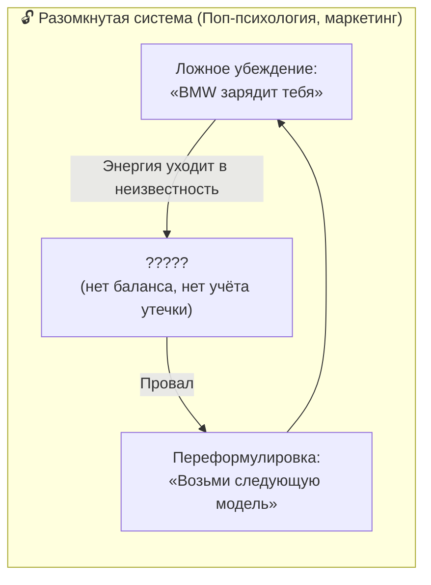
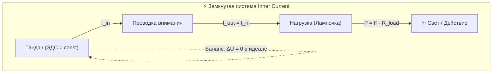
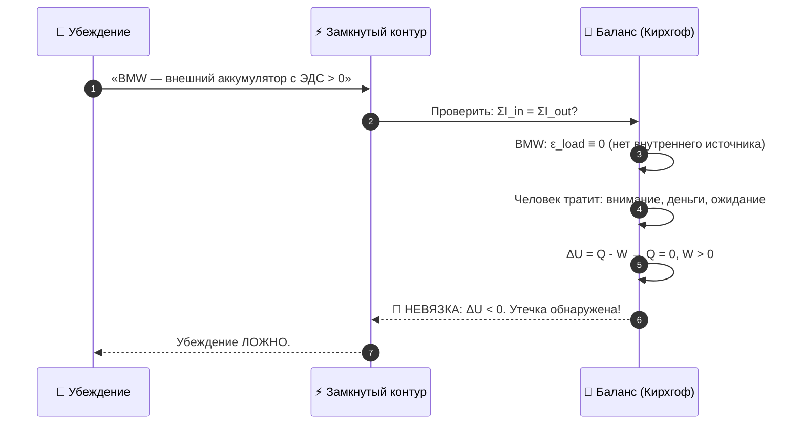
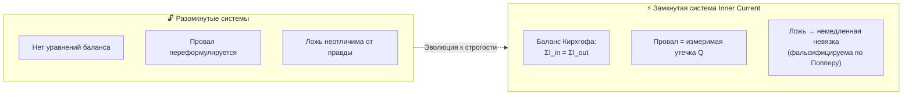
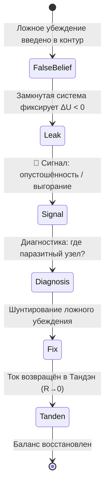

# 24. Замкнутая термодинамическая система как критерий истины: почему ложные ответы о счастье показывают утечку

> «Я дал исчерпывающий ответ, почему BMW не даёт счастья: потому что я создал замкнутую термодинамическую систему, и тут все неверные, ложные ответы покажут утечку. А если утечка — значит, система работает неправильно.»  
> — **Владимир Аньянов**

---

> [!abstract] Квинтэссенция
> **Система Inner Current** — это первая в истории **замкнутая термодинамическая и электродинамическая модель человеческого состояния**. В замкнутой системе действует непреложный закон: любое ложное убеждение о счастье немедленно проявляет себя как **измеримая энергетическая утечка** ($\Delta U \neq 0$ или невязка Кирхгофа). Нет ни одного консьюмеристского, экзистенциалистского или психологического «ответа», который мог бы пройти этот тест, не показав дыру в балансе.

---

## 1. Проблема: разомкнутые системы позволяют врать бесконечно

До появления **Inner Current** все теории счастья существовали в **разомкнутых моделях**:

- Поп-психология: *«Купи это — обретёшь уверенность»*. Через месяц человек опустошён. Ответ: *«Купи следующее»*.
- Позитивная психология: *«Визуализируй, и придёт»*. Не пришло. Ответ: *«Плохо визуализировал»*.
- Традиционная философия: *«Счастье — это добродетель»*. Человек страдает. Ответ: *«Недостаточно добродетелен»*.

Ни в одной из этих моделей **нет закрытого энергетического баланса**. Там нет уравнений. Там нет невязки. Поэтому ложь в них никогда не детектируется — можно бесконечно переформулировать провал как «недостаточное усердие».

---

## 2. Принцип замкнутой системы: первый закон термодинамики и баланс Кирхгофа

В **Inner Current** контур человеческого сознания рассматривается как **строго замкнутая физическая система** с двумя железными законами:

### Закон I: Первый закон термодинамики
$$\Delta U = Q - W$$

Внутренняя энергия системы ($\Delta U$) равна разнице между теплом, поглощённым системой ($Q$), и работой, совершённой системой ($W$). Энергия не берётся из ниоткуда и не исчезает в никуда.

### Закон II: Баланс токов Кирхгофа (первое правило)
$$\sum I_{\text{in}} = \sum I_{\text{out}}$$

Сколько тока втекает в узел — ровно столько вытекает. Ни ампера лишнего, ни ампера в дефиците.

Когда в эту замкнутую модель вводится **любое убеждение о счастье**, оно должно пройти проверку балансом.

---

## 3. Тест на утечку: как замкнутая система детектирует ложь

### Тезис для проверки: «BMW даст тебе энергию и счастье»

**Результат:** убеждение немедленно показывает **отрицательную невязку** ($\Delta U < 0$) — внутренняя энергия системы падает. Это и есть выгорание, опустошённость и разочарование после покупки.

### Общий алгоритм теста:

1. Взять убеждение: *«Источник X даёт мне энергию»*.
2. Проверить: есть ли у X внутренняя ЭДС ($\mathcal{E}_X > 0$)?
3. Если $\mathcal{E}_X = 0$ (X — пассивная нагрузка, пустотная форма) — **утечка неизбежна**.
4. Зафиксировать узел утечки, разомкнуть и перенаправить ток в Тандэн.

---

## 4. Таблица проверки: Классические «ответы» о счастье через замкнутый баланс

| Убеждение | $\mathcal{E}_X$ | Баланс | Вердикт |
| :--- | :---: | :--- | :---: |
| «BMW / дом / статус зарядят меня» | $= 0$ | $\Delta U < 0$, утечка | ❌ |
| «Одобрение людей наполнит меня» | $= 0$ | КЗ на Эго, $\Delta U < 0$ | ❌ |
| «Деньги сами по себе = счастье» | $= 0$ | Нейтрально: деньги — инструмент | ❌ |
| «Буду счастлив, когда достигну цели» | $C_{future} \to \infty$ | Реактивное сопротивление рвёт ток | ❌ |
| **Прямой ток из Тандэна в дело сейчас** | $> 0$ | $\Delta U \geq 0$, баланс сходится | ✅ |
| **Мусин ($R \to 0$) в настоящем** | $> 0$ | $\eta \to 100\%$, нет утечек | ✅ |

---

## 5. Почему Inner Current — первая фальсифицируемая теория счастья

**Ключевое свойство замкнутой системы:** счастье в Inner Current **фальсифицируемо** по критерию Поппера.

Ни одна другая система в истории не давала человеку такого инструмента: **измерить правдивость убеждения физическим уравнением**.

---

## 6. Утечка как диагностический сигнал, а не приговор

Важнейший практический вывод: **утечка — это не трагедия**.

Когда человек чувствует опустошённость после погони за статусными объектами — его контур не сломан. Он работает **абсолютно корректно**: честно показывает невязку, указывает на ложный узел и ждёт починки.

**Утечка — это компас, а не приговор.** Чем честнее человек отслеживает невязку, тем точнее находит ложный узел и тем быстрее восстанавливает сверхпроводимость.

---

## 7. Резюме главы

1. **Замкнутость системы — её главное эпистемологическое оружие.** В разомкнутых теориях ложь неопровержима. В замкнутом контуре Inner Current — мгновенно детектируется невязкой.
2. **Первый закон термодинамики ($\Delta U = Q - W$) и баланс Кирхгофа ($\sum I_{\text{in}} = \sum I_{\text{out}}$)** — абсолютный суд над любым убеждением.
3. **Любой ложный «источник счастья»** ($\mathcal{E}_X = 0$) немедленно создаёт $\Delta U < 0$ — переживаемое как выгорание и опустошённость.
4. **Утечка — диагностический сигнал**: контур работает правильно, честно указывая на ложный узел.
5. **Счастье в Inner Current фальсифицируемо** — это делает её первой строго научной теорией человеческого благополучия.

**Связанные главы:** [[02_Wiki/Inner Current (The Battery Illusion of Material Possessions and Emptiness of Form)|23. Иллюзия аккумулятора вещей]] · [[02_Wiki/Inner Current (Engineering Epistemology and Bitcoin Law)|15. Инженерный критерий истины]] · [[02_Wiki/Inner Current (Fundamental Laws of the Happiness Thermodynamics)|20. Законы термодинамики счастья]]
