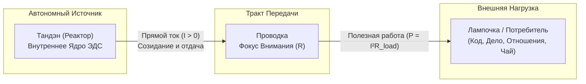
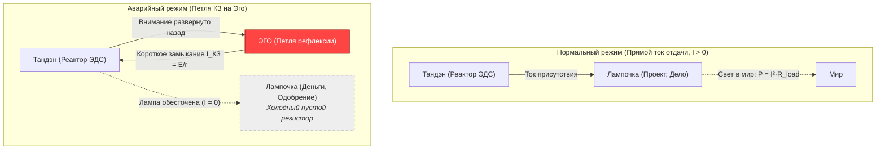

# Inner Current: Базовая топология цепи и закон полярности

> «Масштаб нагрузки не меняет законов электродинамики. Энергия всегда течёт изнутри наружу.»

---

## 1. Концепция контура человека

В системе **«Внутренний ток» (Inner Current)** состояние человеческого сознания и деятельности формализуется как замкнутая электродинамическая система:

### Архитектурные компоненты:
1. **Тандэн (丹田, Автономный Реактор / Ядро):**  
   Глубинный источник электродвижущей силы (ЭДС). Он автономен и не зависит от внешних оценок, славы или чужого одобрения.
2. **Проводка (Каналы внимания и восприятия):**  
   Нейрокогнитивный тракт, обладающий омическим сопротивлением $R$. При чистом присутствии $R \to 0$.
3. **Лампочка (Нагрузка / Внешний объект):**  
   Любая задача, дело или продукт в материальном мире (написание кода, чашка чая, управление компанией, разговор).

---

## 2. Закон фундаментальной полярности

> [!important] Принцип естественной полярности
> Ток жизни всегда течёт строго по направлению:  
> $$\text{Реактор (Тандэн)} \xrightarrow{\quad \text{Внимание} \quad} \text{Лампочка (Нагрузка)}$$

Лампочка является **потребителем** энергии. Она светится от протекающего через неё тока созидания. В ней нет встроенного генератора.

---

## 3. Патология Иллюзии Источника и Короткого Замыкания на Эго

В строгой электродинамике пассивная лампа накаливания не способна сгенерировать ток вспять: $\mathcal{E}_{\text{load}} \equiv 0$, а по закону Кирхгофа $I_{\text{in}} = I_{\text{out}}$ (в лампе не сохраняется ни один кулон заряда).

Когда человек пытается сделать лампочку источником своей ценности:
$$\text{«Вот когда проект признают великим — я наконец стану счастливым и спокойным»,}$$
в цепи разворачивается не мифический «обратный ток», а тяжелейшая внутренняя авария:

### Системные последствия аварии:
* **Иллюзия пустоты (Шуньята):** Лампа — чистый диссипатор ($R$). Вся энергия, которую вы в неё вложили, уходит в мир в виде фотонов и тепла ($Q = I^2 R t$). В ней нет запаса емкости ($C = 0$). Ожидание подпитки от пустой формы — это работа в холостую, создающая ощущение полного истощения.
* **Короткое замыкание на Эго ($I_{\text{КЗ}}$):** В попытке вытянуть оценку снаружи внимание срывается с ремесла и разворачивается внутрь, замыкаясь на мысли о себе (*«А как я выгляжу? А одобрят ли меня?»*). Возникает сверхток внутреннего КЗ:
  $$I_{\text{КЗ}} = \frac{\mathcal{E}_{\text{tanden}}}{r_{\text{internal}}}$$
  По закону Джоуля — Ленца проводка внимания раскаляется докрасна ($Q = I_{\text{КЗ}}^2 r_{\text{internal}} t$). Человек сгорает от тревоги и паники, пока сама задача остаётся тёмной и обесточенной.
* **Катастрофа при поломке лампочки:** Если внешняя лампа гаснет, человек переживает крах личности, так как ошибочно спутал бренное стекло нагрузки со своим вечным сердцем.

---

## 4. Сравнительный анализ состояний

| Параметр | Прямой ток отдачи (Норма) | Короткое замыкание на Эго (Патология) |
| :--- | :--- | :--- |
| **Вектор мощности** | Изнутри $\to$ Наружу (в действие) | Замкнут в петлю рефлексии (на себя) |
| **Статус нагрузки** | Чистый резистор-излучатель ($R$) | Иллюзорный «источник» / обесточена |
| **Функция результата** | Естественное сияние нити накала | Единственное условие права на жизнь |
| **Состояние внимания** | [[02_Wiki/Inner Current (Physics of Presence and Superconductivity)|Мусин (R → 0, Сверхпроводимость)]] | Паразитный перегрев петли эго ($Q = I_{\text{КЗ}}^2 r t$) |
| **Реакция на ошибку** | Инженерная калибровка цепи | Стыд, паралич, выгорание |
| **КПД системы** | Стремится к 100% | 0% (вся энергия уходит в паразитный самонагрев) |

---

## Связи
- [[04_Maps/Inner Current MOC|Inner Current MOC]]
- [[02_Wiki/Inner Current (Physics of Presence and Superconductivity)|Физика присутствия и сверхпроводимость]]
- [[02_Wiki/Inner Current (Scale Invariance and Tea Ceremony)|Инвариантность масштаба нагрузки]]
- [[02_Wiki/Inner Current (Safety, Antifragility and Zanshin)|Предохранители и антихрупкость]]
- [[02_Wiki/Inner Current (Circuitry of Existential Fault and Ground Leak)|28. Схемотехника экзистенциальной аварии (Штатный Golden Path vs аварийный Ground Fault)]]
