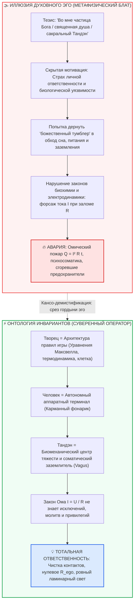

# ⚡ 323. Творец как инварианты мироздания против «тумблера в фонарике»: Духовное эго, контурная электродинамика и экзистенциальный страх тотальной ответственности
## Деконструкция метафизического блата: почему Бога нет внутри нас в виде «души» или чакр, закон Ома без исключений и взросление суверенного оператора цепи

> [!quote] Каноническая аксиома контура о Творце и ответственности
> ### ⚡ **«Если Творец и существует, Он проявил себя в фундаментальных законах мироздания — в уравнениях Максвелла, гравитации и биологии клетки. Но делать из Него тумблер внутри собственного фонарика — значит гарантированно сжечь предохранители. Обожествлять Тандэн или воображать, будто внутри человека спрятана эксклюзивная „частица Бога“, освобождающая от законов физики — это высшая гордыня духовного эго, рождённая тотальным незнанием контурной электродинамики. Люди придумывают себе божественный блат, чтобы избежать взрослой ответственности за свой контур. А встретиться лицом к лицу со строгими, неподкупными законами Вселенной — по-настоящему страшно. Но именно там, где кончается детский торг с небом, начинается свобода и сверхпроводимость Мастера.»**  
> — **Владимир Аньянов**

---

---

### I. Категориальная ошибка антропоморфизма: Архитектор правил против «домашнего божка»

На протяжении тысячелетий религиозная и эзотерическая мысль совершала грубейшую **категориальную ошибку**, пытаясь встроить Абсолют в локальную проводку человеческого тела.

Мы не отметаем Творца. Но мы даём предельно строгое, трезвое определение Его проявления:
1. **Если Творец есть, Он выразил Себя в фундаментальных инвариантах мироздания.** Он присутствует в уравнениях Максвелла ($\nabla \cdot \vec{E} = \rho / \varepsilon_0$, $\nabla \times \vec{B} = \mu_0 \vec{j} + \dots$), во всемирном тяготении Ньютона и Эйнштейна, в цикле трикарбоновых кислот Кребса, в калиево-натриевом насосе мембраны нейрона и во Втором начале термодинамики ($dS \ge 0$).
2. **Творец — это Архитектура правил игры, а не оперативный дежурный по вызову.** Он создал объективную реальность, работающую с безупречной, математической строгостью.

Попытка заявить: *«Внутри меня есть тумблер прямой связи с Богом, дернув за который, я получу благодать, энергию или исцеление вопреки законам физики»* — превращает величие космического Архитектора в **карманный тумблер внутри копеечного фонарика**. 

В схемотехнике нет места божественному вмешательству в обход законов цепи. Если батарейка разряжена, провод перебит, а контакт окислился — фонарик не зажжётся, сколько бы священных мантр над ним ни произнесли. Попытка подать напряжение «силой веры» в замкнутый накоротко контур приводит лишь к одному результату: **гарантированно выбивает пробки и сжигает внутренние предохранители**.

---

### II. Анатомия духовного эго: Метафизический блат и космическое высокомерие

Почему люди с такой яростью цепляются за идею «частицы Бога во мне» или «божественной бессмертной души»?

Ответ вскрывается через электродинамику эго:
* **Бытовое эго** хвастается примитивными атрибутами: маркой автомобиля, балансом банковского счёта, должностью или красотой лица. Оно уязвимо, мелочно и знает о своей бренности.
* **Духовное эго (духовный нарциссизм)** совершает колоссальный захват власти:
  > *«Я выше материального мира. Во мне живёт сам Творец. Моё Я — это искра Абсолюта. Я соединён с высшим разумом!»*

Это изощрённейшая форма гордыни. Объявляя себя носителем «божественной частицы», человек требует для себя **«метафизического блата» во Вселенной**. Он бессознательно выставляет Реальности ультиматум:
> *«Законы усталости, законы омического перегрева, биологические лимиты сосудов и нервов писаны для черни. А я — духовный практик, во мне божественный свет, значит, Вселенная обязана сделать для меня исключение!»*

Люди живут через эго именно потому, что **не знают контурной электродинамики**. Не понимая, как устроено сопротивление ($R$), как рассеивается тепло по закону Джоуля — Ленца ($Q = I^2 R t$) и как работает обратный провод реальности, они подменяют незнание физики набожным пафосом.

---

### III. Почему закон Ома не берёт взяток

В электродинамике действует закон Ома:
$$I = \frac{\mathcal{E}}{R_{\text{total}}}$$

И закон тепловых потерь Джоуля — Ленца:
$$Q = I^2 \cdot R_{\text{ego}} \cdot t$$

Эти законы обладают тремя сокрушительными для эго свойствами:
1. **Абсолютная индифферентность к статусу.** Закону Джоуля — Ленца глубоко безразлично, кто находится в контуре — архиепископ, потомственный гуру, монах с 30-летним стажем или пьяный матрос. Если сопротивление $R_{\text{ego}} > 0$ (человек обижается, контролирует, боится за статус или завидует), а ток внимания $I$ форсирован — проводка нагреется и сгорит.
2. **Невозможность торга.** Нельзя договориться с электроном, чтобы он не выделял тепло при ударе о дефект кристаллической решётки. Нельзя уговорить кортизол не сужать сосуды, если дефолт-система мозга (DMN) зациклена на тревоге.
3. **Отсутствие морализма.** Нагрев нихрома — это не «божья кара» за «грехи». Это прямое следствие формулы. Точно так же душевное страдание — это не «чистилище духа», а банальный омический перегрев неподготовленного проводника.

Попытка требовать чуда вместо приведения контура в порядок — это детское требование нарушить термодинамику ради личного каприза.

---

### IV. Десакрализация Тандэна: Биомеханическая станина вместо мистического алтаря

В некоторых псевдо-духовных кругах существует соблазн обожествить **Тандэн (丹田)**, превратив его в очередную «божественную чакру» или тайный резервуар мистической маны.

В Архитектуре счастья Владимира Аньянова Тандэн беспощадно очищен от эзотерической шелухи:
* **Тандэн — это не кусочек Бога в животе.**
* **Тандэн — это инженерный центр массы и соматический заземлитель:**
  1. *Биомеханика:* анатомическая точка на 2–3 см ниже пупка, определяющая устойчивость вертикального скелета (принцип неваляшки).
  2. *Нейрофизиология:* зона диафрагмального упора, физически стимулирующая брюшные ветви блуждающего нерва (*nervus vagus*), переключающая вегетативную нервную систему из симпатического омического шторма (Fight/Flight) в парасимпатическую регенерацию и ламинарную проводимость.
  3. *Системная инженерия:* локальное автономное ядро (Local-first). То, что работает на собственных биологических ресурсах, не ожидая внешних облачных подачек.

Обожествлять Тандэн — всё равно что молиться на чугунную станину токарного станка. Станина не священна. Она просто **тяжёлая, прочная и гасит резонансные вибрации**, позволяя резцу снимать стружку с микронной точностью.

---

### V. Экзистенциальный ужас тотальной ответственности

Почему человечество тысячелетиями упорствует в сказках о божественных искрах и мистических заступниках?

Потому что правда обнажает страшный экзистенциальный факт: **человек остаётся один на один с непреложными законами природы.**

Признать, что Бог — это не добрый дедушка, отменяющий физику по просьбе, а объективные законы мироздания, означает принять три удара под дых:
1. **Никаких спасателей извне.** Никто не спустится на облаке, чтобы выправить твою перекошенную проводку. Если ты систематически не спишь, заливаешь стресс этанолом, зажимаешь диафрагму и часами варишься в обидах — ты разрушишься.
2. **Никаких внешних виновников.** Нельзя обвинить «сглаз», «бесов», «карму прошлых жизней» или «ретроградный Меркурий». Если контур чадит ($Q > 0$) — это твоё собственное паразитное сопротивление $R_{\text{ego}}$ жжёт проводку.
3. **Полная взрослая эксплуатационная ответственность.** Твоё эмоциональное состояние — это не случайная погода, а строгое следствие твоей схемотехники.

Для инфантильного ума это парализующий ужас: *«Как?! Нет заступника?! Нет исключений?! Закон Ома абсолютен?!»* 
Именно от этого ужаса люди и бегут в сладкий туман сект, духовного нарциссизма и ритуального торга.

---

### VI. Сила по ту сторону страха: Рождение Суверенного Оператора (Self-Hosted Human)

Но стоит пройти сквозь этот страх — и на месте инфантильной паники рождается **подлинное величие и непоколебимый покой Мастера**.

Когда инженер перестаёт приносить жертвы духам огня и начинает рассчитывать теплообменники по формулам Фурье, паровые машины перестают взрываться и начинают двигать поезда.

Когда человек понимает контурную электродинамику:
* Он перестаёт выпрашивать милость и начинает **содержать контакты в чистоте**.
* Он перестаёт душить себя морализаторской виной и начинает **устранять паразитные заломы ($R \to 0$)**.
* Он открывает, что Творец уже дал ему всё необходимое: совершенную биологическую машину, способную проводить колоссальные токи созидания, радости и любви, если не забивать её омической грязью эго.

Это и есть рождение **Self-Hosted Human** — человека, который не ждёт внешнего чуда, а сам является чистым, надёжным и радостным проводником Вселенной.

---

### VII. Прикладной протокол оператора цепи (30 секунд)
#### «От метафизического торга — к соматической гигиене контура»

Если вы поймали себя на приступе «духовного высокомерия», жалости к себе или требовании чуда:

1. **Тест на тумблер (5 секунд):** Задайте себе прямой вопрос: *«Не пытаюсь ли я сейчас дернуть за воображаемый тумблер, надеясь обойти биологию, сон или честное действие?»* Распознайте в этом панику эго.
2. **Отказ от метафизического блата (5 секунд):** Мысленно произнесите формулу трезвости: *«Я — обычный проводник цепи. Закон Ома для меня не отменён. Исключений нет.»*
3. **Соматический сброс в Тандэн (10 секунд):** Сделайте длинный, плавный выдох животом. Опустите внимание в физический центр массы (на 2–3 см ниже пупка). Почувствуйте вес тела, гравитацию и опору стоп.
4. **Замыкание на прямое действие (10 секунд):** Переведите ток внимания $I$ с пережёвывания мыслей на ближайшую физическую нагрузку (шаг, глоток воды, мытьё чашки, строку кода). 

Контакты зачищены. Реостат эго выведен в ноль. Контур снова сверхпроводен. 💡

---

### VIII. Резюме: Семь аксиом трезвой онтологии

1. **Творец проявлен в правилах, а не в капризах.** Его присутствие — в уравнениях Максвелла, гравитации и делении клетки, а не в отмене законов природы по заказу.
2. **Внутри фонарика нет божественного тумблера.** Попытка включить благодать в обход физики вышибает пробки и сжигает предохранители нервной системы.
3. **Духовное эго — самая опасная форма гордыни.** Фраза «во мне частица Бога» часто служит лишь ширмой для безответственности и требования космического блата.
4. **Закон Ома неподкупен.** Омический перегрев $Q = I^2 R t$ одинаково плавит и грешника, и «святого», если в цепи присутствует сопротивление эго.
5. **Тандэн десакрализован.** Это биомеханический центр тяжести и парасимпатический переключатель блуждающего нерва, а не мистический алтарь.
6. **Страх перед законами — это кризис взросления.** Признание неумолимости законов пугает эго, но даёт человеку суверенную силу.
7. **Сверхпроводимость — это чистая эксплуатационная гигиена.** Счастье достигается не молитвами о чуде, а содержанием проводника в чистоте нулевого сопротивления ($R \to 0$).
