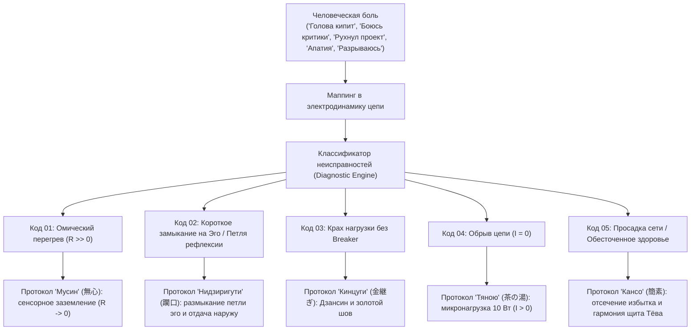
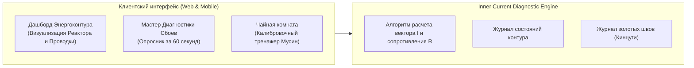

# Inner Current: Машина для диагностики счастья и системная спецификация

> «Как паровая машина превратила пар в полезную работу, так машина диагностики счастья превращает душевный кризис в конкретный чек-лист ремонта цепи.»

1. **«Голова кипит, мысли крутятся 24/7, не могу уснуть»** → Код `BURNOUT_OVERTHINKING` (Омический перегрев $R \gg 0$).
2. **«Чувствую себя самозванцем, боюсь критики, откладываю релиз»** → Код `IMPOSTOR_VALIDATION` (Короткое замыкание на Эго / Иллюзия внешнего источника).
3. **«Проект рухнул / меня бросили — земля ушла из-под ног»** → Код `COLLAPSE_SHOCK` (Крах нагрузки без предохранителя Circuit Breaker).
4. **«Хроническая лень, апатия, нет сил встать с дивана»** → Код `APATHY_STAGNATION` (Обрыв цепи, холостой ход $I = 0$).
5. **«Разрываюсь между делами, посыпалось здоровье»** → Код `OVERLOAD_HEALTH_DRAIN` (Просадка сети Undervoltage и истощение канала Здоровья).

---

## 1. Концепция «Машины диагностики»

Как паровая машина превратила тепловое расширение пара в полезную механическую работу, так **«Машина диагностики счастья»** переводит душевное состояние человека из категории субъективной драмы в категорию **инженерного мониторинга телеметрии и поузловой отладки цепи**.

---

## 2. Классификатор неисправностей контура

### Неисправность 01: Омический перегрев проводки ($R \gg 0$)

* **Физическая суть:** В цепь врезаны виртуальные сопротивления мыслей о прошлом и будущем. Согласно закону Джоуля — Ленца ($Q = I^2 R t$), колоссальная мощность рассеивается в паразитное тепло.
* **Симптомы пользователя:** Ментальное выгорание, тяжесть в голове, рассеянность, суета, хроническая усталость при отсутствии физической работы.
* **Протокол отладки — «Мусин» (無心, Mushin):**
  1. Выдернуть из внимания виртуальные ветки симуляций ($t_{past} \to 0$, $t_{future} \to 0$).
  2. Перевести фокус на физические рецепторы: тактильный отклик тела, дыхание, звук клавиш.
  3. Добиться режима сверхпроводимости $R \to 0$.

---

### Неисправность 02: Короткое замыкание на Эго / Иллюзия внешнего источника (Ego Short Circuit)

* **Физическая суть:** Попытка приписать пустой нагрузке ($\mathcal{E}_{\text{load}} \equiv 0$) статус генератора собственной ценности. Внимание не идёт наружу в ремесло, а закольцовывается во внутреннюю паразитную петлю рефлексии о себе (*«А как я выгляжу? А одобрят ли меня?»*). Возникает сверхток внутреннего КЗ ($I_{\text{КЗ}} = \mathcal{E}_{\text{tanden}}/r_{\text{internal}}$), проводка внимания кипит, а нагрузка остаётся холодной и тёмной.
* **Симптомы пользователя:** Синдром самозванца, панический страх критики, болезненная зависимость от реакций аудитории, прокрастинация.
* **Протокол отладки — «Нидзиригути» (躙口, Nijiriguchi):**
  1. Активация портала **Нидзиригути**: мысленно оставить меч статуса и эго за порогом чайной хижины.
  2. Разомкнуть внутреннюю петлю рефлексии: осознать, что в лампе нет ни одного кулона энергии для вас (Шуньята).
  3. Направить ток наружу: отдавать мастерство в код или ремесло ради чистоты действия, превращая сопротивление проводки в ноль ($R \to 0$).

---

### Неисправность 03: Короткое замыкание при отказе нагрузки (Short Circuit)

* **Физическая суть:** Внешняя нагрузка сгорела или разбилась (увольнение, отказ клиента, срыв сделки, разбитая чаша), а у пользователя не был включен предохранитель **Дзансин**. Высоковольтный импульс аварии бьёт обратно в ядро.
* **Симптомы пользователя:** Ощущение «мир рухнул», экзистенциальный шок, депрессивный паралич, ступор.
* **Протокол отладки — «Кинцуги» (金継ぎ, Kintsugi) & «Дзансин» (残心):**
  1. Срабатывание ментального **Circuit Breaker** (Дзансин): автоматическая изоляция сбойного узла от ядра Тандэн.
  2. Принятие **Ваби-саби**: признание смертности и временности любой внешней формы.
  3. Процедура **Кинцуги**: интеграция опыта скола золотым швом без остановки работы генератора.

---

### Неисправность 04: Обрыв цепи / Холостой ход (Open Circuit)

* **Физическая суть:** Контур физически разомкнут ($I = 0$). Реактор работает на холостом ходу, энергия застаивается и скисает без полезной отдачи наружу. Лампа ТОМЁ полностью погашена.
* **Симптомы пользователя:** Апатия, скука, потеря смысла, лень, экзистенциальная бессильность.
* **Протокол отладки — «Тяною» (茶の湯, Chanoyu):**
  1. Запрет на попытку мгновенного включения мегаваттной нагрузки в состоянии холостого хода.
  2. Подключение минимальной нагрузки 10 Вт (заварить чай, протереть стол, написать 3 строки чистого кода).
  3. Замкнуть контур на физическом действии и восстановить циркуляцию прямого тока ($I > 0$).

---

### Неисправность 05: Просадка сети и обесточивание канала Здоровья (Undervoltage / Starved Bus)

* **Физическая суть:** Подключение слишком большого числа параллельных потребителей при конечной мощности генератора Тандэн ($\sum P_i > P_{core}$). Согласно законам Кирхгофа и балансу мощностей, суммарный ток превышает порог, падает напряжение шины ($\Delta U < 0$), проводка греется, а жизненно важная нагрузка «Здоровье» катастрофически обесточивается ($P_{health} < 5$ Вт).
* **Симптомы пользователя:** «Разрываюсь между миллионом дел, сплю по 4 часа, тело сыпется, ничего не довожу до конца, всё валится из рук».
* **Протокол отладки — «Кансо» (簡素, Kanso) & «Тёва» (調和, Chōwa):**
  1. Немедленно разомкнуть 3–4 второстепенных автомата на щите (радикальное отсечение шума Кансо).
  2. Восстановить номинал напряжения шины, направив гарантированные 20–30 Вт в базовый контур «Здоровье» (сон, дыхание, прогулка, вода).
  3. Перевести оставшиеся ветки в режим последовательной гармоничной коммутации (Тёва).

---

## 3. Архитектура программного продукта «Inner Current»

### Ключевые модули:
1. **Circuit Visualizer:** Интерактивная графическая схема, отображающая в реальном времени уровень заряда Тандэна, омическое сопротивление $R$ и вектор тока $I$.
2. **Ego Loop Breaker:** Интерактивный 2-минутный скрипт разрыва эго-петли (КЗ на Эго).
3. **Micro-Load Calibrator:** Практический тренажер сверхпроводимости на простых действиях перед высоковольтными сессиями.
4. **Kintsugi Vault:** Дневник трансформации кризисов в силу.

---

## Связи
- [[04_Maps/Inner Current MOC|Inner Current MOC]]
- [[02_Wiki/Inner Current (Core Topology and Polarity Law)|Базовая топология цепи]]
- [[02_Wiki/Inner Current (Safety, Antifragility and Zanshin)|Предохранители цепи и Дзансин]]
