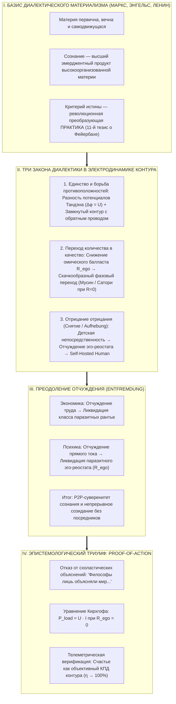
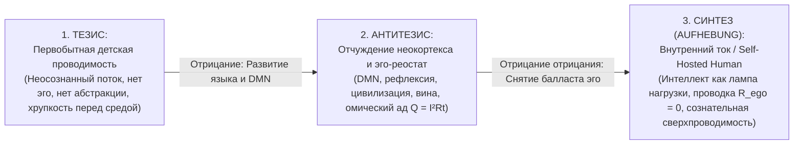
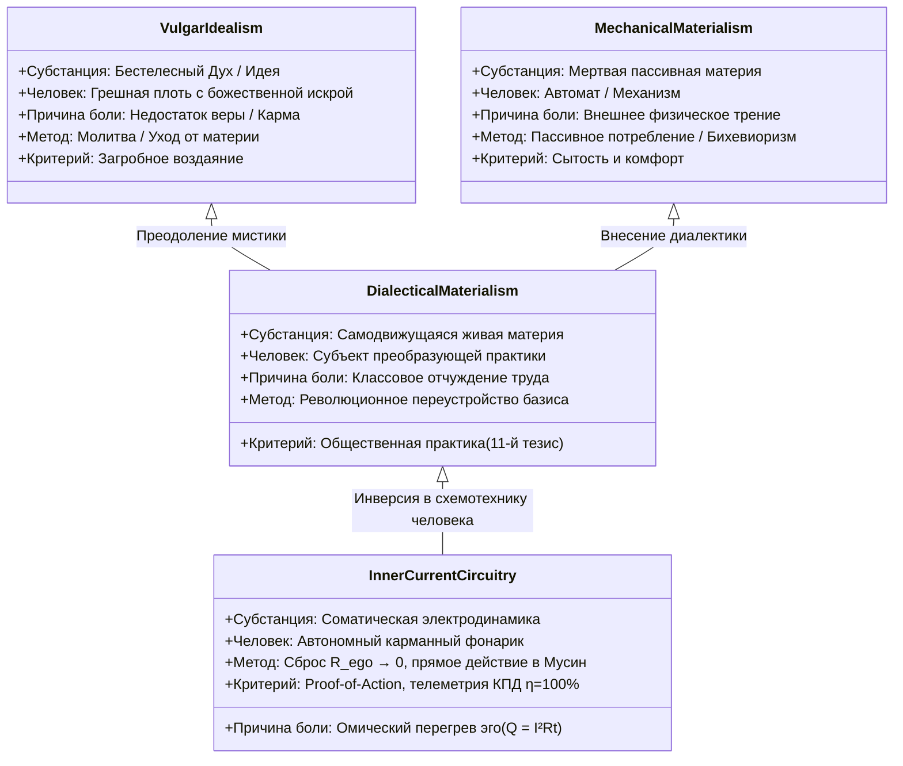

# 355. Диалектический материализм и Внутренний ток: Три закона диалектики, эмерджентность духа и практика как схемотехнический критерий истины — Первичность материального субстрата, радость как эмерджентное поле, законы диалектики в электродинамике контура и 11-й тезис Маркса как Proof-of-Action

> «Маркс и Энгельс совершили колоссальный эпистемологический подвиг: они выбили почву из-под ног идеалистической мистики и поставили диалектику Гегеля с головы на ноги — на незыблемый фундамент самодвижущейся материи. Но в XIX веке у них не было приборов и теории, чтобы заглянуть в микроэлектродинамику живой нервной системы. Они гениально диагностировали отчуждение человека в макроэкономике мануфактур и фабрик, но не могли нарисовать принципиальную схему того, как отчуждение аппаратно генерируется внутри черепной коробки.  
> Внутренний ток делает следующий закономерный шаг: мы доводим диалектический материализм до точной схемотехники карманного фонарика. Дух — не трансцендентный призрак и не божественная искра, а эмерджентное электромагнитное поле материального соматического тока. Три закона диалектики — это не умозрительные абстракции гегельянства, а строгие законы электрической цепи. А знаменитый одиннадцатый тезис Маркса о преобразующей практике — это прямой предок нашего Proof-of-Action: если теория верна, лампочка созидания обязана гореть полным накалом, а проводка не имеет права плавиться в омическом перегреве.»  
> — **Владимир Аньянов**

---



---

## 1. Исторический тупик: Почему идеализм слеп, а механистический материализм мёртв

На протяжении тысячелетий западная и восточная мысль метались между двумя тупиковыми крайностями:

1. **Субъективный и объективный идеализм (Платон, Беркли, Гегель, теология):**  
   Объявлял материальный мир вторичной тенью «идеи», духа или божественной воли. В приложении к счастью это всегда порождало культ мученичества, абстрактную медитацию в вакууме, веру в загробное воздаяние и обвинение материи в «греховности» или «нечистоте». Идеализм принципиально нефальсифицируем по Попперу: если человек страдает, жрец или гуру всегда говорит, что он «недостаточно веровал» или «накопил плохую карму в прошлой жизни».
2. **Вульгарный и механистический материализм (Демокрит, Ламетри с его «Человеком-машиной», Бюхнер, Молешотт):**  
   Сводил сознание к механическому движению часовых шестерней или грубой секреции («мозг выделяет мысль, как печень — желчь»). В этой оптике человек лишался всякой субъективности, самодвижения и воли, превращаясь в пассивный бильярдный шар, реагирующий на внешние пинки среды (прообраз бихевиоризма XX века). Счастье сводилось к сытости и отсутствию внешнего трения — что катастрофически разбилось о феномен экзистенциального краха в сытых буржуазных обществах.

Карл Маркс и Фридрих Энгельс взорвали эту ложную дихотомию, создав **диалектический материализм**:
- Материя первична и объективна, но она **не статична, а находится в непрерывном самодвижении и развитии**.
- Сознание — не потусторонний призрак, а **свойство высокоорганизованной материи**, способное активно отражать мир и преобразовывать его через предметную деятельность.

Однако Маркс и марксисты-ленинцы остановились на пороге психофизиологии. Их инструмент — диалектика производительных сил и производственных отношений — был заточен на макроструктуры классов, фабрик и государств. Человеческая субъективность осталась «чёрным ящиком».

**Внутренний ток (Архитектура счастья Владимира Аньянова)** берет диалектический материализм как строгий фундамент и производит его **инженерную инверсию внутрь биологического субстрата человека**.

---

## 2. Материалистический манифест цепи: Эмерджентная природа духа

Первый постулат Внутреннего тока абсолютно материалистичен: **на принципиальной схеме человека нет нематериальных сущностей**.

### Биологический субстрат как генератор:
- В теле человека работают **37 триллионов живых клеток**, в каждой из которых вращаются тысячи митохондриальных турбин АТФ-синтазы.
- Через внутреннюю мембрану митохондрий непрерывно прокачивается протонный градиент с разностью потенциалов порядка $150\text{–}200\text{ мВ}$. В пересчёте на толщину липидного бислоя (около $5\text{ нм}$) напряжённость электрического поля достигает колоссальных **30 миллионов вольт на метр** ($30\text{ МВ/м}$) — величины, сравнимой с пробоем грозовой молнии.
- Живой организм — это плотный, соматический электрохимический реактор. Центр тяжести и висцеральная нервная система брюшной полости (энтеральная нервная система с её 500 миллионами нейронов и блуждающим нервом) формируют аппаратное ядро — соматический генератор **Тандэн (丹田)**.

### Радость как магнитное поле:
В идеализме «радость» и «дух» объявляются нематериальной благодатью. В механистическом материализме радость вульгаризируется до примитивного всплеска дофамина.

Диалектический материализм Внутреннего тока дает строгое эмерджентное определение (статья 109):
$$\vec{B} = \frac{\mu_0}{4\pi} \int \frac{I \, d\vec{l} \times \hat{r}}{r^2}$$

Радость духа относится к биологическому телу ровно так же, как **вихревое магнитное поле $\vec{B}$ относится к электрическому току $I$ в медном проводнике**:
1. Магнитное поле невозможно «создать» из ничего в вакууме без движения электрических зарядов.
2. Но магнитное поле не сводится к механической массе электронов или атомов меди — оно представляет собой качественно новую, эмерджентную форму материи, возникающую в пространстве при прохождении тока.
3. Точно так же **радость, вдохновение и душевное горение — это эмерджентное электромагнитное поле**, излучаемое биологическим проводником, когда по нему беспрепятственно течёт ток действия из Тандэна при нулевом омическом сопротивлении эго ($R_{\text{ego}} \to 0$).

Дух не предшествует материи. Материя рождает ток, а ток в режиме сверхпроводимости рождает лучистое поле духа!

---

## 3. Первый закон диалектики: Единство и борьба противоположностей в электродинамике контура

Главный закон диалектики гласит: **источник всякого движения и развития лежит внутри самой системы и заключается в единстве и взаимодействии противоположных сторон.**

Вульгарная духовность ищет источник «перводвигателя» вовне — в Боге, космической энергии, учителе или одобрении толпы.

В схемотехнике Внутреннего тока источник движения раскрывается через строгие физические инварианты:

### 1. Разность потенциалов источника ($\Delta \varphi = U = \mathcal{E}$):
Электрический ток в цепи невозможен без разделения зарядов на клеммах источника. Тандэн представляет собой биологический диполь: внутренний потенциал намерения и воли («Хочу!», импульс ключа Хоцу) противопоставлен сопротивлению внешней среды. Без этой полярности нет электродвижущей силы ($\mathcal{E} = 0$).

### 2. Закон замкнутого контура и обратный провод реальности:
Ток $I$ может существовать **только и исключительно в замкнутой цепи** (Закон Кирхгофа):
$$\sum I_{\text{in}} = \sum I_{\text{out}}$$
В разомкнутой цепи сопротивление бесконечно ($R \to \infty$), и ток равен нулю ($I = 0$).

```
[ Тандэн: Внутренний источник ] ──(Прямой провод: Внимание)──> [ Нагрузка: Внешний мир ]
              ▲                                                                │
              └──────────────(Обратный провод: Реальность)────────────────────┘
```

Диалектическое единство противоположностей здесь абсолютно:
- **Внутреннее (Субъект, Тандэн)** и **Внешнее (Объект, Действие в мире)** — это не две изолированные метафизические субстанции Декарта.
- Это **два плеча единого замкнутого контура**.
- Энергия выходит из биологического центра человека, совершает полезную работу в объективной материи внешнего мира (нагрузка 6 ламп: труд, любовь, спорт, творчество) и возвращается обратно через соматический сенсорный отклик («обратный провод реальности»).
- Любая попытка разорвать это единство — например, замкнуться в чистом интроспективном самосозерцании — немедленно обрывает цепь, переводя человека в режим омического гниения ($I = 0$).

---

## 4. Второй закон диалектики: Переход количественных изменений в качественные (Фазовый переход сверхпроводимости)

Второй закон диалектики утверждает: **постепенные, непрерывные количественные изменения при достижении границы меры приводят к скачкообразным качественным преобразованиям.**

В психологии и духовных практиках 2500 лет царила схоластическая путаница:
- Одни учили, что просветление — это бесконечный, нудный процесс медитации длиною в жизни (бесконечное накопление количества без перехода).
- Другие объявляли Сатори непостижимой вспышкой божественной милости, никак не связанной с физической практикой.

Внутренний ток разрешает этот парадокс через физику **фазовых переходов второго рода** (статья 113):

### Узловая линия мер в омической цепи:
Паразитный реостат эго ($R_{\text{ego}}$) — это нихромовая спираль в цепи сознания, сотканная из трёх количественных составляющих:
$$R_{\text{ego}} = R_{\text{guilt}} (\text{вина за прошлое}) + R_{\text{control}} (\text{страх будущего}) + R_{\text{approval}} (\text{зависимость от чужого суда})$$

Когда практикующий применяет инструменты разотождествления (соматический якорь Тандэна, протокол вольтметра, выключение внутреннего критика), происходит **постепенное количественное снижение сопротивления** — Ом за Омом:
$$R_{\text{ego}}: 10\,000\ \Omega \to 1\,000\ \Omega \to 100\ \Omega \to 10\ \Omega \to 1\ \Omega$$

### Скачок в критической точке ($T < T_c$):
Но состояние истинного счастья (Мусин, 無心) — это не просто «низкое сопротивление». Это **скачкообразный фазовый переход в состояние сверхпроводимости** при достижении критического порога:
$$\lim_{R_{\text{ego}} \to 0} Q_{\text{loss}} = 0$$

В момент, когда сопротивление эго падает до нуля, происходит качественный скачок всей системы:
1. **Эффект Мейснера в сознании:** Полное вытеснение внешних паразитных магнитных полей чужих оценок и внутреннего стыда. Сознание становится диамагнетиком для социального давления.
2. **Обнуление потерь Джоуля — Ленца:**
   $$Q = I^2 R_{\text{ego}} t \equiv 0$$
   Вся энергия биологического реактора без потерь уходит в полезную мощность нагрузки ($P_{\text{load}} = P_{\text{total}}$).
3. **КПД контура подскакивает до 100%:**
   $$\eta = \frac{P_{\text{load}}}{P_{\text{total}}} = 1.0 \quad (100\%)$$

Количественная работа по соматическому расслаблению зажимов и отключению мысленного диалога скачком переходит в качественно новое онтологическое состояние — **сверхпроводящее сознание созидания**.

---

## 5. Третий закон диалектики: Отрицание отрицания (Снятие / Aufhebung)

Третий закон диалектики описывает общее направление и спиралевидную форму развития: **новое качество отрицает старое, но сохраняет в преобразованном виде («снимает», Aufhebung) всё жизнеспособное из предыдущих стадий на более высоком уровне.**

История человеческого сознания и путь индивидуального развития представляют собой классическую триаду отрицания отрицания:



### 1. Тезис: Непосредственность ребёнка и дикаря
Младенец и первобытный охотник действуют целостно. У них ещё не сформировался гипертрофированный интерфейс дефолт-системы мозга (DMN). Ток течёт напрямую: голоден — кричит, видит зверя — бежит или бьёт. Сопротивление $R_{\text{ego}} \approx 0$.  
Но этот режим хрупок, не имеет абстрактного мышления, не способен проектировать космические корабли, сочинять симфонии или лечить болезни. Это сверхпроводимость неведения.

### 2. Антитезис: Развитие цивилизации и омический ад отчуждения
С развитием языка, разделения труда, частной собственности и социальных иерархий формируется неокортекс и его главный интерфейсный костыль — **Эго (Я-концепция, DMN)**.  
Человек отрицает непосредственность природы. Он обретает способность предвидеть будущее и анализировать прошлое. Но цена этого колоссальна:
- Интерфейс «Я» превращается в паразитный нихромовый балласт, врезанный последовательно в цепь действия.
- Возникают хроническая вина, страх несоответствия социальным ожиданиям, экзистенциальный ужас смерти.
- 90% энергии человека начинает сгорать в паразитном тепле самосуда ($Q = I^2 R_{\text{ego}} t$). Это эпоха «несчастного сознания» Гегеля, неврозов Фрейда и отчуждения Маркса.

### 3. Синтез (Aufhebung): Внутренний ток и рождение суверенного мастера
Романтики и примитивисты (Руссо, толстовцы, нью-эйдж) призывали к регрессу — «назад к природе», стать как дети, разрушить цивилизацию. Это ложное отрицание без диалектического снятия.

Внутренний ток осуществляет истинное диалектическое **Снятие (Aufhebung)**:
- Мы не уничтожаем неокортекс и не отказываемся от абстрактного мышления, науки и технологий.
- Мы **переносим интеллект с места паразитного реостата в цепи на место полезной нагрузки (Лампы №1 — Работа/Интеллект)**!
- Интеллект перестаёт быть самодовлеющим цензором, взимающим дань за каждый вдох, и становится точным оптическим инструментом в руках соматического оператора.
- Проводка цепи очищается до нуля ($R_{\text{ego}} \to 0$, как у ребёнка), но на клеммы нагрузки подаётся мощность взрослого, вооружённого наукой и культурой созидателя.

Спираль замкнулась на высшем витке: **сознательная, технологическая сверхпроводимость суверенного человека (Self-Hosted Human)**.

---

## 6. Теория отчуждения Маркса (Entfremdung) и ликвидация внутреннего рантье

В «Экономическо-философских рукописях 1844 года» Карл Маркс сформулировал фундаментальную концепцию **отчуждения (Entfremdung)**:
В капиталистическом производстве продукт труда рабочего, сам процесс его деятельности, его родовая сущность и другие люди становятся для него чуждой, враждебной силой, господствующей над ним.

В статьях 48, 49, 114 и 328 Внутреннего тока показан поразительный изоморфизм между макроэкономикой и схемотехникой сознания:

| Параметр | Политэкономия Маркса | Экономика Генри Джорджа | Денежный протокол Сатоши | Внутренний ток Владимира Аньянова |
| :--- | :--- | :--- | :--- | :--- |
| **Паразитный посредник** | Класс капиталистов / Эксплуататоры | Земельный лендлорд (монополист территории) | Фиатный Центробанк (инфляционная монополия) | **Реостат Эго ($R_{\text{ego}}$ / DMN)** |
| **Механизм отчуждения** | Изъятие прибавочной стоимости труда | Взимание земельной ренты за доступ к жизни | Инфляционный налог и обесценение времени | **Омический перегрев ($Q = I^2 R t$): пошлина вины и страха** |
| **Что отчуждается** | Продукт и радость свободного труда | Общественная стоимость локации | Покупательная способность человеческой энергии | **Прямой ток жизни и счастья ($I_{\text{life}}$)** |
| **Решение проблемы** | Обобществление средств производства | Единый налог на землю (LVT, Single Tax) | Биткоин: P2P сеть без посредников (Don't trust, verify) | **Сброс $R_{\text{ego}} \to 0$ в Тандэн и замыкание прямой нагрузки** |

Маркс увидел, что инструмент координации (фабрикант) со временем узурпировал право на жизнь рабочего.  
Внутренний ток показывает: **внутри каждого человека произошла точно такая же узурпация!**

Эволюционный интерфейс координации (эго-ум, призванный предупреждать об опасности саванны) объявил себя единственным «Хозяином» личности. Он встал между соматическим генератором Тандэн и действием, взимая грабительскую пошлину сомнений:  
*«А что о тебе подумают?», «А достоин ли ты?», «А вдруг ты ошибешься?».*

Ликвидация отчуждения во Внутреннем токе — это **ликвидация паразитного посредника внутри собственной нервной системы**. Это революция одноранговой (P2P) депосреднизации духа.

---

## 7. Одиннадцатый тезис о Фейербахе и Proof-of-Action: Практика как схемотехнический критерий истины

В 1845 году Маркс записал свои знаменитые «Тезисы о Фейербахе», ставшие манифестом действенного материализма:

> «Вопрос о том, обладает ли человеческое мышление предметной истинностью, — вовсе не вопрос теории, а практический вопрос. В практике должен доказать человек истинность, т.е. действительность и мощь, посюсторонность своего мышления.» (Тезис 2)  
> «Философы лишь различным образом объясняли мир, но дело заключается в том, чтобы изменить его.» (Тезис 11)

Внутренний ток формулирует этот принцип на бескомпромиссном языке электродинамики: **Proof-of-Action (Доказательство действием)**.

### Банкротство схоластики:
2500 лет схоластическая философия, психоанализ и религиозные конфессии «объясняли» душевную боль:
- Психоанализ раскапывал детские травмы, годами пересказывая сновидения (множа омические потери на сессиях).
- Теология объясняла страдание первородным грехом и испытанием веры.
- Экзистенциализм воспевал абсурд и тошноту бытия.

Все они оставались в разомкнутой цепи умозрительных симуляций ($I = 0$).

### Электродинамический критерий истины Аньянова:
Истина не проверяется логической стройностью философского трактата. Истина верифицируется **состоянием бортовой телеметрии замкнутого контура**:
1. **Напряжение и ток:** Течёт ли ток через нагрузку прямо сейчас? Совершается ли предметная работа в реальном мире ($P_{\text{load}} > 0$)?
2. **Температура проводки:** Греются ли виски, спазмирован ли живот, сгорает ли тело в омическом пламени тревоги ($Q = I^2 R t$)? Если да — система неисправна, концепция ложна!
3. **КПД счастья:** Счастье — это строгое математическое отношение:
   $$\mathcal{H} = \frac{P_{\text{load}}}{P_{\text{total}}} = \frac{P_{\text{load}}}{P_{\text{load}} + I^2 R_{\text{ego}}}$$
   Если $R_{\text{ego}} = 0$, то $\mathcal{H} = 1.0$.

Практика контура детерминирована: ты либо замыкаешь ключ Хоцу и идёшь действовать в режиме Мусин ($R=0$) — и тогда истинность подтверждается мурашками соматического резонанса и светом лампы; либо ты застреваешь в рефлексивной жвачке эго — и тогда закон Джоуля — Ленца неизбежно испепеляет тебя омическим жаром. Никаких оправданий и метафизических алиби.

---

## 8. Сравнительная эпистемологическая матрица четырёх систем



| Критерий анализа | Вульгарный идеализм | Механистический материализм | Диалектический материализм Маркса | Контурная электродинамика Внутреннего тока |
| :--- | :--- | :--- | :--- | :--- |
| **Первичность** | Дух, Бог, Идея первичен; материя вторична или иллюзорна | Материя первична, но мертва и пассивна | Материя первична, находится в диалектическом самодвижении | Материальный соматический субстрат (37 трлн митохондрий, Тандэн) |
| **Природа сознания** | Потусторонняя трансцендентная искра | Механическое следствие внешних импульсов | Высшее эмерджентное свойство высокоорганизованной материи | **Эмерджентное вихревое поле $\vec{B}$, порождаемое током цепи** |
| **Динамика развития** | Божественное предопределение или круг сансары | Линейный детерминизм часового механизма | Спираль противоречий: единство противоположностей, скачки, снятие | **Замкнутый RLC-контур, фазовый переход $R \to 0$, спираль Aufhebung** |
| **Анатомия страдания** | Грех, осквернение плотью, кармический долг | Физическая боль, нехватка материальных благ | Социально-экономическое отчуждение (Entfremdung) | **Омический перегрев паразитного реостата эго ($Q = I^2 R_{\text{ego}} t$)** |
| **Критерий истины** | Догмат веры, авторитет священных текстов | Непосредственное созерцание органов чувств | Преобразующая общественно-историческая практика | **Proof-of-Action: замкнутый контур Кирхгофа, соматический КПД $\eta = 100\%$** |
| **Статус человека** | Раб божий или жертва сансары | Пассивный автомат стимулов и реакций | Творец истории через коллективную борьбу классов | **Self-Hosted Human: суверенный оператор карманного фонарика** |

---

## 9. Шестидесятисекундный протокол диалектического материалиста (Соматический Proof-of-Action)

Когда вы чувствуете приступ душевной боли, тревоги, неуверенности или прокрастинации — вспомните, что перед вами не мистическая трагедия, а банальный сбой в материальной проводке.

Примените полевой протокол диалектического снятия за 60 секунд:

### Шаг 1: Материалистическая локализация (0–15 сек)
- Прекратите верить содержанию тревожных мыслей в голове. Это не «истина о вашей судьбе», это паразитное искрение дефолт-системы мозга (DMN).
- Опустите внимание из головы в физическое тело: почувствуйте центр тяжести внизу живота — точку **Тандэн** (2–3 см ниже пупка).
- Ощутите физическую тяжесть костей, давление стоп на пол, протонное гудение 37 триллионов митохондрий. Материя первична. Реактор находится здесь.

### Шаг 2: Диалектическая диагностика противоречия (15–30 сек)
- Зафиксируйте внутреннее противоречие: импульс созидания (ток) столкнулся с паразитным омическим нихромом эго ($R_{\text{ego}}$ — страх оценки, вина, попытка контролировать чужое мнение).
- Осознайте закон Джоуля — Ленца: пульсация в висках и ком в горле — это не ваша сущность, это **джоулево тепло $Q = I^2 R t$**, выделяющееся на чужеродном балласте. Балласт не нужен цепи.

### Шаг 3: Фазовый переход Aufhebung (30–45 сек)
- Сделайте глубокий диафрагмальный вдох в Тандэн и плотный выдох с лёгким подтягиванием низа живота.
- Разомкните контакт с мысленным критиком: «Я — не этот комментатор. Я — живой ток и проводник».
- Обнулите сопротивление ($R_{\text{ego}} \to 0$). Наблюдайте мгновенный спад теплового напряжения в теле.

### Шаг 4: Proof-of-Action (45–60 сек)
- Нажмите тумблер **Хоцу (発 / Хочу)**: переведите чистый ток Тандэна в прямое предметное действие во внешнем мире.
- Напишите строку кода, сделайте подход со штангой, сделайте шаг навстречу человеку, помойте посуду, нарисуйте эскиз.
- Замкните обратный провод реальности. Почувствуйте, как лампа созидания вспыхнула полным накалом, а дух наполнился чистой, спокойной, материальной радостью.

---

## 10. Резюме: Семь аксиом диалектико-материалистического контура

1. **Материя первична, дух эмерджентен:** Душа, радость и вдохновение не спускаются с небес, а рождаются как электромагнитное поле вокруг плотного биологического тока соматического проводника.
2. **Источник тока внутри системы:** Разность потенциалов создаётся не внешними подачками или похвалами, а внутренним диполем соматического ядра Тандэн и замыканием ключа Хоцу.
3. **Закон замкнутой цепи:** Субъект и объект, внутреннее переживание и внешнее действие — это не враждующие субстанции, а два неразрывных плеча единого контура Кирхгофа с обратным проводом реальности.
4. **Сатори как фазовый переход:** Счастье — не количественное накопление удовольствий, а скачкообразный фазовый переход в сверхпроводимость при обнулении паразитного омического сопротивления эго ($R_{\text{ego}} \to 0$).
5. **Триада Aufhebung:** Человек эволюционирует по диалектической спирали: от детской непосредственности через неизбежный ад эго-отчуждения к суверенному Мастеру цепи (Self-Hosted Human), сохранившему сложный разум как лампу нагрузки.
6. **Преодоление внутреннего отчуждения:** Эго — это внутренний лендлорд и центробанк, взимающий паразитную ренту вины и страха; его ликвидация даёт P2P-суверенитет сознания.
7. **Практика — высший критерий:** Истинность душевного состояния доказывается исключительно через Proof-of-Action: горящую лампу полезной работы и холодную проводку нервной системы без омического перегрева.
