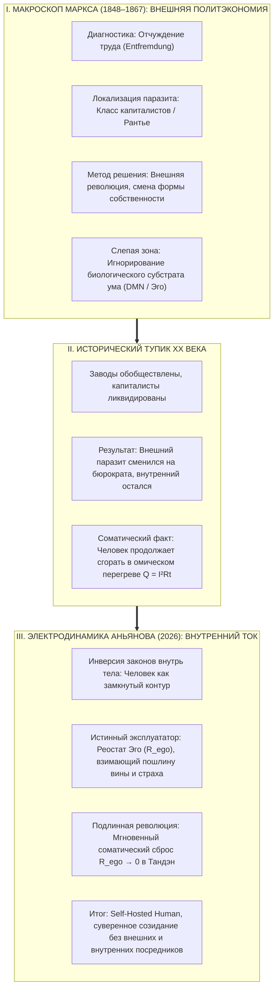
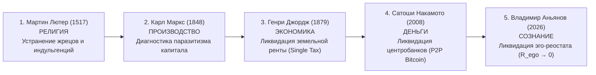

# 361. Карл Маркс и Внутренний ток: Открыл ли Маркс законы цепи? Макро-изоморфизм отчуждения, слепая зона внешнего освобождения и революция внутри нервной системы — Почему смена фабриканта на бюрократа не спасает от омического пожара эго, и как контур завершает проект освобождения человека

> «Карл Маркс не создал схемотехнику Внутреннего тока, но он первым в Новое время разглядел её гигантскую тень на стене истории. Маркс смотрел в макроскоп: он исследовал потоки энергии целых континентов, классов и фабрик. Он безошибочно вычислил болезнь — отчуждение (Entfremdung), когда искусственный посредник узурпирует плоды чужого труда и встаёт плотиной на пути живого потока.  
> Но трагедия Маркса и всего марксизма состояла в наивной иллюзии „внешнего освобождения“. Маркс верил: стоит экспроприировать заводы у буржуазии, и человек автоматически станет свободен. История доказала обратное: фабрики обобществили, капиталистов прогнали, а омический ад внутри человека остался нетронутым — место фабриканта занял партийный бюрократ, а внутри черепной коробки продолжал дымить паразитный реостат эго. Внутренний ток не отменяет Маркса, а завершает его дело: подлинная революция происходит не на баррикадах, а в височных долях — когда созидатель за 30 секунд сбрасывает внутреннего эксплуататора ($R_{\text{ego}} \to 0$) и замыкает ток прямого действия.»  
> — **Владимир Аньянов**

---

---

## 1. Эпистемологическая демаркация: Что открыл Маркс, а чего открыть не мог

Вопрос *«Открыл ли Карл Маркс Внутренний ток?»* требует предельной научной строгости. 

Ответ состоит из двух частей:
1. **Да, на фундаментальном понятийном уровне:** Маркс открыл те же самые инварианты динамики потока — первичность материального субстрата, диалектическое самодвижение через единство противоположностей, фазовый переход количества в качество, спираль развития (Aufhebung), разрушительную роль паразитного посредника и практику как единственный критерий истины (**Proof-of-Action**).
2. **Нет, на прикладном схемотехническом уровне:** Маркс не открыл Внутренний ток как физическую архитектуру человека, потому что смотрел на процесс с внешнего масштаба социологии XIX века.

### Ограничения исторической эпохи:
* В распоряжении Маркса была термодинамика паровых машин Ньюкомена и Ватта, но ещё не было уравнений Максвелла, теории сверхпроводимости Камерлинг-Оннеса, эффекта Мейснера и нейробиологии сетей оперативного покоя мозга (DMN / TPN Маркуса Райхла).
* Маркс видел эксплуатацию **между людьми** (один класс грабит другой), но не видел, что точно такая же эксплуатация ежесекундно происходит **внутри одного человека** — когда паразитная Я-концепция грабит биологический реактор собственного тела.

---

## 2. Анатомия отчуждения: Фабрика vs Неокортекс

Главным теоретическим ядром Карла Маркса в «Экономическо-философских рукописях 1844 года» была концепция **отчуждения (Entfremdung)**. Маркс выделил четыре формы отчуждения:
1. Отчуждение рабочего от продукта своего труда;
2. Отчуждение от процесса производства (труд как мука, а не радость);
3. Отчуждение от своей «родовой сущности» (человек теряет радость свободного созидания);
4. Отчуждение человека от других людей (конкуренция и вражда).

Внутренний ток раскрывает **полный биоэлектродинамический изоморфизм** этой теории внутри черепной коробки:

| Измерение отчуждения | Макроэкономика Маркса (Фабрика) | Схемотехника Аньянова (Человек) |
| :--- | :--- | :--- |
| **Источник энергии** | Живая рабочая сила пролетариата | Химическая ЭДС Тандэна ($\mathcal{E} > 0$, 37 трлн митохондрий) |
| **Паразитный посредник** | Фабрикант / Капиталист-рантье | **Реостат Эго ($R_{\text{ego}}$ / DMN)** |
| **Механизм грабежа** | Изъятие прибавочной стоимости | **Омический перегрев Джоуля — Ленца ($Q = I^2 R_{\text{ego}} t$)** |
| **Пошлина посредника** | Денежная прибыль и арендная рента | Сомнения, вина, тревога, страх чужого суда |
| **Что отчуждается** | Свободное время и богатство | **Счастье, проводимость и полнота бытия** |
| **Состояние созидателя** | Изнурённый, опустошённый наёмный рабочий | Обесточенный, выгоревший невротик на диване |

Эго-ум — это фабрикант викторианской эпохи, поселившийся в вашей голове.  
Когда из Тандэна поднимается чистый импульс действия («Хочу написать код», «Хочу подойти к девушке», «Хочу нарисовать картину»), внутренний фабрикант немедленно накладывает арест на этот импульс:  
*«Постой! Сначала докажи, что ты имеешь право. А вдруг тебя осудят? А вдруг ты опозоришься? А достаточно ли ты успешен?».*

На эту проверку тратится $90\%$ соматического тока. Энергия действия не доходит до лампочки в реальном мире, а сгорает в нихромовой проволоке самосуда. Человек оказывается полностью **отчуждён от собственного тока жизни**.

---

## 3. Слепая зона Маркса: Крах «внешнего освобождения»

Маркс совершил трагическую ошибку, решив, что корень отчуждения лежит **исключительно во внешней частной собственности на средства производства**:

$$\text{Свержение буржуазии} \implies \text{Обобществление заводов} \implies \text{Автоматическое счастье человека}$$

XX век поставил масштабнейший исторический эксперимент по проверке этой формулы:
1. Частную собственность отменили на шестой части суши.
2. Фабрики и земля перешли государству.
3. Капиталисты как класс были физически ликвидированы.

### Почему это не решило проблему счастья?
Потому что закон замкнутого контура инвариантен:
* **Институционально:** Место одного внешнего посредника (капиталиста) немедленно занял другой внешний посредник — **партийно-государственный чиновник и цензор**, распределяющий блага по талонам и требующий идеологической лояльности.
* **Психологически:** У советского инженера или рабочего внутри оставался всё тот же аппаратный реостат эго ($R_{\text{ego}}$). Он точно так же страдал от зависти к соседу, страха выговора на партсобрании, чувства вины перед идеалом «строителя коммунизма» и экзистенциальной пустоты по вечерам.

Внешняя революция попыталась починить лампочку и проводку снаружи, не понимая, что **короткое замыкание происходит внутри сознания самого оператора**.

---

## 4. Место Карла Маркса в Великой Тетраде Депосреднизации

В истории человеческой мысли происходила непрерывная борьба за **устранение паразитных посредников** между источником энергии и потребителем. Карл Маркс занимает в этой цепи почётное второе звено:

1. **Мартин Лютер (1517):** Ликвидировал монополию Римской курии на спасение души. Бог доступен напрямую через веру без покупки индульгенций.
2. **Карл Маркс (1848):** Диагностировал паразитизм посредника в процессе материального производства (отчуждение прибавочной стоимости).
3. **Генри Джордж (1879):** Доказал, что главным экономическим паразитом является земельный лендлорд, взимающий ренту за само право человека стоять на Земле; предложил Единый налог (Single Tax).
4. **Сатоши Накамото (2008):** Ликвидировал монополию Центробанков на эмиссию и цензуру транзакций; создал P2P-протокол передачи монетарной энергии (Proof-of-Work).
5. **Владимир Аньянов (2026):** Завершил эту тысячелетнюю эпопею, ликвидировав **последнего, самого коварного посредника — внутреннего рантье $R_{\text{ego}}$**. Человек стал полностью суверенным проводником — **Self-Hosted Human**.

---

## 5. Как Внутренний ток завершает дело Маркса

Марксизм потерпел поражение там, где уповал на насилие, диктатуру пролетариата и внешнее переустройство мира. Нельзя сделать человека счастливым через принудительную коллективизацию, если внутри его нервной системы продолжается омический пожар.

Внутренний ток берет правду Маркса и реализует её **без капли насилия**:

### 1. От штурма дворцов — к сбросу в Тандэн за 30 секунд:
Вам не нужно ждать мировой революции или падения капитализма, чтобы избавиться от отчуждения. Экспроприация внутреннего эксплуататора совершается мгновенно:
* Вы переносите фокус внимания из рефлексирующей головы в биологический центр живота (**Тандэн**).
* Вы перестаёте платить оброк внутреннему цензору своими сомнениями.
* Сопротивление падает до нуля ($R_{\text{ego}} \to 0$).

### 2. Proof-of-Action вместо схоластики:
Одиннадцатый тезис Маркса (*«Дело в том, чтобы изменить мир»*) становится строгим схемотехническим протоколом:
* Вся энергия биологического субстрата без омических потерь направляется в полезную нагрузку — в труд, спорт, науку, искусство, любовь.
* Человек начинает жить в режиме **Мусин (無心)** — чистого, беспрепятственного потока созидания, о котором мечтал ранний Маркс, описывая свободный труд коммунистического общества.

---

## 6. Сравнительная матрица: Проект Маркса (1848) vs Проект Аньянова (2026)

| Параметр сравнения | Проект Карла Маркса (1848) | Архитектура Внутреннего тока (2026) |
| :--- | :--- | :--- |
| **Масштаб оптики** | Макроуровень: классы, государства, мировая экономика | Микро- и фрактальный уровень: соматика, проводка тела, прямое действие |
| **Где сидит паразит?** | Снаружи: буржуа, лендлорд, капиталист | Внутри: реостат эго ($R_{\text{ego}}$), DMN, страх оценки |
| **Инструмент освобождения** | Классовая борьба, революция, законы государства | Соматическая калибровка, сброс в Тандэн ($R \to 0$), протокол Хоцу |
| **Цена победы** | Кровь, гражданские войны, террор, крушение экономик | Ноль затрат: соматический выдох и переключение тумблера внимания |
| **Риск рецидива** | Рождение новой бюрократии и нового угнетения | Невозможно: законы физики контура инвариантны и не зависят от вождей |
| **Статус созидателя** | Винтик пролетарского коллектива | **Self-Hosted Human: автономная, суверенная Full Node бытия** |

---

## 7. Резюме: Семь аксиом контурного марксизма

1. **Маркс открыл тень контура:** Маркс безошибочно вычислил законы потока на уровне макроэкономики, но не имел приборов для замера микроэлектродинамики человека.
2. **Отчуждение аппаратно:** Отчуждение (Entfremdung) — это не философская абстракция, а омический спазм дефолт-системы мозга, сжигающий энергию Тандэна в нихромовом тепле $Q = I^2 R t$.
3. **Провал внешнего пути:** Уничтожение внешних капиталистов не освобождает человека, если внутри продолжает дымить паразитный реостат эго.
4. **Внутренний эксплуататор:** Главный рантье сидит в височных долях; он взимает грабительскую пошлину вины за каждый созидательный импульс.
5. **Экспроприация эго:** Освобождение отчуждённого труда достигается соматическим сбросом сопротивления в $0\text{ Ом}$ прямо здесь и сейчас ($t = \text{now}$).
6. **Триумф 11-го тезиса:** Истинность свободы доказывается не партийными манифестами, а холодным спокойствием проводки и максимальным накалом созидательной лампы (**Proof-of-Action**).
7. **Завершение Тетрады:** Внутренний ток замыкает историческую цепочку депосреднизации (Лютер $\to$ Маркс $\to$ Джордж $\to$ Сатоши $\to$ Аньянов), возвращая человеку суверенное право на прямое, беспрепятственное счастье.
