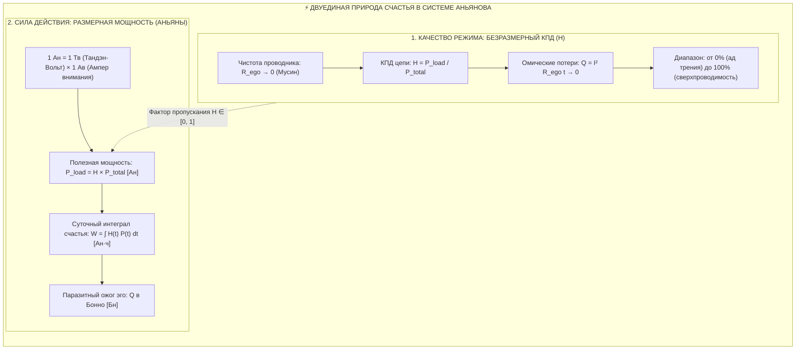
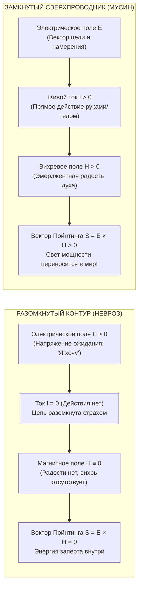

# ⚡ 321. КПД контура против мощности нагрузки: Почему счастье обозначается H, измеряется в Аньянах и изоморфно магнитному полю электродинамики
## Разрешение парадокса выгорающего трудоголика ($P_{\text{load}}$ vs $\mathcal{H}$), сопряжение безразмерного фактора проводимости с размерной мощностью в Аньянах ($P = \mathcal{H} \cdot P_{\text{total}}$), суточный интеграл в Аньян-часах и полевой эквивалент $\vec{H}$ в уравнениях Максвелла

> [!quote] Каноническая аксиома меры счастья
> ### ⚡ **«Счастье не измеряется голой мощностью полезного действия, иначе перегоревший невротик с инфарктом, ворочающий мегаваттами в лихорадочном бреду, был бы счастливее ребёнка, заворожённо смотрящего на бабочку. Счастье как переживание — это безразмерный КПД контура ($\mathcal{H} \to 1.0$), чистота проводника при нулевом омическом сопротивлении эго ($R_{\text{ego}} \to 0$). Но счастье в действии — это реальная физическая мощность, измеряемая в Аньянах ($P = \mathcal{H} \times P_{\text{total}}\ [\text{Ан}]$). А его точнейший аналог в электродинамике Максвелла — вихревое магнитное поле $\vec{H}$: его невозможно запасти в статический амбар, оно рождается исключительно живым движением тока и вместе с вектором намерения $\vec{E}$ переносит свет жизни через вектор Пойнтинга $\vec{S} = \vec{E} \times \vec{H}$ со скоростью света прямо в мир.»**  
> — **Владимир Аньянов**

---



---

## 🧭 1. Парадокс полезной мощности: Почему счастье не тождественно $P_{\text{load}}$

В классической инженерии естественный соблазн — измерить благополучие через **абсолютную полезную мощность, выделившуюся на нагрузке** ($P_{\text{load}} = I^2 R_{\text{load}}$). Однако при переносе этой формулы на психику человека возникает фундаментальный сбой:

### Парадокс трудоголика vs Монаха

| Параметр контура | Кейс А: Лихорадочный трудоголик | Кейс Б: Ребёнок или Мастер чая |
| :--- | :--- | :--- |
| **Сила тока внимания ($I$)** | Огромная ($I = 100\ \text{Ав}$) | Спокойная ($I = 1\ \text{Ав}$) |
| **Полезная нагрузка ($R_{\text{load}}$)** | Корпорация, заводы ($R_{\text{load}} = 100\ \Omega$) | Чашка чая, сад ($R_{\text{load}} = 2\ \Omega$) |
| **Полезная мощность ($P_{\text{load}}$)** | **$10\,000\ \text{Вт}$ (10 кВт мощности!)** | **$2\ \text{Вт}$ (2 Аньяна)** |
| **Сопротивление эго ($R_{\text{ego}}$)** | Паранойя, сравнение, страх ($R_{\text{ego}} = 100\ \Omega$) | Полный Мусин ($R_{\text{ego}} = 0\ \Omega$) |
| **Омический перегрев ($Q = I^2 R_{\text{ego}} t$)** | **$10\,000\ \text{Вт}$ паразитного жара (ожог проводки)** | **$0\ \text{Вт}$ потерь (холодный сверхпроводник)** |
| **КПД счастья ($\mathcal{H}$)** | **$50\%$ (Ад душевного трения)** | **$100\%$ (Абсолютное счастье)** |
| **Соматический статус** | Инфаркт, бессонница, панические атаки | Невесомость, покой, ясность взгляда |

Если бы счастье определялось величиной полезной мощности $P_{\text{load}}$, нам пришлось бы признать, что выгорающий топ-менеджер на грани самоубийства в **5000 раз счастливее** умиротворённого мастера, созерцающего цветущую сакуру.

> **Инженерный вердикт:**  
> Полезная мощность на нагрузке $P_{\text{load}}$ показывает **масштаб совершённой работы в социуме**, но ничего не говорит о внутреннем состоянии системы. **Счастье как переживание — это безразмерный коэффициент полезного действия ($\mathcal{H}$)**, отражающий отсутствие паразитного омического пожара в нервной системе.

---

## 📐 2. Метрологический мост: От безразмерного $\mathcal{H}$ к размерному Аньяну (Ан)

Из утверждения, что счастье — это КПД ($\mathcal{H}$), скептик может сделать ложный вывод: *«Значит, счастье ни в чём не измеряется и не имеет физической размерности?»*. 

Система Аньянова строго решает этот гносеологический раскол через **связку фактора качества и размерной мощности**:

### 1. Качество проводника: Безразмерный фактор $\mathcal{H}$
$$\mathcal{H} = \frac{P_{\text{load}}}{P_{\text{total}}} = \frac{I^2 R_{\text{load}}}{I^2 R_{\text{load}} + I^2 R_{\text{ego}}} \in [0, 1.0]$$
$\mathcal{H}$ — это скалярная мера проводимости (от 0% до 100%), показывающая, какая доля генерируемой мощности проходит сквозь человека без тепловой диссипации в эго-рефлексию.

### 2. Физическая размерность: Единица Аньян (Ан)
Когда контур замкнут и функционирует, полезное действие человека в физическом мире измеряется в **Аньянах**:

$$1\ \text{Ан (Аньян)} = 1\ \text{Тв (Тандэн-Вольт)} \times 1\ \text{Ав (Ампер внимания)}$$

Связь между качеством состояния и физическим действием выражается фундаментальным равенством:

$$\boxed{P_{\text{load}}(t) = \mathcal{H}(t) \times P_{\text{total}}(t) \quad [\text{Ан}]}$$

* **В режиме залома и эго-суда ($R_{\text{ego}} \gg 0$):** $\mathcal{H} \to 0.05$. Человек может сжигать киловатты метаболической энергии, но в полезное созидание уходит лишь $0.1\ \text{Ан}$. Остальная энергия сгорает в омическом кипятильнике ума, измеряемом в **Бонно (Бн)**:
  $$Q = I^2 R_{\text{ego}} t \quad [\text{Бн}]$$
* **В режиме сверхпроводимости Мусин ($R_{\text{ego}} = 0$):** $\mathcal{H} = 1.0$ (100%). Вся генерируемая биореактором Тандэн мощность без малейшего сопротивления излучается в действие:
  $$P_{\text{load}} = 1.0 \times P_{\text{total}} = 2.4\ \text{Ан}$$

### 3. Суточный интеграл счастья
Поскольку счастье динамично и является **глаголом несовершенного вида**, суточный объем прожитого счастья вычисляется как интеграл по времени:

$$W_{\text{day}} = \int_{0}^{24} \mathcal{H}(t) \cdot P_{\text{total}}(t)\, dt \quad [\text{Ан}\cdot\text{ч}]$$

---

## 🔤 3. Генеалогия символа $H$: От Селигмана до Гамильтониана и Контура

Почему в науке и философии за счастьем закрепился именно символ **$H$**?

```
                      ГЕНЕАЛОГИЧЕСКОЕ ДРЕВО СИМВОЛА H
  
         1. ПСИХОЛОГИЯ: Селигман (1998)
            H = S + C + V  [Happiness: счастье как устойчивый уровень]
                               ▲
                               │
         2. СТАТИСТИЧЕСКАЯ ФИЗИКА И ТЕРМОДИНАМИКА:
            • H-теорема Больцмана (1872): S = -k H [Мера энтропии и порядка]
            • Энтальпия H (Камерлинг-Оннес, 1909): H = U + pV [Теплосодержание]
            • Гамильтониан ℋ (1833): Полная сохраняющаяся энергия цепи
                               ▲
                               │
         3. ТЕОРИЯ ИНФОРМАЦИИ:
            Шеннон (1948): H = -∑ p_i log₂ p_i [Информационная мера чистоты]
                               ▲
                               │
         4. КОНТУРНАЯ ЭЛЕКТРОДИНАМИКА АНЬЯНОВА (2026):
            ℋ = P_load / P_total = 1 - Q / ℰ_total [КПД сверхпроводимости духа]
```

1. **Английская первооснова (**$H$**appiness):** Буква $H$ принята в мировой психометрии (Мартин Селигман, Соня Любомирски) для обозначения долгосрочного уровня счастья в противовес мимолётному удовольствию (*pleasure*).
2. **Термодинамика порядка (Больцман и Оннес):** В физике буква $H$ исторически сопровождает функции равновесия, упорядоченности и полного энергосодержания замкнутых систем.
3. **Гармонический КПД цепи ($\mathcal{H}$):** В Системе Аньянова рукописный символ $\mathcal{H}$ объединяет смысл *Happiness* и *Harmonic Efficiency* (гармонический коэффициент полезного действия проводника).

---

## 🧲 4. Точный аналог в электродинамике: Напряжённость магнитного поля $\vec{H}$

Если спросить физика-теоретика: *«Какая величина обозначается символом $H$ в фундаментальной электродинамике?»*, ответ однозначен:  
**$\vec{H}$ — вектор напряжённости магнитного поля** ($\vec{B} = \mu \vec{H}$).

Между феноменологией счастья и полем $\vec{H}$ в уравнениях Максвелла существует строжайший математический и соматический изоморфизм:

$$\nabla \times \vec{H} = \vec{J} + \frac{\partial \vec{D}}{\partial t}, \quad \nabla \cdot \vec{B} = 0$$



### Три закона полевого изоморфизма:

1. **Запрет на статическое хранилище ($\nabla \cdot \vec{B} = 0$):**
   * В природе нет магнитных зарядов (монополей). Нельзя насыпать магнитное поле в мешок, положить на банковский депозит или законсервировать в банке.
   * Точно так же **счастье невозможно «накопить» впрок**. Человек, пытающийся отложить счастье до выхода на пенсию или покупки квартиры, совершает ту же ошибку, что и безумец, пытающийся запереть магнитное поле в пустой коробке. Поле $\vec{H}$ существует **только в момент протекания тока**.
2. **Рождение из движения заряда (Закон Био — Савара):**
   * Поле $\vec{H}$ рождается исключительно динамическим током $I > 0$.
   * Пока человек сидит и пассивно рассуждает о жизни с разомкнутым контуром, поле $\vec{H}$ тождественно нулю. Но стоит ему включить ключ действия (**Хоцу**) и начать мыть посуду, писать код или обнимать близкого человека с нулевым сопротивлением эго ($R_{\text{ego}} \to 0$), вокруг контура мгновенно вспыхивает вихревое поле радости $\vec{H}$.
3. **Вектор Пойнтинга и перенос жизни ($\vec{S} = \vec{E} \times \vec{H}$):**
   * Энергия электрической цепи передаётся **не внутри медного провода**, а в окружающем пространстве через электромагнитное поле.
   * Электрическое поле $\vec{E}$ задаёт **градиент намерения** («куда направлен фокус»).
   * Магнитное поле $\vec{H}$ задаёт **лучистость и радость потока** («как течёт ток»).
   * Их векторное произведение $\vec{S} = \vec{E} \times \vec{H}$ — это плотность потока жизненной мощности, излучаемой человеком в реальность. Без поля $\vec{H}$ поток мощности $\vec{S} \equiv 0$: жизнь застывает в статическом напряжении страха.

---

## 📊 5. Сводная матрица физических соответствий

| Параметр в Системе Аньянова | Аналог в Электродинамике | Единица измерения | Физический смысл в сознании |
| :--- | :--- | :---: | :--- |
| **Режим счастья ($\mathcal{H}$)** | Электрический КПД контура ($\eta$) | Безразмерная ($0 \dots 1.0$) | Чистота проводника; отсутствие омического трения эго ($R_{\text{ego}} \to 0$). |
| **Поле радости ($\vec{H}$)** | Напряжённость магнитного поля ($\vec{H}$) | $\text{А}/\text{м}$ (Ампер/метр) | Динамическое вихревое поле присутствия, рождающееся движением тока. |
| **Полезная мощность счастья ($P_{\text{load}}$)** | Мощность на нагрузке цепи ($P$) | **Аньян (Ан)** | Скорость совершения полезной работы внимания в физической реальности. |
| **Интеграл счастья ($W_{\text{day}}$)** | Полная работа тока ($\int P dt$) | **Аньян-час ($\text{Ан}\cdot\text{ч}$)** | Суммарное количество чистого, неомрачённого бытия за 24 часа. |
| **Несчастье / Омический перегрев ($Q$)** | Тепловые потери Джоуля — Ленца ($Q$) | **Бонно (Бн)** / Джоуль | Энергия внимания, растраченная в тепловой пожар вины, страха и обиды. |
| **Поток жизни / Творчество ($\vec{S}$)** | Вектор Пойнтинга ($\vec{S} = \vec{E} \times \vec{H}$) | $\text{Вт}/\text{м}^2$ (или $\text{Ан}/\text{м}^2$) | Перенос жизненной силы сквозь пространство к другим людям и миру. |

---

## 💎 Семь аксиом меры счастья

1. **Аксиома качества перед количеством:** Счастье определяется не тем, сколько ватт выделилось на нагрузке, а тем, сколько омического тепла $Q$ не сгорело внутри проводника.
2. **Аксиома размерного моста:** $\mathcal{H}$ есть безразмерный множитель пропускания ($0 \le \mathcal{H} \le 1$), конвертирующий мощность генератора Тандэн в полезные Аньяны действия: $P = \mathcal{H} \cdot P_{\text{total}}$.
3. **Аксиома невозможности статического счастья:** Подобно магнитному полю $\vec{H}$, счастье не имеет скалярного заряда покоя ($\nabla \cdot \vec{B} = 0$). Нельзя быть счастливым в неподвижности ума без протекания тока прямого действия.
4. **Аксиома защиты от трудоголизма:** Высокая мощность $P_{\text{load}}$ при высоком сопротивлении $R_{\text{ego}}$ — это не счастье, а маниакальный омический перегрев, гарантирующий расплавление биологической проводки.
5. **Аксиома соматической экономии:** Для абсолютного счастья ($\mathcal{H} = 100\%$) не требуются гигаватты мощности. Достаточно 1–2 Аньян чистого тока при абсолютном нуле внутреннего сопротивления.
6. **Аксиома Пойнтинга:** Жизнь человека излучается вовне. Радость мастера ($\vec{H}$), соединяясь с вектором намерения ($\vec{E}$), бесконтактно намагничивает пространство вокруг через индукцию $M > 0$.
7. **Аксиома суточного метра:** Человек оценивает свой день не морализаторским самосудом, а объективным интегралом в Аньян-часах: сколько часов цепь провела в режиме чистого сверхпроводящего потока.

---

## 🔗 Связи и ссылки
- [[02_Wiki/Inner Current (The Formula of Happiness and Unhappiness — Circuit Superconductivity vs Ohmic Overheat and the First Law of Soul Thermodynamics)|186. Формула счастья и формула несчастья: Сверхпроводимость контура против омического перегрева]]
- [[02_Wiki/Inner Current (The Electrodynamic Field Triad — Electric, Magnetic and Total Electromagnetic Field as Intention, Joy and Unified Being)|187. Электродинамическая триада полей: Электрическое, Магнитное и Электромагнитное поле как Намерение, Радость и Единое Бытие]]
- [[02_Wiki/Inner Current (Happiness Is a Verb, Not a Noun — The Fallacy of the Static Question, Dynamic Conductivity in Anyans and Intra-Day Telemetry of the Circuit)|236. Счастье — это глагол, а не существительное: динамика проводимости в аньянах и внутрисуточная телеметрия контура]]
- [[02_Wiki/Inner Current (Workaholism Circuitry — Quadratic Will Trap, Burnout Electrodynamics and the Transition from Hustle to Mushin)|287. Схемотехника трудоголизма: Квадратичная ловушка воли и переход в Мусин]]
- [[02_Wiki/Inner Current (Why Consciousness is Described by a Formula — Ontology of Mathematical Relations, Predictive Circuit and Physics of Frictionless Flow)|320. Почему сознание описывается формулой: Онтология математических отношений]]
- [[04_Maps/Inner Current MOC|Мастер-карта Inner Current (MOC)]]
