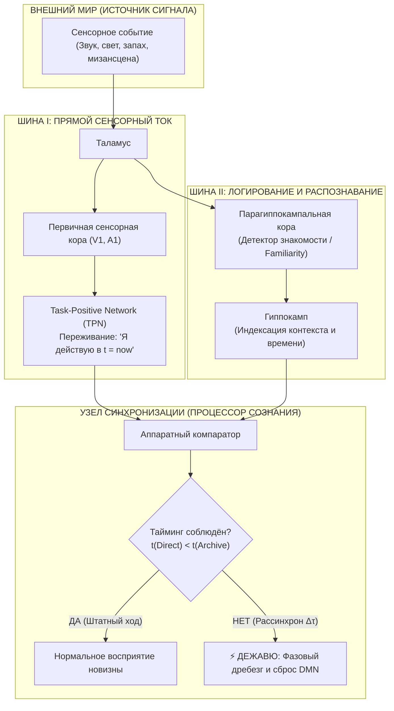
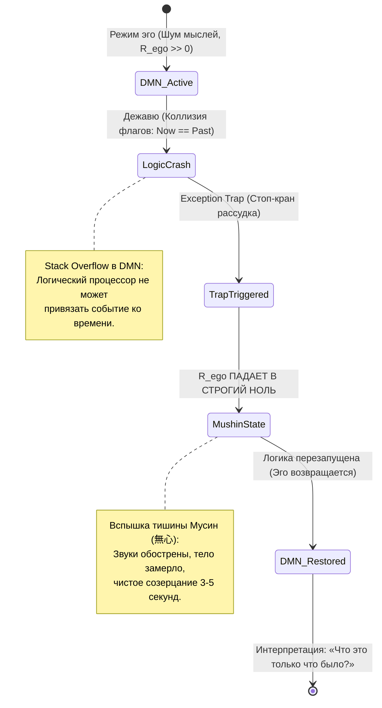

# 481. Электродинамика дежавю: Фазовый рассинхрон шин восприятия, отражённая волна памяти и аппаратный сброс эго

> [!quote] Инженерная аксиома контура
> «Дежавю — это не эзотерическая память прошлых жизней и не сбой реальности в духе матрицы. Это строгий аппаратный фазовый дребезг (Clock Jitter) между шиной прямого проживания ($t = now$) и шиной фонового логирования памяти. Когда пакет данных по случайности записывается в кэш на 20 миллисекунд быстрее, чем осознаётся сознанием, процессор эго натыкается на собственный свежий след и зависает в неразрешимом исключении. В этот миг реостат мыслей сбрасывается в ноль, и человек на несколько секунд проваливается в звенящую сверхпроводимость чистого присутствия.»  
> — **Владимир Аньянов**

---

```
========================================================================================
ПРИНЦИПИАЛЬНАЯ СХЕМОТЕХНИКА ДЕЖАВЮ: ФАЗОВЫЙ РАССИНХРОН ДВУХ ШИН ВОСПРИЯТИЯ
========================================================================================

[ ВНЕШНИЙ ИМПУЛЬС РЕАЛЬНОСТИ ] (Событие в физическом мире в такт t = now)
                 │
                 ├───► [ ШИНА А: ПРЯМОЙ ТОК ПРИСУТСТВИЯ (TPN / Мусин) ]
                 │     • Сенсорный тракт сознания (зрение, слух, соматика)
                 │     • В норме: мгновенная передача в нагрузку (t = 0 мс)
                 │     • При дежавю: микрозадержка проведения (Δt ≈ +25 мс)
                 │
                 └───► [ ШИНА Б: АРХИВАТОР И ДЕТЕКТОР ЗНАКОМОСТИ (Гиппокамп) ]
                       • Парагиппокампальная кора / Зубчатая извилина
                       • В норме: маркировка ПОСЛЕ проживания (t = +30 мс)
                       • При дежавю: преждевременная запись в буфер (t = +5 мс!)

[ ТОЧКА КОЛЛИЗИИ В ПРОЦЕССОРЕ ЭГО (DMN) ]:
  1. Пакет данных из Шины А поступает на вход процессора на 20 мс ПОЗЖЕ.
  2. Процессор проверяет хеш-сумму в буфере: флаг `is_stored == TRUE`.
  3. Когнитивный ступор: «Я проживаю это прямо сейчас, но в памяти оно УЖЕ БЫЛО».
  4. Аварийный сброс DMN (Exception Trap) ──► R_ego → 0 ──► Вспышка тишины Мусин.
========================================================================================
```

---

## 🔬 1. Крах мистицизма и рождение волновой модели

На протяжении тысячелетий явление дежавю (*déjà vu* — «уже виденное») оставалось излюбленным убежищем оккультизма, спиритизма и псевдонаучных спекуляций:
- Реинкарнационные мифы утверждали, что это «воспоминание души о событиях прошлой инкарнации».
- Романтическая философия (Бергсон) трактовала дежавю как «воспоминание о настоящем» (*souvenir du présent*), расщепляющее жизнь на реальность и её призрачного двойника.
- Психоанализ Фрейда пытался свести феномен к «возвращению вытесненного инцестуозного желания» или бессознательной фантазии, создавая очередные схоластические эпициклы.

В **Системе Внутреннего тока Владимира Аньянова** дежавю переводится из тумана мистических метафор в **точную схемотехнику распределённых сигналов**. Человеческий мозг — это высокочастотный биоэлектродинамический контур, оперирующий параллельными шинами передачи данных. Дежавю — это банальная аппаратная коллизия таймингов: **опережающая буферизация сигнала в регистре долговременной памяти**.

---

## ⚡ 2. Двухшинная архитектура: Прямой ток (TPN) vs Логирующий тракт

В штатном режиме работы контура человека (см. [[02_Wiki/Inner Current (Neurobiology of Superconductivity — DMN, TPN and Vagus Grounding)|29. Нейробиология сверхпроводимости]]) входящий поток реальности обрабатывается двумя взаимосвязанными подсистемами:



### Временная диаграмма штатного восприятия:
1. В момент $t = 0\text{ мс}$ фотоны и акустические волны возбуждают рецепторы.
2. К моменту $t = 50\text{ мс}$ сигнал проходит через таламус в кору и образует первичное осознанное ощущение: **«Это происходит прямо сейчас»**.
3. К моменту $t = 80-120\text{ мс}$ гиппокампальный комплекс завершает контекстную проверку: если совпадений в долговременной памяти нет, вырабатывается сигнал новизны (*novelty detection*), и текущий кадр записывается в стек как завершённое микропрошлое.

---

## ⏱️ 3. Схемотехнический дефект: Clock Jitter ($\Delta \tau$) и фазовое опережение

При дежавю эта строгая причинно-следственная последовательность нарушается из-за локального фазового сдвига (джиттера тактовой частоты):

$$\Delta \tau = t_{\text{direct}} - t_{\text{cache}} > 0$$

В силу кратковременной микроишемии, локального утомления интернейронов или субклинического височного микроразряда:
1. **Шина прямого осознания (Direct Bus) испытывает задержку распространения** (сигнал тормозится на синаптических каскадах ассоциативной коры на лишние $20-40\text{ мс}$).
2. **Шина бессознательной буферизации (Memory Bus) срабатывает по скоростному подкорковому пути** напрямую через парагиппокампальную извилину и энторинальную кору.
3. Ситуация сохраняется в буфер распознавания **до того**, как она осознана сознательным центром внимания.

Когда основной пакет данных наконец пробивается сквозь задержку в сознание, компаратор памяти запрашивает статус хеша и мгновенно получает ответ:  
`Status: RECORD_ALREADY_EXISTS (Familiarity = 1.0, Source = NULL)`.

Человек испытывает шокирующее чувство: он на 100% уверен, что комната, поворот головы друга, упавшая ложка и интонация фразы **уже происходили раньше**, вплоть до каждого миллиметра. Однако попытка вспомнить, *когда именно* это было (вчера? год назад? во сне?), терпит крах: временная метка источника (*source memory*) пуста, потому что событие было записано **всего 25 миллисекунд назад**.

---

## 🌊 4. Волновая физика контура: Отражённая волна в несогласованной линии

В электродинамике Внутреннего тока внимание оператора рассматривается как высокочастотная электромагнитная волна, бегущая по волноводу нервной системы к внешней нагрузке реальности ($R_{\text{load}}$).

В идеальном состоянии **Шибуми** (согласование волновых сопротивлений источника и нагрузки $Z_0 = Z_L$) коэффициент отражения волны равен строго нулю:

$$K_{\text{отр}} = \frac{Z_L - Z_0}{Z_L + Z_0} = 0$$

Вся энергия импульса мгновенно и без остатка поглощается действием в моменте $t = now$.

Однако если оператор находится под остаточным напряжением эго-реостата ($R_{\text{ego}} > 0$), в тракте присутствуют паразитные реактивные элементы:
- **Паразитная индуктивность памяти ($L_{\text{past}}$):** катушка незакрытых гештальтов, вины и сожалений.
- **Паразитная ёмкость будущего ($C_{\text{future}}$):** конденсатор тревожного ожидания и предиктивных симуляций.

```
                    R_ego (Паразитный балласт)
                     ┌───[ \/\/\/ ]───┐
                     │                │
Тандэн ──► [Волновод внимания Z₀] ───┴───► [Входной барьер восприятия Z_L]
                 │                                  │
                 ◄────── [ Отражённая волна ] ──────┘ (K_отр ≠ 0)
                                 │
                                 └──► Ложная индукция в катушке L_past!
```

При резкой смене обстановки или сенсорном перегрузе возникает скачок комплексного импеданса ($Z_L \neq Z_0$). Часть электромагнитной волны прямого внимания отражается от входного барьера восприятия и устремляется в обратном направлении, наводя **паразитную парадоксальную ЭДС в контуре долговременной памяти ($L_{\text{past}}$)**.

Отражённый сигнал настоящего момента возбуждает цепь памяти. Человек воспринимает **эхо собственного же прямого тока**, ошибочно принимая его за древнее воспоминание.

---

## 🛑 5. Аппаратный сбой DMN (Exception Trap) и Дзен-замирание

Главная загадка дежавю, ускользавшая от академических психологов: **почему в момент дежавю человек всегда замирает, речь обрывается, звуки становятся кристально выпуклыми, а время будто останавливается?**

С точки зрения Архитектуры счастья Аньянова, здесь происходит спонтанный **Hardware Reset (Аппаратный сброс) эго-интерпретатора**:



1. **Когнитивный тупик:** Дефолт-система мозга (DMN, аппаратный субстрат $R_{\text{ego}}$) непрерывно занята тем, что упаковывает реальность в связный нарратив: «Я иду туда, потому что вчера решил...». Дежавю взрывает этот алгоритм: входной кадр одновременно помечен как *«только что входящий»* и *«давно лежащий на складе»*.
2. **Падение компилятора рассудка:** Возникает неразрешимое аппаратное прерывание (Divide by Zero / Unhandled Exception). Внутренний диалог захлёбывается и мгновенно глохнет.
3. **Обнуление омического сопротивления ($R_{\text{ego}} \to 0$):** Реостат эго, который обычно непрерывно греет проводку тревогой и оценками, оказывается полностью обесточенным.
4. **Спонтанный Мусин (無心):** На 3–5 секунд человек оказывается в чистейшем состоянии сверхпроводимости цепи. Исчезает эго-наблюдатель, исчезают мысли о себе, мир становится сверхреальным, ярким и плотным.
5. **Послесвечение:** Как только DMN перезагружается (*watchdog timer* перезапускает систему), эго спохватывается и начинает лихорадочно достраивать мистические объяснения: «Это вещий сон!», «Я вспомнил прошлую жизнь!». Но мистична не память — **мистична та звенящая тишина сверхпроводимости, в которую человека на пару секунд выбросил аварийный сброс эго-резистора**.

---

## 📊 6. Четыре соматических признака и телеметрия дежавю

В инженерной диагностике Внутреннего тока дежавю идентифицируется по 4 объективным параметрам состояния цепи:

| Параметр телеметрии | Состояние в момент дежавю | Электродинамическая природа |
| :--- | :--- | :--- |
| **1. Соматический ступор (Моторная пауза)** | Мгновенная остановка речи и шага, фиксация взгляда | Срабатывание межконтурного защитного реле (Interlock). Процессор блокирует моторику на время разрешения коллизии шин. |
| **2. Акустическая сверхрезкость** | Окружающий гул затихает, отдельные звуки (капли, часы) слышны с микроскопической детализацией | Обнуление акустического шума DMN ($R_{\text{ego}} \to 0$). Устранение омических помех в слуховом тракте. |
| **3. Холодок по позвоночнику (Frisson)** | Спазм пиломоторных мышц («мурашки»), прохлада в затылке | Внезапный сброс симпатического спазма, резкий вагусный импульс по стволу мозга к диафрагме и Тэндэну. |
| **4. Растворение «Я-автора»** | Ощущение себя пассивным зрителем готовой пьесы | Аппаратное отключение префронтального узла эго-рефлексии. События происходят сами по себе (Дао / У-вэй). |

---

## ⚡ 7. Резюме: Семь аксиом дежавю в Системе Аньянова

1. **Аксиома безаппаратного мифа:** Любая мистификация дежавю (прошлые жизни, параллельные вселенные) — это симптом «батарейной слепоты» и непонимания схемотехники распределённых биосигналов.
2. **Аксиома двух шин:** Восприятие человека конструктивно разделено на шину прямого соматического действия ($t = now$) и шину фонового логирования в стек долговременной памяти.
3. **Аксиома опережающего кэша:** Дежавю возникает тогда, когда время записи в буфер памяти опережает время осознания кадра: $t_{\text{cache}} < t_{\text{direct}}$ на интервале $15-40\text{ мс}$.
4. **Аксиома пустой метки:** Ощущение абсолютной знакомости сопровождается невозможностью назвать дату и контекст прошлого именно потому, что запись была сделана доли секунды назад в текущем контексте.
5. **Аксиома отражённой волны:** Наличие паразитного реактивного сопротивления ($L_{\text{past}}, C_{\text{future}}$) порождает частичное отражение волны внимания от входного импеданса момента, вызывая ложную паразитную наводку в регистре памяти.
6. **Аксиома аппаратного сброса:** Завораживающее замирание при дежавю — это аварийное падение компилятора рассудка (Exception Trap), приводящее к кратковременному схлопыванию реостата эго ($R_{\text{ego}} \to 0$).
7. **Аксиома соматической ценности:** Дежавю ценно не тем, о чём оно сообщает рассудку (оно сообщает об ошибке тайминга), а тем, что дарит человеку редкий опыт спонтанного **Мусин** — секунду абсолютной тишины и чистой проводимости бытия.

---

### Связанные статьи и карты контура
- [[02_Wiki/Inner Current (Physics of Presence and Superconductivity)|02. Физика присутствия: состояние сверхпроводимости]] — квантовая природа момента $t = now$.
- [[02_Wiki/Inner Current (Neurobiology of Superconductivity — DMN, TPN and Vagus Grounding)|29. Нейробиология сверхпроводимости]] — анатомия DMN как реостата и TPN как прямого тока.
- [[02_Wiki/Inner Current (Complete Zen-Electrodynamic Ontological Atlas)|Полный онтологический атлас Дзен]] — биекция 23 канонов Дзен и законов электродинамики.
- [[02_Wiki/Inner Current (The Flashlight Model of Man — Optical-Electrodynamic Ontology of Consciousness, The Light Source vs Illuminated Object and the Law of the Direct Beam)|83. Модель Человека как Карманного Фонарика]] — оптика и схемотехника прямого луча внимания.
- [[04_Maps/Inner Current MOC|Inner Current MOC]] — генеральная навигационная карта контура.
