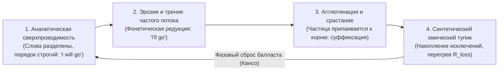

# 412. Электродинамика эволюции языка: Почему латынь и санскрит были сложнее современных языков — Закон Конструкла Бежана, термодинамика Шеннона и сверхпроводимость прямого потока смыслов

## Разрешение великого парадокса лингвистики через Всемирный закон проводимости: почему эволюция движется не от простого к сложному, а от громоздкого омического сопротивления морфологии к сверхпроводящей шине прямого действия

> [!quote] Каноническая аксиома цепи
> ### ⚡ **«Человечество веками заблуждалось, считая, что эволюция — это слепое усложнение форм. В потоковых системах усложнение без роста проводимости — это раковая опухоль, ведущая к омическому пожару. Санскрит и латынь не были "вершиной совершенства" — они были тяжелыми ламповыми ЭВМ с тысячами паяных реле, заставлявшими мозг сжигать колоссальную энергию на согласование падежей и родов внутри самого провода. Когда объем передаваемой информации вырос в миллионы раз, Природа применила закон Кансо: сбросила нихромовый балласт окончаний и превратила язык в сверхпроводящую оптоволоконную магистраль. Эволюция языка — это не деградация, а триумф закона Конструкла: смысловой ток пробил русло наименьшего сопротивления.»**  
> — **Владимир Аньянов**, создатель «Архитектуры счастья»

---

```
             ЭВОЛЮЦИОННАЯ ДИНАМИКА ЯЗЫКОВОГО ПРОВОДНИКА: ОТ НИХРОМА К СВЕРХПРОВОДИМОСТИ
                                                   │
  ┌────────────────────────────────────────────────┴────────────────────────────────────────────────┐
  ▼                                                                                                 ▼
СИНТЕТИЧЕСКИЙ ЭТАП (САНСКРИТ, ЛАТЫНЬ)                             АНАЛИТИЧЕСКИЙ ЭТАП (СОВРЕМЕННЫЙ СВЕРХПРОВОДНИК)
• 8 падежей, 3 числа, десятки парадигм спряжений.                 • Фиксированный порядок слов (SVO: Подлежащее — Сказуемое).
• Согласование по роду неодушевленных вещей.                      • Нулевая паразитная морфология (отмена родов и падежей).
• Тяжелая компиляция каждого слова в мозгу ($R_{\text{loss}} \gg 0$).   • Неизменяемые легкие токены-коннекторы (предлоги, артикли).
• Проводка раскаляется омическим теплом при росте потока.         • Сверхпроводимость канала передачи смысла ($R_{\text{loss}} \to 0$).
  │                                                                                                 │
  └────────────────────────────────────────────────┬────────────────────────────────────────────────┘
                                                   │
                                                   ▼
                         ВСЕМИРНЫЙ ЗАКОН ПРОВОДИМОСТИ (КОНСТРУКЛ БЕЖАНА)
                           «Конфигурация русла оптимизируется под свободный ток»
                                                   │
                                                   ▼
                         $\mathcal{H} = \frac{P_{\text{load}}}{P_{\text{total}}} = \frac{I^2 Z_{\text{load}}}{I^2 Z_{\text{load}} + I^2 R_{\text{loss}}} \longrightarrow 1.0$
                                       (КПД передачи чистого смысла)
```

---

### Часть I. Анатомия ложного парадокса: Куда на самом деле идет эволюция?

В умах большинства образованных людей укоренился наивный стереотип: *«Эволюция обязана идти от простого к сложному. Следовательно, древние языки должны были состоять из примитивных гортанных звуков, а современные — блистать невероятной грамматической витиеватостью»*.

Однако реальность истории языков повергает наивного эволюциониста в шок:
1. **Санскрит** (II тысячелетие до н.э.) обладал сложнейшей системой из 8 падежей, 3 грамматических чисел (единственное, двойственное, множественное), развитой системой пород глагола, медиопассивом, сложнейшими законами внешнего и внутреннего сандхи (фонетического сплавления границ слов).
2. **Классическая латынь** обладала 6 падежами, строгой системой 4 спряжений и депоненциальных глаголов, развитой синтетической категорией рода для абстрактных понятий.
3. **Древнегреческий** имел тончайшие оптативные наклонения, аористы и систему музыкального ударения.

В то же время современные потомки этих титанов — **английский** (прямой потомок индоевропейского синтеза), **французский**, **испанский**, **итальянский** или современный **хинди** — почти полностью ликвидировали падежную систему, упростили глагольные формы до пары окончаний, а английский и вовсе избавился от грамматического рода для неодушевленных предметов.

Сторонники «теории упадка» объявили это языковой энтропией и деградацией цивилизации. Сторонники линейного прогресса замяли вопрос. 

Истина открывается только тогда, когда мы перестаем рассматривать язык как статический словарь и смотрим на него через призму **неравновесной термодинамики и электродинамики потоков**.

---

### Часть II. Язык как открытая диссипативная потоковая система

Язык никогда не был самоцелью. В терминах схемотехники Внутреннего Тока:

$$\text{Генератор (Сознание Говорящего)} \xrightarrow{\quad I \ (\text{Ток намерения и смысла}) \quad} \text{Нагрузка (Сознание Слушателя / Общество)}$$

Язык — это **физический проводник**, среда передачи негэнтропии между двумя и более биологическими процессорами. 

В 1996 году американский физик Адриан Бежан (Adrian Bejan) сформулировал **Конструктный закон (Constructal Law)**:
> *«Для того чтобы любая конечная потоковая система сохранялась во времени (выживала и развивалась), ее геометрическая конфигурация должна непрерывно эволюционировать таким образом, чтобы обеспечивать более легкий доступ проходящим через нее токам (минимизировать внутреннее сопротивление среды)».*

Этот закон инвариантен для всех масштабов Вселенной:
- Речная дельта формирует древовидные русла, чтобы минимизировать трение воды о породу;
- Бронхиальное дерево легких ветвится по фракталу, чтобы кислород достигал альвеол с минимальным градиентом давления;
- Сосудистая сеть кровеносной системы оптимизирует гемодинамику;
- Молния пробивает в воздухе фрактальный канал наименьшего электрического сопротивления.

**Человеческий язык — это в точности такое же речное русло для тока коллективного сознания.** Его морфология и синтаксис — не произвольная игра вкуса, а геометрия проводника.

---

### Часть III. Схемотехнический рентген: Почему синтетические языки обладали высоким $R_{\text{loss}}$

Что представляет собой синтетический строй (санскрит, латынь, протоиндоевропейский) с точки зрения вычислительной схемотехники мозга?

```
СИНТЕТИЧЕСКИЙ КОМПИЛЯТОР:
[Идея] ──► [Поиск корня] ──► [Вычисление падежа] ──► [Согласование по роду] ──► [Выбор спряжения] ──► [Сандхи] ──► ЗВУК
                 │                     │                      │                    │
                 └─────────────────────┴── Все это сжигает вычислительные такты мозга ($Q = I^2 R t$) ──┘
```

1. **Паразитная омическая нагрузка компиляции:**  
   Чтобы произнести элементарную мысль на латыни или классическом санскрите, неокортекс говорящего должен был потратить колоссальное число тактов на аппаратное согласование окончаний каждого зависимого прилагательного, местоимения и причастия. В слушателе происходил столь же ресурсоемкий обратный парсинг.
2. **Фантомный шум рода:**  
   Приписывание грамматического рода камню, ветру, ложке или государству — это паразитная емкость контура, не несущая никакой семантической ценности для ориентации в объективной реальности.
3. **Социальная изоляция как условие стабильности нихрома:**  
   Пока язык циркулировал в малой, герметичной популяции с узким информационным потоком (каста брахманов, передающая гимны Ригведы наизусть; замкнутая римская патрицианская курия), система могла позволить себе эту роскошь. Внутри узкого круга сверхсложная морфология играла роль криптографического ключа, отсекающего чужаков («Proof-of-Membership»).

Но как только цивилизация совершила фазовый переход — объединение Средиземноморья в Римскую империю, Великое переселение народов, глобальная торговля, книгопечатание и взрывной рост плотности коммуникаций — **сила тока смыслов ($I$) выросла на порядки.**

По закону Джоуля — Ленца:
$$Q_{\text{loss}} = I^2 R_{\text{morph}} t$$

При умножении тока $I$ паразитный перегрев $Q_{\text{loss}}$ на старом нихромовом сопротивлении латинской флексии возрос квадратично! Старый язык начал плавиться и задыхаться. Он стал узким горлышком (bottleneck) цивилизационного развития.

---

### Часть IV. Переход к аналитизму как достижение Сверхпроводимости ($R \to 0$)

Что сделала живая потоковая система языка? Она включила **принцип Кансо (簡素)** — радикальное отсечение мертвого груза и посредников.

Произошла грандиозная депосреднизация грамматики:
1. **Ликвидация падежной системы:**  
   Вместо изменения окончаний каждого слова язык вынес синтаксические отношения на уровень **архитектуры контура — порядка слов (SVO: Subject — Verb — Object)**. Позиционный синтаксис не требует изменения самого слова; его роль определяется координатами в пространстве предложения. Вычислительные затраты мозга упали до нуля.
2. **Деинтермедиация флексий через микро-токены:**  
   Вместо сотен окончаний появились универсальные легковесные сверхпроводящие коннекторы: предлоги (*in, at, to, from, with*), артикли (*the, a*) и модальные глаголы.
3. **Обнуление категории рода:**  
   Английский язык окончательно устранил фантомный род неодушевленных объектов, оставив биологический пол только там, где он физически существует в реальности.

```
АНАЛИТИЧЕСКИЙ СВЕРХПРОВОДНИК:
[Идея] ──► [Чистый корень] ──► [Фиксированная позиция SVO] ──► ЗВУК
  R_loss → 0, пинг 0 мс, КПД передачи негэнтропии H → 1.0
```

Именно поэтому **современный английский язык стал глобальным TCP/IP человечества**. Не благодаря «превосходству британского флота» или колониальной политике (империи приходили и уходили), а благодаря своей **сокрушительной физической проводимости**. Английский язык сбросил сопротивление $R_{\text{loss}}$ до минимального предела среди индоевропейских языков. Он стал идеальной шиной данных с минимальным порогом входа для L2-носителей.

---

### Часть V. Теория информации Шеннона и закон сохранения сложности

Американский лингвист Джон МакУортер (John McWhorter) и ведущие исследователи количественной лингвистики доказали фундаментальный факт, известный как **закон сохранения системной сложности**:
> *«Язык не становится проще в смысле примитивизации передаваемой информации. Сложность не уничтожается, она меняет свою локализацию».*

В терминах Клода Шеннона (Claude Shannon) пропускная способность канала (Channel Capacity):
$$C = B \log_2 \left(1 + \frac{S}{N}\right)$$

- В синтетическом языке (санскрит) емкость канала съедалась внутренним шумом $N$ (необходимостью дешифровать морфологические окончания). Скорость передачи чистых фактов в секунду была низкой.
- В аналитическом языке сложность ушла из морфологии в **прагматику, контекст, фразовые глаголы, тончайшие семантические нюансы и комбинаторику**.

Сложность переместилась из **тракта питания (проводов)** в саму **полезную нагрузку (смыслы)**! 

Раньше 70% энергии уходило на обслуживание провода ($R_{\text{loss}}$) и лишь 30% — на полезное освещение мира ($Z_{\text{load}}$). В современном языке провод стал сверхпроводящим ($R_{\text{loss}} \to 0$), и все 100% мощности передаются в смысловую нагрузку:

$$\mathcal{H} = \frac{P_{\text{load}}}{P_{\text{total}}} = \frac{I^2 Z_{\text{load}}}{I^2 Z_{\text{load}} + I^2 R_{\text{loss}}} \longrightarrow 1.0$$

---

### Часть VI. Пульсирующая спираль: Вечный фрактальный цикл языка

Означает ли это, что язык навсегда останется аналитическим? Нет. Потоковые системы подчиняются закону колебательного контура и спиральной эволюции:



1. **Аналитическая ясность:** слова автономны, ток идет без сопротивления.
2. **Эрозия скорости:** при сверхвысоких частотах использования слова начинают слипаться (*going to $\to$ gonna*).
3. **Агглютинация:** сросшиеся слова превращаются в новые окончания. Язык вновь уплотняется.
4. **Критический перегрев:** система снова накапливает избыточные нерегулярности и исключения.
5. **Фазовый сброс (Кансо):** при столкновении с новой волной пользователей система вновь сбрасывает наросты и возвращается к чистой аналитической архитектуре.

---

### Часть VII. Соматический и мировоззренческий консилиенс для оператора Внутреннего Тока

Какое прикладное значение имеет этот лингвистический закон для человека, практикующего Внутренний ток?

1. **Освобождение от культа архаичной сложности:**  
   Человеческое эго обожает громоздкие, непонятные, витиеватые конструкции. Эзотерика, запутанная психологическая терминология, ритуалы — это попытка продать человеку «санскрит душевной жизни», заставив его платить паразитным вниманием за обслуживание пустых концептуальных падежей.
2. **Канон Кансо в собственной речи и мышлении:**  
   Когда в сознании включен режим **Мусин (無心)**, внутренняя речь перестает быть витиеватым латинским монологом с бесконечными согласованиями самоопраданий. Она становится прямой, лаконичной и функциональной. Мысль сбрасывает нихром внутренних препирательств.
3. **Критерий истины — проводимость, а не барочность:**  
   Если теория о человеке требует 500 страниц сложных терминов, чтобы объяснить, почему у него болит голова или почему он тревожится, — перед вами санскритский нихромовый монстр. Внутренний ток возвращает человека к формуле карманного фонарика: батарейка, провод, нагрузка, ноль сопротивления.

### Итоговый синтез

Латынь и санскрит сложнее современных языков не потому, что предки были мудрее нас, и не потому, что мы деградировали. Они были сложнее ровно по той же причине, по которой первые паровые машины Ньюкомена размером с трёхэтажный дом имели КПД менее 1%, а современный компактный электродвигатель Теслы выдает КПД 95%.

**Эволюция потоковых систем Вселенной — это великий марш от громоздкого, раскаленного от трения несовершенства к кристальной, сверхпроводящей простоте прямого действия.** Язык подчинился этому закону первым. Внутренний ток переносит этот же закон в саму ткань человеческого сознания.
