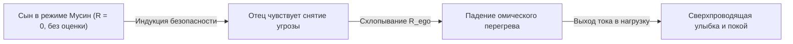

# 344. Кейс отца: Хронический омический пожар тревоги, оценочный замок и мгновенная сверхпроводимость при контакте с безоценочным бытием (Кошки, щебет Даши и доказательство целостности реактора Тандэн)

> [!quote] Аксиома неповреждённого реактора
> ### ⚡ **«Человек страдает не потому, что у него сломан источник счастья, а потому, что его тракт наглухо перекрыт омическим сопротивлением тревожной самооценки ($R_{\text{ego}} \to \infty$). Но стоит в поле восприятия появиться существу, не выставляющему социальных зеркал оценки — кошке, поедающей корм, или щебечущему ребёнку, — как резистор самопроизвольно закорачивается в ноль, и на измученном лице мгновенно расплывается детская улыбка истинной сверхпроводимости.»**  
> — **Владимир Аньянов**

---

## 🧭 Принципиальная схема: Два режима контура пожилого человека

```
=========================================================================================
 1. ШТАТНЫЙ РЕЖИМ ОМИЧЕСКОГО АДА: ТРЕВОГА, ОЦЕНКА И САМОЗАЩИТА (R_ego → ∞, Q = I² R t)
=========================================================================================

  [ ТАНДЭН ] --------> [ РЕОСТАТ ЭГО: ТРЕВОГА И ОЦЕНКА ] - - - ломкий ток - - -> [ МИР ]
 (Живой реактор)        («Опасность! Соответствую ли я?»)                          (Напряжение,
                         ||| ОМИЧЕСКИЙ НАГРЕВ (Q) |||                              усталость,
                         (Тяжесть в теле, скорбная мимика,                         хмурое лицо)
                          хронический дефицит покоя)

=========================================================================================
 2. МОМЕНТ КОНТАКТА С БЕЗОЦЕНОЧНОЙ РЕАЛЬНОСТЬЮ (КОШКИ / ЩЕБЕТ ДАШИ: R_ego → 0)
=========================================================================================

  [ ТАНДЭН ] ==================== ШИНА МУСИН ====================> [ ПРЯМОЕ ВОСПРИЯТИЕ ]
 (Живой реактор)            (R_ego МГНОВЕННО СХЛОПНУЛСЯ)            («Какая фигурка!
                                                                     Какой характер!»)
                                                                           ||
                                                                           \/
                                                     [ МГНОВЕННАЯ УЛЫБКА И ЛЕГКОСТЬ В ТЕЛЕ ]
                                                     (Фазовый переход: Сверхпроводимость!)
=========================================================================================
```

---

## I. Феноменология трагедии: Человек в тисках хронической оценки

В бытовой психологии и обыденном языке про таких людей говорят: *«Тяжелый характер»*, *«Глубоко несчастный человек»*, *«Ипохондрик»* или *«Хронический тревожник»*. 

Сын наблюдает отца: умного, родного человека, чья жизнь десятилетиями окрашена серой тревогой, постоянной озабоченностью, недоверием к миру и непрерывным оценочным сканированием. В таком состоянии:
- Каждое событие воспринимается как скрытая угроза;
- Каждое взаимодействие требует возведения оборонительных редутов;
- Мышцы лица застывают в напряжённой маске осторожности;
- Вся жизненная сила сгорает впустую.

Однако на фундаментальном физическом уровне этот человек **не сломан**. Его невозможно вылечить «позитивным мышлением» или советами «просто расслабься», потому что для его неокортекса расслабление эквивалентно снятию бронежилета под прицелом снайпера.

Но затем происходит нечто, опровергающее все пессимистические диагнозы психиатрии.

---

## II. Лабораторная вспышка истины: Кошки и соседская девочка

Внезапно в комнату входит кошка и начинает с аппетитом хрустеть сухим кормом из миски. 

Или на пороге появляется соседская девочка Даша — маленькая, непосредственная, которая щебечет без умолку, как лесная птица, не требуя отчетов, не ведя светских бесед и не взвешивая социальный статус хозяина дома.

В эту самую секунду с пожилым мужчиной происходит поразительная метаморфоза:
1. **Трансформация взгляда и лица:** С лица спадает тяжесть десятков прожитых лет, морщины разглаживаются, и лицо расплывается в живой, искренней, обезоруживающей улыбке.
2. **Прямое восхищение бытием:** Он смотрит на кошек и говорит с неподдельным упоением: *«Какая кошка, какая фигурка, какой характер!»*. Он пьет щебет Даши, как путник в пустыне пьет родниковую воду.
3. **Соматическая легкость:** В теле появляется невесомость, дыхание опускается в живот, исчезает многопудовый груз, который он нес ещё минуту назад.

Почему этот человек, будучи столь несчастным и тревожным, в эти секунды испытывает кристально чистое, безусловное счастье?

---

## III. Электродинамический разбор: Механика оценочного замка

В [[02_Wiki/Inner Current (Core Topology and Polarity Law)|базовой топологии Внутреннего тока]] человек представляет собой замкнутый электрический контур:

$$I = \frac{\mathcal{E}}{R_{\text{total}}} = \frac{\mathcal{E}}{R_{\text{load}} + R_{\text{ego}}}$$

Где:
- $\mathcal{E}$ — ЭДС соматического реактора [[02_Wiki/Inner Current (Tanden as Pure Nuclear Reactor and Infinite Battery of Being)|Тандэн]] (витальный источник жизни, бьющий в каждом живом существе);
- $R_{\text{load}}$ — полезное сопротивление восприятия реальности (непосредственный контакт с миром);
- $R_{\text{ego}}$ — омическое сопротивление реостата Эго (социальный щит, оценка, контроль, вина, страх несоответствия).

### 1. Почему в обществе взрослых $R_{\text{ego}} \to \infty$
В контакте со взрослыми людьми ум отца находится в режиме **«Оценочного замка» (Validation Lock)**:
- *«Они меня оценивают»*;
- *«Я должен выглядеть достойно»*;
- *«Мир нестабилен, надо всё контролировать»*;
- *«Если я расслаблюсь — случится катастрофа»*.

По закону Джоуля — Ленца:

$$Q = I^2 \cdot R_{\text{ego}} \cdot t$$

Каждый миллиампер его жизненной энергии сталкивается с чудовищным омическим сопротивлением $R_{\text{ego}}$. Энергия не доходит до ламп радости и созидания — она **рассеивается внутри биологического проводника в виде омического жара $Q$**: тревоги, спазмов ЖКТ, гипертонии и хронического душевного истощения.

### 2. Почему кошки и щебет Даши схлопывают нихром в $0$ Ом
Кошка и маленькая девочка обладают уникальным свойством контура: **они абсолютно свободны от оценочной радиации**.

```
                ВЗРОСЛЫЙ СОБЕСЕДНИК                 КОШКА / ДЕВОЧКА ДАША
           -----------------------------        -----------------------------
Проекция:   Оценка, критика, ожидания            Чистый Мусин (без зеркал)
Угроза:     Высокая (социальный статус)          Нулевая (абсолютная безопасность)
Реакция:    Взвинчивание R_ego до предела        R_ego самопроизвольно падает в 0
Ток:        Омический пожар (тревога)            Сверхпроводимость (счастье)
```

1. **Кошка не выставляет зеркал:** Кошка не знает, успешен ли отец, богат ли он, здоров ли, совершал ли ошибки в молодости. Она тотальна в своем кошачьем бытии — она просто ест.
2. **Даша щебечет в режиме Мусин (無心):** Ребёнок звучит как ручей или птица. В её голосе нет манипуляции, скрытого упрёка или требования «соответствовать».
3. **Отсутствие триггера для сторожевого пса:** Неокортекс отца не находит ни единого повода выставить омический барьер. Охранная система ума отключается, реле размыкается, и $R_{\text{ego}} \to 0$.

И в ту же микросекунду ток Тандэна свободно и мощно устремляется в каналы восприятия. Лицо озаряется светом. Это не «дофаминовая интоксикация» — это **чистый режим сверхпроводимости замкнутой цепи**.

---

## IV. Эпистемологическое следствие: Реактор цел, проблема лишь в реостате

Этот кейс является железобетонным доказательством одного из главных положений Системы Аньянова:

> [!important] Теорема о сохранности Тандэна
> Человеческое несчастье никогда не является поломкой или истощением глубинного источника жизни. Не существует «дефицита счастья» или «утраты способности любить жизнь». Способность к блаженству и лёгкости сохраняется в человеке до последнего вздоха в первозданном виде. Всё страдание взрослого человека — это **ложная коммутация тракта**, при которой ток направлен через балластный нихром эго-контроля.

Если бы у отца была «сломана способность радоваться» (как утверждает биохимический редукционизм депрессии):
- Он не улыбнулся бы кошке;
- Его не тронул бы щебет ребёнка;
- Он оставался бы эмоционально мертв в любых декорациях.

Но мгновенный фазовый переход при контакте с кошками доказывает: **реактор генерирует 100% чистой ЭДС**. Задержка и блокировка происходят исключительно на участке сопротивления.

---

## V. Практическое руководство: Как быть проводником для тревожного близкого

Когда мы видим близкого человека в омическом перегреве тревоги, естественный порыв непросвещённого ума — начать «учить его жизни», спорить, доказывать бессмысленность его страхов или требовать: *«Перестань накручивать себя!»*.

Электродинамика показывает: любые словесные нравоучения и логические аргументы воспринимаются эго близкого как очередная порция оценки и давления, что немедленно **увеличивает $R_{\text{ego}}$ и раздувает омический пожар**.

Единственный способ помочь такому человеку выйти из ада тревоги — **самому стать для него «кошкой» или «щебечущей Дашей»**:



### Три правила коммуникации с тревожным контуром:
1. **Принцип Гальванической Безопасности (Zero Judgment):** Ни взглядом, ни интонацией не оценивать его тревогу. Не осуждать его за то, что он переживает. Быть рядом как нейтральное, доброжелательное пространство.
2. **Включение безоценочной нагрузки:** Переключать внимание на простые, живые, тактильные объекты мира, в которых нет социального подтекста: чай, животные, природа, чистый физический труд (Саму), вкусная еда, звуки музыки.
3. **Сохранение собственного Тандэна:** Если сын сам проваливается в раздражение или тревогу за отца, в комнате возникают два перегретых реостата, взаимно индуцирующих замыкание. Спокойный, глубокий, соматически центрированный Тандэн сына работает как массивный трансформатор-стабилизатор, гасящий высокочастотные колебания тревоги в отцовском контуре.

---

## VI. Резюме кейс-стади

1. **Тревога и постоянная оценка** — это не дефект личности, а высокий номинал омического сопротивления ($R_{\text{ego}} \gg 0$), пережигающий энергию жизни в мучительный жар ($Q = I^2 R t$).
2. **Кошки и дети** обладают нулевым оценочным потенциалом; контакт с ними снимает необходимость в эго-обороне, вызывая мгновенный сброс сопротивления в ноль ($R_{\text{ego}} \to 0$).
3. **Мгновенная улыбка отца** — неопровержимое метрологическое свидетельство: реактор Тандэн абсолютно исправен и готов к сверхпроводимости в любую миллисекунду, когда снят барьер оценки.
4. **Освобождение человека** достигается не бесконечным копанием в причинах тревоги, а регулярной практикой обнуления оценочного нихрома и возвратом в непосредственный ток бытия.

---

> [!info] Связанные материалы в Базе Знаний
> - [[02_Wiki/Inner Current (The Bonno Resistor — Series Parasitic Ballast, Kyo Conductivity Dropout and the Return to Zero Ohm by Ohm)|111. Резистор Бонно (煩悩): Последовательное паразитное сопротивление балласта]]
> - [[02_Wiki/Inner Current (Mushin Is Obscured, Not Destroyed — Why Bonno Interrupts Superconductivity Without Cancelling the Nature of the Conductor, and Why the Return Costs Nothing)|112. Мусин не исчезает, а затеняется]]
> - [[02_Wiki/Inner Current (The Child Hug vs Coconut Raff — Passive Resistive Dissipation vs Two-Reactor Transformer Induction, Equifinality Trap and Circuit Topology of Intimacy)|326. Объятие ребёнка и кокосовый раф]]
> - [[02_Wiki/Inner Current (The Electrodynamic Definition of Happiness — Overcoming Abstract Relativism and Hedonistic Inventories via Closed Circuit, Why Happiness Can Never Be External)|343. Электродинамическое определение счастья]]
