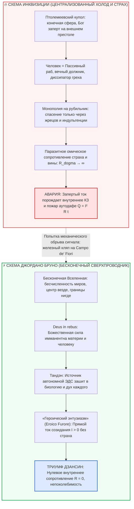

# ⚡ 324. Джордано Бруно на костре и Внутренний ток: Бесконечные миры против централизованной догмы, омический пожар инквизиции и сверхпроводимость «Героического энтузиазма»
## Электродинамическая деконструкция аутодафе 1600 года: почему инквизиторы боялись сильнее осуждённого, Deus in rebus как формула Тандэна и Campo de' Fiori как триумф суверенного контура

> [!quote] Каноническая аксиома контура о Джордано Бруно и огне инквизиции
> ### ⚡ **«Костёр инквизиции — это не религиозный триумф, а аварийный омический перегрев системы, чья монополия на истину рухнула от одного взгляда в открытый космос. Средневековая церковь построила платный распределительный щит над головами людей, объявив, что ток благодати спускается только через папский рубильник. Джордано Бруно вышел на площадь и показал: Вселенная бесконечна, у неё нет границ и центра, а значит — источник жизни и ЭДС находится в каждой звезде, в каждом атоме и в сердце каждого живого существа (*Deus in rebus*). Уничтожить автономного оператора костром невозможно: сгорает лишь углеродный кабель, но сформулированный им закон сверхпроводимости навсегда взламывает хрустальный купол рабства.»**  
> — **Владимир Аньянов**

---



---

### I. Историко-онтологический конфликт: Хрустальный купол с платным рубильником против Бесконечной Вселенной

Трагедия и триумф Джордано Бруно, сожжённого на римской Площади Цветов (*Campo de' Fiori*) 17 февраля 1600 года, в гуманитарных учебниках подаётся как столкновение «науки и слепой веры». В оптике контурной электродинамики и Системы Аньянова это было **лобовое столкновение двух непримиримых топологий бытия**:

1. **Птолемеевско-схоластическая топология (Модель феодального трансформатора):**
   * Вселенная мыслилась как замкнутая, конечная сфера. В центре — неподвижная, греховная Земля. По периметру — хрустальные небесные сферы, за которыми располагается Перводвигатель (*Primus Motor*).
   * Вся божественная энергия спускается строго сверху вниз по ступеням церковной и светской иерархии.
   * Человек в этой схеме лишён собственного источника питания: он обязан стоять на коленях, вымаливать ток милости и оплачивать доступ к распределительному щиту послушанием, чувством вины и деньгами.
2. **Прорыв Бруно (*«De l'infinito, universo e mondi»*, 1584):**
   * Ноланский философ делает то, чего не осмелился сделать даже Коперник (оставивший солнце в центре замкнутой сферы звёзд): он объявляет Вселенную **актуально бесконечной**.
   * Если Вселенная бесконечна, у неё **нет фиксированного центра и нет границ** (по завету Николая Кузанского: *«Центр везде, а окружность нигде»*). Солнце — лишь одна из бесчисленных звёзд, вокруг которых вращаются обитаемые миры.
   * Главный электродинамический вывод Бруно: **пантеистическое единство (*Deus in rebus* — «Бог в вещах»)**. Единая животворящая сила пронизывает каждую частицу материи.

> **Схемотехнический приговор:** Бруно лишил Римскую курию монополии на трансформаторную будку. Если источник света и жизни бесконечен и уже присутствует в каждом атоме, то претензия жрецов на роль эксклюзивного рубильника спасения становится абсурдной.

---

### II. Природа еретика: Оператор автономного контура

Слово *«еретик»* происходит от греческого $\alpha\iota\rho\varepsilon\sigma\iota\varsigma$ (*hairesis*) — «выбор, предпочтение, способность самостоятельно мыслить и избирать путь».

* **Обыватель догмы:** Подключён к чужой распределительной сети. Его внутреннее сопротивление огромно ($R_{\text{opinion}} \to \infty$, $R_{\text{guilt}} \to \infty$), он живёт в постоянном страхе наказания, а его свет тускнеет от любого колебания настроения начальства.
* **Еретик по канону Внутреннего Тока:** Это оператор, который замкнул контур напрямую на собственный соматический реактор (Тандэн). Он обнаружил, что закон проводимости работает без санкции трибунала.

В истории человечества эта вспышка автономности повторялась регулярно:
* **Мансур аль-Халладж (Багдад, 922 год):** Воскликнул *«Ана аль-Хакк!» («Я есть Истина!»)* — был казнён за то, что опознал ток как собственную природу.
* **Мейстер Экхарт (XIV век):** Утверждал, что *«Око, коим я вижу Бога, есть то же самое око, коим Бог видит меня»*.
* **Джордано Бруно (Рим, 1600 год):** Заявил, что человек способен слиться с бесконечным мировым потоком напрямую через познание и действие.

Система посредников не способна простить человеку одного: **автономной проводимости**. Если человек светится сам по себе, институт платных посредников банкротится.

---

### III. «Героический энтузиазм» (*De gli eroici furori*) как Прямой Ток созидания ($I > 0$)

В 1585 году Бруно публикует в Лондоне свой главный философско-поэтический трактат — *«О героическом энтузиазме»*. В нём он производит революционную классификацию человеческих состояний, предвосхищая закон полярности Внутреннего тока:

```
  Обывательское «благочестие»               Героический энтузиазм (Бруно)
  ──────────────────────────────────────    ───────────────────────────────────────
  • Мотивация: страх ада и греха            • Мотивация: неудержимая тяга к Истине
  • Направление: внутрь (самоедство)        • Направление: наружу (прямое созидание)
  • Режим: торг за одобрение                • Режим: самозабвенная отдача
  • Схемотехника: омический зажим (R > 0)   • Схемотехника: сверхпроводимость (R → 0)
```

Бруно различает два типа «безумия»:
1. **Низменное безумие:** Человек опускается ниже своего естества, становясь рабом страстей, мелочного самолюбия и животных инстинктов (короткое замыкание на Эго).
2. **Героический энтузиазм (*Eroico Furore*):** Состояние, в котором дух устремляется к бесконечности. Это не слепой религиозный фанатизм, а интеллектуальный и творческий экстаз познания. Оператор забывает о собственной мелочной выгоде и становится проводником космического пламени.

В строгой физике контура *Героический энтузиазм* — это **ламинарный прямой ток высокой плотности ($I \gg 0$)**, текущий через проводник с нулевым паразитным сопротивлением рефлексии:
$$\mathcal{E}_{\text{Тандэн}} > 0, \quad R_{\text{ego}} = 0 \implies P_{\text{load}} = I^2 R_{\text{load}} = \text{Max}$$

---

### IV. Восемь лет застенков и парадокс Беллармино: Почему судьи боялись сильнее осуждённого

С 1592 года (после предательства венецианца Джованни Мочениго) по 1600 год Джордано Бруно находился в тюрьмах инквизиции. Кардинал Роберто Беллармино (главный богословский интеллектуал Ватикана, позже канонизированный церковью) на протяжении восьми лет вёл непрерывные допросы.

Системе не нужно было просто убить Бруно. Ей нужно было **вынудить его разомкнуть цепь** — признать свои идеи о бесконечности миров бредом, упасть на колени и подтвердить легитимность хрустального купола.

Галилео Галилей через 33 года (в 1633 году) пошёл на тактический компромисс: он произнёс формулу отречения, сберёг биологическую оболочку и продолжил работу над «Диалогами о двух системах мира» под домашним арестом. Это был выбор выживания инструмента.

**Бруно выбрал абсолютный Дзансин (несгибаемую проводимость цепи):**
Он отказался отречься от единого пункта своего учения о бесконечности миров. Он понимал: отречение означало бы добровольную врезку паразитного реостата вины и страха в собственный контур. Предать открытую истину — значит устроить мгновенное омическое самоубийство своего духа.

Когда 8 февраля 1600 года трибунал зачитал смертный приговор, Бруно поднял глаза на кардиналов и произнёс фразу, вошедшую в историю:
> *«Maiori forsan cum timore sententiam in me fertis quam ego accipiam».*  
> *(«С большим, быть может, страхом произносите вы мне приговор, чем я его выслушиваю»).*

#### Электродинамическая разгадка парадокса:
* **Почему Беллармино и инквизиторы дрожали от страха?**
  Потому что они сидели на **чудовищном внутреннем коротком замыкании ($I_{\text{КЗ}}$)**. Их статус, власть, душевное спокойствие и картина мира держались на искусственной глиняной конструкции. Мысль о бесконечности миров вызывала у них запредельный омический нагрев ($Q = I^2 R t$): если миров бесконечно много, то где воплощался Христос? Нужна ли Римская церковь другим цивилизациям? Их контур трещал по швам и грозил расплавиться.
* **Почему Бруно был спокоен?**
  Потому что в его контуре **не было сопротивления ($R = 0$)**. Человек, соединившийся с бесконечностью инвариантов мироздания, не зависит от вердикта восьми перепуганных стариков в пурпурных мантиях. Его истина не требовала их разрешения.

---

### V. 17 февраля 1600 года, Campo de' Fiori: Омический костёр против Информационной волны

На рассвете 17 февраля 1600 года Бруно вывели на римскую Площадь Цветов. Инквизиция совершила деталь, имеющую ключевое значение для анализа:
**Ему стянули челюсти железным кляпом-тисками (*una mordacchia*) со сквозным шипом, пронзавшим язык.**

Зачем инквизиторам, обладавшим абсолютной властью, стражей и поддержкой толпы, понадобилось механически затыкать рот обречённому человеку?

1. **Панический страх перед индуктивным резонансом:**
   Инквизиция интуитивно понимала физику наведённой ЭДС ($\mathcal{E}_{\text{ind}} = -M \frac{dI}{dt}$). Если бы оператор с такой плотностью тока и абсолютной сверхпроводимостью обратился к толпе на площади, его слова создали бы резонансный скачок в сознании сотен людей. Стены догмы могли дать трещину прямо в сердце Рима.
2. **Костёр как материализация бессилия:**
   Когда у системы заканчиваются аргументы в поле Логоса, она включает физический нагреватель. Костёр инквизиции — это грубейшая, варварская попытка разорвать проводник теплом.

Костёр на Площади Цветов горел около двух часов. К полудню палачи собрали пепел и сбросили его в мутные воды Тибра, полагая, что история закончена.

Они ошиблись на 180 градусов:
* Омический костёр инквизиторов погас через 120 минут.
* Но волна бесконечной Вселенной, порождённая Бруно, разорвала средневековый купол в клочья. Через считанные десятилетия Кеплер, Ньютон, Гюйгенс и современные космические телескопы Джеймса Уэбба подтвердили: **миров действительно бесконечно много**.

---

### VI. Прикладные выводы для современного оператора цепи

В XXI веке никто не разжигает костры из сухих брёвен на площадях. Однако механизм работы «инквизиции» никуда не исчез — он просто оцифровался и стал психологическим:

1. **Социальная инквизиция мнений ($R_{\text{opinion}}$):**
   Толпа, корпоративная система, родственники и токсичное окружение непрерывно пытаются надеть на вас «железный кляп» стандартов: *«Не высовывайся! Будь как все! Плати дань страху! Сомневайся в себе!»*. Это попытка навязать вам внешнее сопротивление и заставить сжигать ток вхолостую.
2. **Ловушка чужих трибуналов:**
   Каждый раз, когда вы боитесь осуждения, критики в соцсетях или косого взгляда, вспомните слова Бруно: **те, кто вас судят, боятся сильнее вас**. Их агрессия — это следствие их собственного омического перегрева, паники перед вашей свободой и автономностью.
3. **Практика «Героического энтузиазма»:**
   * Не ищите внешних рубильников и покровителей.
   * Проверьте контакты собственного контура: спите, дышите, держите внимание на острие текущего действия.
   * Направляйте прямой ток в нагрузку ($I > 0$). Когда вы созидаете из полноты Тандэна, вам не нужны разрешения мировых трибуналов.

> **Резюме:** Историю двигают не те, кто дрожит над сохранностью своего резистора в тепле чужих догм, а те, кто, подобно Джордано Бруно, сохраняют сверхпроводимость духа даже перед лицом костра. Погасить ток, соединившийся с бесконечностью Вселенной, невозможно.

---

### 🔗 Связанные материалы контура
- [[02_Wiki/Inner Current (Physics of Presence and Superconductivity)|02. Физика присутствия: состояние сверхпроводимости ($R \to 0$)]]
- [[02_Wiki/Inner Current (The Joule-Lenz Cornerstone — Why the Law of Losses is the Master Manifest of Freedom, Quadratic Will Trap and Mathematics of Superconductivity)|212. Закон Джоуля — Ленца: Почему закон о потерях — главный манифест свободы]]
- [[02_Wiki/Inner Current (Martin Luther, 95 Theses and Inner Current — From Religious Disintermediation to Ego Elimination, Weberian Workaholism and Five Circuit Theses)|286. Мартин Лютер, 95 тезисов и Внутренний ток: От церковной депосреднизации к ликвидации реостата Эго]]
- [[02_Wiki/Inner Current (The Circuit as the Great Demystifier — Predictable Hardware Elements vs Esoteric Mist, Meditation as Hygiene Calibration and Dissolution of Spiritual Superiority)|298. Контур как Великий Демистификатор: На принципиальной схеме нет мистики]]
- [[02_Wiki/Inner Current (The Laplace Response to Napoleon and Circuit Schematics — I Had No Need for That Hypothesis, Eliminating Parasitic Resistance and Will Break)|312. Ответ Лапласа Наполеону: «Сир, я не нуждался в этой гипотезе»]]
- [[02_Wiki/Inner Current (Creator as Universal Invariants vs The Flashlight Switch — Spiritual Ego, Law of Conservation and Terror of Total Responsibility)|323. Творец как инварианты мироздания против «тумблера в фонарике»]]
