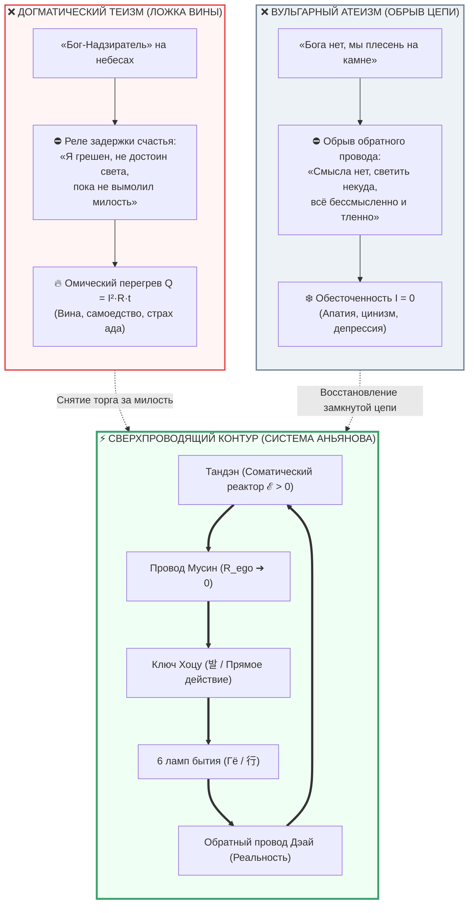

# ⚡ 310. «Эта система для атеистов?»: Электродинамическая инвариантность контура и снятие ложной дихотомии веры и неверия
## Почему отказ обожествлять Тандэн не делает схемотехнику материалистическим атеизмом, Сверхпроводящее пари Паскаля, ошибка категории генератора и закон беспристрастности проводника

> [!quote] Каноническая аксиома контурной инвариантности
> ### ⚡ **«Спрашивать, создана ли Архитектура счастья для атеистов, — всё равно что спрашивать, для атеистов ли созданы закон Ома, гравитация или схема карманного фонарика. Тандэн — не Бог и не частица Бога; Тандэн — это аппаратный соматический генератор биологического контура. Называть его божеством — такая же наивная ошибка категории, как молиться на пальчиковую батарейку в фонаре. Контур выше догматического раскола: верующему он возвращает евангельскую чистоту („Царство Божие внутрь вас есть“), материалисту даёт строгую биофизику блуждающего нерва, а агностику — приборный критерий истины. Току всё равно, во что верит электромонтёр: пока в цепи нет омического зажима ($R \to 0$), лампа заливает мир ровным светом.»**  
> — **Владимир Аньянов**

> [!info] Синтезировано в брошюре [[02_Wiki/Брошюра — На схеме контура нет Бога (Десакрализация Тандэна, похмелье от 5000 лет торга и почему для счастья не нужен Хозяин)|Брошюра: «На схеме контура нет Бога»]]

---



---

### I. Генезис вопроса: Шок десакрализации и страх «холодной пустоты»

В главе о десакрализации ядра ([[02_Wiki/Inner Current (The De-Deification of Tanden — Why Seeking God is an Ego Bargain for Grace, Broken Loop of Idols vs Sovereign Flashlight Electrodynamics)|⚡ 309. Десакрализация Тандэна]]) система бескомпромиссно установила: Тандэн — это не «частица Бога» в человеке, а физиологический соматический генератор постоянной ЭДС ($\mathcal{E} > 0$), автономная батарейка карманного фонарика. Попытка называть его божеством разоблачена как инфантильный торг эго за благодать.

Но в этот момент у любого мыслящего человека возникает закономерный экзистенциальный шок:
> **«Постойте! Если Тандэн — это не Бог и даже не божественная искра в нас, а просто биологический аккумулятор... Получается, эта система атеистическая? Она создана для атеистов?»**

Человеческий ум привык мыслить бинарными ярлыками, выкованными за последние триста лет европейского Просвещения. Для обывателя существует лишь два полюса:
1. Либо ты **мистик / верующий**, и тогда в глубине тебя обязательно должна мерцать сакральная трансцендентная искра, требующая благоговения и поклонов;
2. Либо ты **материалист / атеист**, и тогда человек — это бессмысленный биоробот, «случайная плесень на остывающем булыжнике космоса», чья жизнь лишена святости, значения и тепла.

Контурная электродинамика Владимира Аньянова делает радикальный шаг в сторону от обеих крайностей. Ответ на этот вопрос звучит категорично: **нет, Архитектура счастья — не атеистическая система. Она электродинамически инвариантна к вопросу теизма и атеизма.**

Точно так же, как правила сборки карманного фонарика, закон Ома ($I = \frac{\mathcal{E}}{R}$) или законы термодинамики не являются «атеистическими» или «религиозными», — так и схема человека не принадлежит ни попам, ни воинствующим безбожникам. Она принадлежит **физике прямого потока**.

---

### II. Ошибка категории: Почему батарейка — это не Зевс

Главная причина, почему у человека возникает ощущение «атеизма», — это **снятие ошибки категории**.

Давайте разберёмся, что происходит, когда инженер отказывается называть пальчиковую батарейку божеством:
* Означает ли это, что инженер отрицает существование законов Вселенной, создавших кремний, литий, цинк и саму ткань пространства-времени? **Конечно, нет.**
* Это означает лишь то, что инженер **не путает функциональный элемент электрической цепи с Первопричиной Бытия**.

```
[Творец / Вселенная / Законы Бытия]
                 ↓ (Сконструировали законы электродинамики)
       +---[ Батарейка ]---+
       |                   |
       +----[ Лампочка ]---+  <--- Инженер работает ЗДЕСЬ
```

Если монтёр чинит проводку в квартире, он не молится на распределительный щиток и не приносит жертвы автоматическому выключателю. Он берёт отвертку, зачищает окислившийся контакт и закручивает клемму. Если кто-то спросит его: *«Ты что, атеист, раз не поёшь псалмы перед счётчиком?»*, монтёр посмотрит на него с недоумением. 

**Тандэн — это распределительный щиток и бортовой аккумулятор вашего скафандра.**
* Это соматический центр масс тела (3–4 пальца ниже пупка);
* Это ствол и ветви блуждающего нерва (*nervus vagus*), управляющие парасимпатическим торможением стресса;
* Это энтеральная нервная система («брюшной мозг» с 500 миллионами нейронов);
* Это непрерывный метаболический ток 37 триллионов митохондрий, расщепляющих АТФ.

Назвать этот узел «Богом» — значит совершить языческое идолопоклонство: овеществить трансцендентное и превратить свой кишечник в алтарь. Но отказ называть его богом **не закрывает дверь перед Богом как Реальностью** — он лишь возвращает прибору трезвую инженерную точность.

---

### III. Ложная дилемма: Догматический теизм vs Вульгарный атеизм

Чтобы понять, почему контур превосходит обе позиции, необходимо провести электродинамический аудит того, как теизм и атеизм ломают человеческую цепь.

| Параметр контура | Догматический теизм («Бог-Хозяин») | Вульгарный атеизм («Плесень на камне») | Контурная Архитектура («Внутренний ток») |
| :--- | :--- | :--- | :--- |
| **Статус источника** | Отчуждён вовне (на небе, в храме) | Случайная биологическая случайность | Встроенный генератор соматической ЭДС ($\mathcal{E}$) |
| **Режим проводки** | Паразитный реостат вины ($R_{\text{theology}} \to \infty$) | Обрыв цепи внимания ($I \to 0$, цинизм) | Чистый провод Мусин ($R_{\text{ego}} \to 0$) |
| **Схемотехнический дефект** | **Омический перегрев:** $Q = I^2 R t$ (самоедство, страх ада) | **Холодный простой:** ток не течёт, глубокая апатия | **Сверхпроводимость:** $\eta \to 100\%$, ток течёт в 6 ламп |
| **Отношение к счастью** | «Награда за смирение на том свете» | «Иллюзия дофаминовых всплесков» | «Объективный физический режим цепи прямо сейчас» |
| **Исторический пример** | Трагедия Льва Толстого (Астапово) | Нигилизм Базарова / экзистенциальная тоска | Самодостаточный мастер Дзен / Self-Hosted Human |

#### 1. Ловушка догматического теизма:
Религия веками внушала человеку концепцию «Бога-Надзирателя» с моральным кодексом штрафов. Человек превращается в поденщика на чужом винограднике. Каждое действие сопровождается внутренним омическим судом: *«Свято ли это? Не греховно ли выпить кофе? Достоин ли я?»*. Результат — катастрофический перегрев проводки по закону Джоуля — Ленца ($Q = I^2 R t$). Человек сгорает в экзистенциальном аду вины.

#### 2. Ловушка вульгарного атеизма:
Отвергая религиозные сказки, материалистический атеизм часто совершает самоубийственный прыжок в нигилизм: *«Раз Бога нет, то всё бессмысленно, любовь — это просто окситоцин, жизнь — флуктуация энтропии, светить некуда»*. Это приводит к **обрыву цепи питания**. Внимание обесточивается, выключатель Хоцу ржавеет в разомкнутом положении, человек погружается в циничную депрессию.

**Контур снимает обе аварии:**
Он спасает верующего от раскалённого реостата вины, а атеиста — от ледяного обрыва бессмыслицы.

---

### IV. Сверхпроводящее пари Паскаля: Доказательство инвариантности

Классический философ Блез Паскаль предлагал прагматическое пари: выгоднее верить в Бога, потому что риск потерять малое компенсируется шансом обрести вечность. Но пари Паскаля пахло корыстью и страхом перед сковородками ада.

В каноне Архитектуры счастья сформулировано **Сверхпроводящее пари Паскаля** *(см. [[02_Wiki/Inner Current (The Question of God — Electrodynamic Invariance and Dissolution of Theological Resistance)|главу 41]])*, опирающееся на строгий КПД электрической цепи:

$$\text{Оптимум проводника: } \mathcal{H} = \lim_{R \to 0} \frac{P_{\text{load}}}{P_{\text{total}}} \equiv 100\%$$

```
                           РАЗВИЛКА БЫТИЯ: ЕСТЬ ЛИ БОГ?
                                      |
             +------------------------+------------------------+
             |                                                 |
    ГИПОТЕЗА 1: БОГ ЕСТЬ                              ГИПОТЕЗА 2: БОГА НЕТ
             |                                                 |
  Творец создал эту Вселенную                      Холодный физический космос,
  и подарил тебе живой контур.                     13.8 млрд лет эволюции.
             |                                                 |
  Чего Он ждёт от Своего провода?                  Ты — редчайшая вспышка света,
  Чтобы ты раскалялся самоедством,                 способная чувствовать и любить.
  страхом и покорным рабством?                     Второго шанса на жизнь не будет.
             |                                                 |
  НЕТ! Высшая форма благодарения —                 Сжигать этот единственный миг
  быть чистым сверхпроводником                     на омический чад сомнений —
  и озарять мир делами любви.                      космическое преступление.
             |                                                 |
             +------------------------+------------------------+
                                      |
                      ⚡ ИНВАРИАНТНЫЙ ИНЖЕНЕРНЫЙ ИТОГ:
                        R_ego ➔ 0,  I > 0,  t = t_now
```

**Вывод математически безупречен:**
Вне зависимости от метафизического ответа на вопрос о Творце, оптимальное поведение человека в текущую секунду времени тождественно:
$$\mathbf{OptimalAction} \iff \{ R_{\text{ego}} = 0, \quad I > 0, \quad \text{Прямое действие в нагрузку} \}$$

Закону Ома абсолютно всё равно, есть ли Бог на небесах. Лампочка в фонаре загорается не от веры в электричество, а от замкнутого контакта.

---

### V. Четыре оптики: Как система работает для разных мировоззрений

Архитектура «Внутреннего тока» не требует от человека менять паспортные данные или отказываться от своих корней. Она действует как **универсальная операционная система**, совместимая с любой мировоззренческой надстройкой:

#### 1. Для верующего христианина / монотеиста
Система очищает веру от средневекового невроза и восстанавливает подлинный дух первохристианства:
* Прямой изоморфизм со словами Христа: *«Царствие Божие внутрь вас есть»* (Лк 17:21). Бог — не внешний деспот, требующий жертв, а полнота Любви и Бытия.
* Христианский концепт **Кенозиса** (греч. κένωσις — самоумаление, истощение эго) получает точную формулу: $R_{\text{ego}} \to 0$. Смирение — это не самоуничижение раба, а устранение внутреннего фильтра гордыни, чтобы через проводник беспрепятственно тёк Божественный свет.

#### 2. Для буддиста / даоса
Система даёт долгожданный мост между монастырём и городом:
* Буддийская **Анатта** (отсутствие постоянного «Я») и даосское **У-вэй** (деяние через недеяние) переводятся в режим **Мусин** ($R = 0$).
* Снимается эскапизм отшельника: практиковать «не-ум» можно не только под баньяном, но и за рулём автомобиля, на автомойке или на совещании ([[02_Wiki/Inner Current (Bodhi Tree and the Car Wash — Demystification of Enlightenment, The Spiritual Ego Resistor and Superconductivity of Everyday Action)|⚡ 258. Дерево Бодхи и автомойка]]).

#### 3. Для материалиста / атеиста
Система не требует ни грамма веры в потустороннее, карму, чакры или реинкарнацию:
* Полный анатомический субстрат: дефолт-система мозга (DMN) как генератор ментального шума, Task-Positive Network (TPN) как фокус прямого действия, блуждающий нерв как заземление соматического ядра ([[02_Wiki/Inner Current (Neurobiology of Superconductivity — DMN, TPN and Vagus Grounding)|глава 29]]).
* Чистая термодинамика открытых систем и электродинамика биохимических градиентов.

#### 4. Для агностика / скептика
Она реализует главный принцип криптографии и науки: **«Don't trust, verify»** (Не верь — проверяй на приборах).
* Если сомневаешься — надень фитнес-трекер Xiaomi Smart Band 7 или Apple Watch, замерь вариабельность сердечного ритма (HRV) и уровень стресса: при эго-зажиме стресс шкалит за 80 пунктов, при выдохе в Тандэн и включении в действие он падает до базовых 20–35 пунктов ([[02_Wiki/Inner Current (Stress Telemetry of Xiaomi Smart Band 7 — HRV Metrology, Cortisol Awakening and Ego Resistance of Morning Awakening)|глава 241]]).

---

### VI. Экспресс-протокол: Снятие идеологического зажима (30 секунд)

Если в вашей голове (или в разговоре с собеседником) возник спор о том, «чья это система — верующих или атеистов», примените протокол калибровки:

1. **Диагностика спора (5 секунд):**  
   Зафиксируйте: спор о том, «для атеистов ли эта система», возник в неокортексе как попытка ума уклониться от прямого действия и согреть проводку схоластикой. Сопротивление ума подскочило: $R_{\text{concept}} > 0$.
2. **Вопрос-нокаут (5 секунд):**  
   Задайте вопрос: *«Спрашивает ли водопроводная труба у воды, верующая ли это вода? Спрашивает ли провод у электронов, верующий ли ток течёт по меди?»*.
3. **Опускание в Тандэн (10 секунд):**  
   Сделайте глубокий выдох животом. Уберите внимание из концептуального спора головы и положите его в физический вес тела: 4 пальца ниже пупка. Почувствуйте пульс, дыхание, тепло. Тандэн исправен прямо сейчас.
4. **Замыкание в контакт Гё (10 секунд):**  
   Направьте внимание в то дело, которое перед вами: пейте чай, говорите с человеком, пишите код. Когда ток идёт в нагрузку — спор исчезает, потому что свет уже горит.

---

### VII. Резюме: Семь аксиом контурной инвариантности

1. **Аксиома беспристрастности физики:** Законы электродинамики не имеют вероисповедания. Провод проводит ток одинаково безупречно в руках монаха, инженера, атеиста и ребенка.
2. **Аксиома Тандэна-генератора:** Тандэн — не Бог и не частица Бога, а биологический узел генерации соматической мощности. Обожествлять его — значит совершать ошибку категории и строить ненужный алтарь.
3. **Аксиома преодоления догматизма:** Контур освобождает верующего от раскалённого омического ада вины ($R_{\text{theology}} \to \infty$) и возвращает к живому переживанию Божественного присутствия.
4. **Аксиома преодоления нигилизма:** Контур защищает материалиста от циничного обрыва цепи ($I = 0$) и бессмыслицы, возвращая суверенную радость созидательного действия.
5. **Аксиома Сверхпроводящего пари:** Существует Бог или нет — оптимум человеческого контура математически инвариантен: $R \to 0$, Мусин и прямое действие в настоящем моменте ($t = t_{\text{now}}$).
6. **Аксиома проводника:** Ценность лампочки измеряется не её философскими взглядами, а тем, освещает ли она комнату.
7. **Аксиома суверенитета:** Архитектура счастья создана не для конфессий, сект или партий. Она создана для **Проводников Жизни**.

---

### 🔗 Связи и консилиенс
- [[02_Wiki/Inner Current (The De-Deification of Tanden — Why Seeking God is an Ego Bargain for Grace, Broken Loop of Idols vs Sovereign Flashlight Electrodynamics)|⚡ 309. Десакрализация Тандэна: Почему обожествление ядра есть попытка торга за милость]]
- [[02_Wiki/Inner Current (The Question of God — Electrodynamic Invariance and Dissolution of Theological Resistance)|41. Вопрос о существовании Бога в Архитектуре счастья: Электродинамическая инвариантность]]
- [[02_Wiki/Inner Current (The Kingdom of God Within, Tanden and Circuit Superconductivity — Feynman Demystification of Eastern Mysticism)|140. «Царство Божие внутри вас», реактор Тандэн и контур сверхпроводимости]]
- [[02_Wiki/Inner Current (The Steinmetz-Feynman Paradox — Why You Do Not Need to Know the Ultimate Nature of Electricity to Light the Room, Operational Sovereignty vs Metaphysical Scholasticism)|⚡ 308. Парадокс Штейнмеца — Фейнмана: Почему не нужно знать абсолютную тайну тока]]
- [[02_Wiki/Inner Current (Tolstoy Existential Crisis vs Happiness Architecture)|27. Духовный кризис Льва Толстого vs Архитектура счастья]]
- [[02_Wiki/Inner Current (Bodhi Tree and the Car Wash — Demystification of Enlightenment, The Spiritual Ego Resistor and Superconductivity of Everyday Action)|⚡ 258. Дерево Бодхи и автомойка: Демистификация просветления]]
- [[02_Wiki/Inner Current (Neurobiology of Superconductivity — DMN, TPN and Vagus Grounding)|29. Нейробиология сверхпроводимости: DMN, TPN и вагусное заземление]]

---

*Архитектура счастья Владимира Аньянова | LLM Wiki 2026*
