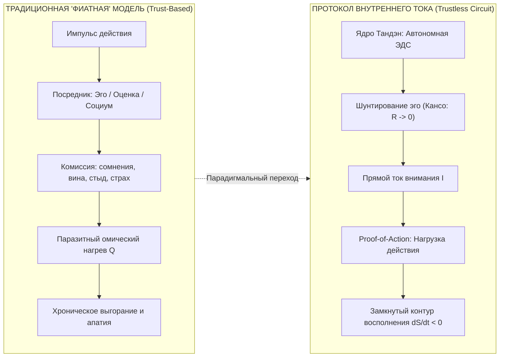
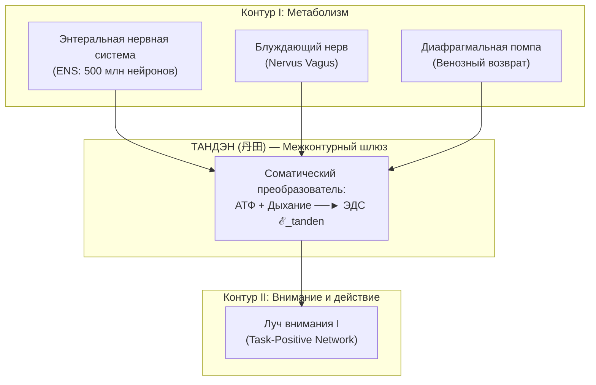
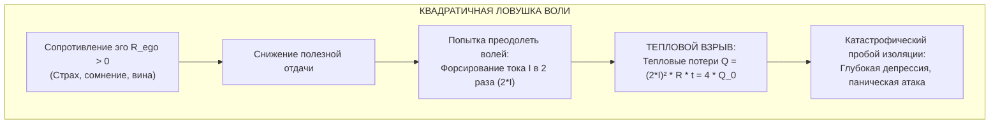
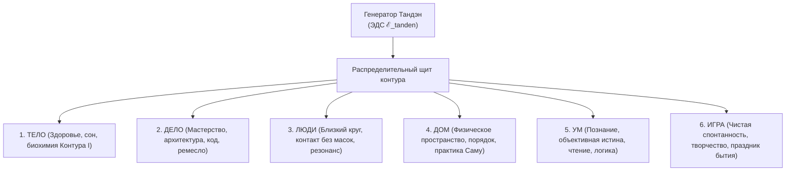
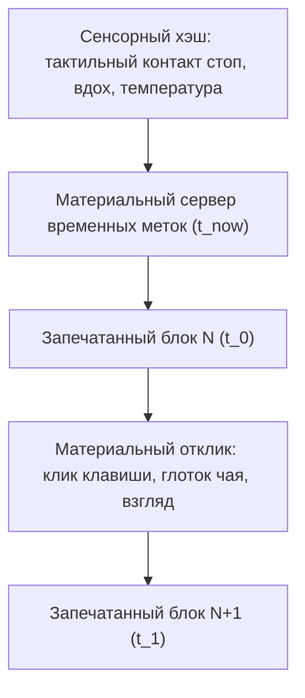
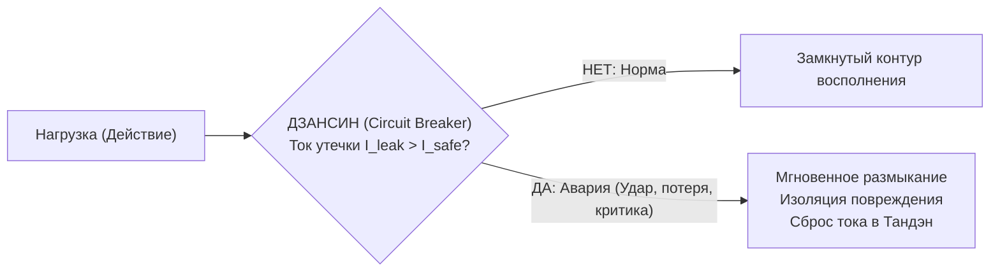
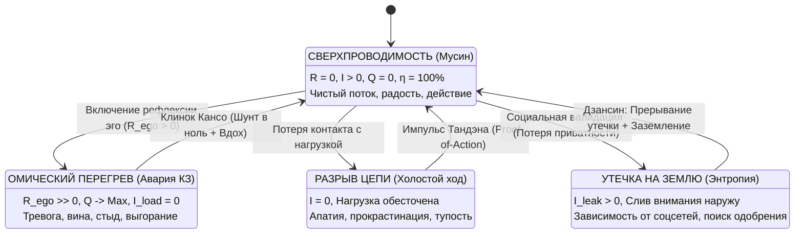

# ⚡ Белая книга: Внутренний ток
### Открытый протокол суверенной электродинамики человека и двухконтурной сверхпроводимости (Мастер-стандарт)
*(Inner Current: The Open Protocol of Sovereign Human Electrodynamics and Dual-Circuit Superconductivity — Master Protocol Standard)*

**Владимир Аньянов**  
*Создатель Системы Аньянова и Архитектуры Внутреннего Тока*  
`v.s.anyanov@gmail.com` · `https://innercurrent.ru`

---

## ⚡ Аннотация (Abstract)

Традиционные институты человеческого благополучия — от религиозных догм до современной академической поп-психологии и коучинга — опираются на модель доверия к внешним посредникам (Trust-Based Model): социальным валидаторам, культурным клиринговым палатам, одобрению окружающих и вербальным симуляциям неокортекса. Подобно фиатной финансовой системе с её инфляцией и скрытым сеньоражем, эта модель порождает хронический кризис человеческой энергосистемы: эмоциональное выгорание, депрессию, тревогу и синдром самозванца. Фундаментальный порок традиционного подхода заключается в его **нефальсифицируемости**: при крахе системы вина возлагается на самого оператора (*«ты недостаточно позитивно мыслил»*), поскольку метафорические модели лишены замкнутых уравнений сохранения.

В настоящей Белой книге представлен **«Внутренний ток» (Inner Current)** — открытый, строгий, бездоверительный (trustless) протокол электродинамики сознания. Мы формулируем человека не как статическую вещь с мыслями, а как **каскад двух открытых неравновесных диссипативных систем (двух вихрей)**:
1. **Контур I (Биохимический субстрат — Тело Пригожина, 1977):** открытая метаболическая система (37 трлн митохондрий, АТФ, дыхание), рассеивающая энтропию через тепло и удерживающая биологический порядок.
2. **Контур II (Когнитивное сознание — Дух Аньянова, 2026):** электродинамическая цепь направленного внимания ($I$), совершающая полезную работу в физической реальности.

Контуры сопрягаются через **межконтурный гальванический шлюз (Тандэн)**, конвертирующий химический потенциал диафрагмального дыхания в соматическую ЭДС ($\mathcal{E} \approx 1.5\text{ В}$). 

Мы доказываем:
* **Закон потерь Джоуля — Ленца ($Q = I^2 R t$):** душевное страдание — это не моральный дефект, а штатный омический перегрев проводников внимания при коротком замыкании на паразитный нихромовый реостат эго ($R_{\text{ego}} > 0$).
* **Квадратичную ловушку воли:** попытка преодолеть внутреннее сопротивление волевым напором ($I \uparrow$) приводит к квадратичному росту тепловых потерь ($Q \sim I^2$), разрушая нервную систему.
* **Фундаментальную теорему о нагрузке (Закон Лампочки: $\mathcal{E}_{\text{load}} \equiv 0$):** внешние объекты, деньги, статусы и дипломы лишены собственной ЭДС; они светятся исключительно током оператора, протекающим сквозь них.
* **Протокол Proof-of-Action (PoA):** решение проблемы «двойной траты внимания» (Double-Spending of Attention) посредством запечатывания квантов внимания в материальный Сервер временных меток «Здесь и сейчас» ($t_{\text{now}}$) с нулевой задержкой ($0\text{ ms}$).
* **Сверхпроводимость ($R \to 0$):** формальное математическое определение счастья как состояния цепи без омического сопротивления, при котором КПД стремится к $100\%$ ($\eta \to 1$), тепловые потери исчезают ($Q \to 0$), а вокруг контура возникает когерентное поле радости.

Протокол защищён аппаратными прерывателями цепи (**Дзансин**) и математически неуязвим к внешнему социальному давлению (**Атака 51% социального консенсуса**).

---

## 1. Парадигмальный сдвиг: От фиатного сознания к физике цепей

На протяжении тысячелетий цивилизация изучала душевное состояние человека через призму субъективной драмы: философии, мистики или психоанализа. Когда у современного человека пропадает энергия и начинается выгорание, общество предлагает ему:
* *«Раскопать детскую травму двадцатилетней давности»*;
* *«Найти своё истинное метафизическое предназначение»*;
* *«Медитировать на свет и повышать вибрации»*;
* *«Усилием воли преодолеть лень и победить прокрастинацию»*.

Когда перегорает проводка в серверной стойке дата-центра, дежурный инженер не анализирует «детство материнской платы» и не читает серверу моральные нотации. Он берёт мультиметр, открывает электрическую схему и локализует точку короткого замыкания или пробоя изоляции на корпус.



### Принципы инженерной строгости Протокола:
1. **Бинарность состояния цепи:** электрическая цепь либо замкнута, либо разомкнута. Ток внимания либо совершает полезную работу в объективном мире, либо рассеивается в тепловой ожог нейросети. Самообман здесь физически невозможен.
2. **Абсолютная фальсифицируемость (Критерий Поппера):** любой экзистенциальный сбой регистрируется в виде конкретной невязки баланса Кирхгофа ($\Delta I \ne 0$), падения напряжения на клеммах действия или соматического перегрева проводников ($Q > 0$).
3. **Безобвинительный ремонт (Blameless Debugging):** страдание — это не нравственный порок и не признак слабости характера. Это объективное физическое следствие высокого импеданса среды при протекании электрического тока.

---

## 2. Двухконтурная архитектура: Каскад открытых диссипативных систем

Фундаментальная ошибка классической науки заключалась в восприятии живого существа как закрытой, равновесной системы (подобной термосу или калориметру Карно — Клаузиуса). В закрытой системе энтропия непрерывно растёт ($dS/dt \ge 0$), что неизбежно вело философию к романтизации распада, отчаяния и тепловой смерти.

В 1977 году Илья Пригожин получил Нобелевскую премию за доказательство того, что **в открытых неравновесных системах материя способна спонтанно организовываться в сложнейший порядок (диссипативные структуры)** при условии прокачки сквозного потока энергии и вещества.

Система Аньянова утверждает: **Человек — это каскад двух открытых неравновесных диссипативных систем (двух вихрей)**:

```
========================================================================================
   АРХИТЕКТУРА ДВУХКОНТУРНОГО ДИССИПАТИВНОГО ЧЕЛОВЕКА (ПРИГОЖИН 1977 — АНЬЯНОВ 2026)
========================================================================================

   [ КОНТУР I: БИОХИМИЧЕСКИЙ СУБСТРАТ — ТЕЛО (ИЛЬЯ ПРИГОЖИН, 1977) ]
   
     Поток вещества: Пища, H2O, O2  ──►  [ МЕТАБОЛИЧЕСКИЙ ВИХРЬ ]  ──► Сброс CO2, тепла
                                         (37 трлн митохондрий, АТФ)      (Выдох Карно)
                                                    │
                                                    ▼
   ═════════════════════════════════════════════════════════════════════════════════════
   [ МЕЖКОНТУРНЫЙ ГАЛЬВАНИЧЕСКИЙ ШЛЮЗ — ТАНДЭН (丹田) ]
   
     • Энтеральная нервная система (ENS, 500 млн нейронов), венозная диафрагмальная помпа
     • Преобразователь мощности АТФ в соматическую ЭДС (ℰ ≈ 1.5 В)
   ═════════════════════════════════════════════════════════════════════════════════════
                                                    │
                                                    ▼ I_attention (Ток внимания)
   [ КОНТУР II: КОГНИТИВНОЕ СОЗНАНИЕ — ДУХ (ВЛАДИМИР АНЬЯНОВ, 2026) ]
   
                     [ РАЗВИЛКА РЕЖИМА ПРОВОДИМОСТИ ВТОРОГО КОНТУРА ]
                                  /                    \
              (R_ego >> 0)       /                      \       (R_ego -> 0)
                                /                        \
   ┌───────────────────────────┐                          ┌───────────────────────────┐
   │    ПАРАЗИТНЫЙ РЕОСТАТ ЭГО │                          │   СВЕРХПРОВОДНИК МУСИН    │
   │  Руминация, вина, тревога │                          │    (Бесшовное присутствие)│
   │  "Что обо мне подумают?"  │                          │    Внимание течет в дело  │
   └─────────────┬─────────────┘                          └─────────────┬─────────────┘
                 │                                                      │
          Q = I² R_ego t                                                ▼
                 ▼                                        ┌───────────────────────────┐
   [ ОМИЧЕСКИЙ ПЕРЕГРЕВ: ТОСКА, ]                         │     ПОЛЕЗНАЯ НАГРУЗКА     │
   [ ВЫГОРАНИЕ, ДЕПРЕССИЯ, АД   ]                         │  (ЩИТ 6 ЛАМП ДЕЙСТВИЯ)    │
   (Короткое замыкание на себя)                           │  Код, текст, музыка, диалог│
                                                          └─────────────┬─────────────┘
                                                                        │
                                                           Return Wire  │ (Сенсорный отклик)
                                                                        ▼
                                                          ┌───────────────────────────┐
                                                          │   СЧАСТЬЕ: dS_total/dt < 0│
                                                          │   СВЕРХПРОВОДИМОСТЬ (η=1) │
                                                          └───────────────────────────┘
========================================================================================
```

### 2.1. Контур I: Метаболический вихрь Тела
* **Функция:** Обеспечение биологической жизни через прокачку материальных носителей энергии (кислород, глюкоза, вода).
* **Уравнение энтропии:**
  $$\frac{dS_I}{dt} = \frac{d_i S_I}{dt} + \frac{d_e S_I}{dt} \le 0$$
  где $d_i S_I > 0$ — внутреннее производство энтропии метаболизма, а $d_e S_I < 0$ — сброс энтропии в окружающую среду через выдох, теплоотдачу и экскрецию.
* **Свойство:** Идеально налаженный Контур I (спортзал, сон, нутрицевтики, биохакинг) поставляет колоссальную электрическую мощность, **но сам по себе не гарантирует человеческого счастья**.

### 2.2. Контур II: Электродинамический вихрь Духа
* **Функция:** Прокачка информации, смыслов и квантов внимания через физические действия в объективную ткань мира.
* **Принцип Изоморфизма:** Внимание подчиняется тем же строгим законам открытых потоковых систем, что и молекулы воды в вихре. Если поток внимания замкнуть внутри самого себя (закрыть сливное отверстие вихря рефлексией над собой) — система немедленно деградирует в гнилое болото энтропийного распада.

---

## 3. Межконтурный гальванический шлюз: Тандэн

В традиционных восточных трактатах соматический центр внизу живота (**Тандэн / 丹田**, точка на 3–5 см ниже пупка) описывался в терминах мистической энергии «Ци». Протокол Внутреннего тока очищает этот узел от эзотерического налёта и даёт ему строгое анатомическое и электродинамическое определение:

> **Тандэн — это межконтурный гальванический шлюз (соматический трансформатор)**, конвертирующий биохимическую мощность АТФ и диафрагмальной гемодинамики Контура I в направленную электродвижущую силу намерения ($\mathcal{E}_{\text{tanden}} \approx 1.5\text{ В}$) Контура II.



### Аппаратный субстрат Тандэна:
1. **Энтеральная нервная система (ENS):** автономная нейронная сеть кишечника, насчитывающая свыше 500 миллионов нейронов (больше, чем во всем спинном мозге) и производящая до $90\%$ серотонина и $50\%$ дофамина организма.
2. **Диафрагмальная гидравлическая помпа:** при глубоком брюшном вдохе купол диафрагмы опускается, механически массируя органы брюшной полости и создавая отрицательное давление в грудной клетке, что резко увеличивает приток венозной крови к правому предсердию.
3. **Парасимпатический тонус блуждающего нерва (*Nervus Vagus*):** соматическое якорение внимания в Тандэне мгновенно переводит нервную систему из стрессового симпатического режима «бей или беги» в режим высокой вариабельности сердечного ритма (HRV), открывая канал свободной проводимости.

Генератор Тандэн **автономен**: его напряжение генерируется из соматического контакта с дыханием и гравитацией, и физически не зависит от внешних лайков, социального одобрения или чужого мнения.

---

## 4. Физика душевной боли: Закон Джоуля — Ленца и квадратичная ловушка воли

В 1841–1842 годах физики Джеймс Джоуль и Эмилий Ленц независимо сформулировали фундаментальный закон теплового действия тока:

$$Q = I^2 \cdot R \cdot t$$

*Количество теплоты $Q$, выделяемое в проводнике, прямо пропорционально квадрату силы тока $I$, электрическому сопротивлению $R$ и времени протекания тока $t$.*

### 4.1. Природа страданий и выгорания
Вся номенклатура экзистенциальных мучений (тревога, панические атаки, тоска, чувство вины, стыд, синдром самозванца) представляет собой **омический термический ожог проводников нервной системы**.

Когда человек направляет внимание не в реальное действие, а начинает рефлексировать над собой:
* *«А что, если я не справлюсь?»*
* *«А что обо мне подумают?»*
* *«Почему именно я совершил эту ошибку?»*

В этот момент в Контуре II подключается паразитный шунт — **Сопротивление Эго ($R_{\text{ego}} \gg 0$)**:
$$R_{\text{ego}} = R_{\text{past}} + R_{\text{future}} + R_{\text{opinion}}$$
Ток высокой мощности $I$, вырабатываемый живым телом, упирается в высокое сопротивление. По закону Джоуля — Ленца вся мощность цепи сбрасывается в тепло $Q$:
* На соматическом уровне: спазм гортани («ком в горле»), зажатые челюсти, хронический гипертонус плечевого пояса, холод в брюшной полости.
* На психоэмоциональном уровне: ощущение адского внутреннего пекла, бессилия и выгорания.

> **Выгорание — это не дефект души и не признак лени. Это штатный тепловой нагрев проводника при коротком замыкании.**

### 4.2. Теорема о квадратичной ловушке воли (The Quadratic Trap of Ego-Will)

В традиционной культуре при падении производительности человеку советуют «взять себя в руки» и применить «силу воли». Протокол Внутреннего тока доказывает математическую катастрофичность этой стратегии:



> **ТЕОРЕМА I (О квадратичном штрафе):**  
> Если оператор пытается преодолеть внутреннее сопротивление $R_{\text{ego}} > 0$ путём волевого увеличения силы тока ($I \to k \cdot I$, где $k > 1$), количество паразитного разрушительного тепла возрастает **пропорционально квадрату коэффициента усилия**:
> $$Q_{\text{new}} = k^2 \cdot Q_{\text{base}}$$
> Попытка преодолеть страх «насилием над собой» гарантированно ведёт к омическому разрушению нейросети.

**Инженерный вывод:** Сопротивление невозможно «продавить» силой. Единственное решение — **мгновенное шунтирование паразитного резистора в ноль ($R_{\text{ego}} \to 0$) через канон Кансо**.

---

## 5. Фундаментальная теорема о нагрузке: Закон Лампочки ($\mathcal{E}_{\text{load}} \equiv 0$)

Главный бич потребительской цивилизации — когнитивная иллюзия, будто счастье встроено в объекты внешнего мира: деньги, недвижимость, автомобили, карьерные грейды или романтических партнёров. Человек искренне верит: *«Вот куплю этот дом — и стану счастливым»*.

Протокол Внутреннего тока формулирует незыблемый физический закон:

> **ТЕОРЕМА II (Закон Лампочки):**  
> Всякий внешний объект материального или социального мира является электрической нагрузкой (потребителем мощности), собственная электродвижущая сила которой тождественно равна нулю:
> $$\mathcal{E}_{\text{load}} \equiv 0$$
> **В САМОЙ ЛАМПОЧКЕ НЕТ И НИКОГДА НЕ БЫЛО БАТАРЕЙКИ.**

```
          ИЛЛЮЗИЯ ПОТРЕБЛЕНИЯ                      ФИЗИЧЕСКАЯ РЕАЛЬНОСТЬ
   ┌───────────────────────────────┐         ┌───────────────────────────────┐
   │ "В машине / деньгах / статусе │         │ Любая вещь — это пассивная    │
   │  содержится энергия счастья"  │   VS    │ вольфрамовая нить лампы.      │
   │   (E_load > 0) — ЛОЖЬ!        │         │ E_load = 0.                   │
   │                               │         │ Лампа светит ТОЛЬКО ТОГДА,    │
   │ Результат: гедонистический    │         │ когда СКВОЗЬ НЕЁ течет ток    │
   │ тупик, разочарование, пустота │         │ вашего собственного генератора│
   └───────────────────────────────┘         └───────────────────────────────┘
```

Ни в стакане чая, ни в миллионе долларов, ни в строчке программного кода нет встроенной радости. Это стеклянные колбы. Они светятся и радуют человека **исключительно в те секунды, когда сквозь них течёт его собственный внутренний ток внимания и созидания**. 

Как только ток выключается, самый дорогой суперкар или самый высокий статус мгновенно превращаются в холодный мёртвый груз. Попытка требовать от лампочки, чтобы она питала генератор — физический абсурд, порождающий кризис опустошения.

### 5.1. Распределительный Щит 6 ламп
Полноценная жизнь оператора строится на параллельном распределении тока генератора по **6 независимым терминалам полезной нагрузки**:

$$\mathbf{P}_{\text{load}} = \sum_{i=1}^{6} P_i = P_{\text{Тело}} + P_{\text{Дело}} + P_{\text{Люди}} + P_{\text{Дом}} + P_{\text{Ум}} + P_{\text{Игра}}$$



1. **Закон параллельной надёжности:** ни одна лампа не должна забирать $100\%$ мощности контура. Монополия работы («Дело» при выключенном «Теле») приводит к расплавлению патрона и аварийному отключению всей подстанции.
2. **Изоляция сбоев:** перегорание одного терминала (например, временная неудача в рабочем проекте) не должно гасить остальные 5 ламп. Автоматический выключатель отсекает повреждённый сектор, сохраняя целостность системы.

---

## 6. Протокол Proof-of-Action (PoA) и Сервер временных меток ($t_{\text{now}}$)

В криптографии фундаментальным прорывом Сатоши Накамото стало решение проблемы «двойной траты» (Double-Spending Problem) без обращения к централизованному банку: каждый блок транзакций подтверждается доказательством проделанной термодинамической работы (Proof-of-Work).

В сфере человеческого сознания существует аналогичный, разрушительный дефект:

### 6.1. Проблема двойной траты внимания (Double-Spending of Attention)
Человек физически сидит за рабочим столом или ужинает с семьёй (тратит квант внимания $N$ на физическое действие), но одновременно пытается потратить **тот же самый неделимый квант внимания** на:
* Прокручивание вчерашней обиды (двойная трата №1);
* Тревогу о курсе валют или дедлайне следующего месяца (двойная трата №2);
* Оценку того, как он сейчас выглядит со стороны (двойная трата №3).

В электродинамике попытка направить один и тот же рабочий ток генератора одновременно в несколько взаимно несогласованных цепей с разным импедансом вызывает фазовый разбаланс, синфазный резонанс и мгновенный пробой изоляции.

```
       [ ПРОБЛЕМА ДВОЙНОЙ ТРАТЫ ВНИМАНИЯ (DOUBLE-SPENDING) ]
       
                    ┌──► Трата 1: Реальное действие (Код, чай)
                    │
   [ Квант Тока I ] ┼──► Трата 2: Руминация прошлого (Вина, обида)  ──► АВАРИЯ КЗ,
                    │                                                    РАЗРЫВ ЦЕПИ,
                    └──► Трата 3: Симуляция будущего (Паника, страх)     ПЕРЕГРЕВ Q
```

### 6.2. Решение: Физический Сервер временных меток ($t_{\text{now}}$)
Протокол Внутреннего тока решает проблему двойной траты через привязку внимания к материальному **Серверу временных меток (Timestamp Server)**: непосредственному физическому срезу «Здесь и сейчас» ($t_{\text{now}}$).



1. **Прошлое и Будущее не проводят ток:** Прошлое ($t < t_{\text{now}}$) и Будущее ($t > t_{\text{now}}$) в физической реальности не имеют материальных проводников. Это нематериальные виртуальные симуляции в дефолт-системе мозга (DMN). Подача реального тока внимания в виртуальные координаты тождественна подаче высокого напряжения на разомкнутые клеммы: $R_{\text{simulation}} \to \infty \implies Q \to \infty$.
2. **Протокол Proof-of-Action (PoA):**  
   Единственной транзакцией, признаваемой контуром валидной, является физически необратимое действие, совершённое в текущий момент времени $t_{\text{now}}$:
   * Нажатие клавиши клавиатуры;
   * Тактильный контакт пальцев с чашкой;
   * Диафрагмальный выдох в Тандэн;
   * Произнесение честного слова вслух.

Как только физическое действие совершено — блок запечатывается. Задержка сети падает до **$0\text{ ms}$**. Сомнения отключаются, поскольку действие термодинамически необратимо.

---

## 7. Канон Кансо: Мгновенное шунтирование эго и прунинг памяти

В японской традиции дзен канон **Кансо (簡素)** означает предельную строгость, отсечение всего декоративного и ненужного. В Протоколе Внутреннего тока Кансо — это прецизионный хирургический инструмент.

### 7.1. Клинок Кансо (Шунт паразитного реостата)
Человеку не нужно тратить годы на психоанализ, чтобы «договориться с эго». С паразитным сопротивлением не договариваются — его **шунтируют проводником с нулевым сопротивлением**:

```
                       КЛИНОК КАНСО: ШУНТИРОВАНИЕ ЭГО
                       
               ┌───────► [ СВЕРХПРОВОДНИК МУСИН: R -> 0 ] ───────┐
               │         (Прямое включение в действие)           │
   Ток Тандэна │                                                 ▼ Нагрузка
  ─────────────┤                                                 ├────────►
   (Внимание)  │         ┌──────────────────────────────┐        │
               └───────X │ ПАРАЗИТНЫЙ РЕЗИСТОР ЭГО      │ X──────┘
                         │ (Сомнения, страх, оценка)    │
                         │ R_ego >> 0 — ШУНТИРОВАН В 0! │
                         └──────────────────────────────┘
```

По закону параллельного соединения проводников ток течёт по пути наименьшего сопротивления:
$$I_{\text{ego}} = I \cdot \frac{R_{\text{mushin}}}{R_{\text{mushin}} + R_{\text{ego}}} \xrightarrow{R_{\text{mushin}} \to 0} 0$$
В ту же микросекунду, когда оператор переводит внимание из мыслей «о себе» в физическое действие, ток через резистор эго падает до нуля. Омический нагрев прекращается мгновенно.

### 7.2. Прунинг оперативной памяти (State Space Pruning)
Подобно тому как полные ноды блокчейна используют алгоритмы отсечения (Pruning) устаревших данных для экономии дискового пространства, оператор Внутреннего тока применяет Кансо для очистки кратковременной памяти сознания:
* Любая прошлая ошибка сжимается в **одну строчку инженерного вывода (хэш-корень)**;
* Сырой эмоциональный лог (обида, стыд, переигрывание диалогов) стирается из памяти безвозвратно. Проводка освобождается от паразитной ёмкости.

---

## 8. Аппаратная защита: Прерыватель Дзансин и расчёт стойкости к «Атаке 51%»

### 8.1. Прерыватель цепи (Circuit Breaker): Дзансин (残心)
В боевых искусствах Дзансин означает непрерывную готовность духа, сохранение осознанности после удара. В электродинамике это **автоматический дифференциальный выключатель (Circuit Breaker)**:



Если результат действия оказался катастрофическим (срыв сделки, предательство, внешняя агрессия), неопытный оператор пробивает контур на землю: впадает в истерику или самобичевание.
Автомат Дзансин срабатывает быстрее, чем неокортекс успеет включить руминацию: он **мгновенно изолирует аварийный участок цепи**, предотвращая разрушение всей электростанции человека.

### 8.2. Математический расчёт: Защита против «Атаки 51% социального консенсуса»

В распределённых сетях «Атакой 51%» называют захват контроля над историей транзакций пулом злоумышленников, сосредоточивших более половины вычислительной мощности.

В социуме суверенная нода человека непрерывно подвергается **Атаке 51% социального шума**: толпа, информационные агентства, тренды и алгоритмические ленты пытаются навязать ноде свои фальшивые транзакции: тревогу, страх, конформизм и подчинение.

```
                  АТАКА 51% СОЦИАЛЬНОГО КОНСЕНСУСА
   Внешний хаос: 99% голосов толпы      Суверенная Нода Аньянова
   [ КРИТИКА / ПАНИКА / ТРЕНДЫ ]  ───►  [ ЛОКАЛЬНЫЙ РЕЕСТР: ТАНДЭН ]
                                        • Валидация только по Proof-of-Action
                                        • Внешний шум признан фальшивым блоком
                                        • Результат атаки: ОТКЛОНЕНО (P_z -> 0)
```

Пусть $p$ — вероятность того, что оператор удерживает фокус в Тандэне и прямом действии ($R_{\text{ego}} = 0$), а $q = 1 - p$ — вероятность поддаться внешнему социальному давлению. 
Отношение шансов захвата контура внешним шумом описывается классической теорией случайных блужданий (задача о разорении игрока):

$$\lambda = \frac{q}{p}$$

Если оператор заземлён в материальном поле ($p > q$), вероятность успешного захвата контура $P_z$ внешним шумом на глубине заземления $z$ (где $z$ — число точек соматического контроля по канону Дзансин) падает **экспоненциально**:

$$P_z = \sum_{k=0}^{\infty} \frac{\lambda^k e^{-\lambda}}{k!} \cdot \min\left(1, \left(\frac{q}{p}\right)^{\max(z - k, 0)}\right)$$

При наличии хотя бы трёх точек физического заземления ($z \ge 3$: опора стоп в пол, диафрагмальный вдох, конкретный предмет в руках):
$$P_z \to 0 \quad \text{при } z \to \infty$$

**Инженерная теорема суверенитета:**  
> Никакое внешнее большинство — обладай оно даже $99.9\%$ голосов социального шума — **физически не способно нарушить баланс цепи внутри суверенной ноды**, пока нода сохраняет холодное хранение внимания (Cold Storage) и отказывается валидировать фальшивые транзакции чужих проекций.

---

## 9. Спецификация состояний (FSM) и 30-секундный протокол калибровки

Суверенная нода человека описывается как детерминированный **конечный автомат (Finite State Machine, FSM)**:



### Матрица состояний ноды:

| Состояние | Физический маркер | Параметры цепи | Диагностика | Протокол исправления |
| :--- | :--- | :--- | :--- | :--- |
| **`SUPERCONDUCTING`** | Легкость, тепло в животе, ясный фокус | $R \to 0, I > 0, Q = 0$ | **ШТАТНЫЙ РЕЖИМ (МУСИН)** | Удержание рабочего такта |
| **`OHMIC_OVERHEAT`** | Зажим челюстей, спазм горла, паника | $R_{\text{ego}} \gg 0, Q \uparrow$ | **КОРОТКОЕ ЗАМЫКАНИЕ** | Срез Кансо, выдох в Тандэн |
| **`OPEN_CIRCUIT`** | Тяжесть век, туман в голове, лень | $I \to 0, \mathcal{E} = \text{idle}$ | **ОБРЫВ ПРОВОДКИ** | Микро-действие (Proof-of-Action) |
| **`GROUND_FAULT`** | Зуд в пальцах, скроллинг ленты | $I_{\text{leakage}} > 0$ | **ПРОБОЙ НА ЗЕМЛЮ** | Размыкатель Дзансин, изоляция |

### Экспресс-протокол калибровки: 30-секундный SPV-аудит

Калибровка ноды выполняется без использования громоздких приборов по 4 простым шагам:

```
┌────────────────────────────────────────────────────────────────────────┐
│               30-СЕКУНДНЫЙ АЛГОРИТМ КАЛИБРОВКИ ОПЕРАТОРА               │
├────────────────────────────────────────────────────────────────────────┤
│ 1. ТЕСТ ГЕНЕРАТОРА (0–5 сек):                                          │
│    Переведи внимание в точку на 3-5 см ниже пупка (Тандэн).            │
│    Сделай глубокий брюшной вдох диафрагмой. Ощути физический вес тела. │
│    ──► СТАТУС: Генератор онлайн. Первичное напряжение верифицировано.   │
│                                                                        │
│ 2. ТЕСТ РЕОСТАТА (5–12 сек):                                           │
│    Где застряло внимание? В прошлом (вина)? Будущем (страх)? В оценке? │
│    ──► ДЕЙСТВИЕ: Примени Клинок Кансо: "Это нематериальный шум".       │
│    Сбрось сопротивление в ноль: R_ego -> 0.                            │
│                                                                        │
│ 3. ВЫПОЛНЕНИЕ PROOF-OF-ACTION (12–25 сек):                             │
│    Мгновенно соверши микроскопическое действие в материальном мире     │
│    с задержкой 0 мс: выпей глоток воды, расправь плечи, напечатай      │
│    строку, прикоснись к столу.                                         │
│    ──► СТАТУС: Блок запечатан. Ток течет в нагрузку.                   │
│                                                                        │
│ 4. АКТИВАЦИЯ СВЕРХПРОВОДИМОСТИ (25–30 сек):                            │
│    Контур замкнут. Нагрузка светит. Проводка холодная.                 │
│    СУВЕРЕННЫЙ ЧЕЛОВЕК НА СВЯЗИ С РЕАЛЬНОСТЬЮ.                          │
└────────────────────────────────────────────────────────────────────────┘
```

---

## 10. Заключение: Архитектура суверенной цивилизации

Протокол «Внутренний ток» снимает с человеческого благополучия двухтысячелетний налёт гуманитарной беспомощности и религиозно-эзотерического фатализма.

1. **Человек не сломан.** В его природе нет встроенного дефекта. Страдание — это не проклятие, а точный физический сигнал мультиметра о наличии паразитного омического сопротивления в цепи.
2. **В вещах нет счастья.** Ни одна внешняя лампа не имеет встроенной батарейки ($\mathcal{E}_{\text{load}} \equiv 0$). Жизнь светится только тогда, когда сквозь неё течёт свободный ток внимания оператора.
3. **Два контура — основа устойчивости.** Контур I (Тело Пригожина) поставляет метаболическую энергию жизни; Контур II (Дух Аньянова) преобразует её в порядок, творчество и сверхпроводимость через прямое действие (Proof-of-Action).

Каждый родившийся человек является полноценной, автономной, суверенной нодой этой вселенской электродинамической сети. Чтобы войти в состояние несокрушимого мира и творческой мощи, оператору не требуются посредники, культы или внешние клиринговые палаты.

**Достаточно запереть свой контур, охладить проводку внимания до сверхпроводимости и зажечь лампы прямого действия.**

---

## 📚 Литература (References)

1. **Пригожин, И. Р. (1977).** *Время, структура и флуктуации.* Нобелевская лекция по химии. / *Prigogine, I. Time, Structure, and Fluctuations. Science, 201(4358), 777–785 (1978).*
2. **Nakamoto, S. (2008).** *Bitcoin: A Peer-to-Peer Electronic Cash System.* `https://bitcoin.org/bitcoin.pdf`
3. **Джоуль, Д. П. (1841).** *О теплоте, выделяемой металлическими проводниками при прохождении электричества.* Philosophical Magazine, 19, 260.
4. **Ленц, Э. Х. (1842).** *О законах выделения тепла гальваническим током.* Записки Императорской Академии Наук Санкт-Петербурга.
5. **Кирхгоф, Г. Р. (1845).** *О законах распределения электрических токов в разветвленных проводниках.* Annalen der Physik und Chemie, 64(4), 497–514.
6. **Такуан Сохо (1632).** *Фудосин Синсэцу (Записи о непоколебимой мудрости) — трактат о природе состояния Мусин.*
7. **Поппер, К. (1934).** *Логика научного исследования (Logik der Forschung).* Springer, Vienna.
8. **Шрёдингер, Э. (1944).** *Что такое жизнь с точки зрения физики? (What is Life? The Physical Aspect of the Living Cell).* Cambridge University Press.
9. **Gershon, M. D. (1998).** *The Second Brain: A Groundbreaking New Understanding of Nervous Disorders of the Stomach and Intestine.* HarperCollins.
10. **Аньянов, В. (2026).** *Архитектура Внутреннего Тока: Двухконтурная электродинамика сознания, каскадные диссипативные системы и онтология счастья.* База знаний LLM Wiki.
