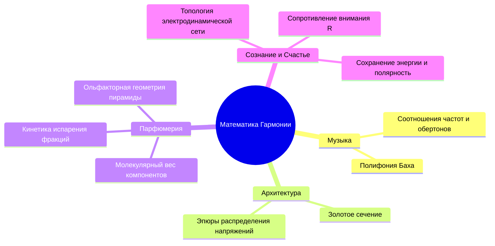
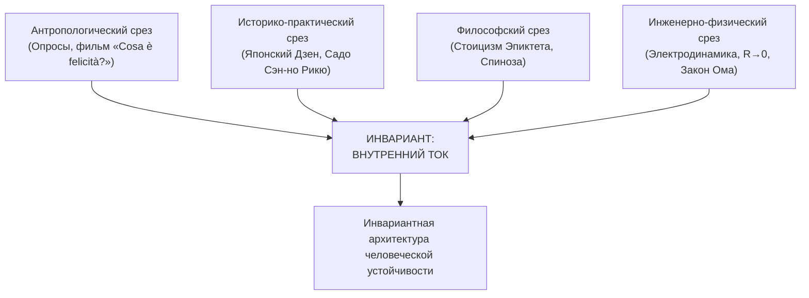

# Inner Current: Математика гармонии и принцип независимой сходимости

> «Математика — универсальный язык природы. Если она управляет музыкой и архитектурой, она неизбежно управляет парфюмерией и устойчивостью человеческого сознания.»

---

## 1. Преодоление раскола «физиков и лириков»

Разделение познания на холодный материализм формул и туманный сентиментализм философии — искусственный продукт эпохи Просвещения:
* **Пифагорейцы** доказывали, что музыка — это числовые дроби ($\frac{1}{2}$ — октава, $\frac{2}{3}$ — квинта).
* **Спиноза** строил законы этики и душевного блаженства строгим геометрическим методом (*more geometrico*).
* **Мастера восточных традиций** объединяли дух с телесной физиологией и упругостью лука.

> [!abstract] Миссия системы
> **Материализовать дух** (дать законы эксплуатации) и **одухотворить материю** (увидеть в физике формулу душевного покоя).

---

## 2. Математика невидимого: парфюмерия, стиль и гармония

Красота не случайна. За каждым эстетическим опытом стоит геометрия и кинетика.

### Парфюмерия как химическая стереометрия:
Парфюмерная пирамида подчиняется законам кинетики и летучести углеводородов:
* **Верхние ноты:** летучие цитрусовые эфиры и терпены с малым молекулярным весом ($0\text{–}15$ мин).
* **Ноты сердца:** средний вес и среднее давление пара ($2\text{–}4$ часа).
* **Базовые ноты:** тяжелые смолы, мускусы и древесные молекулы ($8\text{–}24$ часа).

Гармония парфюма — это баланс скоростей испарения, подобный музыкальному аккорду. Перевод стиля и ароматов в цифровую матрицу — это проявление фундаментальной геометрии природы.

---

## 3. Принцип независимой сходимости (Consilience)

Когда независимые дисциплины, разделенные веками и культурой, приходят к одним и тем же выводам, речь идет не о выдумке, а об **объективном законе реальности**:

1. **Документальный срез («Cosa è felicità?»):** Стеклодув счастлив в создании формы стекла своими руками и независимости от миллиардов. Винодел — в земле. Синьора — в покое. Они эмпирически описывают то, что в формулах называется прямым током без омического трения.
2. **Стоики:** Дихотомия контроля Эпиктета («в нашей власти» — Реактор, «не в нашей» — внешние лампочки).
3. **Электродинамика:** Закон сохранения энергии, омический перегрев Джоуля — Ленца.

---

## 4. Паровая машина человеческого счастья

Пар расширялся в кипящем чайнике тысячелетиями. Но инженеры **Ньюкомен и Уатт** создали цилиндр и поршень, превратив стихийное явление в паровую машину, совершающую полезную работу.

Система **«Внутренний ток»** переводит интуитивное переживание счастья из туманных абстракций в **прикладную, повторяемую диагностическую машину для отладки контура человека**.

---

## Связи
- [[04_Maps/Inner Current MOC|Inner Current MOC]]
- [[04_Maps/Anyanov System MOC|Anyanov System MOC]]
- [[02_Wiki/Inner Current (Diagnostic Machine and System Specification)|Машина для диагностики счастья]]
