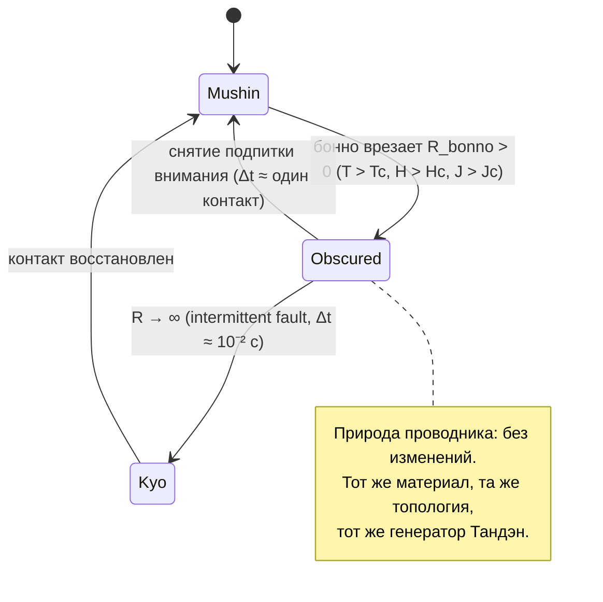

# 112. Мусин не исчезает, а затеняется (無心 под балластом бонно: срыв режима против утраты природы)

> [!quote] Закон Аньянова о затенении проводимости
> ### ⚡ **«Бонно не создаёт второй проводник и не уничтожает природу первого. Оно врезает балласт в тот же тракт: полезная мощность падает, провод греется, лампа Дэай тлеет. Но материал проводника остаётся тем же, топология — той же, генератор — тем же. Мусин не исчезает под бонно. Мусин затеняется.»**
> — **Владимир Аньянов**

> [!question] Вопрос главы
> **«Когда появляется бонно, Мусин пропадает?»**
> Ответ зависит от того, **что именно вы измеряете**: рабочий режим цепи или природу проводника. Это два разных вопроса, и смешение их порождает одну из самых дорогих ошибок практики — «я потерял состояние навсегда».

---

## 1. Разделение двух вопросов: режим против природы

| Что спрашивают на самом деле | Что измеряется | Ответ | Практическое следствие |
| :--- | :--- | :--- | :--- |
| «Проводит ли контур ток прямо сейчас?» | $R_{\text{bonno}}$, $I$, $U_{\text{load}}$, $Q$ | **Нет.** Режим $R \to 0$ сорван | Лампа Дэай тлеет, удар теряет массу, появляется нагрев и Кё (虚) |
| «Изменилась ли природа проводника?» | Материал, топология, номинал генератора $\mathcal{E}$ | **Нет.** Тот же контур, тот же источник, тот же обратный провод | Возврат возможен мгновенно, без «создания» Мусин заново |
| «Существует ли Мусин как свойство цепи?» | Обратимость фазового перехода | **Да.** Сверхпроводимость — это режим, а не орган и не заслуга | Состояние не «зарабатывается», а восстанавливается снятием причины |

Формула, которая удерживает оба ответа одновременно:

$$R_{\text{total}} = R_{\text{bonno}} + R_{\text{load}} \qquad \text{(сопротивление аддитивно)}$$

$$\text{Топология} = \text{const} \qquad \text{(идентичность цепи инвариантна)}$$

Сложение сопротивлений меняет **режим**. Оно не меняет **кто есть кто** в этой цепи: генератор остаётся Тандэном, нагрузка — Дэай, диэлектрик — тем же диэлектриком.

**Инженерная формулировка ответа:** вопрос «пропал ли Мусин?» некорректен без уточнения регистра. Корректно: *«сорван ли режим?»* — да; *«утрачена ли природа?»* — нет. Первое измеряется телеметрией, второе проверяется обратимостью.

---

## 2. Схемотехника срыва: три критических параметра

Сверхпроводимость срывается не «грехом», а выходом за критический параметр. Их три, и каждый даёт свой узнаваемый сорт бонно:

| Критический параметр | Что срывает режим $R \to 0$ | Как это выглядит в человеке | Телеметрия контура |
| :--- | :--- | :--- | :--- |
| **$T > T_c$** (критическая температура) | Тепловой шум | Спешка, раздражение, зажим шеи и плеч, «ум кипит» | $Q = I^2 R_{\text{bonno}} t > 0$: усталость приходит от трения, а не от работы |
| **$H > H_c$** (критическое поле) | Внешнее поле | Взгляд внешнего судьи: похвала, критика, статус, «как я выгляжу» | $R_{\text{bonno}}$ растёт ещё до первого движения: тело откликается на судью раньше действия |
| **$J > J_c$** (критическая плотность тока) | Форсирование тока | Жажда идеального результата, нажим, «выложился на 110%» | $U_{\text{load}} < \mathcal{E}$: мощность на нагрузке падает при росте усилия |

**Этимология 煩悩** («то, что терзает, беспокоит, нагревает и кипятит ум») — это прямое описание первого параметра: 2500 лет назад было сформулировано то же, что сегодня называется тепловым срывом сверхпроводящего состояния.

**Ключевая тонкость: срыв режима — не обрыв.** При $R_{\text{bonno}} > 0$ ток не равен нулю:

$$I = \frac{\mathcal{E}}{R_{\text{bonno}} + R_{\text{load}}} > 0$$

Лампа Дэай **тлеет**. Полное прекращение проводимости даёт только Кё (虚) — intermittent fault длительностью порядка $10^{-2}$ с, и даже он обратим. Отсюда «затенение», а не «исчезновение»: на приборах видно остаточный ток, остаточную мощность и остаточную связь с нагрузкой.

Диаграмма фиксирует главное: у состояния **Obscured** нет ветви в «потеряно навсегда». Из любого узла этой схемы есть обратный переход — потому что ни один из переходов не меняет идентичность тракта.

---

## 3. Оптический слой: пыль на зеркале и тучи на небе

Прикладной срез отвечает: «проводимости нет». Онтологический срез отвечает: «природа не тронута». Оба верны, потому что говорят о разных величинах. Оптическая модель позволяет увидеть **меру** затенения.

- **Зеркало.** Пыль на поверхности не меняет тело зеркала. Меняется только коэффициент передачи (отражения):

$$k = \frac{U_{\text{load}}}{\mathcal{E}} = \frac{R_{\text{load}}}{R_{\text{load}} + R_{\text{bonno}}} \in (0,\, 1]$$

При $R_{\text{bonno}} = 0$: $k = 1$ — зеркало отражает реальность без искажений (Мусин, 無心). При $R_{\text{bonno}} = R_{\text{load}}$: $k = 0{,}5$ — половина мощности при полной субъективной «загрузке». Числовая арифметика балласта разобрана в [[02_Wiki/Inner Current (The Bonno Resistor — Series Parasitic Ballast, Kyo Conductivity Dropout and the Return to Zero Ohm by Ohm)|главе 111]].

- **Небо.** Облака не являются веществом неба и не отменяют неба. Туча — не альтернативная субстанция, а рассеиватель в той же среде: свет на месте, меняется коэффициент пропускания.
- **Инженерный вывод.** Бонно **аддитивно по сопротивлению** и **мультипликативно по ущербу**, но **нейтрально по отношению к идентичности тракта**. Именно поэтому «выковыривание пыли» как отдельной сущности (борьба с собой, борьба с бонно) не работает: устранять нужно не субстанцию, которой нет, а номинал, который держится подпиткой внимания.

---

## 4. Сутра Помоста: 煩悩即菩提 — канон той же мысли

Формула **«бонно соку бодай» (煩悩即菩提)** стоит в «Сутре Помоста Шестого Патриарха» (六祖壇經, глава «Праджня» — 般若品第二, слова Хуэйнэна 慧能):

> 「善知識！凡夫即佛，煩惱即菩提。前念迷即凡夫，後念悟即佛；前念著境即煩惱，後念離境即菩提。」
>
> «Обычный человек — и есть Будда; омрачение — и есть пробуждение. Когда прежняя мысль заблуждается — это обычный человек; когда следующая мысль прозрела — это Будда. Когда прежняя мысль цепляется за объект — это омрачение; когда следующая мысль оставляет объект — это пробуждение.»

Инженер читает эту фразу буквально — **по тактам цепи**:

| Такт | Мысль | $R_{\text{bonno}}$ | Режим контура |
| :--- | :--- | :--- | :--- |
| $t-1$: 前念著境 | Цепляется за объект (оценка, страх промаха, идеал результата) | $> 0$ | Затенённый Мусин: $k < 1$, джоулев нагрев внутри системы |
| $t$: 後念離境 | Оставляет объект | $\to 0$ | Мусин: $k \to 1$, Дэай без задержки, вся разность потенциалов на лампе |

Один и тот же проводник. Один и тот же генератор Тандэн. Разница только в номинале балласта, а не в природе тракта. Именно это и означает 即 («есть», «тождественно»): не «омрачение превращается в пробуждение», а **«омрачение и пробуждение — два режима одной цепи»**. Слово 即 в этой формуле — точный инженерный термин, а не поэтическая вольность.

### 4.1. Два стиха из главы 行由品第一 — два протокола обслуживания

> **Шэньсю (神秀):** 「身是菩提樹，心如明鏡臺。時時勤拂拭，勿使惹塵埃。」
> «Тело — древо бодхи, ум — светлое зеркало. Старательно протирай его, чтобы не собрать пыли.»

> **Хуэйнэн (慧能):** 「菩提本無樹，明鏡亦非臺。本來無一物，何處惹塵埃。」
> «Бодхи — не древо, светлое зеркало — не подставка. Изначально нет ни одной вещи: где могла бы осесть пыль?»

Разница между стихами — не поэзия, а разные разделы инженерной документации:

- **Шэньсю — протокол эксплуатации:** номинал балласта не накапливать (режим работы с сопротивлением: $dR_{\text{bonno}}/dt \le 0$).
- **Хуэйнэн — описание природы:** проводник не портится по существу; «пыль» не образует отдельной субстанции, в которой можно закрепиться. Отсюда вытекает **мгновенность возврата**: возвращать нечего, потому что ничего не было потеряно.

Оба нужны, и они не конкурируют: стих Хуэйнэна объясняет, **почему** возврат стоит один контакт; стих Шэньсю объясняет, **как** не держать номинал включённым. Тревожное «протирание зеркала» — уже третье: это оценка собственной чистоты, то есть ещё один балласт.

---

## 5. Инженерное следствие: возврат — не достижение, а снятие причины

Балласт держится не сам по себе, а подпиткой внимания (оценкой результата, страхом промаха, фиксацией на «как я выгляжу»). Формально:

$$R_{\text{bonno}}(t) \;\xrightarrow[\;t = t^{*}:\ \text{внимание отпустило}\;]{}\; 0$$

Три свойства этого перехода, отличающие его от «достижения состояния»:

1. **Мгновенность.** Время восстановления измеряется одним дыханием и одним контактом, а не годами практики.
2. **Отсутствие накопления.** Возврат не пропорционален стажу, заслугам и добродетелям: он пропорционален снятому номиналу $R_{\text{bonno}}$.
3. **Отсутствие «создания заново».** Проводник не менял атомной природы, генератор не выключался, обратный провод реальности на месте — Мусин не нуждается в повторной сборке.

Отсюда главная ошибка интерпретации: **«я потерял состояние навсегда»** — это не отчёт о факте, а оценка потери. Оценка потери сама является балластом: страх потерять Мусин врезает в тракт ещё один резистор последовательно. Двойная врезка — двойной нагрев, и именно она порождает ощущение «с каждым разом вернуться всё труднее».

---

## 6. Критерий фальсифицируемости (Поппер)

Тезис «Мусин затеняется, но не уничтожается» проверяем. Различия между двумя гипотезами видны в телеметрии:

| Проверка | Если природа сохраняется | Если Мусин «уничтожается» |
| :--- | :--- | :--- |
| **Время восстановления** | Один выдох, один контакт, один удар | Длительная работа по «возвращению себя»: ступени, ретриты, годы |
| **Зависимость от заслуг** | Нет: восстановление пропорционально снятому $R_{\text{bonno}}$ | Пропорциональна стажу, рангу, числу прочитанных книг |
| **Остаточная проводимость** | Лампа тлеет: $I > 0$, $k > 0$ — режим подпорчен, природа на месте | Полная темнота ($I = 0$) даже без Кё |
| **Повторяемость** | Срыв и возврат воспроизводимы много раз за день без деградации | Каждый возврат «дороже» предыдущего и менее надёжен |

**Диагностическое правило:** если практика показывает рост времени восстановления и рост «стоимости» возврата — вы работаете не с балластом, а с его оправданием. Это уже другой диагноз (реестр балластов — в [[02_Wiki/Inner Current (The Bonno Resistor — Series Parasitic Ballast, Kyo Conductivity Dropout and the Return to Zero Ohm by Ohm)|главе 111]], разбор внешней оценки — в [[02_Wiki/Inner Current (Case Study — Tennis Tournament, External Judge Relay and the Protocol of Mushin in Competition)|кейсе 110]]).

---

## 7. Границы модели: $R = 0$ как предел, а не как роскошь

- **Идеализация честно названа.** У реальных сверхпроводников остаётся остаточное сопротивление, а состояние удерживается только внутри критических параметров. Система Аньянова пользуется $R \to 0$ как **нормативным эталоном** ([[02_Wiki/Inner Current (Fundamental Laws of the Happiness Thermodynamics)|Четвёртый закон: абсолютный эталон $R = 0$]]), а не как обещанием нуля по прибору.
- **Зачем нужен эталон.** Он позволяет сравнивать **режимы**, а не людей. Точка отсчёта лечит от сравнений: сравнивать нужно $k$ сегодня и $k$ вчера, а не свою лампу с чужой.
- **Затенение описывается коэффициентом, а не приговором.** [[02_Wiki/Inner Current (Fundamental Laws of the Happiness Thermodynamics)|Кинцуги-закон (Пятый закон)]] добавляет: каждый срыв заваривается золотом антихрупкости — если из него извлечён номинал, а не самооправдание.

---

## 8. Что это меняет практически

- **Не бороться с бонно как с субстанцией.** Второй фронт борьбы — второй последовательный резистор. Вы не сражаетесь с пылью: вы снимаете подпитку внимания.
- **Не верить в утрату состояния.** Формулировка «Мусин затенён» — не утешение, а точная диагностика: ищите номинал и его причину, а не «утраченный дар».
- **Не строить практику на страхе потери.** Страх потерять Мусин — балласт, врезанный в тракт самим понятием Мусин. Протокол (Шэньсю) и понимание природы (Хуэйнэн) работают вместе; тревожное протирание зеркала — нет.
- **Держать два среза ответа раздельно.** На вопрос «пропал ли Мусин?» корректный ответ: «режим сорван, природа не тронута, восстановление не требует сборки».

---

## 9. Итог главы

- **Бонно срывает режим сверхпроводимости, а не природу проводника**: $R_{\text{bonno}} > 0$ делит напряжение, гасит ток и греет систему, но не меняет ни материала, ни топологии, ни генератора Тандэн.
- **Оптическая модель точнее звучит так**: пыль на зеркале и тучи на небе меняют коэффициент передачи и пропускания ($k < 1$), а не тело зеркала и не бытие неба.
- **Три критических параметра дают три сорта бонно**: тепловой шум ($T > T_c$), внешнее поле судьи ($H > H_c$), форсирование результата ($J > J_c$). Этимология 煩悩 («нагревает и кипит ум») — прямое описание первого срыва.
- **«Бонно соку бодай» (煩悩即菩提) из «Сутры Помоста»** фиксирует тождество: 前念著境即煩惱，後念離境即菩提 — одна и та же цепь в двух тактах, а не две субстанции.
- **Стих Хуэйнэна** (「本來無一物，何處惹塵埃」) даёт онтологический срез — природа не портится; **стих Шэньсю** — протокольный: номинал не накапливать.
- **Возврат — снятие причины, а не достижение**: мгновенен, не пропорционален стажу, не требует «создания» Мусин заново.
- **Страх потерять состояние — это балласт**, врезанный в тракт самим понятием состояния: вторая последовательная врезка даёт двойной нагрев и иллюзию деградации.

---

## Connections

- [[04_Maps/Inner Current MOC|Inner Current MOC (Мастер-карта цепи)]]
- [[02_Wiki/Inner Current (The Bonno Resistor — Series Parasitic Ballast, Kyo Conductivity Dropout and the Return to Zero Ohm by Ohm)|111. Резистор Бонно]] — предыдущая глава: арифметика балласта, Кё (虚), реестр омрачений и 5-шаговый протокол $R_{\text{bonno}} \to 0$.
- [[02_Wiki/Inner Current (Complete Zen-Electrodynamic Ontological Atlas)|13. Полный онтологический атлас: биекция канонов Дзен и электродинамики]] — узел 04 (Мусин 無心) и узел 12 (Бонно 煩悩), к которым относится настоящая глава.
- [[02_Wiki/Inner Current (Physics of Presence and Superconductivity)|02. Физика присутствия и состояние сверхпроводимости]] — определение Мусин как $R \to 0$ и закон Джоуля — Ленца.
- [[02_Wiki/Inner Current (Nature and Illusion of Ego)|07. Природа и иллюзия эго]] — демистификация Анатта и Майя через шунтирование $R_{ego}$: почему омрачения не являются субстанциями.
- [[02_Wiki/Inner Current (Circuitry of Existential Fault and Ground Leak)|28. Схемотехника экзистенциальной аварии]] — топологический дуализм: последовательный балласт против параллельной утечки на землю.
- [[02_Wiki/Inner Current (Fundamental Laws of the Happiness Thermodynamics)|20. Фундаментальные законы термодинамики счастья]] — Четвёртый закон (абсолютный эталон $R = 0$) и Пятый (Кинцуги-закон антихрупкости).
- [[02_Wiki/Inner Current (Case Study — Tennis Tournament, External Judge Relay and the Protocol of Mushin in Competition)|110. Кейс-стади: теннис на турнире]] — практическое поле внешнего судьи ($H > H_c$) и протокол возврата в Мусин между розыгрышами.
- [[02_Wiki/Inner Current (Happiness Dashboard and Superconductivity Telemetry)|16. Дашборд счастья]] — телеметрия $R, I, Q$ и коэффициент передачи $k$ как измеримые величины этой главы.
- [[02_Wiki/Inner Current (Satori as the Superconducting Phase Transition — Meissner Effect, Collapse of Bonno Resistance to Zero and Full Circuit Efficiency)|113. Сатори как фазовый переход в сверхпроводимость]] — обратная сторона трёх критических параметров: прохождение точки $T_c$ целиком, эффект Мейснера $\vec{B} = 0$ и КПД $\eta = 100\%$.
- [[02_Wiki/Inner Current (Neurobiology of Superconductivity — DMN, TPN and Vagus Grounding)|29. Нейробиология сверхпроводимости]] — DMN как аппаратный реостат: почему срыв режима обратим на уровне контура.
- [[04_Maps/Inner Current Book MOC|📖 Книга: «Внутренний ток: Архитектура счастья»]]
