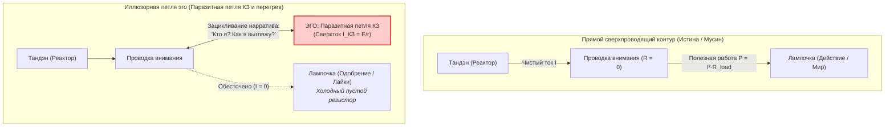

# Inner Current: Природа и иллюзия эго (Демистификация мировых религий)

> «Эго не создает полезной работы. Это не сущность и не творец — это паразитный реостат и фазовая ошибка ума, сжигающая силу чистого намерения в омическом выгорании.»

---

## 1. Вековая загадка: О чем на самом деле говорят мировые традиции

На протяжении тысячелетий ключевые философские и духовные учения человечества независимо друг от друга указывали на один и тот же фундаментальный закон — **иллюзорность обособленного человеческого «Я» (эго)**:

* **Буддизм (Анатта / Анатман):** Нет неизменного, постоянного «Я». Личность — это лишь временный поток сменяющих друг друга скандх (агрегатов восприятия и памяти).
* **Адвайта-веданта (Майя):** Концепт отдельного субъекта — это оптический обман (*майя*), скрывающий целостную природу единого источника.
* **Дзен (Мусин — 無心):** Состояние «не-ума», при котором рассудочный наблюдатель исчезает, оставляя чистое, непосредственное действие.
* **Даосизм (У-вэй):** Недеяние из эго-намерения; спонтанное следование потоку жизни без искусственного сопротивления.
* **Христианский мистицизм (Кенозис):** Самоопустошение ради единения с Божественным («Кто потеряет душу свою... тот сбережет ее»).
* **Суфизм (Фана):** Полное растворение индивидуального эго в сиянии Истины.

### Барьер восприятия для современного человека
Для современного человека (инженера, предпринимателя, разработчика, исследователя) традиционный язык этих истин звучит архаично:
1. Он оброс **мистикой, религиозными догмами и морализаторством** («гордыня — грех», «эго — зло»).
2. Он часто воспринимается как **призыв к слабости, подавлению воли или аскетизму** («убей желания», «стань никем»).
3. В нем нет **измеримой физической механики**, объясняющей, *почему именно* эго приносит страдания и как конкретно его отключить.

Система **«Внутренний ток» (Inner Current)** снимает этот барьер, переводя древнюю интуицию в **строгие, проверяемые факты электродинамики и схемотехники**.

---

## 2. Инженерное определение эго

> [!IMPORTANT]
> **Инженерная формула:**
> **Эго** — это не субстанция, не самостоятельный орган и не «душа». Это **паразитный софтверный шум и внутренняя петля короткого замыкания**, возникающая при самозацикливании внимания на нарративе о себе.

---

## 3. Четыре физических доказательства иллюзорности эго

### Факт 1. Аппаратный факт: Отсутствие детали «Эго» на плате (Hardware Check)
Если физически исследовать топологию человеческой энергосистемы, мы найдем три реальных узла:
1. **Источник ЭДС (Тандэн):** витальная энергия тела, клеточный метаболизм, дыхание, импульс действия.
2. **Проводник (Канал внимания):** сенсорный аппарат восприятия, фокус нейронов, зрение, слух, проприоцепция.
3. **Нагрузка (Физический мир):** код, инструмент, чашка чая, собеседник, холст.

**Где физический микрочип «Эго»?**
Его нет. В нейробиологии нет единого центра «эго» — есть лишь дефолт-система мозга (DMN), компилирующая автобиографический нарратив, пока внимание не занято прямой деятельностью. Эго существует в том же статусе, что и экранная заставка компьютера: пока процессор свободен, заставка летает по экрану; как только поступает реальная нагрузка — заставка мгновенно исчезает.

---

### Факт 2. Временной факт: Полная аннигиляция эго в точке $t = \text{now}$
Все законы физики, электродинамики и термодинамики работают **строго в текущий квант физического времени ($t_0$)**.
* Когда вы отдергиваете руку от раскаленной сковороды, ловите падающую чашку, выводите автомобиль из заноса или делаете идеальный глоток горячего чая — **где в эту миллисекунду ваше эго?**
* Оно полностью отсутствует. В точке прямого физического действия нет мысли «Кем я являюсь?», нет сравнения себя с другими, нет страха критики.
* Эго способно существовать **исключительно в виртуальных временных симуляциях**:
  * $L_{past}$ — паразитная индуктивность прошлого («Надо было сказать иначе...», стыд, вина);
  * $C_{future}$ — паразитная емкость будущего («А вдруг я провалюсь?», синдром самозванца).

> [!NOTE]
> Если феномен **моментально распадается в единственной реально существующей точке времени** и существует лишь как виртуальный рендеринг памяти и фантазии — по строгим законам физики он является **иллюзией**.

---

### Факт 3. Термодинамический факт: Эго производит только трение, а не работу
Эго всегда претендует на роль главного генератора: *«Это Я создал шедевр! Это Я заработал миллион! Это Я страдаю!»*.

Однако закон сохранения энергии и баланс мощностей говорят об обратном:
* Мощность полезной работы: $P_{useful} = I^2 \cdot R_{load}$.
* Тепловые потери (выгорание): $Q = I^2 \cdot R_{ego} \cdot t$.

Чем сильнее эго вмешивается в процесс деятельности:
* тем больше ресурса процессора сжигается на мониторинг чужого мнения и защиту своего имиджа;
* тем выше паразитное сопротивление цепи $R_{ego}$;
* тем сильнее омический перегрев (паника, прокрастинация, истощение);
* тем ниже итоговый КПД действия.

Все величайшие открытия, прорывы в коде и шедевры искусства рождаются в состоянии **потока (Мусин)** — ровно тогда, когда автора «не было дома», когда эго выключилось. **Эго ничего не создает: творит чистый ток Тандэна, а эго лишь присваивает копирайт и собирает налог на трение.**

---

### Факт 4. Топологический факт: Невозможность питания от пассивного отражения
Главный трюк эго — вера в то, что оно наполнится жизненной силой, если внешняя среда пришлет сигнал одобрения:
$$\text{«Вот когда эта лампочка (статус, признание, похвала, капитал) засияет — я наконец стану счастливым».}$$

С точки зрения электротехники это очевидный сбой:
* Лампочка — это пассивный потребитель. В ней физически нет генератора ЭДС.
* Попытка запитать себя от свечения лампочки — это попытка построить вечный двигатель на самообмане.
* Результат попытки питаться обратным током всегда один: **глушение внутренней станции (апатия, депрессия, экзистенциальный крах)**.

---

## 4. Сравнительная матрица: Мистические традиции vs Инженерная физика

| Мировая традиция / Термин | Архаичный язык | Инженерный факт системы «Внутренний ток» |
| :--- | :--- | :--- |
| **Буддизм: Анатта** | «Нет постоянной души/Я» | Отсутствие аппаратного узла эго на плате контура; эго — виртуальный софтверный шум сигнального тракта. |
| **Адвайта: Майя** | «Мир форм — иллюзия» | Ошибка топологии: попытка принять пассивного потребителя (лампочку) за источник ЭДС. |
| **Дзен: Мусин (無心)** | «Не-ум, сознание как зеркало» | **Сверхпроводимость цепи ($R \to 0$):** шунтирование реостата эго, ток течет мгновенно и без потерь мощности. |
| **Даосизм: У-вэй** | «Недеяние, следование Дао» | Нулевое внутреннее сопротивление; устранение паразитного вмешательства реостата в естественный ток жизни. |
| **Христианство: Смирение** | «Укрощение гордыни» | Восстановление естественной полярности: ток отдается в мир (созидание), а не высасывается из него. |
| **Чайный канон: Нидзиригути** | «Снятие мечей перед чайной» | **Аппаратный сброс эго:** принудительное отключение социальных ролей для перехода в сверхпроводящий режим. |

---

## 5. Практический вывод: Протокол шунтирования эго

Бороться с эго бессмысленно — любая «борьба с эго» становится новым нарративом того же самого эго о своей святости и духовных успехах.

Инженерное решение — **шунтирование (Bypass)**:
1. **Сенсорное заземление:** перенос 100% фокуса в физические сенсорные датчики прямо сейчас (давление стоп на пол, тактильный отклик клавиш, температура воздуха, дыхание). Когда сенсорный буфер полон, эго аннигилирует само.
2. **Восстановление вектора отдачи:** переход от вопроса *«Что мир/проект даст мне для подтверждения "Я"?»* (замыкание в петлю эго) к вопросу *«Какую мощность и качество я отдаю в нагрузку прямо сейчас?»* (чистый ток в дело).
3. **Изоляция Circuit Breaker:** проект может завершиться успешно или потерпеть крах — это состояние лампочки. Тандэн всегда остается автономным и целым.

> **Итог:** Когда иллюзия эго разоблачена законами физики, человеку больше не нужно слепо верить в догмы. Он просто эксплуатирует свой контур в режиме сверхпроводимости с КПД $100\%$.

---

## 🔗 Связи
- [[04_Maps/Inner Current MOC|Inner Current MOC]]
- [[02_Wiki/Inner Current (Core Topology and Polarity Law)|01. Базовая топология цепи и закон полярности]]
- [[02_Wiki/Inner Current (Physics of Presence and Superconductivity)|02. Физика присутствия: состояние сверхпроводимости]]
- [[02_Wiki/Inner Current (Scale Invariance and Tea Ceremony)|03. Инвариантность масштаба нагрузки: от чая до империи]]
- [[02_Wiki/Inner Current (Safety, Antifragility and Zanshin)|04. Предохранители цепи, ваби-саби и антихрупкость]]
- [[02_Wiki/Inner Current (Mathematics of Harmony and Consilience)|05. Синтез физики и духа: математика гармонии]]
- [[02_Wiki/Inner Current (Diagnostic Machine and System Specification)|06. Машина для диагностики счастья]]
