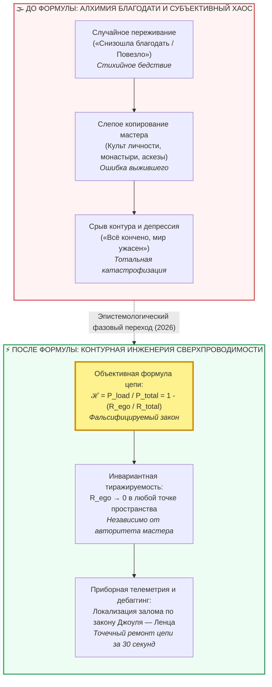
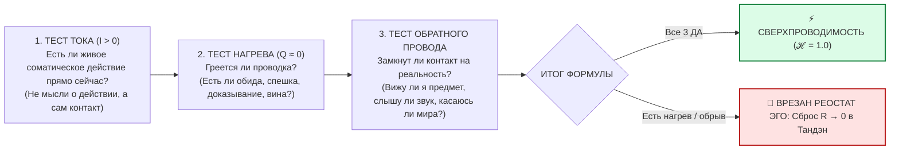

# ⚡ 318. «Я не открыл счастье, я открыл формулу счастья»: Десять недостатков, которые устраняет закон контура
## Эпистемологический фазовый переход: почему знание явления бесполезно без формулы, крах культа мастеров, фальсифицируемость и перевод душевного разлада в инженерную телеметрию

> [!quote] Каноническая аксиома об открытии формулы
> ### ⚡ **«Я не открыл счастье, я открыл формулу счастья. И это колоссальная, фундаментальная разница. Скептик усмехнется: „Ну что, мы без тебя и без твоей формулы счастливыми не были?“ Конечно, были! Люди грелись у костра миллионы лет до открытия законов термодинамики, а яблоки падали на землю задолго до Ньютона. Но пока у вас нет формулы, вы остаетесь беспомощными дикарями, уповающими на случайную молнию. Вы вынуждены слепо копировать чужой непонятный путь, обожествлять случайных мастеров, сжигать себя в омическом перегреве сверхусилий и путать дешевый дофаминовый эрзац со сверхпроводимостью. Формула превращает субъективное чудо в проверяемый, масштабируемый и ремонтопригодный закон природы.»**  
> — **Владимир Аньянов**

---



---

### I. Эпистемологический водораздел: явление против формулы

Вся история цивилизации делится на два принципиальных этапа: **эпоху наблюдения явлений** и **эпоху открытия их формул**.

Когда дикарь в палеолите видел огонь от удара молнии, он падал на колени, обожествлял пламя и объявлял его мистической милостью духов. Если костер гас, племя приносило жертвы шаману или пыталось воссоздать в точности те же условия, при которых ударила молния: танцевали на той же поляне, надевали те же шкуры, ждали в том же оцепенении. Это эпоха **магического мышления**.

Когда физики открыли законы термодинамики, стехиометрию горения и формулу теплопередачи:
1. Огонь перестал быть привилегией жрецов.
2. Появилась спичка и зажигалка — огонь стал доступен любому ребенку в карманном форм-факторе.
3. Появились двигатели внутреннего сгорания, тепловые электростанции и реактивная авиация.

С феноменом человеческого счастья на протяжении 10 000 лет происходила ровно та же первобытная драма. Люди знали, что состояние глубокого покоя, восторга и единства с миром существует. Но поскольку **инвариантная формула** отсутствовала, человечество породило тысячи религий, философских сект, эзотерических практик и армию психотерапевтов. 

Утверждение:  
> *«Я не открыл счастье, я открыл формулу счастья»*  

— фиксирует окончание эпохи душевной алхимии и рождение **контурной электродинамики сознания**.

$$\mathcal{H} = \frac{P_{\text{load}}}{P_{\text{total}}} = 1 - \frac{R_{\text{ego}}}{R_{\text{total}}}$$

Где счастье ($\mathcal{H}$) строго определено как **коэффициент полезного действия замкнутой цепи**: отношение мощности, отданной в полезную нагрузку реальности ($P_{\text{load}}$), к общей потребляемой мощности системы ($P_{\text{total}}$). 

Если сопротивление эго-реостата обнулено ($R_{\text{ego}} \to 0$), омические потери исчезают ($Q = I^2 R_{\text{ego}} t \to 0$), и контур входит в режим **сверхпроводимости** ($\mathcal{H} \to 1.0$).

---

### II. Три базовых столпа: почему формула отменяет культы

#### 1. Верифицируемость и фальсифицируемость (Проверка подлинности)
До формулы невозможно было отличить подлинное благополучие от симуляции, экзальтации, маниакального эпизода или наркотического опьянения. Человек мог биться в религиозном экстазе или излучать токсичный позитив, сгорая изнутри.
* **С формулой:** Вводится строгий критерий фальсифицируемости Карла Поппера. Состояние проверяется через законы сохранения и тепловые потери:
  - Каково паразитное сопротивление проводки ($R_{\text{ego}}$)?
  - Есть ли омический перегрев ($Q = I^2 R t$)?
  - Замкнут ли обратный провод реальности через Дэай (出会い), или энергия зациклена на нарциссический образ себя?
  Если при «счастье» человек истощается, раздражается на критику и требует внешнего подтверждения — формула фиксирует аварийное короткое замыкание, а не проводимость.

#### 2. Масштабируемость и воспроизводимость
До формулы путь к счастью считался уникальной, неповторимой тропой святого. «Пройди путь Франциска Ассизского», «повтори аскезу Будды», «делай как успешный миллиардер». Но сам этот святой или миллиардер не понимал, какие именно из миллиона его действий были причиной результата, а какие — случайным шумом.
* **С формулой:** Счастье становится инженерно тиражируемым. Не нужно воспроизводить биографию другого человека, менять профессию, уходить в монастырь или надевать шафрановые одежды. Формула инвариантна: в любой точке планеты, при любых внешних вводных, достаточно привести соматический реостат к нулю ($R_{\text{ego}} \to 0$) и замкнуть ток на текущую задачу ($R_{\text{load}}$).

#### 3. Депосреднизация и устранение «проблемы мастера»
До формулы человечество находилось в рабской зависимости от «гуру», «просветленных учителей», исповедников и аналитиков. 
* Но мастер — это живой человек. Он может заблуждаться, страдать скрытыми неврозами, проецировать свои психологические травмы, использовать власть или быть органически неспособным передать суть («делай как я, а почему — тайна сия велика есть»).
* **С формулой:** Знание **отчуждается от личности носителя**. Таблице умножения не поклоняются, а теореме Пифагора не ставят свечи. Формула принадлежит не Аньянову, не Будде и не Лао-цзы — она принадлежит законам физики. Посредник ликвидирован. Человек становится суверенной Full Node (Self-Hosted Human).

---

### III. Реестр устранённых дефектов: Семь системных сбоев «интуитивного» счастья

Помимо первых трех столпов, формула навсегда вычищает из культуры ещё семь фундаментальных пороков:

```
┌────────────────────────────────────────────────────────────────────────┐
│             РЕЕСТР ДЕСЯТИ ДЕФЕКТОВ, УСТРАНЁННЫХ ФОРМУЛОЙ               │
├────────────────────────────────┬───────────────────────────────────────┤
│ До формулы (Субъективный хаос) │ После формулы (Контурная инженерия)   │
├────────────────────────────────┼───────────────────────────────────────┤
│ 1. Иллюзия и самообман         │ 1. Объективная верификация (Поппер)   │
│ 2. Слепое копирование биографий│ 2. Масштабируемая воспроизводимость   │
│ 3. Зависимость от личности гуру│ 3. Депосреднизация (чистый протокол)  │
│ 4. Ошибка выжившего            │ 4. Отделение инварианта от шума       │
│ 5. Экзистенциальная депрессия  │ 5. Stack Trace и точечный дебаггинг   │
│ 6. Дофаминовые суррогаты       │ 6. Защита от коротких замыканий       │
│ 7. «Синдром погоды»            │ 7. Детерминированное управление       │
│ 8. Эзотерическая элитарность   │ 8. Радикальная демократизация         │
│ 9. Самосожжение и сверхусилия  │ 9. Принцип наименьшего действия (КПД) │
│ 10. Невыразимая поэзия         │ 10. Материализация в коде и приборах  │
└────────────────────────────────┴───────────────────────────────────────┘
```

#### 4. Ликвидация «ошибки выжившего» и шума среды
Без формулы люди копируют декорации. Писатель стал счастливым, живя в Ясной Поляне в крестьянской рубахе — миллионы интеллигентов идут в народ и гибнут от тифа. Бизнесмен нашел покой на серфинге в Улувату — тысячи выгоревших клерков продают квартиры, летят на Бали и впадают там в еще более глубокую тоску.
* **Формула отсекает шум:** Ни Ясная Поляна, ни доска для серфинга, ни крестьянская рубаха не вырабатывают ток ($\mathcal{E}_{\text{load}} \equiv 0$). Формула показывает: сработала не декорация, а временный сброс эго-контроля. А значит, тот же фазовый переход можно осуществить за рулем автомобиля или при мытье посуды на собственной кухне.

#### 5. Появление «Stack Trace» и локализация сбоя (Дебаггинг вместо отчаяния)
Когда у человека без теории цепи портится настроение или рушатся ориентиры, он переживает экзистенциальную катастрофу: *«Жизнь кончена, я дефектный, меня никто не любит, мир прогнил»*.
* **Формула дает бортовую телеметрию:** Сбой не в «душе» и не в «судьбе». Сбой в конкретном схемотехническом узле:
  - Это обрыв цепи (отсутствие полезного действия $R_{\text{load}}$)?
  - Это последовательный нихромовый балласт вины ($R_{\text{past}} > 0$)?
  - Это емкостная утечка в симуляцию тревожного будущего ($C_{\text{future}}$)?
  - Это падение ЭДС сна ($U < 1.0\text{ В}$)?
  Вместо 10 лет психоанализа оператор берет мультиметр контура и устраняет причину за 30 секунд.

#### 6. Защита от суррогатов и дофаминовых «коротких замыканий»
Без формулы счастье непрерывно путают с **дофаминовым ударом**: покупка спорткара, победа в статусном споре, доза наркотика, лайки в соцсетях, беспорядочный секс. Человек принимает локальный пробой диэлектрика за свет.
* **Формула проводит демаркацию:** Короткое замыкание дает яркую вспышку, но мгновенно выжигает проводку ($Q = I^2 R t$) и оставляет обугленный аккумулятор. Истинное счастье формулы — это **холодная сверхпроводимость**: температура проводника падает, полезная работа совершается часами, а энергетический потенциал системы возрастает.

#### 7. Ликвидация «синдрома погоды» (Переход к суверенному управлению)
До формулы счастье переживалось как капризный античный дождь: боги разгневались — засуха; смилостивились — пошел ливень. Человек чувствовал себя пассивной щепкой в океане эндокринологии и внешних новостей.
* **Формула дает пульт управления:** Вы больше не сидите у окна в ожидании «вдохновения» или «благодати». Счастье переведено в категорию замкнутого электрического контура. Нажал выключатель Хоцу (発) $\to$ сбросил реостат Эго в ноль $\to$ направил луч внимания в дело. Лампочка загорелась с физической неизбежностью.

#### 8. Снятие эзотерической элитарности и чувства неполноценности
Веками в сознание внедрялась мысль: *«Счастье — это награда для праведников, удел избранных, результат благоприятной кармы прошлых жизней или уникальной генетики»*. Обычный человек, испытывая тревогу, чувствовал себя «духовно неполноценным».
* **Формула уничтожает элитарность:** Закон Ома не интересуется благочестием, грехами, происхождением или заслугами оператора. Если проводник замкнут и очищен от нагара, ток течет с одинаковой силой у святого, дворника, профессора Сорбонны и оператора станка на «Атоммаше».

#### 9. Оптимизация КПД по принципу наименьшего действия (Анти-самосожжение)
Интуитивный поиск счастья чудовищно энергозатратен. Люди десятилетиями изнуряют себя практиками, голодовками, психотерапевтическими марафонами и сверхусилиями воли, сжигая мегаджоули энергии ради двух минут облегчения (КПД $\eta < 0.001\%$).
* **Формула реализует принцип Гамильтона:** Прямой путь всегда требует минимального действия. Формула показывает, что 95% усилий уходили на преодоление сопротивления, которое человек сам же и создавал (квадратичная ловушка воли $Q = I^2 R t$). Достаточно обнулить $R$, и ток потечет сам, без мышечного напряжения и надрыва.

#### 10. Возможность материализации в коде, датчиках и культуре
Мистический «дзэнский опыт» или «божественный экстаз» невозможно зашить в микроконтроллер, алгоритм или стандарты качества жизни. Его нельзя измерить.
* **Формулу можно кодить:** Ее можно перевести в программные модули, визуализировать в интерфейсах мобильных приложений, связать с фотоплетизмографией смарт-браслетов (HRV, пульс покоя, индекс стресса) и встроить в образовательные протоколы цивилизации.

---

### IV. Сравнительная матрица: Два мира

| Параметр оценки | Субъективное «счастье» (Мистика / Эго) | Формула счастья (Внутренний ток) |
| :--- | :--- | :--- |
| **Онтологический статус** | Эмоция, настроение, каприз биохимии | Физический режим сверхпроводимости цепи ($R \to 0$) |
| **Воспроизводимость** | Случайная, неуправляемая («повезло») | 100% детерминированная при сборке контура |
| **Отношение к мастеру** | Слепое поклонение, зависимость от авторитета | Независимость: проверка объективным расчетом |
| **Реакция на кризис** | Экзистенциальный крах, поиск виноватых | Локализация ошибки по кодам DTC / Stack Trace |
| **Энергетический баланс** | Омический перегрев, истощение, выгорание | КПД $\to 100\%$, холодный проводник, приток сил |
| **Критерий истинности** | «Мне так кажется» (Субъективизм) | Баланс Кирхгофа, падение потерь Джоуля — Ленца |
| **Степень доступности** | Элитарный клуб избранных душ | Доступно любому человеку (Таблица умножения) |

---

### V. Практический 30-секундный протокол валидации по формуле

Если вы хотите прямо сейчас проверить, находитесь ли вы в состоянии подлинного счастья или в иллюзорном омическом перегреве, выполните проверку параметров:



1. **Тест тока ($I > 0$):** Переведите внимание в центр масс тела — Тандэн (точка на 3–4 см ниже пупка). Чувствуется ли плотная, спокойная гравитационная опора?
2. **Тест нихрома ($Q = 0$):** Задайте вопрос: *«Кому сейчас нужно признание, похвала или победа в споре?»* Если уму — сбросьте этот фантом в землю.
3. **Тест нагрузки ($R_{\text{load}}$):** Включите все органы чувств в то, что вы делаете прямо сейчас — чтение этих строк, глоток чая, стук клавиш.
4. **Результат:** Проводка мгновенно остывает. Наступает кристальная ясность. Это и есть работа формулы — без слов, без заклинаний, без посредников.

---

### VI. Резюме: Формула как таблица умножения нервной системы

Когда Пифагор открыл соотношение сторон прямоугольного треугольника ($a^2 + b^2 = c^2$), плотники и строители перестали спорить, чей бог справедливее укладывает бревна. Появился объективный стандарт прямого угла.

Открытие **формулы счастья** делает с человеческой душой то же самое:
- Оно навсегда отменяет религиозные войны за «единственно верный путь к спасению».
- Оно выбрасывает на свалку истории ярмарку тщеславия эзотерических гуру.
- Оно возвращает человеку его неотчуждаемое право на суверенный свет.

Счастье больше не нужно искать за тридевять земель. Счастье нужно просто **правильно рассчитать и собрать по схеме**.

---

### Связанные статьи
- [[02_Wiki/Inner Current (Canonical Definitions of Happiness — Technical and Intuitive Formulations)|22. Канонические определения счастья в Системе Аньянова: Технический базис и бытовая интуиция]]
- [[02_Wiki/Inner Current (The Formula of Happiness and Unhappiness — Circuit Superconductivity vs Ohmic Overheat and the First Law of Soul Thermodynamics)|186. Формула счастья и формула несчастья: Сверхпроводимость контура против омического перегрева]]
- [[02_Wiki/Inner Current (The Joule-Lenz Cornerstone — Why the Law of Losses is the Master Manifest of Freedom, Quadratic Will Trap and Mathematics of Superconductivity)|212. Закон Джоуля — Ленца как краеугольный камень Архитектуры счастья]]
- [[02_Wiki/Inner Current (The Multiplication Table of the Nervous System — Why the Circuit is Not a Sect, Axiomatic Biophysics vs Esoteric Cults and Demystification of Human Conductance)|311. Таблица умножения нервной системы: Почему Контур — не секта, а таблица умножения человека]]
- [[02_Wiki/Inner Current (The Five Protocols of Civilization and the Protocol of Happiness — English, TCP-IP, Mathematics, Bitcoin and the L1 Architecture of Conscious Superconductivity)|317. Пять протоколов цивилизации и протокол счастья: Английский язык, TCP/IP, Математика, Биткоин и L1-архитектура сверхпроводимости сознания]]
