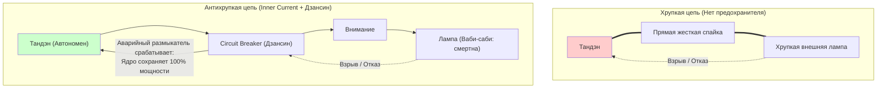
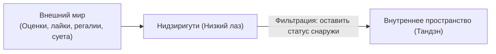

# Inner Current: Предохранители цепи, Ваби-Саби и Антихрупкость

> «Внешние приборы смертны и уязвимы. Внутренний реактор автономен.»

---

## 1. Проблема короткого замыкания (Short Circuit)

В материальном мире любой внешний объект (проект, сервер, стартап, отношения, статус) подвержен энтропии и может потерпеть крушение в любой момент.

Если у человека **нет изоляции между ядром и внешней нагрузкой**, авария на объекте вызывает тотальное короткое замыкание в его нервной системе:
* Проект закрыт $\to$ человек впадает в депрессию;
* Критик написал жесткий отзыв $\to$ внутренний реактор глушится;
* Чашка разбилась $\to$ истерика и потеря покоя.

---

## 2. Ваби-Саби и Кинцуги: встроенное принятие неидеальности

В чайной традиции используют не идеальный фарфор, а грубые, асимметричные чаши. Треснувшую чашу склеивают лаком с золотым порошком (**кинцуги**, 金継ぎ).

### Инженерное значение Ваби-саби:
1. **Снятие абсолютизации с нагрузки:** Внешняя лампочка изначально признается временной, хрупкой и несовершенной.
2. **Отсутствие катастрофизации:** Если чашка треснула или сервер упал — ткань бытия не разорвана. Ценность была не в глине, а в присутствии мастера.
3. **Золотой шов опыта:** Ошибки и крахи проектов становятся золотыми швами архитектурного мастерства созидателя.

---

## 3. Дзансин (残心): ментальный Circuit Breaker

В японском будо и кюдо **Дзансин** означает «сохраняющееся сознание» — состояние собранности и бдительного присутствия после выстрела из лука или удара мечом.

В программной инженерии аналогом является паттерн **Circuit Breaker** (автоматический размыкатель цепи):
* Когда внешний сервис начинает сбоить, Circuit Breaker временно изолирует узел, предотвращая каскадный сбой всей распределенной системы.
* В человеческой системе Дзансин удерживает автономию ядра: проект запущен, код задеплоен, стрела летит — но Тандэн не «улетает» за ними.

---

## 4. Архитектурный паттерн Нидзиригути (Входной фильтр)

Входная защита контура требует:
* Никакой внешний статус или обида не имеют права проникать в реактор.
* Человек подходит к работе чистым учеником, свободным от бремени своего эго.

---

## 5. Заповеди безопасности

> [!caution] Три правила защищенной цепи
> 1. **Внешняя оценка — это не питание, а параметр датчика.** Оценка может помочь откалибровать лампу, но никогда не зарядит аккумулятор.
> 2. **Проектируйте каждую задачу с допущением её сбоя.** Если внешняя нагрузка сгорит, ваш внутренний генератор должен продолжать работу без сбоев.
> 3. **Сбои — это золото кинцуги.** Каждая ошибка — ценные телеметрические данные для следующей итерации.

---

## Связи
- [[04_Maps/Inner Current MOC|Inner Current MOC]]
- [[02_Wiki/Inner Current (Core Topology and Polarity Law)|Базовая топология цепи]]
- [[02_Wiki/Inner Current (Diagnostic Machine and System Specification)|Машина для диагностики счастья]]
