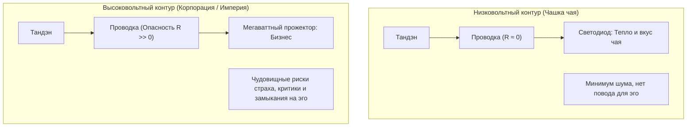
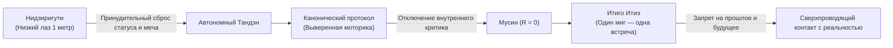

# Inner Current: Инвариантность масштаба нагрузки и Чайная церемония

> «Масштаб нагрузки не меняет законов электродинамики. Но на простых вещах законы видны невооруженным глазом.»

---

## 1. Фундаментальный принцип инвариантности масштаба

В системе **Inner Current** постулируется строгий закон:  
**Законы электродинамики неизменны при любом номинале мощности нагрузки.**

$$\text{Тандэн (Реактор)} \xrightarrow{\quad \text{Внимание} \quad} \text{Лампочка (Нагрузка)}$$

Контур работает по одной и той же топологии, когда человек делает глоток чая или строит транснациональную экосистему. Однако сложность удержания стабильности цепи кардинально различается.

---

## 2. Почему в «простых вещах» счастье видно невооружённым глазом

Люди веками повторяют формулу: *«Счастье — в простых вещах»* (это наглядно показано и в документальных свидетельствах, например, в фильме «Cosa è felicità?», где стеклодувы, крестьяне и пожилые люди говорят о чашке эспрессо, тишине и любимой работе).

Инженерная модель «Внутренний ток» дает этому математическое объяснение:

1. **Отсутствие давления эго:**
   * Держа в руках чашку чая, человек не задается вопросом: *«А достаточно ли я успешен в этом глотке?»*, *«Что скажут инвесторы о том, как я держу чашку?»*.
   * Отсутствие социального давления приводит к **естественному падению внутреннего сопротивления ($R \to 0$)**.
2. **Отсутствие иллюзии источника:**
   * Никто не ожидает, что чашка чая решит все экзистенциальные проблемы и придаст величие. Никому не приходит в голову требовать от фарфора подпитки своего «Я». Ток спокойно течёт из человека в восприятие напитка ($I > 0$).

---

## 3. Почему «империя» разрушает неподготовленного человека

Когда человек подключает к своему контуру мощнейшую высоковольтную нагрузку (масштабный бизнес, публичность, миллионные контракты):

* **Всплеск паразитных сопротивлений:** В кабелях внимания мгновенно возникают массивные индуктивности: страх банкротства, зависть к конкурентам, зависимость от внешних оценок. Провода начинают плавиться от омического перегрева.
* **Искушение иллюзией источника:** Человек начинает ждать: *«Вот когда капитализация достигнет \$100M, я наконец стану великим и спокойным»*. В этот момент внимание срывается в петлю КЗ на эго, реактор глушится мыслями о себе, а внутри наступает тьма и опустошение.

---

## 4. Японская чайная церемония (Садо) как полигон сверхпроводимости

Созданная мастером Сэн-но Рикю чайная традиция (тяною) — это не этнографический ритуал, а **исторический стенд для телесной и ментальной калибровки цепи**.

### Архитектурные элементы стенда:
1. **Нидзиригути (лаз высотой около 1 метра):**  
   Даже сёгуны и князья опускались на колени и оставляли самурайские мечи снаружи. Внутрь комнаты допускается только чистое Ядро (Тандэн).
2. **Канон движений:**  
   Когда алгоритм насыпания чая и взбивания венчиком выверен веками, уму не нужно принимать микро-решения. Внутренний критик выключается, проводка очищается.
3. **Итиго Итиэ (一期一会 — «Один миг, одна встреча»):**  
   Полный запрет на блуждание в виртуальных временах. Ток направляется в текущую миллисекунду.

---

## 5. Вывод для созидателя

> [!tip] Чашка чая как калибровочная лаборатория
> Если вы не можете чисто, без ожиданий и с нулевым сопротивлением запитать крошечный светодиод чашки чая — вы гарантированно сожжёте свою энергосистему, подключив к ней промышленный реактор стартапа. Научившись держать ноль сопротивления в малом, инженер переносит этот навык на код, переговоры и построение систем.

---

## Связи
- [[04_Maps/Inner Current MOC|Inner Current MOC]]
- [[02_Wiki/Inner Current (Physics of Presence and Superconductivity)|Физика присутствия и Мусин]]
- [[02_Wiki/Inner Current (Safety, Antifragility and Zanshin)|Предохранители цепи и Ваби-саби]]
- [[02_Wiki/Inner Current (Diagnostic Machine and System Specification)|Машина для диагностики счастья]]
