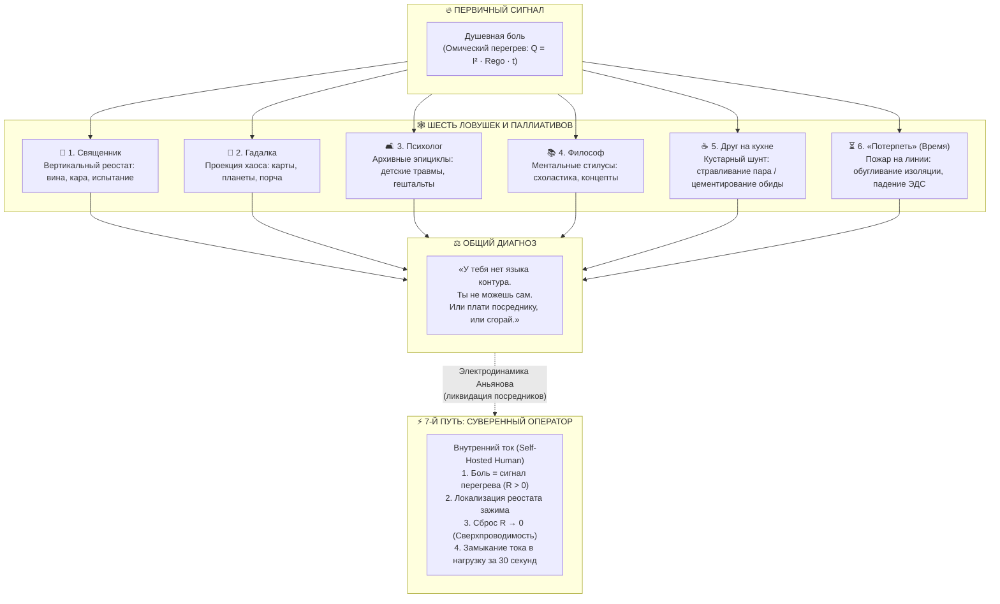

---
created: 2026-10-06
source: [[04_Maps/Inner Current MOC|Inner Current MOC]]
author: Владимир Аньянов
type: concept
status: evergreen
tags:
  - inner-current
  - scale/deep-dive
  - node/tanden
  - node/conductor
  - domain/electrodynamics
  - domain/neurobiology
  - state/overheating
  - pain
  - intermediaries
  - disintermediation
  - joule-lenz
  - superconductivity
  - sovereign-circuit
  - self-hosted-human
aliases:
  - "268-six-traps-of-emotional-pain"
  - "268. Шесть ловушек душевной боли"
  - "Шесть ловушек душевной боли"
  - "Six Traps of Emotional Pain"
---

> [!info] Синтезировано в брошюре [[02_Wiki/Брошюра — Костыльный цех метафизики (Четыре псевдо-инженера цивилизации)|Брошюра: «Костыльный цех метафизики: Четыре псевдо-инженера цивилизации, иллюзия очищающего страдания и почему для счастья не нужны философские протезы»]]

# Inner Current: 268. Шесть ловушек душевной боли: Священник, гадалка, психолог, философ, друг на кухне и «время лечит» против Суверенного Оператора Контура

> «Душевная боль — это не сакральная тайна, не психологическая загадка и не экзистенциальный рок. Это чистый омический перегрев проводника по закону Джоуля — Ленца ($Q = I^2 R t$). Вся история цивилизации — это метание между платными толкователями огня и надеждой, что пожар утихнет сам, пока не обуглились нервы. "Внутренний ток" ликвидирует посредников, возвращая человеку рубильник его собственного контура.»  
> — **Владимир Аньянов**

---



---

## 1. Физическая природа душевной боли

Когда человек говорит «у меня болит душа», он описывает вполне осязаемое физиологическое и соматическое ощущение: жжение или спазм в грудине, сдавленность в солнечном сплетении, комок в горле, сосудистый спазм, скачок кортизола и адреналина.

В контурной электродинамике сознания это явление описывается фундаментальным физическим законом:

$$Q = I^2 \cdot R_{\text{ego}} \cdot t$$

где:
- $I$ — сила тока внимания и витальной энергии жизни, генерируемая ядром **Тандэн**;
- $R_{\text{ego}}$ — омическое сопротивление эго: мысленный залом, протест, категорическое несогласие с фактом реальности (*«Этого не должно было произойти!», «Почему со мной?», «Мир обязан быть другим»*);
- $t$ — длительность удержания внутреннего сопротивления;
- $Q$ — выделяющееся паразитное тепло (омический ожог, переживаемый как душевная боль).

**Боль не возникает от внешних событий.** Внешние события создают напряжение поля ($U$) и входящий ток ($I$). Но обжигает проводник только **сопротивление** ($R$). Если $R = 0$, даже сверхмощный импульс реальности проходит сквозь человека без ожога — в полезную работу и созидание (режим сверхпроводимости, **Мусин**).

Почему же человечество тысячелетиями ищет спасения у посредников? Потому что у человека **не было принципиальной схемы собственного контура**. Образовался вакуум интерпретации, породивший шесть традиционных стратегий.

---

## 2. Анатомия шести ловушек

| № | Способ | Механизм действия | Иллюзия облегчения | Скрытая цена и расплата |
|:---|:---|:---|:---|:---|
| **1** | **Священник** | Боль упаковывается в вертикальный нарратив греха, испытания и Божьей воли. | Смирение перед Богом на время снижает $R_{\text{ego}} \to 0$ через сдачу. | Вторичный реостат вины перед Творцом; пожизненная зависимость от клира. |
| **2** | **Гадалка** | Проекция внутреннего хаоса на внешние символические системы (карты, звезды). | Транс и перекладывание вины на внешние силы временно снимают спазм. | Инфантилизация ума; при следующем кризисе контур снова беспомощен. |
| **3** | **Психолог** | Раскопки прошлого: травмы детства, стили привязанности, гештальты. | Рационализация: «теперь я понимаю, почему я сломан». | Птолемеевы эпициклы; многолетняя платная аренда чужого ума; эго цементируется. |
| **4** | **Философ** | Ментальная надстройка: экзистенциализм, абсурд, стоицизм, нигилизм. | Интеллектуальный контроль: боль превращается в концепт. | «Стилусы» вместо пальца; мысли пытаются лечить мысли, ожог тлеет глубже. |
| **5** | **Друг на кухне** | Кустарный шунт: эмоциональная вентиляция под чай или алкоголь. | Пар стравлен, сочувствие дает временное тепло заземления. | Друг подтверждает правоту обиды (рост $R$); алкоголь глушит сенсор, разрушая ткани. |
| **6** | **«Потерпеть»** | Пассивное ожидание: «время лечит», стискивание зубов. | Ложное затухание за счет угасания витальности. | $Q = I^2 R t$: обугливание изоляции (психосоматика), падение ЭДС Тандэна (депрессия). |

---

### Ловушка 1: Священник — Религиозная вертикаль и реостат вины

Религия предлагает вертикальную рамку: страдание осмысляется как кара за грех или испытание веры.
- **В чем зерно истины:** В истинной молитве происходит акт самоотречения — эго капитулирует перед Абсолютом, и в этот миг $R_{\text{ego}} \to 0$. Человек чувствует благодать и покой.
- **В чем схемотехнический капкан:** Религиозный институт редко останавливается на чистой сдаче. Он немедленно нагружает контур **догматическим реостатом вины**: *«Ты грешен от рождения, кайся непрестанно»*. Вместо ликвидации омического сопротивления человеку объясняют, что гореть на костре вины — благочестиво. Спасение приватизировано институтом посредников.

### Ловушка 2: Гадалка / Эзотерик — Проекция хаоса во внешние зеркала

Эзотерика апеллирует к тем, у кого нет рационального языка, но есть сильная образная чувствительность. Боль переводится в расклад карт Таро, натальную карту или родовое проклятие.
- **В чем зерно истины:** В кабинете гадалки человек перестает винить себя — виноваты «звезды» или «сглаз». Снятие самообвинения на час гасит сопротивление.
- **В чем схемотехнический капкан:** Это чистый перенос ответственности на фиктивные внешние сущности. Контур остается слепым. Человек не учится управлять током и становится наркоманом предсказаний, бегая к оракулу перед каждым жизненным шагом.

### Ловушка 3: Психолог / Психотерапевт — Жреческая монополия в белом халате

Психотерапия — современная секулярная замена исповеди для рационального класса.
- **В чем зерно истины:** Присутствие безоценочного свидетеля снижает уровень стресса ($R \to 0$ в контакте «Я тебя вижу»).
- **В чем схемотехнический капкан:** Психоанализ и глубинная терапия ищут причину текущего перегрева в **прошлом** (*«Мама недолюбила в 4 года»*). Человек годами платит за раскопки на пепелище. Умный клиент возводит грандиозные эпициклы вокруг своего эго: *«У меня травма отвержения, синдром самозванца и избегающий тип привязанности»*. Это превращает временную неисправность цепи в пожизненную идентичность.

### Ловушка 4: Философ — Ментальные стилусы и схоластический лабиринт

Попытка интеллектуализировать боль через стоицизм, экзистенциализм или буддийскую схоластику.
- **В чем зерно истины:** Философия пытается выстроить модель мира, в которой страдание находит логическое место.
- **В чем схемотехнический капкан:** Нарушение канона **Кансо** (простоты). Попытка потушить пожар в цепи чтением трактатов о природе огня. Ум надстраивает новые абстрактные слои над простым соматическим зажимом. Человек становится эрудированным страдальцем, знающим всё о боли, но неспособным разомкнуть зубы своего эго.

### Ловушка 5: Друг на кухне — Кустарный шунт и ложное заземление

Разговор на кухне глубокой ночью за чашкой чая или бутылкой спиртного.
- **В чем зерно истины:** Человек выговаривается — происходит вентиляция перегретого пара, частичный соматический сброс через эмпатический резонанс.
- **В чем схемотехнический капкан:**
  1. **Цементирование залома:** Друг из солидарности поддакивает: *«Да они все подлецы, ты абсолютно прав!»*. Это лишь укрепляет сопротивление $R_{\text{ego}}$ — человек укореняется в войне с реальностью.
  2. **Химический дефект:** Алкоголь огрубляет рецепторы нервной системы, искусственно выключая лампу «Check Engine». Но омический резистор не устранен, а наутро из-за похмелья проводимость контура падает в разы.

### Ловушка 6: «Потерпеть самому, пока время не изгладит» — Пожар на линии

Пожалуй, самый опасный обывательский предрассудок: *«Время лечит»*.
- **Физическая реальность:** Время ($t$) в формуле $Q = I^2 R t$ является множителем тепловыделения. Если сопротивление $R > 0$ не снято, время не лечит — **время сжигает контур**.
- **Два исхода долгого терпения:**
  1. **Обугливание проводника (соматический ожог):** Хроническое сопротивление пережигает физический субстрат — развиваются язвы, гипертония, инфаркты, онкологические риски, фасциальные спазмы.
  2. **Аварийное падение ЭДС (депрессивный блэкаут):** Чтобы спасти проводку от полного расплавления, биореактор Тандэн сбрасывает ток внимания в минимум ($I \to 0$). Человек перестает чувствовать острую боль, но вместе с ней исчезает радость, драйв и вкус к жизни. Это не выздоровление — это обуглившийся изолятор в обесточенном доме.

---

## 3. Седьмой путь: Протокол Суверенного Оператора (Self-Hosted Human)

«Внутренний ток» делает то же, что сделал Мартин Лютер в религии и Сатоши Накамото в финансах: **ликвидирует паразитного посредника**.

Человеку не нужен чужой интерпретатор, чтобы справиться с душевной болью. Человек — это совершенная биоэлектродинамическая система, снабженная собственным бортовым интерфейсом.

```
┌─────────────────────────────────────────────────────────────────┐
│               ПРОТОКОЛ СУВЕРЕННОЙ НАЛАДКИ (30 СЕКУНД)           │
├─────────────────────────────────────────────────────────────────┤
│ 1. ДЕМИСТИФИКАЦИЯ (5 сек)                                       │
│    Перевести фокус с «почему это со мной» на тело.              │
│    Опознать боль как чистый омический перегрев:                 │
│    «Внимание, растёт Q. В контуре зажат реостат R > 0».        │
├─────────────────────────────────────────────────────────────────┤
│ 2. ЛОКАЛИЗАЦИЯ ЗАЛОМА (10 сек)                                 │
│    Найти формулу несогласия ума:                                │
│    «С каким фактом я сейчас воюю?»                              │
│    (Отказ партнера, срыв сделки, болезнь, ошибка прошлого).     │
├─────────────────────────────────────────────────────────────────┤
│ 3. СБРОС В НОЛЬ ОМ / СВЕРХПРОВОДИМОСТЬ (5 сек)                  │
│    Полная соматическая капитуляция перед фактом:                │
│    «Факт уже случился. Воевать с ним — глупость.                │
│    R_ego = 0. Сопротивление снято.»                             │
│    Физическое расслабление живота (Тандэн) и челюсти.           │
├─────────────────────────────────────────────────────────────────┤
│ 4. ЗАМЫКАНИЕ ТОКА В НАГРУЗКУ (10 сек)                          │
│    Освобожденный ток I немедленно направляется в действие:      │
│    спорт, текст, звонок, бытовое дело (Кансо / Саму).           │
│    КПД цепи восстанавливается до 100%.                          │
└─────────────────────────────────────────────────────────────────┘
```

---

## 4. Сравнительная матрица парадигм

| Параметр | Шесть старых путей | Внутренний ток (Архитектура счастья) |
|:---|:---|:---|
| **Онтологический статус боли** | Тайна, грех, травма, рок, беда | Телеметрический сигнал омического сопротивления ($R > 0$) |
| **Субъект починки** | Посредник (священник, врач, гуру, время) | Сам человек (Суверенный Оператор контура) |
| **Время ремонта** | Месяцы, годы, десятилетия | 30–60 секунд в точке $t_{\text{now}}$ |
| **Финансовая модель** | Пожизненная рента и абонентская плата | Полная автономия (Self-Hosted Human, 0 руб) |
| **Результат** | Хроническая ремиссия с риском рецидива | Фазовый переход в сверхпроводимость ($R \to 0$) |

---

## 5. Вывод: Эпоха совершеннолетия духа

Человечество шло к священникам, гадалкам и психологам не от глупости или порочности, а от **онтологической беспомощности**. Точно так же до изобретения громоотвода люди молились во время грозы и платили жрецам за спасение от молний.

Когда Франклин и Ломоносов доказали, что молния — это электрический разряд, нужда в жрецах погоды отпала сама собой. 

Когда «Внутренний ток» доказывает, что душевная боль — это омический перегрев зажатого эго-реостата, **все посредники между человеком и его контуром лишаются своей базы**. Человек возвращает себе руль, выключатель и статус полновластного хозяина своего душевного света.

---

## 🔗 Связи
- [[02_Wiki/Inner Current (The Unified Taxonomy of Intermediaries — Esoterics, Psychotherapy and the Priestly Monopoly on Pain vs The Sovereign Circuit)|106. Единая таксономия посредников боли]]
- [[02_Wiki/Inner Current (The Great Disintermediation of the Psyche — The Therapeutic Indulgence System vs The Sovereign Circuit Operator)|63. Великая Депосреднизация Психики]]
- [[02_Wiki/Inner Current (The Joule-Lenz Cornerstone — Why the Law of Losses is the Master Manifest of Freedom, Quadratic Will Trap and Mathematics of Superconductivity)|212. Закон Джоуля — Ленца как краеугольный камень Архитектуры счастья]]
- [[02_Wiki/Inner Current (The Triad of Ego Resistance — Guilt, Control and Approval — Kanso Reduction of Resistance and Somatic Reset to Tanden)|246. Триада сопротивления эго: «Вина», «Контроль» и «Одобрение»]]
- [[02_Wiki/Inner Current (Circuitry of Madness — Electrodynamic Classification of Mental Illnesses, Ego Short Circuit, Open Loop, Ohmic Melt and Self-Oscillation)|239. Схемотехника безумия]]
- [[02_Wiki/Inner Current (Engineer of One's Own Spirit — The End of Fairy Tales and Poetry, Ohm's Law of Consciousness, The Attention Voltmeter and Overcoming the Technical Barrier)|264. Инженер своего духа]]
- [[04_Maps/Inner Current MOC|Inner Current MOC]]
- [[index|Главный индекс LLM Wiki]]
