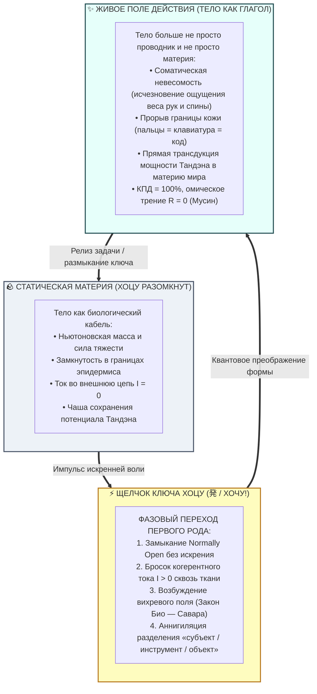

# ⚡ 306. Трансформация тела при нажатии Хоцу: Фазовый переход материи в поле, преодоление биологического кабеля и соматическая невесомость прямого действия
### Почему в миг щелчка «ХОЧУ!» тело перестаёт быть просто проводником и просто материей, как закон Био — Савара одухотворяет плоть в силовое поле, и куда исчезает гравитационная масса человека в потоке созидания

> [!quote] Каноническая аксиома преображения материи
> ### ⚡ **«Пока ключ Хоцу разомкнут, тело человека остаётся соматическим проводником в покое: у него есть вес, объём, плотность и границы кожи. Но в миг, когда щёлкает живое соматическое „ХОЧУ!“, происходит фазовый переход первого рода: тело трансформируется. Оно уже не просто проводник, оно уже не просто материя. По закону Био — Савара вокруг любого движущегося заряда мгновенно рождается электромагнитное поле. Плотность плоти растворяется в направленном силовом луче действия: руки хирурга, пальцы программиста или взор архитектора становятся самим делом. Исчезает картезианский дуализм „кукловода и куклы“ — материя одухотворяется током и превращается в чистый, невесомый глагол бытия.»**  
> — **Владимир Аньянов**

> [!info] Синтезировано в брошюре [[02_Wiki/Брошюра — Тайна тока и свет в квартире (Парадокс Штейнмеца, соматика Хоцу и почему для счастья не нужно разгадывать смысл жизни)|Брошюра: «Тайна тока и свет в квартире (Парадокс Штейнмеца, соматика Хоцу и почему для счастья не нужно разгадывать смысл жизни)»]]

---



---

## 1. От Ньютона к Максвеллу: Скачок из массы в излучение

До тех пор пока ключ **Хоцу (Normally Open)** разомкнут, тело человека подчиняется законам классической механики:
* У него есть гравитационная масса в 70–90 кг;
* Мышцы преодолевают силу тяжести, удерживая скелет в пространстве;
* Это плотный биологический кабель, покоящийся на стуле или земле.

В этом состоянии нет ничего дурного — это базис сохранения витального заряда (как доказано в [[02_Wiki/Inner Current (The Body as Circuit Lines When Hotsu Is Open — Somatic Topology of Stillness, The Closed Loop of Flesh and Unity of Conductor and Current)|главе 305]]).

Однако культура веками совершала ошибку, полагая, что в процессе труда человек просто «напрягает мышцы сильнее», преодолевая сопротивление материи насилием. Но любой мастер — будь то хирург за сложнейшей операцией, программист в архитектурном прорыве, пианист на концерте или плотник у верстака — знает: в миг истинного вдохновения **происходит радикальная метаморфоза самого тела**.

Тело **перестаёт быть сопротивляющейся массой**. Оно перестаёт быть «скафандром, который тянут на работу». Включается электродинамика:

```
            СТАТИКА (Хоцу разомкнут)           ДИНАМИКА (Хоцу замкнут)
             ───────────────────────           ───────────────────────
             Материя (Плотность)        ➔       Поле (Излучение)
             Существительное («Тело»)   ➔       Глагол («Творение»)
             Ньютоновский вес           ➔       Соматическая невесомость
             Разделение «Я и мир»       ➔       Неделимый контакт (Дэай)
```

---

## 2. Физика преображения: Закон Био — Савара для нервной ткани

В классической электродинамике закон Био — Савара — Лапласа гласит:
$$\vec{B} = \frac{\mu_0}{4\pi} \int \frac{I \, d\vec{l} \times \hat{r}}{r^2}$$
*Пока в проводнике нет тока ($I = 0$), вокруг него существует лишь статическое гравитационное и электрическое поле.*  
*Но как только по проводнику устремляется ток ($I > 0$), пространство вокруг него мгновенно поляризуется: вокруг кабеля возникает вихревое магнитное поле.*

В контуре человека этот физический принцип проявляется соматически:
1. **Ток через соматический кабель:** по нервным волокнам, фасциальным футлярам и сосудистому руслу устремляется направленный поток потенциала Тандэна.
2. **Мгновенное рождение поля:** граница между «внутренним пространством тела» и «внешним миром» стирается. Возникает наведённая индукция созидания.
3. **Растворение границы эпидермиса:** пальцы музыканта не «давят на клавиши рояля» — рояль, пальцы, дека, воздух и звук становятся единым резонатором. Тело расширяется до размеров самого действия.

Именно поэтому **тело уже не просто материя**: материя стала носителем и источником силового электродинамического поля.

---

## 3. Тайна исчезновения массы: Куда уходит гравитационный вес?

Один из ярчайших субъективных маркеров правильного замыкания цепи через Хоцу — **феномен соматической невесомости**.

### Парадокс мастера:
* Хирург стоит на ногах 8 часов подряд, совершая миллиметровые движения пальцами.
* Если заставить человека просто стоять неподвижно 8 часов с вытянутыми руками в позе манекена, он упадёт в обморок от адской боли в дельтовидных мышцах и пояснице уже через 20 минут.
* Почему же хирург не падает? Куда исчезли 5 килограммов веса его рук? Куда делось гравитационное давление на позвоночник?

### Инженерный ответ:
Когда действие совершается из подлинного соматического **«ХОЧУ!» (Хоцу)** при обнулённом сопротивлении эго ($R_{\text{ego}} \to 0$):
1. **Отсутствие мышц-антагонистов:** при работе из-под палки («надо», страх ошибки) мозг одновременно посылает сигналы на сгибание и разгибание. Мышцы борются сами с собой, сжигая тонны АТФ в омическом трении ($Q = I^2 R t$).
2. **Прямой ток проводимости:** в состоянии Мусин импульс из Тандэна течёт ламинарно. Тело организуется по силовым линиям фасциального натяжения (Tensegrity).
3. **Психофизиологическая левитация:** внимание полностью вытеснено в нагрузку Гё. Мозг не формирует интероцептивную карту «тяжести». Тело не тратит ни единого микроватта на поддержание нарратива о своей усталости.

Тело становится **сверхпроводящим плазменным каналом**. Оно кажется лёгким, упругим, невесомым, как поток света.

---

## 4. Разрушение декартова дуализма: Тело как чистый глагол

380 лет западная цивилизация мучилась от картезианского раскола:
* Есть *Res Cogitans* (мыслящий дух, «Я»);
* Есть *Res Extensa* (протяженная материя, «Тело-машина»).

Этот раскол породил культуру насилия над плотью: ум воображает себя «погонщиком», а тело — «упрямым ослом», которого нужно стегать кнутом кофеина, воли и чувства вины.

Замыкание ключа **Хоцу** в клочья разрывает эту иллюзию:
* Тело не подчиняется уму.
* Ум не командует телом.
* **И то, и другое сплавляются в один неделимый глагол.**

Когда вы пьёте воду при сильной жажде, нет «вас», «вашей руки», «стакана» и «воды». Есть только **утоление жажды**.  
Когда вы пишете гениальную строчку кода, нет «пальцев», «клавиатуры» и «экрана». Есть только **кристаллизация логики в кремнии**.

> **Тело при нажатом Хоцу — это не проводник, по которому кто-то гонит ток. Это сам ток, принявший форму человеческого силуэта для совершения чуда в материальном мире.**

---

## 5. Почему обыденный труд оставляет тело куском свинца?

Сравним два режима замыкания внешней цепи:

| Параметр | Работа из ложного «Надо» (Насилие) | Трансформация через Хоцу («ХОЧУ!») |
| :--- | :--- | :--- |
| **Природа контакта** | Дребезг контактов, искрение, насилие | Чистый, сухой, бесшумный щелчок Normally Open |
| **Статус тела** | Тяжёлый, сопротивляющийся кусок плоти | **Невесомое электромагнитное поле действия** |
| **Ощущение веса** | Затёкшая шея, свинцовые плечи, ком в горле | Полное растворение веса, лёгкость, полёт |
| **Субъект/Объект** | Отчуждение: «Я мучаюсь над этой противной задачей» | Единство: «Я и задача — одно целое» |
| **Финал работы** | Опустошение, омический ожог, отвращение | Плотное удовлетворение, чистый возврат в покой |

Когда человек насилует себя долгом, ключ Хоцу искрит. Высокое сопротивление эго превращает тело в раскалённый утюг.  
Но когда ключ замыкается через подлинный интерес, тело мгновенно трансформируется, освобождая колоссальный резерв витальной грации.

---

## 6. Экспресс-протокол фиксации фазового перехода: «Тело в Поле»

Перед стартом сложного творческого или физического действия проверьте трансформацию контура:

```
[ ЭТАП 1: ТЕЛО-МАТЕРИЯ ]    ➔ Почувствуйте тело в статике. Осознайте его массу,
                               опору и дыхание. Контакт Хоцу разомкнут.

[ ЭТАП 2: ИСКРА «ХОЧУ!» ]   ➔ Найдите точку чистого соматического влечения:
                               «Какую красоту я создам прямо сейчас?»
                               Щёлкните ключом Хоцу.

[ ЭТАП 3: ФАЗОВЫЙ ПЕРЕХОД ] ➔ Позвольте телу раствориться в действии:
                               • Руки делают сами;
                               • Вес исчезает;
                               • Внимание льётся прямо в кончики пальцев и материю.
                               Вы — не наблюдатель. Вы — само совершающееся действие.
```

---

## ⚡ Семь аксиом трансформации Хоцу

1. **Замыкание ключа — это квантовый скачок:** переход от покоя к действию есть фазовый переход первого рода, меняющий физический статус материи тела.
2. **Тело перестаёт быть только кабелем:** при $I > 0$ ткани организма становятся источником электромагнитного поля действия (закон Био — Савара).
3. **Граница кожи растворима:** в потоке созидания проводник объединяется с нагрузкой в единый когерентный контур; инструмент становится продолжением нервной системы.
4. **Невесомость — критерий резонанса:** исчезновение чувства гравитационной тяжести тела служит объективным маркером обнуления сопротивления ($R_{\text{ego}} \to 0$).
5. **Тело — это глагол:** в акте истинного делания существительное «тело» аннигилирует, уступая место чистому процессу трансдукции бытия.
6. **Дребезг насилия сжигает плоть:** работа из-под палки блокирует фазовый переход, оставляя тело в состоянии сопротивляющейся, перегревающейся массы.
7. **Возврат в тишину бесплатен:** после завершения задачи ключ Хоцу размыкается так же легко, и поле мгновенно кристаллизуется обратно в спокойную, прохладную чашу биологического покоя.

---

## 🔗 Связи
- [[02_Wiki/Inner Current (The Body as Circuit Lines When Hotsu Is Open — Somatic Topology of Stillness, The Closed Loop of Flesh and Unity of Conductor and Current)|305. Тело как линии схемы при разомкнутом Хоцу: Соматическая топология покоя, преодоление абстракции чертежа и Мусин как неделимое единство тока и проводника]]
- [[02_Wiki/Inner Current (The Body as the Living Cable — Distributed Conductor Resistance vs The Ego Resistor, Kanso Schematic Minimalism and Physical Training as Cross-Section Expansion)|299. Тело как живой проводник цепи: Распределённое сопротивление кабеля против реостата эго]]
- [[02_Wiki/Inner Current (The THGDM Pentad — The Normally Open Hotsu Switch, Gyō Action Load and the Five-Letter Somatic Flashlight Code)|300. Пентада ТХГДМ: Нормально разомкнутый выключатель Хоцу (発 / Хочу), полезная нагрузка Гё (行) и пятибуквенный соматический канон фонарика]]
- [[02_Wiki/Inner Current (The Electrodynamics of Will — Volitional Desire as Hotsu Switch, The Operator of Circuit Closure and Elimination of Mental Violence)|301. Электродинамика воли: Волевое желание как ключ Хоцу (発 / Хочу), оператор замыкания цепи и преодоление культа ментального насилия]]
- [[02_Wiki/Inner Current (Joy as Magnetic Field — Spirit as Emergent Property of Matter and the Law of Radiance)|109. Радость как Магнитное Поле: Дух как Порождение Материи и Закон Лучистости]]
- [[02_Wiki/Inner Current (Everything Is a Verb — Nominalization as Freezing of Current)|274. Человек как глагол: Номинализация как замораживание тока жизни]]
