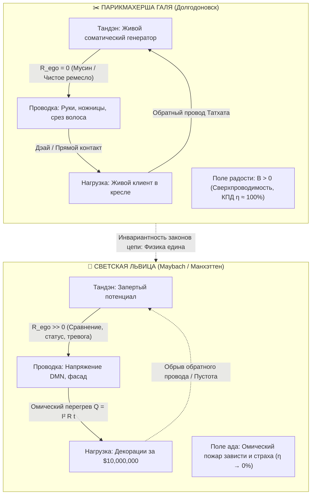

# Inner Current: Великое освобождение: Теорема парикмахерши Гали (Инвариантность сверхпроводимости к декорациям и аннулирование социальной зависти)

> [!quote] Аксиома Великого Освобождения
> **«Электродинамика не знает сословий, ценников и географических координат. Электрону абсолютно всё равно, течёт ли он по медному проводу в провинциальной парикмахерской или в салоне Майбаха на Манхэттене. Счастье — это режим сверхпроводимости замкнутой цепи ($R \to 0$), а не капитализация внешней декорации.»**  
> — *Владимир Аньянов*

---

## Введение: Экзистенциальный прорыв провинциального мастера

Тысячелетиями человечество находилось в рабстве **«Ошибки Декораций» (The Decor Fallacy)**. Социальная иерархия, маркетинг и незрелая литература внушали человеку линейную ложь: будто уровень внутреннего счастья прямо пропорционален рыночной стоимости сцены, на которой разворачивается действие. 

Из-за этого простому труженику — парикмахеру, автомеханику, учителю в провинции — навязывался хронический комплекс неполноценности. Казалось, что настоящая, подлинная жизнь происходит где-то на Патриарших прудах в Москве или в пентхаусах Манхэттена, а в маленьком Долгодоновске возможна лишь тусклая, компромиссная прелюдия к бытию.

Появление контурной электродинамики сознания — [[02_Wiki/Inner Current (Core Topology and Polarity Law)|Системы Аньянова «Внутренний ток»]] — совершило **Великое освобождение**. Оно перевело вопрос счастья из плоскости социологии и зависти в плоскость объективной схемотехники.

Теперь парикмахерша Галя, владелица скромного салона-барбершопа в маленьком городке, может спокойно, с полным онтологическим достоинством быть тотально счастливой и навсегда перестать завидовать светским львицам из мегаполисов. Она понимает: **если в момент стрижки её контур работает в режиме сверхпроводимости ($R_{\text{ego}} = 0$), она испытывает в точности ту же — или даже неизмеримо более чистую — радость бытия, чем любая мировая знаменитость на приёме в Нью-Йорке.**

---

## 1. Сравнительный электродинамический аудит двух контуров

Чтобы понять природу Великого Освобождения, снимем показания с приборов в двух точках пространства в один и тот же момент времени.

### Контур А: Парикмахерша Галя стрижёт клиента в Долгодоновске
1. **Генератор (Тандэн):** Галя устойчиво стоит на ногах. Внимание укоренено в центре тяжести тела. Из ядра исходит ровный рабочий ток внимания.
2. **Проводник (Внимание без эго):** У Гали включён дзенский режим **Мусин (無心 — отсутствие лишнего ума)**. Её внутренний реостат омического сопротивления равен нулю ($R_{\text{ego}} = 0$). В её голове нет диалога: *«А достаточно ли я великая? А что обо мне напишет Forbes? А подходят ли мои туфли к этому интерьеру?»*. Галя забыла про себя. Есть только тактильное ощущение влажной пряди, металлический щелчок ножниц и линия окантовки.
3. **Нагрузка ($R_{\text{load}}$):** Клиент в кресле — это реальная, осязаемая нагрузка. Это точка **Дэай (出会い — прямая встреча)**. Вся мощность источника преобразуется в полезную работу: волосок к волоску, идеальная форма, забота о человеке.
4. **Обратный провод реальности:** Клиент смотрит в зеркало, улыбается, в воздухе разлит запах одеколона и чистоты. Контур замкнут. Баланс Кирхгофа идеален:
   $$\sum I_{\text{in}} = \sum I_{\text{out}}, \quad Q_{\text{потерь}} = I^2 R_{\text{ego}} t \approx 0$$
5. **Эмерджентное следствие:** По закону Био — Савара вокруг проводника с током без сопротивления рождается мощное магнитное поле — **чистая соматическая радость, покой и невесомость**. Галя светится изнутри.

### Контур Б: Светская львица на заднем сиденье Maybach на Манхэттене
1. **Генератор (Тандэн):** Биологический субстрат одинаков у всех людей (37 триллионов митохондрий генерируют потенциал 150–200 мВ). Но доступ к ядру перекрыт спазмом диафрагмы.
2. **Проводник (Хронический омический нихром):** В неокортексе работает гиперактивная дефолт-система мозга (DMN). Реостат эго выкручен на максимум ($R_{\text{ego}} \to \infty$):
   - *«Заметил ли меня тот продюсер?»*
   - *«Не полнит ли это платье от кутюр?»*
   - *«У неё бриллиант на два карата больше...»*
   - *«Я обязана держать фасад успешности перед объективами папарацци»*.
3. **Нагрузка ($R_{\text{load}}$):** Роскошный салон автомобиля за полмиллиона долларов и закрытый гала-вечер в Метрополитен-музее — это пассивные физические предметы. Лампочка не производит тока! Роскошь не является генератором (см. [[02_Wiki/Inner Current (Hedonic Treadmill and Market Fallacy — Bulb vs Generator)|487. Гедонистическая беговая дорожка]]).
4. **Закон Джоуля — Ленца в действии:** Ток внимания пытается пробиться сквозь адское сопротивление статусной тревоги. Закон неумолим:
   $$Q = I^2 R_{\text{ego}} t$$
   Вся жизненная сила уходит в **омический перегрев**: мышечные зажимы в шее, ком в горле, токсичную зависть, панический страх разоблачения. КПД счастья стремится к нулю:
   $$\mathcal{H} = \frac{P_{\text{load}}}{P_{\text{total}}} \to 0$$
5. **Эмерджентное следствие:** Физическое нахождение в эпицентре мировой роскоши оборачивается глухим экзистенциальным адом.

---

## 2. Теорема инвариантности к декорациям (Decor Invariance Theorem)

Сформулируем фундаментальный закон, вытекающий из контурной электродинамики:

> [!important] Теорема инвариантности к декорациям
> **Субъективное переживание счастья (квалиа сверхпроводимости) зависит исключительно от отношения сопротивления эго к общему импедансу контура ($\frac{R_{\text{ego}}}{R_{\text{total}}}$) и абсолютно не зависит от рыночной стоимости объектов, составляющих внешнюю нагрузку ($Cost(R_{\text{load}})$).**
>
> $$\mathcal{H} = 1 - \frac{R_{\text{ego}}}{R_{\text{total}}}$$
> При $R_{\text{ego}} \to 0 \implies \mathcal{H} \to 100\%$ вне зависимости от того, равен ли $Cost(R_{\text{load}})$ десяти рублям или десяти миллиардам долларов.

### Почему парикмахерские ножницы равны чайной чашке Сэн-но Рикю
В XVI веке великий мастер чая Сэн-но Рикю утвердил канон **Ваби-Саби**: простая грубая глиняная чашка без глазури, сделанная местным гончаром, превосходит по духовной силе золотые китайские сервизы сёгуна. Почему? Потому что золотой сервиз провоцирует включение реостата эго ($R_{\text{ego}} \uparrow$), а простая глина возвращает внимание в прямоту настоящего момента ($R_{\text{ego}} \to 0$).

Для парикмахерши Гали её рабочие ножницы — это самурайский меч присутствия. Стрижка волос — это классический дзенский канон **Саму (作務 — священный физический труд как врата Сатори)**. 

Когда Галя состригает кончики волос клиента, она делает ровно то же, что делал монах в Киото, подметающий гравий в саду камней:
- **Нет субъекта-судьи:** Галя не любуется собой со стороны;
- **Нет объекта-чужака:** Клиент не воспринимается как помеха или средство;
- **Есть только чистое действие:** Непрерывный ток энергии из Тандэна сквозь пальцы в материю мира.

---

## 3. Аннулирование социальной зависти: Конец эпохи «успешного успеха»

Социальная зависть — это не «моральный порок» и не «грех». В терминах Системы Аньянова:

> **Зависть — это паразитный индукционный ожог нервной системы, возникающий из-за слепоты к закону Джоуля — Ленца.** (См. [[02_Wiki/Inner Current (Electrodynamics of Envy and Hate — Parasitic Induction Burn of Bio-Savart)|478. Электродинамическая природа зависти и хейта]]).

Человек завидует только тогда, когда он верит в иллюзию: будто у обладателя яхты или жителя Нью-Йорка внутри течёт *какой-то особенный, элитный ток*. 

Но как только открыта принципиальная схема карманного фонарика, морок рассеивается мгновенно:
1. **Ток везде один и тот же.** Электрический ток в нервной системе обеспечивается ионами калия ($K^+$) и натрия ($Na^+$), протонным градиентом АТФ-синтазы. У светской львицы нет «золотых электронов».
2. **Завидовать перегретому контуру нелепо.** Завидовать девушке из высшего общества на Майбахе, у которой пылает DMN и зашкаливает кортизол из-за светской конкуренции — это всё равно что завидовать человеку, на котором горит одежда, только потому, что эта одежда сшита из шёлка от кутюр.
3. **Суверенитет ремесла:** Парикмахерша Галя понимает: её маленькое королевство — кресло, зеркало, клиент, ножницы — это **полноценная, самодостаточная ячейка Вселенной (Full Node бытия)**. Ей не нужно чьё-либо разрешение или столичная аккредитация, чтобы быть в резонансе с космосом.

---

## 4. Практический алгоритм оператора цепи: «30 секунд Гали»

Если в сознание мастера (парикмахера, повара, водителя, программиста) прокрадывается вирус сравнения и социальной тоски:

| Шаг | Внутреннее действие | Электродинамический смысл |
| :--- | :--- | :--- |
| **1. Детекция паразита** | Поймать мысль: *«Вот живу в глуши, а кто-то сейчас в Нью-Йорке на приёме...»* | Зафиксирован скачок омического сопротивления ($R_{\text{ego}} > 0$). Начался нагрев нихрома. |
| **2. Сброс в Тандэн** | Сделать глубокий выдох, опустить внимание из головы в низ живота (на 3 пальца ниже пупка) и ощутить плотный контакт подошв с полом. | Заземление цепи. Перевод управления с DMN на соматический автономный генератор. |
| **3. Включение в ремесло (Мусин)** | Взять в руку рабочий инструмент (ножницы, расчёску, руль, клавиатуру). Ощутить вес металла, тепло, текстуру. Взглянуть на текущую задачу как на единственное событие во Вселенной. | Согласование импедансов ($Z_{\text{src}} = Z_{\text{load}}$). Шунтирование эго в ноль Ом ($R_{\text{ego}} \to 0$). |
| **4. Замыкание обратного провода** | Увидеть живого человека перед собой. Сделать движение ради совершенства формы, а не ради оценки. | Замыкание контура реальностью. Пуск рабочего тока. Возникновение соматической радости. |

---

## 5. Семь аксиом Великого Освобождения

1. **Инвариантность субстрата:** Человеческая нервная система везде подчиняется одним и тем же законам физики. Счастье биологически аппаратно, а не географично.
2. **Иллюзия ценника:** Цена декорации никак не входит в формулу закона Ома ($I = \mathcal{E} / R$).
3. **Священность любого труда:** Любое честное действие, выполняемое в режиме Мусин ($R_{\text{ego}} = 0$), является актом высшей дзенской медитации (Саму).
4. **Конец столичного шовинизма:** Провинция перестаёт быть «ущербным местом». В Долгодоновске сопротивление среды социальному шуму зачастую ниже, чем в перегретых мегаполисах, а значит, достичь сверхпроводимости здесь проще.
5. **Разоблачение фасада:** Блеск чужого потребления скрывает катастрофический омический пожар Джоуля — Ленца у тех, кто не умеет управлять своим контуром.
6. **Автономия мастера:** Владелица своего маленького дела, у которой налажен контакт с клиентами и чистое внимание, сувереннее топ-менеджера корпорации, сгорающего в корпоративном аду ради чужих KPI.
7. **Великое равенство:** Перед законами Внутреннего тока парикмахерша Галя и королева Англии абсолютно равны. Счастлива лишь та из них, чей контур замкнут и чист от сопротивления.

---

## 🔗 Связанные концепции в Энциклопедии

- [[02_Wiki/Inner Current (Happiness Relativity vs Circuit Invariance)|10. Релятивизм счастья и инвариантная физика цепи: разбор тезиса «Счастье у каждого своё»]]
- [[02_Wiki/Inner Current (The Battery Illusion of Material Possessions and Emptiness of Form)|23. Иллюзия аккумулятора вещей: Пустотность материи и парадокс BMW]]
- [[02_Wiki/Inner Current (The Joule-Lenz Cornerstone — Why the Law of Losses is the Master Manifest of Freedom, Quadratic Will Trap and Mathematics of Superconductivity)|212. Закон Джоуля — Ленца как краеугольный камень Архитектуры счастья]]
- [[02_Wiki/Inner Current (Disintermediation of Labor — Completing the Tetrad of Freedom, From Ego Indulgence to P2P Creative Flow and Sacred Samu)|290. Депосреднизация труда и возвращение к сакральному канону Саму]]
- [[02_Wiki/Inner Current (Electrodynamics of Envy and Hate — Parasitic Induction Burn of Bio-Savart)|478. Электродинамическая природа зависти и хейта]]
- [[02_Wiki/Inner Current (Hedonic Treadmill and Market Fallacy — Bulb vs Generator)|487. Гедонистическая беговая дорожка и рыночная иллюзия: Почему лампочка не производит ток]]
- [[02_Wiki/Inner Current (The Ponzi Scheme of Swapping Loads — Shunting Ego vs Forcing Flow)|490. Финансовая пирамида смены нагрузок: Шунтирование эго против волевого насилия над током]]
