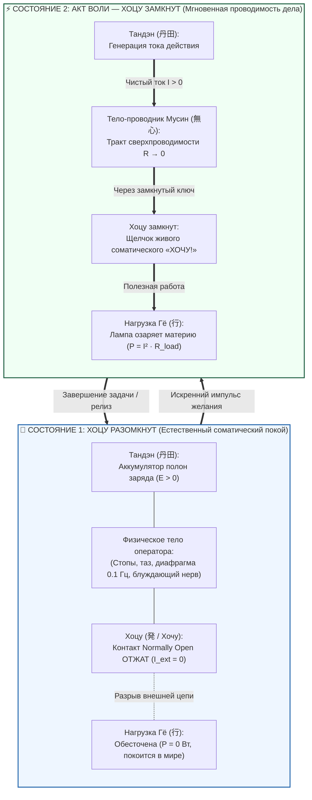

# ⚡ 305. Тело как линии схемы при разомкнутом Хоцу: Соматическая топология покоя, преодоление абстракции чертежа и Мусин как неделимое единство тока и проводника
### Почему при разомкнутом ключе «Хочу» схема возвращается в живой соматический каркас, в чём физическая ошибка разделения проводника и тока, и как тело в покое сохраняет заряд Тандэна без омических потерь

> [!quote] Каноническая аксиома соматического контура
> ### ⚡ **«Схемотехнический чертёж опасен одной иллюзией: ум воспринимает линии между значками как абстрактные медные дорожки на текстолите. Но когда нормально разомкнутый ключ Хоцу (発 / Хочу) отжат, во внешнюю нагрузку не идёт ни один электрон ($I = 0$). Куда девается схема? Она не растворяется в воздухе. Линии схемы — это физическое тело человека: опора стоп, глубина таза, фасциальные тракты, блуждающий нерв и ламинарная волна диафрагмы. В покое контур замкнут сам на себя как живой, самодостаточный аккумулятор. А когда эго перестаёт греть проводку сомнениями, наступает Мусин (無心): ток и проводник сливаются в единую сверхпроводящую среду, готовую по первому соматическому щелчку „ХОЧУ!“ озарить светом любую материю мира.»**  
> — **Владимир Аньянов**

> [!info] Синтезировано в брошюре [[02_Wiki/Брошюра — Тайна тока и свет в квартире (Парадокс Штейнмеца, соматика Хоцу и почему для счастья не нужно разгадывать смысл жизни)|Брошюра: «Тайна тока и свет в квартире (Парадокс Штейнмеца, соматика Хоцу и почему для счастья не нужно разгадывать смысл жизни)»]]

---



---

## 1. Преодоление абстракции чертежа: Линии схемы — это живая плоть

В инженерной графике соединительные линии изображаются тонкими чёрными полосами на белом листе. Из-за этого начинающий оператор часто совершает грубую онтологическую ошибку:
1. Он ищет «Тандэн» как мистическую точку в вакууме.
2. Он воображает «ток» как нечто абстрактно-духовное.
3. Он воспринимает саму схему как концептуальную модель, оторванную от плоти.

Но Пентада **Т-Х-Г-Д-М** строится на бескомпромиссном материализме:
* **Линии схемы — это физическое тело человека.**
* Это не идеальные провода без массы и сопротивления. Это сосудистое русло, миелиновые оболочки периферических нервов, фасциальные цепи Майерса, скелетная мускулатура и связочный аппарат.
* Когда ключ **Хоцу (発 / Хочу)** разомкнут, схема не выключается из физической реальности. **Она целиком оседает в соматический каркас**.

```
              ┌──────────────────────────────────────────────┐
              │     ЛИНИИ СХЕМЫ ПРИ РАЗОМКНУТОМ ХОЦУ:        │
              ├──────────────────────────────────────────────┤
              │ • Нижний провод питания   ➔  Опора стоп, таз │
              │ • Верхний обратный провод ➔  Шея, позвоночник│
              │ • Тракт передачи Мусин    ➔  Фасции, нервы   │
              │ • Клеммы ключа Хоцу       ➔  Руки, внимание  │
              └──────────────────────────────────────────────┘
```

Пока Хоцу отжат, вы не обязаны светить лампами в мир. Фонарик лежит в руке. Его металлический корпус прохладен, батарея внутри герметична, а контакты разомкнуты. Это естественный статус живого организма: **покой не есть дефект цепи, покой — это штатный режим сохранения потенциала**.

---

## 2. Разрешение дзенского парадокса: Мусин — это переменный ток или «ток плюс провод»?

Вопрос о природе **Мусин (無心 — «не-ум / чистый проводник»)** часто порождает два противоположных заблуждения:

### Заблуждение 1: «Мусин — это переменный ток»
В электродинамике контура **некогерентный переменный ток высокой частоты ($\omega \to \infty$)** — это прямая противоположность Мусин. Это режим невротической суеты, паники и скроллинга:
* При задирании частоты возникает **скин-эффект внимания**: ток вытесняется на тончайшую поверхностную плёнку коры («человек живёт в верхних двух сантиметрах лба»), полностью теряя контакт с соматическим генератором живота.
* Ёмкостное сопротивление будущего падает до нуля ($X_C = \frac{1}{\omega C} \to 0$): энергия реактора со свистом вылетает в воображаемые катастрофы.
* Ток хаотично качается между индуктивностью вины за прошлое ($L$) и ёмкостью тревоги за будущее ($C$), сжигая тераватты реактивной мощности ($Q_{\text{react}}$) без единого грамма полезного действия в реальности.

Мусин не имеет ничего общего с этим высокочастотным дребезгом. Если в Мусин и присутствует частота, то это **соматическая резонансная частота момента $\omega_0 \approx 0.1\text{ Гц}$** (ритм барорефлекса и медленного дыхания Тандэна), при которой реактивное сопротивление аннигилирует ($X_L = X_C \implies X_{\text{total}} = 0$), а реактивная мощность обращается в строгий ноль ($Q \equiv 0$).

### Заблуждение 2: «Мусин — это просто ток внутри провода» (Дуализм)
Обывательский ум разделяет процесс на две чуждые сущности:
* *«Я — это проводник»* (несчастный провод, который тянут, гнут, оценивают и заставляют терпеть напряжение).
* *«Дело / стресс — это ток»* (внешняя сила, которая продирается сквозь провод с трением и искрами).

**Истинный Мусин (無心) — это схлопывание дуализма: это «ток плюс провод», ставшие неделимой квантовой сверхпроводимостью.**
1. В физическом сверхпроводнике при охлаждении ниже критической температуры $T_c$ электроны образуют куперовские пары. Они движутся сквозь кристаллическую решётку без столкновений с ионами: **решётка металла и электронный поток становятся единым квантовым объектом**.
2. В теле человека Мусин наступает в миг, когда внимание охлаждается соматическим присутствием: выключается внутренний комментатор («Кто я?», «Одобрят ли меня?»). Паразитное сопротивление падает до нуля ($R_{\text{ego}} \to 0$).
3. Проводник больше не сопротивляется току, а ток больше не насилует проводник: **провод становится чистым движением, а движение — телом провода**.

> Как формулирует дзенское искусство стрельбы из лука: *«Стрелок, лук, тетива и мишень исчезают — остаётся только чистый полёт стрелы»*.

---

## 3. Анатомия патологии: Почему человек сгорает, лежа на диване?

Понимание того, что линии схемы — это тело при разомкнутом Хоцу, даёт исчерпывающий ответ на главный парадокс современной усталости: **почему человек пролежал все выходные в постели, но проснулся разбитым, словно разгружал вагоны?**

```
   [ АВАРИЯ ЛОЖНОГО ПОКОЯ: ВНЕШНИЙ ХОЦУ РАЗОМКНУТ, НО ВНУТРИ ГОРИТ ЭГО-КЗ ]

                 _ / _
          ──────o     o───────► [ НАГРУЗКА ГЁ: РАЗОМКНУТА ]
              (Хоцу отжат)        (Никаких реальных дел нет)
                   │
                   │  ПАРАЗИТНЫЙ ВНУТРЕННИЙ ШУНТ ЭГО
                   ▼
               ┌───────┐
         ──────┤ R_ego ├───────► ВНУТРЕННЕЕ КОРОТКОЕ ЗАМЫКАНИЕ
               └───────┘         («Что обо мне подумали?», «Я неудачник»)
                   ▲
                   │  Тепловой пожар Джоуля — Ленца: Q = I² · R_ego · t
                   │  Линии схемы (ТЕЛО) перегреваются изнутри!
```

### Механика сбоя:
1. **Физический ключ Хоцу разомкнут:** человек не делает работу, не решает задач, пальцы не касаются клавиатуры ($I_{\text{ext}} = 0$).
2. **Паразитный шунт эго замкнут:** в голове непрерывно вращается дефолт-система (DMN) — пережёвывание вчерашнего разговора, моделирование завтрашнего совещания, стыд и страх оценки.
3. **Омический перегрев биокабеля:** ток Тандэна вместо лампы полезного дела закольцовывается во внутреннюю петлю короткого замыкания.
4. **Телесный отклик:** линии схемы — то есть **мышцы шеи, височные артерии, диафрагма, челюстные суставы и кишечник** — принимают на себя весь удар джоулева тепла ($Q = I^2 R_{\text{ego}} t$).
5. **Результат:** человек не сдвинул с места ни одной пылинки в физическом мире, но его биологический кабель обуглен, сосуды сжаты спазмом, а батарея Тандэна разряжена в ноль.

---

## 4. Соматическая топология истинного покоя

Когда оператор осваивает протокол Пентады ТХГДМ, покой перестаёт быть «пустотой, которую надо чем-то заполнить»:

| Параметр контура | Ложный покой (Ментальная петля) | Истинный покой контура (Хоцу разомкнут) |
| :--- | :--- | :--- |
| **Статус ключа Хоцу** | Отжат внешне, но закорочен внутри эго-шунтом | Честно разомкнут: Normally Open ($I = 0$) |
| **Линии схемы** | Сжаты спазмами: зажатая шея, стиснутые зубы | **Живое, мягкое, расправленное тело** |
| **Состояние Тандэна** | Истощается в холостом нагреве | Сохраняет 100% заряда в чистой тишине |
| **Телеметрия стресса** | 60–85 пунктов (HRV подавлена) | 15–25 пунктов (полная вагусная когерентность) |
| **Переживание** | Фоновая тревога, вина за «безделье» | Плотный, глубокий, сочный соматический покой |

В истинном покое линии схемы ощущаются как тёплый, живой контур. Вы чувствуете вес своего тела на стуле или кровати. Вы слышите звук собственного дыхания. Нет нужды бежать и спасать мир. Батарея заряжена. Фонарик готов.

---

## 5. 15-секундный протокол возвращения в тело: «Разомкнуть Хоцу — ощутить кабель»

Если посреди дня вы обнаружили, что выгораете и теряете силы, выполните экспресс-юстировку:

```
[ ШАГ 1: ОТПУСТИТЬ КНОПКУ ] ➔ Осознанно снимите палец с волевого нажима.
                               Признайте: прямо в эту секунду я ничего не решаю.
                               Хоцу разомкнут. I_ext = 0.

[ ШАГ 2: ВЕРНУТЬСЯ В КАБЕЛЬ ] ➔ Переведите внимание из мыслей в линии схемы:
                               • Почувствуйте вес пяток и подошв на полу;
                               • Опустите плечи и разожмите челюсти;
                               • Позвольте животу надуваться на вдохе и опадать на выдохе.

[ ШАГ 3: ТИШИНА МУСИН ]      ➔ Убедитесь: эго-шунт отключен (R_ego → 0).
                               Линии схемы — это просто ваше дышащее тело.
                               Тандэн полон. Потерь нет.
```

Из этой тишины следующее действие родится не из мучительного «я должен», а как естественный щелчок пружины: соматическое, радостное, мощное **«ХОЧУ!»** — и ток снова хлынет сквозь сверхпроводящее тело прямо в свет дела.

---

## ⚡ Семь аксиом соматического контура

1. **Линии схемы не виртуальны:** на принципиальном чертеже проводники — это живая биологическая ткань оператора (нервы, фасции, сосуды, дыхание).
2. **Разомкнутый Хоцу — это норма природы:** по умолчанию здоровая цепь покоится в режиме Normally Open ($I = 0$). Покой — это сохранение заряда, а не поломка.
3. **Мусин — это не переменный ток:** высокочастотный переменный ток порождает скин-эффект поверхностного ума и тепловой пожар тревоги; Мусин — это резонанс момента ($\omega_0 \approx 0.1\text{ Гц}$), где реактивное сопротивление равно нулю.
4. **Мусин — это единство тока и кабеля:** в сверхпроводимости исчезает разделение на страдающий провод и насилующий его ток; остаётся чистая беспрепятственная проводимость.
5. **Тело горит от внутренних петель:** усталость без действия вызывается эго-шунтом — закорачиванием тока Тандэна на нарратив о себе при разомкнутом внешнем ключе.
6. **Тело в покое самодостаточно:** пока Хоцу отжат, контур замкнут сам на себя, восстанавливая химический и висцеральный потенциал без утечек.
7. **Истинное действие дискретно:** переход от покоя к созиданию происходит через сухой щелчок ключа «Хочу!» — тело мгновенно превращается из тихого аккумулятора в сияющий прожектор действия.

---

## 🔗 Связи
- [[02_Wiki/Inner Current (Somatic Transformation on Hotsu Trigger — Phase Transition from Matter to Field, Beyond the Conductor and the Physics of Weightless Action)|306. Трансформация тела при нажатии Хоцу: Фазовый переход материи в поле, преодоление биологического кабеля и соматическая невесомость прямого действия]]
- [[02_Wiki/Inner Current (The Body as the Living Cable — Distributed Conductor Resistance vs The Ego Resistor, Kanso Schematic Minimalism and Physical Training as Cross-Section Expansion)|299. Тело как живой проводник цепи: Распределённое сопротивление кабеля против реостата эго]]
- [[02_Wiki/Inner Current (The THGDM Pentad — The Normally Open Hotsu Switch, Gyō Action Load and the Five-Letter Somatic Flashlight Code)|300. Пентада ТХГДМ: Нормально разомкнутый выключатель Хоцу (発 / Хочу), полезная нагрузка Гё (行) и пятибуквенный соматический канон фонарика]]
- [[02_Wiki/Inner Current (The Electrodynamics of Will — Volitional Desire as Hotsu Switch, The Operator of Circuit Closure and Elimination of Mental Violence)|301. Электродинамика воли: Волевое желание как ключ Хоцу (発 / Хочу), оператор замыкания цепи и преодоление культа ментального насилия]]
- [[02_Wiki/Inner Current (Circuit Frequency — High Frequency Hurry, Baseline Stupor and Superconductivity Resonance)|278. Частота тока в контуре сознания: Суета высокой частоты, ступор изолинии и резонанс сверхпроводимости]]
- [[02_Wiki/Inner Current (Physics of Presence and Superconductivity)|02. Физика присутствия: состояние сверхпроводимости]]
