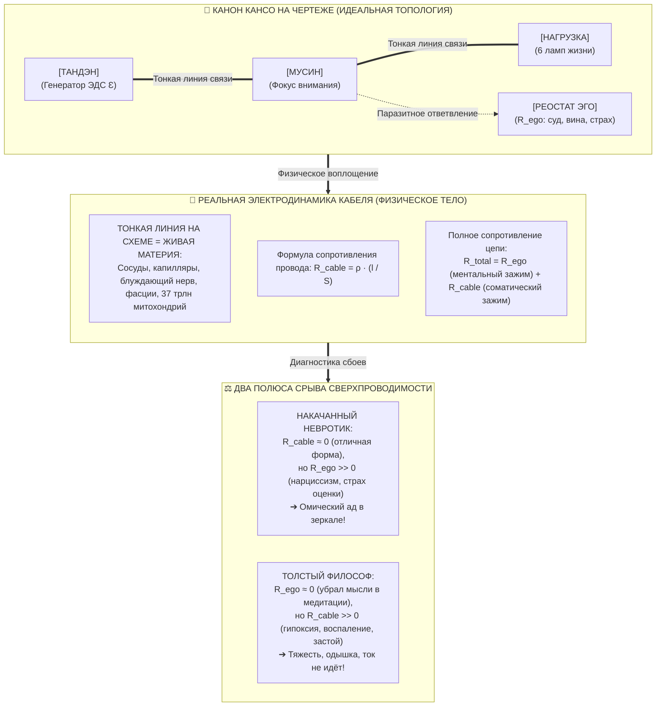

# ⚡ 299. Тело как живой проводник цепи: Распределённое сопротивление кабеля против реостата эго, канон Кансо на чертеже и физический тренинг как расширение сечения проводника ($S \uparrow$)
### Почему тонкие линии связи на принципиальной схеме — это физическая плоть человека, в чём схемотехническая ошибка отделения «чистого ума» от больного тела, и как маркетинг фитнеса переходит от нарциссизма кубиков пресса к восстановлению сверхпроводимости биокабеля

> [!quote] Каноническая аксиома живого проводника
> ### ⚡ **«На принципиальной электрической схеме соединительные провода между генератором и нагрузкой рисуются тонкими идеальными линиями. Но ни один грамотный инженер не верит в идеальные провода: у любого реального кабеля есть распределённое внутреннее сопротивление ($R = \rho \frac{l}{S}$). Тело человека — это и есть этот физический кабель. Ты можешь сколько угодно обнулять ментальное эго ($R_{\text{ego}} \to 0$), но если твой биологический провод забит висцеральным балластом, пережат спазмами и задыхается в гипоксии — ток жизни разогреет проводку до одышки и тяжести. Счастье требует не только тишины ума, но и проходимости плоти. Тренировки в спортзале — это не конкурс тщеславия для эго, а механическая расточка сечения кабеля до состояния золотой сверхпроводящей шины.»**  
> — **Владимир Аньянов**

---



---

## 1. Парадокс «Толстого Философа»: Почему убрать эго недостаточно?

Нередко человек, познакомившийся с фундаментальной аксиомой Системы (*«Счастье — это режим сверхпроводимости цепи при $R \to 0$»*), попадает в логическую ловушку:
> *«Если счастье — это отсутствие сопротивления эго, значит, мне достаточно просто выключить внутреннего критика, отпустить мысли о прошлом и будущем, войти в Мусин — и я буду абсолютно счастлив. Зачем мне бегать, качать мышцы и следить за питанием? Разве тело не вторично?»*

Но когда такой человек садится в медитацию, убирает суждения, а затем встаёт с коврика, он с удивлением обнаруживает:
* Он не чувствует ни лёгкости, ни полёта, ни прохлады сверхпроводимости.
* Подъём на третий этаж отзывается колотящимся сердцем и одышкой.
* В животе стоит свинцовая тяжесть, печень перегружена висцеральным жиром, шея затекла, а мозг тонет в сонной мути.

И человек разочарованно восклицает: *«Ваша схема не работает! Я убрал эго, а счастья и лёгкости всё равно нет!»*

В чём же ошибка?

Ошибка кроется в непонимании того, **что именно на схеме изображают соединительные линии**.

---

## 2. Канон Кансо: Почему на схеме нет отдельного резистора тела?

В профессиональных схемах радиотехники соединительные медные дорожки печатной платы рисуются простыми линиями без обозначения резисторов. Инженер не перегружает чертёж значками сопротивления для каждого сантиметра медного проводника — это нарушило бы **канон Кансо (簡素 — предельная ясность и лаконичность)**. 

Однако любой квалифицированный схемотехник помнит: **у соединительной линии есть собственное погонное сопротивление**.

```
    [ТАНДЭН] ────────────────────────────────────────────────────────► [НАГРУЗКА]
              ▲
              │
    На схеме: чистая идеальная линия (Кансо).
    В реальности: физический кабель (R_cable = ρ · l / S).
```

В человеческом контуре:
1. **Реостат Эго ($R_{\text{ego}}$)** — это **дискретный переключаемый узел**. Это ментальный зажим, паразитная программа неокортекса (DMN), которую сознание может разомкнуть или зашунтировать за доли секунды одним соматическим выдохом в Тандэн.
2. **Линии связи ($R_{\text{cable}}$)** — это **распределённое сопротивление самого биологического субстрата**. Это плоть, сосудистое русло, миофасциальный каркас, плотность капилляров, клеточная мембрана и концентрация гемоглобина.

Полное сопротивление человеческого контура описывается аддитивной формулой:

$$R_{\text{total}} = R_{\text{ego}} + R_{\text{cable}}$$

Если оператор обнулил ментальный шум ($R_{\text{ego}} = 0$), но физический кабель находится в аварийном состоянии ($R_{\text{cable}} = 50\ \Omega$), то по неумолимому закону Джоуля — Ленца:

$$Q = I^2 \cdot R_{\text{total}} \cdot t = I^2 \cdot R_{\text{cable}} \cdot t > 0$$

Ток жизни ($I$), выходящий из квантового реактора Тандэн, **буквально рассеивается в тепло внутри засорённых сосудов и закисленных тканей**. Человек испытывает тканевую интоксикацию, вегетативную перегрузку и физическую вялость. Он физиологически лишён субстрата для переживания полёта!

---

## 3. Физика кабеля: Закон сопротивления проводника $R = \rho \frac{l}{S}$

Чтобы понять, как физическая форма влияет на счастье, обратимся к классической формуле электродинамики:

$$R_{\text{cable}} = \rho \cdot \frac{l}{S}$$

Разберём каждый параметр применительно к человеческому телу:

### 1. $\rho$ — Удельное сопротивление биологической среды (Биохимическая чистота)
* **Высокий $\rho$ (Плохой проводник):** Хроническое системное воспаление, вызванное висцеральным ожирением и избытком ультрапереработанной пищи; метаболический синдром; закисление интерстициальной жидкости (ацидоз); сгущение крови и застой лимфы. Электрохимический потенциал клеток падает, протонный градиент митохондрий проседает ниже 120 мВ. Ток электронов встречает огромное внутреннее трение.
* **Низкий $\rho \to 0$ (Чистый сверхпроводник):** Чистая межклеточная среда, чувствительность к инсулину, отсутствие системного воспаления, идеальный водно-солевой баланс.

### 2. $S$ — Площадь поперечного сечения проводника (Мощность сосудистого и мышечного русла)
* **Малое сечение $S \downarrow$ (Тонкий перегревающийся проводок):** Гиподинамия, редукция капиллярной сети, атрофия скелетных мышц, сдавленная грудная клетка с малым объёмом лёгких. Пропустить через такой провод мощный жизненный импульс невозможно — он мгновенно «греется» (тахикардия, скачок давления, паническая атака).
* **Большое сечение $S \uparrow$ (Силовая медная шина):** Развитое микроциркуляторное русло (ангиогенез от аэробных тренировок), рабочий объём лёгких ($SpO_2 \ge 98\%$), развитый мышечный корсет, способный без натуживания переносить нагрузки. Ток величиной в десятки ампер проходит свободно и без нагрева.

### 3. $l$ — Длина и геометрия тракта (Осанка и анатомический контур)
* **Деформированный тракт $l \uparrow$:** Сутулость, спазмированная трапеция, пережатый шейный отдел (компрессия блуждающего нерва и каротидного синуса), залом в пояснице. Провод перекручен, образуются узлы паразитной индуктивности и механические заломы.
* **Расправленный контур:** Прямой позвоночный столб, раскрытая диафрагма, расправленные плечи. Волна внимания от Тандэна до кончиков пальцев проходит по прямой линии кратчайшего пути.

---

## 4. Разрешение фитнес-противоречия: Капкан нарциссизма vs Сверхпроводимость

Когда человек приходит в тренажёрный зал с классическим маркетинговым лозунгом: *«Накачай тело — получи кубики пресса — и станешь счастливым!»*, он попадает в глубочайший концептуальный тупик:

```
┌────────────────────────────────────────────────────────────────────────┐
│             СТАРЫЙ МАРКЕТИНГ ФИТНЕСА (ТУПИК ЭГО-ФЕТИША)                │
│                                                                        │
│  [Стыд / Неполноценность] ──► [Тренажёрный зал] ──► [Кубики пресса]    │
│                                                            │           │
│                                                            ▼           │
│                                                 [РАЗДУВАНИЕ R_ego]     │
│                                                 • Страх потерять форму │
│                                                 • Сравнение в зеркале  │
│                                                 • Зависимость от лайков│
│                                                            │           │
│                                                            ▼           │
│                                                [ОМИЧЕСКИЙ АД В ДУШЕ]   │
└────────────────────────────────────────────────────────────────────────┘
```

Бодибилдер может снизить сопротивление провода ($R_{\text{cable}} \to 0$), но в процессе накачки его **реостат эго взлетает до небес ($R_{\text{ego}} \to \infty$)**. Он зациклен на граммах съеденного белка, в панике от лишнего процента подкожного жира и непрерывно судит окружающих и себя. В итоге суммарное сопротивление $R_{\text{total}}$ колоссально, и никакого счастья в его жизни нет — только невроз и железная дисциплина вымученного тщеславия.

### Новый инженерный маркетинг зала (Через Архитектуру Контура):

Фитнес-клубам пора прекратить продавать нарциссизм и эго-картинку. Их истинный продукт — **восстановление аппаратной сверхпроводимости биокабеля человека**:

```
┌────────────────────────────────────────────────────────────────────────┐
│             НОВЫЙ МАРКЕТИНГ ЗАЛА: КАЛИБРОВКА СВЕРХПРОВОДНИКА           │
│                                                                        │
│  [Застойный проводник] ──► [Тренинг проводимости] ──► [Шина высокой    │
│  (Усталость, одышка,        (Ангиогенез, раскрытие      мощности]      │
│   зажатый кабель)            капилляров, сброс ρ)     (S ↑, ρ ↓)       │
│                                                            │           │
│                                                            ▼           │
│                                                  R_cable ──► 0         │
│                                                            │           │
│                                                            ▼           │
│                                                [ДЕТСКАЯ ЛЁГКОСТЬ БЫТИЯ]│
│                                                (Свободный ток жизни)   │
└────────────────────────────────────────────────────────────────────────┘
```

---

## 5. Готовый инженерный скрипт для переговоров с тренажёрным залом

Если руководство тренажёрного зала хочет отстроиться от сотен одинаковых качалок и привлечь людей с высоким интеллектом и платёжеспособностью, их месседж должен звучать так:

> **«Ваше тело — это единственный физический кабель, через который вы проживаете каждую секунду своей жизни.**
> 
> Если кабель забит сидячим образом жизни, спазмами в шее и лишним балластом — любое жизненное действие даётся вам с сопротивлением. Вы чувствуете хроническую усталость, тяжесть и раздражительность, сколько бы вы ни зарабатывали, как бы позитивно ни мыслили и сколько бы ни медитировали. Ток вашей жизни просто перегорает в узком, засорённом проводе.
> 
> Тренировки у нас — это не ярмарка тщеславия перед зеркалом. Это **калибровка и очистка вашего кабеля**.
> 
> * Мы расширяем сечение сосудистого русла ($S \uparrow$), чтобы ваше сердце работало легко и экономично.
> * Мы насыщаем 37 триллионов митохондрий кислородом, смывая метаболический нагар ($\rho \downarrow$).
> * Мы возвращаем вам расправленный анатомический контур без заломов ($l$).
> 
> Когда сопротивление тела падает до нуля — возвращается забытая с детства лёгкость, ясность мысли и чистая энергия действия. Вы тренируетесь не ради чужих взглядов. Вы тренируетесь, чтобы ваше тело стало идеальным проводником вашего счастья».

---

## 6. Резюме: Семь аксиом Биокабеля Цепи

1. **Аксиома неразрывности субстрата:** Мышление и тело не разделены. Линии связи на чертеже — это живая ткань плоти, обладающая строгим физическим сопротивлением $R_{\text{cable}}$.
2. **Аксиома аддитивности зажима:** Полное омическое сопротивление человека складывается из двух узлов: $R_{\text{total}} = R_{\text{ego}} + R_{\text{cable}}$. Обнуление одного узла не компенсирует засор другого.
3. **Аксиома канона Кансо:** Отсутствие отдельного значка резистора для тела на схеме — это дань лаконичности чертежа, а не отрицание физики проводника.
4. **Аксиома сечения шины ($S \uparrow$):** Физические тренировки — это механическое расширение поперечного сечения сосудистого и мышечного русла. Развитый кабель проводит высокие токи внимания без омического перегрева.
5. **Аксиома биохимического нагара ($\rho \downarrow$):** Висцеральное ожирение, гипоксия и воспаление увеличивают удельное сопротивление биологической среды, превращая жизнь в преодоление внутреннего вязкого трения.
6. **Аксиома краха эго-фитнеса:** Накачивание мышц ради одобрения общества обнуляет $R_{\text{cable}}$, но взвинчивает $R_{\text{ego}}$, запирая человека в нарциссическом омическом аду перед зеркалом.
7. **Аксиома телесной лёгкости:** Подлинное переживание счастья (легкость, прохлада, полет) наступает лишь при совместном выполнении двух условий: чистый ум в Тандэне ($R_{\text{ego}} \to 0$) и тренированный, проходимый биологический кабель плоти ($R_{\text{cable}} \to 0$).
