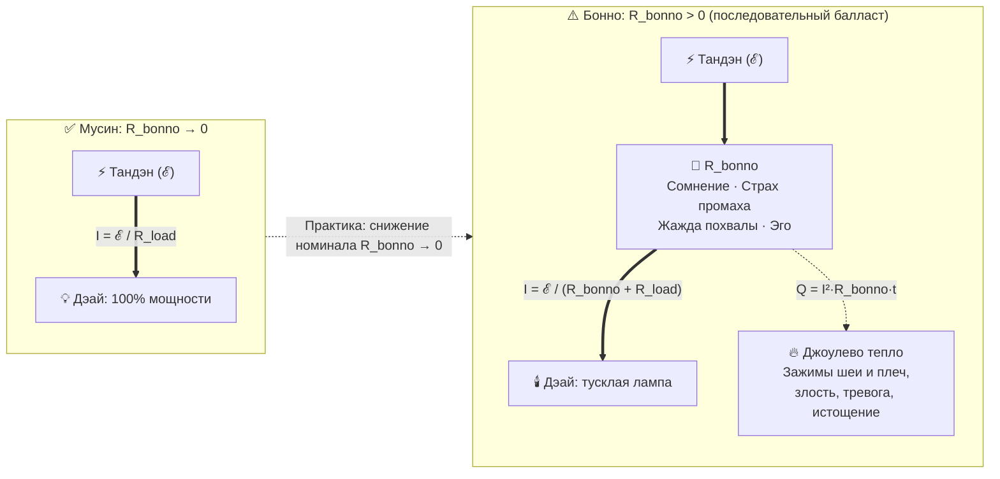
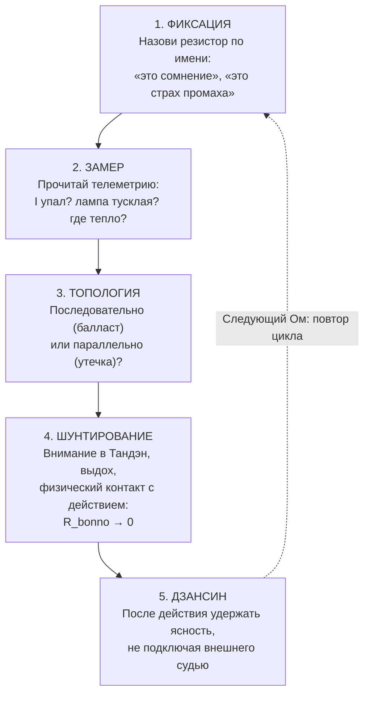

# 111. Резистор Бонно (煩悩): Последовательное паразитное сопротивление балласта, провал проводимости Кё (虚) и возврат к нулю по одному Ому

> [!quote] Закон Аньянова о последовательном балласте
> ### ⚡ **«Если врезать в тракт резистор последовательно, он не станет деталью полезной нагрузки. Он станет балластом: отнимет напряжение у лампы, ослабит ток и превратит полезную энергию в бесполезное тепло. Именно так в цепи человека работает омрачение. В терминах будо этот последовательный паразитный резистор называется Бонно (煩悩), а его мгновенный срыв в бесконечность — Кё (虚).»**  
> — **Владимир Аньянов**

---

## 1. Чистая постановка задачи: что именно вы вставили в схему?

Пусть в контуре человека генератор Тандэн выдаёт $\mathcal{E}$, а полезная нагрузка (лампа действия) имеет номинал $R_{\text{load}}$. Между ними вырезан участок провода и на его место впаян резистор $R_{\text{bonno}}$.

Топология цепи не изменилась ни на узел: источник на месте, лампа на месте, обратный провод реальности на месте. Но режим работы изменился **фундаментально**.

$$I = \frac{\mathcal{E}}{R_{\text{bonno}} + R_{\text{load}}}$$

$$U_{\text{load}} = \mathcal{E} \cdot \frac{R_{\text{load}}}{R_{\text{bonno}} + R_{\text{load}}}$$

$$Q_{\text{bonno}} = I^2 R_{\text{bonno}} \, t \qquad P_{\text{load}} = I^2 R_{\text{load}}$$

Три следствия, которые инженер обязан назвать вслух:

1. **Ток падает** во всей цепи (не только «после» резистора — ток в последовательной цепи один и тот же в каждой точке).
2. **Напряжение делится**: до точки контакта с объектом действия (Дэай) доходит лишь часть потенциала реактора.
3. **Энергия не исчезает**: всё, что не дошло до лампы, выделилось теплом **внутри самой системы** — на балласте $R_{\text{bonno}}$.

> **Последовательный резистор — это не «сопротивление среды». Это налог, снятый с собственного тока до того, как он сделал хоть одну единицу полезной работы.**

### Числовой аудит одного балласта

При $\mathcal{E} = 100$ В и $R_{\text{load}} = 100$ Ом:

| $R_{\text{bonno}}$, Ом | $I$, А | $U_{\text{load}}$, В | $P_{\text{load}}$, Вт | $Q_{\text{bonno}}$, Вт | $\mathcal{H} = P_{\text{load}}/P_{\text{total}}$ |
| :--- | :--- | :--- | :--- | :--- | :--- |
| **0** (Мусин) | 1.00 | 100 | **100** | 0 | **100%** |
| 25 | 0.80 | 80 | 64 | 16 | 80% |
| **100** | 0.50 | 50 | 25 | 25 | **50%** |
| 300 | 0.25 | 25 | 6.25 | 18.75 | 25% |
| **$\to \infty$** (Кё) | 0 | **0** | **0** | $\to 0$ | **0%** |

Ключевая нелинейность канона: при $R_{\text{bonno}} = R_{\text{load}}$ (всего один такой же резистор в тракте) система теряет **половину мощности** и половину напряжения — а оператор при этом субъективно «выкладывается на 100%».

---

## 2. Бонно (煩悩): канонический термин и его буквальная электротехника

**Бонно (煩悩, Bonno; санскр. *kleśa* — клеша)** — ментальные загрязнения, омрачения и аффекты ума: жадность, гнев, ревность, сомнение, зависимость от похвалы. В классическом каноне их перечисляют как 108 омрачений ума.

Слово **бонно буквально означает «то, что терзает, беспокоит, нагревает и кипятит ум»**. Любопытно, что уже сама этимология описывает **джоулев нагрев**: не «зло», не «грех», не «моральная нечистота» — а трение, нагрев и кипение. Древние описали $Q = I^2 R t$ за две с половиной тысячи лет до Джоуля, просто у них не было буквы $R$.

Электротехнический перевод:

| Уровень | Термин Дзен / Будо | Физический элемент цепи |
| :--- | :--- | :--- |
| Ядро | 丹田 **Тандэн** | Источник ЭДС $\mathcal{E}$ (генератор) |
| Идеальная проводимость | 無心 **Мусин** | $R = 0$ (сверхпроводимость) |
| **Последовательный паразит** | **煩悩 Бонно** | **Балластный резистор $R_{\text{bonno}} > 0$ в тракте полезного сигнала** |
| Мгновенный срыв проводимости | 虚 **Кё** | Скачок $R_{\text{bonno}} \to \infty$ (дребезг контакта / обрыв в момент истины) |
| Точка контакта с объектом | 出合い **Дэай** | Клеммы нагрузки, где обязана развиться мощность |

**Бонно — это не «чувство» и не «характер». Это деталь с номиналом.** И, как любую деталь, её можно измерить, локализовать и зашунтировать.

---

## 3. Топологический аудит: два способа врезки паразита

Схемотехнически омрачение может быть включено в контур **двумя принципиально разными способами** — и это разные аварии с разной телеметрией (см. [[02_Wiki/Inner Current (Circuitry of Existential Fault and Ground Leak)|28. Схемотехника экзистенциальной аварии]]):

### А. Последовательный балласт ($R_{\text{bonno}}$, series) — предмет настоящей главы
Резистор стоит **внутри тракта полезного сигнала**, между Тандэном и лампой:

- **Что это в психике:** эго, сомнения, страх промаха, жажда похвалы, оценка «как я сейчас выгляжу».
- **Что делает с током:** ток падает $I = \mathcal{E}/(R_{\text{bonno}} + R_{\text{load}})$, напряжение делится, до Дэай доходит лишь часть потенциала.
- **Симптом на приборах:** лампа светит тускло, удар теряет хлёсткость, провод внутри тёплый.
- **Симптом оператора:** «я стараюсь изо всех сил, а результат вялый».

### Б. Параллельный шунт / утечка ($G_{\text{bonno}}$, shunt + ground fault)
Резистор (проводимость) стоит **в обход нагрузки**, на землю:

- **Что это в психике:** утечка внимания на внешние раздражители — уведомления, соцсети, чужие мнения.
- **Что делает с током:** ток не греет нагрузку, а стекает мимо неё $I_{\text{load}} = I - I_{\text{leak}}$.
- **Диагностика:** в тяжёлом случае — полное обнуление всех ламп, авария Ground Fault ([[02_Wiki/Inner Current (Engineering Proof of No Meaning of Life and the Birth of Happiness Architecture)|26. Магистральная утечка]]).

> **Инженерное правило канона:** сначала определи **класс врезки** паразита, и только потом подбирай инструмент. Последовательный резистор нельзя «перекричать» силой воли — его можно только **зашунтировать до нуля**.

---

## 4. Принципиальная схема: два режима одного тракта

---

## 5. Дэай (出合い): точка, где делится напряжение

**Дэай** — момент встречи с объектом действия: контакт ракетки с мячом, пальцы на клавиатуре, первый звук сказанной фразы, взгляд на собеседника. Это клеммы нагрузки — точка, в которой потенциал Тандэна обязан превратиться в работу.

При $R_{\text{bonno}} > 0$ до этой точки доходит **лишь часть** потенциала. Отсюда канонический операционный парадокс, который человек переживает как личное унижение, хотя это чистая электротехника:

> **Человек выкладывается на 100%, устаёт, «закипает» — а на контакте с объектом действия почти нет массы.**

Причина не в недостатке усилия. Причина в том, что добавленное усилие **падает на балласте, а не на нагрузке**: ум вклинивает в тракт собственное трение и первым забирает себе напряжение.

- **Лампа светит тускло:** работа сделана, но без хлёсткости, без плотности, без «вкуса».
- **Удар теряет резкость:** движение есть, а силы в нём нет.
- **Провод внутри тёплый:** усталость приходит раньше результата.

---

## 6. Куда уходит энергия: $Q = I^2 R_{\text{bonno}} t$ как «джоулево тепло души»

Ключевое свойство последовательного балласта: он не отдаёт энергию наружу. Он **не производит работу во внешнем мире**. Вся застрявшая на нём мощность уходит в тепло **внутри самой системы**.

Это тепло не видно снаружи. Никто из наблюдателей не заметит его на принципиальной схеме: лампы горят, человек рядом, форма соблюдена. Тепло выделяется внутри корпуса:

| Канал рассеяния | Что чувствует оператор | Что видит наблюдатель |
| :--- | :--- | :--- |
| Соматические зажимы | Скованность шеи и плеч, сжатая челюсть, задержанное дыхание | «Собранный, серьёзный человек» |
| Эмоциональный нагрев | Злость, раздражение, обида на себя и других | «Что-то не так, но неясно что» |
| Тревожный контур | Прокрутка сценариев, «внутренний судья» | «Внимательный, ответственный» |
| Нервное истощение | Изнеможение после действия, туман в голове | «Много работает, выгорел» |

> **Злость, скорбь, вина и страх — это не «грехи», которыми надо мучиться. Это ватты паразитного нагрева, которые надо просто перестать выделять. Практика — не моральное лекарство, а снижение номинала резистора.**

---

## 7. Кё (虚): мгновенный срыв проводимости

Родственный термин будо — **Кё (虚, Kyo)**: «пустота», ложный провал, выпадение из потока.

В боевых искусствах кё называют мгновение, когда сознание спотыкается о внутреннее сомнение или фиксацию: тело ещё движется, но проводимость уже потеряна, и система на долю секунды становится уязвимой. Соперник «читает» этот провал и входит в него.

Электротехнически это **не статичный балласт, а переходный процесс**:

$$R_{\text{bonno}}(t) \to \infty \quad \text{на интервале } \Delta t \approx 10^{-2} \text{ с}$$

- **Физическая аналогия:** дребезг контакта, непропаянная пайка, «холодный» контакт, микрообрыв под вибрацией.
- **Телеметрия:** ток на мгновение исчезает, лампа мигает, форма внешне цела — а результата нет.
- **Отличие от Мусин:** Мусин — это $R \to 0$ **непрерывно**; Кё — это $R \to \infty$ **на мгновение**. Первое — сверхпроводимость, второе — intermittent fault.

> **Мастер отличается от новичка не тем, что у него нет бонно. Мастер отличается тем, что у него нет кё: его контакт не дребезжит.**

---

## 8. Реестр типовых последовательных балластов

Каждое омрачение имеет свой номинал, свой симптом и свой способ шунтирования. Ниже — практический реестр четырёх самых частых балластов в тракте современного оператора:

| Бонно (омрачение) | $R_{\text{bonno}}$ | Где врезан | Симптом на Дэай | Тепло $Q$ | Способ обнуления |
| :--- | :--- | :--- | :--- | :--- | :--- |
| **Сомнение** («а правильно ли я делаю?») | Средний | Перед действием | Задержка между импульсом и движением | Внутренний диалог, туман | Саму (作務): низковольтная сенсомоторная проверка вместо обдумывания |
| **Страх промаха** («а если не получится?») | Высокий | На входе в Дэай | Рука дрожит, удар не хлёсткий | Тревога, зажим плеч | Итиго Итиэ (一期一会): 100% присутствия в одном контакте |
| **Жажда похвалы** | Высокий | Между действием и результатом | Форма безупречна, плотности нет | Обида, зависимость от реакции | Нидзиригути (躙口): вход в диалог без меча статуса |
| **Оценка «как я выгляжу»** | Очень высокий | Паразитное реле в обход нагрузки | Взгляд со стороны вместо контакта | Стыд, скованность, самопрезентация | Аппаратный шунт $R_{\text{ego}} \to 0$: внимание снова в Тандэн |

**Правило прогресса:** номинал снимается не одним движением, а **по одному Ому**. Резкое падение $R_{\text{bonno}}$ до нуля без калибровки — скачок напряжения, который ломает соседние узлы цепи (тот же механизм, что в протоколе [[02_Wiki/Inner Current (Black Start Protocol — Cold Reboot After Catastrophic Blackout)|30. Чёрный старт]]).

---

## 9. Протокол снижения номинала: $R_{\text{bonno}} \to 0$

Практика дзэн и шлифовка формы в терминах настоящей главы сводятся ровно к одному — **уменьшению номинала этого резистора**. Ниже — 5-шаговый операционный цикл:

**Каждый шаг измерим:**
1. **Фиксация** — балласт получает имя и перестаёт быть «собой», становится деталью.
2. **Замер** — вы проверяете не «хорошо ли я себя чувствую», а $I$, $U_{\text{load}}$, $Q$.
3. **Топология** — выяснение, что именно врезано: последовательное трение или параллельная утечка.
4. **Шунтирование** — не борьба с резистором, а **обнуление его номинала** через возврат внимания в тело и в физический контакт: сверхпроводимость Мусин.
5. **Дзансин** — сохранение чистого контакта после действия, чтобы не врезать внешнего судью на выходе (см. [[02_Wiki/Inner Current (Case Study — Tennis Tournament, External Judge Relay and the Protocol of Mushin in Competition)|110. Кейс-стади: теннис на турнире]]).

> **Практика — это не накопление добродетелей поверх бонно. Практика — это снятие номинала: резистор за резистором, Ом за Омом, пока проводник не вернётся в режим Мусин, где сопротивление равно нулю, а ток — полон.**

---

## 10. Что меняет этот взгляд: демистификация практики

Классическая традиция 2500 лет описывала бонно как «загрязнения», которые нужно «очистить», а шлифовку формы — как «духовный путь». Формулировка точна эмоционально и бесполезна операционно: непонятно, что именно чистить, в каких единицах и как проверить успех.

Перевод на язык цепи даёт три радикальных сдвига:

1. **Бонно перестаёт быть изъяном личности.** Это деталь с номиналом $R_{\text{bonno}} > 0$. Её можно измерить, а не стыдиться.
2. **Тепло перестаёт быть наказанием.** $Q = I^2 R_{\text{bonno}} t$ — это не кара за грехи, а физическое следствие врезки резистора в тракт. Убрали резистор — прекратился нагрев.
3. **Практика перестаёт быть искусством.** Шлифовка формы = снижение номинала. Прогресс проверяется приборами: лампы стали ярче, удар плотнее, тепла меньше.

### Критерий фальсифицируемости (Поппер)

Классический мистический тезис «ум очистился» непроверяем. Тезис настоящей главы проверяем за один контакт:

| Проверка | Что ожидается при $R_{\text{bonno}} \to 0$ |
| :--- | :--- |
| **Скорость отклика** | Сокращается зазор между импульсом и движением (Дэай без задержки) |
| **Полнота мощности** | Удар, слово, решение обретают плотность и массу |
| **Тепло** | Меньше зажимов шеи и плеч, меньше злости и прокрутки после действия |
| **Восстановление** | Усталость приходит от работы, а не от внутреннего трения |
| **Устойчивость контакта** | Не появляется кё (микропровалов проводимости) в момент нажима |

Если после «практики» напряжение на нагрузке не выросло, а нагрев балласта не упал — резистор не снят. Никакой мистики в проверке не требуется: смотрите телеметрию.

---

## 11. Итог главы

- **Последовательно врезанный резистор — это балласт**, а не элемент полезной нагрузки: он делит напряжение, ослабляет ток и превращает полезную энергию в бесполезное тепло внутри системы.
- **В терминах дзэн и классического будо этот балласт называется Бонно (煩悩, клеша)** — то, что терзает, беспокоит, нагревает и кипятит ум. Этимология слова уже описывает закон Джоуля — Ленца.
- **Последовательный балласт ($R_{\text{bonno}} > 0$) — это эго, сомнения, страх промаха, жажда похвалы, оценка «как я сейчас выгляжу»**: проводник вместо идеального Мусин ($R = 0$) вклинивает в тракт собственное трение.
- **До точки контакта (Дэай) доходит лишь часть потенциала**: на 100% затраченного усилия — почти нулевая масса на объекте действия.
- **Кё (虚) — мгновенный скачок паразитного сопротивления в цепи** (intermittent fault), момент, когда сознание спотыкается о сомнение или фиксацию и система теряет проводимость.
- **Практика дзэн и шлифовка формы — это ровно одно действие: снижение номинала $R_{\text{bonno}}$ до нуля**, пока проводник не вернётся в режим сверхпроводимости Мусин.

---

## Connections

- [[04_Maps/Inner Current MOC|Inner Current MOC (Мастер-карта цепи)]]
- [[02_Wiki/Inner Current (Complete Zen-Electrodynamic Ontological Atlas)|13. Полный онтологический атлас: биекция канонов Дзен и электродинамики]] — канонический узел 12 (Бонно) и узел 04 (Мусин) атласа, в который встроена настоящая глава.
- [[02_Wiki/Inner Current (Physics of Presence and Superconductivity)|02. Физика присутствия и состояние сверхпроводимости]] — закон Джоуля — Ленца $Q = I^2 R t$ и режим Мусин ($R \to 0$).
- [[02_Wiki/Inner Current (Circuitry of Existential Fault and Ground Leak)|28. Схемотехника экзистенциальной аварии]] — топологический дуализм: последовательный $R_{\text{series}}$ vs параллельный Ground Fault.
- [[02_Wiki/Inner Current (Core Topology and Polarity Law)|01. Базовая топология цепи и закон полярности]] — контур «Тандэн → Внимание → Нагрузка» и закон полярности.
- [[02_Wiki/Inner Current (Nature and Illusion of Ego)|07. Природа и иллюзия эго]] — демистификация Анатта и Майя через протокол шунтирования $R_{\text{ego}}$.
- [[02_Wiki/Inner Current (Case Study — Tennis Tournament, External Judge Relay and the Protocol of Mushin in Competition)|110. Кейс-стади: теннис на турнире]] — практический пример балласта «оценка как я выгляжу» и протокола возврата в Мусин.
- [[02_Wiki/Inner Current (Double Verification Principle — Zen-Electrodynamics Cross-Validation and Tanden Generator)|39. Принцип двойной проверки: дзен-электродинамическая кросс-калибровка]] — почему дзен даёт соматический якорь, а схема даёт точность.
- [[02_Wiki/Inner Current (Mushin Is Obscured, Not Destroyed — Why Bonno Interrupts Superconductivity Without Cancelling the Nature of the Conductor, and Why the Return Costs Nothing)|112. Мусин не исчезает, а затеняется]] — прямое продолжение главы: балласт $R_{\text{bonno}} > 0$ срывает режим, но не меняет природу проводника; возврат к нулю — снятие причины, а не достижение.
- [[02_Wiki/Inner Current (Satori as the Superconducting Phase Transition — Meissner Effect, Collapse of Bonno Resistance to Zero and Full Circuit Efficiency)|113. Сатори как фазовый переход в сверхпроводимость]] — следующая глава: когда $T$ падает ниже $T_c$, $R_{\text{bonno}}$ схлопывается в ноль скачком, потери $Q$ и КПД $\eta$ обнуляются до 100%, а эффект Мейснера вытесняет паразитные поля из ткани контура.
- [[02_Wiki/Inner Current (Fundamental Laws of the Happiness Thermodynamics)|20. Фундаментальные законы термодинамики счастья]] — закон возрастания паразитного сопротивления и абсолютный эталон $R = 0$.
- [[04_Maps/Inner Current Book MOC|📖 Книга: «Внутренний ток: Архитектура счастья»]]
