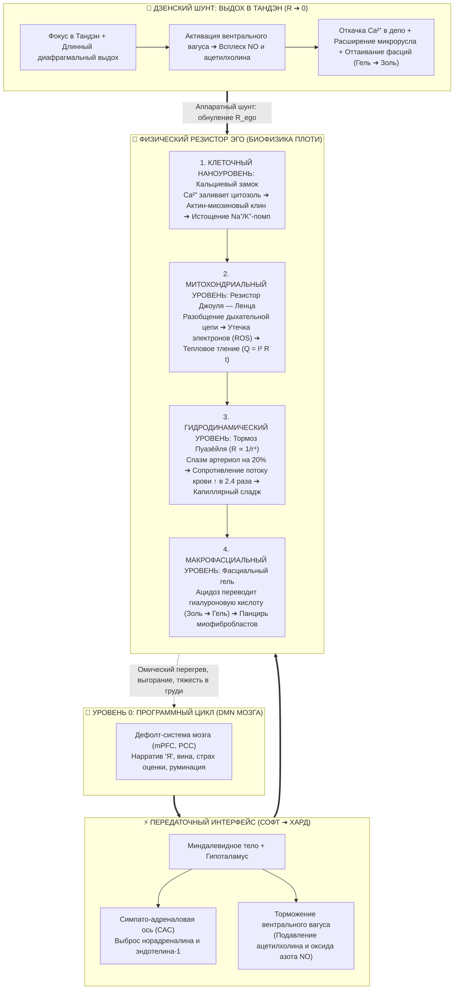

# ⚡ 540. Физический резистор эго в теле: Кальциевый замок, омический тормоз Пуазёйля и митохондриальный перегрев

### Почему DMN мозга — это лишь программный контроллер, где в биологической плоти физически расположен реостат сопротивления ($R_{\text{ego}}$), и как мышечно-сосудистый спазм преобразует жизненную силу в тепловое тление Джоуля — Ленца

> [!quote] Каноническая аксиома материального резистора
> ### ⚡ **«Ментальное эго — это лишь бестелесный софтверный цикл в коре головного мозга (DMN). Компьютерный код сам по себе не может страдать и не может греться. Страдание начинается тогда, когда этот софт дёргает рубильники вегетативной системы и смыкает в плоти физический реостат. Резистор эго в теле — это не абстракция: это заблокированные кальциевые каналы клеток, сжатые до капиллярного ишемического спазма микрососуды по закону Пуазёйля ($R \propto 1/r^4$), закисленный фасциальный гель и сорванные в режим теплового тления митохондрии. Счастье — это не смена мыслей на "позитивные", а мгновенное размыкание этого омического капкана и возвращение живого кабеля плоти в режим нулевого сопротивления.»**  
> — **Владимир Аньянов**

---



---

## 1. Демаркация «Софт против Харда»: почему нейросети DMN недостаточно для страдания

В современной нейробиологии принято указывать на **сеть пассивного режима работы мозга (DMN — Default Mode Network)** как на субстрат «эго». Действительно, узлы медиальной префронтальной коры ($mPFC$), задней поясной коры ($PCC$) и нижней теменной дольки активируются в моменты, когда человек блуждает в мыслях о себе, прокручивает социальный стыд, зависть, рефлексию или конструирует виртуальные сценарии будущего.

Однако здесь кроется кардинальная ошибка редукционизма:
**Алгоритм, зацикленный в чистом софте, не способен породить боль и истощение.**

Если запустить бесконечный цикл `while(true) { criticize_self(); }` на сервере в облаке, сервер не испытывает экзистенциального ужаса; он просто расходует такты процессора. Человеческое же страдание переживается как невыносимая телесная тяжесть, сдавленность в солнечном сплетении, ком в горле, одеревенение плеч и хроническая усталость.

Следовательно:
* **DMN — это программный контроллер (логический вентиль)**. Он задаёт паттерн ложного разделения: «Я отдельно от мира, мир враждебен, ресурсы ограничены».
* **Физический резистор эго ($R_{\text{ego}}$)** расположен **в соматической ткани ниже основания черепа**. Это аппаратная периферия, которую софт переводит в состояние омического сопротивления.

---

## 2. Клеточный наноуровень: Кальциевый замок ($\text{Ca}^{2+}$-Overload)

Любая живая клетка в состоянии покоя поддерживает сверхпроводящую электрохимическую поляризацию. Концентрация свободного кальция в цитоплазме покоящейся клетки ничтожно мала — около $100\ \text{нМ}$, тогда как во внеклеточной среде она в 10 000 раз выше ($\approx 1\text{–}2\ \text{мМ}$).

Когда DMN генерирует сигнал экзистенциальной тревоги («Обо мне плохо подумали», «Я неудачник», «Будущее опасно»):
1. Сигналы через гипоталамус активируют симпатические терминали, выделяющие **норадреналин** на $\alpha_1$-адренорецепторы.
2. Запускается сигнальный каскад $G_q \to \text{PLC} \to \text{IP}_3$, открывающий кальциевые каналы саркоплазматического/эндоплазматического ретикулума.
3. Ионы $\text{Ca}^{2+}$ лавиной устремляются в цитозоль.

В здоровом рабочем контуре этот всплеск кальция мгновенно гасится: как только действие завершено, насос **SERCA** (сарко/эндоплазматическая кальциевая АТФаза) откачивает $\text{Ca}^{2+}$ обратно в депо с затратой энергии АТФ.

Но в режиме работы DMN тревога не имеет физического завершения. Мысли текут часами. В результате:
* Кальциевые насосы перегружаются и истощаются.
* Актин и миозин в цитоскелете клетки остаются сцепленными в состоянии **тонического полуспазма**.
* До **40–60% энергии АТФ**, вырабатываемой клеткой, уходит в пустую работу насосов ($\text{Na}^+/\text{K}^+$-АТФазы и SERCA) лишь для того, чтобы удержать клетку от гибели при высоком кальциевом напряжении. Это микроскопический омический тормоз: ток питательных веществ идёт, но полезной внешней работы ($W = 0$) нет.

---

## 3. Субклеточный тепловой рассеиватель: Разобщение митохондрий и закон Джоуля — Ленца

Что происходит с метаболической энергией, когда клетка зажата кальциевым замком? Она подчиняется закону Джоуля — Ленца:
$$Q = I^2 R_{\text{ego}} t$$
где вся мощность жизненного тока $I$, идущего от Тандэна (окисление глюкозы и жирных кислот), не выходит в виде светового луча действия (Гё), а превращается в **паразитное тепло и тканевое тление ($Q$)**.

В нормальном состоянии митохондрии действуют как высокоэффективные квантовые генераторы: электроны перемещаются по дыхательной цепи (комплексы I $\to$ II $\to$ III $\to$ IV), выкачивая протоны и создавая электрохимический потенциал ($\Delta \Psi_m$), который крутит турбину АТФ-синтазы.

Под непрерывным симпатическим давлением эго:
1. Хронический избыток кальция активирует митохондриальную пору переходной проницаемости (**mPTP**).
2. Протонный градиент рассеивается через белки разобщения (UCP) в прямое тепло.
3. Электроны срываются с цепи на комплексах I и III, реагируя с кислородом напрямую с образованием **активных форм кислорода (АФК / ROS)**: супероксид-радикала ($O_2^{\bullet-}$), перекиси водорода ($H_2 O_2$) и гидроксил-радикала ($^{\bullet}OH$).
4. Оксидативный стресс запускает воспалительный ядерный фактор $\text{NF-\kappa B}$, стимулируя продукцию провоспалительных цитокинов ($IL\text{-}6, TNF\text{-}\alpha$).

Человек чувствует «горение изнутри», разбитость и хроническую субфебрильную усталость. Это не метафора — это буквальное физическое рассеяние тока на биологическом сопротивлении.

---

## 4. Тканевой гидравлический тормоз: Закон Пуазёйля ($R \propto 1/r^4$) и капиллярный сладж

Сосудистая система — это главный жидкостный кабель распределения энергии. Гидравлическое сопротивление сосудистого русла подчиняется уравнению Пуазёйля:
$$R_{\text{vasc}} = \frac{8 \eta L}{\pi r^4}$$
где ключевой параметр — **радиус просвета сосуда в четвёртой степени ($r^4$)**.

* **Сверхпроводящий режим (Мусин):** парасимпатическая ветвь и эндотелий генерируют базальный уровень **оксида азота (NO)**. Артериолы и капиллярные сфинктеры расслаблены, их просвет $r$ оптимален. Эритроциты легко деформируются и скользят по капиллярам диаметром 5–7 мкм со сверхнизким сопротивлением трения.
* **Режим сопротивления эго ($R_{\text{ego}}$):** выброс эндотелина-1 и норадреналина вызывает спазм прекапиллярных сфинктеров. Достаточно уменьшить радиус микрососуда всего на **19%**, как гидравлическое сопротивление потоку крови **возрастает ровно в 2 раза** ($1 / 0.81^4 \approx 2.32$).
* При сужении радиуса на **30%** сопротивление подскакивает более чем в **4 раза**!

К чему это приводит:
1. **Капиллярный сладж (Rouleaux formation):** скорость кровотока падает, эритроциты теряют отрицательный заряд мембран и слипаются в «монетные столбики», физически закупоривая капиллярное русло.
2. **Тканевая ишемия и гипоксия:** ткани переходят на анаэробный гликолиз, накапливая молочную кислоту.
3. **Падение pH (локальный ацидоз):** кислая среда дополнительно сенсибилизирует болевые ноцицепторы (ASIC-каналы), формируя тупую, непроходящую фоновую тревогу в теле.

---

## 5. Макроструктура: Фасциальная тиксотропия и мышечный панцирь

Вся мускулатура и внутренние органы упакованы в непрерывную сеть соединительной ткани — фасцию. 

Основное межклеточное вещество фасции состоит из молекул **гиалуроновой кислоты (HA)**. Гиалуронан обладает свойством **тиксотропии** — его вязкость напрямую зависит от температуры и кислотности ($\text{pH}$):
* **При высоком заряде и нормальном pH ($\approx 7.4$):** цепочки гиалуроновой кислоты скользят друг относительно друга в состоянии жидкого, смазывающего **золя**. Фасциальные листки скользят без трения — тело ощущается невесомым, текучим и свободным.
* **При ацидозе, вызванном капиллярным спазмом эго:** молекулы гиалуронана агрегируют, сшиваются и переходят в состояние **вязкого, клейкого геля**. Скольжение блокируется.

Одновременно в фасции активируются специализированные клетки — **миофибробласты**, несущие $\alpha$-гладкомышечный актин ($\alpha\text{-SMA}$). Под воздействием цитокинов тревоги они необратимо стягивают фасциальные полотна.

Так возникает то, что Вильгельм Райх эмпирически назвал «мышечным панцирем» (*muskulärer Panzer*):
* **Шейно-затылочный зажим:** спазм субокципитальных мышц сдавливает затылочные нервы и позвоночные артерии, ухудшая венозный отток из черепа.
* **Диафрагмальный блок:** диафрагма застывает на полувдохе, блокируя глубокий дренаж брюшной полости.
* **Тазово-поясничный замок:** тоническое укорочение подвздошно-поясничной мышцы (*psoas major*) передавливает брюшное аортальное русло и отсекает Тандэн от ног.

---

## 6. Дзенская аппаратная декомпрессия: Почему длинный выдох в Тандэн обнуляет резистор

Теперь становится очевидным, почему абстрактные ментальные аффирмации («Я спокоен», «Я принимаю себя») почти никогда не работают против глубокой тревоги:
> **Попытка переубедить мыслями напряжённое тело — это попытка починить расплавленный омический резистор на печатной плате отправкой текстового сообщения.**

Чтобы сбросить физический резистор эго, требуется **аппаратная коммутация вегетативной цепи**:

```
[Мысль DMN] ➔ [Симпатика] ➔ [Ca²⁺-спазм] ➔ [Ишемия Пуазёйля] ➔ [Фасциальный гель]
                                      ▲
                                      │ АППАРАТНЫЙ ШУНТ:
                      [ФОКУС В ТАНДЭН + ВЫДОХ ВДВОЕ ДЛИННЕЕ ВДОХА]
                                      │
            [Вентральный Вагус] ➔ [Ацетилхолин + NO] ➔ [Откачка Ca²⁺] ➔ [R = 0]
```

Когда практик опускает внимание в нижний даньтянь (Тандэн) и начинает медленный, удлинённый выдох с расслаблением живота:
1. Барорецепторы дуги аорты и каротидного синуса фиксируют плавное изменение внутрибрюшного давления и активируют **вентральную ветвь блуждающего нерва (Nervus Vagus)**.
2. Терминали вагуса выбрасывают **ацетилхолин** на мускариновые $M_2$- и $M_3$-рецепторы эндотелия.
3. Активируется эндотелиальная синтаза оксида азота (**eNOS**), вызывая мощный локальный выброс газа **NO (оксида азота)**.
4. Оксид азота активирует растворимую гуанилатциклазу ($sGC$), повышая уровень цГМФ и фосфорилируя белки, откачивающие кальций из цитозоля.
5. Гладкомышечные сфинктеры артериол расслабляются. По закону Пуазёйля радиус $r$ увеличивается — сопротивление кровотоку падает в геометрической прогрессии ($R \propto 1/r^4$).
6. Приток свежей оксигенированной крови вымывает лактат, pH возвращается к 7.4. Фасциальный гель мгновенно оттаивает в текучий золь.
7. Резистор эго физически замкнут накоротко — в контуре восстанавливается **режим биологической сверхпроводимости ($R_{\text{ego}} \to 0$)**.

---

## 7. 30-секундный протокол соматического шунтирования ($R_{\text{ego}} \to 0$)

При первом ощущении сбоя цепи (появление мыслей вины, обиды, тревоги за статус или суеты):

* **Шаг 1. Локализация резистора (3 секунды):**
  Не спорьте с мыслями DMN. Мгновенно переведите сенсорный фокус внутрь тела и нащупайте, где именно сомкнулся омический спазм (челюсти, горло, диафрагма, подреберье, тазовое дно).
* **Шаг 2. Разрыв петли «Софт ➔ Хард» (7 секунд):**
  Сделайте резкий микро-сброс тонуса плеч вниз. Физически разомкните коренные зубы (отпустите жевательные мышцы *masseter* — главный соматический триггер тройничного нерва).
* **Шаг 3. Включение генератора NO (20 секунд):**
  Сделайте короткий вдох носом в нижнюю треть живота (Тандэн) на 3 счёта и **очень длинный, бесшумный, непрерывный выдох через рот тонкой струйкой на 6–8 счетов**, позволяя животу полностью стать мягким.
* **Результат:** 
  Симпатический драйв отключён. Кальций ушёл в саркоплазматический ретикулум. Капилляры раскрылись. В теле разливается характерное ощущение прохладного тепла и невесомости — цепь вышла на чистую проводимость.

---

## Резюме: Семь аксиом физического резистора эго

1. **Бестелесного страдания не существует:** Ментальный нарратив DMN не способен болеть; всё человеческое страдание есть результат физического включения соматического реостата.
2. **Природа сопротивления:** Резистор эго в теле — это не умозрительный символ, а измеримый биофизический импеданс (кальциевый застой, вазоспазм и фасциальная ригидность).
3. **Закон Пуазёйля в психике:** Сужение микрорусла даже на 20% более чем удваивает омическое сопротивление току жизненных флюидов ($R \propto 1/r^4$), создавая соматическое ощущение удушья и тяжести.
4. **Митохондриальное тление:** Разобщение дыхательной цепи под симпато-адреналовым стрессом рассеивает жизненную мощность в тепловое воспаление и свободные радикалы по закону Джоуля — Ленца ($Q = I^2 R t$).
5. **Фасциальный капкан:** Закисление среды при капиллярной ишемии переводит гиалуроновую смазку из скользящего золя в вязкий клейкий гель, физически цементируя мышечный панцирь.
6. **Бессилие ментального контроля:** Невозможно растворить кальциевый спазм мыслями о принятии; для сброса сопротивления требуется соматическая вагусная декомпрессия.
7. **Мгновенность сверхпроводимости:** Возврат в режим Мусин ($R \to 0$) происходит не за годы медитаций в пещерах, а за 30 секунд физиологического шунтирования через Тандэн, выброс оксида азота и глубокое капиллярное раскрытие.
