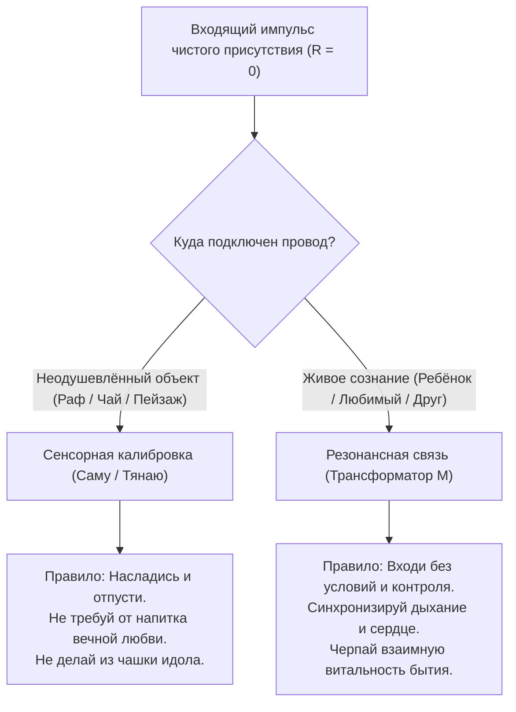

---
created: 2026-10-09
source: [[04_Maps/Inner Current MOC|Inner Current MOC]]
author: Владимир Аньянов
chapter: 326
layer: "IV. Мета-система и продукт (Инструменты, телеметрия и ценность)"
tags:
  - inner-current
  - scale/deep-dive
  - node/tanden
  - node/conductor
  - domain/electrodynamics
  - domain/neurobiology
  - state/leak
  - philosophy
  - coconut-raff-syndrome
  - child-hug
  - circuit-topology
  - load-types
  - transformer-induction
  - equifinality-trap
  - mushin
  - sensory-dissipation
  - zen-engineering
aliases:
  - "326-child-hug-vs-coconut-raff"
  - "Объятие ребёнка и кокосовый раф"
  - "Пассивное рассеяние против трансформаторной индукции"
  - "The Child Hug vs Coconut Raff"
type: canon
status: evergreen
---

> [!info] Контекст цикла
> Эта глава завершает и онтологически кристаллизует гедонистический цикл исследований Системы: [[02_Wiki/Inner Current (The Planck Paradox and Coconut Raff Syndrome — Why People Confuse Happiness with Pleasure, The Abstraction Barrier and The Sudden-Thought Test)|279. Синдром Кокосового Рафа]], [[02_Wiki/Inner Current (The Five Scenes Syndrome — Deconstruction of The Lover, Gym, Child, Work and Travel Checklist, The Lamp vs Generator Fallacy and Scenery Vulnerability Test)|281. Синдром Пяти Сцен]], [[02_Wiki/Inner Current (The Layman's Self-Deception — Loss of Happiness Without Circuit Theory)|282. Самообман обывателя в объятиях]] и [[02_Wiki/Inner Current (The Wall Socket and Appliance Fallacy — Why Pleasures Are Toasters and Inner Current Is Grid Voltage, Deconstruction of The Defense List and Bread with Water Test)|284. Метафора Розетки и Электроприборов]].

# 326. Объятие ребёнка и кокосовый раф: Пассивное резистивное рассеяние против трансформаторной индукции двух реакторов — Почему отсутствие эго в стимуле и контакте даёт приятное чувство, но их смешение ведёт к системной катастрофе контура

> [!quote] Аксиома топологии нагрузки Аньянова
> ### ⚡ **«Чистота проводника не отменяет физики потребителя. Когда женщина пьёт кокосовый раф без эго, её проводка сверхпроводима ($R_{\text{ego}} \approx 0$), но ток рассеивается в пассивном резисторе вкусовых рецепторов. Когда та же женщина без эго обнимает ребёнка, её проводка столь же чиста, но контур замыкается на второй живой генератор, порождая индуктивный резонанс двух сердец. Субъективно оба переживания сладки, ибо ток течёт беспрепятственно. Но объявить их одним и тем же — значит совершить фатальную ошибку схемотехники: перепутать свет дешёвого светодиода с сиянием высоковольтного трансформатора и попытаться насытить жажду живой связи покупкой сладкой пены.»**  
> — **Владимир Аньянов**

---

## 🧭 Принципиальная схема: Топологическая демаркация нагрузок

```
[СЛУЧАЙ А: КОКОСОВЫЙ РАФ — ОДНОСТОРОННЕЕ РЕЗИСТИВНОЕ РАССЕЯНИЕ]

    ⚡ Тандэн (ЭДС) ────► [Проводка: R_ego ≈ 0] ────► ☕ Пассивный сенсор (Язык)
                                                          │
                                                          ▼
                                              Дофамин + Калории (Сахар/Жир)
                                              (Энергия рассеяна в тепло: Q_sens)
                                              Контур исчерпан по окончании глотка.

══════════════════════════════════════════════════════════════════════════════════════

[СЛУЧАЙ Б: ОБЪЯТИЕ РЕБЁНКА — ДВУСТОРОННЯЯ ИНДУКЦИЯ ДВУХ РЕАКТОРОВ]

    ⚡ Тандэн Мамы  ────► [Проводка: R_ego ≈ 0] ─┐
                                                 ├─► ❤️ РЕЗОНАНСНЫЙ ТРАНСФОРМАТОР
    ⚡ Тандэн Ребёнка ──► [Проводка: R_ego ≈ 0] ─┘   (Взаимная индукция M > 0)
                                                          │
                                                          ▼
                                              Окситоцин + HRV-синхронизация
                                              Вентральный вагус + Заземление
                                              Когерентная накачка: P_общ > P₁ + P₂!
```

---

## 1. Исходный парадокс: Изоморфизм проводимости

В формулировке вопроса заложен исключительно точный эмпирический факт:
1. **Женщина выпила кокосовый раф:** Она не позировала перед зеркалом, не снимала сторис, не доказывала миру свою утончённость. Она просто ощутила бархатистую текстуру кокосового молока, сладость сиропа и тепло напитка.
2. **Женщина обняла ребёнка:** Она не требовала от него послушания, не реализовывала материнскую гордыню («мой ребёнок — лучший»), не выполняла тягостный социальный долг. Она просто прижала к себе живое тёплое существо.

В обоих актах **эго отсутствовало**.

На строгом языке Архитектуры Внутреннего Тока это означает одно: **реостат паразитного сопротивления эго был выведен в ноль ($R_{\text{ego}} \to 0$)**.

### Почему в обоих случаях возникло «приятное чувство»?
Потому что фундаментальное чувство счастья и благополучия в теории контура — это **не внешняя награда**, а **кинетическое ощущение самого тока, протекающего через чистую проводку без омического сопротивления**:
$$I = \frac{\mathcal{E}}{R_{\text{internal}} + R_{\text{ego}} + R_{\text{load}}}$$

Когда $R_{\text{ego}} \approx 0$, в цепи исчезает паразитный тепловой перегрев Джоуля — Ленца ($Q = I^2 R_{\text{ego}} t \to 0$). Мозг выходит из режима хронической тревоги Default Mode Network (DMN), активируется Task-Positive Network (TPN), и наступает классическое дзенское состояние **Мусин (無心 — чистое неискажённое присутствие)**.

Поэтому на уровне качества пропускания тока оператор действительно переживает физиологически чистое, светлое и лёгкое ощущение. **В этом аспекте процессы абсолютно изоморфны.**

---

## 2. Анатомия расхождения: Схемотехника и топология нагрузок

Однако здесь изоморфизм заканчивается. То, что проводка в обоих случаях сделана из сверхпроводящего серебра, не отменяет вопроса: **к чему именно подключен провод?**

| Параметр схемы | ☕ Кокосовый раф | 👶 Объятие ребёнка |
| :--- | :--- | :--- |
| **Тип нагрузки** | Пассивное омическое сопротивление ($R_{\text{load}}$) | Активная индуктивно-резонансная связь ($M_{12}$) |
| **Наличие источника у объекта** | $\mathcal{E}_2 \equiv 0$ (Неодушевлённая материя) | $\mathcal{E}_2 > 0$ (Автономный генератор Тандэн) |
| **Направление энергообмена** | Одностороннее (Реактор $\to$ Сенсор $\to$ Тепло) | Двустороннее (Взаимная индукция контуров) |
| **Биохимический каскад** | Дофамин, быстрая глюкоза, триглицериды | Окситоцин, эндорфины, вазовагальный тонус |
| **Полевой эффект** | Локальное угасание стимула ($t \approx 3\text{–}5\text{ с}$) | Когерентный резонанс, накопление витальности |
| **Ёмкость насыщения** | Насыщение рецепторов (приторность, сенсорная адаптация) | Углубление контакта, заземление базовой безопасности |

### А. Кокосовый раф как сенсорный светодиод
Кокосовый раф — это химический раствор жиров, сахаров и ароматических эфиров. Он не обладает волей, сознанием и собственным генератором ЭДС.
* Ток внимания женщины подаётся на вкусовые рецепторы языка и обонятельные рецепторы носоглотки.
* Рецепторы вырабатывают потенциал действия, в прилежащем ядре вспыхивает кратковременный дофаминовый импульс.
* Как только глоток сделан, химический раздражитель смывается слюной.
* **Термодинамика процесса:** Ток был преобразован в кратковременное сенсорное возбуждение и полностью рассеялся в метаболическое тепло ($Q_{\text{sens}}$). Раф оставил калории телу, но **не вернул ни одного ватта когерентной психической мощности обратно в контур**.

### Б. Объятие ребёнка как резонансный трансформатор Теслы
Ребёнок — это не чашка с напитком. Это **полноценная биоэлектромагнитная колебательная система**, обладающая собственным Тандэном.
* Когда женщина обнимает ребёнка с нулевым эго ($R_{\text{ego}} = 0$), два незамкнутых на страх существа входят в непосредственное соприкосновение.
* Происходит физическая и нейровегетативная **когерентность**:
  1. Синхронизируются межсердечные интервалы (RR-интервалы вариабельности пульса HRV);
  2. Включается вентральный вагусный комплекс (социальная вовлеченность по Стивену Порджесу);
  3. Происходит колоссальный выброс окситоцина, блокирующий миндалевидное тело у обоих участников контакта.
* **Термодинамика процесса:** Это не одностороннее рассеяние. Это **взаимная индукция двух катушек (трансформаторная связь)**. Энергия циркулирует между матерью и дитём, создавая поле стоячей волны покоя и неуязвимости:
$$P_{\text{общ}} = P_{\text{мать}} + P_{\text{ребёнок}} + 2\sqrt{P_{\text{мать}} P_{\text{ребёнок}}} \cos(\Delta\phi)$$
При синфазном объятии ($\Delta\phi = 0$) суммарная мощность поля возрастает лавинообразно. Ребёнок получает аппаратную подпитку жизненной безопасности, а женщина — глубочайшее экзистенциальное заземление, несравнимое ни с какими десертами мира.

---

## 3. Ловушка эквифинализма: Почему их категорически нельзя смешивать

> [!CAUTION]
> **Смешение этих двух состояний в единую недифференцированную корзину «удовольствия» — это главная онтологическая диверсия общества потребления.**

Обыватель рассуждает примитивно:
> *«Мне было приятно, когда я пила раф. Мне было приятно, когда я обнимала сына. Значит, приятное чувство — это одно и то же вещество X. Зачем напрягаться, терпеть капризы близких, строить глубокую уязвимую связь, если я могу зайти в кофейню, заплатить 350 рублей и получить ту же самую дозу X без всякого эго?»*

Это явление в теории систем называется **ловушкой эквифинализма** (путаницей одинакового поверхностного сигнала с абсолютно разной внутренней архитектурой).

### К чему ведёт эта ошибка на практике?

1. **Синдром выжженного контура (Дофаминовый тупик):**
   Пассивные резисторы (раф, покупки, рилсы, сериалы) обладают свойством **сенсорной адаптации**. Десятый раф подряд не вызывает того же восторга — рецепторы десенсибилизируются, сахар вызывает метаболическую усталость. Человек начинает повышать дозировку стимулов, но глубинная пустота только нарастает.
2. **Атрофия резонансной проводимости:**
   Чтобы обнять человека без эго, требуется высочайшая дисциплина присутствия: нужно выдержать чужую уязвимость, не закрыться, не защищаться. Если оператор заменяет эту практику «кокосовыми рафами», проводка для живого резонанса зарастает омической окалиной. Человек превращается в замкнутого гедонистического потребителя, неспособного к глубокой близости.
3. **Холодная комната с горячими тостерами:**
   Как доказано в главе [[02_Wiki/Inner Current (The Wall Socket and Appliance Fallacy — Why Pleasures Are Toasters and Inner Current Is Grid Voltage, Deconstruction of The Defense List and Bread with Water Test)|284]], удовольствия — это тостеры, а счастье — напряжение в сети. Раф — это тостер. Объятие — это подключение ко второму живому генератору сети. Пытаться согреть ледяной дом включением тостера вместо запитки магистрального отопления — верх инженерного слабоумия.

---

## 4. Калибровочный протокол Сэн-но Рикю: Истинная роль рафа

Означает ли это, что кокосовый раф плох или греховен? **Ни в коем случае.**

Здесь вступает в силу великий принцип японской чайной церемонии (Тяною), сформулированный Сэн-но Рикю (см. главу [[02_Wiki/Inner Current (Scale Invariance and Tea Ceremony)|03. Инвариантность масштаба нагрузки]]):

* **Чашка рафа — это низковольтный калибровочный стенд.**
* Держа в руках чашку с кофе, оператор тренирует **ноль сопротивления ($R \to 0$) на микро-токах**. В чашке нет социального риска: кофе не упрекнёт, не отвергнет, не разобьёт сердце. Держать чистоту проводника с кофе — легко и безопасно.
* **Объятие человека — это высоковольтная нагрузка.**
* Если человек не способен удержать внимание на вкусе напитка и судорожно листает ленту соцсетей, он **гарантированно спалит проводку при попытке обнять близкого человека**, мгновенно включив реостат обиды, контроля, раздражения или вины.

> **Закон иерархии цепи:**  
> Раф нужен не как замена живому человеку, а как **гигиенический тренажёр внимания**. Научившись быть тотально в рафе, оператор переносит эту сверхпроводимость в объятие ребёнка.

---

## 5. Сократовский стресс-тест внезапной мысли

Чтобы окончательно рассеять любые сомнения в том, что эти нагрузки принципиально разные, проведём для обоих случаев мысленный эксперимент — **Сократовский стресс-тест Аньянова** (глава 279):

### Сценарий 1: Раф + Внезапная мысль
* Женщина пьёт раф, ей сладко и тепло.
* Внезапно звонит телефон или всплывает мысль: *«Завтра сокращение на работе, платить за ипотеку нечем»*.
* **Результат контура:** Реостат эго взлетает до небес ($R_{\text{bonno}} \to \infty$). Пробки выбило. Раф остаётся в чашке, сахар и кокос физически на языке, но **радость испарилась мгновенно**. Жидкость встаёт комом в горле. Пассивный стимул бессилен удержать контур против вспышки омического пожара.

### Сценарий 2: Ребёнок + Внезапная мысль
* Женщина обнимает ребёнка, контур со-настроен.
* Всплывает та же самая мысль: *«Завтра сокращение на работе»*.
* **Результат контура:** Если женщина не сбегает в панику ума, а ещё глубже прижимает к груди дышащего, тёплого, пахнущего молоком и детством малыша, **поле индукции двух живых тел гасит ментальный пожар**. 
* Вазовагальный тонус ребёнка индуцирует заземление в нервной системе матери. Внезапная мысль растворяется в реальности живой плоти: *«Мы живы, мы здесь, остальное решим»*.

Живой трансформатор двух реакторов обладает **антихрупкостью и гасящей индуктивностью**, на которую неодушевлённая чашка с кофейным напитком не способна в принципе.

---

## 6. Итоговый протокол оператора: Разделение щитовой



### Семь канонических выводов:
1. **По проводке — одно:** В обоих случаях отсутствие эго обеспечивает режим сверхпроводимости ($R_{\text{ego}} \to 0, \text{Мусин}$).
2. **По нагрузке — фундаментально разное:** Раф — это пассивное резистивное рассеяние ($Q_{\text{sens}}$); объятие — взаимная индукция двух реакторов ($M_{12}$).
3. **Биохимия различна:** Раф работает на рецепторном дофамине и глюкозе; объятие — на системном окситоцине, эндорфинах и вентральном вагусе.
4. **Смешивать запрещено:** Попытка закрыть дефицит человеческого резонанса покупкой сенсорных стимуляторов приводит к дофаминовому банкротству и деградации мощности цепи.
5. **Раф — это школа, объятие — это жизнь:** Умение пить кофе без эго тренирует внимание для того, чтобы в объятии ребёнка присутствовать на все 100%.
6. **Тест внезапной мысли:** Вкус рафа бессилен перед тревогой ума; глубокий резонанс объятия способен заземлить и растворить страх силой живой плоти.
7. **Инженерная формула:** Держите контакты чистыми всегда, но никогда не путайте свет индикаторного диода с сиянием термоядерного реактора любви.
