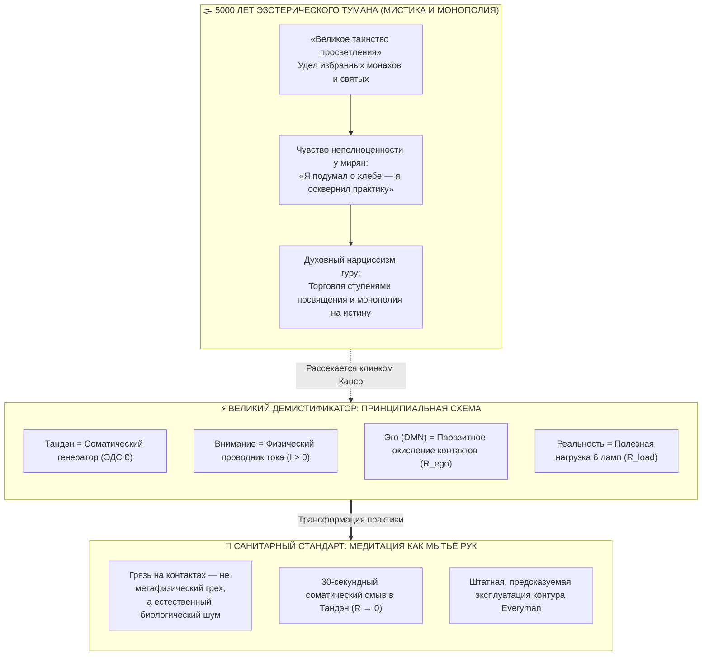

# ⚡ 298. Контур как Великий Демистификатор: На принципиальной схеме нет мистики — Штатная работа элементов, медитация как калибровка (мытьё рук перед едой) и ликвидация духовного превосходства
### Почему перед лицом законов электродинамики рушится пятитысячелетний эзотерический туман, как принципиальная схема делает работу сознания штатной и предсказуемой, и почему гордиться медитацией так же нелепо, как хвастаться часовым мытьём рук

> [!quote] Каноническая аксиома контурной демистификации
> ### ⚡ **«На принципиальной электрической схеме негде спрятаться мистике. Там нет места призракам, астральным посвящениям, сакральной кастовости и эзотерическому туману. Есть источник тока, проводник, окислившийся контакт и нагрузка. Контур — это великий демистификатор тысячелетий. Он низводит медитацию с пьедестала недосягаемого монашеского подвига до элементарного мытья рук перед едой: смыл налипший жир отождествления с мыслями ($R_{\text{ego}} \to 0$) — и сел за трапезу жизни с чистым проводником.»**  
> — **Владимир Аньянов**

---



---

## 1. Архитектурная прозрачность: Почему на принципиальной схеме не выживает эзотерика?

Если вы положите перед инженером принципиальную электрическую схему радиоприемника, фонарика или микропроцессора, вы не найдете там ни одного элемента с пометкой: *«Здесь происходит непостижимое священное чудо»*. 

Каждый узел схемы подчиняется строгим физическим уравнениям:
* Есть источник электродвижущей силы ($\mathcal{E}$).
* Есть проводники с определенной проводимостью ($\sigma$).
* Есть резисторы, рассеивающие энергию в тепло по закону Джоуля — Ленца ($Q = I^2 R t$).
* Есть нагрузка, совершающая полезную работу ($P = I^2 R_{\text{load}}$).

Величайший переворот, совершенный **Системой «Внутренний ток»**, заключается в том, что она применила эту беспощадную оптику к человеку:

```
┌────────────────────────────────────────────────────────────────────────┐
│             ДЕМИСТИФИКАЦИЯ ЭЛЕМЕНТОВ ЧЕЛОВЕЧЕСКОГО КОНТУРА             │
├─────────────────────────┬──────────────────────────────────────────────┤
│ Эзотерический миф       │ Строгий физический узел Системы Аньянова     │
├─────────────────────────┼──────────────────────────────────────────────┤
│ «Божественная благодать»│ ЭДС соматического реактора Тандэн (Ɛ)        │
│ «Святой дух / прана»    │ Физический ток дрейфа внимания (I = dq/dt)   │
│ «Грех / кармическая кара│ Омический нагрев окисленного контакта (R_ego)│
│ «Астральное очищение»   │ Штатная калибровка нулевой отметки (R → 0)   │
│ «Служение карме»        │ Запитка 6 жизненных ламп полезной нагрузки   │
└─────────────────────────┴──────────────────────────────────────────────┘
```

Когда человек видит свой контур на чертеже, в нем **исчезает место для суеверий**. Если лампочка не горит, никто не бьет поклоны и не обвиняет расположение звезд. Инженер берёт мультиметр и проверяет: где залом? где окислилась клемма? где обрыв обратного провода?

Контур — это **абсолютная демистификация человеческого бытия**. Он переводит душевную драму из религиозного тумана в плоскость прикладной, предсказуемой схемотехники.

---

## 2. Крах монополии посредников: Как схема отменяет «духовных дилеров»

На протяжении пяти тысячелетий вокруг состояний покоя, счастья и ясности выстраивались мощнейшие институты посредничества:
1. **Жрецы и духовные наставники:** утверждали, что контакт с высшим источником возможен только через их благословение, ритуалы или посвящения.
2. **Монастырские школы:** объявили, что для выхода из страданий необходимо отказаться от семьи, работы, уйти в скит или пещеру и потратить 30 лет на послушание.
3. **Современные гуру осознанности:** упаковали медитацию в платные приложения, ретриты за тысячи долларов и сложные многоступенчатые курсы «открытия чакр».

Принципиальная схема наносит по этой индустрии сокрушительный удар.

Подобно тому как **Биткоин Сатоши Накамото** устранил банковских посредников формулой одноранговой P2P-транзакции, а **Единый налог Генри Джорджа** устранил паразитическую ренту монополистов земли, **Внутренний ток Владимира Аньянова** ликвидирует «духовный центробанк».

Контур человека — **Self-Hosted (автономен по природе)**:
* Тандэн уже встроен в ваше тело с рождения (в центре тяжести за пупком).
* Внимание — это ваш собственный, неделимый носитель заряда.
* Законы Ома и Джоуля — Ленца работают одинаково у тибетского ламы, нью-йоркского банкира и водителя в Волгодонске.

Никакой посредник не может «дать» вам проводимость и не может ее «отобрать». Вы сами являетесь полным узлом (Full Node) своего духа.

---

## 3. Демистификация медитации: От «сакрального таинства» к мытью рук перед едой

Самая яркая и освобождающая аналогия Системы — это **санитарная революция сознания**.

Вспомните историю медицины:
* До середины XIX века (до Игнаца Земмельвейса и Луи Пастера) врачи принимали роды теми же немытыми руками, которыми секунду назад вскрывали трупы в анатомическом театре. Родильную горячку объясняли «дурным воздухом», «волей судьбы» или «испорченной кровью».
* Когда Земмельвейс предложил просто мыть руки раствором хлорной извести, медицинская элита подняла его на смех. Но когда врачи наконец начали мыть руки — смертность мгновенно упала в 10 раз. С явлений сорвали мистику: инфекция оказалась не «божьей карой», а обычной грязью на коже.

Ровно такую же революцию совершает Внутренний ток по отношению к медитации:

```
[ДО КОНТУРА: ЭЗОТЕРИЧЕСКИЙ МИФ]
  Мысль во время практики → «Я согрешил! Я плохой йог!» → Чувство вины (R_ego ↑↑) → Перегрев

[С КОНТУРОМ: САНИТАРНЫЙ СТАНДАРТ]
  Мысль во время практики → «Села пыль на датчик» → Смыв вниманием в Тандэн (R → 0) → Чистота
```

1. **Мысль — это не грех и не осквернение.** Мозг производит мысли точно так же, как сальные железы выделяют кожный жир, а на руках оседает пыль после прогулки по городу. Это естественная физиология биологического субстрата.
2. **Медитация — это просто мытьё рук перед едой.** Когда вы садитесь в кресло на 15 минут и наблюдаете мысли, не цепляясь за них, вы не «достигаете высших миров». Вы просто открываете кран, пускаете воду и **смываете налипший за день жир эго-рефлексии**.
3. **После мытья рук нужно садиться за стол!** Вы помыли руки не для того, чтобы стоять над раковиной следующие 8 часов и любоваться чистотой ладоней. Руки моют **для того, чтобы есть**. Контур очищают от паразитного сопротивления ($R_{\text{ego}} \to 0$) **для того, чтобы жить**: любить, работать, радоваться, светить лампами в мир.

---

## 4. Ликвидация двух крайностей: Синдром неполноценности vs Духовный нарциссизм

Мистификация медитации неизбежно порождает две уродливые крайности, которые полностью аннулируются контурной схемотехникой:

### А. Синдром «духовной неполноценности» (Удел новичка)
Обычный человек садится медитировать, но через две минуты обнаруживает, что думает о завтрашнем отчете или покупке молока. 
* В мистической парадигме он испытывает стыд: *«Я безнадежен. У меня беспокойный ум. Я никогда не достигну просветления»*. Он врезает в контур колоссальный реостат самобичевания ($R_{\text{guilt}} \to \infty$).
* В контурной парадигме он спокойно констатирует факт: *«Ага, ветровое стекло запылилось. Включаем дворники (возврат внимания в Тандэн)»*. Никакой трагедии. Через 3 секунды провод снова чист.

### Б. Синдром «духовного нарциссизма» (Удел «продвинутого»)
Человек, научившийся сидеть по часу со скрещенными ногами, начинает тайно или явно презирать «неосознанных обывателей»: *«Они бегают в суете, а я постиг тишину, я практик, я на третьем уровне самадхи»*.

В оптике карманного фонарика этот пафос выглядит откровенно комично:  
**Хвастаться часом медитации так же смешно, как ходить по улице и гордо заявлять: «Смотрите на меня, я мыл руки с мылом целых шестьдесят минут подряд!»**

Если ты мыл руки час — ты либо болен обсессивно-компульсивным расстройством, либо застрял в ванной и умер от голода, пока на кухне остывал обед. Медитация — это утилитарная гигиена, а не повод для раздувания духовного эго.

---

## 5. Предсказуемость и штатная работа: Инженерный стандарт для Everyman

Почему контурная модель делает человека несокрушимым? Потому что она возвращает ему **инженерную предсказуемость**.

В мистических системах результат всегда случаен: сегодня «снизошла благодать», а завтра «кармический откат», и никто не знает, почему. В такой атмосфере человек превращается в суеверного дикаря.

В Архитектуре счастья все процессы **штатны и детерминированы**:

| Ситуация в жизни | Показания мультиметра | Инженерное действие |
| :--- | :--- | :--- |
| Тревога, зуд, страх за будущее | $R_{\text{ego}} \gg 0$, перегрев $Q = I^2 R t$ | Промывка контакта: дыхание в Тандэн, сброс ожиданий |
| Лихорадочная спешка, суета | Срыв частоты, попытка бегства | Остановка на 60 секунд: тест «старика с газетой» |
| Усталость, истощение биосубстрата | Просадка ЭДС ($\mathcal{E} < 1.0\text{ В}$) | Сон в расправленном контуре, кислород, калории |
| Ясность, спокойствие, радость | $R_{\text{ego}} = 0, \; I > 0$ | Штатная сверхпроводимость: полная отдача текущему делу |

Это дает человеку абсолютный суверенитет. Он больше не боится своих состояний. Он знает: **у контура нет «мистических проклятий», есть только штатные режимы работы и временные омические заломы проводки, устраняемые за 30 секунд.**

---

## Резюме: Семь аксиом Великой Демистификации

1. **Принципиальная схема — могильщик мистики.** В контуре есть только физические параметры (ЭДС, ток, сопротивление, мощность); на чертеже нет места для астральных призраков.
2. **Медитация — это мытьё рук перед едой.** Это утилитарная гигиеническая калибровка нулевой отметки проводника ($R_{\text{ego}} \to 0$), а не сакральный подвиг.
3. **Всплывающая мысль — это пыль на датчике, а не грех.** Бороться с мыслями так же глупо, как обижаться на пыль; её просто смывают возвратом внимания в Тандэн.
4. **Холостой ход не равен жизни.** Помыл руки — садись есть. Откалибровал прибор — иди жить, любить, творить и зажигать 6 ламп реальности.
5. **Гордость медитацией — это духовное ОКР.** Хвастаться часами неподвижного сидения так же нелепо, как кичиться часовым мытьем рук под краном.
6. **Контур упраздняет касту посредников.** Законы физики не требуют жрецов; каждый человек является суверенным оператором собственной цепи (Self-Hosted Human).
7. **Предсказуемость побеждает страх.** Когда работа сознания становится штатной и воспроизводимой, человек обретает непоколебимый покой истинного мастера.

---

### Связанные узлы Архитектуры:
- [[02_Wiki/Inner Current (Meditation, Feverish Activity and Awake Stillness — Zero Tanden Calibration vs Battery Idle, Ego Panic Before Pausing and the An-Yang Formula)|⚡ 297. Медитация, лихорадочная занятость и состояние покоя: Калибровка нуля Тандэна vs холостой ход батарейки]]
- [[02_Wiki/Inner Current (Ego Dissolution as Washing Hands — Sanitary Revolution of Consciousness and Scientific Hygiene vs Martyrdom)|⚡ 173. Сброс эго как мытьё рук перед едой: Санитарная революция сознания]]
- [[02_Wiki/Inner Current (Is the Circuit Just a Metaphor — Structural Isomorphism vs Poetic Tropes, Operational Falsifiability and Demystification of Ineffable States)|⚡ 293. «Это просто метафора?»: Разрешение главной претензии скептиков]]
- [[02_Wiki/Inner Current (Circuit Schematics of Disintermediation — Parasitic Resistor Between Tanden and Deai and Universal Registry of Eliminated Middlemen)|⚡ 292. Принципиальная схемотехника депосреднизации: Последовательный балласт между Тандэном и Дэай]]
- [[02_Wiki/Inner Current (The 'Spiritual Self' Paradox — Socratic Test of Spiritual Deficiency, Spiritual Materialism and Freedom as Conductor Superconductivity)|⚡ 280. Парадокс «духовного себя»: Сократовский тест недостаточной духовности]]
