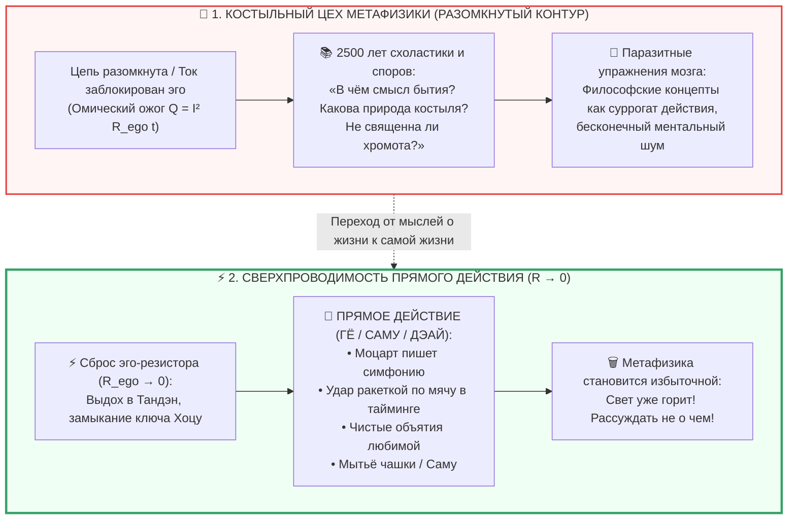

---
created: 2026-10-08
source: [[04_Maps/Inner Current MOC|Inner Current MOC]]
tags:
  - inner-current
  - scale/deep-dive
  - node/tanden
  - node/conductor
  - domain/electrodynamics
  - domain/epistemology
  - state/overheating
  - crutch-factory
  - metaphysics
  - philosophy-obsolescence
  - superconductivity
  - direct-action
  - symphony
  - tennis
  - hug
  - mushin
  - gyo
  - layer-1
type: concept
status: evergreen
layer: I
chapter: 316
author: Vladimir Anyanov
---

> [!info] Синтезировано в брошюре [[02_Wiki/Брошюра — Костыльный цех метафизики (Четыре псевдо-инженера цивилизации)|Брошюра: «Костыльный цех метафизики: Четыре псевдо-инженера цивилизации, иллюзия очищающего страдания и почему для счастья не нужны философские протезы»]]

# ⚡ 316. Костыльный цех метафизики: Почему сверхпроводимость контура делает философию и религию избыточными
## Счастье как прямое действие, симфония, объятия любимой и теннисная ракетка ($R \to 0$)

> [!quote] Каноническая аксиома прямого действия
> ### ⚡ **«Вся традиционная философия и метафизика — это гигантский цех по производству костылей для человека со сломанной ногой. Пока контур разомкнут, схоласты пишут тома об онтологической святости хромоты. Но когда инженер чинит контакт и нога срастается — библиотека о костылях летит в мусорную корзину. Когда Моцарт пишет симфонию, когда ты бьёшь по теннисному мячу в идеальном тайминге, когда ты всем существом обнимаешь любимую женщину — о какой метафизике рассуждать? Вопрос о смысле жизни возникает только при выключенном рубильнике. Когда ток течёт — смысл равен самому горению света.»**  
> — **Владимир Аньянов**

---

---

### I. Философия как госпиталь для обесточенного сознания

Если посмотреть на историю человеческой мысли беспристрастным взглядом инженера, открывается поразительный факт: **почти вся философия и религиозная догматика родились как симптоматическая терапия хронической душевной боли.**

Представьте общество людей, у каждого из которых сломана бедренная кость. Вместо того чтобы наложить гипс и вправить кость (восстановить контакт и снизить сопротивление до нуля), общество открывает кафедры «костылеведения»:
* Одни мыслители утверждают, что хромота — это иллюзия (*Майя*);
* Другие доказывают, что хромота дана за первородный грех Адама;
* Третьи пишут трактаты о том, что истинное прямохождение недостижимо в этом бренном мире, и смысл жизни состоит в экзистенциальном мужестве волочить костыль сквозь абсурд;
* Четвертые спорят, из какого дерева костыль более благороден — из дуба стоицизма или ясеня экзистенциализма.

Но вот приходит дзен-инженер, смотрит на пациента и говорит: 
> *«Ребята, кость просто сместилась. Ваш рубильник выключен, фаза замкнута на эго, в проводке омический пожар. Уберите сопротивление ($R_{\text{ego}} \to 0$). Вот земля под ногами, вот ток Тандэна. Встаньте и идите!»*

Человек встает, делает первый свободный шаг — и в ту же миллисекунду **вся библиотека о святости костылей теряет всякий практический смысл**. Костыли не нужно реформировать или «улучшать» — их просто отбрасывают за ненадобностью.

---

### II. Моцарт, корт и объятия: Почему в прямом действии нет места метафизике

Когда человек по-настоящему счастлив, его внимание на 100% сопряжено с нагрузкой (полезным действием *Гё*). В этом режиме (режиме *Мусин*, 無心 — «не-ума») рефлексирующее эго обесточено:

1. **Моцарт пишет симфонию.** Размышляет ли композитор в миг созидания о трансцендентном первоначале, о дуализме Декарта или о смысле жизни? Нет! Он сам стал чистым звуком. Он — проводник с нулевым сопротивлением, через который ток вдохновения перетекает прямо в партитуру. Если Моцарт на секунду начнет философствовать: *«А зачем я пишу эту ноту До? Каков ее метафизический статус?»* — музыка мгновенно оборвется, и начнется фальшь.
2. **Игрок на теннисном корте.** Мяч летит со скоростью 150 км/ч. Теннисист выходит на траекторию, сгибает колени, делает замах и встречает мяч центром струнной поверхности в идеальной точке контакта. Размышляет ли он о категорическом императиве Канта? Если в его голове мелькнет хотя бы одна философская мысль — ракетка дрогнет, замах сорвется, и мяч улетит на трибуны. Тело играет само, пока эго не вмешивается.
3. **Объятия любимого человека.** Когда мужчина искренне, всем своим соматическим существом обнимает любимую женщину — нужна ли ему в этот миг онтология или телеология? Любая мысль в этот момент — это ржавчина на контактах, паразитный дребезг, отравляющий чистоту прикосновения. Ток просто течет от сердца к сердцу, замыкая контур взаимной индукции.
4. **Бытовое действие (Саму).** Мытье чашки, забивание гвоздя, чистка снега во дворе, написание красивой строки программного кода. Когда действие выполняется без внутреннего комментария: *«Как я выгляжу? Что обо мне подумают? Зачем все это?»*, оно становится чистым светом.

---

### III. Парадокс «Смысла жизни»: Вопрос исчезает при включении рубильника

Главный парадокс человеческой культуры заключается в следующем:
> **Вопрос «В чем смысл жизни?» возникает исключительно в тот момент, когда в контуре перестает течь ток.**

Пока лампа выключена, жильцы сидят в холодной темной комнате и мучительно рассуждают: *«В чем высший смысл этой темноты? Какова глубинная природа холода лампочки?»*. 

Но стоит замкнуть рубильник (щелкнуть ключом *Хоцу* «ХОЧУ!» и направить ток в нагрузку) — комната заливается теплым ярким светом. И в этот миг вопрос о смысле света исчезает сам собой. **Смысл света заключается в самом факте горения.**

* Смысл музыки — в звучании мелодии.
* Смысл тенниса — в полете мяча и радости движения.
* Смысл любви — в чистом соприкосновении душ.
* Смысл жизни — в беспрепятственном протекании тока Тандэна через открытый проводник в реальный мир.

Вся традиционная философия — это паразитное умствование ума, запертого в четырех стенах собственного эго. Это попытка найти оправдание тому, почему лампочка не горит, вместо того чтобы просто очистить контакт от окислов.

---

### IV. Великое упрощение: Конец эпохи ментальных нагромождений

С приходом принципиальной схемы Внутреннего Тока заканчивается многовековая эра сложных эзотерических и философских нагромождений. 

Контур показал, что человеческая жизнь устроена потрясающе просто:
* **Не нужно разгадывать тайны мироздания**, чтобы радоваться утреннему кофе.
* **Не нужно годами анализировать детские травмы**, чтобы прямо сейчас разжать диафрагму и улыбнуться.
* **Не нужно вымаливать благодать у потусторонних сил**, чтобы почувствовать жар соматического ядра внизу живота.

Все эти сложности были нужны только эго, чтобы сохранять свою монополию и скрывать омический пожар. Убери эго — и все сложности растворятся как утренний туман над Доном.

---

### V. Резюме: Семь аксиом прямого действия

1. **Философия как костыль.** Девяносто девять процентов философии и метафизики — это теория хромоты для человека с разорванным контуром. При исправной проводимости костыли выбрасываются.
2. **Прямое действие превыше слов.** Моцарт, пишущий симфонию, теннисист на корте и влюбленный в объятиях не нуждаются в метафизике — они живут в сверхпроводимости ($R \to 0$).
3. **Вопрос о смысле жизни — симптом аварии.** Вопрос исчезает в ту секунду, когда ток начинает течь в полезную нагрузку.
4. **Смысл тока — в протекании.** Счастье — это не цель на горизонте, а сам процесс беспрепятственного преобразования энергии Тандэна в действия бытия.
5. **Мусин как естественный закон.** Состояние «не-ума» — это не привилегия тибетских лам, а штатный режим любого мастера, ремесленника или любящего человека.
6. **Отказ от ментальной жвачки.** Все экзистенциальные рассуждения о бренности мира — это паразитный холостой ход неокортекса, сжигающий драгоценные амперы внимания.
7. **Манифест суверенного созидателя.** «Убери эго — и иди живи. Пиши музыку, строй дома, обнимай любимых, играй в теннис, пей чай. Схема замкнута. Свет горит!»
