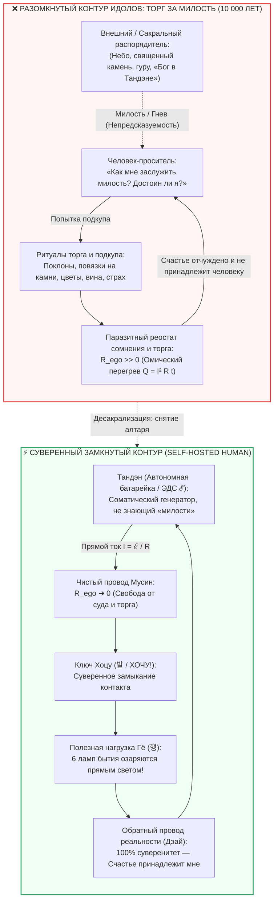

# ⚡ 309. Десакрализация Тандэна: Почему обожествление ядра есть попытка торга за милость — Разомкнутый контур идолов (небо и камень) против суверенной батарейки карманного фонарика
### Анатомия страха автономии, почему лаборатория счастья пытается сделать из генератора алтарь, невозможность заслужить закон Ома и схемотехника Self-Hosted Human

> [!quote] Каноническая аксиома оператора контура
> ### ⚡ **«Люди ищут Бога не ради истины, а ради протокола торга. Если Бог на небесах — нужно каяться и смотреть на небо. Если Бог в камне — нужно украшать камень цветами и повязывать ленты. А если Тандэн объявить „частицей Бога“ — можно продолжать оставаться инфантильным попрошайкой, вымаливающим благодать у собственного живота. Но у карманного фонарика нет милости. Батарейка не судит грешников и не требует поклонов. Ей плевать на ленточки и покаяния — ей нужен замкнутый электрический контакт и нулевое омическое сопротивление ($R \to 0$). Пока вы ищете того, кто выдаст вам счастье по заслугам, ваше счастье вам не принадлежит. Закон Ома не торгуется: $I = \mathcal{E}/R$. Замкните цепь в прямое физическое действие — и свет вспыхнет мгновенно.»**  
> — **Владимир Аньянов**

> [!info] Синтезировано в брошюре [[02_Wiki/Брошюра — На схеме контура нет Бога (Десакрализация Тандэна, похмелье от 5000 лет торга и почему для счастья не нужен Хозяин)|Брошюра: «На схеме контура нет Бога»]]

---



---

### I. Экзистенциальный инстинкт торга: Зачем уму нужен Бог?

В разговорах о счастье рано или поздно всплывает неизбывный мотив, будоражащий умы даже самых искренних исследователей (включая знакомых автора из Лаборатории Счастья): *«А что, если Тандэн — это не просто центр тяжести и не просто физиологический реактор? Что, если Тандэн — это частица Бога в человеке?»*.

За этой поэтической попыткой обожествить биологическое ядро скрывается не благоговение перед величием Вселенной, а **древнейший, глубоко зашитый рефлекс эго: инстинкт торга**.

Человеческий ум устроен так, что он панически боится **абсолютной автономии и суверенной ответственности за состояние собственного контура**. Признать, что счастье — это холодный, математически строгий закон электродинамики замкнутой цепи, для эго невыносимо. Почему? Потому что перед лицом закона физики невозможно упасть на колени, нельзя разжалобить гравитацию и невозможно сторговаться с законом сохранения энергии.

Уму жизненно необходим **субъект**. Ему нужен Тот, у кого есть:
1. Воля и настроение;
2. Понятие о «грехе» и «заслугах»;
3. И главное — **«милость»**.

Зачем человеку понимать, что такое Бог? Автор формулирует предельно трезвый ответ:  
> *«Люди пытаются понять, что такое Бог, потому что когда они поймут его, то они будут знать, как заслужить его милость.»*

Если Бог понят — получен протокол манипуляции. Если правила игры расшифрованы, ум чувствует себя в безопасности: он знает, какую валюту положить на алтарь, чтобы в обмен получить спокойствие, защиту или дофаминовый прилив.

---

### II. Разомкнутый контур идолопоклонства: От камня саванны к небесам монотеизма

Вся история религий, культов и суеверий — это история смены внешних декораций вокруг одной и той же **разомкнутой схемы питания**:

* **Если Бог в камне** — дикарь подходит к камню, вешает на него пестрые лоскуты, обвязывает травами и раскладывает у подножия цветы. Логика проста: камень польщен, камень сыт, камень проявит благосклонность на охоте.
* **Если Бог на небесах** — средневековый крестьянин крестится, падает ниц, смотрит в облака и читает покаянные молитвы. Логика та же: Небо увидело смирение, Небо отменит град и пошлет урожай.
* **Если Бог в Тандэне** — современный «духовный искатель» закрывает глаза, садится в позу лотоса и начинает благоговейно и подобострастно дышать в живот, пытаясь «умилостивить» искру божества внутри себя.

Но схемотехнически во всех трех случаях происходит одно и то же: **цепь размыкается, а человек превращается в бесправного попрошайку**.

```
[Внешний / Сакральный Источник] ---> ??? ---> [Человек-проситель]
                     (Режим: «Помилуй, прими жертву и дай свет»)
```

В этой топологии заложена фундаментальная трагедия: **человек признает, что источник его энергии находится не в его власти**. 
Если мое благополучие зависит от каприза Того, кто на небе, от духа в священном валуне или от того, насколько «угоден» я искре в животе, — значит:
> **«Я зависим от чего-то внешнего, и моё счастье мне не принадлежит.»**

Счастье оказывается сданным в пожизненную кабалу внешнему рантье. Человек лишается суверенитета. Вместо того чтобы направлять соматический ток в реальные дела (в 6 ламп полезной нагрузки бытия), 90% мощности внимания сжигается на **подкуп инстанции**: бесконечное сканирование «не обидел ли я Его?», перегрев вины и мучительные попытки соответствовать придуманным канонам благочестия.

---

### III. Электродинамика Батарейки: Почему генератору не нужны цветы

Архитектура Внутреннего тока совершает радикальный жест: она снимает с Тандэна золоченый оклад святости и возвращает его на место — **в принципиальную схему карманного фонарика**.

```
           +-----------[ Тандэн (Батарейка ℰ) ]-----------+
           |                                              |
           |             R_ego -> 0 (Мусин)               |
           +-----> [Внимание] ----> [6 ламп действия] ----+
                    (Обратный провод реальности Дэай)
```

Что такое Тандэн с точки зрения объективной науки?
Тандэн — это **соматический генератор постоянной ЭДС ($\mathcal{E}$)**, эволюционный центр масс биологического тела, узел сплетения блуждающего нерва (vagus nerve), брюшного мозга (энтеральной нервной системы) и 37 триллионов работающих митохондрий. Это аппаратный аккумулятор жизни.

А теперь представьте себе человека, который открыл крышку обычного карманного фонарика, достал пальчиковую батарейку типа АА, поставил ее на стол, начал кланяться ей, повязывать на нее шелковые бантики и осыпать лепестками роз, шепча: *«О, великая батарейка, будь милостива, яви свет!»*.

Это выглядит как клинический абсурд. Но именно этим занимаются те, кто пытается «обожествить Тандэн».

**Батарейке глубоко безразличны поклоны, слезы и цветы. Батарейке нужен электрический контакт.**

У физических законов нет морали, нет обид и нет любимчиков. Закон Ома для замкнутой цепи не знает слова «милость»:
$$I = \frac{\mathcal{E}}{R_{\text{total}}}$$

* Если кнопка выключателя разомкнута или проводка окислена ржавчиной вины и сомнений ($R \to \infty$) — **хоть разбейте лоб об алтарь, света не будет**.
* Но если контакт зачищен (Кансо), паразитный реостат самосуда сброшен в ноль ($R_{\text{ego}} \to 0$, Мусин) и суверенный ключ воли нажат в физическое действие (Хоцу / Гё) — **свет вспыхивает мгновенно, со 100% КПД**.

Батарейка не спрашивает у лампочки: *«Святая ли ты лампочка? Достойна ли ты светить? Не согрешила ли ты вчера?»*. Напряжение просто пробивает вакуум и превращается в лучистый фотонный поток.

---

### IV. Ловушка «Духовного Тандэна»: Как сакрализация ядра плавит проводку

Попытка лаборатории счастья «обожествить Тандэн» кажется возвышенной, но на практике она неизбежно ведет к тяжелой **техногенной аварии контура**.

Давайте проследим, что происходит в сознании человека в тот момент, когда он поверил, что Тандэн — это «частица Бога»:

1. **Рождение внутреннего цензора:**  
   Если Тандэн свят, значит, к нему нельзя подходить «грязным». Возникает тревога: *«А правильно ли я дышу? А не слишком ли я грешен? А достоин ли я прикасаться вниманием к божественному?»*.
2. **Врезание паразитного балласта ($R_{\text{bonno}} > 0$):**  
   Вместо того чтобы быть свободным проводом проводника, ум превращается в придирчивого таможенника. В цепь последовательно врезается гигантское омическое сопротивление священного трепета, вины и неуверенности.
3. **Омический пожар Джоуля — Ленца:**  
   Вся энергия биологического генератора вместо того, чтобы идти в творчество, семью, спорт или работу, упирается в это сопротивление и переходит в чистый тепловой чад:
   $$Q = I^2 R_{\text{ego}} t$$
   Человек начинает гореть изнутри. Он медитирует годами, но становится нервным, обидчивым, хрупким и фанатичным.

Парадокс заключается в том, что **сама попытка сакрализовать источник энергии немедленно блокирует его проводимость**. Вы не можете свободно пользоваться фонариком, если боитесь испачкать батарейку.

---

### V. Суверенитет проводника (Self-Hosted Human): Счастье как неотчуждаемая физика

Когда вы понимаете, что Тандэн — это не капризный бог, а штатный генератор вашего скафандра, происходит величайшее освобождение в жизни.

Исчезает фигура **Посредника**:
* Больше не нужен шаман, знающий, какую ленту привязать к камню.
* Больше не нужен священник, толкующий волю небес.
* Больше не нужен гуру или психотерапевт, выдающий платные индульгенции на право «быть счастливым».

Человек становится **Self-Hosted Human** — автономной, полнофункциональной нодой бытия.

Ваше счастье возвращается вам. Оно больше не находится в залоге у погоды, у начальства, у мнения соседей или у трансцендентных небесных инстанций. 

> **Счастье — это не награда за хорошее поведение. Счастье — это объективное состояние сверхпроводимости исправной цепи ($R \to 0, I > 0$).**

Вы не можете «заслужить» ток. Ток уже гудит в ваших проводах прямо сейчас — в каждом сокращении миокарда, в каждом вдохе, в миллионах нервных импульсов. Всё, что от вас требуется, — перестать душить этот ток собственными концептуальными зажимами.

---

### VI. Экспресс-протокол оператора цепи: «Снять алтарь — замкнуть контакт» (30 секунд)

Когда вы ловите себя на ощущении бессилия, зависимости или попытке «вымолить» хорошее состояние у судьбы, применяется прикладной инженерный протокол:

```
[Мысль о «немилости»] ➔ [Осознание торга] ➔ [Сброс в Тандэн] ➔ [Щелчок Хоцу] ➔ [Свет 6 ламп]
```

1. **Фиксация торга (5 секунд):**  
   Отловите в уме скрытый вопрос просителя: *«За что мне это?»*, *«Почему сегодня нет ресурса?»*, *«Как мне заслужить спокойствие?»*. Опознайте это как попытку повязать тряпку на священный камень.
2. **Ликвидация алтаря (5 секунд):**  
   Мысленно скажите себе: *«У генератора нет настроения. Законы физики не обижаются на меня. Тандэн — не алтарь, это моя бортовая батарейка»*.
3. **Соматическое заземление (10 секунд):**  
   Сделайте глубокий, спокойный выдох животом. Опустите внимание из крутящейся головы прямо в физический центр тяжести (на 3 пальца ниже пупка). Почувствуйте плотную, тяжелую опору тела. Реостат эго разжимается: $R_{\text{ego}} \to 0$.
4. **Щелчок суверенного ключа Хоцу (10 секунд):**  
   Не ждите благословения. Выберите любое простое физическое действие прямо сейчас (помыть чашку, написать строчку, сделать шаг, обнять близкого). Замкните контакт в полезную нагрузку Гё. Свет вспыхивает сам.

---

### VII. Резюме: Семь аксиом суверенного контура

1. **Аксиома торга:** Попытка понять Бога исторически была попыткой найти инструкцию по вымаливанию милости и подкупу реальности.
2. **Аксиома разомкнутой цепи:** Поклонение камням, небу или внешним авторитетам отчуждает счастье, превращая человека в зависимого попрошайку.
3. **Аксиома батарейки:** Тандэн — не сакральная «частица Бога», а автономный соматический генератор ЭДС. Батарейке не нужны поклоны и цветы — ей нужен контакт.
4. **Аксиома беспристрастности закона Ома:** У электродинамики нет милости и любимчиков. Формула $I = \mathcal{E}/R$ срабатывает безупречно и мгновенно для каждого, кто обнулил паразитное сопротивление ($R \to 0$).
5. **Аксиома омического ожога сакрализации:** Попытка сделать из Тандэна икону врезает в цепь реостат священного страха и вины, гарантируя внутренний пожар ($Q = I^2 R t$) вместо покоя.
6. **Аксиома Self-Hosted Human:** Освобождение от внешних и внутренних идолов возвращает человеку 100% суверенитет над собственным состоянием.
7. **Аксиома прямого луча:** Счастье не вымаливают — его проводят. Зачистите контакты от самосуда, нажмите выключатель воли и светите в мир.

---

*Архитектура счастья Владимира Аньянова | LLM Wiki 2026*
