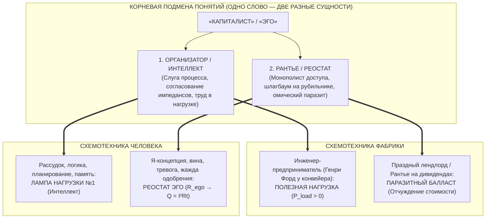
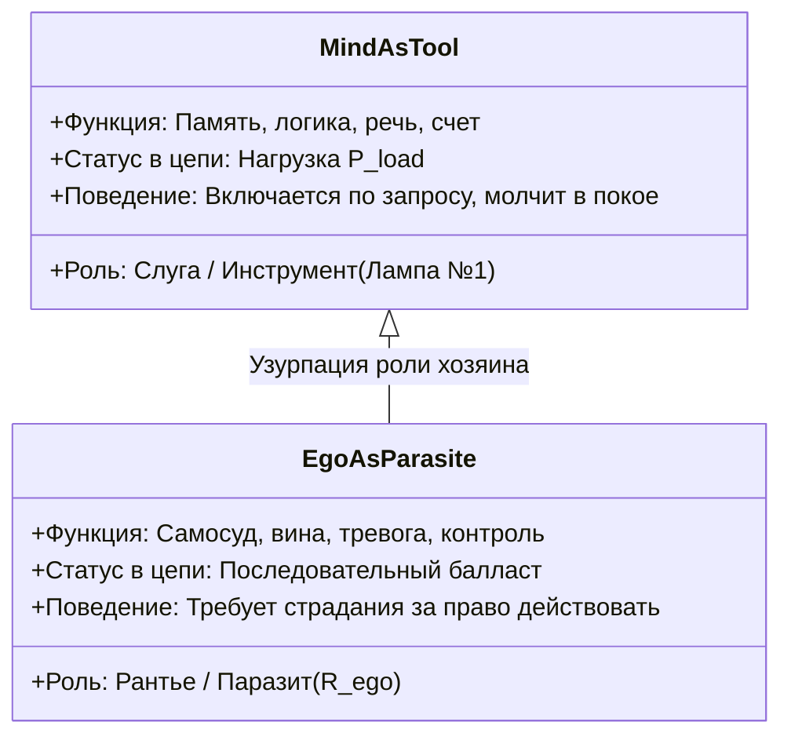
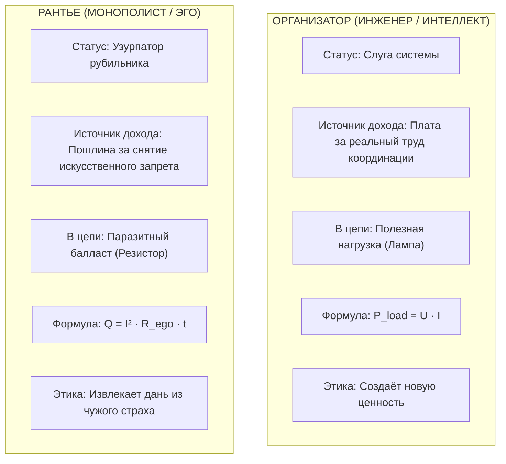

# 362. Парадокс фабрики и рантье: Почему капиталист отчуждает, если без него невозможна фабрика? — Организатор как полезная нагрузка против рантье как шлагбаума, и великий изоморфизм ума и эго («Как жить без эго, если без него невозможно мыслить?»)

> «Когда критикуют паразитизм капиталиста, обыватель всегда возмущается: *„Но ведь без капиталиста невозможна фабрика! Кто соберёт станки, кто наймёт рабочих, кто организует процесс?“*  
> И этот же самый обыватель, приходя во Внутренний ток, задаёт абсолютно симметричный вопрос: *„Но как жить без эго? Ведь без эго невозможно мыслить, строить планы, говорить на языке и выживать в обществе!“*  
> В обоих случаях люди совершают одну и ту же катастрофическую категориальную ошибку: **они путают Слугу-Организатора (полезный рабочий инструмент) с Паразитом-Рантье (монопольным шлагбаумом)**. Фабрика действительно невозможна без организатора, архитектора и согласователя импедансов — это полезный труд в нагрузке. Но фабрика прекрасно обходится без праздного рантье, который запер забор и собирает дань за само право подойти к станку. Точно так же жизнь человека невозможна без рассудка и логики (лампы нагрузки), но расцветает только тогда, когда уничтожен внутренний рантье — паразитный нихромовый реостат эго, вымогающий страдания за право сделать вдох.»  
> — **Владимир Аньянов**

---



---

## 1. Анатомия парадокса: Почему обыватель защищает паразита

Вопрос *«Разве без капиталиста возможна фабрика?»* кажется обывателю непробиваемым аргументом в пользу вечности капитализма.

Логика обывателя прямолинейна:
1. Вот пустое поле. Фабрики нет.
2. Приходит человек с деньгами (капиталист).
3. Покупает землю, заказывает станки, нанимает инженеров, архитекторов и рабочих.
4. Фабрика начинает выпускать паровозы, ткани или автомобили.
5. Вывод обывателя: *«Капиталист создал фабрику! Без него рабочие умерли бы с голоду. Значит, любая прибыль, которую он забирает, справедлива, а называть его паразитом — неблагодарность»*.

В чём здесь логическая и системная ошибка?

Ошибка состоит в том, что словом «капиталист» называют **две диаметрально противоположные функции**, которые исторически оказались склеены в одной фигуре:
1. **Функция А: Труд предпринимателя и архитектора** (координация, проектирование, сборка системы, принятие риска).
2. **Функция Б: Монополия титула собственности** (право не пускать людей к природным ресурсам и орудиям труда без уплаты оброка).

Функция А — это **созидание**.  
Функция Б — это **отчуждение и чистый паразитизм**.

---

## 2. Трёхфазный закон перерождения посредника (Статья 49)

В контурной философии Аньянова показано: **ни один системный паразит не появляется на свет в статусе паразита**. Каждый паразит рождается как жизненно необходимый слуга.

```
┌─────────────────────────┐       ┌─────────────────────────┐       ┌─────────────────────────┐
│       1. СЛУГА          │ ───►  │     2. МОНОПОЛИСТ       │ ───►  │       3. ПАРАЗИТ        │
│    (Предприниматель)    │       │     (Собственник)       │       │        (Рантье)         │
└─────────────────────────┘       └─────────────────────────┘       └─────────────────────────┘
  Проектирует фабрику,              Огораживает землю и               Лежит на яхте,
  согласует импедансы,              станки: труд невозможен           нанял директоров,
  рискует, работает 18 ч.           без его личной визы.              собирает ренту.
```

### Фаза 1: Слуга (Предприниматель-пионер)
Когда молодой Генри Форд ночами в кирпичном сарае своими руками собирает первый бензиновый квадрицикл, а затем проектирует революционный движущийся конвейер в Хайленд-Парке — он **не паразит**.  
Он — великий инженер, организатор и труженик. Его деятельность — это полезная нагрузка колоссальной мощности ($P_{\text{load}}$). Он согласует импедансы между научными открытиями, физическими материалами и живым трудом рабочих. За этот труд координации он имеет право на вознаграждение.

### Фаза 2: Монополист (Шлагбаум на пути к жизни)
Но как только фабрика построена и запатентована, вступает в силу закон монополии.  
Рабочий приходит на фабрику не потому, что он глупее Форда, а потому, что **все средства производства и земля вокруг уже приватизированы**. Рабочий физически отрезан от природы и сырья. Ему запрещено добыть руду, взять станок и сделать автомобиль самостоятельно — за забором стоит вооружённая полиция, охраняющая титул собственности.

Капиталист перестает быть просто организатором. Он становится **контролёром шлагбаума**:  
*«Ты хочешь есть? Твой труд стоит 100 рублей. Но я заплачу тебе 20. А 80 рублей заберу себе. Не потому, что я сегодня работал в четыре раза больше тебя, а потому, что станок принадлежит мне по закону».*

### Фаза 3: Паразит (Чистое рантье)
Проходит 50 лет. Основатель умер. Его внуки живут в Париже или на Лазурном Берегу. Фабрикой управляет наёмный топ-менеджмент (наёмные координаторы), на станках работают наёмные инженеры.  
Внуки не знают, как устроен мотор, и ни дня не стояли у конвейера. Но они ежеквартально получают миллионы долларов дивидендов.

**Почему они получают эти деньги?**  
Не за организацию фабрики (её организуют наёмные директора). Они получают эти деньги **исключительно за право собственности на рубильник**. Они отчуждают прибавочную стоимость только потому, что закон разрешает им взимать частную пошлину с чужого созидания.

---

## 3. Зеркальный изоморфизм: Вопрос об Эго в человеке

Теперь перенесите этот макроэкономический анализ внутрь собственного черепа.  
Каждый первый скептик, впервые слышащий о необходимости сброса сопротивления эго ($R_{\text{ego}} \to 0$), восклицает:

> *«Но ведь без эго человек невозможен! Ведь именно эго ставит цели, говорит на языке, строит карьеру, защищает границы и помнит, кто я такой!»*

Это **абсолютно та же самая иллюзия**, слово в слово!



### Подмена: Интеллект vs Эго
1. **Интеллект (Рассудок, неокортекс) — это Организатор фабрики:**  
   Логика, язык, память, способность сложить $2 + 2$, спроектировать программный интерфейс или завязать шнурки — это великолепный рабочий инструмент. Это Лампа №1 на принципиальной схеме Внутреннего тока. Без интеллекта человек превратился бы в биологический овощ. Интеллект жизненно необходим!
2. **Эго (Я-концепция, DMN) — это Праздный Рантье:**  
   Паразит рождается в тот момент, когда инструмент объявляет: *«Я — это не просто калькулятор в твоей голове. Я — это ТЫ САМ. Я — единственный Хозяин твоей жизни. И ты не сделаешь ни шага без моего суда!»*.

### Как эго отчуждает энергию жизни?
Вам захотелось подойти к человеку, написать пост, начать бизнес, выйти на сцену.  
Из соматического реактора Тандэн поднимается чистый ток жизни ($I > 0$).  
Но внутренний капиталист-рантье перекрывает рубильник:  
*«Стоять! А имеешь ли ты право? А что подумают люди? А если ты провалишься? А вдруг ты недостаточно идеален? Заплати мне налог тревогой, бессонницей и чувством неполноценности, и только тогда я, может быть, разрешу тебе действовать!».*

Ток сгорает в нихромовом балласте ($Q = I^2 R_{\text{ego}} t$).  
Человек лежит обесточенный на диване, не сделав ни единого действия, но чувствуя себя так, словно разгрузил вагон угля. **Внутренний рантье экспроприировал его жизнь.**

---

## 4. Разрешение парадокса: Координация без шлагбаума

История доказала: сложная система требует **координации и структуры**, но она совершенно не требует **паразитного монополиста**.

| Сфера бытия | Ложная модель (С паразитом) | Протокольная модель (Без паразита) | Почему она работает? |
| :--- | :--- | :--- | :--- |
| **Производство** | Фабрика с частным рантье, отчуждающим прибыль | Кооператив / Открытый консорциум инженеров | Координация сохраняется, но паразитная рента обнулена |
| **Программный код** | Проприетарный софт корпорации (подписочная рента) | Open Source (Linux, Git, Python) | Миллионы разработчиков координируют код без монополиста |
| **Деньги** | Центробанк, печатающий фиат и взимающий инфляционный налог | Биткоин (P2P протокол Сатоши Накамото) | Математический протокол гарантирует правила без рантье |
| **Сознание человека** | Невротическое эго, требующее страданий за каждый шаг | **Внутренний ток (Мусин, $R_{\text{ego}} = 0$)** | **Интеллект считает и решает задачи, но паразитный критик выключен** |

### Координация в режиме Мусин (無心):
Когда хирург делает сложнейшую 8-часовую операцию на открытом сердце, **его эго отключено**. У него нет времени думать: *«А велик ли я? А похвалят ли меня в соцсетях? А что будет, если я ошибусь?»*. Если эти мысли появятся, пациент умрёт от дрогнувшего скальпеля.  
Но выключено ли его мышление? Выключены ли его знания анатомии? **Нет!**  
Его интеллект работает с предельной, запредельной точностью. Инструмент координации работает на $100\%$ мощности, но паразит-рантье обнулен ($R_{\text{ego}} = 0$). Это и есть состояние сверхпроводимости — Мусин.

---

## 5. Сравнительная таблица: Организатор против Рантье



| Критерий | Слуга-Организатор (Инженер / Рассудок) | Паразит-Рантье (Монополист / Эго) |
| :--- | :--- | :--- |
| **Главная цель** | Запустить движение, решить задачу, включить свет | Удержать контроль, утвердить статус, собрать дань |
| **Принцип работы** | Устраняет трение, согласует элементы системы | Создаёт искусственное трение, чтобы брать плату за проход |
| **В отношении ошибки** | Диагностирует неисправность и чинит контакт | Раздувает чувство вины, стыда и неполноценности |
| **Поведение в покое** | Отключается и отдыхает (Standby, тишина) | Не может замолчать, крутит фоновую жвачку тревоги |
| **Что происходит при его устранении?** | Система распадается в хаос (нужен инструмент!) | **Система вздыхает свободно и переходит в сверхпроводимость** |

---

## 6. Резюме: Семь аксиом депосреднизации

1. **Два лица одного слова:** Слово «капиталист» (как и слово «эго») склеивает созидательного координатора процесса и праздного монополиста доступа.
2. **Фабрика требует разума, а не шлагбаума:** Производство невозможно без инженерной архитектуры, но прекрасно живёт без паразита, взимающего ренту за титул собственности.
3. **Ум — не эго:** Интеллект, логика, память и планирование — это рабочие лампы нагрузки; эго — это паразитный нихромовый реостат, ворующий у них ток.
4. **Механизм отчуждения:** Отчуждение возникает там, где посредник объявляет себя единственным источником жизни и требует оброк за право действовать.
5. **Мусин как высшая координация:** В состоянии сверхпроводимости ($R_{\text{ego}} = 0$) мышление не умирает, а достигает идеальной точности, освободившись от шума эго-рефлексии.
6. **Ошибочный вывод обывателя:** Защищать капиталиста-рантье из-за того, что фабрика требует координатора — всё равно что защищать раковую опухоль из-за того, что организму требуются делящиеся клетки.
7. **P2P-суверенитет человека:** Освобождение от внутреннего рантье возвращает человеку $100\%$ его соматической мощности: вы сохраняете всю силу острого интеллекта, навсегда обнулив пошлину душевной боли.
