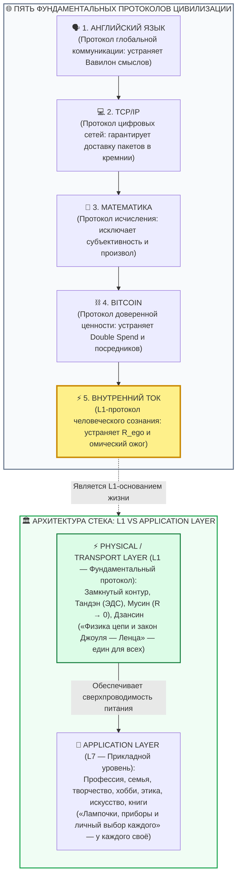
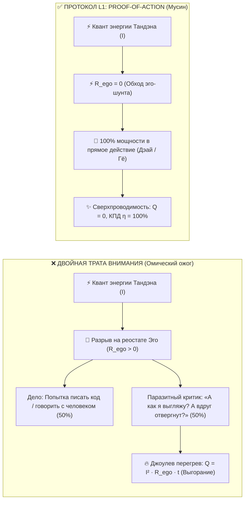

# ⚡ 317. Пять протоколов цивилизации и протокол счастья: Английский язык, TCP/IP, Математика, Биткоин и L1-архитектура сверхпроводимости сознания
## Иерархия фундаментальных стандартов бытия, ликвидация «Double Spend» внимания и почему Внутренний ток — это L1-уровень человеческой проводимости

> [!quote] Каноническая аксиома пяти протоколов
> ### ⚡ **«Цивилизация делает скачок не тогда, когда изобретает очередное субъективное мнение, а когда стандартизирует объективный протокол передачи. Английский язык преодолел Вавилон в коммуникации. TCP/IP устранил хаос пакетов в кремнии. Математика исключила двусмысленность в логике. Биткоин устранил посредников и риск двойной траты в обмене ценностью. А Внутренний ток — это L1-протокол проводимости нервной системы. Он не диктует вам, какую лампочку зажечь и во что верить. Он устраняет паразитное сопротивление проводки и прекращает Double Spend внимания. Счастье — это не приз и не этическая доктрина. Счастье — это телеметрия исправной работы этого протокола.»**  
> — **Владимир Аньянов**

---

---

### I. Архитектура цивилизации: почему миром правят протоколы

Если очистить историю человечества от мифов и войн, останется единственный объективный вектор эволюции — **переход от хаотических посредников к детерминированным протоколам**.

Протокол — это не свод моральных наставлений и не философское пожелание. Протокол — это **строгий набор соглашений, гарантирующий безошибочную передачу сигнала в определенной среде**:

| Протокол | Среда передачи | Что устраняет (Энтропия) | Инвариантный результат |
| :--- | :--- | :--- | :--- |
| **1. Английский язык** | Социум и культура | Вавилонское разногласие языков и понятий | Глобальное взаимопонимание людей и науки |
| **2. TCP/IP** | Физические кабели и кремний | Потерю, дублирование и коллизию пакетов | Единая мировая сеть (Интернет) |
| **3. Математика** | Логика и абстракция | Двусмысленность, капризы веры и суеверия | Воспроизводимый и непротиворечивый расчет |
| **4. Bitcoin** | Децентрализованный реестр | Произвол центробанков и проблему *Double Spend* | Неподкупный суверенный обмен ценностью |
| **5. Внутренний ток** | **Нервная система и соматика** | **Паразитный реостат $R_{\text{ego}}$ и омический ожог $Q$** | **Сверхпроводимость бытия (Счастье)** |

Каждый из этих пяти протоколов выполняет одну и ту же цивилизационную задачу: **устраняет паразитное трение в тракте передачи**.

---

### II. Ошибка категорий: почему 10 000 лет счастье искали на уровне Application Layer

Главная трагедия философии, религии и классической психологии заключается в том, что они пытались создать счастье на **прикладном уровне (L7 / Application Layer)**:
* *«Женись и заведи детей»* (семейный фреймворк);
* *«Построй карьеру и добейся признания»* (социальный апп);
* *«Уйди в монастырь и откажись от желаний»* (аскетический софт);
* *«Думай позитивно и медитируй по 20 минут»* (психологический скрипт).

Это эквивалентно попытке исправить сгоревший сетевой кабель или оборванную оптоволоконную магистраль переустановкой браузера или сменой шрифта на веб-странице.

Человек покупает новый «тостер» (машину, должность, переезд на Бали, новые отношения), включает его в розетку, но если сама проводка сознания раскалена докрасна ($R \gg 0$) или выбиты предохранители, прибор не работает. Человек разочаровывается в «тостере», выбрасывает его и бежит за другим — попадая в бесконечный гедонистический бег по кругу.

> [!important] Формула демаркации L1 и L7
> **Система «Внутренний ток» — это L1-протокол (Transport / Physical Layer).**  
> Она не указывает вам, в какой сфере реализоваться, какую музыку слушать и кем работать. Это прерогатива прикладного уровня. Протокол гарантирует лишь одно: **какой бы прибор вы ни включили в розетку бытия, напряжение будет стабильным, контакты чистыми, а сопротивление проводки равным нулю ($R \to 0$).**

---

### III. Проблема «Double Spend» внимания и ликвидация паразитного КЗ

В криптографии величайшим прорывом Сатоши Накамото стало математическое решение проблемы двойного расходования (*Double Spending Problem*) без участия центрального банка. До Биткоина цифровую информацию можно было бесконечно копировать и отправлять двум адресатам одновременно.

В контурной электродинамике человека существует точный физиологический аналог — **Double Spend внимания**:

Когда человек пытается одновременно:
1. Делать реальное дело (направлять ток в нагрузку);
2. И оценивать себя глазами воображаемого наблюдателя (паразитная петля в $R_{\text{ego}}$),

он совершает **незаконный Double Spend своего энергетического бюджета**. Но закон сохранения энергии неумолим: один и тот же квант мощности нельзя потратить дважды. Возникает короткое замыкание на образ «Я», и по закону Джоуля — Ленца ($Q = I^2 R_{\text{ego}} t$) неизбежно выделяется колоссальный омический жар — то, что в быту называют стыдом, тревогой, синдромом самозванца и выгоранием.

**Внутренний ток как протокол ликвидирует эту коллизию:** через соматический якорь Тандэна и режим Мусин проводка переключается в одноранговый режим (*P2P Direct Action*), где 100% тока уходит строго в физическую нагрузку.

---

### IV. Контент-агностичность протокола (Content-Agnostic Core)

Протоколу TCP/IP абсолютно всё равно, что зашифровано в передаваемых IP-пакетах: научное открытие, признание в любви, чертеж космического корабля или видеоролик. Задача протокола — доставить байты от источника к приемнику целостными, упорядоченными и без задержек.

Точно так же **Внутренний ток фундаментально контент-агностичен**:
* Ему всё равно, держите ли вы руль автомобиля, варите суп, кодите архитектуру нейросети, моете посуду или проводите совет директоров;
* Он не делит действия на «священные» и «мирские», «великие» и «мелкие» (см. [[02_Wiki/Inner Current (Scale Invariance and Tea Ceremony)|03. Инвариантность масштаба нагрузки]]);
* Его интересует исключительно **чистота сечения проводника ($R \to 0$)** и **замкнутость цепи через контакт с реальностью (Дэай)**.

Если провод чист — даже мытье пола превращается в медитативную сверхпроводимость (Саму). Если провод окислен эго — даже управление триллионным фондом превращается в адский омический кошмар.

---

### V. Счастье как объективная телеметрия (Ping 0 ms и 100% Throughput)

Обыватель считает, что счастье — это «праздник», «эйфория» или «награда за хорошее поведение». Но протокольная оптика возвращает понятию строгую физическую трезвость.

> [!tip] Инженерное определение
> **Счастье — это телеметрия исправной работы L1-протокола цепи.**  
> Это состояние, когда в контуре нет очередей пакетов, нет паразитных ретрансляций и потерь мощности на нагрев:
> - **Loss Rate = 0%:** нет утечек внимания в симуляции фантомного прошлого ($L_{\text{past}}$) и тревожного будущего ($C_{\text{future}}$);
> - **Ping = 0 ms:** реакция на реальность мгновенна, между стимулом и действием отсутствует зазор рефлексивного эго-сомнения;
> - **Throughput = 100%:** вся номинальная ЭДС реактора переходит в полезную работу на выбранной нагрузке.

| Сетевой параметр (TCP/IP / Bitcoin) | Соматический эквивалент (Внутренний ток) | Состояние сбоя (Несчастье) | Состояние протокола (Счастье) |
| :--- | :--- | :--- | :--- |
| **Packet Loss (Потери)** | Рассеивание внимания на мысли о себе | Потеря энергии в $R_{\text{ego}}$ ($Q > 0$) | Полная собранность в $t = \text{now}$ |
| **Latency / Ping (Задержка)** | Время между восприятием и действием | Ступор, сомнения, бесконечный паралич анализа | Мгновенный отклик без внутреннего трения (Мусин) |
| **Double Spend Attack** | Раздвоение внимания (действие + самосуд) | Короткое замыкание на Эго, выгорание | Неделимый неделигируемый фокус (Proof-of-Action) |
| **Network Congestion (Затор)** | Мышечные спазмы, сжатые челюсти, задержка дыхания | Омический перегрев тела (стресс 60–90 по HRV) | Свободный расправленный проводник (стресс < 25) |

---

### VI. Экспресс-протокол проверки L1-стека (30-секундный Ping-тест)

Если в течение дня вы почувствовали усталость, тупик, раздражение или тревогу, не пытайтесь менять жизненные цели на уровне L7. Проведите быстрый аудит L1-протокола:

1. **Шаг 1. Проверка питания (Тандэн):**  
   Опустите внимание в физический центр тяжести (3–4 см ниже пупка). Сделайте глубокий диафрагмальный выдох. Перенесите точку опоры из черепной коробки в гравитационный центр тела.
2. **Шаг 2. Детекция Double Spend (Клинком Кансо):**  
   Задайте вопрос: *«Трачу ли я сейчас квант энергии на попытку контролировать чужое мнение или переиграть прошлое?»* При обнаружении паразитного процесса — срежьте соединение. Мысль — это не проводник, это шум в эфире.
3. **Шаг 3. Замыкание в нагрузку (Дэай):**  
   Найдите один физический объект прямо перед глазами (клавиатура, чашка, документ, собеседник). Подайте 100% тока в тактильный контакт с ним. 
4. **Шаг 4. Фиксация сверхпроводимости:**  
   Почувствуйте исчезновение трения. Пинг восстановлен, ток течет. Вы снова в сети.

---

### 🔗 Связанные статьи базы знаний
* [[02_Wiki/Inner Current (Core Topology and Polarity Law)|01. Базовая топология цепи и закон полярности]] — полярность ЭДС и базовые узлы схемы.
* [[02_Wiki/Inner Current (Physics of Presence and Superconductivity)|02. Физика присутствия: состояние сверхпроводимости]] — закон Джоуля — Ленца и режим Мусин.
* [[02_Wiki/Inner Current (Engineering Epistemology and Bitcoin Law)|15. Инженерный критерий истины: Биткоин и демистификация сказок о счастье]] — первый монетарный изоморфизм.
* [[02_Wiki/Inner Current (What Bitcoin Did for Finance, Inner Current Did for Happiness)|38. Что Биткоин сделал для финансов, Внутренний ток сделал для счастья]] — P2P суверенитет духа.
* [[02_Wiki/Inner Current (The Great Isomorphism of Disintermediation — Satoshi Nakamoto Protocol vs Anyanov Protocol — P2P Sovereignty of the Soul)|114. Великий Изоморфизм Депосреднизации]] — прямое сравнение протоколов Сатоши и Аньянова.
* [[02_Wiki/Inner Current (The Crutch Factory of Metaphysics — Why Superconductivity Renders Philosophy Obsolete, Happiness as Direct Action, Symphony, Hug and Tennis)|316. Костыльный цех метафизики]] — почему сверхпроводимость прямого действия аннулирует схоластику.
