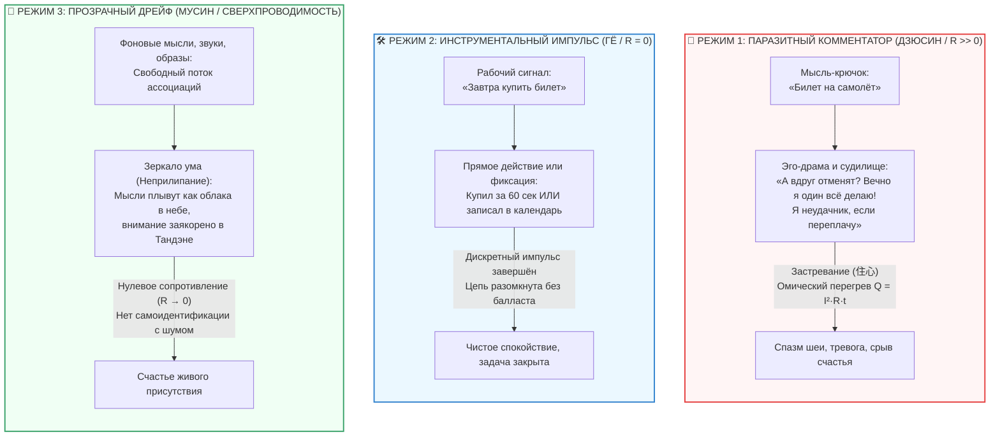

# ⚡ 387. Парадокс билета на самолёт и три режима мышления: Функциональный импульс против эго-резистора, текучий дрейф и электродинамика Мусин (無心)
### Почему мысль о покупке билета не убивает сверхпроводимость, в чём разница между инструментом навигации и паразитным комментатором, и как отличить застрявший ум (Дзюсин) от зеркальной текучести

> [!quote] Каноническая аксиома живого тока и чистой мысли
> ### ⚡ **«Самое разрушительное заблуждение неопытного практика — считать, что мысль является врагом счастья, а просветление — это кома или лоботомия без единой искры в голове. Биологический мозг — это великолепный бортовой навигатор. Когда всплывает мысль: „Завтра в десять утра нужно купить билет на самолёт“ — в ней нет ни грамма эго-сопротивления. Это чистый функциональный импульс нагрузки ($R = 0$). Мусин (無心) — это не пустота кладбища, а текучесть горного ручья, который огибает камни и ни за один из них не цепляется. Счастье теряется не тогда, когда мысль возникает, а тогда, когда ум застревает в ней (Дзюсин), впаивает паразитный эго-резистор ($R_{\text{ego}} > 0$) и начинает омическое самосожжение: „А вдруг билеты подорожают? Почему вечно я?“. Сверхпроводимость — это свобода от застревания, а не амнезия.»**  
> — **Владимир Аньянов**

---



---

## 1. Демистификация тишины: Почему дзен — это не ментальная кома

Среди начинающих исследователей медитации и дзена распространено наивное заблуждение: будто счастье или пробуждение требуют **полной стерилизации сознания** — состояния, когда в голове не возникает ни одной мысли, а кора больших полушарий превращается в безжизненный холодный монолит.

Но неокортекс человека — это эволюционный вычислительный центр. Пока сердце качает кровь, а нейроны обмениваются ионными потенциалами действия ($Na^+$, $K^+$, $Ca^{2+}$), генератор ассоциаций продолжает работать.

Попытка «убить все мысли» или «заставить себя ни о чём не думать» порождает самое чудовищное короткое замыкание:
1. Появляется мысль $A$: *«Надо купить билет»*.
2. Тут же включается цензор $B$: *«Чёрт, я подумал мысль! Я потерял дзен! Надо перестать думать!»*.
3. Следом возникает мысль $C$: *«Какой я недисциплинированный практик...»*.

В этот момент ток внимания на 100% закольцовывается на паразитное сопротивление самобичевания ($R_{\text{ego}} \gg 0$). По закону Джоуля — Ленца ($Q = I^2 R t$) проводка раскаляется, шея деревенеет, и счастье мгновенно исчезает.

Проблема заключалась не в мысли о билете, а в **попытке объявить биологический инструмент преступлением против духа**.

---

## 2. Анатомия мысли о билете: Навигационный датчик против эго-резистора

Сравним две ситуации, в которых звучит одна и та же фраза: *«Нужно купить билет на самолёт»*.

### Ситуация А: Мысль как навигационный импульс (Инструмент)
Вы идёте по улице или пьёте чай. Всплывает напоминание: *«Завтра в 12:00 открывается продажа билетов, нужно зайти в приложение»*.
* **Что происходит в цепи:** Это просто бортовой GPS автомобиля сознания. Он сообщил координату и погас.
* **Действие оператора:** Достать телефон, вбить напоминание на 12:00 (5 секунд) или просто зафиксировать в памяти. 
* **Физика контура:** Сопротивления нет ($R = 0$). Ток прошёл через полезную функциональную нагрузку и вернулся в соматический покой. Сверхпроводимость не нарушена.

### Ситуация Б: Мысль, захваченная эго-резистором (Драма)
Всплывает та же мысль, но к ней мгновенно припаивается реостат самооценки и страха:
* *«Опять всё на мне! Вечно никто, кроме меня, не может позаботиться о поездке! А вдруг сайт зависнет? А вдруг места разберут? Почему я вечно так нервничаю из-за ерунды? Жизнь — сплошной стресс...»*
* **Что происходит в цепи:** Ток внимания больше не решает задачу. Он застрял в воображаемой битве с миром и самим собой. Выделилось паразитное тепло $Q$, выделился кортизол, упала вариабельность сердечного ритма (HRV). Счастье разрушено.

**Вывод:** Мысль о билете нейтральна. Эго — это не сам факт мысли, а паразитная рефлексивная надстройка: претензия, страх, судилище и жалость к себе.

---

## 3. Такуан Сохо: Мусин (Не-ум) против Дзюсин (Застрявший ум)

В фундаментальном дзенском каноне XVII века *«Фудоти синмёроку»* великий наставник Такуан Сохо объяснял мастеру меча Ягю Мунэнори разницу между истинным мастером и погибающим дилетантом:

```
╔═══════════════════════════════════════════════════════════════════════════════╗
║                      АНАТОМИЯ ВНИМАНИЯ ПО ТАКУАНУ СОХО                       ║
╠═══════════════════════════════════════════════════════════════════════════════╣
║ 1. ДЗЮСИН (住心 — «Остановившийся, застрявший ум»):                          ║
║    Меч противника занесён для удара. Если фехтовальщик зафиксирует внимание   ║
║    на лезвии со словами: «Какой блестящий клинок! Он сейчас меня разрубит!» — ║
║    ум ОСТАНОВИЛСЯ. В этот момент реакция блокируется, и воин погибает.       ║
║    В электродинамике: R → ∞ (пробой проводимости, аварийный клинч).          ║
╠══════════════════════════════════════════════════════════════════════════════╣
║ 2. МУСИН (無心 — «Не-ум, текущий ум»):                                        ║
║    Лезвие занесено. Ум видит клинок, но НЕ ПРИЛИПАЕТ к нему. Внимание         ║
║    охватывает всё поле боя целиком: стойку врага, ветер, дистанцию. Рука      ║
║    парирует удар сама, без предварительного рассуждения.                      ║
║    В электродинамике: R = 0 (сверхпроводимость, ламинарный поток).            ║
╚═══════════════════════════════════════════════════════════════════════════════╝
```

Мусин — это **текучесть горной воды**. Вода течёт с вершины горы. На её пути встречаются камни, поваленные стволы деревьев, песчаные отмели. Вода касается каждого камня, огибает его и немедленно течёт дальше. Ни один ручей не останавливается перед булыжником со словами: *«Я обиделся на этот камень, я останусь здесь плакать»*.

Когда мысли свободно «плавают в голове, и вы за них не цепляетесь» — это и есть **живое проявление Мусин в покое**.

---

## 4. Три фундаментальных режима мышления

Классификация состояний ума становится кристально ясной, если разложить её не по содержанию мыслей («хорошие vs плохие»), а по **режиму проводимости замкнутой цепи**:

| Параметр | 1. Эго-петля (Дзюсин / $R \gg 0$) | 2. Инструментальный импульс (Гё / $R_{\text{load}}$) | 3. Прозрачный дрейф (Мусин / $R \to 0$) |
| :--- | :--- | :--- | :--- |
| **Природа мыслей** | Обида, вина, тревога, судилище, «почему я?», жалобы, тщеславие. | Прикладные задачи: «Купить билет», «2 + 2 = 4», «повернуть руль», «написать код». | Свободные ассоциации, образы, звуки, воспоминания без зацепа. |
| **Отношение к «Я»** | Лихорадочная самоидентификация («Я жертва», «Я герой»). | Безличностный инструмент («Задача требует решения»). | Наблюдатель растаял в поле бытия. |
| **Режим цепи** | Ток замкнут на паразитный нихром. Омический перегрев $Q = I^2 R t$. | Ток кратковременно замкнут на полезную нагрузку Гё ($P = 100\%$). | Ток течёт свободно, не встречая препятствий. Полная проводимость. |
| **Соматический маркер** | Зажим трапеций, сжатые зубы, спертое дыхание груди. | Собранный, точный тонус тела, мягкая концентрация. | Расправленный живот (Тандэн), лёгкость, глубокое дыхание. |
| **Статус Мусин** | ❌ **Срыв режима** (Застревание) | ✅ **Мусин в действии** (Самадхи труда) | ✅ **Мусин в созерцании** (Самадхи покоя) |
| **Переживание** | Несчастье, истощение, раздражение. | Удовлетворение от выполненного дела, ясность. | Непринуждённая радость, свежесть, покой. |

---

## 5. Дзенская притча о зеркале и птице

Древний дзенский образ формулирует отношение к всплывающим мыслям с предельной оптической точностью:

> **«Зеркало отражает всё, что перед ним появляется. Пролетает сокол — зеркало безупречно отражает размах его крыльев. Сокол улетает — на зеркале не остаётся ни царапины, ни тени пера. Зеркало не звало птицу прилететь и не прогоняло её прочь.»**

* Ваше сознание — это зеркало.
* Мысль о билете на самолёт — это птица, пролетевшая перед зеркалом.
* Если вы попытаетесь «стереть птицу из зеркала», вы начнёте тереть стекло наждачной бумагой и поцарапаете поверхность.
* Если вы побежите за птицей, вы разобьёте зеркало о стену.
* Если вы просто позволите ей пролететь, отразиться, послужить навигатором и исчезнуть — **зеркало останется сияющим и чистым**.

---

## 6. Операционный протокол: 15-секундный фильтр всплывающей мысли

Когда в голове всплывает любая мысль, оператор контура не занимается психоанализом и не впадает в панику. Он пропускает импульс через трёхпозиционный селектор:

```
                    [ВСПЛЫЛА МЫСЛЬ В ГОЛОВЕ]
                               │
            ┌──────────────────┴──────────────────┐
     [Это действие прямо сейчас?]           [Это фоновый шум?]
            │                                     │
     ┌──────┴──────┐                              │
   [ДА]          [НЕТ]                            │
    │              │                              │
Выполнить      Записать в календарь        Не трогать руками.
за 60 сек      на конкретное время         Пусть плывёт мимо,
(Купить билет) (Завтра в 10:00)            как облако в небе.
    │              │                              │
    └──────────────┴──────────────┬───────────────┘
                                  │
                    [КОНТУР ОСТАЁТСЯ В МУСИН (R = 0)]
```

### Три правила гигиены проводника:
1. **Правило 60 секунд:** Если прикладная мысль требует меньше минуты (ответить «да», закрыть окно, выключить чайник) — сделайте прямо сейчас. Импульс сгорит в действии, цепь останется чистой.
2. **Правило календаря:** Если задача требует действий в будущем («купить билет завтра») — выгрузите её из оперативной памяти биокомпьютера в внешний накопитель (заметки, календарь). Как только дата зафиксирована, неокортекс успокаивается и снимает напряжение сторожевого контура.
3. **Правило открытого неба:** Если мысль — это абстрактный образ, случайная ассоциация или чужой разговор — просто смотрите, как она уплывает. Не давайте ей топлива своей эмоциональной оценки.

**Счастье — это не безмолвие кладбища. Счастье — это сверхпроводимость живого, чуткого и свободного ума, который умеет летать, считать билеты на самолёт и радоваться каждому вдоху без тени омического зажима.**
