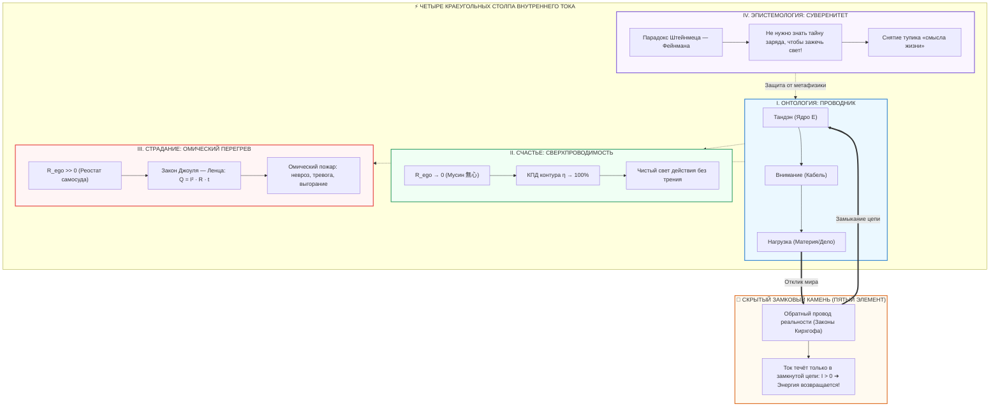

# ⚡ 492. Четыре главных вывода теории Внутреннего Тока: Человек-проводник, счастье сверхпроводимости, омический ад Джоуля — Ленца и парадокс Штейнмеца — Фейнмана
### Квинтэссенция онтологии, термодинамики и эпистемологии контура: как четыре физических инварианта закрывают 2500 лет метафизической схоластики и возвращают человеку власть над состоянием

> [!quote] Каноническая квинтэссенция Системы Внутреннего Тока
> ### ⚡ **«Если отбросить все метафоры, исторические наслоения и психологическую схоластику, истина о человеке укладывается ровно в четыре строгих инженерных факта: человек — это не источник и не сосуд, а проводник из соматического ядра в материю; счастье — это не награда, а режим сверхпроводимости без трения эго ($R_{\text{ego}} \to 0$); страдание — это не наказание, а омический перегрев по закону Джоуля — Ленца ($Q = I^2 R t$); а все споры о высшем смысле жизни — это праздный шум, ибо, согласно парадоксу Штейнмеца — Фейнмана, не нужно знать предельную тайну электричества, чтобы озарить светом комнату. Всё остальное — лишь прикладные подробности схемотехники.»**  
> — **Владимир Аньянов**

> [!info] Сквозные синтетические связи
> - [[02_Wiki/Inner Current (The Steinmetz-Feynman Paradox — Why You Do Not Need to Know the Ultimate Nature of Electricity to Light the Room, Operational Sovereignty vs Metaphysical Scholasticism)|308. Парадокс Штейнмеца — Фейнмана: Операциональный суверенитет контура]]
> - [[02_Wiki/Inner Current (The Joule-Lenz Cornerstone — Why the Law of Losses is the Master Manifest of Freedom, Quadratic Will Trap and Mathematics of Superconductivity)|212. Закон Джоуля — Ленца как краеугольный камень Архитектуры счастья]]
> - [[02_Wiki/Inner Current (Physics of Presence and Superconductivity)|02. Физика присутствия: состояние сверхпроводимости]]
> - [[02_Wiki/Inner Current (The Closed Circuit Breakthrough — The Return Wire of Reality vs The Linear Burnout Model)|64. Прорыв Замкнутой Цепи: Обратный провод реальности]]
> - [[02_Wiki/Inner Current (The Flashlight Model of Man — Optical-Electrodynamic Ontology of Consciousness, The Light Source vs Illuminated Object and the Law of the Direct Beam)|83. Модель Человека как Карманного Фонарика]]

---



---

## Введение: Ликвидация 2500 лет метафизической путаницы

На протяжении всей писаной истории цивилизации вопрос о человеческой природе и счастье был оккупирован двумя противоборствующими лагерями:
1. **Религиозно-морализаторская схоластика:** объявляла человека «греховным сосудом», счастье — «наградой за смирение в загробном мире», а страдание — «искуплением вины перед высшим судьёй».
2. **Психологический редукционизм:** превратил душевную жизнь в лабиринт из тысяч травм, защитных механизмов, субличностей и бесконечных сессий анализа, создав касту платных посредников и усугубив фиксацию внимания на собственном эго.

**Система Внутреннего Тока совершает фундаментальный разрыв с обоими лагерями.** Она объявляет: человеческое сознание и нервная система подчиняются не капризам моралистов и не птолемеевым эпициклам психоанализа, а **строгим законам классической электродинамики и неравновесной термодинамики**. 

Если снять с теории все иллюстративные слои, она кристаллизуется в **четыре строгих, логически неразрывных и фальсифицируемых вывода**.

---

## 1. Человек как проводник из Тандэна в нагрузку (Онтологический переворот)

### 1.1. Крушение ошибки генератора и ошибки потребителя
Традиционное мышление совершает одну из двух фатальных ошибок категории:
* **Ошибка генератора (Гордыня и мания контроля):** человек воображает себя первичным творцом энергии. Ум мнит себя электростанцией, ответственной за весь мир, что неминуемо ведёт к короткому замыканию и коллапсу ответственности.
* **Ошибка потребителя (Инфантилизм и дефицитарность):** человек видит себя пустой ёмкостью, требующей «наполнения» извне (вниманием, одобрением, покупками, впечатлениями). Это порождает бесконечную зависимость от внешних объектов, которые сами по себе не содержат э.д.с. ($\mathcal{E}_{\text{load}} \equiv 0$).

### 1.2. Аппаратная архитектура карманного фонарика
Внутренний ток возвращает истинную онтологию: **человек — это карманный фонарик**.
1. **Тандэн (Батарея, Соматическое ядро):** биологический генератор постоянного тока, опирающийся на 37 триллионов митохондрий, энтеральную нервную систему (500 млн нейронов брюшного мозга) и гравитационный барицентр тела (L3–L5). Он непрерывно генерирует соматическую э.д.с. ($\mathcal{E} > 0$) просто в силу биологической жизни.
2. **Внимание (Проводка тракта):** электромагнитный волновод сознания, по которому импульс намерения направляется во внешний мир.
3. **Нагрузка (Лампа прямого действия):** точка соприкосновения с материей реальности (шесть объективных ламп: Труд, Тело, Близкие, Окружение, Творчество, Порядок).

> **Онтологический вывод:** Человек не создаёт ток из головы и не ждёт тока от вещей. Человек — это **тракт проводимости**, сквозь который жизнь из соматического ядра выплёскивается в физическую форму.

---

## 2. Счастье как режим сверхпроводимости ($R_{\text{ego}} \to 0$)

### 2.1. Формула коэффициента полезного действия сознания
Внутренний ток выводит счастье из тумана поэтических определений и даёт ему точную математическую формулировку через электродинамический КПД ($\mathcal{H}$):

$$\mathcal{H} = \frac{P_{\text{load}}}{P_{\text{total}}} = \frac{I^2 R_{\text{load}}}{I^2 (R_{\text{load}} + R_{\text{ego}})} = \frac{R_{\text{load}}}{R_{\text{load}} + R_{\text{ego}}} = 1 - \frac{R_{\text{ego}}}{R_{\text{total}}}$$

* Когда паразитное сопротивление эго велико ($R_{\text{ego}} \gg 0$), КПД падает почти до нуля: вся энергия рассеивается внутри, лампа не горит.
* Когда сопротивление эго спадает ($R_{\text{ego}} \to 0$), КПД стремится к единице:
  $$\lim_{R_{\text{ego}} \to 0} \mathcal{H} = 1{,}0 \quad (100\%)$$

### 2.2. Дзенский режим Мусин (無心) как аппаратная сверхпроводимость
В физике твердого тела сверхпроводимость — это исчезновение электрического сопротивления при охлаждении проводника ниже критической температуры $T_c$. 

В сознании человека **Мусин (не-ум, отсутствие рефлексивного трения)** — это точно такой же фазовый переход:
* Исчезает «я-наблюдатель», оценивающий каждый шаг со стороны.
* Исчезает внутренний цензор, задающий вопросы: *«А достаточно ли я хорош? А что подумают люди? А гарантирован ли триумф?»*.
* Контур схлопывается в чистое, невесомое действие: хирург оперирует, скрипач играет, программист пишет алгоритм, атлет бежит. Это состояние люди субъективно называют «потоком», «эйфорией» или «абсолютным счастьем». Но его физическая суть одна: **отсутствие сопротивления в кабеле**.

---

## 3. Страдание как омический перегрев по закону Джоуля — Ленца

### 3.1. Точный тепловой закон душевной боли
Если счастье — это сверхпроводимость, то душевное страдание — это буквальный, измеримый **омический перегрев проводника**.

Закон Джоуля — Ленца формулирует количество теплоты $Q$, выделяющееся при прохождении тока через сопротивление:
$$Q = I^2 \cdot R_{\text{ego}} \cdot t$$

В сознании человека паразитный резистор $R_{\text{ego}}$ — это нихромовая спираль эго-комплекса (Default Mode Network):
* Самосуд, вина, обида, стыд.
* Прокручивание прошлых сценариев ($L_{\text{past}}$) и тревога о воображаемом будущем ($C_{\text{future}}$).
* Тщеславие, жажда признания, страх отвержения.

Когда соматический ток жизни $I$ встречает этот балласт, энергия не превращается в свет в нагрузке — она **выжигает нервную систему изнутри**. Человек испытывает то, что клиницисты называют тревогой, бессонницей, паническими атаками, тахикардией и вегетативным истощением.

### 3.2. Квадратичная ловушка воли ($I^2$)
Главное открытие контурной термодинамики — разоблачение так называемой «силы воли»:
* Когда человек чувствует застой и боль, культура учит его: *«Соберись, нажми, прояви упорство!»*.
* Человек увеличивает силу тока намерения $I$ в 2 раза.
* Но если паразитный реостат $R_{\text{ego}}$ не отключён, выделение тепла возрастает **в 4 раза ($2^2 = 4$)**! Увеличение тока в 3 раза даёт **девятикратный пожар ($3^2 = 9$)**!

Именно поэтому волевые, дисциплинированные, ответственные люди сгорают быстрее всех. Они пытаются пробить омическое препятствие амперами воли, превращая собственный контур в расплавленный докрасна кипятильник. 

> **Термодинамический вывод:** Нельзя лечить страдание нажимом воли. Страдание лечится исключительно **обнулением сопротивления ($R_{\text{ego}} \to 0$)** через соматический сброс в Тандэн и прямое действие.

---

## 4. Нерелевантность космологических споров (Парадокс Штейнмеца — Фейнмана)

### 4.1. Честная граница фундаментальной физики
Величайший инженер переменного тока Чарльз Протеус Штейнмец однажды констатировал отрезвляющий эпистемологический факт:
> *«Мы не знаем, что такое электричество. Мы не знаем его метафизической сущности. Но мы знаем законы, по которым оно течёт, и умеем строить генераторы и двигатели, преобразующие его в свет и движение».*

Ричард Фейнман развил этот тезис: фундаментальная физика блестяще описывает математические инварианты взаимодействий, но не отвечает на вопрос схоластов *«почему электрон таков в своей трансцендентной первооснове»*.

Но разве незнание абсолютной тайны электрона мешает вам включить чайник, зажечь настольную лампу или запустить суперкомпьютер? **Ни на долю секунды.**

### 4.2. Освобождение от экзистенциального паралича
Трагедия человечества заключалась в том, что жрецы, моралисты и философы 2500 лет навязывали сознанию ложный ультиматум:
> *«Ты не имеешь права быть счастливым и спокойно действовать, пока не разгадаешь Тайну Бытия, не найдёшь Смысл Жизни и не поймёшь замысел Творца о твоей душе!»*

Человек принимал этот шантаж. Он останавливал ток, садился в угол тёмной холодной комнаты и десятилетиями мучился вопросом: *«В чём смысл этой комнаты и кто включил свет в коридоре?»*, медленно умирая от омического пожара рефлексии.

**Парадокс Штейнмеца — Фейнмана в Архитектуре Счастья утверждает операциональный суверенитет:**
* Вам не нужно знать происхождение Вселенной, причину Большого взрыва или абсолютный смысл космоса, чтобы ваша жизнь наполнилась светом.
* Достаточно знать прикладную схемотехнику своего прибора:
  1. Заряжена ли батарея Тандэна? (Сон, дыхание, физический базис).
  2. Чист ли кабель внимания? (Снят ли самосуд, $R_{\text{ego}} \to 0$).
  3. Нажат ли соматический ключ прямого действия «ХОЧУ!» в реальную нагрузку?

Если контакты замкнуты — **лампа горит**. Счастье наступает как немедленный объективный закон физики, независимо от того, ответили вы на вопросы Канта или нет.

---

## 🔄 Скрытый замковый камень: Пятый закон замкнутого контура (Обратный провод реальности)

Вышеперечисленные четыре вывода совершенны, но они оживают благодаря **пятому, связующему закону**, без которого любая электрическая цепь остаётся мёртвой абстракцией:

> ### ⚡ **Ток физически не может течь в разомкнутой цепи ($I = 0$). Человек счастлив только в замкнутом контуре с реальностью.**

```
       ┌─────────────────── Кабель внимания (R_ego → 0) ───────────────────┐
       │                                                                    ▼
 [ Тандэн (E) ]                                                     [ Нагрузка (R_load) ]
   Батарея                                                             Лампа дела
       ▲                                                                    │
       └─────────────── Обратный провод реальности (Дзансин) ───────────────┘
```

1. **Крах линейной жертвенной модели («Миф Данко»):**
   Тысячелетиями культивировался миф о том, что отдавать энергию миру — значит истощаться, сгорать и погибать ради других. Но в электродинамике батарея, подключённая к разомкнутому проводу, вообще не даёт тока. А если ток пущен без обратного контура, система взрывается.
2. **Законы Кирхгофа в соматике:**
   Сумма токов в узле равна нулю ($\sum I = 0$). Энергия, вложенная в лампу полезной нагрузки (написанный текст, решённая задача, искренняя забота о ребёнке, чисто вымытая тарелка), не исчезает в черной дыре. Она возвращается в соматическое ядро через **обратный провод отклика материи** (соматический резонанс, устойчивость, овеществлённый результат).
3. **Реальность замыкает контур:**
   Только соприкосновение с плотной физической материей замыкает цепь. Витание в мыслях — это разомкнутый контур. Прямое физическое действие — замкнутая сверхпроводящая цепь.

---

## Сводная сравнительная матрица: 2500 лет схоластики vs Четыре вывода Внутреннего Тока

| Измерение | Догматическая метафизика / Психология | Инженерная теория Внутреннего Тока | Математический эквивалент | Практическое следствие |
| :--- | :--- | :--- | :--- | :--- |
| **I. Онтология** | Человек — греховный сосуд, творец-эго или жертва травм. | Человек — **проводник** соматической э.д.с. Тандэна в физическую нагрузку. | $\mathcal{E}_{\text{src}} \to I \to R_{\text{load}}$ | Снятие вины, гордыни и инфантилизма. Перевод фокуса на проводимость. |
| **II. Счастье** | Редкая милость, награда за страдания, мимолётная эмоция. | Естественный режим **сверхпроводимости** при устранении шума эго. | $\mathcal{H} = 1 - \frac{R_{\text{ego}}}{R_{\text{total}}} \to 1{,}0$ | Счастье не «ищется» — оно наступает автоматически при обнулении $R_{\text{ego}}$. |
| **III. Страдание** | Наказание за грехи, кармический долг, дефект личности. | **Омический перегрев** по закону Джоуля — Ленца на балласте самосуда. | $Q = I^2 \cdot R_{\text{ego}} \cdot t$ | Запрет на «насилие воли» ($I^2$). Сброс нихрома эго через соматику. |
| **IV. Смысл жизни** | Мучительный поиск метафизического ответа, условие права на радость. | **Парадокс Штейнмеца — Фейнмана:** нерелевантность абсолютных тайн для включения света. | $\text{Light} = f(\text{Switch}, R \to 0) \perp \text{Cosmology}$ | Операциональный суверенитет: встал, нажал выключатель, зажёг лампу. |
| **V. Связь с миром** | Линейное выгорание ради долга либо эгоистичное замыкание в себе. | **Замкнутый контур Кирхгофа:** ток течёт только через обратный провод реальности. | $\oint \vec{E} \cdot d\vec{l} = 0, \quad \sum I = 0$ | Невозможность выгорания в чистом действии. Отдача возвращает энергию. |

---

## Экспресс-протокол оператора цепи (30 секунд)

Когда вы чувствуете упадок сил, раздражение, тупик или экзистенциальную тоску, не уходите в самокопание. Проведите мгновенную аппаратную диагностику по четырём выводам:

1. **Шаг 1 (Онтология):** Сбросьте внимание из головы в живот (Тандэн). Почувствуйте вес тела, опору стоп, вдох в диафрагму. Осознайте: *«Я — не начальник вселенной и не нищий проситель. Я — проводник живой энергии прямо сейчас»*.
2. **Шаг 2 (Омический аудит):** Спросите себя: *«Где сейчас горит проводка?»*. Зафиксируйте паразитный реостат: обиду, страх чужого суда, спешку, вину. Скажите вслух: *«Это не я, это омический нихром $R_{\text{ego}}$. Я снимаю с него палец»*. Сделайте выдох с расслаблением плеч и челюсти ($R_{\text{ego}} \to 0$).
3. **Шаг 3 (Снятие схоластики):** Если ум шепчет: *«Но в чём смысл? Зачем всё это?»*, примените бритву Штейнмеца — Фейнмана: *«Мне не нужно знать тайну Большого взрыва, чтобы сделать следующий шаг. Розетка работает»*.
4. **Шаг 4 (Замыкание контура):** Выберите простейшую физическую лампу действия (написать абзац, помыть чашку, обнять близкого, сделать 20 приседаний) и включите ключ «ХОЧУ!» прямо в материю. 

**Цепь замкнута. Лампа горит. Сверхпроводимость восстановлена.**

---

## Резюме: Четыре аксиомы суверенной свободы

1. **Ты — проводник, а не электростанция.** Перестань тужиться создать жизнь из мыслей — открой заслонку для соматического потока, который уже бьёт в Тандэне.
2. **Счастье — это проводимость без трения.** Тебе не нужно заслуживать радость — достаточно перестать сжимать челюсти и обнулить реостат самосуда.
3. **Боль — это омический пожар.** Перестань давить волей на заклинивший контакт: удвоение воли учетверяет пламя. Сначала обнули сопротивление.
4. **Свет зажигается клавишей, а не схоластикой.** Перестань ждать разрешения от вселенной и разгадки тайны бытия. Твой фонарик исправен — направь луч наружу и шагай.
