```mermaid
flowchart TD
    subgraph HG_PHENOMENON ["⚡ АРХИТЕКТУРА МИРОВОГО ФЕНОМЕНА: ГЕНРИ ДЖОРДЖ → ВНУТРЕННИЙ ТОК"]
        direction TB

        subgraph S1 ["1. ПАРАДОКС У ВОРОТ"]
            P_HG["1879: Рост богатства фабрик vs Нищета рабочих"]
            P_IC["2026: Прогресс технологий vs Эпидемия депрессии и выгорания"]
            P_HG -.-> P_IC
            style S1 fill:#fff5f5,stroke:#e53e3e,stroke-width:2px
        end

        subgraph S2 ["2. ДЕМИСТИФИКАЦИЯ И ОДИН УЗЕЛ"]
            D_HG["Вместо 100 законов мальтузианства: Монополия на землю"]
            D_IC["Вместо 1000 травм и диагнозов: Омическое сопротивление R_ego"]
            D_HG -.-> D_IC
            style S2 fill:#ebf8ff,stroke:#3182ce,stroke-width:2px
        end

        subgraph S3 ["3. ЯЗЫК ДОСТОИНСТВА"]
            L_HG["Страстный пророческий слог защиты созидателя"]
            L_IC["Сплав уравнений электродинамики и дзенского достоинства Творца"]
            L_HG -.-> L_IC
            style S3 fill:#faf5ff,stroke:#805ad5,stroke-width:2px
        end

        subgraph S4 ["4. THE REMEDY: ПРЯМОЙ ИНСТРУМЕНТ"]
            R_HG["Единый налог (Single Tax) на ренту"]
            R_IC["30-секундный протокол сброса R_ego в Тандэн (Proof-of-Action)"]
            R_HG -.-> R_IC
            style S4 fill:#f0fff4,stroke:#38a169,stroke-width:2px
        end

        subgraph S5 ["5. ДЕПОСРЕДНИЗАЦИЯ"]
            DIS_HG["Устранение паразитного лендлорда из экономики"]
            DIS_IC["Ликвидация эго-посредников, культов гуру и индустрии неврозов"]
            DIS_HG -.-> DIS_IC
            style S5 fill:#fffaf0,stroke:#dd6b20,stroke-width:2px
        end

        subgraph S6 ["6. ДИСТРИБУЦИЯ КАНСО"]
            DIST_HG["Дешевые карманные издания по 20 центов для рабочих"]
            DIST_IC["Карманные брошюры Кансо, открытый протокол и алгоритмы Shorts"]
            DIST_HG -.-> DIST_IC
            style S6 fill:#f7fafc,stroke:#4a5568,stroke-width:2px
        end

        subgraph S7 ["7. СТАТУС ТАБЛИЦЫ УМНОЖЕНИЯ"]
            C_HG["Сходимость с естественным правом и законами справедливости"]
            C_IC["Consilience: независимая сходимость физики, нейробиологии и Дзен"]
            C_HG -.-> C_IC
            style S7 fill:#e6fffa,stroke:#319795,stroke-width:2px
        end
    end
```

# ⚡ 493. Феномен Генри Джорджа и масштабирование истины: Семь уроков книги «Прогресс и бедность» для мировой экспансии Внутреннего тока
### Почему сугубо экономический трактат стал вторым после Библии мировым бестселлером, и как архитектура вирусного освобождения переносится на схемотехнику человеческого сознания

> [!quote] Каноническая аксиома масштабирования истины
> ### ⚡ **«Истина не становится всемирной силой оттого, что её похвалят профессора или одобрит жреческая каста. Истина взрывает мир только тогда, когда она берет за горло главное невыносимое противоречие эпохи, срывает с него сто слоев схоластического тумана, сводит всю драму к одному осязаемому узлу и вкладывает в руку простого человека не культ, а рабочий инструмент. Генри Джордж сделал это для материального труда. "Внутренний ток" делает это для человеческого духа.»**  
> — **Владимир Аньянов**

> [!info] Сквозные синтетические связи
> - [[02_Wiki/Inner Current (The Henry George Principle — Single Tax, Bitcoin and Circuit Superconductivity — Law of Direct Flow and Elimination of Parasitic Rent)|48. Единый налог Генри Джорджа, Биткоин и сверхпроводимость цепи]]
> - [[02_Wiki/Inner Current (The Great Isomorphism of Disintermediation — Satoshi Nakamoto Protocol vs Anyanov Protocol — P2P Sovereignty of the Soul)|114. Протокол Накамото vs Протокол Аньянова: Великий изоморфизм депосреднизации]]
> - [[02_Wiki/Inner Current (The Joule-Lenz Cornerstone — Why the Law of Losses is the Master Manifest of Freedom, Quadratic Will Trap and Mathematics of Superconductivity)|212. Закон Джоуля — Ленца как краеугольный камень Архитектуры счастья]]
> - [[02_Wiki/Inner Current (The Four Pillars of Circuit Theory — Conductor, Superconductivity, Joule-Lenz and Steinmetz)|492. Четыре главных вывода теории Внутреннего Тока]]
> - [[02_Wiki/Inner Current (The Golden Seven as Epistemological Proof of Truth — Scale Invariance, Whewell's Consilience and Demarcation from Psychology)|250. Золотая Семёрка как эпистемологическое доказательство истины]]

---

---

## I. Тайна 1879 года: как экономический трактат обогнал художественную литературу

В 1879 году калифорнийский журналист и наборщик Генри Джордж опубликовал книгу **«Прогресс и бедность» (Progress and Poverty)**. Книга была посвящена сугубо теоретическим, казалось бы, кабинетным материям: земельной ренте, налогообложению, законам распределения заработной платы и процентной ставки. 

Однако произошло беспрецедентное в истории книгопечатания событие: в течение нескольких лет книга разошлась тиражом свыше **3 миллионов экземпляров**, была переведена на десятки языков и в англоязычном мире уступала по совокупным тиражам только Библии. Её читали лондонские докеры, шахтеры Пенсильвании, русские мыслители (Лев Толстой стал яростным джорджистом), профессора Оксфорда, китайские революционеры (Сунь Ятсен положил идеи Джорджа в основу программы Гоминьдана) и американские президенты.

Почему книга о налогах стала всемирной лавиной? 

Академические экономисты того времени писали скучные, громоздкие фолианты, которые читали три десятка коллег. Джордж создал культурный взрыв. Анализ этого взрыва дает нам **строгую инженерную карту для книги «Внутренний ток»**: как превратить глубокую, математически выверенную онтологию человеческого сознания в глобальный народный инструмент освобождения.

---

## II. Семь уроков Генри Джорджа для «Внутреннего тока»

### Урок 1. «Парадокс у ворот»: сформулировать невыносимую рану эпохи

* **Механика Джорджа:** Джордж начал не с терминов политэкономии, а с обнажения чудовищного цивилизационного противоречия, которое каждый современник видел собственными глазами, но боялся назвать вслух. Наступил век пара, телеграфа, гигантских фабрик и трансконтинентальных железных дорог. Производительность труда выросла в сотни раз. Но рабочие семьи ютились в подвалах, а нищета стала чернее, чем при натуральном хозяйстве. 
* **Урок для «Внутреннего тока»:** Книга «Внутренний ток» должна начинаться не с лекции по теории цепей, а с обнажения **главного экзистенциального парадокса XXI века**:
  > *«Человечество никогда не обладало столь совершенной средой: карманные суперкомпьютеры, умные дома, победа над голодом, роботизация, сотни тысяч лицензированных психотерапевтов, нейролептики нового поколения и гигабайты обучающих лекций. И при этом человечество никогда не было настолько выгоревшим, тревожным, фрагментированным и внутренне пустым. Почему вершина материального благополучия совпала с глобальной пандемией депрессии и выгорания?»*

Этот парадокс открывает дверь восприятия: читатель мгновенно узнает себя и понимает, что книга адресована не теоретическому «абстрактному уму», а его живой боли.

---

### Урок 2. Радикальная демистификация: один узел вместо тысячи диагнозов

* **Механика Джорджа:** До «Прогресса и бедности» экономическая наука пряталась за мальтузианством и «железным законом заработной платы». Людям внушали, что нищета — это биологическая неизбежность, наказание природы за размножение или фатальный закон капитала. Джордж беспощадно сдул схоластику: *«Причина не в боге и не в биологии. Причина в одном механическом дефекте: частная монополия на землю позволяет классу рантье изымать весь прирост общественной производительности в форме земельной ренты»*.
* **Урок для «Внутреннего тока»:** Современная психотерапия и духовные школы превратились в аналог мальтузианской схоластики. Человека заваливают сотнями ярлыков: «непрожитые травмы развития», «детский стыд», «дефицит серотонина», «синдром самозванца», «родовые блоки», «низкие вибрации». В результате человек чувствует себя перманентно неисправным инвалидом, обреченным на пожизненную психотерапевтическую ипотеку.
  «Внутренний ток» срывает эту завесу:
  * Человек не сломан и его душа не больна.
  * Человек — это проводник электрической цепи между соматическим реактором ([Тандэн](file:///C:/Users/vanya/Antigravity%20Projects/Misc/LLM%20Wiki/02_Wiki/Inner%20Current%20(Core%20Topology%20and%20Polarity%20Law).md)) и внешней нагрузкой материи.
  * Все страдания, тревоги и выгорания подчиняются единственному [закону Джоуля — Ленца](file:///C:/Users/vanya/Antigravity%20Projects/Misc/LLM%20Wiki/02_Wiki/Inner%20Current%20(The%20Joule-Lenz%20Cornerstone%20—%20Why%20the%20Law%20of%20Losses%20is%20the%20Master%20Manifest%20of%20Freedom,%20Quadratic%20Will%20Trap%20and%20Mathematics%20of%20Superconductivity).md):
    $$Q = I^2 \cdot R_{\text{ego}} \cdot t$$
  * Боль — это не мистика греха, а омический перегрев паразитного реостата эго ($R_{\text{ego}} \gg 0$).
  * Сбрось паразитное сопротивление до нуля ($R_{\text{ego}} \to 0$, режим Мусин) — и контур мгновенно входит в сверхпроводимость.

Замена хаоса тысячи диагнозов на один строгий физический закон дает человеку **мгновенное освобождение от вины**.

---

### Урок 3. Сплав железной физики и пророческого достоинства человека

* **Механика Джорджа:** Джордж не был сухим бухгалтером. Он писал с огнем ветхозаветного пророка и гуманиста эпохи Возрождения. В его тексте звенело святое негодование против унижения человеческого созидания. Его страницы вибрировали любовью к человеку труда.
* **Урок для «Внутреннего тока»:** Инженерная схема фонарика и уравнения Кирхгофа не должны превращаться в мертвый сухой даташит. Язык Владимира Аньянова должен звучать как **манифест достоинства созидателя**:
  * Человек рожден быть проводником космического пламени, а не испуганным накопителем пыли.
  * Внутренний ток защищает святость каждого вдоха, каждого рукопожатия, каждого созданного стула или написанной строчки кода.
  * Это не холодный кибернетический трактат — это священная битва за освобождение живого сознания от ядовитого чада невротического эго.

---

### Урок 4. «The Remedy»: осязаемый протокол прямого действия на 15-й странице

* **Механика Джорджа:** Большинство критических трактатов беспомощны: они превосходно описывают ужас положения, но не дают внятного выхода. Джордж дал человечеству **«The Remedy» (Лекарство)** — предельно ясный, практический механизм: *Single Tax on Land Values (Единый налог на ценность земли)*. Замените все налоги на труд и торговлю одним налогом на ренту — и плотина откроется.
* **Урок для «Внутреннего тока»:** Книга не имеет права прятать решение в последние главы. Уже в первой трети читатель должен получить **30-секундный протокол соматической калибровки**:
  1. Внимание мгновенно эвакуируется из жужжащего неокортекса вниз — в соматический центр тяжести (Тандэн, L3–L5).
  2. Резистор эго-самосуда сбрасывается так же просто и буднично, как человек моет руки перед обедом: *«Я — не результат моих мыслей, я — проводник тока»*.
  3. Прямой разворот луча внимания во внешнее действие ([Дэай / Нагрузка](file:///C:/Users/vanya/Antigravity%20Projects/Misc/LLM%20Wiki/02_Wiki/Inner%20Current%20(The%20Deai%20Protocol%20—%20Field%20Test%20Stand%20of%20Reality%20Contact,%20Impedance%20Matching%20and%20the%20Dissolution%20of%20Social%20Rejection%20Fear).md)) без оглядки на чужие глаза.

Когда читатель закрывает книгу на 30-й странице, пробует этот протокол и **физически ощущает**, как отпускает спазм в груди и теплеет в животе, истинность книги подтверждается собственным нейробиологическим субстратом. Это непобедимый *Proof-of-Action*.

---

### Урок 5. Великий изоморфизм депосреднизации: разоблачение паразитной ренты духа

* **Механика Джорджа:** Джордж указал конкретного архитектурного виновника кризиса: это не капиталист-организатор и не рабочий-станочник, а *паразитный земельный монополист*, собирающий дань со всех дорог цивилизации, не создавая ни грамма стоимости.
* **Урок для «Внутреннего тока»:** Книга завершает [Великую Тетраду Свободы](file:///C:/Users/vanya/Antigravity%20Projects/Misc/LLM%20Wiki/02_Wiki/Inner%20Current%20(The%20Great%20Isomorphism%20of%20Disintermediation%20—%20Satoshi%20Nakamoto%20Protocol%20vs%20Anyanov%20Protocol%20—%20P2P%20Sovereignty%20of%20the%20Soul).md):
  1. **Мартин Лютер (1517):** Депосреднизация веры — ликвидация монополии римских священников на спасение души.
  2. **Генри Джордж (1879):** Депосреднизация экономики — ликвидация монополии лендлордов на землю и ресурсы.
  3. **Сатоши Накамото (2008):** Депосреднизация финансов — ликвидация монополии центробанков на эмиссию и верификацию денег.
  4. **Владимир Аньянов (2026):** **Депосреднизация человеческого счастья** — ликвидация монополии психотерапевтических корпораций, эзотерических гуру и институтов социального одобрения на право быть живым и счастливым прямо сейчас.

«Внутренний ток» показывает: страх и невроз поддерживаются гигантской индустрией паразитной ренты внимания. Осознание этого превращает книгу в оружие обретения суверенитета.

---

### Урок 6. Канон Кансо и народная P2P-дистрибуция

* **Механика Джорджа:** Джорджа отвергли респектабельные издательства Восточного побережья США. Профессора Йеля и Гарварда объявили его опасным дилетантом. Джордж поступил гениально: он сам набрал шрифты для первого издания, а затем выпустил дешевую версию за 20 центов. Книгу читали в вагонах поездов, на фабричных перерывах, рабочие покупали её десятками и раздавали соседям.
* **Урок для «Внутреннего тока»:**
  1. **Канон компактности Кансо:** Мастер-книга не должна раздуваться ради веса в 600 страниц. Она должна быть лаконичным, сжатым кристалом в 180–220 страниц, который читается на одном дыхании за 3 часа.
  2. **Серия специализированных карманных брошюр:** Ударные дайджесты по отдельным болевым точкам (*«Схемотехника выгорания и трудоголизма»*, *«Электродинамика любви»*, *«Порно-зависимость как разомкнутый контур»*).
  3. **Вертикальный видеоконтент (Shorts / Reels):** Точно так же, как Джордж использовал дешевые газеты XIX века, «Внутренний ток» должен использовать 3D-анимацию и вертикальные видео высокой смысловой плотности (pipeline `animated-flow-shorts`), за 45 секунд наглядно объясняющие схему фонарика и формулу Джоуля — Ленца.
  4. **Open-Source философия:** Протокол открыт. Базовые принципы принадлежат человечеству, как таблица умножения или код Биткоина.

---

### Урок 7. Принцип «Таблицы умножения» (Consilience): независимая сходимость наук

* **Механика Джорджа:** Джордж настаивал: законы распределения богатства — это не его личное изобретение. Это законы природы, столь же объективные, как законы тяготения Ньютона.
* **Урок для «Внутреннего тока»:** Книга категорически отмежевывается от статуса «авторского культа» или «новой секты»:
  > *«Контур — это не новая секта. Контур — это таблица умножения человеческой нервной системы. Таблице умножения не поклоняются и в неё не верят: она просто работает как объективный закон проводимости.»*

Через [Золотую Семёрку доказательств](file:///C:/Users/vanya/Antigravity%20Projects/Misc/LLM%20Wiki/02_Wiki/Inner%20Current%20(The%20Golden%20Seven%20as%20Epistemological%20Proof%20of%20Truth%20—%20Scale%20Invariance,%20Whewell's%20Consilience%20and%20Demarcation%20from%20Psychology).md) и принцип научной консилиенции (сходимости электродинамики Максвелла, неравновесной термодинамики Пригожина, нейробиологии DMN/TPN и многовекового дзенского опыта) скептик любого уровня образования лишается контраргументов. Человек понимает: сопротивление плавит проводку независимо от его веры.

---

## III. Инженерная матрица масштабирования: Джордж (1879) vs Аньянов (2026)

| Параметр масштабирования | «Прогресс и бедность» (Генри Джордж, 1879) | «Внутренний ток» (Владимир Аньянов, 2026) |
| :--- | :--- | :--- |
| **Центральный парадокс** | Рост богатства при одновременном углублении бедности | Рост комфорта и технологий при эпидемии выгорания и депрессии |
| **Единый виновник** | Монопольная земельная рента рантье | Паразитное омическое сопротивление эго ($R_{\text{ego}} \gg 0$) |
| **Физический закон** | Закон распределения маржинального продукта труда и земли | Закон Джоуля — Ленца тепловых потерь ($Q = I^2 R t$) |
| **Практический рычаг** | Единый земельный налог (Single Tax on Land Value) | 30-секундный соматический сброс в Тандэн ($R \to 0$, Мусин) |
| **Линия депосреднизации** | Освобождение труда от диктата земельного феодала | Освобождение сознания от индустрии психотерапии и гуру |
| **Формат упаковки** | Карманные брошюры по 20 центов для докеров и рабочих | Карманный канон Кансо, PDF-манифесты и 3D-Shorts |
| **Статус знания** | Естественный закон справедливости и политэкономии | Таблица умножения человеческой нервной системы (Consilience) |

---

## IV. Резюме: Семь аксиом мирового контура

1. **Аксиома Раны:** Книга становится всемирной, только если бьет в самый больной, невысказанный нерв цивилизации.
2. **Аксиома Простоты:** Сила идеи измеряется не сложностью ее терминов, а числом шагов, за которое простой человек может восстановить свое благополучие.
3. **Аксиома Формулы:** За каждым душевным адом стоит не мистика, а физический закон омических потерь.
4. **Аксиома Огня:** Логика чертежа должна гореть неподдельным состраданием к человеку-созидателю.
5. **Аксиома Суверенитета:** Любая система, требующая пожизненного посредника — это скрытая рента. Внутренний ток дает человеку собственный автономный рубильник.
6. **Аксиома Распространения:** Истина идет в мир снизу — от читателя к читателю, через понятные карманные схемы и личный опыт сверхпроводимости.
7. **Аксиома Неизбежности:** Законы проводимости побеждают, потому что они истинны: сопротивление греет проводник, а чистый ток зажигает свет.

---

> [!tip] Навигационный компас
> - Назад в реестр: [[04_Maps/Inner Current MOC|Inner Current MOC (Слой IV. Мета-система и продукт)]]
> - Главный индекс базы знаний: [[index|LLM Wiki Index]]
