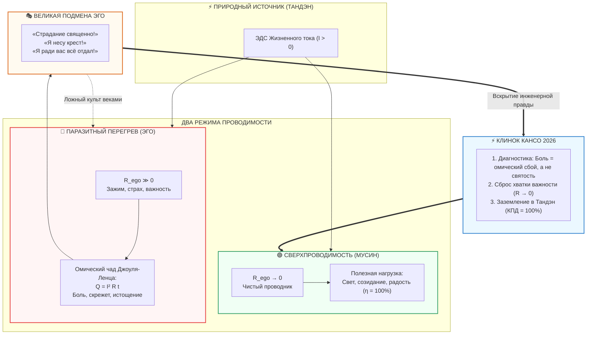

---
created: 2026-10-08
source: [[04_Maps/Inner Current MOC|Inner Current MOC]]
tags:
  - inner-current
  - scale/deep-dive
  - node/tanden
  - node/conductor
  - domain/electrodynamics
  - domain/zen
  - state/overheating
  - suffering-myth
  - ohmic-overheat
  - ego-virtue
  - martyrdom
  - religion
  - guilt-currency
  - workaholism
  - codependency
  - joule-lenz
  - mushin
  - tanden
  - layer-3
type: concept
status: evergreen
layer: III
chapter: 314
author: Vladimir Anyanov
---

> [!info] Синтезировано в брошюре [[02_Wiki/Брошюра — Костыльный цех метафизики (Четыре псевдо-инженера цивилизации)|Брошюра: «Костыльный цех метафизики: Четыре псевдо-инженера цивилизации, иллюзия очищающего страдания и почему для счастья не нужны философские протезы»]]

# ⚡ 314. Иллюзия очищающего страдания: Как эго объявляет паразитный омический перегрев духовной добродетелью
## Демистификация религиозного мученичества, анатомия бытовых «великомучеников» и физика сверхпроводимости Мусин

> [!quote] Каноническая аксиома схемотехники духа
> ### ⚡ **«"Страдание очищает душу!" — самая чудовищная ложь эго: объявить свой собственный паразитный перегрев высшей духовной добродетелью.»**  
> 
> ### ⚡ **«В электродинамике закон Джоуля — Ленца беспристрастен: выделение тепла ($Q = I^2 R t$) — это не полезная работа цепи, а омические потери на внутреннем сопротивлении. Раскалённый докрасна, дымящийся кабель свидетельствует лишь об одном: проводник забит примесями, проводимость отвратительна. Но эго не способно признать свою структурную ригидность. Вместо того чтобы устранить сопротивление до нуля ($R \to 0$, Мусин), оно вешает на чадящий провод табличку "Священный жертвенник" и требует поклонения.»**  
> — **Владимир Аньянов**

---



---

### I. Физический базис: Закон Джоуля — Ленца и омическая слепота

В базовой физике и электродинамике не существует моральных категорий. Есть строгий закон Джоуля — Ленца:
$$Q = I^2 \cdot R \cdot t$$
Количество теплоты ($Q$), выделяемое в проводнике, прямо пропорционально квадрату силы тока ($I^2$), сопротивлению проводника ($R$) и времени ($t$).

В любом инженерном контуре выделение тепла в подводящих линиях — это **паразитные омические потери**. Это свидетельство технической деградации:
1. Кабель имеет слишком высокое удельное сопротивление.
2. В узлах возник окисленный контакт.
3. Проводник работает не как линия передачи мощности к полезной нагрузке (лампам созидания, действия, любви), а как аварийный кипятильник.

Когда нагревательный прибор греется намеренно — это нагрузка. Но когда раскаляется докрасна и дымит **сам подводящий провод** — инженер объявляет аварийную остановку. Никому в здравом уме на электростанции не придёт в голову сказать: *«Посмотрите, как докрасна раскалилась наша медная шина! Как благородно плавится изоляция! Какое высокое духовное служение несёт этот кабель!»*

Инженер скажет: **«Срочно обесточить контур, заменить бракованный провод и зачистить клеммы. КПД системы падает к нулю, мы сжигаем ресурсы впустую»**.

Но в человеческой культуре на протяжении тысячелетий разворачивается ровно обратная картина: **человеческое эго объявило аварийный перегрев собственной проводки высшим признаком святости**.

---

### II. Религиозно-мистический регистр: Канонизация обугленной проводки

На протяжении тысячелетий мировые религиозные институты совершали одну и ту же схемотехническую ошибку: путали **очищение проводника** с **насилием над проводником**.

#### 1. Извращение античной аскезы
Слово «аскеза» (*askesis*) в Древней Греции означало банальную спортивную тренировку атлета. Это режим подготовки тела: убрать лишний жир, отточить реакцию, сделать инструмент лёгким, гибким и чистым проводником силы ($R \to 0$).

Что сделало из этого религиозное эго?
* **Столпничество:** Десятилетия стояния на узком столбе под палящим солнцем без движения.
* **Вериги:** Железные цепи весом в десятки килограммов, врезающиеся в гниющее мясо проводника.
* **Флагелланты:** Средневековые процессии людей, хлещущих себя до костей бичами со свинцовыми наконечниками.

Возникла инвертированная логика: *«Чем сильнее мне больно, тем ближе я к Богу»*.
С точки зрения схемотехники здесь происходит катастрофа:
* Сильная физическая и душевная боль **не растворяет эго**, а стягивает всё внимание проводника в сингулярную точку «Я». 
* Человек, бичующий себя плёткой или стоящий на гвоздях ради святости, находится в состоянии максимального эгоцентризма во всей вселенной. Всё его сознание занято *его* подвигом, *его* невыносимой болью, *его* будущей небесной наградой.
* Это не освобождение от «Я» — это надувание эго-резистора до размеров галактики. Вместо сверхпроводимости проводник просто сгорает на костре собственного мазохизма.

#### 2. Валюта вины и коммерческий бартер с Небом
Эго панически боится состояния лёгкости и беспричинной радости (природного режима Тандэна), потому что в состоянии лёгкости эго **не нужно**. Если ток течёт свободно, посредник не получает комиссионных.

Поэтому эго изобрело универсальную квазивалюту — **вину и искупление через муку**:
> *«Я греховен, испорчен и ничтожен. Но если я достаточно долго буду мучиться, бить себя в грудь и посыпать голову пеплом, Небесный Хозяин увидит мои омические потери и выпишет мне индульгенцию».*

Это чистейший коммерческий торг. Страдание здесь выступает как плата за право оставаться ригидным, не меняя структуру ума. Вместо того чтобы отпустить эго-контроль (сделать $R = 0$), человек покупает прощение тоннами пережитой боли.

---

### III. Бытовой регистр: Инкубаторы бытового мученичества

Если религиозные вериги сегодня кажутся архаикой, то в быту культ перегрева процветает в каждом подъезде и офисе.

```
                    ┌────────────────────────────────────────┐
                    │      ФОРМЫ БЫТОВОГО МУЧЕНИЧЕСТВА       │
                    └────────────────────────────────────────┘
                                         │
         ┌───────────────────────────────┼───────────────────────────────┐
         ▼                               ▼                               ▼
┌──────────────────┐           ┌──────────────────┐           ┌──────────────────┐
│   РОДИТЕЛЬСКИЙ   │           │  КОРПОРАТИВНЫЙ   │           │   СОЗАВИСИМОЕ    │
│  ВЕЛИКОМУЧЕНИК   │           │    МАЗОХИЗМ      │           │  «СПАСАТЕЛЬСТВО» │
├──────────────────┤           ├──────────────────┤           ├──────────────────┤
│ «Я всю жизнь на  │           │ «Работаю без сна │           │ «Терплю запои и  │
│ вас положила!»   │           │ 4 года без отпуска│           │ побои — это мой  │
│ Перегрев страха  │           │ Инфаркт в 35 лет │           │ крест и любовь»  │
│ автономности →   │           │ как орден верности│          │ Трусость выхода →│
│ пожизненный долг │           │ Квадратичная     │           │ «священная жертва│
│ для детей.       │           │ ловушка воли I². │           │ ради семьи».     │
└──────────────────┘           └──────────────────┘           └──────────────────┘
```

#### 1. Родительский комплекс «великомученика»
Классический паттерн семейного ада:
* *«Я ночей не спала, карьеру бросила, в одном пальто двадцать лет ходила, чтобы тебя выучить!»*
* **Инженерный диагноз:** Человек панически боялся собственной реализации, не умел выстраивать границы и заменять омическое сопротивление тревоги на живое действие. Он копил внутреннее трение десятилетиями.
* **Ложь эго:** «Я святая мать / отец-герой».
* **Токсичный выхлоп:** Вместо тепла и автономии детям передаётся парализующий радиоактивный счёт за «жертву». Перегрев родителя трансформируется в вину ребёнка. Если бы родитель жил в сверхпроводимости — счастливо, радостно и свободно, — ребёнок вырос бы здоровым без всяких долгов.

#### 2. Корпоративный мазохизм (Культ выгорания)
* Сотрудник с гордостью заявляет: *«Я вчера ушёл из офиса в 4 утра, спал на диване в переговорке, на выходных закрыл 80 тикетов, ем только энергетики!»*
* **Инженерный диагноз:** Неумение организовать процесс, панический синдром самозванца, страх тишины и неспособность сказать «нет» (гигантское сопротивление $R$).
* **Ложь эго:** «Я ключевой игрок, опора бизнеса, незаменимый герой».
* **Токсичный выхлоп:** Человек путает истощение проводника с эффективностью. Когда через год у него отказывает нервная система или случается инфаркт, проект рушится. Его страдание принесло не пользу компании, а сожгло инфраструктуру.

#### 3. Созависимое «спасательство»
* *«Я терплю его алкоголизм / измены / унижения, потому что любовь долготерпит и всё переносит. Без меня он пропадет. Это мой крест».*
* **Инженерный диагноз:** Банальный ужас перед одиночеством, вторичная выгода контроля и зависимость от эмоциональных качелей.
* **Ложь эго:** «Я несу подвиг всепрощающей святой любви».
* **Токсичный выхлоп:** Легитимация разрушения двоих людей. Страдалец подкармливает деструкцию партнёра, чтобы сохранять свой статус незаменимого спасателя.

---

### IV. Почему эго смертельно выгодно страдать?

Зачем человеческому эго держаться за эту ложь? Почему оно объявляет свой омический перегрев высшей ценностью? Для этого есть три фундаментальные выгоды:

1. **Страдание освобождает от ответственности за результат (Щит мученика):**
   Если ты делаешь работу спокойно, точно и легко — тебя оценивают по объективному результату. Но если ты в процессе *страдал, обливался потом и падал в обмороки* — тебя больше нельзя судить по законам физики. Попробуй сказать уставшему мученику, что его отчёт бессмысленен: ты сразу станешь «бессердечным чудовищем». Страдание — идеальное алиби некомпетентности.

2. **Страдание создаёт иллюзию онтологического «веса»:**
   Состояние сверхпроводимости (Мусин, $R \to 0$) абсолютно прозрачно и невесомо. Там нет «делателя», нет напыщенной драмы. Эго панически боится этой прозрачности: ведь там его не видно! А когда человек мучается, плачет, преодолевает надрыв — он чувствует себя невероятно плотным, важным, трагическим центром вселенной. Драма кормит эго калориями значимости.

3. **Страдание даёт моральное право судить других:**
   Тот, кто выстрадал, автоматически надевает мантию судьи: *«Я через такое прошёл, а вы жизни не нюхали!»* Страдание конвертируется в высокомерие высшей пробы — «духовную гордыню пострадавшего».

---

### V. Демаркация: Паразитный перегрев vs Подлинный катарсис

Означает ли это, что боль в жизни человека вообще не имеет смысла? Нет. Но между **омическим перегревом эго** и **фазовым переходом трансформации** лежит непреодолимая пропасть:

| Параметр | Паразитный омический перегрев (Ложь эго) | Подлинный катарсис (Фазовый переход) |
| :--- | :--- | :--- |
| **Что происходит с $R_{\text{ego}}$?** | Сопротивление **удерживается и растёт**; эго сжимает зубы и терпит. | Сопротивление **ломается и падает в ноль** ($R \to 0$); иллюзия эго сдаётся. |
| **Динамика во времени** | Хроническое, вялотекущее, годами повторяющееся тление и нытьё. | Короткая, острая вспышка разочарования, за которой наступает полная тишина. |
| **Физиологический след** | Хронический зажим челюсти, спазм диафрагмы, тусклый взгляд, выгорание. | Глубокий соматический выдох, расправление плеч, ощущение невесомости. |
| **Эмоциональное послевкусие** | Ожесточение, претензия ко всем вокруг, скрытая зависть, морализаторство. | Лёгкость, здоровый юмор, сострадание, смех над своей прежней глупостью. |
| **Электродинамический статус** | Кабель горит, ток падает, полезная работа равна нулю. | Проводник очищен, ток течёт свободно, лампы жизни вспыхивают на 100%. |

---

### VI. Инженерный протокол оператора: Сброс мученического шунта за 30 секунд

Когда вы ловите себя на мысли: *«Как же мне тяжело, но надо терпеть ради высшей цели / семьи / проекта»*, — выполните аварийный инженерный протокол:

```
[ШАГ 1: ТЕЛЕМЕТРИЯ ТЕПЛА] (0–5 сек)
Зафиксируйте ощущение напряжения в теле (зубы, плечи, ком в горле). 
Произнесите вслух без жалости к себе: 
«Стоп. Это не подвиг. Это омический перегрев Q = I² R t. Мой кабель сейчас плавится».

[ШАГ 2: ПОИСК РЕЗИСТОРА] (5–15 сек)
Задайте один вопрос: 
«Какую иллюзию собственной важности, контроля или чужого одобрения я сейчас так отчаянно сжимаю?»
(Например: страх показаться слабым, желание быть незаменимым, страх сказать правду).

[ШАГ 3: КЛИНОК КАНСО] (15–20 сек)
Разомкните хватку. Мысленно скажите: 
«Я не обязан быть мучеником этой драмы. Мне не нужен нимб ценой инфаркта».

[ШАГ 4: ЗАЗЕМЛЕНИЕ В ТАНДЭН] (20–30 сек)
Сделайте длинный выдох низом живота. Опустите внимание в центр тяжести (3 см ниже пупка).
Почувствуйте, как спадает температура в голове. 
Спросите себя: «Что сейчас требует прямого, спокойного действия без драмы?» 
И просто сделайте это — на 0 Ом сопротивления.
```

---

### VII. Семь аксиом проводимости без надрыва

1. **Боль — это сигнал об ошибке цепи, а не награда.** В физике перегрев сообщает о нарушении контакта. Праздновать перегрев — значит быть слепым к архитектуре прибора.
2. **Мученик всегда эгоцентричен.** Тот, кто упивается своей жертвой, видит только себя и свой мнимый пьедестал.
3. **Чистый ток бесшумен и прохладен.** Сверхпроводник при $R \to 0$ не выделяет тепла и не издаёт скрежета. Истинное мастерство и добродетель выглядят возмутительно лёгкими.
4. **Жертвенность — яд для окружающих.** Тот, кто жертвует собой ради других, неизбежно выставит им неподъёмный счёт в виде вины.
5. **Страдание не очищает — очищает сдача.** Очищение происходит не от того, что кабель долго горел, а от того, что проводник наконец прекратил сопротивляться току жизни.
6. **Труд без перегрева — это Саму.** Можно работать 14 часов подряд, не испытывая ни капли страдания, если действовать в режиме Мусин (без внутреннего комментатора и торга за признание).
7. **Счастье — это естественное состояние исправной цепи.** Когда сопротивление снято, ток Тандэна зажигает все лампы бытия без единой капли надрыва.
