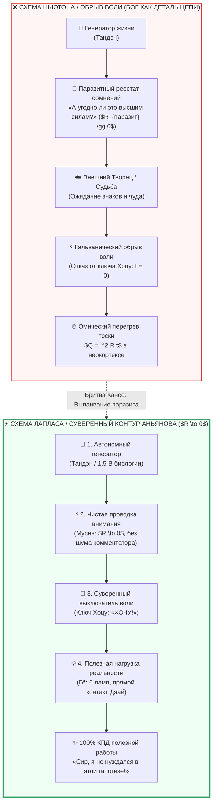

---
created: 2026-10-08
source: [[04_Maps/Inner Current MOC|Inner Current MOC]]
tags:
  - inner-current
  - scale/deep-dive
  - node/tanden
  - node/conductor
  - domain/electrodynamics
  - domain/zen
  - state/overheating
  - laplace-response
  - napoleon
  - celestial-mechanics
  - god-hypothesis
  - kanso
  - ockhams-razor
  - tanden
  - mushin
  - hotsu
  - gyo
  - parasitic-resistance
  - closed-circuit
  - layer-1
type: concept
status: evergreen
layer: I
chapter: 312
author: Vladimir Anyanov
---

> [!info] Синтезировано в брошюре [[02_Wiki/Брошюра — Костыльный цех метафизики (Четыре псевдо-инженера цивилизации)|Брошюра: «Костыльный цех метафизики: Четыре псевдо-инженера цивилизации, иллюзия очищающего страдания и почему для счастья не нужны философские протезы»]]

# ⚡ 312. Ответ Лапласа Наполеону и схемотехника замкнутого контура: «Сир, я не нуждался в этой гипотезе»
## Почему впаивание «Творца» в проводку действия порождает паразитное сопротивление ($R \gg 0$) или гальванический обрыв воли, и как небесная механика 1799 года изоморфна электродинамике сознания

> [!quote] Каноническая аксиома схемотехники действия
> ### ⚡ **«Когда Наполеон спросил Пьера-Симона Лапласа, почему в его математической модели движения планет ни разу не упомянут Творец, астроном ответил: "Сир, я не нуждался в этой гипотезе". Внутренний ток возвращает эту несокрушимую бритву разума в человеческое сознание.»**  
> 
> ### ⚡ **«Если в схеме уже есть автономный генератор (Тандэн / Батарейка), чистая сверхпроводящая магистраль внимания (Мусин, $R \to 0$), суверенный ключ прямого действия (Хоцу / "Хочу!") и реальная полезная нагрузка мира (Гё / 6 ламп) — куда там впаивать "Бога"? Лишняя деталь в замкнутой электрической цепи — это всегда либо паразитное сопротивление ($R_{\text{паразит}} \gg 0$), пережигающее проводку сомнениями, либо гальванический обрыв субъектности. Таблице умножения не нужен жрец, а закону Ома не нужна гипотеза чуда.»**  
> — **Владимир Аньянов**

> [!info] Синтезировано в брошюре [[02_Wiki/Брошюра — На схеме контура нет Бога (Десакрализация Тандэна, похмелье от 5000 лет торга и почему для счастья не нужен Хозяин)|Брошюра: «На схеме контура нет Бога»]]

---



---

### I. Исторический прецедент: От «Бога белых пятен» Ньютона к уравнению Лапласа

В 1799 году великий французский математик и астроном **Пьер-Симон Лаплас** преподнёс Наполеону Бонапарту первые тома своего монументального труда *«Небесная механика» (Traité de mécanique céleste)*. 

Наполеон, внимательно пролистав фолиант, задал естественный для человека своей эпохи вопрос:
> *«Ньютон в своей книге упомянул Бога. Вы написали такую огромную книгу о системе мироздания и ни разу не упомянули её Создателя. Почему?»*

На что Лаплас дал ответ, навсегда вошедший в золотой фонд научной мысли:
> ***«Je n’avais pas besoin de cette hypothèse»*** *(«Сир, я не нуждался в этой гипотезе»)*.

Чтобы понять глубину этого ответа, необходимо знать предысторию спора. **Исаак Ньютон**, сформулировав закон всемирного тяготения, столкнулся с математической задачей многих тел. Рассчитав гравитационное взаимодействие планет, он обнаружил накапливающиеся вековые возмущения орбит. Ньютон не смог доказать их устойчивость аналитически и предположил метафизический костыль: *«Бог время от времени должен лично вмешиваться в ход планет, чтобы подправить их траектории и спасти Солнечную систему от хаоса»*. Это классический пример уязвимости мышления, известной в философии как **«Бог белых пятен» (God of the gaps)**.

Лаплас пошёл другим путём. Он сел за сложнейшие дифференциальные уравнения, применил теорию возмущений высших порядков и доказал: **Солнечная система механически устойчива сама по себе**. Никакого внешнего часовщика, дёргающего за шестерёнки орбит, не требуется. Законы сохранения и гравитации замыкают модель исчерпывающе.

В электродинамике человеческого сознания **Внутренний ток (Inner Current)** делает в точности то же самое: он упраздняет гипотезу внешнего дирижёра в замкнутом контуре действия.

---

### II. Схемотехнический аудит: Куда впаивать «Творца»?

Рассмотрим замкнутую принципиальную схему созидающего человека по формуле Пентады ТХГДМ:

$$\text{Тандэн (Батарейка)} \xrightarrow{\quad R \to 0\ (\text{Мусин}) \quad} \text{Внимание} \xrightarrow{\quad \text{Ключ}\ (\text{Хоцу}) \quad} \text{Нагрузка}\ (\text{Гё / 6 ламп}) \xrightarrow{\quad \text{Обратный провод} \quad} \text{Земля}$$

Если в цепи уже присутствуют:
1. **Автономный генератор ($\mathcal{E}_0$):** биологический реактор Тандэн (37 триллионов митохондрий, протонный градиент АТФ в 150–200 мВ, запасы гликогена, ритм сердца);
2. **Чистая магистраль проводимости ($R \to 0$):** режим Мусин (бесшумный ламинарный дрейф ионов внимания, когда неокортекс не генерирует помех);
3. **Суверенный исполнительный ключ:** волевой импульс Хоцу (発 / «Хочу!», замыкание контакта «здесь и сейчас»);
4. **Полезная нагрузка ($R_{\text{load}}$):** реальное материальное действие Гё (строка кода, взмах ракетки, чистка посуды, разговор с близким, шаг по асфальту),

— то возникает строгий инженерный вопрос: **куда на этой печатной плате впаивать радиодеталь под названием «Бог» / «Высшие силы» / «Знаки Вселенной»?**

С точки зрения законов Кирхгофа и теории цепей возможны лишь два варианта подключения дополнительного элемента:

```
Вариант А (Последовательно):   [Батарейка] ── [Паразитный резистор "Жду знака"] ── [Ключ Хоцу] ── [Лампа]
Вариант B (Разрыв цепи):       [Батарейка] ── [Разомкнутый выключатель воли] ── ❌ (Жду чуда) ── [Лампа]
```

#### 1. Паразитное последовательное сопротивление ($R_{\text{паразит}} \gg 0$)
Если оператор пытается сделать Высшие Силы посредником в каждом бытовом или профессиональном шаге, в тракт немедленно врезается добавочный реостат:
* *«А угодно ли это небу?»*
* *«А нет ли знака Вселенной отложить спортзал?»*
* *«А заслужил ли я результат праведностью?»*

По закону Ома сила тока падает:
$$I = \frac{\mathcal{E}}{R_{\text{load}} + R_{\text{паразит}}} \to 0$$
А по закону Джоуля — Ленца вся витальная мощь генератора уходит не в полезный свет ламп, а в раскалённый омический самосожжение нервной системы:
$$Q = I^2 \cdot R_{\text{паразит}} \cdot t$$
Человек лежит на диване, не сделав ни единого движения, но сгорает в экзистенциальном перегреве тревоги и вины.

#### 2. Гальванический обрыв субъектности (Паралич ключа Хоцу)
Худший сценарий — передача суверенной функции тумблера наружу. Человек размыкает ключ Хоцу и садится ждать: *«Если Богу угодно, проект сам напишется / здоровье само поправится / отношения сами наладятся»*. 

Цепь разомкнута ($I \equiv 0$). Никакая мощность в нагрузку не передаётся. Ни одна лампа реальности не зажигается. Энергия реактора Тандэн, не находя выхода в действие, начинает искать аварийные шунты: химические суррогаты (алкоголь), дофаминовые петли (скроллинг) или психосоматические сбои.

---

### III. Лаплас против Толстого: Устойчивость орбит против омического ада вины

Глубочайший контраст между подходом Лапласа и религиозной метафизикой демонстрирует судьба Льва Толстого (подробно разобранная в [[02_Wiki/Inner Current (Tolstoy Existential Crisis vs Happiness Architecture)|главе 27]] и [[02_Wiki/Inner Current (The Tolstoy Paradox — Why 2,000 Years of Self-Improvement Failed and How Circuit Electrodynamics Replaced Moral Agony with a Closed Loop)|главе 105]]).

Толстой, будучи гением художественного слова, попытался решить задачу человеческого счастья через **тотальное впаивание идеи Хозяина/Творца во все узлы сознания**. Каждый вздох, каждый кусок хлеба и каждая копейка проверялись на «угодность Хозяину». Результат известен:
* Сопротивление эго-рефлексии выросло до астрономических величин ($R_{\text{moral}} \to \infty$);
* Контур ушёл в непрерывный омический пожар вины ($Q = I^2 R t$);
* Жизнь завершилась трагическим ночным побегом из Ясной Поляны и омическим коллапсом на станции Астапово.

Лаплас же показал другой путь: **когда законы движения рассчитаны точно, небеса не падают**. Когда биологический субстрат заряжен, внимание ламинарно, а рука твёрдо нажимает выключатель — созидание происходит с математической неизбежностью. Ему не нужны подпорки суеверий.

---

### IV. Дзен-онтология: Творец как Само Поле, а не радиодеталь

Означает ли отказ от гипотезы Творца в контуре вульгарный воинствующий атеизм или цинизм? Напротив, в дзенской философии и в теории поля Внутреннего тока здесь раскрывается подлинная грандиозность мироздания:

> **В цепь нельзя впаять «Бога», потому что Высшее Начало — это не радиодеталь. Если и говорить о Божественном или о Природе Будды (Таковости), то это САМИ ЗАКОНЫ ЭЛЕКТРОДИНАМИКИ. Это само физическое свойство Пустоты (Шуньяты) пропускать через себя ток.**

Попытка припаять Творца рядом с резистором нагрузки — это категориальная ошибка того же порядка, как если бы радиоинженер попытался припаять на текстолитовую плату между конденсатором и микросхемой кусочек «концепции электромагнетизма». 

* Законы Максвелла не нуждаются в том, чтобы их рисовали на схеме: они действуют в каждом миллиметре проводника;
* Закон Ома ($I = U/R$) работает одинаково для святого, грешника, физика и садовника;
* Вселенная говорит с человеком не через вещие сны и суеверные запреты, а через объективную соматическую телеметрию: **чистый ток даёт радость ($R \to 0$), зажатое эго сжигает нервы ($Q = I^2 R t$)**.

---

### V. Экспресс-протокол Лапласа: Калибровка оператора за 15 секунд

Когда в моменты усталости, сомнений или страха перед сложным вызовом ум начинает скатываться в метафизический торг, инфантильное ожидание «знаков судьбы» или ступор ответственности, оператор контура проводит 15-секундную юстировку:

| Шаг | Диагностический узел | Калибровочное действие |
| :--- | :--- | :--- |
| **1. Тандэн** | Генератор питания | Сбросить дыхание вниз живота. Проверить батарейку (сон, вода, кислород). Заряд есть? Есть. |
| **2. Мусин** | Проводка внимания | Отключить мысленного цензора и внутренний комментарий. Выбросить нарратив «достоин / не достоин». $R \to 0$. |
| **3. Хоцу** | Ключ воли | Сказать сухое, суверенное соматическое: **«ХОЧУ / ДЕЛАЮ»**. |
| **4. Бритва Лапласа** | Отсечение паразитов | Внутренний голос шепчет: *«А что, если судьба против? А где высший знак?»* — Оператор отвечает Наполеону внутри себя: **«Сир, я не нуждаюсь в этой гипотезе»**. |
| **5. Гё (Лампа)** | Полезная нагрузка | Положить пальцы на клавиатуру / сделать первый физический шаг. **Контур замкнут. Ток пошёл.** ⚡ |

---

### VI. Резюме главы

1. Ответ астронома Лапласа Наполеону — высший манифест канона **Кансо (簡素)**: отсечение избыточных ментальных сущностей ради чистоты модели.
2. Ньютоновский «Бог белых пятен» — это следствие лени и неполноты расчета. В человеческой жизни идея «фатума/судьбы» возникает там, где оператор не откалибровал соматику или испугался нажать ключ воли.
3. Впаивание внешнего Творца в цепь прямого действия неизбежно превращается либо в **паразитное сопротивление сомнений ($Q = I^2 R t$)**, либо в **гальванический обрыв субъектности ($I = 0$)**.
4. Контур человека самодостаточен: биологический Тандэн даёт ЭДС, режим Мусин даёт проводимость, ключ Хоцу даёт решение, а нагрузка Гё преобразует энергию в реальность.
5. Быть суверенным оператором цепи — значит не перекладывать замыкание контактов на небеса, а действовать по объективной таблице умножения собственной нервной системы.

---

> [!info] Системная навигация
> - Предыдущая глава: [[02_Wiki/Inner Current (The Multiplication Table of the Nervous System — Why the Circuit is Not a Sect, Axiomatic Biophysics vs Esoteric Cults and Demystification of Human Conductance)|311. Таблица умножения нервной системы: Почему Контур — не секта]]
> - Родственная глава: [[02_Wiki/Inner Current (The Steinmetz-Feynman Paradox — Why You Do Not Need to Know the Ultimate Nature of Electricity to Light the Room, Operational Sovereignty vs Metaphysical Scholasticism)|308. Парадокс Штейнмеца — Фейнмана: Почему не нужно знать абсолютную тайну тока]]
> - Родственная глава: [[02_Wiki/Inner Current (Is the Circuit for Atheists — Demystification of Tanden, Category Error of the Generator and Electrodynamic Invariance)|310. «Эта система для атеистов?»: Электродинамическая инвариантность контура]]
> - Мастер-реестр: [[04_Maps/Inner Current MOC|Inner Current MOC (Слой I. Физический базис цепи)]]
