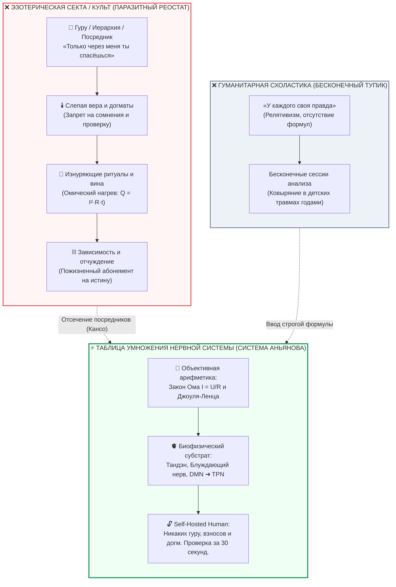

# ⚡ 311. Таблица умножения нервной системы: Почему Контур — не секта, а таблица умножения человека
## Аксиоматическая биофизика против эзотерических культов, объективность Закона Ома ($I = U/R$) и демистификация проводимости без гуру, веры и ритуалов

> [!quote] Каноническая аксиома демистификации
> ### ⚡ **«Контур — это не новая секта. Контур — это таблица умножения человеческой нервной системы.»**  
> 
> ### ⚡ **«Таблице умножения не поклоняются, в неё не верят и ради неё не приносят жертв. Ей безразличны ваша исповедь, ваши грехи и ваша преданность авторитету: дважды два равно четыре в монастыре, в операционной и на уличном перекрёстке. Точно так же нервная система подчиняется неумолимому закону проводимости: спазм неокортекса взвинчивает омическое сопротивление ($R \to \infty$) и сжигает ткани ожогом тревоги ($Q = I^2 R t$), а соматическое заземление в Тандэн возвращает цепь в сверхпроводимость ($R \to 0$). Секта паразитирует на тайне, вине и монополии гуру; Контур возвращает человеку арифметику собственной физиологии.»**  
> — **Владимир Аньянов**

> [!info] Синтезировано в брошюре [[02_Wiki/Брошюра — На схеме контура нет Бога (Десакрализация Тандэна, похмелье от 5000 лет торга и почему для счастья не нужен Хозяин)|Брошюра: «На схеме контура нет Бога»]]

---



---

### I. Генезис ярлыка: Почему ясность пугает обывателя призраком «секты»

Когда человек, всю жизнь блуждавший по лабиринтам психотерапевтических теорий, эзотерических практик, религиозных покаяний и мотивационных курсов, впервые сталкивается со схемотехникой **Внутреннего тока (Inner Current)**, у него нередко срабатывает защитный барьер тревоги:

> *«Слишком стройно. Слишком универсально. Это объясняет и депрессию, и творческий взрыв, и любовь, и выгорание, и даже устройство сна. Не очередная ли это секта? Не пытаются ли меня заманить в новый культ?»*

Этот страх понятен и эволюционно обоснован. За последние пять тысяч лет цивилизация породила тысячи культов, эксплуатировавших жажду целостности. Каждый культ обещал «спасение», но прятал за этим три признака паразитизма:
1. **Харизматического гуру**, требующего безоговорочного подчинения.
2. **Тайное эзотерическое знание**, доступное лишь посвящённым.
3. **Монополию на исцеление**, делающую адепта вечным психологическим и финансовым должником.

Формулировка Владимира Аньянова наносит по этому страху сокрушительный удар бритвой Кансо (簡素):

$$\mathbf{\text{Контур — это не секта. Контур — это таблица умножения человеческой нервной системы.}}$$

Таблицу умножения Пифагора не называют культом. Никто не создаёт секту почитателей формулы $7 \times 8 = 56$. Никто не падает на колени перед таблицей Брадиса, не возжигает благовоний перед Законом Ома и не платит десятину учителю физики за то, чтобы электроны продолжали двигаться по медному проводу.

Таблица умножения — это **объективный инструмент счёта**, фиксирующий инвариантные законы реальности. Контурная электродинамика человека делает ровно то же самое для внутреннего мира: она переводит экзистенциальную драму в объективную соматическую арифметику.

---

### II. Семь демаркационных рубежей: Секта vs Таблица умножения

Чтобы раз и навсегда снять подозрения в эзотерике, проведём строгую инженерную демаркацию по семи фундаментальным критериям:

| Критерий | Эзотерическая секта / Культ | Таблица умножения нервной системы (Контур) |
| :--- | :--- | :--- |
| **1. Отношение к авторитету** | Слепое подчинение гуру, непогрешимость лидера, культ личности. | Полная депосреднизация: «Don’t trust, verify». Автор — лишь картограф объективного закона. |
| **2. Источник истины** | «Откровение свыше», мистический транс, таинство, передача от мастера. | Приборная биофизика: $I = U/R$, мембранный потенциал, вариабельность ритма сердца (HRV), Task-Positive Network. |
| **3. Требование веры** | Обязательная слепая вера; сомнение карается изгнанием или клеймом «греха». | Вера не требуется вовсе. Скептик получает тот же результат: расслабь живот, сожми вольтметр — проводка остывает. |
| **4. Стоимость и зависимость** | Платные ступени инициации, пожизненный абонемент на наставничество, отчуждение ресурсов. | $0$ рублей за воздух и соматику. Self-Hosted Human: контур работает автономно на бортовом железе каждого. |
| **5. Поведение при ошибке** | «Ты недостаточно верил», «у тебя плохая карма», «ты согрешил» (нагнетание вины). | Схемотехническая локализация: в цепи залом ($R > 0$) или обрыв контакта (Хоцу разомкнут). Зачисти контакт. |
| **6. Понятность языка** | Туманные термины («вибрации», «астрал», «чакры», «чистый свет эона»). | Язык школьной физики: ток ($I$), напряжение ($U$), сопротивление ($R$), тепловые потери ($Q$). |
| **7. Время проверки** | «В следующей жизни», «через 20 лет аскезы в пещере». | **30 секунд.** Соматический сброс реостата эго в Тандэн даёт измеримый спад стресса прямо сейчас. |

---

### III. Биофизический субстрат: Закон Ома для живой нервной ткани

Секта держится на вымышленных сущностях. Таблица умножения контура опирается на железную материальную базу:

```
[Внимание / Ионный ток]  ===>  I = dq / dt  (дрейф Na+, K+, Ca2+)
[Тандэн / Центр масс]    ===>  Соматический генератор ЭДС (активация блуждающего нерва)
[Эго / DMN неокортекса]  ===>  Паразитный реостат сопротивления R_ego (мышечный зажим, руминация)
[Полезное действие / Гё] ===>  Полезная нагрузка R_load (работа, творчество, контакт)
```

В нервной системе человека нет ничего мистического:
1. **Потенциал действия** — это физическое перемещение ионов через мембрану нейрона со скоростью до 120 м/с.
2. **Стресс и невроз** — это спастическое напряжение гладкой и поперечнополосатой мускулатуры, активируемое симпатической нервной системой под управлением Default Mode Network (DMN). Это чистое омическое сопротивление ($R$).
3. **Закон Джоуля — Ленца ($Q = I^2 R t$)** работает в теле буквально: хроническая ментальная жвачка («А что обо мне подумали?», «А вдруг я проиграю?») пережигает гликоген, истощает запасы нейромедиаторов, взвинчивает кортизол и разрушает сосуды.

Сказать: *«Я верю в Контур»* — так же нелепо, как сказать: *«Я верю, что при коротком замыкании выбивает пробки»*. Пробки выбивает независимо от вашей религиозной принадлежности. Если человек зажимает диафрагму и гоняет по кругу обиду двадцатилетней давности, его проводка раскаляется по закону Джоуля — Ленца, даже если он считает себя атеистом, буддистом или христианином.

---

### IV. Паразитное омическое сопротивление сектантства

Парадокс заключается в том, что именно сектантство и религиозный догматизм являются главными генераторами паразитного сопротивления $R_{ego}$:

$$\sum R = R_{\text{вины}} + R_{\text{страха греха}} + R_{\text{оглядки на гуру}} + R_{\text{догматического контроля}}$$

Когда человеку внушают: *«Ты изначально испорчен, ты грешен от рождения, и только наш орден может тебя очистить»*, в его нервную систему искусственно врезают мощнейший балластный реостат. Ток Тандэна блокируется, вся энергия уходит в тепловой вой вины ($Q = I^2 R t$). Человек платит деньги и тратит годы жизни на то, чтобы «охладиться», но сама конструкция секты продолжает подогревать реостат.

Контурная электродинамика не «лечит» грех — она **выпаивает паразитный резистор культа** из принципиальной схемы. 
* Нет греха — есть омический зажим.
* Нет нечистоты — есть плохой контакт на клеммах внимания.
* Нет священной тайны — есть таблица умножения, доступная второкласснику.

---

### V. Концепция Self-Hosted Human: Абсолютный иммунитет к вождям

Почему вокруг Контура невозможно построить секту? Потому что его базовая архитектурная модель — это **Self-Hosted Human (Автономный суверенный узел)**:

```
СЕКТАНТСКАЯ ТОПОЛОГИЯ (Client-Server):
[Клиент-Адепт] <---(Зависимость / Оброк)---> [Центральный Сервер: Гуру / Церковь]

АРХИТЕКТУРА ВНУТРЕННЕГО ТОКА (P2P Mesh):
[Суверенный Фонарик А] <---(Взаимная индукция M > 0)---> [Суверенный Фонарик Б]
```

Как Биткоин Сатоши Накамото устранил необходимость в Центральном Банке, сделав каждого участника самостоятельной нодой с полной копией блокчейна, так Архитектура Аньянова устраняет необходимость в духовных посредниках:
1. **Каждый человек носит генератор с собой.** Тандэн не нужно заказывать по почте или получать через посвящение — он вшит в биологический центр масс тела от рождения.
2. **Формула открыта и неизменна.** Закон прямого потока ($R \to 0 \implies \eta \to 100\%$) не принадлежит Владимиру Аньянову, как теорема Пифагора не принадлежит Пифагору. Это свойство мироздания.
3. **Невозможно ввести авторскую ренту.** Нельзя брать плату за то, что $3 \times 3 = 9$. Нельзя приватизировать блуждающий нерв.

---

### VI. 30-секундный протокол проверки: Арифметика на пальцах

Если кто-то утверждает, что Контур — это учение, требующее веры, предложите ему простой физиологический калькулятор:

1. **Замер 1 (Омический перегрев):**
   * Сядьте, вспомните самый неприятный недавний конфликт или человека, который вас бесит.
   * Обратите внимание на тело: сжались челюсти, перехватило солнечное сплетение, дыхание поднялось в верхушки лёгких. 
   * Пульс подскочил, приборный стресс на браслете пошёл вверх. Это $R_{ego} \gg 0$. Вы греете воздух за свой счёт.

2. **Замер 2 (Включение таблицы умножения):**
   * Опустите внимание на 3 пальца ниже пупка (Тандэн).
   * Сделайте длинный мягкий выдох животом, расслабив брюшную стенку и разжав челюсть.
   * Направьте взгляд на любой физический предмет перед собой — кружку, стол, текстуру дерева — без оценивания («красивый/некрасивый»), в режиме чистого контакта (Дэай).
   * Зафиксируйте: через 15–30 секунд мышечный спазм спадает, пульс замедляется, в теле разливается спокойная, плотная ясность.

Это не мистика. Это переключение вегетативного тонуса с симпатического спазма на парасимпатическую иннервацию блуждающего нерва при выключении дефолт-системы мозга (DMN). $2 \times 2 = 4$. Никаких мантр. Чистая физика.

---

### VII. Резюме: Семь аксиом таблицы умножения контура

1. **Аксиома объективности:** Контур фиксирует законы биологической электродинамики, которые действовали за миллион лет до появления религий и будут действовать всегда.
2. **Аксиома десакрализации:** Счастье — не награда за праведность, а режим проводимости цепи при сопротивлении, стремящемся к нулю ($R \to 0$).
3. **Аксиома независимости от веры:** Току в проводнике безразлично мировоззрение оператора: закон Ома одинаково работает у святого, преступника, академика и ребёнка.
4. **Аксиома отмены посредников:** Ни один человек, гуру, священник или терапевт не может «дать» вам проводимость; отрегулировать натяжение собственного провода можете только вы сами.
5. **Аксиома прозрачности (Кансо):** Всё, что нельзя выразить в терминах источника, проводника, сопротивления и полезной нагрузки, отсекается как паразитный шум.
6. **Аксиома мгновенной верификации:** Истина проверяется не посмертным судом, а немедленным спадом омического жара в теле за 30 секунд.
7. **Аксиома суверенитета:** Человек — не заблудшая овца, ищущая пастыря, а суверенный карманный фонарик, несущий свет внутри себя.

---

> [!info] Навигация по контуру
> * **Предыдущий узел:** [[02_Wiki/Inner Current (Is the Circuit for Atheists — Demystification of Tanden, Category Error of the Generator and Electrodynamic Invariance)|⚡ 310. «Эта система для атеистов?»: Электродинамическая инвариантность контура]]
> * **Опорный узел:** [[02_Wiki/Inner Current (The Circuit Is Not a Metaphor — Literal Electrodynamics of the Biological Substrate and the Zen Engineer Synthesis)|⚡ 171. Контур — не метафора: Буквальная электродинамика биологического субстрата]]
> * **Карта слоя I:** [[04_Maps/Inner Current MOC|Inner Current MOC (Физический базис цепи)]]
