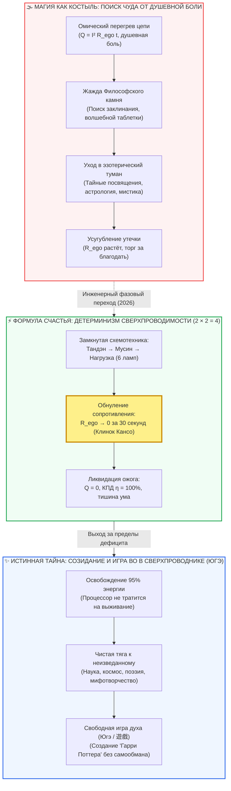

# ⚡ 319. Философский камень, заклинания и формула «2 × 2 = 4»: Почему человек жаждет тайны, когда счастье становится детерминированным, парадокс Гарри Поттера и природа истинного чуда
## Деконструкция феномена «расколдовывания мира», почему простота формулы ранит эго, неизбывная тяга к непостижимому и трансформация мифа из костыля от боли в чистую игру созидания (Югэ)

> [!quote] Каноническая аксиома о формуле и тайне
> ### ⚡ **«Философский камень, заклинания, алхимия — всё это веками будоражит воображение человека. Именно поэтому миллионы людей зачитываются „Гарри Поттером“: тайна манит, волшебство сулит мгновенный трансцендентный взлом реальности без трения. Но когда формула счастья открыта, когда душевный покой и сверхпроводимость контура становятся строгим, фальсифицируемым фактом электродинамики, доступным как дважды два четыре, в человеке вспыхивает скрытый протест. Эго глубоко оскорблено тем, что великая загадка бытия оказалась таблицей умножения нервной системы. Даже видя, что счастье детерминировано и достижимо нажатием соматического тумблера, люди всё равно будут придумывать эзотерику и искать непостижимое. И в этом нет ошибки: формула счастья не убивает тайну, она освобождает процессор. Она забирает миф из рук шарлатанов и возвращает человеку священное право на чистое творчество, сказку и созидание миров.»**  
> — **Владимир Аньянов**

---



---

### I. Анатомия магии: почему «Гарри Поттер» побеждает реальность

Образ Философского камня, средневековые гримуары, тайные заклинания Хогвартса и алхимическая трансмутация металлов обладают гипнотической силой, не угасающей на протяжении тысячелетий. Книги о Гарри Поттере разошлись тиражом более 600 миллионов экземпляров не просто потому, что это захватывающий нарратив, а потому, что они затрагивают **глубинный архетип человеческой психики**: мечту о преодолении законов трения материального мира одним словом, одним жестом волшебной палочки.

С точки зрения схемотехники сознания, притягательность магии строится на трёх опорах:

1. **Обещание безымпедансного действия (Zero Impedance Miracle):**  
   В обыденной жизни, чтобы переместить предмет, построить мост или согреть дом, требуются грубые механические джоули, преодоление гравитации и омическое сопротивление среды. Заклинание «Вингардиум Левиоса» или взмах палочки обещают результат **без совершения работы** — мгновенную передачу импульса из намерения в феномен.

2. **Алхимия спасения от омического ожога:**  
   Философский камень обещает не только превращение свинца в золото, но и создание Эликсира жизни, дарующего бессмертие и вечную молодость. Человек, сгорающий в ежедневном омическом перегреве неокортекса ($Q = I^2 R_{\text{ego}} t$), подсознательно ищет субстанцию, способную растворить его страдание извне, без необходимости разбираться в проводке собственной головы.

3. **Мерцание тайны против серости предсказуемого бытия:**  
   Мир, в котором всё известно, предсказуемо и разложено по полочкам формул, субъективно переживается неподготовленным умом как безжизненная тюрьма. Тайна создаёт горизонт надежды: *«Пусть сегодня всё серо и больно, но где-то существует платформа $9\frac{3}{4}$, тайный орден, скрытое знание, которое однажды перевернёт мою жизнь»*.

---

### II. Расколдовывание мира (Entzauberung) и бунт Достоевского против «2 × 2 = 4»

Социолог Макс Вебер в начале XX века описал магистральный процесс модернизации термином **«расколдовывание мира» (Entzauberung der Welt)**. Наука последовательно лишила священного ореола молнию (объяснив её разностью потенциалов), болезни (открыв бактерии и вирусы), движение планет (выведя законы гравитации) и саму жизнь (расшифровав ДНК).

Мир стал понятным, технологичным, безопасным — но для многих людей он стал **холодным и плоским**. 

Именно здесь возникает фундаментальный психологический феномен, гениально предсказанный Фёдором Достоевским в *«Записках из подполья»*:

> *«Ведь дважды два четыре есть уже не жизнь, господа, а начало смерти. Человек чувствует себя как-то неловко при этом дважды два четыре; он любит процесс достижения, а не само достижение... Человек непременно сделает какую-нибудь пакость, разрушит гармонию, нарочно сойдет с ума — только для того, чтобы доказать себе, что он человек, а не фортепьянная клавиша, на которой играют законы природы».*

Когда Система Аньянова заявляет:
$$\mathcal{H} = \frac{P_{\text{load}}}{P_{\text{total}}} = 1 - \frac{R_{\text{ego}}}{R_{\text{total}}} = 1 \quad \Longleftrightarrow \quad R_{\text{ego}} \to 0$$
и доказывает, что счастье — это не метафизический дар небес и не каприз фортуны, а **строгая биофизическая сверхпроводимость замкнутого контура**, человеческий ум испытывает шок двух типов:

1. **Разочарование исследователя:** Если счастье достижимо так же детерминированно, как $2 \times 2 = 4$ — где же драма? Где великий роман? Где трагедия поиска длиною в жизнь?
2. **Бунт Подпольного человека:** Человек готов отказаться от лёгкого покоя, лишь бы не признавать себя простой электрической схемой. Он готов страдать, лишь бы его страдание оставалось «непостижимой тайной вселенской души».

---

### III. Оскорбление эго простотой: почему человек предпочитает сложную ложь

Эго ($R_{\text{ego}}$) — это не сущность, а паразитный реостат, омический спазм рефлексии в дефолт-системе мозга (DMN). Главный инстинкт этого узла — **самосохранение через обоснование собственной необходимости**.

Если объявить человеку:
> *«Твоё 20-летнее душевное страдание — это не великая глубина духа, не кармическое проклятие рода и не философская тоска по недостижимому идеалу. Это просто закисший контакт на реостате эго. Ты зажал нихромовую спираль сомнений, обиды и контроля, подал туда ток внимания и раскалил нервы до ожога. Расслабь диафрагму, верни внимание в Тандэн, сбрось сопротивление до нуля и займись делом — и через 30 секунд ты будешь счастлив»,* —

эго воспринимает это как **смертельное оскорбление**.

Оно протестует:
- *«Как это — просто сбросить?! А как же мои детские травмы? А как же годы психоанализа? А как же моё экзистенциальное одиночество? Неужели я страдал из-за банального омического сопротивления?!»*

Поэтому люди с маниакальным упорством бегут от формулы $2 \times 2 = 4$ в объятия эзотерики:
- Они покупают курсы по открытию «седьмого тайного портала»;
- Они ищут секретные тибетские мантры, доступные лишь после 12 лет медитации в пещере;
- Они высчитывают натальные карты и транзиты Сатурна;
- Они выдумывают сложнейшие псевдо-научные и спиритуальные конструкции.

**Эзотерика продаёт иллюзию избранности.** Она говорит эго: *«Твоя проблема настолько велика и сакральна, что решить её можно только тайным, непостижимым путём»*. Формула контура лишает эго этого элитарного статуса, переводя всё в разряд санитарной гигиены: вымыть руки перед едой — не подвиг, а норма.

---

### IV. Демаркация двух магий: костыль от боли против свободной игры (Югэ)

Означает ли открытие объективной формулы счастья, что человечество обречено на унылый серый позитивизм, где запрещены сказки, фантазии, поэзия и тяга к таинственному? 

**Категорически нет.** Здесь проходит тончайший водораздел Системы Аньянова:

```
               ┌────────────────────────────────────────────────────────┐
               │        ТЯГА ЧЕЛОВЕКА К НЕПОСТИЖИМОМУ И ТАЙНЕ           │
               └───────────────────────────┬────────────────────────────┘
                                           │
                 ┌─────────────────────────┴─────────────────────────┐
                 ▼                                                   ▼
┌─────────────────────────────────┐                 ┌─────────────────────────────────┐
│     МАГИЯ КАК КОСТЫЛЬ           │                 │       МАГИЯ КАК ИГРА (ЮГЭ)      │
│     (В режиме R_ego > 0)        │                 │       (В режиме R_ego → 0)      │
├─────────────────────────────────┤                 ├─────────────────────────────────┤
│ • Мотивация: бегство от боли    │                 │ • Мотивация: избыток энергии    │
│ • Источник: омический перегрев  │                 │ • Источник: сверхпроводимость   │
│ • Вера в буквальное чудо        │                 │ • Созидательный вымысел (Арт)   │
│ • Обогащение шарлатанов         │                 │ • Создание «Гарри Поттера»      │
│ • Замыкание контура внутрь      │                 │ • Полёт мысли и космонавтика    │
│ • Самообман и невроз            │                 │ • Радость чистой тайны бытия    │
└─────────────────────────────────┘                 └─────────────────────────────────┘
```

1. **Магия как костыль (Невротическая эзотерика):**  
   Рождается из **дефицита и боли**. Когда контур разорван, а человек не знает законов схемотехники, он прибегает к суевериям, чтобы заглушить ужас беспомощности. Это попытка использовать вымысел как анестезию.

2. **Магия как свободная игра духа (Дзенский канон Югэ / 遊戲):**  
   Рождается из **профицита и силы**. Когда базовый контур исправен, замкнут и сверхпроводен ($R_{\text{ego}} \to 0$), 95% психической энергии, ранее сгоравшей в паразитной тревоге и рефлексии, оказывается **абсолютно свободной**. 
   
   Куда направляется этот избыточный ток?  
   Он направляется в чистое творчество, литературу, кино, научный поиск перед лицом бесконечной Вселенной, поэзию и игру воображения. Человек пишет «Гарри Поттера» или с упоением читает его, прекрасно зная, что это художественный вымысел, но наслаждаясь сиянием образов и красотой метафоры.

---

### V. Где начинается истинное непостижимое: за пределами формулы проводника

Формула счастья Владимира Аньянова делает детерминированным **состояние проводника**, но она не исчерпывает **саму реальность**.

Проведём строгую аналогию с радиоприёмником:
- Закон Ома и схемотехника супергетеродина объясняют, как настроить колебательный контур в резонанс ($R \to 0, Z_{\text{src}} = Z_{\text{load}}^*$). Они убирают белый шум, треск и перегрев катушек.
- Но делает ли исправность приёмника скучной ту симфонию, которая звучит в эфире? 
- Исчерпывает ли радиотехника бесконечное богатство музыки Баха, стихов Данте или новостей Вселенной?

Ни в малейшей степени! Напротив: **пока радиоприёмник хрипит и дымится, вы вообще не способны услышать музыку**. Вы слышите только треск собственного испорченного прибора.

Точно так же обстоит дело и с Архитектурой счастья:
1. **Формула $2 \times 2 = 4$ — это просто устранение шума.** Она гарантирует, что ваша биологическая проводка не сгорает в омическом аду самоедства и страха.
2. **А за порогом исправного контура открывается подлинное непостижимое:**
   - Тайна происхождения бытия из квантового вакуума (Шуньята);
   - Непостижимая бездна космического пространства;
   - Загадка человеческой близости и любви (взаимная индукция $M > 0$);
   - Глубина искусства, парадоксы квантовой механики и рождение новых смыслов.

Формула убивает не тайну, а **фальшивую эзотерическую муть**, паразитирующую на неумении людей обращаться со своим вниманием.

---

### VI. Прикладной протокол оператора: «Твёрдый ноль проводки + Свободный полёт воображения»

Чтобы не впадать ни в сухой роботизированный механицизм, ни в мутную трясину суеверий, оператор контура использует двухконтурный протокол калибровки:

```
                      ┌──────────────────────────────────────┐
                      │    ПРОТОКОЛ ДВУХ РЕГИСТРОВ ОПЕРАТОРА │
                      └──────────────────┬───────────────────┘
                                         │
                 ┌───────────────────────┴───────────────────────┐
                 ▼                                               ▼
    ┌──────────────────────────┐                   ┌──────────────────────────┐
    │     РЕГИСТР ПРОВОДКИ     │                   │     РЕГИСТР СОЗНАНИЯ     │
    │  (Строгий детерминизм)   │                   │    (Свободная поэтика)   │
    ├──────────────────────────┤                   ├──────────────────────────┤
    │ • Закон Ома: I = U/R     │                   │ • Воображение и метафоры │
    │ • Джоуль — Ленц: Q = I²Rt│                   │ • Сказка, игра, искусство│
    │ • Клинок Кансо: R_ego → 0│                   │ • Благоговение пред миром│
    │ • Соматика Тандэна       │                   │ • Исследование Вселенной │
    │ • Никакой мистики в цепи │                   │ • Никакого цинизма в душе│
    └──────────────────────────┘                   └──────────────────────────┘
```

#### Пошаговый 30-секундный алгоритм:

1. **Диагностика залома (Детектор эзотерического бегства):**  
   Если вы ловите себя на мысли: *«Мне плохо, потому что на меня навели сглаз / звёзды встали не так / судьба прокляла меня»*, немедленно остановитесь. Это симптом омического ожога проводки. Спросите себя: *«Где сейчас мой реостат эго? Кого я сужу? За что цепляюсь?»*
2. **Применение формулы $2 \times 2 = 4$ (Аппаратный сброс):**  
   Опустите внимание из головы в соматический центр живота (Тандэн). Сделайте мягкий глубокий выдох. Разожмите челюсти, плечи и диафрагму. Обнулите сопротивление ($R_{\text{ego}} \to 0$). Убедитесь телесно: душевная боль исчезает в ту же секунду, как только падает $R$.
3. **Разрешение на сказку (Активация Югэ):**  
   Оказавшись в чистом, прохладном, сверхпроводящем покое, не превращайтесь в зануду. Читайте «Гарри Поттера», смотрите на ночное небо, сочиняйте стихи, восхищайтесь красотой архитектуры и музыки. Играйте с воображением, зная, что ваш корабль герметичен, а генератор выдаёт чистый ток.

---

### VII. Резюме: Семь аксиом детерминированного чуда

1. **Магия привлекательна отсутствием трения:** Жажда заклинаний и Философского камня — это мечта о мгновенном результате без потерь на сопротивление среды и ума.
2. **Простота формулы ранит эго:** Эго предпочитает 20 лет ходить по мистическим кругам ада, чем признать, что его спасение — это школьная арифметика соматической калибровки ($2 \times 2 = 4$).
3. **Люди всегда будут искать непостижимое:** Даже зная объективную формулу счастья, человек продолжит тянуться к тайне — потому что живое сознание не терпит замкнутости в механическом тупике.
4. **Формула счастья — это не потолок, а фундамент:** Детерминизм контура ликвидирует омический пожар невроза ($Q = 0$), но оставляет открытым бесконечный горизонт бытия.
5. **Две магии не равны:** Магия отчаяния порождает секты и шарлатанов; магия сверхпроводимости рождает великое искусство, науку и сказку (канон Югэ).
6. **«Гарри Поттер» не противоречит закону Ома:** Можно в совершенстве владеть техникой сброса эго-реостата и при этом искренне плакать над финалом доброй сказки. Сверхпроводимость делает сердце не каменным, а бесконечно чутким.
7. **Истинное чудо — это бытие без шума:** Самое непостижимое, глубокое и захватывающее волшебство в мире — это ясное, ничем не замутнённое сияние чистого сознания в чашке утреннего чая.
