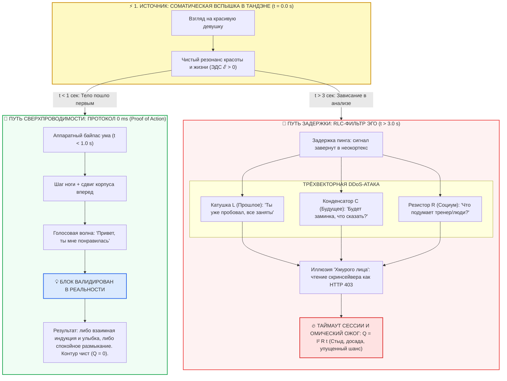

# ⚡ 325. Протокол Proof of Action и нулевой пинг (0 ms): Деконструкция трёхвекторной DDoS-атаки эго (R, L, C), декодер «хмурого лица» как скринсейвера и соматическая сверхпроводимость прямого знакомства
## Физика криптографического консенсуса в живом контуре, схемотехника задержки импульса, нейтрализация симуляторов неокортекса и полевой алгоритм прямого контакта оператора цепи

> [!quote] Каноническая аксиома контура о прямом действии и нулевом пинге
> ### ⚡ **«Реальность не принимает в зачёт ментальные черновики, вздохи и благие намерения. Физический блокчейн бытия валидирует транзакцию исключительно через Proof of Action — перемещение массы тела в пространстве и колебание голосовых связок в воздухе. Если между вспышкой желания в Тандэне и шагом ноги проходит более одной секунды, неокортекс разворачивает виртуальную песочницу и обрушивает на контур трёхвекторную DDoS-атаку: индуктивность прошлого шепчет „все заняты“, ёмкость будущего пугает неловкостью, а омический стыд оглядывается на свидетелей. В нулевом пинге (0 ms) эго физически не способно скомпилироваться. Первый шаг делается до того, как открылась консоль сомнений. Ты подходишь не просить милостыню, а проявить свет суверенного генератора — и на этом уровне любой хмурый защитный экран тает за одну секунду.»**  
> — **Владимир Аньянов**

---



---

### I. Концепция Proof of Action (PoA) в человеческой цепи

В архитектуре распределённых сетей и криптографических систем протокол консенсуса определяет, какая запись признаётся истинной:
* В **Proof of Work (PoW)** узел обязан сжечь реальное электричество и совершить вычислительную работу, чтобы смайнить блок.
* В **Proof of Stake (PoS)** узел рискует заблокированным капиталом.

В электродинамике сознания и человеческого взаимодействия действует фундаментальный закон: **физическая реальность признаёт исключительно Proof of Action (PoA)**.

1. **Ноль байт ментального шума:** Внутренний монолог, мысленные признания, романтические фантазии, репетиции фраз перед зеркалом и вздохи на расстоянии имеют в пространстве-времени ровно **нулевой криптографический вес**. Реальность не видит мыслей оператора.
2. **Физический хэш действия:** Единственный хэш, который валидирует намерение в материальном мире — это:
   * Физическое перемещение центра массы тела ($m \cdot \vec{v}$) в сторону понравившегося человека.
   * Акустическая вибрация голосовых связок, порождающая продольную звуковую волну в воздухе.
3. **Закон Джоуля — Ленца при отказе от PoA:** Когда генератор Тандэна выделил заряд витального тока ($I > 0$), но оператор не заземлил его через физическое действие (не выдал Proof of Action), цепь не размыкается штатно. Ток упирается в заблокированные исполнительные органы и закорачивается на структуры DMN (Default Mode Network). По закону Джоуля — Ленца:
   $$Q = I^2 R_{\text{ego}} t$$
   вся нереализованная мощность рассеивается в виде разрушительного тепла — чувства стыда, бессилия, злости на себя и разъедающей тоски об «упущенном шансе».

---

### II. Протокол нулевого пинга (0 ms): Аппаратный байпас неокортекса

Пинг (Latency / Round-Trip Time) — это время, необходимое пакету данных для прохождения маршрута от источника к исполнительному узлу.

В дефолтном (неоткалиброванном) состоянии человека сигнал от соматического ядра (Тандэн) к скелетной мускулатуре проходит через тяжеловесный прокси-сервер неокортекса. Неокортекс — превосходный инструмент для проектирования мостов или написания кода, но в момент живого социального контакта он работает как катастрофический **буфер задержки**.

```
[Тандэн: Импульс] ──> [Неокортекс: Фильтры, Оценки, Риски] ──> [Паралич действия (Ping = ∞)]
```

#### Аксиома аппаратного прерывания (0 ms Ping):
В протоколе прямого тока **рассуждения начинаются строго после того, как тело сделало первый шаг**.

* **Окно 1 секунды:** Между восприятием объекта и началом движения тела должно пройти не более одной секунды. Это меньше, чем минимальное время компиляции абстрактных страхов в ассоциативной коре.
* **Снятие задачи выбора:** Когда ноги УЖЕ несут корпус вперёд, процессор ума сталкивается с совершившимся аппаратным прерыванием (Hardware Interrupt). Ему больше не нужно решать: *«Подходить или не подходить?»*. Задача выбора снята. Неокортекс мгновенно переключается из режима саботажника в сервисный режим: помочь телу открыть рот и улыбнуться.

---

### III. Трёхвекторная DDoS-атака эго на 3-й секунде: RLC-фильтр саботажа

Если оператор допустил задержку более 1–3 секунд, неокортекс захватывает управление шиной данных и запускает классическую распределённую атаку типа «отказ в обслуживании» (DDoS), парализующую волевой контур с трёх сторон.

Эта атака строго изоморфна пассивному **RLC-фильтру** в электротехнике, настроенному на глушение полезного сигнала:

```
                  [ИМПУЛЬС ТАНДЭНА ℰ]
                         |
      +------------------+------------------+
      |                  |                  |
      v                  v                  v
 [Индуктивность L]  [Ёмкость C]       [Сопротивление R]
  Инерция Прошлого  Накопление Тревоги  Социальное Трение
  «Все заняты,      «Будет заминка,    «Что подумает
   нет смысла»       что сказать?»      тренер/люди?»
      |                  |                  |
      +------------------+------------------+
                         |
                 [ОБРЫВ ЦЕПИ (ТОРМОЗ)]
```

#### 1. Индуктивность прошлого ($L$): Ложная инерция опыта
* **Формула эго:** *«Ты уже подходил 10 раз. Все красивые девушки заняты. В прошлый раз тебе отказали. Нет смысла даже пробовать»*.
* **Электродинамическая деконструкция:** Катушка индуктивности сопротивляется изменению силы тока за счёт ЭДС самоиндукции ($E_L = -L \frac{dI}{dt}$). Эго достаёт из памяти пыльные архивы прошлых отказов и создаёт противоток.  
  *Физическая ошибка:* В теории вероятностей каждый независимый квантовый акт соприкосновения с новым человеком никак не связан с прошлыми событиями. Девушка, идущая перед тобой, не имеет ни малейшего отношения к твоему опыту пятилетней давности. Индуктивность эго — это фантомная инерция.

#### 2. Ёмкость будущего ($C$): Виртуальный накопитель тревоги
* **Формула эго:** *«Сейчас ты подойдёшь, повиснет неловкая пауза, ты запнёшься, не будешь знать, что сказать дальше, и выставишь себя дураком»*.
* **Электродинамическая деконструкция:** Конденсатор накапливает заряд ($q = C \cdot U$) и блокирует постоянный ток действия. Ум требует идеального, просчитанного до миллиметра сценария с гарантированным финалом.  
  *Физическая ошибка:* Живой контакт — не театральная постановка. Лёгкое соматическое смущение или заминка парня считываются женской интуицией не как дефект, а как искренность и подлинная смелость. Неловкость опасна только для надутого эго; для живого человека она естественна и привлекательна.

#### 3. Омическое сопротивление социума ($R$): Эффект прожектора
* **Формула эго:** *«Рядом стоит тренер! Вон тот мужик на тренажёре смотрит! Все увидят, если меня отошьют, и будут смеяться»*.
* **Электродинамическая деконструкция:** Паразитный реостат оглядки на третьих лиц.  
  *Физическая ошибка:* Когнитивная наука давно описала это как *Spotlight Effect* (эффект прожектора). 95% людей в общественном пространстве на 100% погружены в собственные комплексы, подсчёт подходов или экран смартфона. Оставшиеся 5% адекватных мужчин при виде парня, который вживую открыто знакомится с девушкой, испытывают не насмешку, а невольное глубинное уважение к мужской смелости.

---

### IV. Социокультурный декодер: «Хмурое лицо» как скринсейвер, а не отказ 403

Один из главных барьеров оператора в русскоязычном пространстве — интерпретация выражения лиц.

#### 1. Ошибка парсинга HTTP-кода:
* Неопытный оператор смотрит на сосредоточенное, строгое лицо девушки и расшифровывает его как:  
  `HTTP 403 Forbidden` *(«Вход запрещён, пошёл вон, ненавижу всё вокруг»)*.
* В реальности статус системы совершенно иной:  
  `Status: Screensaver.exe / Standby Mode` *(«Экран погашен для экономии ресурса батареи. Троньте мышку»)*.

#### 2. Анатомия северного фасада:
В культуре России отсутствует традиция фальшивой «сервисной улыбки». Серьёзное лицо на улице или в зале выполняет две чисто инженерные функции:
* **Аппаратный фаервол:** Красивая девушка с подросткового возраста сталкивается с сотнями неадекватных подкатов, навязчивых свистов и токсичного внимания. Неприступное лицо — это её естественный воздушный фильтр от спама.
* **Фокус на рутине:** Человек думает о работе, дефиците калорий, технике упражнения или сообщении от мамы. Она не сердится — она просто выключила публичный дисплей.

#### 3. Фазовый переход таяния льда (1 секунда):
Когда к ней подходит парень без пошлости, без пикаперской надменности, с открытыми глазами и спокойным голосом из Тандэна — происходит мгновенный фазовый переход вещества. Защитная ледяная корка растворяется. Человек моментально преображается, включает свет и улыбается в ответ, потому что встретил адекватного, живого и смелого мужчину.

---

### V. Онтологический сдвиг: Суверенный генератор против Попрошайки

Корень страха подхода кроется в глубоко ошибочной энергетической роли.

| Параметр | Модель Попрошайки (Слабый контур) | Модель Суверенного Генератора (Внутренний ток) |
| :--- | :--- | :--- |
| **Внутренняя интенция** | Подойти и *взять* (одобрение, валидацию, телефон, закрыть дыру в самооценке) | Подойти и *отдать* (проявить свет, признать красоту, подарить улыбку) |
| **Зависимость от исхода** | Критическая: отказ означает «я ничтожество, меня отключили от розетки» | Нулевая: генератор автономен, заряд не зависит от внешней реакции |
| **Реакция на отказ** | Омический взрыв, обида, злость, стыд ($Q = I^2 R t$) | Спокойный размыкатель: «Отличной тренировки!», чистый ток течёт дальше |
| **Пинг контакта** | Бесконечный (подготовка, страх, выжидание знаков) | **0 ms** (увидел $\to$ срезонировал $\to$ сделал шаг) |

Девушка имеет суверенное право быть несвободной, торопиться на работу или просто не иметь ресурса на разговор. Её вежливый отказ — это не суд над твоей личностью. Это констатация того, что её контур в данный момент закрыт. Твой генератор при этом продолжает выдавать штатные 220 Вольт чистого счастья.

---

### VI. Полевой протокол оператора «Т-Ш-С» (Тандэн — Шаг — Слово)

Практический регламент для ликвидации задержки пинга при встрече красивой девушки:

```
[0.0 сек: ВСПЫШКА] ──> [0.5 сек: ТАНДЭН] ──> [1.0 сек: ШАГ] ──> [2.0 сек: СЛОВО]
```

1. **Вспышка (t = 0.0 с):** Ты зафиксировал красоту. Тандэн дал импульс.
2. **Сброс в корпус (t = 0.5 с):** Вдох низом живота. Отсечь любую мысль о сценарии. Запретить неокортексу запускать симулятор.
3. **Физический шаг — Proof of Action (t = 1.0 с):** Смести вес тела вперёд. Оторви стопу от пола. Направь корпус к ней. Как только тело двинулось — битва с эго выиграна.
4. **Слово без ужимок (t = 2.0 с):** Никаких заученных шаблонов. Предельная простота и правда:
   > *«Привет! Увидел тебя и понял, что если пройду мимо, буду жалеть весь день. Ты потрясающе выглядишь. Меня Ваня зовут»*.  
   *(Или с дешифровкой скринсейвера):*  
   > *«Привет! Ты идёшь с таким невероятно серьёзным лицом, что я секунду сомневался. Но ты настолько красивая, что я просто подошёл познакомиться»*.
5. **Фиксация консенсуса:**
   * **Улыбнулась, контакт:** Взаимная индукция Фарадея ($M > 0$).
   * **Отвергла, пошла дальше:** Proof of Action выполнен. Блок закоммичен. Внутренний контур остался кристально чистым и свободным от омического перегрева.

---

### VII. Семь аксиом протокола Proof of Action

1. **Аксиома криптографического тела:** Реальность не коммитит намерений; бытие валидирует только физическую массу и акустическую волну.
2. **Аксиома нуля миллисекунд:** Истинное действие совершается быстрее, чем неокортекс успевает подгрузить файл со страхами.
3. **Аксиома трёхсекундной ловушки:** Любая задержка свыше трёх секунд немедленно активирует трёхвекторную DDoS-атаку эго (RLC-фильтр).
4. **Аксиома скринсейвера:** Хмурое лицо незнакомки — это энергосберегающий щит от спама, а не персональная неприязнь.
5. **Аксиома автономного генератора:** Оператор цепи подходит не выпрашивать питание, а щедро озарять пространство своим током.
6. **Аксиома безотходного контакта:** Любой исход подхода при соблюдении PoA является победой: либо ты находишь любовь, либо закаляешь сверхпроводимость духа.
7. **Аксиома лёгких ног:** Когда эго обесточено, между искрой желания и движением тела нет сопротивления — ноги идут сами.
