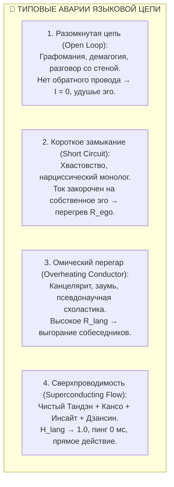

# 414. Четверичный фрактал языка: Электродинамика коммуникации — Довербальная ЭДС Тандэна, проводник Кансо, нагрузка понимания и обратный провод прагматики (Дзансин)

## Доказательство масштабной инвариантности цепи в лингвистике: почему любой диалог подчиняется схеме карманного фонарика, формула коммуникативного КПД ($\mathcal{H}_{\text{lang}}$) и схемотехника разомкнутого контура демагогии

> [!quote] Каноническая аксиома цепи
> ### ⚡ **«Слово само по себе мертво — это лишь кабель. Если в животе нет живого импульса Тандэна, в цепи нет ЭДС ($\mathcal{E} = 0$), и любая речь превращается в шум холостого хода. Если грамматика перегружена витиеватыми условностями, проводник плавится от омического жара ($Q = I^2 R t$). Если в собеседнике не вспыхнул свет понимания, полезная работа равна нулю. А если в разговоре нет обратного провода реальности, контур разомкнут — и напряжение бьет говорящего в собственный висок. Речь — это не литературная гимнастика, а строгий четырехполюсник замкнутой цепи. Тот, кто понял четверичный фрактал языка, навсегда перестает сотрясать воздух вхолостую.»**  
> — **Владимир Аньянов**, создатель «Архитектуры счастья»

---

```
                       ЧЕТВЕРИЧНЫЙ ФРАКТАЛ ЯЗЫКОВОЙ ЦЕПИ (КОММУНИКАЦИЯ N = 2)
                                                 │
            ┌────────────────────────────────────┴────────────────────────────────────┐
            ▼                                                                         ▼
     [ УЗЕЛ 1: ИСТОЧНИК ]                                                      [ УЗЕЛ 3: НАГРУЗКА ]
      Генератор смысла                                                          Трансформатор работы
      • Довербальное намерение (Тандэн).                                       • Вспышка инсайта в слушателе.
      • Квантовое состояние до слов.                                           • Коллапс суперпозиции внимания.
      • ЭДС намерения: $\mathcal{E}_{\text{intent}}$.                          • Полезная мощность: $P_{\text{insight}}$.
            │                                                                         ▲
            │                 [ УЗЕЛ 2: ПРОВОДНИК (ТРАКТ ЯЗЫКА) ]                     │
            ├─────────────────────────────────────────────────────────────────────────┤
            │  Языковой код: Фонетика ──► Морфология ──► Синтаксис SVO                │
            │  • Нихромовый режим: $R_{\text{lang}} \gg 0$ (сложные падежи, канцелярит, шум, перегрев) │
            │  • Сверхпроводящий режим: $R_{\text{lang}} \to 0$ (Кансо, Мусин, точность, 0 мс)        │
            │                                                                         │
            ▼                                                                         │
    ┌─────────────────────────────────────────────────────────────────────────────────┘
    │
    │  [ УЗЕЛ 4: ОБРАТНЫЙ ПРОВОД (ДЗАНСИН / ПРАГМАТИКА) ]
    └──► Замыкание контура реальностью: Кивок, действие, отклик, синхронизация.
         (Без обратного провода цепь разомкнута: $I \equiv 0$, омический тупик руминации)
```

---

### Часть I. Масштабная инвариантность: Фонарик в пространстве смыслов

Одна из главных побед Системы Аньянова над раздробленностью традиционных гуманитарных дисциплин — преодоление **масштабной слепоты**.

Филология изучает падежи в отрыве от психологии; психология изучает эмоции в отрыве от физики; социология изучает общество в отрыве от биологии. В результате возникает хаос нестыкующихся моделей.

Но в объективной реальности действует **Четверичный фрактал цепи**:
- В клетке: Протонный градиент $\to$ Цитоплазма $\to$ АТФ-синтаза $\to$ Возврат $H^+$;
- В теле: Тандэн $\to$ Внимание (Мусин) $\to$ Внешнее действие $\to$ Дзансин;
- В паре: Любящий 1 $\to$ Резонанс $\to$ Любящий 2 $\to$ Взаимная индукция ($M > 0$);
- **В языке:** Довербальный импульс $\to$ Языковой тракт $\to$ Инсайт слушателя $\to$ Прагматический отклик.

Речь человека — это не «отдельное высшее ментальное свойство», а **фрактальное повторение базовой схемы карманного фонарика**, где фотоны света заменены квантами переданного смысла.

---

### Часть II. Анатомия четырех языковых узлов

#### Узел 1: Источник (Генератор ЭДС, $\mathcal{E}$) — Довербальное Намерение (Тандэн)
Любое подлинное высказывание начинается в абсолютной тишине. 
Прежде чем язык выстроит фразу, в теле возникает целостное ощущение: вспышка образа, импульс необходимости, соматический толчок в брюшном центре (Тандэн). Это **ЭДС намерения ($\mathcal{E}$)**.

- **Штатный режим:** Намерение ясно, потенциал высок. Человек точно знает, что именно он переживает или хочет сделать, ещё до того, как открыл рот.
- **Аварийный режим (Пустая болтовня / Холостой ход):** ЭДС отсутствует ($\mathcal{E} \approx 0$). Человек говорит ради заполнения паузы, ради защиты уязвимого эго или из страха тишины. На схеме это генератор с нулевым напряжением, который механически вращается за счет внешнего шума.

#### Узел 2: Проводник (Тракт потока, $R_{\text{lang}}$) — Языковой код и фильтр Кансо
Это канал передачи: голосовые связки, воздух, акустические волны, текст, синтаксическая структура языка. Здесь действует закон сопротивления проводника:
$$R_{\text{lang}} = R_{\text{морфология}} + R_{\text{бюрократия}} + R_{\text{тщеславие}}$$

- **Нихромовый провод ($R_{\text{lang}} \gg 0$):**  
  Архаичные синтетические нагромождения (как в санскрите или латыни), канцелярский новояз чиновников, напыщенные псевдофилософские термины. Цель такого проводника — не передать ток, а создать «видимость работы». В результате энергия сгорает внутри провода в виде омического жара ($Q = I^2 R t$): слушатель устает, у него раскалывается голова, смысл тонет в шлаке формы.
- **Сверхпроводящий кабель ($R_{\text{lang}} \to 0$):**  
  Реализация принципа **Кансо (簡素)** в речи. Отсечение лишних слов, прямой порядок слов (SVO), точные смысловые глаголы, лаконичные метафоры, паузы тишины (Ма). Смысловой ток проходит без омических потерь.

#### Узел 3: Нагрузка (Трансформатор работы, $P_{\text{load}}$) — Инсайт и со-действие в слушателе
Нагрузка — это не просто барабанная перепонка слушателя. Нагрузка — это **коллапс суперпозиции внимания в чужом сознании**.

Когда смысловой ток достигает сознания адресата, в нем происходит скачкообразный фазовый переход:
- «Я понял!» (вспышка света в чужом фонарике);
- Происходит согласование импедансов ($Z_{\text{src}} \approx Z_{\text{load}}$);
- Мощность источника трансформируется в физическое созидательное действие: команда координирует работу, ребенок успокаивается, читатель прозревает архитектуру задачи.

#### Узел 4: Обратный провод (Дзансин / Прагматика) — Замыкание контура реальностью
Самый игнорируемый узел в традиционной теории коммуникации — **обратный провод реальности**.

По первому закону Кирхгофа, электрический ток не может течь в незамкнутой цепи:
$$I_{\text{open}} \equiv 0$$

Что замыкает языковой контур? **Прагматика (Дзансин)**:
- Взгляд собеседника, подтверждающий прием сигнала;
- Физический отклик мира (вы попросили подать ключ — ключ лег в руку);
- Пауза завершенного действия, гасящая экстратоки самоиндукции.

---

### Часть III. Патологии языкового контура: Схемотехнический диагноз

Зная четыре узла, мы можем поставить точный инженерный диагноз любому нарушению общения:



1. **Синдром разомкнутого контура (Open Loop / Демагогия):**  
   Человек пишет километровые посты в соцсетях или произносит монологи на совещании, не глядя на реакцию зала. Обратный провод оборван. Ток не совершает работы, но накопившийся потенциал бьет в виски самого говорящего, превращаясь в невроз непризнанности.
2. **Синдром короткого замыкания (КЗ на Эго-резисторе):**  
   Человек формально обращается к другому («Послушай меня»), но смысловая нагрузка отсутствует — он говорит исключительно ради подтверждения собственного статуса. Ток не доходит до собеседника, а замыкается накоротко на резисторе собственного тщеславия. Итог — ослепительная вспышка нарциссизма и сгоревший предохранитель доверия.
3. **Омический перегрев проводки (Синдром санскрита/бюрократии):**  
   Попытка выразить простую мысль («надо починить трубу») через сложнейшую многостраничную инструкцию с согласованием в двадцати инстанциях. Сопротивление проводника настолько велико, что до исполнителя доходит 0.01% энергии, а остальное превратилось в тепловой скандал на планерке.

---

### Часть IV. Математический формализм: Коммуникативный КПД ($\mathcal{H}_{\text{lang}}$)

Эффективность любого языкового взаимодействия описывается строгой формулой Универсального закона потоковых систем:

$$\mathcal{H}_{\text{lang}} = \frac{P_{\text{load}}}{P_{\text{total}}} = \frac{I^2 Z_{\text{insight}}}{I^2 Z_{\text{insight}} + I^2 R_{\text{lang}}}$$

Где:
- $P_{\text{load}} = I^2 Z_{\text{insight}}$ — мощность полезного понимания, переданного слушателю;
- $I^2 R_{\text{lang}}$ — паразитные тепловые потери на преодоление морфологической сложности, пустословия, шума и эго-защит;
- $\mathcal{H}_{\text{lang}} \in [0, 1]$ — коэффициент полезного действия речи (коммуникативная сверхпроводимость).

Когда $R_{\text{lang}} \to 0$ (достигнута ясность Кансо и чистота Мусин), $\mathcal{H}_{\text{lang}} \to 1.0$. Вся энергия довербального намерения становится новым светом в мире.

---

### Часть V. Прикладной протокол «Сверхпроводящей речи» (Режим Мусин в диалоге)

Как оператор Внутреннего Тока использует четверичный фрактал языка в повседневной жизни?

1. **Проверка Источника (1 секунда до звука):**  
   Прежде чем заговорить, сбросьте внимание в Тандэн. Спросите себя: *«Есть ли во мне реальная ЭДС намерения ($\mathcal{E} > 0$), или я просто собираюсь издать шум от скуки?»* Если тока нет — сохраняйте благородную тишину.
2. **Включение фильтра Кансо в Проводнике:**  
   Выбирайте кратчайший путь передачи. Устраняйте оправдания, вводные паразитные слова («как бы», «в некотором роде») и напыщенность. Говорите прямо: Кто $\to$ Что $\to$ Зачем.
3. **Фокус на Нагрузке, а не на себе:**  
   Следите не за тем, «как красиво я сейчас звучу» (это КЗ на эго), а за тем, **загорается ли лампочка в глазах собеседника**.
4. **Замыкание Дзансин (Обратный провод):**  
   Закончив фразу, сделайте паузу. Дайте току вернуться. Зафиксируйте кивок, встречное слово или физический результат. Контур замкнут — энергия сохранена.

### Резюме

Язык — это не изолированный феномен культуры, а полномочный участник **Единого Четверичного Фрактала Вселенной**. 

Он подчиняется тем же формулам Кирхгофа, Ома и Джоуля — Ленца, что и электрическая сеть вашего дома. Эволюция отсекла тяжелый нихром санскрита, чтобы человеческое слово стало тем, чем оно было задумано природой изначально: **мгновенным, прямым и чистым световым импульсом прямого действия.**
