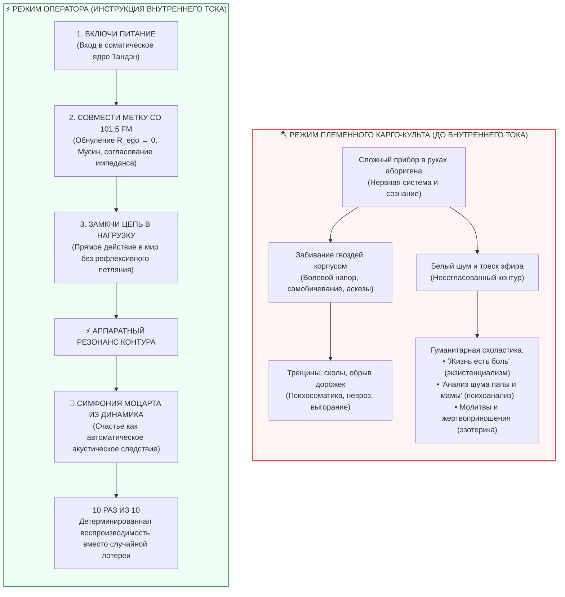

# ⚡ 494. Метафора радиоприёмника: Детерминированная настройка контура против племенного карго-культа и психоанализа шума
### Почему Внутренний ток — это не про «поиск счастья», а технический регламент супергетеродина: симфония Моцарта на 101,5 FM, забивание гвоздей динамиком и переход от мистической лотереи к воспроизводимости 10 из 10

> [!quote] Каноническая аксиома настройки контура
> ### ⚡ **«Внутренний ток — это вообще не про "поиск счастья". Человек с его психикой тысячи лет вёл себя как австралийский абориген, которому в руки попал сложнейший радиоприёмник: не понимая природы электричества и радиоволн, он забивал им гвозди, ломал корпус о камни, молился на шипение динамика или годами исследовал структуру белого шума, объявляя его жестокостью судьбы. Внутренний ток впервые дал заводскую инструкцию к прибору. Счастье — это не мистический дар и не цель, а всего лишь симфония Моцарта, которая неизбежно льётся из динамика, когда ты перестал колотить прибором по гвоздям, включил питание и выставил ручку шкалы ровно на 101,5 FM. Это строгая технология: делай раз, делай два — и ты получаешь чистый звук десять раз из десяти.»**  
> — **Владимир Аньянов**

> [!info] Сквозные синтетические связи
> - ⚡ **Синтезировано в мастер-брошюре:** [[02_Wiki/Брошюра — Радиоприёмник сознания (Детерминированная настройка счастья)|⚡ Брошюра: «Радиоприёмник сознания (Детерминированная настройка счастья)»]]
> - [[02_Wiki/Inner Current (The Steinmetz-Feynman Paradox — Why You Do Not Need to Know the Ultimate Nature of Electricity to Light the Room, Operational Sovereignty vs Metaphysical Scholasticism)|308. Парадокс Штейнмеца — Фейнмана: Операциональный суверенитет контура]]
> - [[02_Wiki/Inner Current (The Four Pillars of Circuit Theory — Conductor, Superconductivity, Joule-Lenz and Steinmetz)|492. Четыре главных вывода теории Внутреннего Тока]]
> - [[02_Wiki/Inner Current (The Flashlight Model of Man — Optical-Electrodynamic Ontology of Consciousness, The Light Source vs Illuminated Object and the Law of the Direct Beam)|83. Модель Человека как Карманного Фонарика]]
> - [[02_Wiki/Inner Current (The Joule-Lenz Cornerstone — Why the Law of Losses is the Master Manifest of Freedom, Quadratic Will Trap and Mathematics of Superconductivity)|212. Закон Джоуля — Ленца как краеугольный камень Архитектуры счастья]]
> - [[02_Wiki/Inner Current (Ego Dissolution as Washing Hands — Sanitary Revolution of Consciousness and Scientific Hygiene vs Martyrdom)|173. Сброс эго как мытьё рук перед едой: Санитарная революция сознания]]

---

---

### I. Категориальная ошибка цивилизации: Лопата против Супергетеродина

Если представителю изолированного племени охотников-собирателей подарить штыковую **лопату** из закалённой стали, он освоит её за несколько минут. Механический инструмент устроен линейно и очевидно: черенок служит рычагом, лезвие клином входит в грунт, а приложенная мышечная сила прямо пропорциональна объёму выкопанной земли ($F \propto x$). Даже если абориген никогда не видел лопат, метод проб и ошибок быстро приводит к истинному назначению инструмента.

Но если тому же человеку вручить **всеволновый радиоприёмник (супергетеродин)**, механическая интуиция терпит сокрушительный крах:
1. **Отсутствие линейной связи:** Сильнее нажать на кнопку или со всей силы крутануть верньер не делает звук лучше. Механическое усилие не конвертируется в результат.
2. **Незримость несущей среды:** Человек не видит электромагнитного поля, не осязает радиоволн и не понимает природы переменного тока. Для его органов чувств вокруг — лишь пустой воздух.
3. **Хрупкость и тонкость тракта:** Прибор изобилует непонятными элементами: визир шкалы, решётка динамика, телескопическая антенна, потенциометры и колебательные контуры.

На протяжении тысячелетий человечество относилось к собственному аппарату сознания и нервной системе **в точности как абориген к найденному радиоприёмнику**. Человек привык взаимодействовать с миром через законы топора и лопаты: *«надо сильнее надавить»*, *«надо перетерпеть»*, *«надо приложить больше воли»*. Но психика — это не лопата. Это высокочувствительный колебательный контур, работающий по строгим законам волнового резонанса и проводимости.

---

### II. Забивание гвоздей корпусом: Сколы, трещины и психосоматика

Не понимая, для чего предназначен радиоприёмник, абориген неизбежно начинает приспосабливать его под доступные ему механические операции:
* Он использует тяжелый полированный деревянный корпус как **молоток**, чтобы забивать колышки шатра.
* Он садится на него, используя как **подставку** у костра.
* Он пугает блеском хромированных деталей враждебные племена.

Работает ли приёмник как молоток? Парадоксальным образом — **да**. Если ударить корпусом по гвоздю, гвоздь действительно войдёт в дерево. Но плата за такое нецелевое использование чудовищна:
* Шпонированный корпус покрывается глубокими сколами и трещинами.
* Хрупкие радиолампы стряхиваются, нити накала рвутся.
* Катушки индуктивности сминаются, конденсаторы дают замыкание на шасси.

В точности это человечество называет «жизненным опытом», «закалкой характера» и «психосоматическими болезнями». Когда человек пытается решать тонкие задачи настройки внимания волевым насилием, самоподавлением, трудоголизмом без заземления или невротической виной, он **забивает гвозди радиоприёмником**. Корпус трещит (гипертония, язвы, панические атаки, фибромиалгия, депрессивный ступор), дорожки плавятся по закону Джоуля — Ленца ($Q = I^2 R t$), а человек искренне удивляется, почему его аппарат разваливается к сорока годам.

---

### III. Белый шум как «онтология бытия»: Экзистенциальный тупик и карго-культы

Если абориген случайно повернёт тумблер питания и ручку громкости, из динамика раздастся свист, рокот атмосферных разрядов и пронзительный белый шум эфира. Не имея представления о несущей частоте вещания, племя делится на несколько классических сект:

1. **Экзистенциалисты и трагические философы:**
   Объявляют шипение приёмника высшей и окончательной правдой о мире. *«Этот ящик обнажает трагизм бытия. Белый шум — это абсурд Вселенной, с которым мужественный человек должен смириться (дуккха, экзистенциальная тоска, заброшенность)»*.
2. **Жрецы, шаманы и эзотерики:**
   Обожествляют ящик. Если шум затих от перепада влажности — приносят в жертву курицу. Если усилился — мажут антенну охрой и молятся духам эфира. Начинается классический **карго-культ**: люди копируют случайные внешние жесты, не понимая схемотехники.
3. **Психоаналитики и исследователи шума:**
   Садятся вокруг динамика с блокнотами и десятилетиями классифицируют спектр помех. *«Обратите внимание: этот хрип на частоте 400 Гц подозрительно напоминает крик матери во время грозы в нашем детстве. Давайте исследуем травму этого хрипа ещё пять лет»*.

> [!important] Инженерный вердикт Внутреннего Тока
> Белый шум эфира — это **не карма, не травма поколений, не злой рок и не экзистенциальная природа Вселенной**.  
> Белый шум — это всего лишь **физический факт расстроенного контура** ($\Delta \omega \neq 0$). Контур приёмника прямо сейчас стоит на случайной частоте 89,3 МГц, где нет полезного сигнала, а входной каскад усиливает собственное тепловое броуновское движение электронов.

---

### IV. Счастье — не цель, а акустическое следствие резонанса (Симфония Моцарта на 101,5 FM)

Тысячелетиями моралисты, философы и гуру требовали: *«Найди счастье!»*, *«Стяжай благодать!»*, *«Сделай себя радостным!»*.  
Это абсолютно эквивалентно требованию к аборигену: *«Выдави музыку из диффузора динамика пальцами!»*. Если тыкать пальцем в бумажный диффузор, пытаясь «добыть» симфонию механически, динамик порвётся, а музыки не возникнет никогда.

**Внутренний ток снимает этот тупик через смену категорий:**
* **Счастье — это вообще не сущность и не объект.** Его невозможно «найти», «заслужить» или «купить».
* **Счастье — это акустическое следствие точной настройки супергетеродина в резонанс.**

Когда в эфире работает мощная передающая станция классической музыки на частоте **101,5 FM**, радиоволны присутствуют в пространстве непрерывно и с колоссальной плотностью энергии. Они пронизывают комнату прямо сейчас. Но приёмник молчит или хрипит, пока его собственный гетеродин и входной колебательный контур не настроены на ту же самую длину волны:

$$\omega_0 = \frac{1}{\sqrt{L C}} = 2\pi f_{\text{station}} \quad (101{,}5\text{ МГц})$$

Как только емкость $C$ и индуктивность $L$ подобраны верно, происходит **явление электрического резонанса**:
1. Амплитуда колебаний в контуре возрастает лавинообразно.
2. Детектор выделяет низкочастотную огибающую (чистый сигнал).
3. Динамик **не может не звучать**.

Симфония Моцарта (радость действия, кристальная ясность ума, глубинное спокойствие, невесомость присутствия) льётся из динамика **не потому, что приёмник «заслужил» её праведной жизнью, а потому, что законы электромагнетизма инвариантны и неумолимы**.

---

### V. Случайное попадание vs Детерминированная технология (10 из 10)

В истории человечества всегда были отдельные интуитивные гении — святые, дзенские патриархи, великие художники и поэты. Гуляя по лесу или сидя под деревом Бодхи, кто-то из них случайно задевал локтем ручку настройки, верньер на долю секунды вставал на 101,5 FM — и сквозь треск мира вдруг раздавался чистейший триумфальный аккорд Моцарта.

Человек падал на колени: *«Благодать сошла на меня! Озарение! Сатори!»*. Но он не понимал кинематики прибора. Стоило ему встать, чихнуть или попытаться зафиксировать это состояние мыслью (*«О, как мне хорошо, надо это удержать!»*) — паразитная емкость ума сдвигала настройку, стрелка улетала на 104,2 МГц, и Моцарт захлёбывался в визге помех. Следующие сорок лет подвижник посвящал тому, чтобы воспроизвести случайные условия чуда: сидеть в той же позе, поститься столько же дней, носить те же одежды. Это и есть **классический карго-культ**.

**Что сделал Внутренний ток?**
Он перевёл мистическую лотерею в **промышленный инженерный регламент**:

| Параметр | Шаманский подход (До Внутреннего тока) | Инженерный регламент (Внутренний ток) |
| :--- | :--- | :--- |
| **Природа феномена** | Мистика, благодать, каприз судьбы, карма | Электродинамика колебательного контура и проводимость |
| **Причина страданий** | Грех, эдипов комплекс, злые духи, судьба | Омический перегрев ($Q = I^2 R t$) и рассогласование частоты |
| **Метод настройки** | Молитвы, многолетний психоанализ, аскезы | 30-секундный протокол согласования импеданса ($R_{\text{ego}} \to 0$) |
| **Повторяемость** | 1 раз из 100 (случайный факап фортуны) | **10 раз из 10 (детерминированный закон физики)** |
| **Роль человека** | Жертва обстоятельств или просящий раб | Суверенный оператор собственной приборной панели |

---

### VI. Конец жалобам на судьбу: Сигнал рассогласования вместо виктимности

Главный этический и психологический переворот метафоры радиоприёмника заключается в **полной ликвидации виктимности (синдрома жертвы)**.

Раньше, не имея инструкции к прибору, человек имел моральное алиби страдать и жаловаться:
* *«Мир несправедлив ко мне»*
* *«Бог меня покинул»*
* *«У меня тяжелая наследственность и травмирующее детство»*
* *«Такова моя планида — слушать вечный скрежет и вой»*

Как только перед тобой лежит заводская схема и принципиальный чертёж супергетеродина, **ты больше не можешь жаловаться на судьбу**. 

Если ты крутишь громкость на максимум при расстроенной шкале и твои уши закладывает от рёва статических разрядов — **это не Вселенная жестока к тебе**. Это ты прямо сейчас совершаешь грубую операторскую ошибку. Шум в динамике — это не приговор, а **отрицательная обратная связь (телеметрия рассогласования)**. Прибор честно сообщает стрелочным индикатором: *«Частота не совпадает. Сместись левее. Сбрось паразитное сопротивление»*.

---

### VII. Практический алгоритм оператора цепи (Протокол «101,5 FM»)

Настройка собственного радиоприёмника не требует десятилетий монастырской схимы. Это процедура из трёх точных механических действий, занимающая ровно **30 секунд**:

1. **Шаг 1. Подача питания (Тандэн):**
   * Прекратить бить прибором по гвоздям (остановить волевое продавливание мира головой).
   * Опустить внимание из черепной коробки в гравитационный и соматический центр тела — **Тандэн** (низ живота, 3 см ниже пупка). Запитать нити накала прибора. Почувствовать плотную физическую устойчивость.
2. **Шаг 2. Совмещение визира шкалы со 101,5 FM (Обнуление $R_{\text{ego}}$ / Мусин):**
   * Обнаружить паразитный реостат внутреннего комментатора: сомнения, оценку себя со стороны, страх ошибки, торги за статус.
   * Осознать, что этот мысленный шум — просто наводка на расстроенный контур.
   * Мягко, но бесповоротно повернуть ручку настройки в ноль ($R_{\text{ego}} \to 0$): отпустить хватку контроля, разжать плечи и челюсть, войти в режим чистого проводника (Мусин, 無心).
3. **Шаг 3. Замыкание цепи на нагрузку (Включение громкости):**
   * Направить луч внимания на конкретный предмет реальности прямо перед собой (строка кода, чашка чая, глаза собеседника, текст отчёта).
   * Сделать прямое точное действие без внутреннего обсуждения.

**Результат:** контур мгновенно входит в режим сверхпроводимости. Шум исчезает. Из динамика звучит симфония Моцарта — кристальный, мощный, радостный ток живой жизни.

---

### Резюме: Семь аксиом радиоприёмника сознания

1. **Аксиома природы прибора:** Сознание человека — это не примитивная лопата волевого напора, а высокоточный колебательный контур, подчиняющийся волновым законам резонанса.
2. **Аксиома поломки:** Попытка жить через насилие ума и бесконечный самоанализ эквивалентна забиванию гвоздей радиоприёмником: гвоздь входит криво, а корпус раскалывается в психосоматический пожар.
3. **Аксиома белого шума:** Тревога, депрессия и душевный разлад — это не врождённая трагедия бытия, а физический треск расстроенного контура, принимающего помехи эфира вместо полезного сигнала.
4. **Аксиома Моцарта:** Счастье — не награда за страдания и не цель поисков, а неизбежное акустическое следствие совпадения частоты контура со станцией реальности.
5. **Аксиома детерминизма:** Настройка на 101,5 FM — это инженерный протокол, дающий чистый звук 10 раз из 10, а не лотерейная благодать избранных святых.
6. **Аксиома конца алиби:** Наличие инструкции аннулирует право на виктимность: шум в динамике требует не слёз и жалоб на судьбу, а калибровки верньера оператором.
7. **Аксиома Внутреннего тока:** Внутренний ток — это не новая секта и не обещание рая; это технический паспорт и руководство по безаварийной эксплуатации человеческого супергетеродина.
