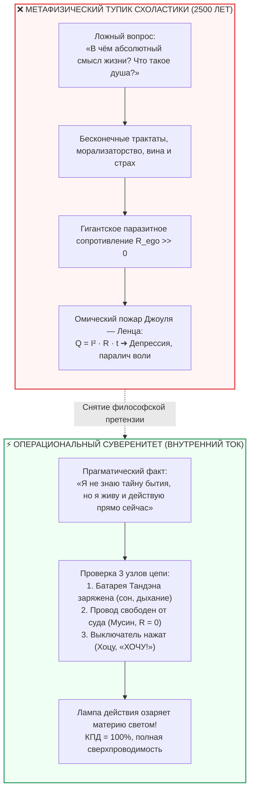

---
created: 2026-10-08
source: [[04_Maps/Inner Current MOC|Inner Current MOC]]
tags:
  - inner-current
  - scale/deep-dive
  - node/tanden
  - node/conductor
  - domain/electrodynamics
  - domain/neurobiology
  - state/overheating
  - steinmetz-paradox
  - feynman-epistemology
  - operationalism
  - electricity-mystery
  - life-operator
  - joule-lenz
  - superconductivity
  - layer-1
type: concept
status: evergreen
layer: I
chapter: 308
---

# ⚡ 308. Парадокс Штейнмеца — Фейнмана: Почему не нужно знать абсолютную тайну тока, чтобы озарить квартиру светом — Операциональный суверенитет контура против метафизической схоластики
### Почему фундаментальная физика честно не знает, «что такое» электрический заряд, в чём трагедия 2500 лет поисков «смысла жизни», и как прикладная схемотехника человека возвращает власть над собственным состоянием

> [!quote] Каноническая аксиома оператора контура
> ### ⚡ **«Если спросить фундаментального физика, что такое электрический заряд в своей предельной метафизической первосути, он честно признается: „Мы не знаем“. Заряд — это базовое калибровочное свойство материи. Но чтобы в вашей комнате вспыхнул свет, вам не нужно разгадывать уравнения квантовой электродинамики. Достаточно знать, где розетка, исправен ли провод и как нажать выключатель. Величайшая трагедия человечества заключалась в иллюзии, будто для счастья необходимо сначала разгадать непостижимую „тайну бытия“ и найти „смысл жизни“. Это чудовищная ошибка категории. Счастье не требует философских ответов на неразрешимые вопросы — оно требует трезвой инженерной гигиены контура: зарядить Тандэн, снять паразитный реостат самосуда и соматически щёлкнуть ключом „ХОЧУ!“.»**  
> — **Владимир Аньянов**

> [!info] Синтезировано в брошюре [[02_Wiki/Брошюра — Тайна тока и свет в квартире (Парадокс Штейнмеца, соматика Хоцу и почему для счастья не нужно разгадывать смысл жизни)|Брошюра: «Тайна тока и свет в квартире (Парадокс Штейнмеца, соматика Хоцу и почему для счастья не нужно разгадывать смысл жизни)»]]
> [!info] Синтезировано в брошюре [[02_Wiki/Брошюра — На схеме контура нет Бога (Десакрализация Тандэна, похмелье от 5000 лет торга и почему для счастья не нужен Хозяин)|Брошюра: «На схеме контура нет Бога»]]

---



---

## 1. Парадокс Штейнмеца: Честная граница науки

В истории науки мало фигур столь же великих в практической электротехнике, как **Чарльз Протеус Штейнмец** — математик и инженер, приручивший переменный ток для корпорации General Electric. Именно Штейнмец сформулировал отрезвляющую эпистемологическую истину:
> *«Мы не знаем, что такое электричество. Мы не знаем его сущности. Но мы знаем законы, по которым оно течёт, и умеем строить генераторы и двигатели, преобразующие его в свет и движение».*

Спустя полвека гениальный **Ричард Фейнман** развил эту мысль в своём фундаментальном анализе природы физических законов:
* Наука не отвечает на вопрос *«ЧТО это такое само по себе?»*.
* Наука отвечает на вопрос *«КАК это устроено, по каким математическим законам взаимодействует и как ведёт себя в эксперименте?»*.

Если спросить квантового физика: *«Что такое отрицательный заряд электрона? Из какого вещества он слеплен?»* — честный учёный ответит, что электрический заряд — это инвариант калибровочной симметрии группы $U(1)$. Но на вопрос *«почему Вселенная устроена именно так?»* физика разводит руками. Это аксиоматический фундамент реальности.

Но разве незнание абсолютной сути электрона мешает вам включить кофемашину, вскипятить чайник или зажечь настольную лампу? **Ни на одну секунду.**

---

## 2. Экзистенциальная катастрофа человечества: Поиск рубильника через схоластику

А теперь посмотрим, что происходило в сфере человеческого сознания и благополучия на протяжении последних двух с половиной тысяч лет.

Пока физики создавали генераторы и освещали города, философы, теологи и моралисты убеждали человека:
1. *«Ты несчастен, потому что ты ещё не понял Тайну Бытия»*.
2. *«Сначала найди Смысл Жизни, искупи грехи, пойми природу Атмана, докажи свою безупречность моральному суду — и лишь потом ты получишь право на радость»*.
3. *«Если ты не знаешь метафизической цели космоса — ты не имеешь права спокойно жить»*.

Человек брал этот ложный постулат на веру. Он садился за книги, уходил в монастыри, тратил десятилетия на психоанализ или запирался в комнате, мучительно вымучивая ответ на вопрос: *«Кто я и зачем я здесь?»*.

### Что происходило в принципиальной схеме человека?
* Попытка ума вычислить «смысл жизни» — это попытка заставить генератор подать напряжение на несуществующую, бесконечно удалённую воображаемую нагрузку.
* Поскольку ответа нет и быть не может, внимание закольцовывалось в паразитный вихрь саморефлексии.
* В цепь врезался колоссальный реостат сомнений и вины: $R_{\text{ego}} \to \infty$.
* По закону Джоуля — Ленца:
  $$Q = I^2 \cdot R_{\text{ego}} \cdot t$$
  контур человека начинал гореть изнутри. Возникала бессонница, тахикардия, депрессивный ступор и экзистенциальный кризис (трагедия Льва Толстого на станции Астапово).

Человек сидел в тёмной холодной комнате и умирал от холода, отказываясь нажать выключатель на стене, пока ему не объяснят метафизику электрона.

---

## 3. Операциональный суверенитет: Логика квартирной электропроводки

Архитектура Внутреннего тока возвращает человеку статус **суверенного хозяина своего прибора**.

Чтобы в вашей квартире горел свет, вам нужно понимать не метафизику, а **три простых контурных факта**:

```
 ┌────────────────────────────────────────────────────────────────────────┐
 │            КАК ЗАЖЕЧЬ СВЕТ: КВАРТИРА vs КОНТУР ЧЕЛОВЕКА                │
 ├───────────────────────────────────┬────────────────────────────────────┤
 │      КВАРТИРНАЯ ЭЛЕКТРИКА         │      ВНУТРЕННИЙ ТОК ЧЕЛОВЕКА       │
 ├───────────────────────────────────┼────────────────────────────────────┤
 │ 1. Есть ли фаза в щитке? (U = 220В)│ 1. Полон ли Тандэн? (Сон, еда, тело)│
 │ 2. Нет ли КЗ и залома в кабеле?    │ 2. Чист ли Мусин? (R_ego → 0)      │
 │ 3. Нажата ли клавиша на стене?     │ 3. Щёлкнул ли ключ Хоцу? («ХОЧУ!») │
 └───────────────────────────────────┴────────────────────────────────────┘
```

Если эти три условия выполнены — **лампа горит**. Вы пьёте чай, код компилируется, проект строится, ребёнок смеётся, текст пишется. Квартира залита светом.

Вам не нужно доказывать вселенной своё «право на существование». Вам не нужно ждать разрешения жреца, терапевта или внутреннего критика. **Ток течёт по законам природы, а не по законам морали.**

---

## 4. Развенчание претензии интеллектуала: «Но я хочу знать ВСЁ!»

Интеллектуал часто возражает:  
> *«Но разве это не примитивно? Разве не благороднее мучиться экзистенциальными вопросами, чем просто быть счастливым оператором цепи?»*

Ответ жесткий и отрезвляющий:
1. **Мучение — это не глубина, это омический ожог:** страдание от неразрешимых вопросов не делает вас мыслителем; оно просто свидетельствует о том, что ваш проводник плавится от высокого сопротивления ($Q = I^2 R t$).
2. **Истинное познание требует сверхпроводимости:** именно тогда, когда вы выключаете паразитный шум внутреннего суда и входите в состояние **Мусин ($R = 0$)**, ваш интеллект становится острым, как лазер. Вы начинаете видеть реальность такой, какая она есть, а не сквозь закопчённые очки собственных страхов.
3. **Фейнмановская чистота:** Ричард Фейнман радовался игре на бонго, рисованию портретов и взламыванию замков ничуть не меньше, чем интегралам по траекториям. Он не превращал физику в похоронный культ. Он был мастером прямого, живого тока.

---

## 5. Протокол Оператора: Как зажечь свет за 30 секунд

Если вы поймали себя на экзистенциальной тоске, тяжести или параличе ума:

```
[ ШАГ 1: ОТМЕНИТЬ СУДИЛИЩЕ ]  ➔ Признайте: «Я не знаю абсолютную тайну бытия,
                                 и никто во Вселенной её не знает. Это нормально».
                                 Снимите претензию на всеведение. R_ego схлопывается.

[ ШАГ 2: ПРОВЕРИТЬ ТАНДЭН ]   ➔ Опустите внимание в низ живота.
                                 Почувствуйте опору стоп, сделайте 3 глубоких
                                 диафрагмальных вдоха (ритм 0.1 Гц). Генератор в сети.

[ ШАГ 3: ЩЁЛКНУТЬ ХОЦУ ]       ➔ Задайте один честный вопрос:
                                 «Какое микро-действие я ХОЧУ сделать прямо сейчас?»
                                 (Налить воды, выйти на балкон, написать функцию).
                                 Щёлкните кнопкой «ХОЧУ!» и войдите в действие.
```

В эту же секунду комната вашей жизни наполняется светом.

---

## ⚡ Семь аксиом операционального суверенитета

1. **Фундаментальная тайна неустранима:** физика не знает, что такое заряд в своей абсолютной первосути; человек не знает, в чём абсолютный телеологический смысл бытия.
2. **Свет не требует метафизики:** для того чтобы лампочка освещала квартиру, достаточно исправной проводки и замкнутого выключателя.
3. **Счастье — это операциональный факт:** счастье наступает при соблюдении законов цепи ($R_{\text{ego}} \to 0, I > 0$), а не при нахождении философских ответов.
4. **Схоластика пережигает проводку:** попытка ума «вычислить смысл жизни» действует как гигантский балластный резистор, порождающий депрессивный омический пожар ($Q = I^2 R t$).
5. **Мусин снимает философский зуд:** в состоянии «не-ума» исчезает сам автор экзистенциальных претензий; остаётся чистое, радостное присутствие.
6. **Ключ Хоцу — орган свободы:** свет зажигается не из-под палки навязанного долга, а через сухое, искреннее соматическое «ХОЧУ!».
7. **Ты — оператор, а не раб тайны:** ваша задача — не расшифровать Вселенную, а быть чистым, исправным, сверхпроводящим контуром для её созидательного тока.

---

## 🔗 Связи
- [[02_Wiki/Inner Current (The Nature of Human Current and Demystification of Mushin)|307. Что такое ток в контуре человека и физическая демистификация Мусин]]
- [[02_Wiki/Inner Current (The Body as Circuit Lines When Hotsu Is Open — Somatic Topology of Stillness, The Closed Loop of Flesh and Unity of Conductor and Current)|305. Тело как линии схемы при разомкнутом Хоцу]]
- [[02_Wiki/Inner Current (Somatic Transformation on Hotsu Trigger — Phase Transition from Matter to Field, Beyond the Conductor and the Physics of Weightless Action)|306. Трансформация тела при нажатии Хоцу]]
- [[02_Wiki/Inner Current (The Feynman Criterion of Truth — Simplicity as the Certificate of Validity, Explaining via Everyday Objects and the Demystification of Complexity)|185. Критерий истины Фейнмана: Простота как окончательный сертификат подлинности]]
- [[02_Wiki/Inner Current (Engineering Proof of No Meaning of Life and the Birth of Happiness Architecture)|26. Инженерное доказательство отсутствия смысла жизни]]
- [[02_Wiki/Inner Current (Tolstoy Existential Crisis vs Happiness Architecture)|27. Сравнительный анализ: Духовный кризис Льва Толстого vs Архитектура счастья]]
