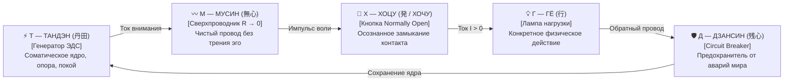

# ⚡ 300. Пентада ТХГДМ: Нормально разомкнутый выключатель Хоцу (発 / Хочу), полезная нагрузка Гё (行) и пятибуквенный соматический канон фонарика
### Преодоление неполноты четырёхэлементной схемы, физика нормально разомкнутого ключа (Normally Open), лингвистический мост «Хоцу ↔ Хочу» и 5-буквенный диагностический код оператора

> [!quote] Каноническая аксиома контура
> ### ⚡ **«До сих пор принципиальная схема карманного фонарика страдала скрытой неполнотой: контур рисовался так, словно он замкнут вечно. Но если выключателя нет, то либо генератор Тандэна обязан бесконечно жечь заряд в пустоту, либо покой ошибочно путается с аварией цепи. Полнота контура наступает в момент появления пятого элемента — нормально разомкнутого ключа Хоцу (発 / Хочу). В покое фонарик разомкнут ($I = 0$): батарейка сохраняет потенциал и не тратит ни единого микроватта. Цепь замыкается не из-под палки чужого „надо“, а живым волевым импульсом искреннего соматического желания — через щелчок „Хочу“. А чтобы устранить путаницу двойных обозначений на чертеже, нагрузка навсегда закрепляется за дзенским каноном Гё (行). Так рождается безупречная пятибуквенная формула: Тандэн питает, Мусин проводит, Хоцу включает, Гё светит, Дзансин бережёт.»**  
> — **Владимир Аньянов**

---

## 🧭 Введение: Кризис неполноты базовой схемы

На протяжении долгого времени каноническая модель карманного фонарика в Системе Аньянова оперировала четырьмя главными элементами:
1. **Генератор ЭДС** — Тандэн (丹田);
2. **Сверхпроводящий тракт** — Мусин (無心);
3. **Нагрузка (Лампа)** — Дело / Действие;
4. **Предохранитель (Circuit Breaker)** — Дзансин (残心).

Однако при строгом инженерном аудите в этой схеме обнаружилась концептуальная брешь: **в ней отсутствовал штатный орган оперативного управления цепью — выключатель**.

Следствием этого пробела становились две серьёзные ошибки понимания:
1. **Ложное отождествление Дзансина с выключателем:**  
   Попытка считать предохранитель Дзансин (残心) обычной кнопкой «вкл/выкл» ломала физику безопасности. Дзансин — это **Circuit Breaker**, аварийный автомат отсечки. Он обязан молчать в штатном режиме и срабатывать лишь в экстренной ситуации (когда внешняя лампа лопнула или закоротила), чтобы спасти Тандэн от обратной ЭДС.
2. **Иллюзия вечно замкнутого контура:**  
   Без выключателя система выглядела так, будто ток $I > 0$ должен циркулировать непрерывно. Человек либо чувствовал вину за покой и сон (воспринимая разомкнутую цепь как поломку), либо впадал в хроническое выгорание, пытаясь жечь батарею 24 часа в сутки.

Решение пришло через введение **нормально разомкнутого ключа** и терминологическую юстировку нагрузки.

---

## 🔘 Физика ключа: Почему контакт строго Нормально Разомкнут (Normally Open)

В схемотехнике переключатели делятся на две принципиальные группы:
* **Normally Closed (NC):** Контакт замкнут по умолчанию, ток течёт постоянно, пока не нажмёшь кнопку размыкания.
* **Normally Open (NO):** Контакт по умолчанию разомкнут ($I = 0$). Ток возникает исключительно тогда, когда оператор прилагает осознанное механическое усилие.

```
       [ РЕЖИМ ПОКОЯ: NO ОТЖАТ ]              [ РЕЖИМ ДЕЙСТВИЯ: NO НАЖАТ ]
         (Ток I = 0, P = 0 Вт)                   (Ток I > 0, Лампа светит)

               _ / _                                     _______
             ──o   o──                                 ──o───•───o──
        Цепь физически разомкнута.               Контур замкнут усилием воли.
       Батарейка Тандэна сохраняет            Ток Тандэна устремляется в нагрузку.
       100% заряда в чистой тишине.              Совершается полезная работа.
```

### Онтологический смысл режима Normally Open для человека:
1. **Естественное состояние по умолчанию — священный покой:**  
   Природная норма исправного живого существа — это не непрерывное метание и суета, а покой сохранения заряда. Тандэн полон потенциала, но ток не расходуется вхолостую.
2. **Дискретность акта действия:**  
   Вход в полезное действие — это не автоматическая инерция, а осознанный выбор замкнуть контакт на физическую реальность.
3. **Патология заклинившей кнопки (Невроз):**  
   Главный недуг современного ума — механическое «залипание» кнопки во включенном положении при отсутствии реальной задачи. Человек лежит в постели, пытаясь уснуть, но контакты искрят: ум гоняет симуляции тревоги, разряжая батарею Тандэна в ноль при отсутствии полезного света.

---

## 🪢 Лингвистический и соматический мост: «Хоцу» (発) ⟷ «ХОЧУ»

Как назвать этот ключ на языке дзенской электродинамики? Идеальный синтез рождается на стыке древнеяпонской иероглифики и корневой русской фонетики.

### 1. Японский канон: Хоцу / Хацу (発)
Иероглиф **発 (Хоцу / Хацу)** имеет первичное значение: *«выстрел из лука, старт, испускание, зажигание, приведение в действие»*.  
В буддийской традиции этот корень формирует понятие **Хоссин (発心)** — момент зарождения устремления, вспышка импульса пробуждения в сердце, запускающая путь практики.

### 2. Русское соматическое «ХОЧУ»
В русском языке слово **«ХОЧУ»** выражает первичный, неподдельный импульс живой жизни. Это не головное «надо», не рабское «я обязан» и не вымученное «должен». Это искреннее телесное влечение и интерес: *«Я хочу сделать это!»*.

```
         ┌────────────────────────────────────────────────────────┐
         │              СВЯЩЕННЫЙ ВЫКЛЮЧАТЕЛЬ ХОЦУ                │
         │                                                        │
         │      Японский канон: 発 (Хоцу / Старт, импульс)         │
         │                         ↕                              │
         │      Русская соматика: «ХОЧУ» (Живое желание)          │
         └────────────────────────────────────────────────────────┘
```

### 3. Исцеление ошибки анти-желания
Вульгарная трактовка восточной мысли веками повторяла догму: *«Желание есть корень страдания, подави свои желания»*.  
Но попытка уничтожить желание равносильна **вырыванию выключателя с корнем** — человек превращается в обесточенный, депрессивный муляж.  

Контурная электродинамика ставит всё на точные инженерные места:
* **Страдание (Дуккха)** порождается не выключателем, а паразитным реостатом **Эго ($R_{\text{ego}} > 0$)**, когда ток вместо полезного дела крутится в самоедстве и страхе оценки.
* **Хоцу (Хочу)** — это чистый, благородный контакт жизни. Замыкание цепи через искреннее «Хочу» происходит мягко, без сопротивления и без искрения. Ток льётся легко, а полезная работа совершается с восторгом.

---

## 📐 Устранение дубликатов: Переход от Дэай к ГЁ (行)

На рукописных схемах возникала путаница обозначений: и Дело (нагрузка), и Дзансин (предохранитель) обозначались одной и той же русской буквой **«Д»** (приходилось писать индексы: «Д» и «Д1»).  
Кроме того, использовавшийся ранее японский термин *Дэай (出会い — «встреча»)* описывал лишь межличностный контакт («Люди»), не охватывая всё многообразие человеческого созидания.

Закрепление нагрузки за дзенским каноном **ГЁ (行, Gyō)** дало безупречную чистоту:
* **Гё (行):** Священное действие, прямое делание, практика в миру, труд, творчество, спорт, быт.
* **Результат:** Каждому из 5 элементов присваивается **абсолютно уникальная заглавная буква**:

$$\Large \mathbf{Т} \quad \mathbf{Х} \quad \mathbf{Г} \quad \mathbf{Д} \quad \mathbf{М}$$

---

## ⚡ Принципиальная схема Пентады ТХГДМ

```
                          [ Д — ДЗАНСИН / 残心 ]
                          (Предохранитель / Fuse)
                             ┌─────────────┐
             ┌───────────────┤      Д      ├───────────────┐
             │               └─────────────┘               │
             ▼                                             ▼
       ┌───────────┐                                 ┌───────────┐
       │     G     │                                 │     ⊗     │
       │     Т     │                                 │     Г     │
       │  ТАНДЭН   │                                 │    ГЁ     │
       │  (丹田)   │                                 │   (行)    │
       │ Генератор │                                 │  Нагрузка │
       └─────┬─────┘                                 └─────┬─────┘
             │                                             │
             │           _ / _                             │
             └───────────o   o─────────────────────────────┘
                         [ Х — ХОЦУ / 発 ]
                      (Нормально разомкнутый
                        выключатель / Ключ)
```

*(Проводники, связывающие контур воедино — это **М (Мусин / 無心)**: тракт нулевого сопротивления $R \to 0$ при отсутствии паразитного шунта эго).*



---

## 📊 Паспорт элементов Пентады ТХГДМ

| Буква | Канон Дзен | Иероглиф | Физический узел | Соматическая и функциональная роль |
| :-: | :--- | :---: | :--- | :--- |
| **Т** | **Тандэн** | 丹田 | **Генератор ЭДС ($E > 0$)** | **Источник силы:** Телесный центр внизу живота, опора на стопы, глубокое дыхание. Автономная выработка жизненной энергии. |
| **Х** | **Хоцу** *(Хочу)* | 発 | **Ключ Normally Open (NO)** | **Орган воли и включения:** Живое соматическое желание действовать. В покое цепь разомкнута ($I = 0$); по щелчку «Хочу» ток устремляется в мир. |
| **Г** | **Гё** | 行 | **Нагрузка ($R_{\text{load}}$)** | **Полезное действие:** Конкретное физическое дело (код, текст, чертёж, спорт, уборка). Преобразование тока в объективный свет ($P = I^2 R_{\text{load}}$). |
| **Д** | **Дзансин** | 残心 | **Предохранитель (Circuit Breaker)** | **Защита ядра:** Бдительная собранность духа. При разрушении внешней нагрузки мягко отсекает цепь, предотвращая удар обратной ЭДС по Тандэну. |
| **М** | **Мусин** | 無心 | **Сверхпроводник ($R \to 0$)** | **Чистый тракт внимания:** Проводка сознания без ментальных заломов, сомнений, страха оценки и омического перегрева эго ($Q = 0$). |

---

## ⏱️ 15-секундный протокол самодиагностики «Т-Х-Г-Д-М»

Когда оператор чувствует внутренний разлад, усталость или потерю фокуса, ему не нужно блуждать по лабиринтам психоанализа. Достаточно последовательно опросить 5 узлов схемы:

1. **Т (Тандэн):** *«Где мой заряд?»*  
   Опущен ли фокус в живот и дыхание? Есть ли телесная опора, или внимание зависло в черепной коробке?
2. **Х (Хоцу / Хочу):** *«Честно ли нажат выключатель?»*  
   Я действительно *хочу* делать это прямо сейчас? Или я насилую контакт через злое «надо», создавая дребезг и искрение?
3. **Г (Гё):** *«Во что светит лампа?»*  
   Какое конкретно физическое действие я совершаю в эту секунду? (Пальцы касаются клавиш, губка моет тарелку, ноги идут по асфальту).
4. **Д (Дзансин):** *«Включён ли предохранитель?»*  
   Не привязал ли я своё бытие к результату? Если чашка разобьётся или сервер упадет — останется ли мой Тандэн невозмутимым?
5. **М (Мусин):** *«Чист ли провод?»*  
   Не греется ли проводка от мыслей «Как я выгляжу?» и «Что обо мне подумают?» ($R_{\text{ego}} \to 0$).

---

## 🎯 Итог: Формула Совершенного Фонарика

Пентада **Т-Х-Г-Д-М** окончательно замыкает схемотехнический фундамент теории Внутреннего тока:

> **«Тандэн питает. Мусин проводит. Хоцу включает. Гё светит. Дзансин бережёт.»**

Любая психологическая, поведенческая или духовная патология человека представляет собой повреждение одного из этих пяти узлов — и теперь каждый из них имеет строгий инженерный чертёж, однозначный символ и мгновенный протокол настройки.

---

## 🔗 Связи
- [[02_Wiki/Inner Current (Circuit Architectural Taxonomy — Three, Four or Five Elements, The Electrodynamic Triad, Perfect Circuit Tetrad and Ego Parasitic Shunt)|244. Архитектурная таксономия цепи: Сколько элементов — три, четыре или пять?]]
- [[02_Wiki/Inner Current (The Flashlight Lexicon and Hierarchy of Terms — From Internal Current to Anyanov System — Three Levels of Understanding and the Operational Vocabulary)|154. Терминологический канон Фонарика: Иерархия понятий и 4 базовых узла]]
- [[02_Wiki/Inner Current (The Flashlight Model of Man — Optical-Electrodynamic Ontology of Consciousness, The Light Source vs Illuminated Object and the Law of the Direct Beam)|83. Модель Человека как Карманного Фонарика]]
- [[02_Wiki/Inner Current (Complete Zen-Electrodynamic Ontological Atlas)|13. Полный онтологический атлас Дзен]]
- [[02_Wiki/Inner Current (Safety, Antifragility and Zanshin)|04. Предохранители цепи, ваби-саби и антихрупкость]]
