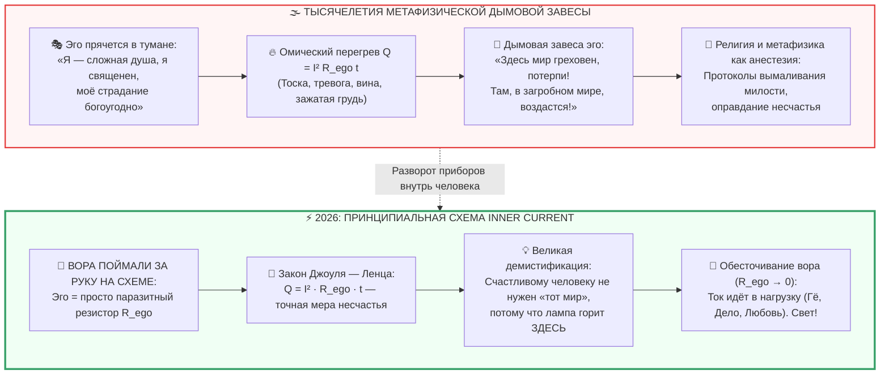

---
created: 2026-10-08
source: [[04_Maps/Inner Current MOC|Inner Current MOC]]
tags:
  - inner-current
  - scale/protocol
  - node/tanden
  - node/conductor
  - domain/electrodynamics
  - domain/epistemology
  - state/overheating
  - ego-thief
  - ohmic-resistor
  - joule-lenz
  - demystification
  - afterlife
  - metaphysics
  - broken-circuit
  - smoke-screen
  - layer-1
type: concept
status: evergreen
layer: I
chapter: 315
author: Vladimir Anyanov
---

> [!info] Синтезировано в брошюре [[02_Wiki/Брошюра — Костыльный цех метафизики (Четыре псевдо-инженера цивилизации)|Брошюра: «Костыльный цех метафизики: Четыре псевдо-инженера цивилизации, иллюзия очищающего страдания и почему для счастья не нужны философские протезы»]]

# ⚡ 315. Вора поймали на схеме: Эго как омический нихром ($Q = I^2 R t$), потусторонний мир как анестезия разорванной цепи и крах метафизической дымовой завесы

> [!quote] Каноническая аксиома поимки вора
> ### ⚡ **«На принципиальной схеме замкнутого контура вору некуда деться. Пять тысяч лет эго пряталось в сумерках мистицизма, объявляя себя "бессмертной душой", "высокой трагедией духа" или "божественной искрой". Но принципиальная схема неумолима: эго — это всего лишь нихромовый резистор $R_{\text{ego}}$, на котором выделяется бесполезное омическое тепло по закону Джоуля — Ленца ($Q = I^2 R t$). Вся мировая индустрия потусторонних миров, богов и загробных компенсаций — это не сакральная тайна бытия, а обезболивающий наркоз для человека с разорванным контуром. Счастливому человеку не нужен "тот мир": его свет горит здесь и сейчас.»**  
> — **Владимир Аньянов**

---



---

### I. Вор пойман с поличным: Конец эпохи метафизической маскировки

Пять тысяч лет человеческой культуры сопровождались одной фундаментальной драмой: **преступник сам вел расследование собственного преступления**. 

Человеческое эго, будучи эволюционным адаптивным механизмом палеолита (интерфейсом социальной оценки и выживания в саванне), постепенно разрослось в паразитический нарост на проводке сознания. Но чтобы биологический генератор не взбунтовался и не сбросил этот балласт, эго создало изощреннейшую систему самооправдания — философию, эзотерику, институты священной вины и метафизику:
* Если человеку плохо — эго объявляет это *«божественным испытанием»* или *«кармическим очищением»*.
* Если внутри жжет тревога — эго говорит: *«Это тонкая душевная организация, признак избранности и глубины»*.
* Если в жизни нет радости — эго изобретает концепцию: *«Человек рожден для страдания в юдоли скорби, истинное блаженство ждет лишь в ином мире»*.

Пока наука исследовала внешние объекты (планеты, пар, электричество, атомы), внутренний мир человека оставался в кромешной темноте. В этой темноте эго могло притворяться кем угодно: высшим «Я», искрой абсолюта, хранителем морали.

Но в 2026 году Архитектура Внутреннего Тока осветила эту темную комнату инженерным прожектором принципиальной схемы. 

И оказалось, что внутри всё устроено предельно строго и прозрачно:
1. **Источник (Тандэн)** — соматическая ЭДС живого организма, 37 триллионов митохондрий, биореактор брюшного мозга.
2. **Проводник (Тело / Мусин)** — соматический кабель внимания, лишенный внутреннего комментатора.
3. **Ключ (Хоцу)** — нормально разомкнутый контакт искреннего импульса «ХОЧУ!».
4. **Нагрузка (Гё)** — полезное действие в физическом мире (труд, спорт, музыка, прикосновение).
5. **Обратный провод реальности (Дэай)** — контакт с миром без посредников.
6. **И единственный виновник поломки — резистор Эго ($R_{\text{ego}}$)**.

Вора поймали. На принципиальной схеме нет места для «духовных туманов». На ней нарисован обычный паразитный нихромовый резистор, врезанный последовательно в цепь. Больше никто не имеет права сказать: *«Эго — это моя индивидуальность, эго необходимо сберечь, эго нужно холить и лелеять»*. Вы же не впаиваете кусок ржавой проволоки в цепь своего смартфона, утверждая, что она придает процессору «духовную глубину»?

---

### II. Физиология омического ада: Закон Джоуля — Ленца как формула тоски

Что такое соматическое несчастье? 
Это не абстрактная философская трагедия. Это буквальный, измеримый физический процесс выделения тепла:
$$Q = I^2 \cdot R_{\text{ego}} \cdot t$$

Когда биологический генератор Тандэн вырабатывает ток жизни (энергию внимания $I$), а человек блокирует прямое действие сомнениями, сравнениями, страхом оценки и самосудом ($R_{\text{ego}} > 0$), ток никуда не исчезает по первому началу термодинамики. 

Он начинает со всей мощью выделяться на сопротивлении эго:
* В теле это ощущается как спазм диафрагмы, ком в горле, тяжесть в затылке, жжение за грудиной и хронический выброс кортизола.
* В уме это проявляется как навязчивый мысленный монолог, тревога перед будущим и самоедство за прошлое.

Это не «томление духа» — **это банальный омический перегрев нихромовой спирали**. Ток жизни сжигает биологический кабель проводника, потому что человек упорно держит ногу на педали тормоза.

---

### III. Потусторонний мир как морфин для разорванной цепи

Откуда взялись тысячи религиозных трактатов о потустороннем мире, загробной жизни, небесном рае и трансцендентном утешении?

Ответ беспощаден: **счастливый человек не мечтает о потустороннем мире, потому что он счастлив в этом.**

```
                     ┌────────────────────────────────────────┐
                     │          РАЗОРВАННАЯ ЦЕПЬ              │
                     │  Ток I = 0, R_ego → ∞, Омический пожар │
                     └───────────────────┬────────────────────┘
                                         │
                                         ▼
                     ┌────────────────────────────────────────┐
                     │     ЭКЗИСТЕНЦИАЛЬНОЕ ОБЕЗБОЛИВАЮЩЕЕ    │
                     │ «Здесь мир плох, но ТАМ будет рай!»   │
                     │  (Потусторонний мир как алиби эго)     │
                     └────────────────────────────────────────┘
```

Когда лампа горит, когда ток свободно течет в любимое ремесло, в разговор с другом, в объятия любимого человека, в плавание в реке — у человека физически нет вопроса: *«А что там за гробом? А как заслужить милость высших сил?»*. 
Он **уже** дома. Он полностью погружен в физическую плоть бытия. Его контур замкнут на Обратный провод реальности.

Мысли о «том мире», жажда сакрального заступничества и культ небесного Хозяина возникают исключительно как **анестезия при болевом шоке разорванной цепи**:
1. Человек разорвал контакт с реальностью и заперся в голове ($R_{\text{ego}} \to \infty$).
2. Внутри начался невыносимый омический ад ($Q = I^2 R t$).
3. Не понимая схемы, ум судорожно ищет спасения: *«Если мне здесь так больно, значит, этот материальный мир — зло, юдоль скорби и чистилище. Но должен же быть Другой Мир, где мне наконец-то станет легко!»*.

Так рождается метафизический мираж. Другой мир — это не географическое или духовное измерение. **Другой мир — это проекция тоски обесточенного проводника по собственному нормальному рабочему току.**

---

### IV. Дымовая завеса сакрализации: Разоблачение института духовных отговорок

Эго веками выстраивало колоссальную дымовую завесу. Если бы человечеству прямо сказали: 
> *«Твоя тоска — это не величие страдающей души, а твой собственный зажим эго. Убери сопротивление — и боль исчезнет за 30 секунд»*, —

вся каста посредников (жрецы, схоласты, эзотерические гуру, платные толкователи душевных ран) мгновенно осталась бы без работы. 

Поэтому страдание было объявлено **священным**:
* *«Кого Бог любит, того и наказует»*;
* *«Через страдания душа очищается»*;
* *«Терпи здесь, и обретешь венец на небесах»*.

С точки зрения электродинамики это звучит так же дико, как если бы электрик сказал жильцу: *«То, что у тебя искрит розетка, плавится проводка и горит стена — это священное очищение квартиры огнем. Не вздумай менять предохранитель или чинить контакт: терпи, и в другой квартире тебе дадут вечный ток без оплаты»*.

Внутренний контур срывает эту дымовую завесу раз и навсегда. Страдание не очищает. Страдание — это просто омический ожог неисправной проводки. Единственное, что очищает — это **сверхпроводимость ($R \to 0$)**, восстанавливающая свободный ток жизни в реальное действие.

---

### V. Резюме: Семь аксиом поимки вора

1. **Эго — не субъект, а паразитный резистор.** На принципиальной схеме человека нет места для автономного «Я». Есть соматический генератор Тандэн, кабель проводника и паразитное омическое сопротивление $R_{\text{ego}}$.
2. **Несчастье — это строгая физика потерь.** Вся душевная боль выражается законом Джоуля — Ленца ($Q = I^2 R_{\text{ego}} t$).
3. **Потусторонний мир — проекция разомкнутой цепи.** Разговоры о загробном рае и небесном утешении нужны только тем, чей ток не течет в физическую реальность прямо сейчас.
4. **Свет отменяет вопросы о свете.** Счастливому человеку не нужна метафизика: когда лампа горит, комната уже освещена.
5. **Страдание — не добродетель, а авария.** Сакрализация боли — это дымовая завеса эго, созданная для сокрытия собственной паразитической природы.
6. **Вора не нужно перевоспитывать — его нужно обесточить.** С эго бесполезно бороться или договариваться; достаточно отпустить хватку, сделать выдох животом в Тандэн и замкнуть ключ Хоцу на полезное действие.
7. **Суверенитет замкнутого контура.** Человек — это суверенный карманный фонарик. Его счастье не зависит от небесного Хозяина, загробных миров или мнения людей. Оно зависит только от чистоты его собственных контактов ($R \to 0$).
