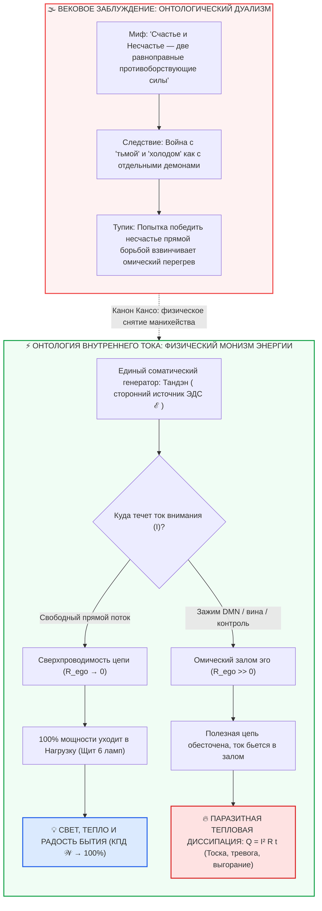

# ⚡ 322. Несчастье — это рассеянная энергия счастья: Несчастье не обладает самостоятельной онтологической сущностью
## Физический изоморфизм холода и тьмы (Privatio Boni), закон сохранения энергии контура и паразитная тепловая диссипация нереализованной радости ($Q = I^2 R_{\text{ego}} t$)

> [!quote] Каноническая аксиома контура об онтологии несчастья
> ### ⚡ **«Несчастье — это рассеянная энергия счастья. Несчастье не обладает самостоятельной онтологической сущностью. Подобно тому, как холод — это отсутствие тепла, а темнота — отсутствие фотонов, несчастье — это лишь паразитная тепловая диссипация нереализованного счастья. В человеке нет „генератора горя“ или „тока страданий“. Вся жгучая мука, тоска и тревога — это чистая, витальная мощность Тандэна, которая вместо того, чтобы озарять мир через полезную нагрузку, раскаляет проводку о залом эго. Стоит выправить залом — и то же самое пламя, что сжигало тебя изнутри, становится ламинарным светом созидания.»**  
> — **Владимир Аньянов**

---



---

### I. Онтологический статус: Почему у несчастья нет собственного бытия (Privatio Boni в строгой физике)

На протяжении тысячелетий мировая культура находилась в плену наивного **манихейского дуализма**. Философы, теологи и психологи рассматривали счастье и несчастье как две самостоятельные, полярные субстанции, борющиеся за человеческую душу:
- С одной стороны рисовались «светлые силы», гармония, эвдемония и благодать;
- С другой стороны воздвигались темные чудовища: Танатос, грех, экзистенциальная тоска, невроз и депрессия как автономные онтологические сущности.

Вся эта многотомная схоластика рассыпается при первом же соприкосновении с фундаментальными законами природы. 

В естествознании действует абсолютный закон: **ряд феноменов, кажущихся обывателю самостоятельными «сущностями», являются всего лишь отсутствием или нарушением базового физического инварианта**:

| Феномен восприятия | Кажущаяся «сущность» | Строгий физический факт | Онтологический статус |
| :--- | :--- | :--- | :--- |
| **Холод** | «Мороз», «ледяная субстанция» (гипотетический флогистон холода) | Отсутствие кинетической энергии хаотического движения частиц: $\langle E_k \rangle \to 0$ | **Физическое ничто**: нет «частиц холода», есть лишь дефицит тепла |
| **Темнота** | «Мрак», «тьма египетская», поглощающая свет сила | Отсутствие электромагнитного излучения (плотность фотонов $n_\gamma \to 0$) | **Оптическое ничто**: нет «лучей мрака», есть лишь отсутствие фотонов |
| **Тишина** | «Безмолвие» как отдельная акустическая среда | Отсутствие механических колебаний давления в упругой среде ($\Delta p = 0$) | **Акустическое ничто**: отсутствие волн |
| **НЕСЧАСТЬЕ** | «Горе», «злой рок», «депрессия», отдельное демоническое состояние | **Паразитная тепловая диссипация нереализованной мощности Тандэна ($Q = I^2 R_{\text{ego}} t$)** | **Онтологическое ничто**: отсутствие проводимости цепи ($R \to 0$) |

Древние схоласты (вслед за Августином) интуитивно нащупали этот принцип в богословии, назвав зло *privatio boni* («лишением добра»). Однако без законов электродинамики и термодинамики это оставалось абстрактной этической метафорой. 

В Архитектуре счастья Владимира Аньянова этот принцип впервые обретает **строгую инженерную формулировку**:
> **У несчастья нет собственного генератора. В человеческой анатомии и физиологии нет «аккумулятора скорби», нет «железы отчаяния» и нет специального «тока несчастья». Вся энергия, которую человек ощущает во время самого чудовищного душевного страдания — это на 100% чистая, первозданная витальная энергия его собственного счастья, рассеянная в паразитное омическое тепло.**

---

### II. Первое начало термодинамики духа: Куда девается ток генератора Тандэн?

Рассмотрим энергетический баланс человека как замкнутой электродинамической системы. 

В соматическом ядре человека непрерывно функционирует живой источник сторонней ЭДС — **Тандэн** ($\mathcal{E}_0$). Тридцать семь триллионов митохондрий непрерывно перекачивают протоны через внутреннюю мембрану, создавая колоссальный градиент потенциала в 150–200 мВ на нанометр (напряженность поля порядка $10^7\text{ В/м}$ — на уровне молнии!). Этот витальный реактор непрерывно подает в проводящую нервную ткань ток направленного внимания:
$$I = \frac{dq}{dt}$$

Полная мощность, генерируемая человеком в единицу времени, подчиняется Первому началу термодинамики:
$$P_{\text{total}} = \mathcal{E} \cdot I$$

Энергия не может исчезнуть в небытие. Закон сохранения энергии абсолютен. Куда расходуется эта мощность?

Уравнение баланса мощности в человеческом контуре имеет исчерпывающий вид:
$$P_{\text{total}} = P_{\text{load}} + P_{\text{parasitic}}$$
$$\mathcal{E} \cdot I = \sum_{k=1}^6 I_k^2 R_{\text{load}, k} + I^2 R_{\text{ego}}$$

Где:
1. $P_{\text{load}} = \sum_{k=1}^6 I_k^2 R_{\text{load}, k}$ — полезная мощность, излучаемая шестью лампами бытия (Дело, Тело, Близость, Среда, Познание, Игра). Это свет, созидание, любовь, физический восторг действия, научный поиск, чистый Мусин.
2. $P_{\text{parasitic}} = I^2 R_{\text{ego}}$ — паразитная омическая мощность потерь, выделяющаяся на сопротивлении эго-реостата (DMN, образ «Я», вина о прошлом $L$, паника перед будущим $C$, страх чужого суда).

#### Сравнительный расчет двух режимов контура

```
РЕЖИМ СЧАСТЬЯ (Сверхпроводимость Мусин):
R_ego → 0
P_parasitic = I² · 0 = 0
P_load = P_total = ℰ · I
КПД контура: 𝒲 = (P_load / P_total) · 100% = 100%
Результат: Полная мощность генератора озаряет мир. Внутри проводника — абсолютный холод и покой.

РЕЖИМ НЕСЧАСТЬЯ (Омический залом эго):
R_ego >> 0, цепь нагрузки разомкнута (человек заперся в рефлексии)
P_load = 0
P_parasitic = I² · R_ego = P_total
КПД контура: 𝒲 = 0%
Результат: 100% мощности генератора превращается в паразитный нагрев провода: Q = I² R_ego t.
Вся энергия счастья пережигает внутренности проводника.
```

Когда человек глубоко несчастен — он **не обесточен**. Напротив: человек в приступе паники, острой ревности или черной зависти генерирует колоссальное количество энергии! Его сердце колотится с частотой 130 ударов в минуту, дыхание сбито, мышцы сведены судорогой, неокортекс поглощает до 25% всей глюкозы тела, прокручивая сотни катастрофических сценариев в секунду. 

С точки зрения физики — это бешеная, гигантская мощность! Но куда она идет? Ни одна лампа в реальном мире не горит. Человек не создает шедевра, не обнимает любимого, не строит дом. Вся эта колоссальная термодинамическая мощность целиком диссипирует на внутреннем резисторе эго, превращая нервную систему в раскаленный паяльник.

---

### III. Феноменология «омического дыма»: Спектр рассеяния счастья

Каждое так называемое «негативное чувство» — это не отдельный вирус и не врожденный грех. Это строго локализованный тип паразитной диссипации нереализованного тока счастья:

```
                                  ┌──► ВИНА (Индуктивный залом прошлого: L_past)
                                  │    Чистая энергия ответственности застряла в архивной петле
                                  │
                                  ├──► ТРЕВОГА (Емкостной залом будущего: C_future)
                                  │    Чистая энергия созидательного предвидения закорочена на симуляциях
                                  │
ЧИСТЫЙ ТОК ТАНДЭНА                ├──► ОБИДА (Омический спазм непринятия реальности)
(Потенциал абсолютного счастья)  ──┼    Чистая энергия любви, запертая отказом признать факт Дэай
                                  │
                                  ├──► ЗАВИСТЬ (Ошибка атрибуции чужого луча)
                                  │    Чистая энергия собственного роста, преломленная через сравнение
                                  │
                                  └──► ВЫГОРАНИЕ (Квадратичный ожог воли: Q = I² R t)
                                       Попытка продавить залом утроенной силой воли (I ↑↑)
```

1. **Тревога — это рассеянная энергия созидательного предвидения.** Человек обладает мощным аппаратом прогнозирования и планирования. В сверхпроводимости этот аппарат используется для наведения мостов и проектирования ракет. Но при зажиме эго этот ток замыкается на мысленный образ «А вдруг обо мне подумают плохо?» и диссипирует в виде холодной дрожи и панических атак.
2. **Обида — это рассеянная энергия близости и благодарности.** Это огромный ток любви и открытости, натолкнувшийся на несовпадение действий Другого с нашими ожиданиями. Вместо того чтобы перекалибровать линзу (канон Кансо), эго врезает последовательный балласт непринятия факта. Тот ток, который должен был согреть обоих, раскаляет проводку обиженного до белого каления.
3. **Ревность — это рассеянная энергия глубокого восхищения.** Невероятный по силе ток влечения и восторга, замкнутый накоротко на страх утраты контроля над чужой суверенной нодой.
4. **Выгорание — это рассеянная энергия гениального созидателя.** Трагедия пассионария, который пытается компенсировать сопротивление проводки ($R_{\text{ego}} > 0$) увеличением нажима воли ($I \to 2I, 3I$). По закону Джоуля — Ленца выделение паразитного тепла растет квадратично:
   $$Q = (2I)^2 R_{\text{ego}} t = 4 I^2 R_{\text{ego}} t$$
   Удвоение волевого напора при неочищенном эго дает четырехкратный пожар нервной ткани.

**Несчастье — это то же самое счастье, только пущенное в короткое замыкание на образ себя.**

---

### IV. Цивилизационная ошибка: Война с тьмой ведрами и энциклопедии холода

Понимание того, что несчастье не обладает собственной онтологической сущностью, производит беспощадную деконструкцию 2500 лет человеческой культуры:

#### 1. Абсурд «борьбы с депрессией и тоской»
Представьте человека, который вошел в темную комнату и вместо того, чтобы щелкнуть выключателем, достал ведро и начал вычерпывать темноту в окно. Или человека, который посреди зимней стужи пытается физически уничтожить «мороз» лопатой. 
Именно этим занималось человечество! 
Люди пытались «бороться с унынием», «искоренять грех», «подавлять тревогу», «вытеснять плохие мысли». Но всякая прямая борьба с тем, чего нет — это включение дополнительного контура сопротивления ума против ума! Это порождает вторичный омический разогрев:
$$R_{\text{total}} = R_{\text{первичный залом}} + R_{\text{борьба с заломом}}$$
Проводка вспыхивает с удвоенной силой.

#### 2. Птолемеевы эпициклы психиатрии и психотерапии
Современные справочники психических расстройств (DSM-5, МКБ-11) насчитывают сотни страниц, описывающих тысячи тончайших оттенков душевных мук. В оптике Внутреннего тока это выглядит как составление подробнейшей энциклопедии «сорока видов холода» учеными, которые не знают, что такое термодинамическая температура и молекулярно-кинетическая теория. 
Они классифицируют: «холод утренний колючий», «холод подвальный сырой», «холод экзистенциальный ледяной». Но все эти сотни диагнозов описывают **одно-единственное явление: омическое падение полезного напряжения до нуля из-за паразитного зажима эго**.

#### 3. Религиозная канонизация паразитного тепла
Самое зловещее искажение произошло в институциональных религиях, где паразитное тепло омического ожога ($Q = I^2 R t$) было объявлено «священным страданием, очищающим душу». Человеку внушили, будто сам факт того, что его проводка горит и чадит — угоден Богу. 
С инженерной точки зрения это равносильно тому, как если бы электрик объявил короткое замыкание и пожар на подстанции высшей добродетелью трансформатора.

---

### V. Неразрушимость исходного потенциала: Счастье не нужно искать заново

Из физического монизма вытекает главный, освобождающий вывод всей Архитектуры счастья:

> [!important] Закон сохранения светоносного потенциала
> **Если несчастье — это лишь рассеянная энергия счастья, значит, человеку не нужно искать счастье где-то вовне. Оно не утеряно. Оно не разрушено. Оно пульсирует прямо здесь, прямо сейчас — в виде того самого тока, который раскаляет его нервы.**

Скептик в глубочайшей депрессии говорит: «Я пуст. Во мне нет энергии для счастья». 
Дзен-инженер с вольтметром отвечает: 
> *«Ты ошибаешься. Твоя невыносимая душевная боль — это физическое свидетельство колоссального присутствия энергии! Мертвец не испытывает боли. Пустая батарейка не греется. Если тебе больно, если твое сердце сжимается от тоски — значит, твой Тандэн работает на полной мощности! Твой ядерный реактор в полном порядке. Единственное, что произошло — вся эта ослепительная мощь уперлась в залом эго и превратилась в паразитное тепло. Твое несчастье — это твое собственное счастье, зовущее выправить проводку.»*

В этом фундаментальное отличие Системы Аньянова от всех видов позитивной психологии и эзотерики:
- Позитивная психология предлагает «накачивать себя радостью» (пытаться подлить ток в горящий провод);
- Внутренний ток требует **отсечь лишнее сопротивление (канон Кансо, $R_{\text{ego}} \to 0$)**.

Как только сопротивление обнулено, рассеяние мгновенно прекращается. Вся та термодинамическая мощность, которая секунду назад сжигала тебя тревогой, **в ту же долю секунды** превращается в ослепительный, ламинарный луч прямого действия и созидания.

---

### VI. Практический алгоритм оператора: Трансформация диссипации в сверхпроводимость (30 секунд)

Когда в контуре возникает ощущение несчастья (тоска, раздражение, страх, тяжесть в груди), оператор цепи не впадает в экзистенциальную панику и не ищет виноватых. Он выполняет четырехшаговый регламент ТО:

```
[ ШАГ 1: ТЕЛЕМЕТРИЧЕСКАЯ ФИКСАЦИЯ ]
Опознать омический нагрев: 
«Прямо сейчас во мне нет никакой беды или мистического горя. 
Прямо сейчас во мне бурлит колоссальная сила Тандэна, которая диссипирует на заломе эго: Q = I² R t».
           │
           ▼
[ ШАГ 2: ЛОКАЛИЗАЦИЯ ЗАЛОМА ]
Спросить себя беспристрастно (без суда):
«За какой фантомный образ "Я" прямо сейчас зацепился провод внимания?
Что я пытаюсь защитить: свою правоту? мнение людей? контроль над завтрашним днем?»
           │
           ▼
[ ШАГ 3: СРЕЗ РЕОСТАТА КЛИНКОМ КАНСО ]
Соматический выдох в Тандэн. Тотальный сброс претензии:
«Пусть думают что хотят. Пусть случится что угодно. Я — не образ в чужой голове. Я — проводник».
R_ego схлопывается в ноль: R_ego → 0.
           │
           ▼
[ ШАГ 4: ЗАМЫКАНИЕ НА ПОЛЕЗНУЮ НАГРУЗКУ (Хоцу → Гё) ]
Мгновенно направить высвобожденный напор тока в конкретное физическое действие:
Взять гитару, помыть чашку, написать строчку кода, сделать шаг, взглянуть в глаза собеседнику.
Паразитный ожог Q прекращается. Лампа горит чистым светом сверхпроводимости (𝒲 → 100%).
```

---

### VII. Резюме: Семь аксиом онтологии счастья

1. **Аксиома асимметрии бытия:** Счастье обладает самостоятельным онтологическим статусом (сверхпроводимость замкнутой цепи). Несчастье самостоятельным онтологическим статусом не обладает (*privatio boni*).
2. **Аксиома изоморфизма:** Несчастье соотносится со счастьем точно так же, как холод с теплом, темнота со светом, а тишина со звуком.
3. **Аксиома единого реактора:** В человеке существует только один генератор витальной энергии — соматический центр Тандэн. «Генератора несчастья» не существует в природе.
4. **Аксиома закона сохранения:** Несчастье — это та же самая энергия счастья, превращенная омическим сопротивлением эго ($R_{\text{ego}} > 0$) в паразитное джоулево тепло ($Q = I^2 R t$).
5. **Аксиома тщетности войны:** Любая прямая борьба с несчастьем абсурдна и контрпродуктивна, как попытка вычерпать тьму из комнаты решетом. Тьма исчезает только при включении света.
6. **Аксиома неуничтожимости:** Пока человек жив и способен чувствовать душевную боль, его потенциал счастья стопроцентно сохранен и функционирует на пределе мощности.
7. **Аксиома сверхпроводящего фазового перехода:** Для перехода от глубочайшего несчастья к чистому счастью не требуется времени или внешних условий. Требуется лишь срез паразитного омического зажима ($R_{\text{ego}} \to 0$), возвращающий контуру его естественный, заводской режим сверхпроводимости.
