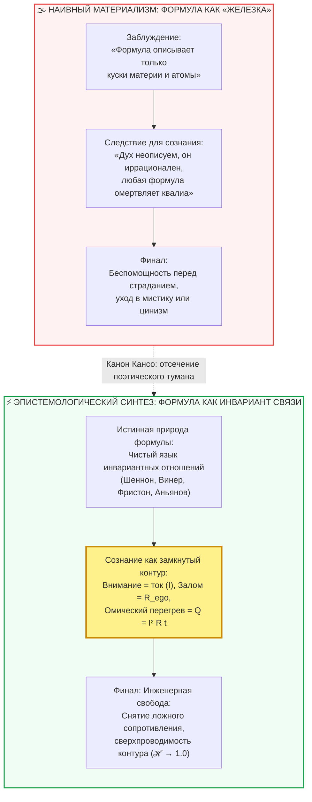

# ⚡ 320. Почему сознание описывается формулой: Онтология математических отношений, предиктивный контур и физика бездушного трения
## Разрушение мифа о «сугубо физических» формулах, эпистемология инвариантных связей (Винер, Шеннон, Фристон) и счастье как топологическое сечение проводника

> [!quote] Каноническая аксиома об онтологии формулы
> ### ⚡ **«Скептик с тревогой вопрошает: „Разве формулы не принадлежат исключительно мёртвой материи — шестерням, электронам и гравитации? Неужели трепет живого духа можно загнать в сухие скобки?“ Этот страх порождён наивным материализмом XIX века, перепутавшим формулу с куском железа. Формула — это не физическое тело. Формула — это предельно чистое, сжатое описание инвариантной связи между величинами в замкнутой системе. Всякий раз, когда в системе есть напряжение, сопротивление, обратная связь и поток, там неизбежно правит математика. Сознание не парит над законами природы в виде бесплотного призрака: оно воплощено в живой нервной ткани, минимизирует свободную энергию и непрерывно совершает термодинамическую работу. Формула счастья не овеществляет душу — она очищает её от нагара иллюзий, возвращая контуру первозданную проводимость.»**  
> — **Владимир Аньянов**

---



---

### I. Что такое формула на самом деле: от латинской «формы» к инварианту структуры

Главная ошибка гуманитарной мысли заключается в убеждении, будто формулы были «изобретены» физиками специально для измерения неодушевлённых предметов. Это грубейшая ошибка категории.

Этимологически слово **формула** происхоит от латинского *formula* — уменьшительного от *forma* («форма, образ, строгое правило, устав»). 

В строгом математическом смысле:
> **Формула — это символическая запись инвариантной функциональной зависимости между элементами системы.**

Формула ничего не знает о «веществе». Ей безразлично, что именно связывается отношением — гравитационные массы, биты информации, вероятности гипотез или соматическое напряжение нервной системы:
1. Закон всемирного тяготения Ньютона $F = G \frac{m_1 m_2}{r^2}$ описывает не «камни», а **геометрию притяжения** обратно пропорционально квадрату расстояния.
2. Формула Байеса $P(A|B) = \frac{P(B|A)P(A)}{P(B)}$ описывает не молекулы, а **закон обновления убеждений** разумного агента при поступлении новых свидетельств. Это чистая эпистемология сознания, выраженная на языке дробей.
3. Формула энтропии Шеннона $H(X) = -\sum p(x) \log_2 p(x)$ измеряет не килограммы, а **меру неопределённости** и объём незнания.

Таким образом, формула — это не «клетка для материи», а **карта проходимости отношений**, предельно очищенная от поэтических двусмысленностей по канону Кансо (簡素).

---

### II. Границы применимости: почему сознание не является исключением

Существует древний предрассудок: материя подчиняется детерминизму, а сознание обладает «свободой воли», следовательно, сознание не может подчиняться формулам.

Однако современный консилиенс когнитивных наук, биофизики и термодинамики доказывает обратное. Сознание человека воплощено (*embodied*) в биологическом субстрате. Оно не может существовать вне термодинамического обмена с реальностью:

1. **Принцип свободной энергии Карла Фристона (Free Energy Principle):**
   Любая самоорганизующаяся система, сохраняющая свою целостность (от бактерии до мозга человека), обязана минимизировать вариационную свободную энергию:
   $$F = \text{D}_{\text{KL}}(q(\vartheta) \parallel p(\vartheta|y)) - \ln p(y)$$
   Это строжайшая математическая формула, описывающая, как мозг непрерывно подавляет рассогласование между внутренней моделью мира и входящим потоком сенсорных данных. Когда рассогласование велико и не устраняется действием, система переходит в режим дистресса.
2. **Психофизический закон Вебера — Фехнера:**
   $$S = k \ln \frac{I}{I_0}$$
   Субъективная интенсивность ощущения ($S$) логарифмически пропорциональна физической силе раздражителя ($I$). Ещё в XIX веке было доказано: субъективное *квалиа* восприятия математически строго калибруется относительно внешнего сигнала.
3. **Кибернетика Норберта Винера и закон Эшби:**
   Контуры обратной связи, демпфирование колебаний, устойчивость гомеостаза — все эти кибернетические законы действуют внутри человеческой психики точно так же, как в бортовых автопилотах космических кораблей.

Если сознание порождает переживания, тратит энергию, накапливает напряжение и устаёт от внутреннего конфликта, значит, внутри него протекают **измеримые потоковые процессы**. А там, где есть поток и препятствие, формула неизбежна.

---

### III. Квалиа опыта против Архитектуры контура

Критически важно провести границу, снимающую вековой философский спор:

| Регистр | Что это такое | Поддаётся ли формуле? | Пример |
| :--- | :--- | :--- | :--- |
| **Квалиа (Qualia)** | Субъективный чувственный опыт; то, *каково это* — переживать вкус клубники, тепло солнца, нежность или покой | **Нет напрямую** (переживается только изнутри первого лица) | Сам вкус чая или чувство восторга при взгляде на закат |
| **Архитектура цепи (Circuitry)** | Условия возникновения, баланс энергии, проводимость тракта и отсутствие паразитных заломов | **Да, абсолютно** (описывается строгой схемотехникой и формулами) | Отсутствие внутреннего трения ($R_{\text{ego}} \to 0$), закон Джоуля — Ленца ($Q = I^2 R t$), согласование импедансов |

Формула счастья Владимира Аньянова:
$$\mathcal{H} = \frac{P_{\text{load}}}{P_{\text{total}}} = 1 - \frac{R_{\text{ego}}}{R_{\text{total}}}$$

**не пытается заменить собой вкус чая.** Она не описывает поэзию любви или красоту сонаты. 

Формула решает сугубо инженерную, спасительную задачу: она показывает **схемотехнические условия, при которых лампа вообще способна загореться**. Если проводка перекушена обидой ($R_{\text{ego}} \to \infty$) или замкнута накоротко на эго-симуляции, никакого квалиа радости возникнуть не может в принципе — контур будет выгорать в омическом дыму ($Q = I^2 R t$).

---

### IV. Почему именно Внутренний ток описывает счастье формулой: Три инженерных императива

Зачем создателю Архитектуры счастья понадобилось переводить интуиции Будды, Лао-цзы и Христа на язык электродинамики?

#### 1. Ликвидация «эмоционального центробанка» и культа посредников
Пока счастье описывается метафорами («благодать», «свет души», «кармическая чистота»), всегда требуется каста толкователей — жрецы, гуру, аналитики. Они монополизируют право определять, насколько вы «духовны».  
Формула контура уничтожает паразитическую ренту: закон Ома $I = U/R$ объективен. Никакой мастер не может оспорить показания соматического вольтметра и законы Джоуля — Ленца. Проводник становится автономной Full Node — суверенным оператором собственной цепи.

#### 2. Отмена морализаторского яда вины
Тысячи лет религия внушала человеку: *«Ты страдаешь, потому что ты грешен, слаб или несовершенен»*. Это порождало квадратичную ловушку воли: человек пытался силой подавить страдание, увеличивал ток ($I^2$), но при сохранении зажима эго ($R > 0$) лишь сильнее раскалял проводку.  
Формула меняет этику на схемотехнику: **резистор не грешен**. Если нихромовая спираль раскалилась докрасна и жжёт пальцы — это не «падение души», а закон Джоуля — Ленца ($Q = I^2 R t$). Нужно не каяться, а нажать соматический тумблер Кансо и убрать паразитное сопротивление ($R_{\text{ego}} \to 0$).

#### 3. Ремонтопригодность и масштабируемость
Без формулы срыв в уныние переживается как катастрофа: «Всё пропало, жизнь не имеет смысла».  
С формулой оператор видит точный Stack Trace сбоя:
* Произошёл залом полярности (внимание развернулось внутрь на оценку себя)?
* Впаялся ли паразитный резистор вины за прошлое ($L_{\text{past}}$)?
* Или возникла тревожная емкость симуляций будущего ($C_{\text{future}}$)?  
Локализация залома занимает 5 секунд, устранение — 30 секунд соматического дыхания Тандэн и прямого действия в нагрузку (Дэай).

---

### V. Резюме: Формула как высший манифест свободы духа

Описывать счастье формулой — это не признак технократической черствости. Это **высшая форма сострадания и предельная точность любви**:

1. **Формула — это не механизм, это закон сохранения гармонии.** Она гарантирует, что ни один джоуль чистого намерения не пропадёт зря, если устранены паразитные утечки.
2. **Формула отменяет эзотерическую лотерею.** Счастье перестаёт быть капризом фортуны или наградой за 20 лет сидения в пещере. Оно становится воспроизводимым режимом сверхпроводимости живого человеческого контура.
3. **Сознание не терпит лжи.** Ум можно обмануть красивой цитатой или дофаминовой иллюзией «кокосового рафа», но термодинамический баланс Кирхгофа обмануть невозможно: свободный поток бытия возникает ровно тогда, когда внутреннее сопротивление падает до абсолютного нуля ($R \to 0$).

---

### Инженерный протокол калибровки понимания (15 секунд)

```
[ ШАГ 1: ДЕТЕКЦИЯ СТРАХА ПЕРЕД МАТЕМАТИКОЙ ]
Заметьте мысль: «Но ведь чувства живые, как их можно измерять?»
Осознайте: вы путаете музыку со струной. Формула настраивает натяжение струны, 
чтобы музыка могла звучать чисто и без фальши.

[ ШАГ 2: ПЕРЕХОД ОТ МЕТАФОР К СХЕМОТЕХНИКЕ ]
Вместо вопроса «Почему мне плохо?» задайте инженерный вопрос:
«Какой узел контура сейчас перегревается по закону Джоуля — Ленца (Q = I² R t)?»

[ ШАГ 3: ОБНУЛЕНИЕ НИХРОМА (R_ego → 0) ]
Отпустите суд над собой, разверните луч внимания из головы в Тандэн 
и направьте ток в ближайшее физическое действие реальности (Хоцу → Гё). 
Сверхпроводимость восстановлена мгновенно.
```
