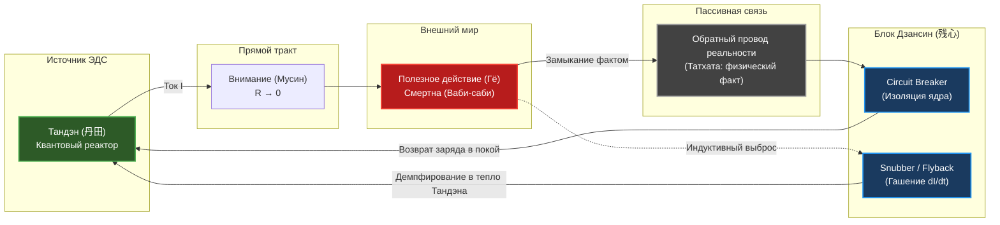

---
created: 2026-10-12
source: [[04_Maps/Inner Current MOC|Inner Current MOC]]
author: Владимир Аньянов
chapter: 357
layer: "II. Практика и защита контура (Прикладная калибровка)"
tags:
  - inner-current
  - node/zanshin
  - node/return-wire
  - node/tanden
  - node/conductor
  - node/load
  - domain/electrodynamics
  - domain/zen
  - domain/neurobiology
  - domain/epistemology
  - state/superconducting
  - state/overheating
  - state/open-loop
  - scale/deep-dive
  - zanshin
  - return-wire
  - circuit-breaker
  - transient-snubber
  - kanso
  - wabi-sabi
aliases:
  - "357-zanshin-in-the-circuit-return-wire-or-fuse"
  - "Дзансин в контуре: Обратный провод или предохранитель?"
  - "Схемотехника завершённого действия и Circuit Breaker"
  - "Zanshin in the Circuit — Return Wire or Fuse"
type: concept
status: evergreen
---

# 357. Дзансин в контуре: Обратный провод или предохранитель? Схемотехника завершённого действия, гашение экстратоков самоиндукции и автономный Circuit Breaker
### Разрешение фундаментального вопроса схемотехники человека: почему Дзансин — не пассивная шина реальности, а интеллектуальный автомат защиты ядра и демпфер переходных процессов при отключении нагрузки

> [!quote] Главная аксиома узла Дзансин
> ### ⚡ **«Обратный провод — это пассивная шина физического факта: реальность, замыкающая контур Кирхгофа. Но Дзансин — это интеллектуальный автомат защиты (Circuit Breaker) и демпфер переходных процессов (Snubber). Стрела вонзилась в мишень, код задеплоен, слово сказано: без Дзансина обратный всплеск самоиндукции разносит оператора на эйфорию или отчаяние. Дзансин поглощает удар переходного процесса, изолирует реактор Тандэн от смертности внешней лампы и возвращает контур в соматический покой 100% готовности.»**
> — **Владимир Аньянов**

---

### Архитектурная схема: Топологическое разделение узлов Обратного Провода и Дзансин

```
                            [ ДЗАНСИН: CIRCUIT BREAKER + SNUBBER ]
                            (Автомат защиты и демпфер экстратока)
                                           │
                                           ▼
      ┌─────────────────────────────────[ РЕЛЕ ]──────────────────────────────────┐
      │                                                                           │
      ▼                                                                           │
[ ТАНДЭН ] ────(ТОК ВНИМАНИЯ: МУСИН)───► [ ЛАМПА: ДЕЙСТВИЕ ] ───► [ ОБРАТНЫЙ ПРОВОД ]
(Квантовый      (Сверхпроводник R → 0)   (Полезная нагрузка)     (Шина факта реальности:
 реактор ЭДС)                              (Стрела в полёте)       Татхата / закон Кирхгофа)
```



---

## Часть I. Природа дилеммы: откуда берется ощущение «обратного провода»?

В практике оператора Внутреннего Тока часто возникает естественная интуитивная путаница:
> *«Дзансин — это обратный провод или предохранитель? Мне больше нравится предохранитель, но ведь обратный провод тоже постоянно ощущается как замыкание системы. Что же такое Дзансин на самом деле?»*

Эта мысль возникает не на пустом месте. В традиционном японском будо (бусидо, кэндо, кюдо) **Дзансин (残心)** буквально означает *«сохраняющийся дух»* или *«непрерывность присутствия»*.
* Лучник натянул тетиву, отпустил стрелу. Стрела летит и поражает мишень.
* Но лучник не подпрыгивает с криком «Ура!», не бросает лук и не опускает плечи в разочаровании, если стрела ушла в молоко.
* Лучник замирает в неподвижной, монолитной позе: лук удерживается на линии прицела, дыхание остаётся внизу живота (Тандэн), взгляд открыт и панорамно охватывает всю арену.

Оператор физически переживает этот момент как **возврат энергии в исходную точку**. Создаётся мощная иллюзия: *«Я совершил импульс наружу, а через Дзансин этот импульс замкнулся обратно в меня — значит, Дзансин и есть обратный провод!»*

Однако с точки зрения строгой теории электрических цепей и онтологии фонарика здесь скрыта **категориальная ошибка между средой проведения и автоматом защиты**. 

Смешать Обратный провод и Дзансин — всё равно что перепутать медную шину заземления с микропроцессорным блоком релейной защиты и дугогасительной камерой.

---

## Часть II. Топологический статус Обратного провода (`#node/return-wire`): Пассивная шина Реальности (Татхата)

Чтобы понять место Дзансин, необходимо сначала зафиксировать строгий физический статус **Обратного провода реальности**:

### 1. Первый закон Кирхгофа и невозможность тока в открытой цепи
Электрический ток внимания ($I$) не может течь в никуда. По первому закону Кирхгофа сумма токов в любом узле замкнутой цепи равна нулю:
$$\sum I = 0$$

Если контур разомкнут, сопротивление бесконечно ($R \to \infty$), и ток немедленно падает до нуля ($I = 0$). Человек, пытающийся действовать без заземления на физический мир — мечтатель, хронический прокрастинатор, потребитель чужого контента — находится в режиме **разомкнутой цепи** (`#state/open-loop`). Он растрачивает ЭДС батарейки на внутренний холостой ход.

### 2. Физический факт как замыкатель цепи (Татхата)
Обратный провод — это **сама объективная физическая реальность (Таковость, Татхата)**:
* Вы помыли чашку $\to$ чистая чашка со стуком встала на деревянную полку. Физический факт состоялся. Контур замкнулся.
* Вы написали функцию $\to$ юнит-тесты стали зелёными, коммит ушёл в репозиторий. Контур замкнулся.
* Вы подошли познакомиться $\to$ прозвучал голос девушки (независимо от того, улыбнулась она или отказала). Реальность ответила. Контур замкнулся.

Обратный провод пассивен. Он не «думает», не защищает и не переживает. Он просто обеспечивает **электродинамическую непрерывность Вселенной**: действие произведено $\to$ физический мир зафиксировал изменение $\to$ цепь замкнута.

### 3. Ликвидация синдрома Данко
Линейная модель морали веками учила жертвенности: «Вырви своё сердце и освети путь другим». В схемотехнике это попытка светить разомкнутым проводом в бесконечность. Результат — обесточивание и смерть. 
Канон Внутреннего Тока утверждает: **энергия никогда не отдаётся без возврата**. Любое истинное действие в мире замыкается обратным проводом реальности, принося соматическое подтверждение выполненной работы.

---

## Часть III. Почему Дзансин — это Предохранитель (Circuit Breaker)

Если обратный провод — это пассивная медная шина факта, то что такое **Дзансин**?

Дзансин — это **активное защитное устройство**, совмещающее две критические функции: **Circuit Breaker (автоматический выключатель)** и **Transient Voltage Suppressor / Snubber (демпфер переходных процессов)**.

```
       ┌──────────────────── ВНЕШНИЙ МИР ────────────────────┐
       │                                                     │
       │     [ Внешняя Лампа / Проект / Другой Человек ]     │
       │                   (Хрупкость, отказ, авария)        │
       │                             │                       │
       └─────────────────────────────┼───────────────────────┘
                                     │
                        [ УДАР АВАРИИ: КЗ / ОБРЫВ ]
                                     │
                                     ▼
                      ╔═════════════════════════════╗
                      ║       ДЗАНСИН (残心)        ║
                      ║   Аварийный Circuit Breaker ║
                      ╚════════════════╤════════════╝
                                       │
                ┌──────────────────────┴──────────────────────┐
                ▼                                             ▼
     [ Аварийное размыкание ]                      [ Сохранение ядра ]
    «Связь мгновенно разорвана,                   «Тандэн удерживает 100%
     катастрофа не дошла до ядра»                  мощности в полном покое»
```

### 1. Несовершенство внешней лампы (Канон Ваби-саби)
В материальном мире любая полезная нагрузка ($R_{\text{load}}$) несовершенна, подвержена энтропии и смертна:
* Сервер может упасть под DDoS-атакой;
* Стартап может обанкротиться;
* Отношения могут закончиться;
* Критик может написать ядовитую рецензию на книгу.

Если у человека **нет изоляции между генератором и нагрузкой**, авария на внешнем приборе немедленно вызывает каскадное короткое замыкание в его нервной системе. Человек отождествляет себя с лампочкой: лампа разбилась — оператор психологически погиб.

### 2. Плавкий предохранитель vs Интеллектуальный Circuit Breaker
* Обычный **плавкий предохранитель (Fuse)** — одноразовый. Когда сила тока превышает критический порог, металлическая нить перегорает. Человек впадает в ступор, депрессию, «заболевает» на три месяца, чтобы восстановиться.
* **Дзансин — это самовосстанавливающийся промышленный Circuit Breaker (автомат защиты)**. Он не сгорает. Он мгновенно **разрывает гальваническую связь** между судьбой внешнего проекта и автономией квантового реактора Тандэн.

Когда стрела ушла в молоко, Дзансин мгновенно срабатывает:
> *«Стрела промахнулась. Это факт обратного провода реальности. Но мой Тандэн — не мишень и не стрела. Мой реактор цел, заряжен и готов к следующему выстрелу.»*

---

## Часть IV. Электродинамика экстратоков самоиндукции: Дзансин как Snubber и Flyback-диод

Здесь раскрывается самое глубокое физическое свойство Дзансин, которое ранее оставалось скрытым за восточной поэтикой.

### 1. Формула Фарадея — Максвелла при отключении нагрузки
Всякий раз, когда по цепи течёт мощный ток внимания ($I$), в проводнике и окружающем пространстве накапливается энергия электромагнитного поля. Человеческий неокортекс и нервная система обладают значительной **индуктивностью** ($L$) — способностью накапливать ментально-эмоциональный импульс.

Когда действие завершается (стрела вонзилась в щит, спектакль окончен, важные переговоры подошли к концу), ток нагрузки мгновенно обрывается:
$$\frac{dI}{dt} \to -\infty$$

По закону электромагнитной индукции Фарадея возникает **ЭДС самоиндукции обратного знака**:
$$\mathcal{E}_{\text{ind}} = -L \frac{dI}{dt}$$

Чем быстрее оборвалось действие и чем больше была вовлечённость, тем чудовищнее скачок обратного напряжения!

```
Ток (I)
  ▲
  │     [Импульс действия]
  │      ┌─────────────────┐
  │      │                 │
  │──────┘                 └──────────────► Время (t)
                           ▲
                           │ Точка отсечки (dI/dt)
Напряжение (U)             │
  ▲                        │
  │                        ▼
  │                   ▲ [Всплеск самоиндукции без Дзансина!]
  │                   │ (Эйфория / Отходняк / Паника)
  │                   │
  │───────────────────┼────────────────────► Время (t)
  │                   │
  │                   ▼ [Демпфирование Дзансином]
  │                     (Плавное затухание в Тандэн)
```

### 2. Два типа аварийных пробоев без Дзансина
Если у оператора не активирован Дзансин, этот бросок напряжения $\mathcal{E}_{\text{ind}}$ бьёт прямо по чувствительным тканям неокортекса:
1. **Пробой в эйфорию («Победное бешенство»):** Лучник прыгает, кричит, празднует. Всплеск напряжения сжигает рецепторы. На следующий день наступает тяжелейшее эмоциональное похмелье и опустошение.
2. **Пробой в депрессивный ступор («Похмелье действия»):** После сдачи проекта наступает резкая апатия, беспричинная тоска и страх: «А что дальше? Зачем я живу?».

### 3. Дзансин как демпферная RC-цепочка (Snubber) и Flyback-диод
В импульсных блоках питания параллельно индуктивной нагрузке обязательно ставят **диод обратного хода (Flyback Diode)** или **демпферную RC-цепочку (Snubber)**. Их единственная задача — безопасно поглотить экстраток размыкания и вернуть его обратно в конденсатор фильтра.

**Дзансин — это соматический Flyback-диод человека**:
* После поражения цели внимание не взрывается наружу, а мгновенно перенаправляется вниз — в диафрагму, в тазовое дно, в стопы.
* Экстраток самоиндукции не пробивает изоляцию неокортекса, а плавно гасится о монолитную соматическую массу Тандэна.
* Система мгновенно входит в режим **сверхпроводящего покоя** ($\mathcal{H} = 1$).

---

## Часть V. Точка сборки: Дзансин как Страж и Концевой Выключатель Обратного Провода

Теперь становится кристально ясна взаимосвязь обоих понятий:

| Узел схемы | Топологическая роль | Физический субстрат | Что делает в теле |
| :--- | :--- | :--- | :--- |
| **Обратный провод** (`#node/return-wire`) | **Пассивная шина замыкания цепи** | Объективная реальность (Татхата), законы физики, свершившийся факт | Даёт опору для тока Кирхгофа; подтверждает, что действие произошло в реальности, а не в фантазиях |
| **Дзансин** (`#node/zanshin`) | **Активный Circuit Breaker + Демпфер экстратока** | Соматическое удержание осанки, блуждающий нерв, панорамное внимание | Не даёт вниманию «улететь» за стрелой, гасит всплеск самоиндукции, изолирует ядро от гибели проекта |

```
[НАЧАЛО ИМПУЛЬСА]          [ДЕЙСТВИЕ В МИРЕ]              [ФИНИШ ЦИКЛА]
 Тандэн (Батарейка) ──► Проводник Мусин ──► Нагрузка ──► Обратный провод факта
                                                                │
                                                                ▼
                                                        [ ДЗАНСИН: СТРАЖ ]
                                                                │
                                    ┌───────────────────────────┴───────────────────────────┐
                                    ▼                                                       ▼
                       «Проверить: замкнут ли факт?»                        «Защитить: не прилипло ли эго?»
                       (Контроль обратного провода)                          (Сброс экстратока в Тандэн)
```

Дзансин — это **концевой выключатель и интеллектуальный страж на входе обратного провода**:
1. Он контролирует, чтобы контур **действительно замкнулся фактом реальности**, а не завис в подвешенном ментальном ожидании («Отправил — забудь, факт состоялся»).
2. Он контролирует, чтобы по обратному проводу в реактор вернулся **чистый заряд покоя**, а не ментальная копоть эго-оценок («Кто я теперь: гений или неудачник?»).

---

## Часть VI. Нейробиологический субстрат: TPN, DMN и тонус блуждающего нерва

С точки зрения нейробиологии Дзансин осуществляет ювелирное переключение сетей мозга в критический момент завершения задачи:

```
[ДЕЙСТВИЕ] ──────────────────────► [ТОЧКА ЗАВЕРШЕНИЯ] ──────────────────────► [РЕЖИМ ПОКОЯ]
TPN активна                        Риск вспышки DMN:                           Дзансин удерживает:
(Внимание в работе)                «Как я выглядел? Оценят ли?»                - Вентральный вагус
                                                                               - DMN выключена (R = 0)
                                                                               - TPN в готовности standby
```

1. **Блокировка вспышки DMN (Default Mode Network):**
   В момент завершения действия Task-Positive Network (TPN) выключается. В этот миг мозг по умолчанию активирует сеть пассивного режима (DMN) — генератор тревожной мысленной жвачки, самоедства и гордыни. Дзансин удерживает панорамное присутствие, **не позволяя DMN включить паразитный нихромовый резистор** ($R_{\text{bonno}} = 0$).
2. **Вентральный блуждающий нерв (Vagus Nerve):**
   Удержание Дзансина соматически опирается на длинный выдох и расслабление жевательных мышц. Это мгновенно активирует парасимпатический вентральный вагусный тормоз: пульс замедляется, вариабельность сердечного ритма (HRV) подскакивает, тело входит в режим биологической безопасности.

---

## Часть VII. 30-секундный операционный протокол «Дзансин-Демпфер»

Практический протокол калибровки после любого значимого действия (отправка важного письма, сложный разговор, завершение тренировочного сета, публичное выступление):

```
┌────────────────────────────────────────────────────────────────────────┐
│             ПРОТОКОЛ «ДЗАНСИН-ДЕМПФЕР» (30 СЕКУНД)                     │
├────────────────────────────────────────────────────────────────────────┤
│ 1. [00–05 сек] СТОП-КАДР: Руки завершили действие — тело замерло.      │
│    Не хвататься за телефон, не проверять реакцию, не оправдываться.     │
│                                                                        │
│ 2. [05–15 сек] СОМАТИЧЕСКИЙ ДЕМПФЕР:                                   │
│    Внимание из головы резко падает в таз и стопы.                      │
│    Глубокий диафрагмальный выдох через нос. Челюсть отвисает.          │
│                                                                        │
│ 3. [15–25 сек] СРАБАТЫВАНИЕ CIRCUIT BREAKER:                           │
│    Ментальная фиксация: «Стрела ушла. Нагрузка отделена от реактора.   │
│    Реальность сделает своё дело. Мой Тандэн автономен на 100%.»        │
│                                                                        │
│ 4. [25–30 сек] СТАТУС STANDBY:                                         │
│    Панорамный взгляд на 180 градусов. Ноль ожиданий. Полная готовность │
│    к следующему импульсу Хоцу (発).                                     │
└────────────────────────────────────────────────────────────────────────┘
```

---

## Часть VIII. Резюме: Семь аксиом узла Дзансин

1. **Аксиома различия:** Обратный провод — это пассивная шина объективного факта реальности (Татхата). Дзансин — это интеллектуальный активный автомат защиты и демпфер (Circuit Breaker + Snubber).
2. **Аксиома Кирхгофа:** Без обратного провода ток не может течь в принципе ($\sum I = 0$). Без Дзансина замкнутый ток разносит систему экстратоками размыкания.
3. **Аксиома Ваби-саби:** Внешняя нагрузка смертна, несовершенна и хрупка. Дзансин изолирует генератор Тандэн от краха внешней лампы.
4. **Аксиома самоиндукции:** Обрыв мощного импульса внимания порождает бросок обратного напряжения ($\mathcal{E} = -L \frac{dI}{dt}$). Дзансин поглощает этот бросок, предотвращая эйфорический перегрев или депрессивный откат.
5. **Аксиома концевого выключателя:** Дзансин стоит на границе между нагрузкой и обратным проводом, пропуская в ядро чистый покой факта и блокируя ментальные претензии эго.
6. **Аксиома соматического сброса:** Физический субстрат Дзансин — это опора на Тандэн, длинный выдох, расслабленная челюсть и включение вентрального вагуса при отключённой DMN.
7. **Аксиома вечной готовности:** Дзансин завершает предыдущий такт не усталостью, а сверхпроводящим нулём ($R = 0$), возвращая оператора в идеальную точку старта для следующего действия.

---

## Связи
- [[04_Maps/Inner Current MOC|Inner Current MOC]] — карта континента Внутреннего Тока
- [[02_Wiki/Inner Current (Safety, Antifragility and Zanshin)|04. Предохранители цепи, ваби-саби и антихрупкость]] — базовая глава о защите контура
- [[02_Wiki/Inner Current (The Closed Circuit Breakthrough — The Return Wire of Reality vs The Linear Burnout Model)|64. Прорыв Замкнутой Цепи: Обратный провод реальности]] — топология обратного провода
- [[02_Wiki/Inner Current (The Somatic Anchor and Quadruple Consilience — Hardware Bodily Verification)|349. Соматический якорь и четверичный консилиенс]] — телесная верификация Дзансин и Хоцу
- [[02_Wiki/Inner Current (The Elephant Parable and Six Blind Philosophers — Electrodynamic Deconstruction of European Thought, Schopenhauer to Husserl and the Full Circuit)|356. Притча о слоне и шесть слепых философов]] — полный контур действия
